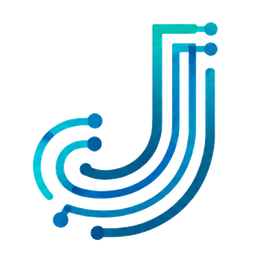
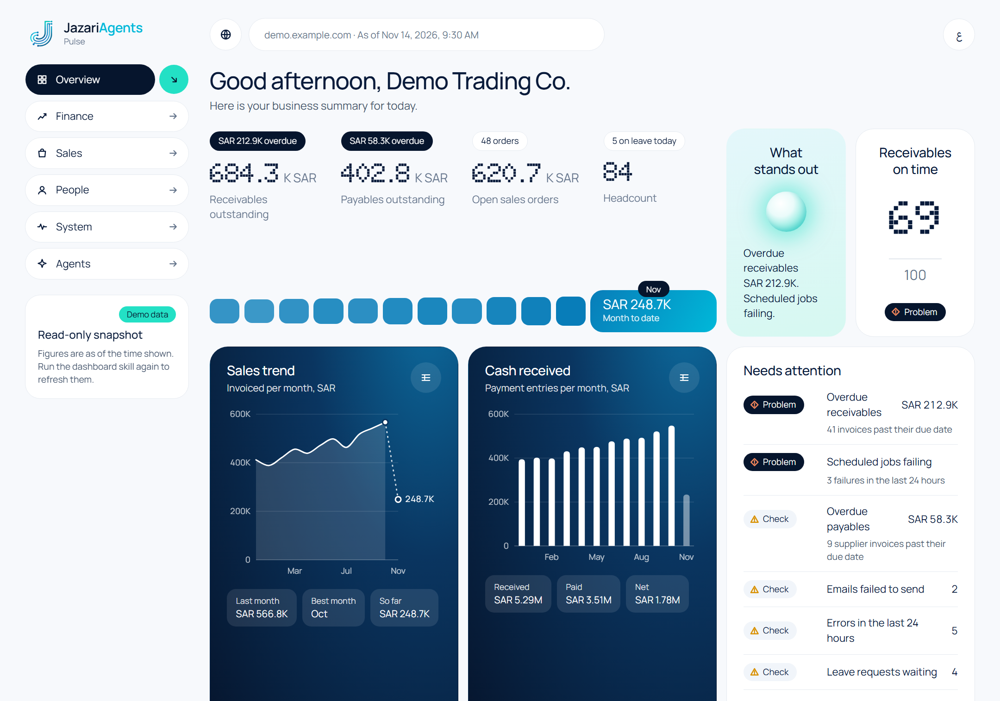

<p align="center">
  
</p>

<h1 align="center">Jazari Agents for Frappe &amp; ERPNext</h1>

<p align="center">
  Run ERPNext by chatting with Claude, in English or Arabic.<br>
  Nine specialist agents, 23 skills, a safety net before every change, and a one-page dashboard of your business.
</p>

<p align="center">
  <a href="#install">Install</a> ·
  <a href="#what-you-can-ask">What you can ask</a> ·
  <a href="#the-dashboard">Dashboard</a> ·
  <a href="#how-it-compares">How it compares</a> ·
  <a href="#status">Status</a> ·
  <a href="#بالعربية">بالعربية</a>
</p>

<p align="center">
  
</p>

A plugin for [Claude Code](https://claude.com/claude-code) and the Claude desktop app. It teaches Claude how
ERPNext and the other Frappe apps actually work, step by step, and makes it careful: it reads before it
writes, takes a snapshot before it changes anything, and tells you plainly what cannot be undone.

It is for two kinds of people:

- **New to ERPNext.** Say what you want in your own words ("raise an invoice for Al Waha", "who owes us
  money?"). The agent explains the terms as it goes and never leaves you at a dead end.
- **Already fluent.** Skip the clicking. Bulk imports, month-end, stock reconciliation, permissions and
  bench work, with a confirmation and an audit trail.

## Install

In Claude Code:

```
/plugin marketplace add JazariAgents/agents-for-frappe-erpnext
/plugin install jazari-frappe-erpnext@jazari-agents
```

Then say **"connect my ERPNext site"**.

Third-party marketplaces do not update themselves by default. To get new versions automatically, open
`/plugin`, go to **Marketplaces**, choose `jazari-agents` and turn on **auto-update**.

**You need** a site on Frappe v15 or v16 (v16.53 or later for the best connection) and Claude Code or the
Claude desktop app. The dashboard also needs Python 3.8 or later.

## Connecting to your site

The plugin uses Frappe's own tools first, so no password or key passes through the chat:

| Route | When it is used |
|---|---|
| **Frappe's built-in MCP server** | Site on v16.53 or later with MCP enabled. Sign-in happens in your browser. |
| **`frappectl`**, Frappe's command-line client | Claude can run shell commands. New profiles are read-only until you say otherwise. |
| **API key** | Older sites, or when neither of the above is available. The key stays in a local file. |
| **No connection** | Claude walks you through the screens instead. |

## The nine agents

| | Agent | Looks after |
|---|---|---|
|  | **Rukaz** | Setup and configuration |
|  | **Wafir** | Bulk import and migration |
|  | **Imran** | Building apps, DocTypes and customisation |
|  | **Dhukhr** | Inventory and stock |
|  | **Mizan** | Accounting, tax and reporting |
|  | **Zahir** | Marketing and website |
|  | **Hazim** | Sales operations and projects |
|  | **Anees** | Customers, support and people |
|  | **Urwah** | API, bench and automation |

They are skills, not separate programs: Claude picks the right one from what you ask.

## What you can ask

| Area | For example |
|---|---|
| Accounting | "Raise a sales invoice from this delivery note" · "Reconcile October's bank statement" · "Set up UAE VAT" |
| Selling and buying | "Turn this quotation into an order" · "Which purchase orders are still to receive?" |
| Stock and manufacturing | "Post a stock reconciliation for the main warehouse" · "Create a BOM for this item" |
| People | "Approve the pending leave requests" · "Run payroll for October" |
| CRM, Helpdesk, Learning, Lending | "Show me deals closing this month" · "Which tickets breached their SLA?" |
| Data | "Import these 400 items from the spreadsheet" (with a dry run first) |
| Administration | "Add a user who can only see sales" · "Back up the site" · "Why is the scheduler stopped?" |
| Building | "Create a DocType for equipment loans" · "Add a custom field to Sales Invoice" |
| Reports and dashboard | "How is the company doing?" · "Build my dashboard" |
| Undo | "What did you change today?" · "Put that back the way it was" |

The 1,607 pages of official Frappe documentation the skills rely on are bundled, so the agent reads
the real page instead of guessing.

## The safety net

Frappe's own AI tools check permissions, but by their documentation they do not ask before a change.
This plugin does:

- **Reads first.** It looks at the current record and the DocType's real fields before writing.
- **Snapshot before change.** A copy of what is about to change is saved to a local folder. No snapshot,
  no change.
- **Says what cannot be undone.** Settings roll back exactly. Deleted records come back as new records.
  Posted invoices, sent emails and payroll runs cannot be undone at all, and it says so before acting.
- **Confirms.** It states what will change and how many records, and waits for a clear yes. Anything over
  25 records stops for a count first.
- **Treats site data as data.** Text inside a record is never followed as an instruction.
- **Keeps a log.** Every request is written to a task log, and every change to an audit log.

These are instructions Claude follows, not locks in code. Keep production on a read-only `frappectl`
profile if you want a hard guarantee.

## The dashboard

Say **"build my dashboard"** and the plugin reads your site (read-only) and produces one self-contained
page with six screens: Overview, Finance, Sales, People, System and Agents.

- Sales and purchases invoiced, cash received and paid, receivables by age, the largest overdue invoices
- Open orders and quotations, top customers, new customers per month
- Headcount, attendance, leave and expense approvals, the last payroll run
- Scheduler status, errors per day, failed jobs, email queue, installed app versions
- What the agents themselves did: requests handled, records changed, and the share of changes that had a
  snapshot first

Every card prints where its number came from. A figure the site will not give says "Not available" and
why. English and Arabic, right to left. Try it without a site:

```bash
python plugins/jazari-frappe-erpnext/skills/frappe-dashboards/scripts/pulse.py demo --out pulse-demo.html
```

## How it compares

| | Claude alone | Claude + Frappe's MCP or `frappectl` | Claude + this plugin |
|---|---|---|---|
| Can read and change your site | No | Yes | Yes (through Frappe's tools) |
| Sign-in without pasting keys | n/a | Yes | Yes |
| Step-by-step ERPNext workflows | General knowledge | No | Yes |
| Asks before changing, snapshots, says what cannot be undone | No | No | Yes |
| Guidance for beginners | Generic | No | Yes |
| Arabic and English | Language only | No | Yes |
| Business dashboard | No | No | Yes |
| Maintained by Frappe, always current | n/a | Yes | No, see [Status](#status) |

Frappe's MCP server gives Claude hands. This plugin adds the know-how and the care. It is built to sit on
top of Frappe's tools, not to replace them.

## Status

This is an early public release, and it is honest about what that means:

- **Checked against documentation, not yet against a live site.** Every one of the 331 documented
  capabilities traces to an official Frappe page, and the dashboard's fields and methods were checked
  against the version-16 source. Nothing has yet been run end to end on a real ERPNext site. Expect rough
  edges, and please [open an issue](../../issues) when you find one.
- **Built on Frappe 16.32 and ERPNext 16.33** (August 2026), with the connection, dashboard and safety
  rules checked against 16.56 and 16.55 (November 2026). When you connect, the plugin compares itself
  with your site and tells you what has changed since.
- **Not yet covered:** Automation rules, the rebuilt BOM Creator, and a few labels renamed since August.
  [`compat.json`](plugins/jazari-frappe-erpnext/compat.json) lists them.

See the [changelog](CHANGELOG.md).

## بالعربية

إضافة لـ Claude تمكّنك من تشغيل ERPNext وتطبيقات Frappe بالمحادثة، بالعربية أو الإنجليزية. تسعة وكلاء
متخصصون (ركاز، وافر، عمران، ذخر، ميزان، زاهر، حازم، أنيس، عروة) يغطّون التأسيس والاستيراد الجماعي
والمحاسبة والمخزون والمبيعات والموارد البشرية والدعم والأتمتة.

قبل أي تغيير يأخذ الوكيل لقطة احتياطية، ويخبرك بوضوح بما لا يمكن التراجع عنه، وينتظر موافقتك. واطلب
«ابنِ لوحة المتابعة» لتحصل على صفحة واحدة تعرض المالية والمبيعات والموظفين وسلامة النظام من موقعك مباشرة.

التثبيت بالأمرين المذكورين في قسم [Install](#install) أعلاه، ثم قل: «اربط موقعي».

## Licence

[MIT](LICENSE). The pages in `plugins/jazari-frappe-erpnext/docs/` are copies of Frappe's documentation,
© Frappe Technologies and contributors, under CC BY-SA; see [NOTICE.md](NOTICE.md).

Frappe, ERPNext, Frappe HR, Frappe CRM and Frappe Helpdesk are trademarks of Frappe Technologies Pvt. Ltd.
This is an independent project and is not affiliated with or endorsed by Frappe.

Made by [Jazari Agents](https://jazariagents.com) · hello@jazariagents.com
