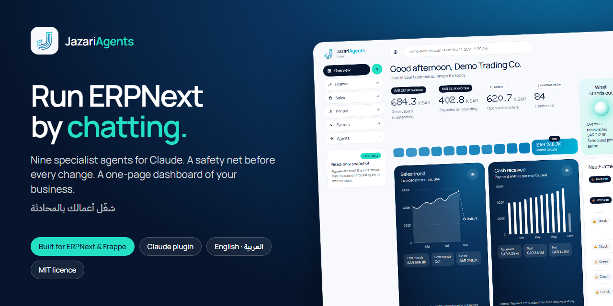
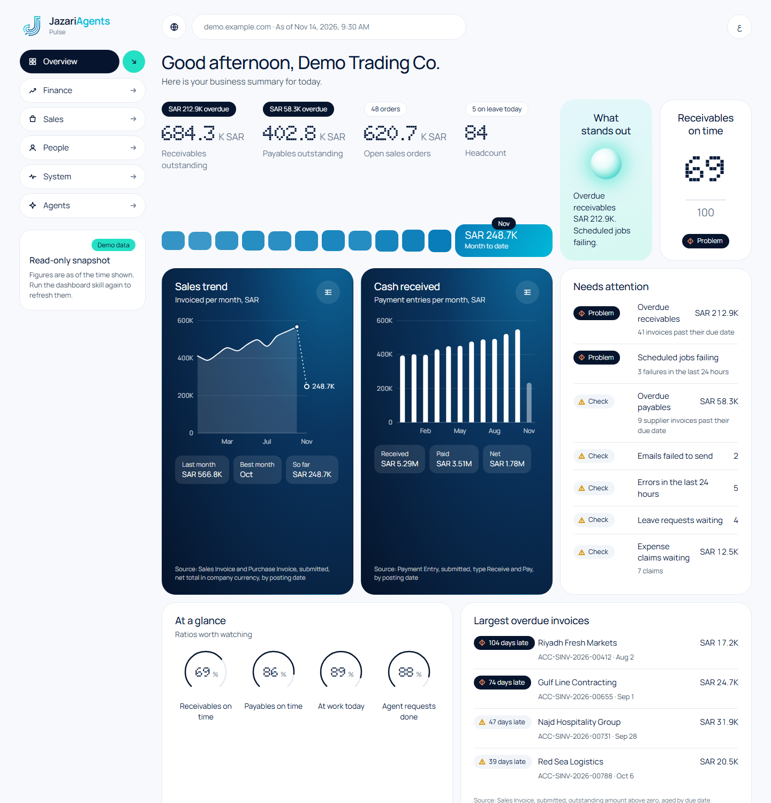
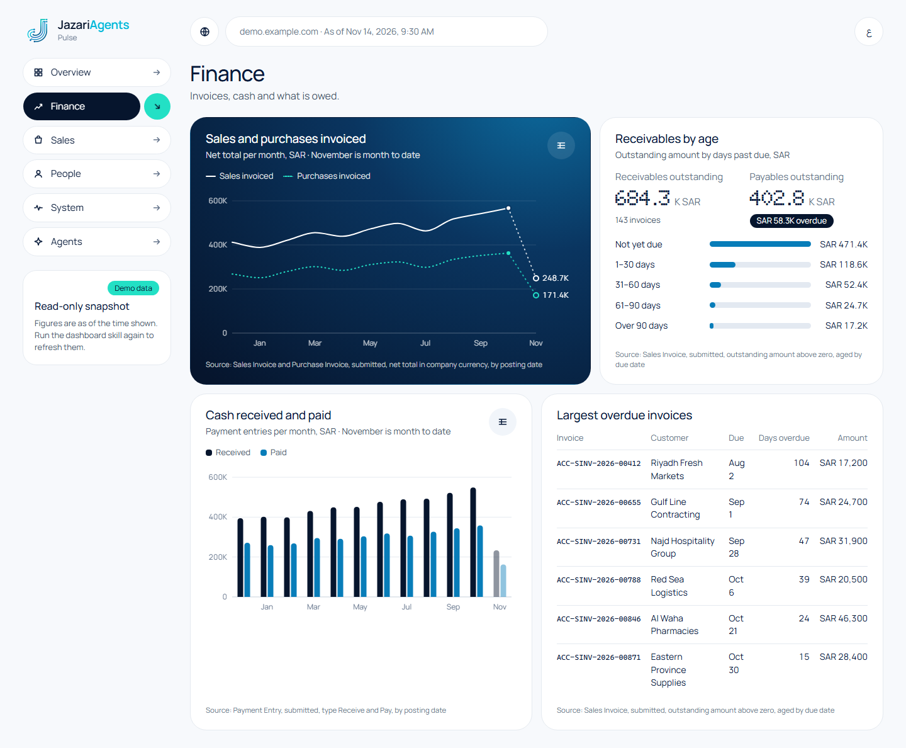
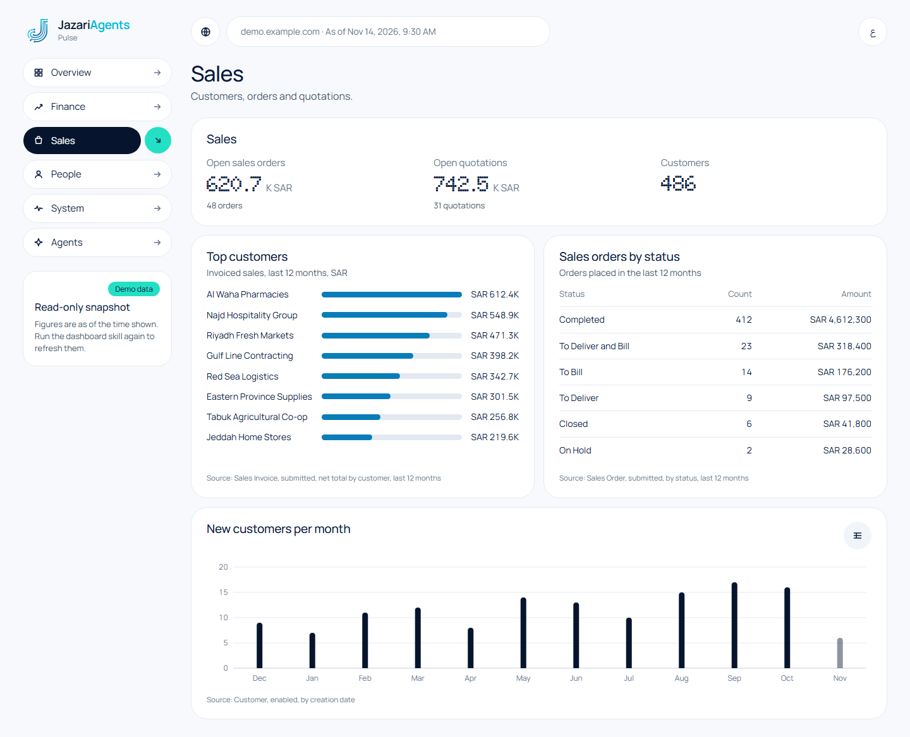
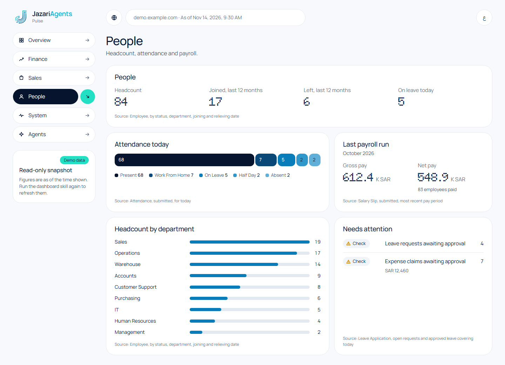
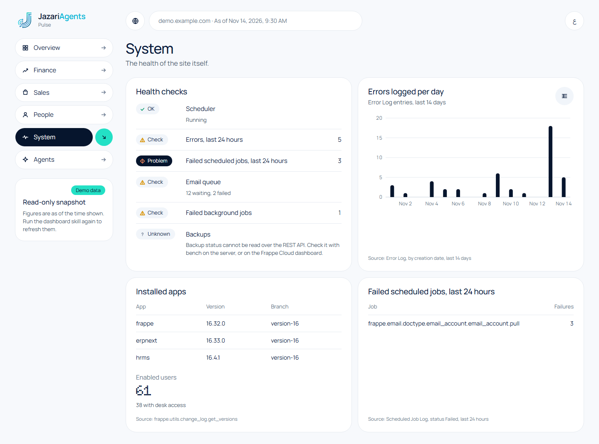
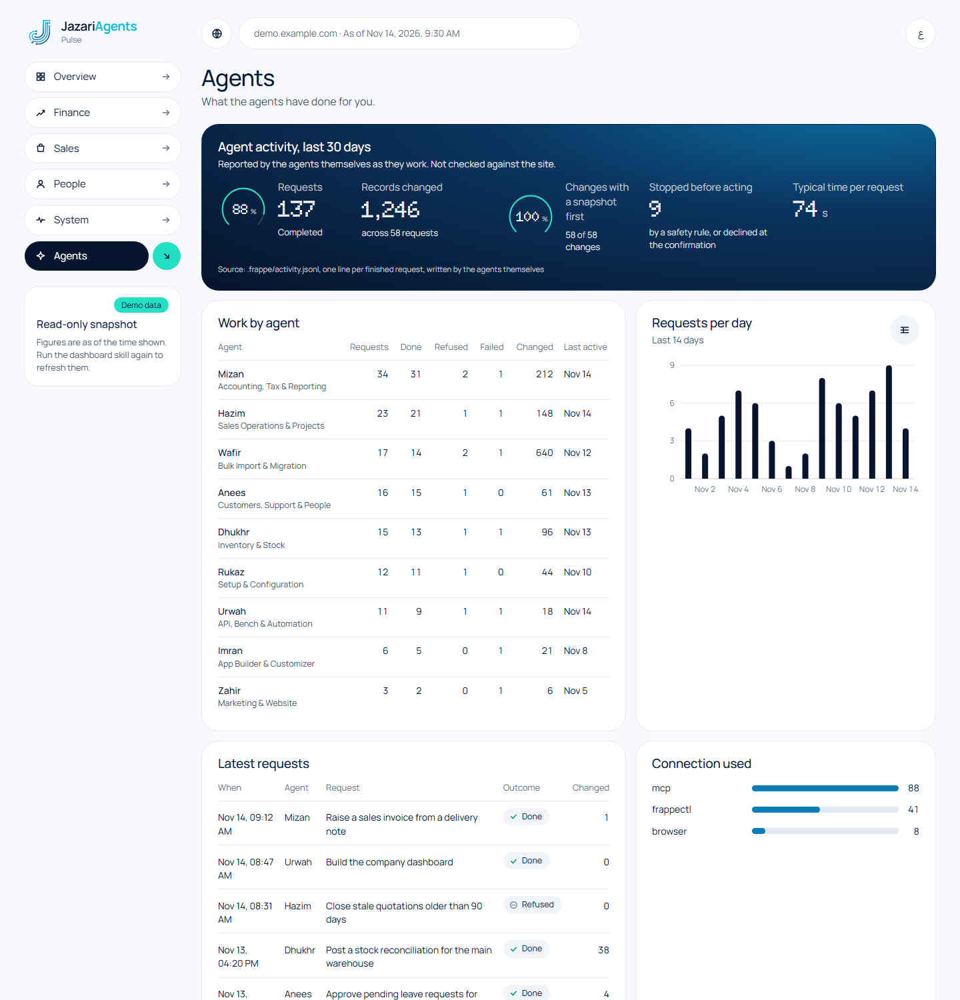
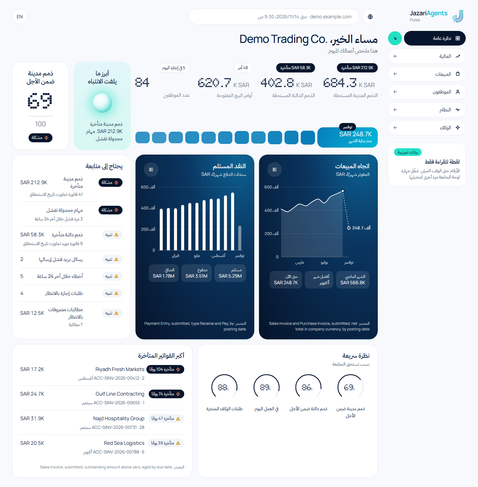

<p align="center">
  
</p>

<h1 align="center">Jazari Agents for Frappe &amp; ERPNext</h1>

<p align="center">
  <b>Talk to your ERP instead of clicking through it.</b><br>
  A Claude plugin with nine specialist agents that know how ERPNext really works,<br>
  ask before they change anything, and show you your business on one page.
</p>

<p align="center">
  
  
  
  
</p>

<p align="center">
  <a href="#install-in-two-minutes">Install</a> ·
  <a href="#your-first-five-minutes">First five minutes</a> ·
  <a href="#the-dashboard">Dashboard</a> ·
  <a href="#what-a-session-looks-like">A session</a> ·
  <a href="#how-it-compares">How it compares</a> ·
  <a href="#questions">Questions</a> ·
  <a href="#بالعربية">بالعربية</a>
</p>

---

## Why this exists

ERPNext can run a whole company, but every task is a different screen, a different form and a different
set of terms. Frappe now ships its own AI connection, which lets Claude reach your site. It does not teach
Claude accounting, and it leaves confirming each change to whoever is driving it.

This plugin adds the missing part:

- **Know-how.** 23 skills built from 1,612 pages of official Frappe documentation, bundled so the agent
  reads the real page instead of guessing.
- **Care.** It reads before it writes, takes a snapshot before every change, tells you what cannot be
  undone, and waits for a clear yes.
- **A view of the business.** One command turns your site into a six-screen dashboard.
- **Two languages.** Everything works in English and Arabic, right to left included.

It is made for two kinds of people. If you are **new to ERPNext**, say what you want in your own words and
the agent explains the terms as it goes. If you are **already fluent**, skip the clicking: bulk imports,
month-end, stock reconciliation and permissions, with a confirmation and an audit trail.

## The dashboard

Say **"build my dashboard"**. The plugin reads your site without changing anything and produces one
self-contained page.

<p align="center">
  
</p>

<table>
  <tr>
    <td width="50%"><p align="center"><b>Finance</b><br>Invoiced, cash in and out, receivables by age</p></td>
    <td width="50%"><p align="center"><b>Sales</b><br>Orders, quotations, top customers</p></td>
  </tr>
  <tr>
    <td><p align="center"><b>People</b><br>Headcount, attendance, payroll, approvals</p></td>
    <td><p align="center"><b>System</b><br>Scheduler, errors, failed jobs, app versions</p></td>
  </tr>
  <tr>
    <td><p align="center"><b>Agents</b><br>What the agents did, and whether they took a snapshot first</p></td>
    <td><p align="center"><b>العربية</b><br>The same page in Arabic, right to left</p></td>
  </tr>
</table>

- Every card prints where its number came from.
- A figure the site will not give says "Not available" and why, instead of showing a guess.
- The unfinished month is drawn apart from the trend, so it never looks like a crash.
- It is a snapshot as of the time in its header. Ask for it again to refresh it.

The screenshots show the bundled demo data. See it yourself without a site:

```bash
python plugins/jazari-frappe-erpnext/skills/frappe-dashboards/scripts/pulse.py demo --out pulse-demo.html
```

## Install in two minutes

You need [Claude Code](https://claude.com/claude-code) and a site on Frappe v15 or v16.

**1. Add the marketplace.** In Claude Code, type:

```
/plugin marketplace add JazariAgents/agents-for-frappe-erpnext
```

**2. Install the plugin.**

```
/plugin install jazari-frappe-erpnext@jazari-agents
```

**3. Connect your site.** Start a new session and say:

```
connect my ERPNext site
```

The agent asks which language you want, then finds the safest way to connect. You never type a password
into the chat.

**4. Keep it current (recommended).** Frappe releases about once a week, so turn on updates once: type `/plugin`,
open **Marketplaces**, choose `jazari-agents`, and select **Enable auto-update**.

<details>
<summary><b>How it connects to your site</b></summary>

<br>

It tries Frappe's own tools first, in this order:

| Route | When it is used | What you do |
|---|---|---|
| **Frappe's built-in MCP server** | Site on v16.53 or later, with MCP enabled | Add `https://your-site/api/v2/mcp` as a connector and sign in in your browser |
| **`frappectl`**, Frappe's command-line client | Claude can run shell commands | `pip install frappectl`, then `frappectl auth login https://your-site --oauth` |
| **API key** | Older sites, or neither of the above | Paste the key into a local file the agent creates for you |
| **No connection** | You would rather not connect anything | The agent walks you through the screens instead |

New `frappectl` profiles are read-only until you decide otherwise, which is the safest way to try the
plugin on a production site.

</details>

<details>
<summary><b>The dashboard needs one more thing</b></summary>

<br>

Python 3.8 or later, and either a `frappectl` profile or an API key. The page loads three typefaces from
Google Fonts when you open it; everything else is inside the file.

</details>

## Your first five minutes

Try these in order. None of the first three changes anything on your site.

| Say this | What happens |
|---|---|
| `connect my ERPNext site` | Sets the language, connects, and tells you which version and apps you run |
| `who owes us money?` | Lists unpaid invoices by age, largest first |
| `build my dashboard` | Reads the site and gives you the six-screen page above |
| `raise a sales invoice for <customer>` | Shows what it will create, takes a snapshot, and waits for your yes |
| `what did you change today?` | Reads back its own log, with the snapshot for each change |
| `put that back the way it was` | Restores from the snapshot, or tells you plainly if it cannot |

## What a session looks like

An illustration of the flow the skills are written to follow. Your wording will differ.

> **You:** Raise a sales invoice for Al Waha Pharmacies for the delivery we made yesterday.
>
> **Mizan (accounting):** I found delivery note MAT-DN-2026-00412 for Al Waha Pharmacies, 3 items,
> SAR 46,300. I will create a sales invoice from it and submit it.
>
> Before I do: **a submitted invoice posts to the ledger and cannot be edited.** If it turns out wrong, the
> fix is a credit note, not an undo. I have saved a snapshot of the delivery note as it is now.
>
> This is your **production** site. Shall I go ahead?
>
> **You:** Yes.
>
> **Mizan:** Done. Sales invoice ACC-SINV-2026-00846 is submitted for SAR 46,300, due 21 November. I read
> it back from the site and it matches. Logged, with the snapshot reference.

## The nine agents

They are skills, not separate programs: Claude picks the right one from what you ask.

<table>
  <tr>
    <td align="center" width="11%"><br><b>Rukaz</b><br><sub>Setup</sub></td>
    <td align="center" width="11%"><br><b>Wafir</b><br><sub>Bulk import</sub></td>
    <td align="center" width="11%"><br><b>Imran</b><br><sub>Building apps</sub></td>
    <td align="center" width="11%"><br><b>Dhukhr</b><br><sub>Stock</sub></td>
    <td align="center" width="11%"><br><b>Mizan</b><br><sub>Accounting</sub></td>
    <td align="center" width="11%"><br><b>Zahir</b><br><sub>Marketing</sub></td>
    <td align="center" width="11%"><br><b>Hazim</b><br><sub>Sales and projects</sub></td>
    <td align="center" width="11%"><br><b>Anees</b><br><sub>Customers and people</sub></td>
    <td align="center" width="11%"><br><b>Urwah</b><br><sub>API and bench</sub></td>
  </tr>
</table>

| Area | You can ask |
|---|---|
| Accounting | "Reconcile October's bank statement" · "Set up UAE VAT" · "Close the month" |
| Selling and buying | "Turn this quotation into an order" · "Which purchase orders are still to receive?" |
| Stock and manufacturing | "Post a stock reconciliation for the main warehouse" · "Create a BOM for this item" |
| People | "Approve the pending leave requests" · "Run payroll for October" |
| CRM, Helpdesk, Learning, Lending | "Show me deals closing this month" · "Which tickets breached their SLA?" |
| Data | "Import these 400 items from the spreadsheet" (with a dry run first) |
| Administration | "Add a user who can only see sales" · "Back up the site" · "Why is the scheduler stopped?" |
| Building | "Create a DocType for equipment loans" · "Add a custom field to Sales Invoice" |

## The safety net

- **Reads first.** It looks at the current record and the DocType's real fields before writing.
- **Snapshot before change.** A copy of what is about to change is saved to a local folder. No snapshot,
  no change.
- **Says what cannot be undone.** Settings roll back exactly. Deleted records come back as new records.
  Posted invoices, sent emails and payroll runs cannot be undone at all, and it says so before acting.
- **Confirms.** It states what will change and how many records. Anything over 25 records stops for a
  count first.
- **Treats site data as data.** Text inside a record is never followed as an instruction.
- **Keeps a log.** Every request goes to a task log, every change to an audit log.

These are instructions Claude follows, not locks in code. For a hard guarantee on a production site, connect
with a read-only `frappectl` profile: it stops write requests on your machine before they are sent.

## How it compares

| | Claude alone | Claude + Frappe's MCP or `frappectl` | Claude + this plugin |
|---|:---:|:---:|:---:|
| Can read and change your site | — | ✓ | ✓ |
| Sign-in without pasting keys | — | ✓ | ✓ |
| Step-by-step ERPNext workflows | General knowledge | — | ✓ |
| Asks first, snapshots, says what cannot be undone | — | — | ✓ |
| Guidance for beginners | Generic | — | ✓ |
| Arabic and English | Language only | — | ✓ |
| Business dashboard | — | — | ✓ |
| Maintained by Frappe, always current | — | ✓ | Not yet, see below |

Frappe's tools give Claude hands. This plugin adds the know-how and the care. It is built to sit on top of
them, not to replace them.

## Where it stands

This is an early public release, and it is honest about what that means.

**Run on a real site** (ERPNext 16.55 on Frappe 16.56, 14 November 2026):

- **The dashboard.** Every figure was compared with the site's database and matched. It was also run with
  a user who lacks permissions, a wrong key and a blocked address, to check that it explains instead of
  failing.
- **The API calls all 22 skills share**: read, list, page, create, update, delete, submit, cancel and the
  error replies. 27 of 27 behaved as written.
- **Frappe's built-in MCP server.** All 13 tools the plugin expects are there and answer.
- **Eight standard reports** run through the API, including grouping by cost center.
- **An Automation Flow** was built, test-run, switched on and seen to fire.
- **`frappectl`**, Frappe's own command-line tool (v0.24.0). The dashboard gave the same figures through it
  as through an API key, and its read-only sign-in refused every change, as it should.

**Not yet run on a real site:**

- Each of the 335 walkthroughs, one by one. They trace to Frappe's official pages; where your site
  disagrees with a step, the agent says so instead of improvising.
- Frappe HR, CRM, Helpdesk, Insights, Lending and Learning. The test site had Frappe and ERPNext only.
- Frappe Cloud's dashboard, bench on a production server, and version 15 sites.

**Versions.** The reference pages are from Frappe 16.32 and ERPNext 16.33 (August 2026), plus five newer
pages. All 13 changes between those versions and 16.56 / 16.55 are covered; see
[`compat.json`](plugins/jazari-frappe-erpnext/compat.json). When you connect, the plugin compares itself
with your site and tells you what has changed since.

Expect rough edges, and please [open an issue](../../issues) when you find one.

The [changelog](CHANGELOG.md) has the details.

## Questions

**Is it free?** Yes, under the MIT licence. You need your own Claude subscription and your own ERPNext site.

**Does my data go to Jazari Agents?** No. Snapshots, logs and the dashboard stay in a folder on your
machine. The conversation itself goes to Claude, as with anything you ask it. See [SECURITY.md](SECURITY.md).

**Will it work on Frappe Cloud?** It talks to your site over Frappe's standard API, so where the site is
hosted should not matter. It has not been tested on Frappe Cloud yet.

**Does it work on version 15?** Partly. You connect with an API key, because Frappe's MCP server and
`frappectl` need v16. The step-by-step pages were written from version 16 documentation, so some menus and
labels will differ; the plugin tells you so when you connect.

**Can it break my books?** It is written to make that hard: it confirms, snapshots, and refuses to call a
posted document reversible. It is still software following instructions. Try it on a test site first, and
keep production read-only until you trust it.

**I found a mistake.** Please [open an issue](../../issues). Say which Frappe and ERPNext versions you run;
the plugin tells you when you connect.

## بالعربية

**شغّل ERPNext بالمحادثة.** إضافة لـ Claude فيها تسعة وكلاء متخصصين (ركاز، وافر، عمران، ذخر، ميزان، زاهر،
حازم، أنيس، عروة) يغطّون التأسيس والاستيراد الجماعي والمحاسبة والمخزون والمبيعات والموارد البشرية والدعم
والأتمتة.

- قبل أي تغيير يأخذ الوكيل لقطة احتياطية، ويخبرك بوضوح بما لا يمكن التراجع عنه، وينتظر موافقتك.
- قل «ابنِ لوحة المتابعة» لتحصل على صفحة واحدة تعرض المالية والمبيعات والموظفين وسلامة النظام من موقعك.
- كل شيء يعمل بالعربية، ومن اليمين إلى اليسار.

**التثبيت:** نفّذ الأمرين في قسم [Install](#install-in-two-minutes) أعلاه، ثم قل: «اربط موقعي».

## Licence

[MIT](LICENSE). The pages in `plugins/jazari-frappe-erpnext/docs/` are copies of Frappe's documentation,
© Frappe Technologies and contributors, under CC BY-SA; see [NOTICE.md](NOTICE.md).

Frappe, ERPNext, Frappe HR, Frappe CRM and Frappe Helpdesk are trademarks of Frappe Technologies Pvt. Ltd.
This is an independent project and is not affiliated with or endorsed by Frappe.

<p align="center">
  <br>
  Made by <a href="https://jazariagents.com">Jazari Agents</a> · hello@jazariagents.com
</p>
