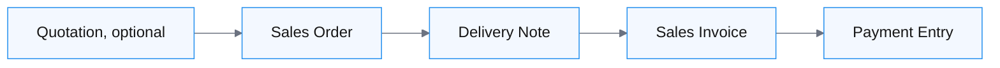
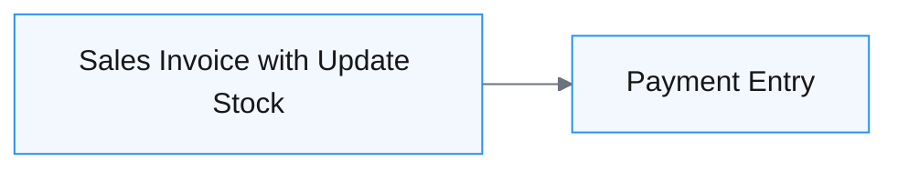
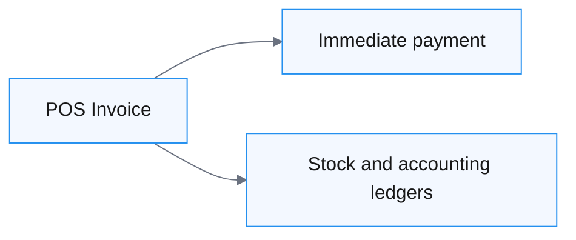
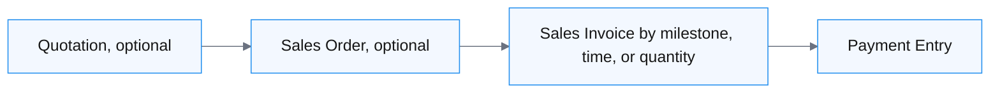
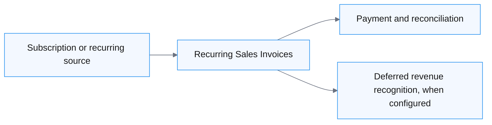
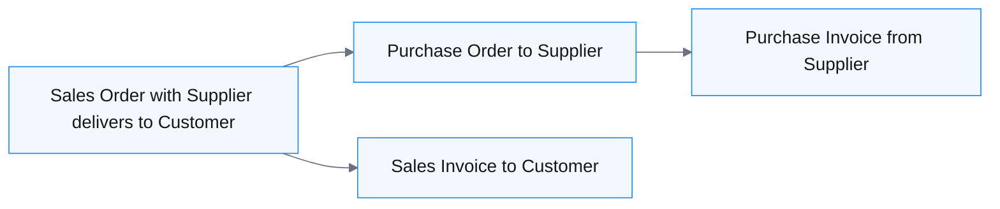
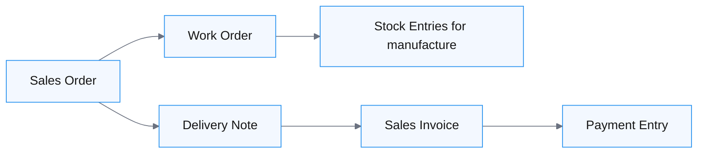
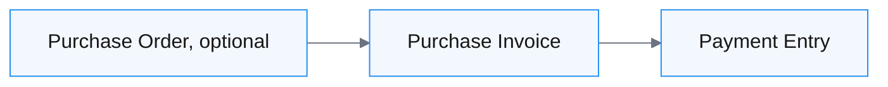
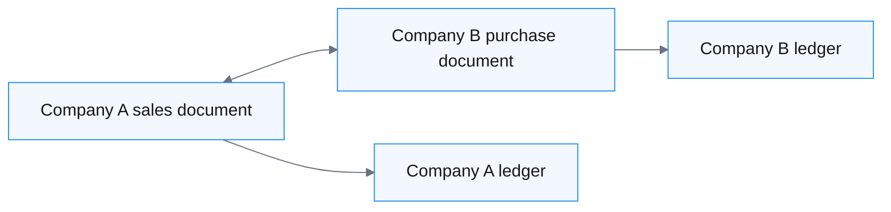

<!-- Frappe documentation: erpnext, part 1 of 18. Index: docs/INDEX.md -->

<!-- page: erpnext/erpnext__2-step-301-redirect-in-your-erpnext-website.md -->
---
title: "2 Step 301 Redirect in your ERPNext Website"
space: "ERPNext"
url: "https://docs.frappe.io/erpnext/2-step-301-redirect-in-your-erpnext-website"
updated: "2026-03-04"
---

  
**What is 301 Redirect?**  
A **301 Redirect** is used to make sure that search engines and users are sent to the correct page. A 301 status code is used when any page has been permanently moved to another location. Users will now see the new URL as it has replaced the old page.  
**2 Step 301 Redirects with ERPNext:**  
**Step 1:** Open Website Settings via the awesome bar (Global Search Bar) and expand the heading, "Redirects"  
  
**Step 2:** Enter the old URL in Source and the new URL in Target and save the document.  
  
**Watch the Redirect in action:**  
  
  


<!-- page: erpnext/erpnext__access-log.md -->
---
title: "Access Log\n"
space: "ERPNext"
url: "https://docs.frappe.io/erpnext/access-log"
updated: "2026-03-04"
---


> Introduced in Version 13

**Access Log is a security feature that logs all data exports by all users in the system.**

It is a tool for System Managers to track which files were accessed or exported by users on the system. This is useful for tracking your company's sensitive information like transactions or financials.

Access logs are created in the following events:

 - Printing of all Forms and Reports
 - Private file downloading
 - Exporting via XLSX/CSV formats

In ERPNext, Access Log is available to System Managers, it can be accessed using the Global Search or through:

> Home > Users and Permissions > Logs > Access Log


In case an access log is created on the event of exporting a Report, a **Show Report** button will be generated in the respective log. On clicking this button, the exported report can be viewed along with the set filters.


Similarly, a **Show Document** button is generated in case of events related to documents directly such as document Printing and Private File download.


Events such as [Raw Printing](/erpnext/raw-printing) save information along with the chosen template for the document.


<!-- page: erpnext/erpnext__accounting-dimension-filter.md -->
---
title: "Accounting Dimensions Filters\n"
space: "ERPNext"
url: "https://docs.frappe.io/erpnext/accounting-dimension-filter"
updated: "2026-08-14"
---

Imagine Apple pays $1,000 to advertise the iPhone. The company wants its reports to show two simple facts: the money was spent on the **iPhone** product and by the **Marketing** department.


While entering the expense, someone accidentally selects **Mac** and **Engineering**. The payment amount is still correct, so the accounts balance. However, Apple's reports now tell the wrong story. They say the Mac engineering team spent $1,000, even though the money was used to advertise the iPhone.


An Accounting Dimension Filter prevents this mistake. Apple can create a rule that says, “When this iPhone advertising account is used, select the iPhone product and an allowed department.” If someone chooses an incorrect value, ERPNext stops the transaction before it is submitted.


This means the employee does not need to remember every accounting rule. ERPNext guides them while they enter the transaction. At the end of the month, the finance team can trust that the iPhone and Marketing reports include the correct $1,000 expense.


[Accounting Dimensions](/erpnext/accounting-dimensions) record which product and department received or spent the money. Accounting Dimension Filters make sure users choose values that are allowed for the account. This Apple story is only an easy example, not a description of Apple's real accounting system.


In the working example below, Nova Electronics Trading records revenue by department. The Sales - NET account must use the Sales department. The filter places this rule inside ERPNext, so users do not have to remember it for every invoice or journal entry.

## Before you begin

Create and enable the required Accounting Dimension first. Also create the dimension values that users will select, such as Sales, Service, or Operations.


Confirm which ledger accounts need control. A filter can apply to one or more accounts and can either allow selected values or restrict selected values.

## Create an Accounting Dimension Filter

Open the Accounting Dimension Filter list and select **Add Accounting Dimension Filter**.


Select the **Accounting Dimension** and **Company**. Enable **Apply restriction on dimension values**, then choose how ERPNext should interpret the values:

- **Allow**: only the values listed in the filter can be used with the selected accounts.
- **Restrict**: the values listed in the filter cannot be used with the selected accounts.

Use **Allow** when the permitted list is short and stable. Use **Restrict** when most values are valid and only a few combinations must be blocked.


### Select the accounts

In **Applicable On Account**, add every account to which the rule applies. Select **Is Mandatory** when the dimension must always be supplied for postings to that account.


In this example, Sales - NET is mandatory. Any transaction that posts to this income account must carry an accepted Department value.


### Select the dimension values

In **Applicable Dimension**, add the values that ERPNext should allow or restrict. The meaning of this list depends on the choice made in **Allow Or Restrict Dimension**.


Save the filter. Accounting Dimension Filters are configuration records, so they do not require submission.


## How the filter works in transactions

When a transaction line uses an account covered by the filter, ERPNext checks its dimension value. With an Allow rule, values outside the permitted list are rejected. With a Restrict rule, values in the restricted list are rejected.


If **Is Mandatory** is selected, ERPNext also prevents submission when the dimension is blank. This check applies at the accounting line level, which matters for documents containing several income, expense, asset, or liability accounts.


The filter does not change the amount, tax, stock movement, or posting account. It validates the accounting classification attached to the posting.

## Important fields and what they mean


| Field                                 | What it controls                                                             |
| ------------------------------------- | ---------------------------------------------------------------------------- |
| Accounting Dimension                  | The dimension whose values are checked, such as Department or Business Unit. |
| Company                               | The company in which the rule applies.                                       |
| Disabled                              | Temporarily stops the filter without deleting it.                            |
| Apply restriction on dimension values | Enables value-level allow or restrict rules.                                 |
| Allow Or Restrict Dimension           | Determines whether listed values are permitted or blocked.                   |
| Accounts                              | The ledger accounts checked by the rule.                                     |
| Is Mandatory                          | Requires a dimension value whenever the account is used.                     |
| Dimensions                            | The allowed or restricted dimension values.                                  |


## Design filters that remain manageable

Start with rules that protect important reporting boundaries. Income and expense accounts are common candidates because missing or incorrect dimensions can distort departmental profit and loss reports.


Avoid creating many overlapping filters for the same account until the expected result is clear. Test each rule using a draft transaction before rolling it out to a large user group. Document why the combination is controlled so finance administrators can maintain it later.


If a valid business combination changes, update the filter before users post the new type of transaction. Disabling the filter removes the validation, so use that option only as a temporary, deliberate exception.

## Troubleshooting

### ERPNext says the dimension is mandatory

The transaction uses an account whose filter has **Is Mandatory** enabled. Enter an allowed dimension value on the affected accounting line.

### A valid value is not available

Check whether the filter uses Allow or Restrict, whether the correct company is selected, and whether the value exists in the Applicable Dimension table. Also confirm that the Accounting Dimension and its value are enabled.

### The filter appears to have no effect

Confirm that the transaction actually posts to an account listed in the filter. Also check that the filter is not disabled and that value restrictions are enabled.

## Frequently asked questions

### Does a filter change existing ledger entries?

It validates new or amended transactions. Existing submitted ledger entries remain unchanged.

### Can I create different rules for different companies?

Each filter is company-specific, which lets a multi-company setup use different accounting controls.

### Should I use Allow or Restrict?

Use Allow when only a small set of values is correct. Use Restrict when most values are acceptable and only known exceptions must be blocked.

### Can the dimension be optional for one account and mandatory for another?

The Is Mandatory setting is stored on each account row, so the requirement can vary by account.

## Related topics

- [Accounting Dimensions](/erpnext/accounting-dimensions)
- [Cost Center](/erpnext/cost-center)
- [General Ledger](/erpnext/general-ledger)
- [Journal Entry](/erpnext/journal-entry)
- [Sales Invoice](/erpnext/sales-invoice)
- [Budget](/erpnext/budgeting)

<!-- page: erpnext/erpnext__accounting-dimensions.md -->
---
title: "Accounting Dimensions | ERPNext Documentation"
description: "Create and use ERPNext Accounting Dimensions to tag transactions, enforce segment rules, and filter financial reports by department or business unit."
space: "ERPNext"
url: "https://docs.frappe.io/erpnext/accounting-dimensions"
updated: "2026-08-14"
---

Imagine Apple wants to understand whether iPhone, Mac, or Services contributes the most profit, and whether the Americas, Europe, or Greater China performs best. Creating separate Sales, Travel Expense, Bank, and Receivable accounts for every product and region would make its [Chart of Accounts](/erpnext/chart-of-accounts) enormous and difficult to maintain.


Accounting Dimensions solve this by adding business context to the same accounting entry. Apple could tag a sale with Product Line = iPhone and Region = Americas, then filter financial reports by either dimension without duplicating ledger accounts. This is an illustrative example of how a large multi-product company could use dimensions, not a claim about Apple's internal accounting system.


The account tells Apple what happened, such as a sale or an advertising expense. The dimensions tell Apple which product and region it belonged to. This lets one clean set of accounts answer many management questions.


ERPNext already treats [Cost Center](/erpnext/cost-center) and [Project](/erpnext/project) as dimensions. Create a configurable Accounting Dimension when you need an additional segment. In the working example below, Nova Electronics Trading uses **Department** to compare Sales, Operations, and other teams while keeping one clean set of income, expense, asset, and liability accounts.

## Before you begin

Create the records that will supply the dimension values first. An Accounting Dimension must reference a DocType, so a Department dimension uses existing [Department](/hr/department) records. For a new concept such as Product Line, create and populate an appropriate custom DocType before configuring the dimension.


You need the Accounts Manager or System Manager role. Decide whether the dimension is only for analysis or must be entered on every Profit and Loss or Balance Sheet posting. Mandatory settings affect transaction submission, so test them with representative invoices, payments, and journals before enabling them for daily users.

## Create an Accounting Dimension

1. Open the Accounting Dimension list and select **Add Accounting Dimension**.
2. Select the **Reference Document Type**. ERPNext uses records from this DocType as the available dimension values.
3. Confirm the **Dimension Name**, then save. ERPNext creates the corresponding fields on accounting transactions and supported reports.


## Set a company default and mandatory rules

Use the **Dimension Defaults** child table when different companies need different defaults or validation rules. Select the highlighted pencil icon to open the complete row editor.


For Nova Electronics Trading, **Sales - NET** is the default Department. The dimension is mandatory for Profit and Loss accounts, which helps prevent untagged income and expense postings. It is not mandatory for Balance Sheet accounts in this example.


## Important fields and what they mean


| Field                                         | What it controls                                                                                                                                          |
| --------------------------------------------- | --------------------------------------------------------------------------------------------------------------------------------------------------------- |
| Reference Document Type                       | The DocType whose records become selectable dimension values. This cannot be changed after the dimension is created.                                      |
| Dimension Name                                | The label shown on transactions and report filters. ERPNext derives the generated field name from this value.                                             |
| Company                                       | The company to which a defaults-table row applies. Add separate rows when companies need different defaults or mandatory rules.                           |
| Default Dimension                             | The value ERPNext fetches automatically for the selected company. Users can change it when their role and the transaction permit it.                      |
| Mandatory for Profit and Loss Account         | Requires a dimension for postings to Income and Expense accounts.                                                                                         |
| Mandatory for Balance Sheet                   | Requires a dimension for postings to Asset, Liability, and Equity accounts.                                                                               |
| Automatically post balancing accounting entry | Uses the selected offsetting account to keep entries balanced by dimension. Enable this only after your accounting team validates the intended treatment. |
| Offsetting Account                            | The Asset or Liability ledger used for automatically generated balancing entries.                                                                         |


## Use dimensions in transactions

After the background field-creation job finishes, the new dimension appears in the Accounting Dimensions section of supported transactions such as a [Sales Invoice](/erpnext/sales-invoice), [Purchase Invoice](/erpnext/purchase-invoice), [Payment Entry](/erpnext/payment-entry), and [Journal Entry](/erpnext/journal-entry). Choose the value that describes the transaction before submitting it.


Where ERPNext exposes the dimension on item or accounting rows, use row-level values when one document belongs to multiple departments or segments. A document-level value is convenient when the complete transaction belongs to one segment. Review the generated [General Ledger](/erpnext/general-ledger) entries after submission to confirm that the dimension reached the intended debit and credit lines.

## Filter accounting reports by a dimension

The generated dimension becomes a filter on supported reports. Select Department in the General Ledger to inspect detailed postings, or use it on the [Profit and Loss Statement](/erpnext/profit-and-loss-statement) and [Balance Sheet](/erpnext/balance-sheet) to analyse a segment. Report results only include entries that were posted with that dimension value.


Accounting Dimensions do not retroactively tag older transactions. If earlier entries have no Department value, selecting a Department filter will exclude them. Treat dimension rollout as a controlled accounting change and decide how your team will handle historical comparisons.

## Disable an Accounting Dimension

Open the dimension and select **Disable** when it is no longer needed. Existing transaction and ledger values remain intact, so historical reports retain their tags. Refresh the browser after disabling if the generated field remains visible on a form.


Prefer disabling to deleting. The dimension is part of posted accounting history and may be referenced by reports or validations.

## Troubleshooting

### The new dimension does not appear on transactions

Field creation runs in the background. Wait for queued jobs to finish, reload the browser, and confirm that the dimension is enabled. If it is still missing, ask an administrator to review failed background jobs and the generated Custom Fields.

### A transaction says the dimension is mandatory

Open each accounting or item row that posts to the affected account type and provide the dimension value. A header value may not replace a missing row-level value when different rows can carry different dimensions.

### A filtered report is empty or incomplete

Confirm the company, date range, and dimension filter. Then inspect the source voucher and its General Ledger entries. Transactions created before the dimension was introduced, or entries saved without a dimension when it was optional, will not appear under that value.

## Frequently asked questions

### Should I create a new ledger account for each department instead?

Usually no. Keep accounts for the economic nature of the posting, such as Sales or Travel Expense, and use dimensions for the responsible department or segment. This avoids an oversized Chart of Accounts while preserving analysis.

### Can one invoice use more than one dimension value?

One invoice can use multiple values when the transaction exposes the dimension on item or accounting rows. Assign the appropriate value to each row and verify the resulting General Ledger entries.

### Will a new dimension classify old transactions automatically?

The generated field does not classify old transactions automatically. It applies to future edits and postings. Existing ledger entries remain unchanged, so plan the effective date and historical reporting approach before rollout.

### Why is a disabled dimension still visible?

Reload the browser after disabling it. If the field remains after a clean reload, confirm that the dimension is actually disabled and review current-version behavior with your administrator before changing generated Custom Fields manually.

### Can I make the dimension mandatory only for income and expenses?

Enable **Mandatory for Profit and Loss Account** and leave the Balance Sheet option cleared. ERPNext then validates postings according to the account type.

## Related topics

- [Accounting Dimensions Filters](/erpnext/accounting-dimensions-filters)
- [Cost Center](/erpnext/cost-center)
- [Budget](/erpnext/budget)
- [Accounting Reports](/erpnext/accounting-reports)

<!-- page: erpnext/erpnext__accounting-entries.md -->
---
title: "Accounting Entries | ERPNext Documentation"
description: "Learn how common ERPNext transactions create balanced debit and credit entries, from owner funding and purchases to sales, expenses, payments, and closing."
space: "ERPNext"
url: "https://docs.frappe.io/erpnext/accounting-entries"
updated: "2026-08-03"
---

Every submitted accounting transaction in ERPNext creates balanced debit and credit entries in the [General Ledger](https://docs.frappe.io/erpnext/general-ledger). You normally do not post those lines yourself. You create the business document, such as a Sales Invoice or Payment Entry, and ERPNext uses its accounts and amounts to create the ledger effect.


This page follows one small business from owner funding to purchasing, selling, paying expenses, and closing a period. The examples explain the accounting logic behind the documents without requiring you to memorize journal-entry rules.

## Before you begin

Set up the company's [Chart of Accounts](https://docs.frappe.io/erpnext/chart-of-accounts), default receivable and payable accounts, bank or cash accounts, stock accounts, income accounts, and expense accounts. Configure items and warehouses when you keep perpetual inventory.


Use the company's accounting currency consistently in these examples. Multi-currency transactions add exchange-rate and exchange-gain-or-loss entries, but the debit and credit principles remain the same.

## Understand debit and credit

A debit is not automatically good or bad, and a credit does not necessarily mean money received. They are the two sides of a balanced accounting entry.


| Account type | Increase is normally recorded as | Decrease is normally recorded as | Common examples                                           |
| ------------ | -------------------------------- | -------------------------------- | --------------------------------------------------------- |
| Asset        | Debit                            | Credit                           | Bank, Cash, Accounts Receivable, Stock in Hand, Equipment |
| Expense      | Debit                            | Credit                           | Rent, Salaries, Cost of Goods Sold                        |
| Liability    | Credit                           | Debit                            | Accounts Payable, Loans, Tax Payable                      |
| Equity       | Credit                           | Debit                            | Capital Stock, Retained Earnings                          |
| Income       | Credit                           | Debit                            | Sales, Service Income                                     |


Every posting must balance: total debits equal total credits. ERPNext validates this before a posting document can be submitted.

## 1. Record the owner's investment

Suppose the owner invests $25,000 in Nova Electronics Trading. The company now has $25,000 more in its bank, and the owner's equity in the business increases by the same amount.


| Account             | Debit   | Credit  | Why                                 |
| ------------------- | -------: | -------: | ----------------------------------- |
| Nova Operating Bank | $25,000 |         | The company's bank asset increases. |
| Capital Stock       |         | $25,000 | The owner's equity increases.       |


Record this with a [Journal Entry](https://docs.frappe.io/erpnext/journal-entry) because it is owner funding, not a customer or supplier payment against an invoice.


After submission, **View &gt; Ledger** shows the two balanced General Ledger lines.


## 2. Buy equipment and inventory

Assume Nova buys equipment for $2,800 and phone inventory for $2,200. It pays $2,000 immediately and owes the supplier $3,000.

The purchase increases assets:


| Account          | Debit  | Credit |
| ---------------- | ------: | ------: |
| Equipment        | $2,800 |        |
| Stock in Hand    | $2,200 |        |
| Bank             |        | $2,000 |
| Accounts Payable |        | $3,000 |


Equipment is a fixed asset because the business expects to use it for more than one accounting period. Inventory is a current asset because it is held for sale. Bank decreases for the amount paid now, while Accounts Payable records the unpaid supplier balance.

In ERPNext, use a [Purchase Receipt](https://docs.frappe.io/erpnext/purchase-receipt) to receive stock when your process separates receipt from billing. Use a [Purchase Invoice](https://docs.frappe.io/erpnext/purchase-invoice) to recognize the supplier liability. If **Update Stock** is selected on the Purchase Invoice, the invoice can also receive stock without a separate Purchase Receipt.

The example Purchase Invoice records real NovaPhone inventory from a supplier.


Use a [Payment Entry](https://docs.frappe.io/erpnext/payment-entry) for the $2,000 paid now and allocate it to the supplier invoice. ERPNext debits Accounts Payable and credits Bank for the payment. The remaining $3,000 stays outstanding until it is paid or otherwise adjusted.

## 3. Sell inventory

Suppose Nova sells 325 units during the day for net sales of $1,625. The inventory cost of those units is $800. A stock sale normally has two accounting effects.

### Recognize the sale


| Account                     | Debit  | Credit |
| --------------------------- | ------: | ------: |
| Bank or Accounts Receivable | $1,625 |        |
| Sales                       |        | $1,625 |


If the customer pays immediately, Bank or Cash is debited. If payment is due later, Accounts Receivable is debited. Sales income is credited in both cases.

### Recognize the inventory consumed


| Account            | Debit | Credit |
| ------------------ | -----: | ------: |
| Cost of Goods Sold | $800  |        |
| Stock in Hand      |       | $800   |


The expense records what the sold items cost the business. The stock credit reduces the inventory asset. ERPNext calculates this amount from stock valuation; it is not necessarily the same as the selling price.

A [Sales Order](https://docs.frappe.io/erpnext/sales-order) records the commercial commitment but does not post revenue. A [Delivery Note](https://docs.frappe.io/erpnext/delivery-note) posts the stock and Cost of Goods Sold effect for a perpetual-inventory sale. A [Sales Invoice](https://docs.frappe.io/erpnext/sales-invoice) posts revenue, tax, and the customer receivable. When **Update Stock** is selected, the Sales Invoice can also post the stock effect without a separate Delivery Note.


The dot before an Item Code shows stock availability at a glance: green means in stock and red means out of stock.

When the customer pays, submit a Payment Entry linked to the invoice. ERPNext debits Bank and credits Accounts Receivable, reducing the invoice's outstanding amount.

## 4. Record operating expenses

Assume monthly rent is $5,000 and salaries are $8,000. When they are paid from the bank:


| Account        | Debit  | Credit  |
| -------------- | ------: | -------: |
| Rent Expense   | $5,000 |         |
| Salary Expense | $8,000 |         |
| Bank           |        | $13,000 |


Expenses increase with debits, while the bank asset decreases with a credit. Use the most specific standard document available. Payroll documents should record salary liabilities and payments; a Purchase Invoice can record a supplier-billed expense; a Journal Entry can record a valid adjustment or expense for which no dedicated operational document is appropriate.

The following Journal Entry records $845 of office maintenance paid from Nova's operating bank account.


## 5. Understand profit during the period

Purchases of raw material or inventory continue to increase Stock in Hand until that stock is sold or consumed. Sales increase income, while Cost of Goods Sold, rent, salary, and other operating costs increase expenses.

Suppose the month's net sales are $40,000 and total expenses are $20,000. The [Profit and Loss Statement](https://docs.frappe.io/erpnext/profit-and-loss-statement) reports a $20,000 profit for the period. This profit increases the owners' claim on the business, but it remains in the income and expense accounts until the period is closed.

The [Balance Sheet](https://docs.frappe.io/erpnext/balance-sheet) shows what the business owns and owes at a point in time. For example, after the transactions above, the company may hold $44,000 in cash and $1,000 in raw-material inventory, alongside its equipment, receivables, payables, and equity. The exact balances depend on every transaction posted during the period.

## 6. Close the period

Use a [Period Closing Voucher](https://docs.frappe.io/erpnext/period-closing-voucher) after reports have been reviewed and adjustments are complete. It transfers the net balance of income and expense accounts to an Equity or Liability closing account, normally Retained Earnings.

For a $20,000 profit, the simplified closing logic is:


| Account           | Debit   | Credit  |
| ----------------- | -------: | -------: |
| Profit or Loss    | $20,000 |         |
| Retained Earnings |         | $20,000 |


A loss reverses the direction. ERPNext calculates the actual entries from all Profit and Loss accounts for the selected period.

Select the company, fiscal year, period start and end dates, and the closing account. Review the Profit and Loss Statement and General Ledger before submitting.


After submission, income and expense balances are closed into the selected balance-sheet account for that period. Do not use a closing voucher merely to hide an unexplained difference. Correct source transactions and complete approved adjustments first.

## Which ERPNext document should you use?


| Business event                        | Usually use            | Main accounting effect on submission                                                         |
| ------------------------------------- | ---------------------- | -------------------------------------------------------------------------------------------- |
| Customer commits to buy               | Sales Order            | No General Ledger entry                                                                      |
| Ship stock                            | Delivery Note          | Debit Cost of Goods Sold; credit Stock in Hand                                               |
| Bill a customer                       | Sales Invoice          | Debit Accounts Receivable; credit income and tax liabilities                                 |
| Receive customer money                | Payment Entry          | Debit Bank or Cash; credit Accounts Receivable                                               |
| Receive stock                         | Purchase Receipt       | Debit Stock in Hand; credit Stock Received But Not Billed                                    |
| Record a supplier bill                | Purchase Invoice       | Debit stock, asset, or expense; credit Accounts Payable                                      |
| Pay a supplier                        | Payment Entry          | Debit Accounts Payable; credit Bank or Cash                                                  |
| Record an adjustment or owner funding | Journal Entry          | Accounts depend on the event; debits and credits must balance                                |
| Transfer period profit or loss        | Period Closing Voucher | Close income and expense balances into Retained Earnings or another approved closing account |


Prefer operational documents over manual Journal Entries for routine sales, purchases, and payments. They preserve the customer, supplier, item, stock, tax, outstanding, and reconciliation details that a bare journal entry does not provide as clearly.

## Verify accounting entries

Open a submitted posting document and select **View &gt; Ledger**. Alternatively, run the General Ledger report and filter by company, voucher type, or voucher number.

Check that:

1. Total debit equals total credit.
2. The party and control account are correct.
3. Income, expense, stock, bank, and tax accounts match the transaction.
4. Cost Centers and accounting dimensions are present where required.
5. The posting date and fiscal year are correct.
6. The transaction appears correctly in the Profit and Loss Statement and Balance Sheet.

## Troubleshooting

### A Sales Order does not appear in the General Ledger

This is expected. A Sales Order is a commitment, not a revenue posting. Submit the appropriate Delivery Note and Sales Invoice, or a Sales Invoice with Update Stock, to record the accounting effect.

### The Sales Invoice shows revenue but no stock or Cost of Goods Sold entry

Check whether stock was already posted by a Delivery Note. If there is no Delivery Note, confirm that **Update Stock** was selected on the Sales Invoice and that the item maintains stock.

### A supplier invoice posts directly to an expense instead of inventory

Check whether the item maintains stock, the perpetual-inventory configuration, the selected warehouse, and the item's accounts. Service and non-stock items normally post to expense accounts rather than Stock in Hand.

### The invoice is paid, but an outstanding amount remains

Open the Payment Entry and confirm that the invoice is included in **References** with the correct allocated amount. Use [Payment Reconciliation](https://docs.frappe.io/erpnext/payment-reconciliation) when a standalone or advance payment needs to be allocated later.

### A report balance differs from the transaction

Confirm the report company, date range, finance book, currency, Cost Center, and other filters. Then open the source voucher's ledger and trace every posting. Do not edit General Ledger rows directly.

## FAQs

### Do draft documents affect the General Ledger?

No, Drafts can calculate totals for review, but posting documents affect the ledger only after submission.

### Why does a credit sale debit Accounts Receivable?

Accounts Receivable is an asset because the customer owes the company money. The asset increases with a debit, while Sales income increases with a credit.

### Why are inventory purchases not immediately an expense?

Unsold inventory is an asset. Its cost becomes Cost of Goods Sold when the inventory is sold or otherwise consumed, allowing the expense to be matched with the related revenue.

### Can I use a Journal Entry instead of invoices and Payment Entries?

Technically, some balances can be posted through a Journal Entry, but routine operational transactions should use their dedicated documents. Dedicated documents update outstanding balances, party ledgers, stock, taxes, payment references, and operational reports more safely and clearly.

### Can I submit another transaction after a Period Closing Voucher?

ERPNext applies closing-period controls to protect the closed accounts. Follow your organization's approved reopening or adjustment process rather than inserting transactions into a closed period casually.

## Related topics

- [Understanding Debit and Credit](https://docs.frappe.io/erpnext/understanding-debit-and-credit)
- [How Transactions Affect the Ledger](https://docs.frappe.io/erpnext/how-transactions-affect-the-ledger)
- [Journal Entry](https://docs.frappe.io/erpnext/journal-entry)
- [General Ledger](https://docs.frappe.io/erpnext/general-ledger)
- [Chart of Accounts](https://docs.frappe.io/erpnext/chart-of-accounts)
- [Period Closing Voucher](https://docs.frappe.io/erpnext/period-closing-voucher)
- [Payment Entry](https://docs.frappe.io/erpnext/payment-entry)

<!-- page: erpnext/erpnext__accounting-for-bad-debts.md -->
---
title: "Accounting for Bad Debts | ERPNext Documentation"
description: "Write off a customer bad debt in ERPNext with a Journal Entry linked to the outstanding Sales Invoice, then verify the receivable and expense postings."
space: "ERPNext"
url: "https://docs.frappe.io/erpnext/accounting-for-bad-debts"
updated: "2026-08-14"
---

Record a bad debt when a customer receivable is no longer expected to be collected. The write-off should close or reduce the specific [Sales Invoice](/erpnext/sales-invoice), post the loss to an approved expense account, and preserve the Customer and invoice references for an auditable trail.


The example below writes off USD 500 from Northstar Retail. The demo company uses **Write Off - NET** as its approved expense account. Your organization may instead use an account named **Bad Debt Expense**.

## Before you begin

Complete your collection and approval process first:

- Review the Customer's [Accounts Receivable](/erpnext/accounts-receivables), Credit Notes, unallocated payments, disputes, and [Dunning](/erpnext/dunning) history.
- Confirm the approved write-off amount, accounting date, Customer, and Sales Invoice.
- Confirm which expense account your accountant wants to use. Create a non-group expense account such as **Bad Debt Expense** if one does not already exist.
- Keep the approval evidence ready to attach to the Journal Entry.

If the amount is being reduced because of a return, pricing dispute, or commercial concession, use a [Credit Note](/erpnext/credit-note) instead. A Credit Note can correct revenue and taxes; a bad-debt Journal Entry records a collection loss.

## Understand the accounting entry

The Journal Entry must balance:


| Row | Account                       | Debit | Credit | Result                                            |
| --- | ----------------------------- | -----: | ------: | ------------------------------------------------- |
| 1   | Bad Debt Expense or Write Off | 500   | 0      | Records the loss in the Profit and Loss statement |
| 2   | Receivable account            | 0     | 500    | Reduces the amount owed by the Customer           |


The receivable row must also contain the **Customer**, **Reference Type**, and **Reference Name**. These fields tell ERPNext which customer's balance and which invoice outstanding amount should be reduced.

## Create the Journal Entry

1. Go to **Accounting &gt; General Ledger, Journals and Adjustments &gt; Journal Entry**.
2. Select **Add Journal Entry**, highlighted below.


3. Select the **Company** and **Posting Date**. Keep **Entry Type** as **Journal Entry** unless your accounting policy requires a different type.
4. In **Accounting Entries**, add the expense row. Select **Bad Debt Expense** or your approved write-off account and enter the approved amount in **Debit**.
5. Add a second row. Select the Company's Receivable account and enter the same amount in **Credit**.
6. Confirm that **Total Debit** equals **Total Credit**.

The example uses **Write Off - NET** for the debit and **Debtors - NET** for the credit. On the receivable row, select the highlighted pencil icon to open the full child-row editor. Fields for the Customer and invoice reference are available inside this editor.


## Identify the Customer on the receivable row

In the child-row editor:

1. Confirm that **Account** contains the Receivable account used by the Sales Invoice.
2. Set **Party Type** to **Customer**.
3. Select the Customer whose debt is being written off in **Party**.

The highlighted fields identify Northstar Retail inside the shared receivable control account. Without the Party values, ERPNext cannot apply the write-off to the customer's outstanding balance correctly.


## Link the write-off to the Sales Invoice

Continue in the same child-row editor:

1. Confirm that the write-off amount is entered in **Credit**.
2. Set **Reference Type** to **Sales Invoice**.
3. Select the invoice being written off in **Reference Name**.

The highlighted reference fields link the USD 500 credit to Sales Invoice `ACC-SINV-2026-00009`.


This reference is essential. A Journal Entry can balance the General Ledger without it, but the Sales Invoice may remain outstanding in the Accounts Receivable report.

## Save and submit

1. Close the child-row editor and recheck both account rows.
2. Add a clear **User Remark**, such as `Approved partial bad debt write-off for ACC-SINV-2026-00009`.
3. Attach the approval, collection history, or other supporting evidence.
4. Save the Journal Entry.
5. Review the accounts, Customer, invoice reference, and posting date, then select **Submit**.

Submitting creates General Ledger entries. It does not create stock movement and does not alter the original Sales Invoice's item, revenue, or tax values.

## Partial write-off

For a partial bad debt, enter only the approved amount in both Journal Entry rows. The invoice remains outstanding for the balance.

For example, if an invoice has USD 1,200 outstanding and USD 500 is written off, its expected remaining outstanding amount is USD 700. Check the report after submission rather than assuming the reference was applied correctly.

## If the customer pays later

Do not edit or cancel a valid submitted write-off merely because the Customer later pays. Record the recovery using a new entry and the recovery income or expense account required by your accounting policy. Preserve a clear reference to the Customer, original invoice, and bad-debt Journal Entry.

Consult your accountant when a recovery affects tax reporting or a closed accounting period.

## Verify the result

After submission, check the [General Ledger](/erpnext/general-ledger) and Accounts Receivable report using the same Company, posting date, and currency.

Confirm that:

- the Sales Invoice outstanding amount is reduced by the write-off;
- the bad-debt or write-off expense account is debited;
- the Receivable account is credited;
- the ledger entries retain the Customer party;
- the receivable entry retains the Sales Invoice reference;
- no stock movement occurred.

## Troubleshooting

### The Sales Invoice still appears fully outstanding

Open the receivable row and confirm **Party Type**, **Party**, **Reference Type**, and **Reference Name**. Also check that the credit amount was entered on the receivable row rather than the expense row.

### The Customer or invoice cannot be selected

Confirm that the Receivable account, Customer, Sales Invoice, and Journal Entry belong to the same Company. Check the invoice currency and whether the selected account permits the required currency.

### Total Debit and Total Credit do not match

Enter the same approved write-off amount as a debit to the expense account and a credit to the Receivable account. Include any exchange difference required for a foreign-currency invoice according to your accounting policy.

### Accounts Receivable does not match the Receivable control account

Look for Journal Entries posted to a Receivable account without a Party or invoice reference. Compare the same Company, date, currency, and account in both reports.

## Frequently asked questions

### Can I write off the full invoice?

Y

es. Credit the Receivable account for the full outstanding amount and link the row to that Sales Invoice. Verify that the invoice becomes fully settled after submission.

### Can I write off several invoices in one Journal Entry?

Use a separate receivable row for each invoice reference. This keeps the allocation and audit trail clear.

### Does a bad-debt Journal Entry correct tax or revenue?

It normally records a collection loss and reduces the receivable. Use a Credit Note when the underlying sale, price, return, or tax must be corrected.

## Related topics

- [Journal Entry](/erpnext/journal-entry)
- [Accounts Receivables](/erpnext/accounts-receivables)
- [Sales Invoice](/erpnext/sales-invoice)
- [Credit Note](/erpnext/credit-note)
- [Sales Interest and Dunning](/erpnext/dunning)
- [General Ledger](/erpnext/general-ledger)

<!-- page: erpnext/erpnext__accounting-introduction.md -->
---
title: "Accounting Introduction | ERPNext Documentation"
description: "Understand ERPNext Accounting features, ledgers, invoices, payments, taxes, banking, inventory accounting, controls, closing, and financial reports."
space: "ERPNext"
url: "https://docs.frappe.io/erpnext/accounting-introduction"
updated: "2026-08-14"
---

Accounting in ERPNext turns everyday business activity into a reliable financial record. A sale, purchase, stock movement, expense, or payment begins as an operational document and becomes balanced ledger entries when it is submitted.


At Nova Industries, an electronics manufacturer and distributor, the finance team needs to answer simple questions: Are customers paying on time? What do we owe suppliers? Is the business profitable, and does the bank balance agree with the books? ERPNext connects those questions to the transactions that created each amount.


This guide introduces the accounting features, explains how transactions reach the ledger, and shows which workflow fits different kinds of businesses. You can start with the basic sales and purchase cycles, then move into reconciliation, taxes, dimensions, budgets, and financial reporting as your needs grow.

## The accounting model

Each Company has a base currency, fiscal year, default accounts, and its own [Chart of Accounts](/erpnext/chart-of-accounts). The chart groups accounts under Assets, Liabilities, Equity, Income, and Expenses. Ledger accounts hold postings; group accounts organize them for reporting.


ERPNext uses double-entry accounting. Every accounting transaction has equal debit and credit totals, so the books remain balanced. You do not normally create those entries by hand. Submitting a transaction generates them from the document's values and accounting configuration.

Three records are especially useful when tracing a number:


| Record                   | What it tells you                                                                                             |
| ------------------------ | ------------------------------------------------------------------------------------------------------------- |
| **Source document**      | The business event, amounts, parties, taxes, dates, and references entered by a user                          |
| **GL Entry**             | The debit or credit posted to an account, with its company, party, cost center, project, and other dimensions |
| **Payment Ledger Entry** | How receivables, payables, advances, and payments are linked and allocated                                    |


If stock accounting is enabled, inventory transactions also create Stock Ledger Entries. Stock quantities and values are therefore traceable separately from, but connected to, the General Ledger. Read [How Transactions Affect the Ledger](/erpnext/how-transactions-affect-the-ledger) for posting examples.

## What the Accounting module covers

### Company books and account structure

ERPNext creates a separate set of books for every Company. You can use the standard chart supplied for the selected country, edit it, or use the [Chart of Accounts Importer](/erpnext/chart-of-accounts-importer) during implementation.


Company defaults determine common posting accounts such as receivables, payables, income, expenses, round-off, exchange gain or loss, and retained earnings. [Accounts Settings](/erpnext/accounts-settings) contains controls that apply across transactions, including frozen dates and rules for editing accounting entries.


Use [Finance Books](/erpnext/finance-book) when the same company needs parallel asset depreciation or reporting bases. Use multiple companies and consolidated reports when legal entities must keep independent ledgers but management needs a combined view.

### Sales, purchases, and outstanding amounts

A [Sales Invoice](/erpnext/sales-invoice) records income, tax, and the amount a Customer owes. A [Purchase Invoice](/erpnext/purchase-invoice) records expense or asset value, tax, and the amount owed to a Supplier. Credit Notes and Debit Notes reverse or reduce the effect of invoices while preserving an audit trail.


ERPNext tracks receivables and payables by party, invoice, due date, and payment term. Accounts Receivable and Accounts Payable reports provide ageing and outstanding analysis. Payment terms can divide one invoice into scheduled instalments.


For collection workflows, Payment Requests can share a request or payment link with a Customer. Dunning helps follow up overdue receivables. Supplier payments can be organized with Payment Orders where that approval process is required.

### Payments, advances, and reconciliation

A [Payment Entry](/erpnext/payment-entry) records money received, money paid, or an internal transfer between cash and bank accounts. It can allocate one payment across several invoices, accept a partial payment, record an advance against an order, or retain an excess amount as unallocated credit.


Use [Payment Reconciliation](/erpnext/payment-reconciliation) to match existing unallocated payments, advances, credit notes, and journal entries with invoices. This changes allocation and outstanding balances without creating a second cash movement.


For bank operations, ERPNext stores Bank Accounts and Bank Transactions, imports statement data, and provides a [Bank Reconciliation](/erpnext/bank-reconciliation) tool. Reconciliation matches statement lines with vouchers, creates missing payments where appropriate, and records clearance dates.

### Taxes and regional compliance

Tax templates add sales and purchase taxes to transactions. Tax Categories and Tax Rules can choose the correct template from factors such as party, address, Item, or transaction. Item Tax Templates support different rates for particular products. Tax withholding supports deductions made when paying eligible Suppliers.


Tax reports and statutory behavior vary by country. ERPNext provides the accounting framework, while regional features may come from the selected country configuration or a localization app. Complete [tax setup](/erpnext/setting-up-taxes) before posting live invoices.

### Inventory and cost of goods sold

With perpetual inventory, stock receipts and issues affect both the Stock Ledger and the General Ledger. Purchase Receipts can move value into stock received but not billed. Delivery Notes reduce inventory and recognize cost of goods sold. Stock Entries record transfers, manufacture, repacking, and adjustments.


A Sales Invoice or Purchase Invoice can also update stock when the **Update Stock** option is enabled. This supports a shorter workflow, but it combines billing and stock movement in one document. Choose the workflow deliberately before users begin posting transactions.

### Assets, expenses, and deferred accounting

The Assets module integrates with Accounting for capitalization, depreciation, transfers, disposal, and value adjustments. Depreciation schedules can post entries automatically.


Expense Claims record employee expenses and liabilities. Deferred revenue and deferred expense settings spread eligible invoice amounts across future accounting periods instead of recognizing the full amount on the invoice date.


Subscriptions and recurring documents can automate regular billing. Projects and Timesheets support service billing, cost collection, and profitability analysis.

### Cost control and management reporting

[Cost Centers](/erpnext/cost-center) identify where income and expense belong. Projects track work-specific revenue and cost. Configurable [Accounting Dimensions](/erpnext/accounting-dimensions) add reporting segments such as branch, department, channel, or business unit without expanding the Chart of Accounts.


Budgets can be set by account, cost center, project, or accounting dimension. ERPNext can warn or stop users when an applicable annual or monthly budget is exceeded. Budget Variance reports compare planned and actual values.

### Currencies and intercompany accounting

Companies, parties, bank accounts, and ledger accounts can use different currencies. ERPNext stores transaction currency and company currency values, applies exchange rates, and books realized exchange differences during settlement. Exchange Rate Revaluation handles eligible open foreign-currency balances at a reporting date.


Inter Company Journal Entries and linked sales and purchase invoices help record transactions between entities. Each company still receives its own balanced entries.

### Closing, controls, and auditability

A [Journal Entry](/erpnext/journal-entry) handles adjustments such as accruals, provisions, transfers, write-offs, and corrections that do not belong in a specialized document.


At period end, accountants review reconciliations, depreciation, stock valuation, tax, and adjusting entries. A Period Closing Voucher transfers the period's profit or loss to the selected closing account. An [Accounting Period](/erpnext/accounting-period) can prevent selected transaction types from being posted, amended, or cancelled in a closed period. Frozen-date controls provide another way to restrict backdated accounting.


Submitted documents retain their audit trail. Instead of editing a finalized transaction in place, users cancel and amend it when permissions and period controls allow. ERPNext's immutable-ledger approach creates reversal entries for cancellation rather than deleting the original ledger history.

### Reports and financial statements

The [Accounting Reports](/erpnext/accounting-reports) workspace includes:

- General Ledger and Trial Balance for account-level verification
- Balance Sheet, Profit and Loss Statement, and Cash Flow
- Accounts Receivable and Accounts Payable with ageing
- Sales and Purchase Registers
- Bank reconciliation and payment reports
- Tax, budget, cost center, project, and dimension-based reports
- Consolidated statements and multi-currency display options where supported

Reports read submitted ledger data. A draft document does not affect the books, and cancelling a submitted transaction reverses its accounting effect.

## A practical way to learn the module

Start with [Understanding Debit and Credit](/erpnext/understand-debit-and-credit), then follow one complete business cycle. Create an invoice, submit it, open its **Accounting Ledger**, record a payment, and review the General Ledger and Accounts Receivable or Payable report.

Before a production rollout:

1. Finalize Companies, fiscal years, currency, and the Chart of Accounts.
2. Configure default accounts, taxes, payment terms, cost centers, and dimensions.
3. Decide which sales, purchase, stock, and service workflows users will follow.
4. Import opening balances and outstanding invoices using the appropriate migration tools.
5. Test representative transactions and reconcile their ledger effect.
6. Set roles, approval controls, frozen dates, and period-closing responsibilities.

See [Accounting Workflows by Business Type](/erpnext/accounting-workflows-by-business-type) to choose a starting workflow.

## Related topics

- [Chart of Accounts](/erpnext/chart-of-accounts)
- [How Transactions Affect the Ledger](/erpnext/how-transactions-affect-the-ledger)
- [Understanding Debit and Credit](/erpnext/understand-debit-and-credit)
- [Accounting Reports](/erpnext/accounting-reports)
- [Opening and Closing](/erpnext/opening-and-closing)
- [Accounting Workflows by Business Type](/erpnext/accounting-workflows-by-business-type)

<!-- page: erpnext/erpnext__accounting-migration-overview.md -->
---
title: "Accounting Migration Overview | ERPNext Documentation"
description: "Plan and complete an ERPNext accounting migration using a clear cutover scope, clean source data, the correct import tools, reconciliation, and finance approval."
space: "ERPNext"
url: "https://docs.frappe.io/erpnext/accounting-migration-overview"
updated: "2026-08-15"
---

An accounting migration is not a project to recreate every screen and transaction from the old system. It is a controlled handover: choose a cut-off date, bring across the information needed to continue operations, prove that the opening position is correct, and start new transactions in ERPNext.


Nova Industries has seven years of invoices in its previous system, but only current masters, open invoices, unallocated payments, stock, assets, bank balances, and verified ledger balances are needed to begin. The old system can remain available for historical reporting until those records are no longer operationally useful.


This guide gives an opinionated migration sequence: decide the scope, export, clean and map the data, import masters, load opening transactions and balances, then validate and correct the result before users begin normal posting.

## The migration process

Do at least one test migration before the final cutover. A migration is complete only after the results have been validated and the finance owner has approved them.

## 1. Choose what you will migrate

Start by choosing a cutover date. A financial-year boundary is convenient, but a month-end can also work if waiting is impractical. Close and reconcile your old system through the day before this date. Enter every new transaction in ERPNext from the cutover date onward.

For most companies, the best scope is:

- active Customers, Suppliers, Items, Warehouses, Accounts, Cost Centers, tax templates, and other masters needed after cutover;
- unpaid customer and supplier invoices;
- unallocated payments and advances;
- bank and cash balances;
- stock quantities and values by Item and Warehouse;
- fixed assets with their accumulated depreciation;
- other asset, liability, and equity balances;
- year-to-date income and expense balances only when you are starting during a financial year and need current-year reporting in ERPNext.

Leave closed invoices, settled payments, old quotations, completed orders, and detailed journal history in the old system unless there is a legal or operational reason to move them.

Before deciding, ask a practical question: **Will someone need this record to complete work in ERPNext after cutover?** If the answer is no, preserve it in the old system or as a secure export instead of importing it.

## 2. Export and preserve the source data

Complete the normal month-end or year-end checks in your existing system before extracting data. Once the final export starts, stop users from changing transactions dated before the cutover.

Keep these source reports:


| Source report                                | Why you need it                                                                    |
| -------------------------------------------- | ---------------------------------------------------------------------------------- |
| Trial Balance                                | Proves that the opening general ledger in ERPNext agrees with the old system.      |
| Balance Sheet and Profit and Loss Statement  | Confirms financial-statement totals and account classifications.                   |
| Customer ageing by invoice                   | Provides each unpaid customer invoice, due date, currency, and outstanding amount. |
| Supplier ageing by invoice                   | Provides each unpaid supplier invoice and outstanding amount.                      |
| Bank reconciliation and statements           | Confirms the bank ledger, statement balance, and uncleared transactions.           |
| Stock report by Item and Warehouse           | Provides the opening quantity and value of inventory.                              |
| Fixed Asset register                         | Provides asset cost, date, accumulated depreciation, and remaining life.           |
| Advances and unallocated payments            | Identifies money received or paid that is not allocated to an invoice.             |
| Tax, loan, accrual, and prepayment schedules | Explains balances that cannot be understood from the Trial Balance alone.          |


Save the final reports as protected spreadsheets or PDFs. Record the exact export time, cutover date, company, currency, and filters used. These files are your migration evidence and your fallback when a total does not agree.

## 3. Clean and map the data

Cleaning and mapping means transforming data exported from your current system into the format ERPNext can import.

Do not edit your only source export. Keep it unchanged, then create a working copy. In the working copy:

1. Remove inactive records that you have decided not to migrate.
2. Remove duplicate Customers, Suppliers, Items, and Accounts.
3. Standardize names, dates, country codes, currencies, units of measure, and tax identifiers.
4. Decide the ERPNext name or code for each legacy record.
5. Map every legacy account to an ERPNext Account.
6. Map Customers, Suppliers, Items, Warehouses, Cost Centers, and currencies to their ERPNext names.
7. Separate outstanding invoices, advances, stock, assets, bank balances, and remaining general-ledger balances because they use different import methods.
8. Compare the cleaned totals with the unchanged source reports.

Create a simple mapping workbook with columns such as `Legacy Type`, `Legacy ID`, `Legacy Name`, `ERPNext Type`, `ERPNext Name`, `Action`, and `Notes`. Use `Action` values such as **Import**, **Merge**, **Rename**, and **Do not migrate**. This gives the migration team one approved answer when a legacy name does not match ERPNext.

## 4. Configure ERPNext before importing

Create the Company and confirm its country, default currency, fiscal year, and accounting defaults. Set up the Chart of Accounts, Cost Centers, Warehouses, units of measure, tax accounts, and naming rules before importing dependent records.

Import masters in dependency order. A practical sequence is:

1. Chart of Accounts and Cost Centers
2. Warehouses and units of measure
3. Item Groups, Customer Groups, Supplier Groups, and Territories
4. Customers and Suppliers
5. Items and Item Prices
6. Bank Accounts, Modes of Payment, tax templates, and remaining masters

Test a few records first. Open them in ERPNext and confirm that links, defaults, addresses, currencies, and accounts are correct before importing the complete file.

## 5. Use the right ERPNext import tool

ERPNext provides different tools because not every opening record should be imported in the same way.


| Tool                                                                                          | Use it for                                                                                                                                               |
| --------------------------------------------------------------------------------------------- | -------------------------------------------------------------------------------------------------------------------------------------------------------- |
| [Data Import](https://docs.frappe.io/erpnext/data-import)                                     | Import Customers, Suppliers, Items, Warehouses, Cost Centers, and other master records from CSV or Excel templates. It can also update existing records. |
| [Chart of Accounts Importer](https://docs.frappe.io/erpnext/chart-of-accounts-importer)       | Import your own account hierarchy before transactions exist for the Company.                                                                             |
| [Opening Invoice Creation Tool](https://docs.frappe.io/erpnext/opening-invoice-creation-tool) | Create outstanding Sales Invoices and Purchase Invoices without recreating their full item history.                                                      |
| [Opening Balance in Accounts](https://docs.frappe.io/erpnext/opening-balance)                 | Bring in the remaining opening ledger balances through opening entries.                                                                                  |
| [Stock Reconciliation](https://docs.frappe.io/erpnext/stock-reconciliation)                   | Set opening stock quantities and values by Item and Warehouse.                                                                                           |
| [Asset](https://docs.frappe.io/erpnext/asset)                                                 | Create existing fixed assets with their opening cost and depreciation information.                                                                       |


Use small batches and retain every import file. Give each file a clear sequence number so you can tell which version was tested, corrected, and finally imported.

### Avoid double counting

Opening invoices, stock, assets, and opening payments can create accounting entries. Do not import the same value again in the final opening Journal Entry.

For example, suppose your legacy Trial Balance contains:

- $10,000 in Accounts Receivable from unpaid customer invoices;
- a $2,000 unallocated customer receipt;
- a net Accounts Receivable balance of $8,000.

Create the $10,000 outstanding invoices with the Opening Invoice Creation Tool and bring in the $2,000 receipt using the approved opening-payment method. Do not add another $8,000 Accounts Receivable line to the opening Journal Entry. That would count the balance twice.

After all specialized opening documents are created, use an opening Journal Entry only for balances that have not already been produced by another document. The Temporary Opening account should be zero when the migration is complete.

## 6. Validate and correct

Do not judge the migration by the number of successful imports. Judge it by whether ERPNext agrees with the approved source reports.

Validate in this order:

1. Compare the number of imported masters and outstanding invoices.
2. Compare customer and supplier ageing invoice by invoice.
3. Compare bank, cash, stock, fixed assets, advances, tax balances, loans, and other schedules.
4. Run the ERPNext Trial Balance for the cutover date and compare every account with the source Trial Balance.
5. Compare the Balance Sheet and Profit and Loss Statement.
6. Confirm that Temporary Opening and migration-clearing accounts have no unexplained balance.
7. Test normal work, including creating an invoice, receiving a payment, delivering stock, paying a supplier, and running reports.

If a total does not agree, do not post an unexplained Journal Entry to force the Trial Balance to match. Find the source of the difference. Typical causes are duplicate imports, an incorrect account mapping, a missing invoice, reversed debit and credit values, the wrong currency or exchange rate, or importing a control-account balance after its supporting invoices were already created.

Correct the mapping or import file, cancel or reverse the incorrect migration record using the normal ERPNext controls, import the corrected data, and validate again. Keep a correction log that records the issue, cause, action, owner, and evidence.

## 7. Approve the migration and go live

Before go-live, obtain written approval from the finance owner that:

- the Trial Balance and financial statements agree;
- receivables and payables agree with invoice-level schedules;
- bank, stock, asset, tax, and other control balances agree;
- operational tests have passed;
- correction items are resolved or formally accepted;
- the old system exports and backups are stored securely;
- users know the final cutover time and where new transactions must be entered.

After approval, stop changing migration records except through a controlled correction process. Keep the old system read-only for historical reports. ERPNext is now the source of truth for transactions dated on or after the cutover.

## Related topics

- [Data Import](https://docs.frappe.io/erpnext/data-import)
- [Chart of Accounts Importer](https://docs.frappe.io/erpnext/chart-of-accounts-importer)
- [Opening Invoice Creation Tool](https://docs.frappe.io/erpnext/opening-invoice-creation-tool)
- [Opening Balance in Accounts](https://docs.frappe.io/erpnext/opening-balance)
- [Stock Reconciliation](https://docs.frappe.io/erpnext/stock-reconciliation)
- [Trial Balance](https://docs.frappe.io/erpnext/accounting-reports)

<!-- page: erpnext/erpnext__accounting-of-inventory-stock.md -->
---
title: "Accounting Of Inventory Stock"
space: "ERPNext"
url: "https://docs.frappe.io/erpnext/accounting-of-inventory-stock"
updated: "2026-02-27"
---

The value of available inventory is treated as a Current Asset in the company's [Chart of Accounts](/erpnext/chart-of-accounts). To prepare a Balance Sheet, you should make the accounting entries for those assets. There are generally two different methods of  
accounting for inventory.

## Auto/Perpetual Inventory

**Note**: The user must define an inventory account (with Account Type set as Stock) either in the warehouse, the group warehouse, or at the company level (as the Default Inventory Account). If the user hasn't set an account in the warehouse or company, but an inventory account exists, the system will use that account to post GL entries against the respective warehouse.

In this process, for each stock transaction, the system posts relevant  
accounting entries to sync stock balance and accounting balance. This is the  
default setting in ERPNext for new accounts. By default, Perpetual Inventory is enabled in the [Company](/erpnext/company-setup#23-stock-settings).

When you buy and receive items, those items are booked as the company’s assets  
(stock-in-hand). When you sell and deliver those items, an  
expense (Cost of Goods Sold) equal to the landed cost of the items is booked.  
General Ledger entries are created after every stock transaction. As a result,  
the value as per Stock Ledger always remains the same with the relevant account  
balance. This improves the accuracy of the Balance Sheet and the Profit and Loss  
statement.

Read [Perpetual Inventory documentation](/erpnext/perpetual-inventory)  
to check accounting entries for a particular stock transaction.

### Advantages of Perpetual Inventory

Perpetual Inventory system will make it easier for you to maintain the accuracy of the company's asset and expense values. Stock balances will always be synced with relevant account balances, so no more periodic manual entry needs to be done to balance them.

In case of new back-dated stock transactions or cancellation/amendment of an existing transaction, all the future Stock Ledger entries and GL Entries will  
be recalculated for all items of that transaction. The same is applicable if  
any cost is added to the submitted Purchase Receipt later through the Landed  
Cost Voucher.

> Note: Perpetual Inventory completely depends upon the item valuation rate.  
> Hence, you have to be more careful entering the valuation rate while making any  
> incoming stock transactions like Purchase Receipt, Material Receipt, or  
> Manufacturing/Repack.

---

## 2. Periodic Inventory

In this method, accounting entries need to be created manually in order to sync stock balance and relevant account balance. The system does not create  
accounting entries automatically for assets at the time of material purchases  
or sales.

In an accounting period, when you buy and receive items, an expense is booked  
in your accounting system. You sell and deliver some of these items.

At the end of an accounting period, the total value of items to be sold, need  
to be booked as the company’s assets, often known as stock-in-hand.

The difference between the value of the items remaining to be sold and the  
previous period’s stock-in-hand value can be positive or negative. If  
positive, this value is removed from expenses (Cost of Goods Sold) and is  
added to assets (stock-in-hand). If negative, a reverse entry  
is passed.

This complete process is called **Periodic Inventory**.

If you are an existing user using Periodic Inventory and want to use Perpetual  
Inventory, you need to follow [a few steps](/erpnext/migrate-to-perpetual-inventory) to migrate.

<!-- page: erpnext/erpnext__accounting-period.md -->
---
title: "Accounting Period"
space: "ERPNext"
url: "https://docs.frappe.io/erpnext/accounting-period"
updated: "2026-08-14"
---

Nova Industries has approved its April to June financial statements. The finance team now needs those numbers to remain stable while July transactions continue. An Accounting Period locks selected submittable document types for the finished date range, preventing a late invoice, cancellation, or amendment from changing reports that have already been reviewed.


This is a selective lock. You choose which document types are closed. It is different from a [Period Closing Voucher](/erpnext/period-closing-voucher), which transfers profit or loss, and from [freezing accounting entries](/erpnext/freeze-accounting-entries), which applies a broader date-based posting restriction.

## Before you begin

- Finish reconciliations and approved period-end adjustments.
- Confirm which document types must be blocked with the finance controller.
- Create the record only after the end date has passed. ERPNext does not allow a future end date.

## Create an Accounting Period

1. Open **Accounting Period** and create a new record.
2. Enter a descriptive name, start date, end date, and company.
3. Select an exempted role only when your policy permits controlled exceptions.
4. In **Closed Documents**, add the document types to restrict and keep **Closed** selected.
5. Save, review, and submit the record.


## Choose what to close


| Document type                      | Why teams commonly close it                                              |
| ---------------------------------- | ------------------------------------------------------------------------ |
| Sales Invoice and Purchase Invoice | Protect revenue, expense, receivable, payable, and tax balances.         |
| Journal Entry                      | Prevent unapproved backdated adjustments.                                |
| Payment Entry                      | Protect bank, cash, receivable, and payable allocations.                 |
| Stock Entry and stock transactions | Protect valuation and cost of goods sold where stock accounting applies. |


## What users experience

When a selected document is dated inside the closed range, ERPNext blocks creation, amendment, or cancellation after the Accounting Period has ended. A document type that is not listed, or whose **Closed** checkbox is cleared, remains available.

## Troubleshooting

### Users can still post one type of transaction

Open the Accounting Period and confirm that the exact DocType appears in Closed Documents with Closed selected. Also confirm that the posting date falls inside the period and the record is submitted.

### You cannot save the period

Check that the end date is not in the future, the date range is valid, the company is correct, and at least one closed document row is present.

## Frequently asked questions

### Does the exempted role bypass every restriction?

Treat exemptions as controlled finance access and test the exact transaction type. Some period-closing restrictions are intentionally strict and should not be assumed to behave like the broader frozen-accounts role.

### Should I create next month’s Accounting Period in advance?

Create it after the month ends. Use permissions and the frozen-accounts date if you need to control entries during an active month.

## Related topics

- [Accounting overview](/erpnext/accounting/introduction)
- [Chart of Accounts](/erpnext/chart-of-accounts)
- [General Ledger](/erpnext/general-ledger)
- [Fiscal Year](/erpnext/fiscal-year)

<!-- page: erpnext/erpnext__accounting-reports.md -->
---
title: "Accounting Reports"
space: "ERPNext"
url: "https://docs.frappe.io/erpnext/accounting-reports"
updated: "2026-08-14"
---

It is the end of August at Nova Industries. The sales team says the company had a strong month, but the finance manager sees less cash in the bank than expected. Customers still owe money, several supplier bills are overdue, and the team needs to explain which transactions produced the balances before deciding what to collect and what to pay.


No single report answers all of those questions. ERPNext accounting reports show the same submitted transactions from different angles. This guide helps you begin with the decision you need to make, select the right report, interpret a populated example, and move from a summary number to its source document.

## Begin with the question, not the report name


| Question                                                               | Start with                                                      | Why                                                                     |
| ---------------------------------------------------------------------- | --------------------------------------------------------------- | ----------------------------------------------------------------------- |
| Which individual entries produced this account balance?                | [General Ledger](/erpnext/general-ledger)                       | It lists debit and credit postings with their source vouchers.          |
| Do debit and credit balances agree at the end of the period?           | Trial Balance                                                   | It summarizes opening, period, and closing balances account by account. |
| What does the company own and owe on a particular date?                | Balance Sheet                                                   | It presents assets, liabilities, and equity at a point in time.         |
| Did the company earn a profit during the period?                       | Profit and Loss Statement                                       | It compares income with expenses for a period.                          |
| Why did cash increase or decrease even when the company made a profit? | Cash Flow                                                       | It explains cash movement through operations, investing, and financing. |
| Which customer invoices need collection follow-up?                     | [Accounts Receivable](/erpnext/accounts-receivable-and-payable) | It shows invoice-level outstanding balances and ageing.                 |
| Which supplier invoices should be paid next?                           | Accounts Payable                                                | It shows supplier balances, due dates, and ageing.                      |
| Why is an invoice still outstanding after a payment was recorded?      | [Payment Ledger](/erpnext/payment_ledger)                       | It shows invoice and payment allocations used by outstanding reports.   |


## Follow Nova's month-end review

The finance manager does not open every report at once. She begins with the broad result, identifies the number that needs explanation, and then moves to a more detailed report.

### Check whether the books balance

Start with Trial Balance after posting the period's invoices, payments, stock transactions, and adjustments. Opening Debit and Opening Credit show the position brought into the period. Debit and Credit show activity during the selected dates. Closing Debit and Closing Credit show the resulting balance.


The total debit and credit columns should agree because every submitted accounting transaction posts equal debits and credits. Agreement proves mathematical balance, but it does not prove that every transaction used the correct account. Use the General Ledger to investigate the composition of a suspicious balance.

### Explain an account with General Ledger

For 13 July to 13 August 2026, Nova's General Ledger contains Sales Invoice, stock, tax, and bank entries. One $20,000 sale debits Debtors and credits Sales. The same invoice credits Stock In Hand by $14,500 and debits Cost of Goods Sold by $14,500. This is why one sales invoice can create more than two ledger rows.


The report totals show $395,762 of debits and $395,762 of credits. That confirms balance for the selected scope. To investigate the $229,000 sale, open its Voucher No. The voucher explains the business event, while the General Ledger explains its accounting effect.


Use the General Ledger for evidence and tracing. Use Trial Balance when you need one closing balance per account. Selecting different companies, dates, Finance Books, Cost Centers, Projects, or other [Accounting Dimensions](/erpnext/accounting-dimensions) can make two otherwise similar report runs show different totals.

### Decide what to collect with Accounts Receivable

Nova's Accounts Receivable report shows $249,212 outstanding from four customers as of 13 August 2026. The entire visible amount falls in the 0 to 30 day ageing bucket. This tells the finance manager that the invoices are recent. It does not automatically mean they are overdue because due dates and payment terms must also be considered.


The next action is to review Due Date and outstanding amount for each invoice. A payment that exists but remains unallocated may require [Payment Reconciliation](/erpnext/payment-reconciliation). An overdue customer may require a statement through [Process Statement of Accounts](/erpnext/process-statement-of-accounts) or a [Dunning](/erpnext/dunning) record.


Accounts Receivable is better than General Ledger for collection work because it keeps the invoice, payment allocation, due date, and ageing together. General Ledger remains the better report when the amount itself needs accounting investigation.

### Plan supplier payments with Accounts Payable

Nova's Accounts Payable report shows $184,293 outstanding to Summit Traders Ltd., Zuckerman Security Ltd., and MA Inc. in the 121 days and above bucket. Unlike the recent receivables, these balances are old and require immediate review.


The finance manager should verify whether the invoices are genuinely unpaid, disputed, or already covered by an unallocated payment. After confirming the balances, she can create a [Payment Entry](/erpnext/payment-entry) for routine settlement or use a [Payment Order](/erpnext/payment-order) when several approved supplier payments need coordinated processing.

### Understand why profit and cash differ

Nova's Cash Flow report shows Profit for the year of $109,440, but Net Cash from Operations is negative $117,866. The largest visible reason is the $316,212 increase in Accounts Receivable. Revenue contributed to profit, but much of the cash has not yet been collected. The $184,293 increase in Accounts Payable offsets part of that pressure because Nova has not yet paid those suppliers.


This is the decision the reports enable: profit is positive, but collection must improve before Nova commits to additional cash spending. Profit and Loss explains whether the business earned money. Cash Flow explains why the bank position moved differently.

## Understand the core financial statements


| Statement                 | Period or date                                       | What to read                                                           | What it does not explain alone              |
| ------------------------- | ---------------------------------------------------- | ---------------------------------------------------------------------- | ------------------------------------------- |
| Trial Balance             | A reporting period with opening and closing balances | Whether debit and credit totals agree and which accounts hold balances | Business meaning of each transaction        |
| Balance Sheet             | A point in time                                      | Assets, liabilities, equity, liquidity, and capital structure          | How profit was earned during the period     |
| Profit and Loss Statement | A period                                             | Income, cost of sales, operating expenses, and profit                  | Whether income has been collected in cash   |
| Cash Flow                 | A period                                             | Cash movement from operations, investing, and financing                | Invoice-level collection or payment details |


## Apply filters consistently


| Filter                                     | Why it matters                                                                                                       |
| ------------------------------------------ | -------------------------------------------------------------------------------------------------------------------- |
| Company                                    | Restricts the report to one legal entity. Use Consolidated Financial Statements for a group view.                    |
| Reporting dates or fiscal year             | Changes the activity and balances included in the result.                                                            |
| Finance Book                               | Includes entries belonging to the selected accounting book and can explain apparent differences between report runs. |
| Cost Center, Project, or another dimension | Shows only the selected operational slice rather than the whole company.                                             |
| Presentation currency                      | Changes displayed amounts without changing the underlying ledger entries.                                            |
| Include or exclude period-closing entries  | Changes whether closed income and expense balances are included in the view.                                         |


When two reports appear not to agree, first match Company, dates, Finance Book, dimensions, currency, and period-closing options. Then check whether one report shows activity during a period while the other shows a balance as of a date.

## Other useful accounting reports


| Decision                                                           | Report                                                    |
| ------------------------------------------------------------------ | --------------------------------------------------------- |
| Compare actual expenses with approved limits                       | [Budget Variance Report](/erpnext/budget-variance-report) |
| Review invoiced sales, purchases, and tax columns                  | Sales Register or Purchase Register                       |
| Review sales or purchase movement by item and period               | Item-wise register or invoice trend report                |
| Find ordered, delivered, or received items that still need billing | To Bill reports                                           |
| Compare several companies under one group                          | Consolidated Financial Statements                         |


## Troubleshooting

### Trial Balance and General Ledger appear different

Run both reports with the same Company, dates, Finance Book, dimensions, and period-closing treatment. Trial Balance separates opening, period, and closing values, while General Ledger lists individual postings. Previous fiscal years that have not been closed can also affect how income and expense balances appear.

### A financial statement is empty

Confirm that submitted transactions exist inside the selected company and period. Remove optional Finance Book and dimension filters one at a time, refresh the report, and verify that the underlying accounts use the correct root and report types.

### A report contains the right total but the wrong account

A balanced total cannot detect incorrect account selection. Open the amount in General Ledger, inspect the source voucher, and correct it through the supported cancellation and amendment or adjustment workflow.

### The report remains in a loading state

Reduce an unusually large period or filter scope and run it again. For large datasets, use the report's prepared-report option when available and wait for completion before interpreting or exporting it.

## Frequently asked questions

### Why can a profitable company have negative cash flow?

Profit records income and expenses when they are recognized. Cash Flow records when cash actually moves. Credit sales can increase profit before customers pay, while unpaid supplier bills can delay cash outflow.

### Which report should an auditor receive?

The exact package depends on the engagement. A common starting set includes Trial Balance, General Ledger, Balance Sheet, Profit and Loss Statement, Cash Flow, Accounts Receivable, Accounts Payable, and the source vouchers supporting material balances.

### Do filters change accounting entries?

Report filters change which entries are selected and how they are presented. They do not modify submitted ledger entries.

### Can I export a report before reviewing it?

ERPNext can export many reports, but first verify the Company, dates, currency, dimensions, grouping, and totals in the application. An export preserves a mistaken filter choice just as accurately as a correct one.

## Related topics

- [General Ledger](/erpnext/general-ledger)
- [Payment Ledger](/erpnext/payment_ledger)
- [Accounts Receivable and Payable](/erpnext/accounts-receivable-and-payable)
- [Financial Report Template](/erpnext/financial-report-template)
- [Accounting Dimensions](/erpnext/accounting-dimensions)
- [Finance Book](/erpnext/finance-book)

<!-- page: erpnext/erpnext__accounting-setup-checklist.md -->
---
title: "Accounting Setup Checklist | ERPNext Documentation"
description: "Use this ERPNext accounting setup checklist to verify company, accounts, banking, taxes, opening balances, controls, and go-live testing."
space: "ERPNext"
url: "https://docs.frappe.io/erpnext/accounting-setup-checklist"
updated: "2026-08-14"
---

Accounting setup is complete only when a real transaction can move from business activity to the correct ledger accounts without guesswork. The safest approach is to configure the foundation in sequence, then test one small sales, purchase, payment, and reporting cycle.


Nova Industries first establishes its fiscal year and Chart of Accounts, then adds taxes, Cost Centers, bank and payment defaults, credit terms, and company-level fallback accounts. Each later choice depends on the earlier structure, so testing as you go is easier than correcting many submitted transactions later.


Use this checklist as a practical readiness review. It links each setup decision to the transaction or report that proves the configuration works.

## 1. Company and calendar

- Create the legal entity in [Company](https://docs.frappe.io/erpnext/company-setup).
- Confirm abbreviation, country, currency, tax ID, and address.
- Create and assign the [Fiscal Year](https://docs.frappe.io/erpnext/fiscal-year).

## 2. Chart of Accounts and defaults

- Review the [Chart of Accounts](https://docs.frappe.io/erpnext/chart-of-accounts).
- Confirm receivable, payable, cash, bank, income, expense, tax, stock, fixed-asset, write-off, exchange, and rounding accounts.
- Configure [Company accounting defaults](https://docs.frappe.io/erpnext/company-accounting-defaults).
- Create the required [Cost Centers](https://docs.frappe.io/erpnext/cost-center) and other Accounting Dimensions.

## 3. Payments and banking

- Create Bank and Bank Account records.
- Map a ledger account to every company bank account.
- Configure [Modes of Payment](https://docs.frappe.io/erpnext/bank-accounts-and-modes-of-payment).
- Test a receipt, payment, statement import, and reconciliation.

## 4. Sales, purchases, and taxes

- Create Payment Terms and templates.
- Configure sales and purchase tax templates.
- Add Tax Categories, Tax Rules, and Item Tax Templates where required.
- Confirm Customer, Supplier, Item, and Item Group defaults.

## 5. Accounting controls

- Review [Accounts Settings](https://docs.frappe.io/erpnext/accounts-settings).
- Configure roles, approval workflows, and submission permissions.
- Decide how periods will be locked and closed.
- Configure document naming and print formats.

## 6. Opening data

- Choose a cutover date.
- Import parties, Items, fixed assets, and outstanding invoices.
- Import opening ledger balances through approved opening tools.
- Reconcile receivables, payables, bank, stock, fixed assets, tax balances, and equity with the previous system.

## 7. Test before go-live

Run one complete sales, purchase, payment, expense, asset, and return scenario. Verify:

- General Ledger debit and credit;
- Accounts Receivable and Payable;
- Trial Balance;
- Balance Sheet and Profit and Loss Statement;
- Stock Ledger and Stock Balance, if perpetual inventory is enabled;
- tax reports;
- bank reconciliation;
- printed and emailed documents.

Record who approved the opening balances and test results.

## Related topics

- [Opening Balance](https://docs.frappe.io/erpnext/opening-balance)
- [Opening Invoice Creation Tool](https://docs.frappe.io/erpnext/opening-invoice-creation-tool)
- [Data Import](https://docs.frappe.io/erpnext/data-import)
- [Accounting Period](https://docs.frappe.io/erpnext/accounting-period)

<!-- page: erpnext/erpnext__accounting-workflows-by-business-type.md -->
---
title: "Accounting Workflows by Business Type | ERPNext Documentation"
description: "Choose an ERPNext accounting workflow for goods, retail, services, subscriptions, drop shipping, manufacturing, purchasing, or intercompany operations."
space: "ERPNext"
url: "https://docs.frappe.io/erpnext/accounting-workflows-by-business-type"
updated: "2026-08-15"
---

Two companies can earn the same revenue while needing very different accounting workflows. A product business must track stock movement and cost, a service business may bill time or milestones, and a subscription business may receive cash before it has earned the income.


Nova Industries manufactures and distributes electronics, so a typical sale can affect receivables, income, inventory, and Cost of Goods Sold. Its installation team, however, can invoice a service without a Delivery Note or stock posting. ERPNext supports both flows, but the documents and settings must match the economic event.


This page helps you choose a sensible sales, purchase, stock, deferred-income, and payment workflow for your business model. It also shows which documents are optional and which ones create ledger or stock entries.

## [#](#choose-your-required-milestones)Choose your required milestones

Before selecting a workflow, answer these questions:

1. Do you need to record a Customer or Supplier commitment before billing?
2. Does physical stock move?
3. Must operations confirm delivery or receipt separately from finance?
4. Is billing based on quantity, time, milestones, usage, or a recurring schedule?
5. Is payment immediate, in advance, or on credit?
6. Do goods pass through your Warehouse, go directly between parties, or not exist as stock?

The following document types represent different milestones:


| Document                          | Milestone                        | General Ledger effect                  |
| --------------------------------- | -------------------------------- | -------------------------------------- |
| Quotation                         | Commercial offer                 | None                                   |
| Sales Order or Purchase Order     | Confirmed commitment             | None                                   |
| Delivery Note or Purchase Receipt | Physical fulfilment              | Stock entries with perpetual inventory |
| Sales Invoice or Purchase Invoice | Billing and amount due           | Yes                                    |
| Payment Entry                     | Movement and allocation of money | Yes                                    |


## [#](#standard-goods-sale)Standard goods sale




**Best for:** wholesale, distribution, equipment sales, and businesses where sales, warehouse, billing, and collection happen at different times.

**Benefits:** each team confirms its own milestone; partial delivery and partial billing are easy to track; the Sales Order shows delivered and billed percentages; stock and receivables are recorded at the correct stage.

**Tradeoffs:** more documents must be completed and reconciled. Users must create downstream documents from the order or delivery so the fulfilment chain remains linked.

**Configuration:** maintain stock Items and Warehouses, enable perpetual inventory if stock movement should post to the General Ledger, set Item income and expense defaults, and configure receivable, tax, and cost-of-goods-sold accounts.

The Sales Order is a commitment and does not normally post to the ledger. The [Delivery Note](/erpnext/delivery-note) reduces stock and recognizes cost. The [Sales Invoice](/erpnext/sales-invoice) records income, tax, and receivable. Payment clears the outstanding amount.

Use a separate Purchase Order, Purchase Receipt, Purchase Invoice, and payment cycle to replenish inventory.

## [#](#direct-invoice-with-stock-update)Direct invoice with stock update




**Best for:** small stores, simple counter sales, and low-complexity businesses that deliver and bill at the same moment but do not require a full POS workflow.

**Benefits:** one document records revenue, receivable, inventory reduction, and cost of goods sold. There is no separate Delivery Note to complete.

**Tradeoffs:** warehouse and finance do not have separate confirmation points. It is less suitable when picking, dispatch, proof of delivery, or partial fulfilment must be controlled independently.

**Configuration:** maintain stock Items and Warehouses, configure perpetual inventory and Item accounts, then enable **Update Stock** on the Sales Invoice. If payment is immediate, record it through a Payment Entry or the supported payment fields for the selected invoicing flow.

The invoice affects both the General Ledger and Stock Ledger. A separate Sales Order remains optional. If you create the invoice directly, there is no order whose delivery or billing progress can be tracked. See [Sales Invoice with Update Stock](/erpnext/sales-invoice#update-stock) for the combined path.

## [#](#retail-and-point-of-sale-sale)Retail and point-of-sale sale




**Best for:** retail stores and counters where the Customer receives goods and pays in the same interaction.

**Benefits:** Item selection, pricing, taxes, stock update, billing, and payment are combined in a checkout-oriented interface. POS Closing consolidates and reconciles shift activity.

**Tradeoffs:** it is not designed for long fulfilment cycles, negotiated project billing, or complex credit control. Returns and shift closing need consistent cashier procedures.

**Configuration:** create a [POS Profile](/erpnext/point-of-sale), choose the Company, Warehouse, price list, payment methods, taxes, and applicable users. Confirm opening and closing procedures and cash-difference responsibility.

## [#](#service-or-project-based-sale)Service or project-based sale




**Best for:** consulting, agencies, implementation partners, maintenance providers, and project businesses that do not deliver stocked goods.

**Benefits:** avoids unnecessary stock documents. A Sales Order can hold the commercial scope and track billing progress. Projects, Tasks, and Timesheets can collect delivery effort and cost.

**Tradeoffs:** progress depends on disciplined milestone, time, or quantity updates. A Sales Invoice proves billing, not acceptance of work, unless your process captures approval separately.

**Configuration:** create non-stock service Items, income and expense accounts, payment terms, and Projects where profitability is required. Use [Timesheet-based billing](/erpnext/sales-invoice#timesheet) when invoices are based on approved hours.

For milestone billing, use one service Item with a quantity such as `1.000`. Invoice `0.250`, `0.500`, and `0.250` across three invoices to represent 25%, 50%, and 25% of the engagement. Keep the rate equal to the full contract value. ERPNext uses the decimal quantities to track the billed portion of the Sales Order.

A Delivery Note is normally unnecessary for a non-stock service. Creating the Sales Invoice directly is valid, but it will not update a Sales Order's billing progress if no order is linked.

## [#](#recurring-service-or-subscription)Recurring service or subscription




**Best for:** software subscriptions, retainers, memberships, support plans, rentals, and other periodic services.

**Benefits:** automates regular invoice creation and can separate billing from revenue recognition. Payment terms, reminders, and receivable reports support collection.

**Tradeoffs:** plan dates, cancellations, upgrades, proration, failed payments, and tax changes need clear operating rules. Automatic invoice creation does not guarantee collection.

**Configuration:** set up [Subscriptions](/erpnext/subscription), plans, Customer defaults, taxes, due dates, and recurring processing. Configure [deferred revenue](/erpnext/deferred-revenue) when income must be recognized over the service period rather than entirely on the invoice date.

## [#](#drop-shipped-sale)Drop-shipped sale




**Best for:** distributors and online sellers whose Supplier sends goods directly to the Customer.

**Benefits:** avoids receiving and dispatching the goods through your Warehouse. Sales and purchase documents remain connected, making margin and Supplier fulfilment easier to trace.

**Tradeoffs:** you have less physical control over stock, packing, delivery timing, and proof of delivery. Supplier and Customer addresses and communication must be accurate. The normal Warehouse stock ledger does not represent the goods because your company does not receive them.

**Configuration:** mark applicable Items as supplied by a Supplier, set the default Supplier where useful, select **Supplier delivers to Customer** on the Sales Order item, and create the Purchase Order from that Sales Order. Follow the [Drop Ship](/erpnext/drop-ship) workflow so the documents remain linked.

The Sales Invoice records Customer revenue and receivable. The Purchase Invoice records Supplier cost and payable. The Sales Order and Purchase Order are commitments, not ledger postings.

## [#](#make-to-order-manufacturing)Make-to-order manufacturing




**Best for:** manufacturers that produce finished goods against confirmed demand.

**Benefits:** connects demand, material planning, production, finished-goods stock, delivery, billing, and profitability. Manufacturing stock entries carry component value into the finished Item.

**Tradeoffs:** Bills of Materials, Warehouses, Work Orders, valuation, scrap, and work-in-progress practices must be maintained accurately. Backdated stock entries can trigger valuation reposting.

**Configuration:** set up stock Items, Warehouses, Bills of Materials, Workstations, operations, and manufacturing defaults. Use [Request for Raw Materials from a Sales Order](/erpnext/request-for-raw-materials-from-sales-order) or production planning where needed.

The Sales Order creates demand but no accounting entry. Manufacturing Stock Entries affect inventory value. Delivery records cost of goods sold, and the invoice records income and receivable.

## [#](#purchase-led-service-and-expense-workflow)Purchase-led service and expense workflow




**Best for:** professional services, rent, utilities, software, and other purchases without a physical receipt into stock.

**Benefits:** avoids a Purchase Receipt that adds no operational value. The Purchase Order can still provide budget or approval control before the Supplier invoice arrives.

**Tradeoffs:** there is no separate goods-received confirmation. The team needs another way to verify that the service was accepted before invoice approval.

**Configuration:** use non-stock Items or appropriate expense accounts, Supplier payment terms, taxes, Cost Centers, Projects, and approval workflows. A [Purchase Invoice](/erpnext/purchase-invoice) records expense or asset value and the Supplier payable.

## [#](#multi-company-and-intercompany-workflow)Multi-company and intercompany workflow




**Best for:** groups with separate legal entities that trade with each other.

**Benefits:** each entity keeps an independent, balanced audit trail while linked documents reduce duplicate entry. Consolidated statements can provide a group view.

**Tradeoffs:** Companies, internal Customers and Suppliers, prices, taxes, currencies, and due-to or due-from accounts must be aligned. Consolidation is not a substitute for any elimination or statutory process required by your accounting policy.

**Configuration:** mark the relevant parties as internal, map them to Companies, configure intercompany accounts, and use [Inter Company Invoices](/erpnext/inter-company-invoices) or intercompany Journal Entries. Test both sides before using automation in production.

## [#](#decide-which-documents-are-optional)Decide which documents are optional

Do not ask only whether ERPNext permits a document to be skipped. Ask what control disappears if you skip it.


| If you skip      | You no longer have                                                         |
| ---------------- | -------------------------------------------------------------------------- |
| Quotation        | A versioned offer before Customer commitment                               |
| Sales Order      | A central record of committed quantity, delivery, and billing progress     |
| Delivery Note    | Separate warehouse confirmation and proof of stock delivery                |
| Purchase Order   | Pre-purchase commitment, authorization, and ordered-versus-billed tracking |
| Purchase Receipt | Separate receiving confirmation and received-not-billed accrual            |


Creating a downstream document directly can be correct for a short workflow. It does not update an omitted or unlinked upstream document. If an order exists, create its delivery, receipt, or invoice from that order so ERPNext updates the related percentages and status.

## [#](#implementation-recommendation)Implementation recommendation

Start with one primary workflow per business line. Document its required fields, approvals, handoffs, returns, and exceptions. Then test:

- full and partial fulfilment;
- advance, partial, and combined payments;
- returns and credit notes;
- tax and currency differences;
- cancellation and amendment;
- month-end reconciliation and reporting.

Only introduce a shorter alternate workflow when users can clearly identify when it applies. Review [How Transactions Affect the Ledger](/erpnext/how-transactions-affect-the-ledger) before approving the accounting result.

## [#](#related-topics)Related topics

- [Accounting Introduction](/erpnext/accounting-introduction)
- [How Transactions Affect the Ledger](/erpnext/how-transactions-affect-the-ledger)
- [Sales Invoice](/erpnext/sales-invoice)
- [Purchase Invoice](/erpnext/purchase-invoice)
- [Payment Entry](/erpnext/payment-entry)
- [Drop Ship](/erpnext/drop-ship)

<!-- page: erpnext/erpnext__accounts-receivable-and-payable.md -->
---
title: "Accounts Receivable and Payable"
space: "ERPNext"
url: "https://docs.frappe.io/erpnext/accounts-receivable-and-payable"
updated: "2026-08-14"
---

Nova Electronics Trading has sold goods on credit to Northstar Retail and bought devices on credit from Apex Devices. The finance team needs to know how much customers still owe, what Nova must pay suppliers, which balances are overdue, and which invoices need attention first.


Accounts Receivable reports track outstanding customer invoices and credits. Accounts Payable reports track outstanding supplier invoices and debits. Both use the Payment Ledger to present invoice-level balances and ageing without requiring the reader to reconstruct every allocation from General Ledger rows.

## Accounts Receivable

Use Accounts Receivable to review customer exposure, follow up overdue invoices, investigate unapplied credits, and estimate incoming cash.


## Accounts Payable

Use Accounts Payable to plan supplier payments, protect cash flow, capture early-payment opportunities, and avoid overdue bills.


## Run either report

1. Open Accounts Receivable or Accounts Payable.
2. Select the Company and reporting date.
3. Choose ageing based on Due Date or Posting Date according to the review.
4. Optionally filter by Party, Account, Territory, Supplier Group, Cost Center, Project, Finance Book, currency, or another available dimension.
5. Refresh the report and open significant invoice references.

## Understand ageing


| View               | Meaning                                                                                        |
| ------------------ | ---------------------------------------------------------------------------------------------- |
| Current or not due | The invoice has an outstanding amount, but its due date has not passed.                        |
| Ageing buckets     | Outstanding amounts grouped by the configured number of days.                                  |
| Total outstanding  | Invoice amount remaining after allocated payments, credit notes, debit notes, and adjustments. |
| Payment-term view  | Outstanding split across the invoice's payment schedule rather than treated as one due amount. |


## From report to action


| Finding                                 | Next action                                                                                                                    |
| --------------------------------------- | ------------------------------------------------------------------------------------------------------------------------------ |
| Customer invoice is overdue             | Review communications, send a statement, create a [Dunning](/erpnext/dunning) record where appropriate, or record the payment. |
| Payment exists but invoice remains open | Review the [Payment Entry](/erpnext/payment-entry) reference or use [Payment Reconciliation](/erpnext/payment-reconciliation). |
| Supplier invoice is due                 | Create or review a Payment Entry, Payment Request, or Payment Order according to the approval process.                         |
| Balance is disputed                     | Open the invoice, credit or debit notes, and General Ledger before changing any transaction.                                   |


## Troubleshooting

### An invoice is missing

Confirm that it is submitted, has a non-zero outstanding amount, uses the selected receivable or payable account, and falls within the report filters.

### Ageing does not match expectations

Check whether ageing is based on Posting Date, Due Date, or Payment Terms. Also confirm the ageing ranges and report date.

### A payment has not reduced outstanding

The payment may be unallocated, allocated to another invoice, or posted to a different party account. Review the References table and Payment Ledger.

## Frequently asked questions

### Why not create one receivable account for every customer?

ERPNext normally keeps one common receivable account and distinguishes balances by Customer. This keeps the Chart of Accounts manageable while preserving party-level detail.

### Do these reports include draft invoices?

Draft documents have not posted receivable or payable ledger entries and are not part of outstanding balances.

### Can I see balances in party currency?

Currency options depend on the account and report filters. Compare the account currency, party currency, and company base currency when reviewing foreign balances.

## Related topics

- [Sales Invoice](/erpnext/sales-invoice)
- [Purchase Invoice](/erpnext/purchase-invoice)
- [Payment Entry](/erpnext/payment-entry)
- [Payment Ledger](/erpnext/payment_ledger)
- [Process Statement of Accounts](/erpnext/process-statement-of-accounts)
- [Common Receivable Account](/erpnext/why-not-to-use-a-customer-specific-receivable-account)

<!-- page: erpnext/erpnext__accounts-receivables.md -->
---
title: "Accounts Receivables | ERPNext Documentation"
description: "Review customer outstanding balances, ageing, payments, and credits with the Accounts Receivable report in ERPNext."
space: "ERPNext"
url: "https://docs.frappe.io/erpnext/accounts-receivables"
updated: "2026-08-14"
---

Nova Industries has submitted invoices to several customers. The sales total shows how much was billed, but the collections team needs a different answer: who still owes money, which invoices are overdue, and where an existing payment or credit has not been allocated correctly?


The **Accounts Receivable** report brings every open customer receivable into one view. It shows the original invoiced amount, payments and Credit Notes already allocated, the remaining outstanding amount, the due date, and how long the balance has been open.


For example, the report can show that Northstar Retail still owes part of an invoice while another customer has an unallocated advance. Use it to prioritize collection follow-up, investigate mismatched allocations, and estimate incoming cash before opening the exact invoice or payment that needs attention.

## Before you begin

Submit your [Sales Invoices](/erpnext/sales-invoice) and record customer receipts through [Payment Entries](/erpnext/payment-entry). Draft transactions do not affect the receivable balance. Also confirm that the report date and Company are correct.

## Run the report

1. Search for **Accounts Receivable**.
2. Select the **Company** and **Posting Date**.
3. Add filters such as Customer, Receivable Account, Cost Center, Project, Territory, or Customer Group when you need a narrower view.
4. Review the invoice rows and the total outstanding amount.


## Understand the columns


| Column             | What it means                                                       |
| ------------------ | ------------------------------------------------------------------- |
| Posting Date       | Date on which the accounting entry was posted                       |
| Party              | Customer that owes the amount                                       |
| Voucher No         | Sales Invoice, Journal Entry, or other source transaction           |
| Due Date           | Date by which payment was expected                                  |
| Invoiced Amount    | Original receivable created by the voucher                          |
| Paid Amount        | Amount already allocated against the voucher                        |
| Credit Note        | Credit already allocated against the voucher                        |
| Outstanding Amount | Amount still open after payments and credits                        |
| Age (Days)         | Number of days used for ageing                                      |
| Ageing buckets     | Outstanding amount grouped into periods such as 0–30 and 31–60 days |


The report can show a negative balance when a customer has an unallocated advance or credit. It can also show an old invoice as outstanding when a payment exists but has not been allocated to that invoice.

## Accounts Receivable Summary

Use **Accounts Receivable Summary** when you need one consolidated line per customer instead of invoice-level detail. It is useful for collection meetings and customer-level exposure checks. Return to the detailed report before taking action so you can identify the exact vouchers involved.

## Follow up on overdue balances

- Open the Sales Invoice from **Voucher No** to review its payment schedule.
- Use [Process Statement Of Accounts](/erpnext/process-statement-of-accounts) to send statements to several customers.
- Create a [Dunning](/erpnext/dunning) against an overdue invoice when you need a formal reminder with interest or fees.
- Use [Payment Reconciliation](/erpnext/payment-reconciliation) when a receipt or credit exists but is not allocated to the correct invoice.
- Create a [Credit Note](/erpnext/credit-note) for an approved return or invoice reduction.

## Common issues

**A submitted payment is not reducing the invoice**

Check whether the Payment Entry references that invoice. If it is unallocated, reconcile it against the invoice.

**The report does not match the General Ledger**

Confirm Company, date, currency, party, and receivable account filters. The Accounts Receivable report is voucher-oriented, while the [General Ledger](/erpnext/general-ledger) shows individual ledger postings.

**An invoice appears in the wrong ageing bucket**

Check whether ageing is based on Due Date or Posting Date, then review the invoice payment schedule.

## Related topics

- [Sales Invoice](/erpnext/sales-invoice)
- [Payment Entry](/erpnext/payment-entry)
- [Credit Note](/erpnext/credit-note)
- [Process Statement Of Accounts](/erpnext/process-statement-of-accounts)
- [Sales Interest / Dunning](/erpnext/dunning)
- [Accounts Receivable and Payable report](/erpnext/accounts-receivable-and-payable)

<!-- page: erpnext/erpnext__accounts-settings.md -->
---
title: "Accounts Settings | ERPNext Documentation"
description: "Configure invoicing, payments, credit limits, assets, closing, reports, and other accounting behavior in ERPNext Accounts Settings."
space: "ERPNext"
url: "https://docs.frappe.io/erpnext/accounts-settings"
updated: "2026-08-14"
---

Accounting policies often begin as a small operational decision and later affect every invoice, payment, exchange-rate calculation, and ledger posting. Accounts Settings is where ERPNext stores those site-wide rules, so a convenient-looking checkbox can change how future transactions behave.


Nova Industries may decide that supplier invoice numbers must be unique, overdue invoices should stop further credit, or cancelled invoices should release linked payments. The finance team should understand the accounting consequence of each option before enabling it, especially on a site that already contains submitted transactions.


This page explains each settings area in practical terms, the business decision behind it, and the checks to perform before changing production behavior.

## Invoice and Billing

This tab controls invoice validation, stock expense posting, analytical accounting, deferred accounting, taxes, printing, prices, and exchange rates.

### Invoice cancellation and invoicing


| Setting                                                               | What it changes                                                                          |
| --------------------------------------------------------------------- | ---------------------------------------------------------------------------------------- |
| Unlink Payment on cancellation of invoice                             | Converts linked payments into unallocated amounts when an invoice is cancelled           |
| Unlink Advance Payment on cancellation of order                       | Removes the allocation between an advance and a cancelled order                          |
| Delete Accounting and Stock Ledger entries on deletion of transaction | Allows ledger rows to be removed when an eligible cancelled document is deleted          |
| Enable Immutable Ledger                                               | Posts reversal entries instead of rewriting older ledger history                         |
| Check Supplier invoice number uniqueness                              | Prevents duplicate supplier invoice numbers within the configured scope                  |
| Automatically fetch Payment Terms from Order/Quotation                | Copies the schedule from the linked order or quotation                                   |
| Enable Common Party Accounting                                        | Supports adjustment entries when one party is both Customer and Supplier                 |
| Allow multi-currency invoices against single party account            | Permits foreign-currency invoices against a party account maintained in company currency |
| Enable Discount Accounting                                            | Posts discounts to configured discount accounts                                          |


Use cancellation options only after deciding how your audit trail should work. Immutable Ledger is the safer choice when accounting history must not be rewritten.

### Stock expense and analytical accounting

**Book Stock Expense GL Entries** posts purchase expense and expenses included in stock value through configured stock expense accounts. When enabled, confirm the required accounts on the Company or Item defaults.

Analytical Accounting settings can require Cost Center, Project, or Accounting Dimensions on profit-and-loss entries. Enable mandatory dimensions only after defaults and user workflows are ready.

### Journals and deferred accounting

Journal settings control when ERPNext uses Journal Entries for specific accounting processes. Deferred accounting is used for annual subscriptions, prepaid insurance, rent, service contracts, and other amounts recognized over time.


| Setting                                         | Use                                                                 |
| ----------------------------------------------- | ------------------------------------------------------------------- |
| Book Deferred entries based on                  | Spreads recognition by days or by months                            |
| Automatically process deferred Accounting entry | Lets scheduled jobs create recognition entries                      |
| Book deferred entries via Journal Entry         | Creates Journal Entry documents instead of posting only ledger rows |


If automatic processing is disabled, run [Process Deferred Accounting](https://docs.frappe.io/erpnext/process-deferred-accounting) manually and monitor unprocessed schedules.

### Tax, print, Item Price, and currency exchange

Tax settings determine how address Tax Categories and Item Tax Templates are applied. Print settings control whether inclusive tax, tax tables, and payment schedules appear in printed documents. Item Price options affect how prices are created or updated from transactions.

Currency Exchange settings determine whether stale rates are allowed and how old a saved rate may be. If stale rates are not allowed, ERPNext fetches or requires a current rate based on the configured tolerance.

## Payments

The Payments tab controls payment reconciliation, repost behavior, and payment options.


### Payment Reconciliation Settings


| Setting                                         | What it controls                                                     |
| ----------------------------------------------- | -------------------------------------------------------------------- |
| Auto reconcile Payments                         | Runs reconciliation automatically for eligible payments              |
| Posting Date inheritance for exchange gain/loss | Chooses whether exchange differences use the payment or invoice date |
| Auto Reconciliation job trigger                 | Frequency, in minutes, for processing queued reconciliation          |
| Reconciliation queue size                       | Number of documents processed in each run                            |


Use conservative queue settings on a busy production site. Automatic reconciliation reduces manual allocation work, but users should still review party balances and exceptions.

### Repost

The Allowed DocTypes table identifies transaction types whose account changes can trigger reposting. Include only documents that your correction process requires. Reposting may use background workers and can affect later ledger entries.

### Payment Options

Review payment-entry creation, allocation, and exchange-difference behavior. Test receipts, supplier payments, advances, refunds, multi-currency payments, and write-offs before changing defaults.

## Credit Limits

This tab controls overbilling and overdue-balance restrictions.


| Setting                                      | What it means                                                             |
| -------------------------------------------- | ------------------------------------------------------------------------- |
| Over Billing Allowance (%)                   | Permits billing above the ordered amount within the stated percentage     |
| Role Allowed to Over Bill                    | Lets only the selected role exceed the normal allowance                   |
| Enable Overdue Billing Threshold             | Blocks new billing when overdue exposure crosses the configured threshold |
| Role allowed to bypass overdue billing limit | Allows an authorized role to proceed after reviewing the risk             |


Customer and Company records provide credit limits. Accounts Settings determines how strictly users must follow them. Keep override roles limited and require a documented approval process.

## Assets

The Assets tab controls automatic depreciation and other asset-accounting behavior.


Enable automatic depreciation only after setting Asset Categories, finance books, depreciation methods, schedules, and default accounts. Confirm that scheduled jobs are running. Review depreciation entries, asset purchases, capitalization, transfers, disposals, and value adjustments in a test company.

Changing asset settings does not automatically correct previously posted depreciation. Use the appropriate asset transaction or adjustment workflow instead of editing submitted ledger entries.

## Accounts Closing

The Accounts Closing tab restricts backdated postings and identifies who can work in frozen periods.


| Setting                                                     | Purpose                                                                                    |
| ----------------------------------------------------------- | ------------------------------------------------------------------------------------------ |
| Accounts Frozen Till Date                                   | Prevents ordinary users from creating or changing accounting entries on or before the date |
| Role Allowed to Set Frozen Accounts and Edit Frozen Entries | Grants a controlled exception for authorized accounting administrators                     |
| Credit Controller                                           | Identifies the role permitted to approve transactions beyond credit limits                 |


Use a freeze during month-end review, audit, or final reporting. For transaction-specific restrictions across a date range, use an [Accounting Period](https://docs.frappe.io/erpnext/accounting-period). For year-end profit transfer, use a [Period Closing Voucher](https://docs.frappe.io/erpnext/period-closing-voucher).

Before freezing a period, reconcile bank accounts, receivables, payables, taxes, stock, assets, payroll, and intercompany balances.

## Reports

The Reports tab tunes the output and performance of accounting reports.


**Remarks Column Length** limits how much voucher text appears in report results. Longer remarks may help investigation but can make reports harder to scan.

Accounts Receivable and Accounts Payable tuning settings control how those reports process large datasets. Change performance options only after testing with production-like volume. A faster report that omits required detail is not an acceptable tradeoff.

Legacy fields preserve compatibility with older reports or implementations. Leave them unchanged unless migration testing or an upgrade note requires them.

## Others

The Others tab groups Chart of Accounts, banking, Payment Request, and budget behavior.


### Chart of Accounts

Review options that affect account creation, validation, and ledger behavior. Make structural changes before importing opening balances.

### Banking

Banking options affect Bank Transactions, statement imports, reconciliation, and matching. Test a representative statement before enabling automation.

### Payment Request

Configure how payment requests and payment gateways create or update accounting documents. Confirm the clearing and bank accounts used by each gateway.

### Budget

Budget settings determine whether ERPNext warns or stops users when a transaction exceeds a budget. Test the action at monthly, quarterly, and annual limits and confirm which roles may override it.

## Document Naming

This tab controls naming series for accounting documents.


Choose naming series before go-live. A good series distinguishes company or document type without becoming difficult to read. Confirm legal invoice-number requirements, yearly resets, amendments, returns, credit notes, and multi-company use.

Changing a naming series affects new documents only. Do not rename submitted accounting documents to imitate another sequence.

## Before saving a change

1. Record the current value and reason for the change.
2. Confirm whether the setting affects all companies on the site.
3. Test the relevant transaction from draft through submission, cancellation, and amendment.
4. Check the General Ledger, Stock Ledger, receivable or payable report, and financial statements.
5. Test permissions and override roles.
6. Communicate the change to users and approvers.

## Troubleshooting

**A setting does not take effect**

Reload the form and create a new test transaction. Check whether Company, Item, Item Group, Customer, Supplier, Mode of Payment, or row-level values provide a more specific default.

**A user can still submit a restricted transaction**

Review their roles, workflow permissions, override role, and whether the configured limit applies to that transaction.

**A report changed after the setting was updated**

Compare the underlying General Ledger entries and report filters. Do not repost accounting data until the source transaction and expected result have been verified.

## Related topics

- [Company accounting defaults](https://docs.frappe.io/erpnext/company-accounting-defaults)
- [Chart of Accounts](https://docs.frappe.io/erpnext/chart-of-accounts)
- [Payment Reconciliation](https://docs.frappe.io/erpnext/payment-reconciliation)
- [Repost Accounting Ledger](https://docs.frappe.io/erpnext/accounting/tools/repost-accounting-ledger)
- [Accounting Period](https://docs.frappe.io/erpnext/accounting-period)
- [Period Closing Voucher](https://docs.frappe.io/erpnext/period-closing-voucher)
- [Asset Depreciation](https://docs.frappe.io/erpnext/asset-depreciation)

<!-- page: erpnext/erpnext__activity-cost.md -->
---
title: "Activity Cost\n"
space: "ERPNext"
url: "https://docs.frappe.io/erpnext/activity-cost"
updated: "2026-02-26"
---

**Activity Cost records the per-hour billing rate and costing rate of an Employee against a particular Activity Type.**

The system pulls this rate while making Timesheets. It is used to determine the Project Cost.


To access Activity Cost, go to,

> Home > Projects > Time Tracking > Activity Cost

## How to create Activity Cost

1. Go to the Activity Cost list and click on New.
2. Add the name of the Employee for whom you are configuring the Activity Cost.
3. Add the Costing Rate and the Billing Rate for the Employee.
4. Save.

Alternatively, an Activity Cost can also be created via the Activity List.


<!-- page: erpnext/erpnext__activity-type.md -->
---
title: "Activity Type"
space: "ERPNext"
url: "https://docs.frappe.io/erpnext/activity-type"
updated: "2026-02-26"
---

**Activity Type in ERPNext helps you maintain different types of activities against which a Timesheet can be made.**

To access Activity Type, go to,

> Home > Projects > Time Tracking > Activity Type


## How to create Activity Type

---

1. Go to the Activity Type List and click on New.
2. Add the subject of the Activity Type.
3. Specify 'Default Costing Rate' if any.
4. Mention 'Default Billing Rate' is applicable.
5. Save.

By default, the following Activity Types are created in ERPNext.

- Planning
- Research
- Proposal Writing
- Execution
- Communication

Further, The Default Costing Rate and the Default Billing Rate for Individual Employees can also be configured using Activity Cost.

<!-- page: erpnext/erpnext__add-remove-fields-from-print-format.md -->
---
title: "Add/Remove Fields from Print Format"
space: "ERPNext"
url: "https://docs.frappe.io/erpnext/add-remove-fields-from-print-format"
updated: "2026-03-02"
---

To explain, let's consider Purchase Order which has the following fields in the Print Format, and here, I want to add 'Supplier's Contact Name' under Supplier Name and remove the 'Weight Per Unit' column from the Item's table.
 


**Step 1:** Navigate to the Print View of the document you want to change the Print Format of -> Menu (...) -> Customize


**Step 2:** Search for the field by name and add it to the desired location


_Follow the same drag and drop method to remove the fields as well._

 

**Step 3:** To add/remove the fields from the child table of the document: Locate the table -> Select Columns -> Check/Uncheck as you wish.


 

**The result:**


<!-- page: erpnext/erpnext__adding-attachments-to-outgoing-messages.md -->
---
title: "Adding Attachments to Outgoing Messages\n"
space: "ERPNext"
url: "https://docs.frappe.io/erpnext/adding-attachments-to-outgoing-messages"
updated: "2026-03-04"
---


**You can add attachments to outgoing emails on-the-go in ERPNext.**

If you have certain files attached to your document and wish to attach the same to the outgoing email, you can do so by simply picking it from the attachments list.


<!-- page: erpnext/erpnext__adding-margin.md -->
---
title: "Add Margin to Quotations and Sales Orders | ERPNext Documentation"
description: "Add percentage or fixed margins to ERPNext quotation and sales order items manually or through Pricing Rules, with calculation examples."
space: "ERPNext"
url: "https://docs.frappe.io/erpnext/adding-margin"
updated: "2026-07-25"
---

Margin increases an item's transaction Rate above its Price List Rate. ERPNext can apply a percentage or fixed amount directly on a [Quotation](/erpnext/quotation) or [Sales Order](/erpnext/sales-order) item, or apply it automatically through a [Pricing Rule](/erpnext/pricing-rule).

## Before you begin

Create:

- The required [Item](/erpnext/item).
- A selling [Price List](/erpnext/price-lists).
- An [Item Price](/erpnext/item-price) that supplies the Price List Rate.

Margin needs a reference Price List Rate. If no rate is fetched, verify the Item Price before troubleshooting the margin calculation.

## Add margin directly to an item

1. Create a Quotation or Sales Order.
2. Select the Customer, Price List, and Item.
3. Select the highlighted pencil icon to open the complete item-row editor.
4. Set **Margin Type** to **Percentage** or **Amount**.
5. Enter **Margin Rate or Amount**.
6. Review the calculated Rate and Amount.
7. Save.


## Margin calculation

For a fixed margin:

`Rate = Price List Rate + Margin Amount`

For a percentage margin:

`Rate = Price List Rate + (Price List Rate × Margin Percentage ÷ 100)`

Example:


| Value           | Amount |
| --------------- | ------ |
| Price List Rate | $1,000 |
| Margin          | 15%    |
| Margin amount   | $150   |
| Resulting Rate  | $1,150 |


Any item discount is evaluated separately. Review Price List Rate, Margin, Discount, Rate, and Net Rate together when both are used.

## Apply margin automatically with a Pricing Rule

Use a Pricing Rule when the same margin should apply under repeatable conditions.

1. Create or open a Pricing Rule.
2. Configure its applicability, such as Item, Item Group, Customer, Customer Group, quantity, amount, and validity.
3. In the **Margin** section, select Percentage or Amount.
4. Enter the Margin Rate or Amount.
5. Save and enable the rule.
6. Test it on a new Quotation or Sales Order.


When several rules can match, review their priorities and conditions. A more specific rule may need a higher priority than a general Item Group rule.

## Margin and discounts

Margin and discount solve different pricing needs:

- Margin adds a markup to the Price List Rate.
- [Applying a Discount](/erpnext/applying-discount) reduces a price or total.
- A fixed Pricing Rule Rate can replace the fetched rate.

Avoid combining them without a documented pricing policy. Users should be able to explain how the final Rate was reached.

## Downstream transactions

When a Sales Order is created from a Quotation, or a [Sales Invoice](/erpnext/sales-invoice) is created later in the cycle, verify the mapped Rate. [Selling Settings](/erpnext/selling-settings) can warn or stop users when the rate changes through the sales cycle.

## Troubleshooting


| Problem                             | What to check                                                                  |
| ----------------------------------- | ------------------------------------------------------------------------------ |
| Margin fields do not affect Rate    | Confirm that a Price List Rate was fetched                                     |
| Margin is not applied automatically | Verify the Pricing Rule is enabled, valid, and matches the transaction         |
| A different rule wins               | Review rule priority, Item or party specificity, and overlapping conditions    |
| The downstream rate changes         | Review mapped values and the Maintain Same Rate setting                        |
| Final profitability is unclear      | Margin is based on Price List Rate, not necessarily valuation or purchase cost |


## Frequently asked questions

### Is margin calculated from valuation rate?

No. The item margin fields use Price List Rate as their pricing reference.

### Can I add a fixed dollar margin?

Yes. Select Amount as the Margin Type.

### Can margin apply to Sales Invoices?

Margin fields are primarily entered on Quotation and Sales Order items. Downstream documents can carry the resulting rate.

### How do I enforce a minimum selling price?

Review the selling-price validation in Selling Settings and test it against your purchase or valuation rates.

## Related topics

- [Price Lists](/erpnext/price-lists)
- [Item Price](/erpnext/item-price)
- [Pricing Rule](/erpnext/pricing-rule)
- [Applying a Discount](/erpnext/applying-discount)
- [Change the Rate of Items in the Sales Cycle](/erpnext/change-the-rate-of-items-in-the-sales-cycle)

<!-- page: erpnext/erpnext__adding-reference-to-journal-entry.md -->
---
title: "Add a Reference to a Journal Entry | ERPNext Documentation"
description: "Learn how to add invoice and document references to Journal Entry rows in ERPNext, allocate receivables or payables, and verify outstanding balances safely."
space: "ERPNext"
url: "https://docs.frappe.io/erpnext/adding-reference-to-journal-entry"
updated: "2026-08-03"
---

A reference connects one accounting row in a [Journal Entry](https://docs.frappe.io/erpnext/journal-entry) to the ERPNext document that explains the amount. On a receivable or payable row, the reference can also allocate the debit or credit against a specific invoice and update its outstanding balance when the Journal Entry is submitted.

Add a reference only when the Journal Entry genuinely settles, adjusts, transfers, or reverses an amount related to that document. A reference is not a general-purpose note. Use **User Remark** and attachments for supporting context that should not affect invoice allocation.

## Before you begin

Confirm the following:

1. The referenced document belongs to the same company and is eligible for the intended adjustment.
2. The account, party, debit or credit direction, and amount are correct.
3. A dedicated document such as a [Payment Entry](https://docs.frappe.io/erpnext/payment-entry), return, [Credit Note](https://docs.frappe.io/erpnext/credit-note), or [Debit Note](https://docs.frappe.io/erpnext/debit-note) is not more appropriate.
4. The invoice has enough outstanding amount for the allocation.
5. You have accounting approval and supporting evidence for a write-off or manual adjustment.

The example below writes off $221 from Northstar Retail's submitted Sales Invoice `ACC-SINV-2026-00009` using a draft Journal Entry.


## Add the reference

Create or open the Journal Entry. Add the balanced accounting rows and enter the approved debit or credit amounts.

For an invoice-related adjustment, use the receivable or payable account on the party row. Select the pencil icon to open the full child-row editor.


Set **Party Type** to **Customer** or **Supplier**, then select the corresponding party. ERPNext uses these fields with the receivable or payable account to update the correct party ledger.


In the **Reference** section:

1. Set **Reference Type** to the document type, such as **Sales Invoice**.
2. Set **Reference Name** to the exact document, such as `ACC-SINV-2026-00009`.
3. Review the reference due date when ERPNext fetches it.
4. Confirm that the row amount is the amount you intend to allocate.


Collapse the row and verify that total debit equals total credit. Save the draft, review all accounts and references, then submit.

## What the reference changes

The effect depends on the referenced document and the accounting row.

For a Sales Invoice write-off:


| Account                                  | Debit | Credit | Reference effect                                                                 |
| ---------------------------------------- | -----: | ------: | -------------------------------------------------------------------------------- |
| Approved write-off expense               | $221  |        | Records the loss or adjustment.                                                  |
| Accounts Receivable for Northstar Retail |       | $221   | Allocates $221 to the selected Sales Invoice and reduces its outstanding amount. |


For a supplier adjustment, the payable row and debit or credit direction depend on the business event. Do not reverse the signs merely to make the voucher submit. Confirm the intended ledger effect with your accountant.

After submission, open the referenced invoice and confirm its outstanding amount. You can also use **View &gt; Ledger**, the [General Ledger](https://docs.frappe.io/erpnext/general-ledger), and the [Accounts Receivable or Payable report](https://docs.frappe.io/erpnext/accounts-receivable-and-payable) to verify the allocation.

## Documents that can be referenced

Current ERPNext provides these Reference Type options on a Journal Entry accounting row:


| Group                        | Reference types                                                                                                                                                                                               |
| ---------------------------- | ------------------------------------------------------------------------------------------------------------------------------------------------------------------------------------------------------------- |
| Sales and purchases          | [Sales Invoice](https://docs.frappe.io/erpnext/sales-invoice), [Purchase Invoice](https://docs.frappe.io/erpnext/purchase-invoice), [Sales Order](https://docs.frappe.io/erpnext/sales-order), Purchase Order |
| Accounting and payments      | Journal Entry, Payment Entry, Bank Transaction, Exchange Rate Revaluation, Invoice Discounting                                                                                                                |
| Expenses and payroll         | Expense Claim, Payroll Entry, Employee Advance, Full and Final Statement                                                                                                                                      |
| Assets, loans, and education | Asset, Loan, Fees                                                                                                                                                                                             |


The presence of an option does not mean every combination is valid. ERPNext filters Reference Name choices and validates the account, party, company, status, and amount according to the selected document.

Orders can be referenced for traceability, but they do not have an invoice outstanding balance to settle. Use an invoice reference when the Journal Entry must update receivables or payables.

## Important fields and what they mean


| Field              | Meaning                                                         | Guidance                                                              |
| ------------------ | --------------------------------------------------------------- | --------------------------------------------------------------------- |
| Account            | Ledger account affected by the row                              | Use the correct receivable or payable account for invoice allocation. |
| Party Type         | Type of counterparty                                            | Required for customer or supplier ledger allocation.                  |
| Party              | Specific Customer, Supplier, Employee, or other supported party | Must match the referenced transaction where applicable.               |
| Reference Type     | DocType connected to the row                                    | Select the business document that explains the adjustment.            |
| Reference Name     | Specific document connected to the row                          | Select the exact submitted transaction.                               |
| Reference Due Date | Due date fetched from the reference                             | Useful for receivable and payable ageing.                             |
| Debit or Credit    | Amount posted and allocated by the row                          | Direction must match the intended accounting effect.                  |


## Troubleshooting

### Reference Name is empty

Set Reference Type first. Confirm that the source document is submitted, belongs to the same company, matches the selected party, and is available for that account and adjustment.

### ERPNext says the reference has no outstanding amount

The invoice may already be fully paid, written off, returned, or allocated. Open the invoice and inspect its outstanding amount and payment references before adding another adjustment.

### The Journal Entry submits but the invoice outstanding amount is unchanged

Confirm that the receivable or payable row contains the correct Party Type, Party, Reference Type, and Reference Name. A reference on an unrelated expense, income, bank, or cash row does not allocate the party invoice.

### The allocated amount is more than the outstanding amount

Reduce the Journal Entry row to the intended outstanding amount or investigate prior allocations. Do not over-allocate merely to absorb a difference.

### The wrong invoice was referenced

If the Journal Entry is still a draft, correct the row. If it is submitted, follow the controlled cancellation and amendment process, considering the [immutable ledger](https://docs.frappe.io/erpnext/immutable-ledger-in-erpnext) and closed-period restrictions.

## FAQs

### Is a reference required on every Journal Entry row?

No, Use it when the row relates to a supported ERPNext document. Ordinary accruals, transfers, and opening adjustments may not require a document reference.

### Should I use a Journal Entry to record normal customer payments?

Prefer Payment Entry. It is designed for bank or cash movement, invoice allocation, advances, currencies, and reconciliation. Use a Journal Entry for an approved accounting adjustment that is not better handled by a dedicated transaction.

### Can one Journal Entry reference several invoices?

Yes, Add separate accounting rows with the appropriate party, invoice reference, and allocation amount. Keep the voucher balanced and verify every invoice afterward.

### Can I reference a Sales Order or Purchase Order?

Yes, for traceability where supported. Orders are commitments, so referencing one does not settle an invoice outstanding balance.

### Does saving a draft change the invoice balance?

No, The allocation affects accounting and outstanding balances when the Journal Entry is submitted.

## Related topics

- [Journal Entry](https://docs.frappe.io/erpnext/journal-entry)
- [Payment Entry](https://docs.frappe.io/erpnext/payment-entry)
- [Accounting for Bad Debts](https://docs.frappe.io/erpnext/accounting-for-bad-debts)
- [Payment Reconciliation](https://docs.frappe.io/erpnext/payment-reconciliation)
- [General Ledger](https://docs.frappe.io/erpnext/general-ledger)
- [Immutable Ledger](https://docs.frappe.io/erpnext/immutable-ledger-in-erpnext)

<!-- page: erpnext/erpnext__adding-users.md -->
---
title: "Adding Users"
space: "ERPNext"
url: "https://docs.frappe.io/erpnext/adding-users"
updated: "2026-03-29"
---

User management in ERPNext includes creating and managing user accounts, defining roles, and assigning these roles to users based on their responsibilities. Administrators can configure detailed permissions for each role by specifying the level of access to modules within the system.


Users can be added by the System Manager. To add users go to: > Home > Users and Permissions > User

There are two main types of users:

**Website users**: Customers, Suppliers, Students, etc., who have access only to the portal and not to any modules. **System Users**: People using ERPNext in the Company with access to modules, company data, etc.

Read more about [difference between system and website user](/erpnext/difference-between-system-user-and-website-user).

Under User, a lot of info can be entered. For the sake of usability, the information entered for web users is minimal: First Name and Email.

An Email address is the unique key (ID) identifying the Users.

### 1. Creating New User

1. Go to the User list, click on New.
2. Add an Email address and name of the user.
3. Save.


*Details like Username and Language can also be changed.*


### 2. Features

### 2.1 Setting Roles

After saving, you will see a list of roles and checkboxes next to them. Just check the roles you want the user to have and save the document. The roles have pre-defined permissions, to know more about roles, [click here](/erpnext/role-based-permissions). You can set [Role profiles](/erpnext/role-and-role-profile) to use as a template which selects multiple roles together.


### 2.2 More Information

More information about the employee can be set from this section:

- Gender
- Phone
- Mobile No
- Birth Date
- Location
- Interests
- Bio

Ticking on 'Mute Sounds' will mute sounds that play on interacting with documents. The user may need to do a Settings > Reload for the changes to take place.

### 2.3 Change Password

- **Set New Password**: As a System Manager, you can set a new password for the user if it needs to be changed.
- **Send Password Update Notification**: Send an email notification to the user that their password has been changed.
- **Log out from all devices while changing Password**: When changing the user's password, this logs out the user from PC and any mobile device they may have logged into.

### 2.4 Document Follow

With this option you can follow various documents in the system and get email notifications when they are updated. Know more [here](/erpnext/document-follow).

### 2.5 Email Settings

- **Send Notifications for Email threads**: The user will get notifications for Email conversations that take place in document types like Opportunities.
- **Send Me A Copy of Outgoing Emails**: Sends the user a copy of the emails they send. This is useful for keeping track if the email got sent.
- **Allowed In Mentions**: Allow this user's name to appear in thread conversations so that they can be mentioned using '@'.
- **Email Signature**: Adding an email signature here will set it as default for all outgoing emails for the user. This is different from a footer which is set from the [Company master](/erpnext/company-setup).

### 2.6 Email Inbox

Subscribe the user to different mailing lists of your company from this section. Add a new row and select the mailing list to assign this user. For example, mailing lists can be jobs, support, sales, etc. To know more about Email Inbox, [click here](/erpnext/email-inbox).

### 2.7 Allow Module Access

Users will have access to all modules for which they have role-based access. If you want to restrict access of certain modules for this user, un-check the modules from this list.


#### 2.7.1 Module Profiles

Role Profiles act as a template to store and select access to multiple modules. This Role Profile can then be assigned to a User. For example, HR Users will have access to multiple modules like HR, Payroll, etc. Role Profiles are useful to provide access to multiple modules at once when adding multiple users.


### 2.8 Security Settings

- **Simultaneous Sessions**: Simultaneous login sessions the user is allowed. You can use the same set of credentials for multiple users by allowing more sessions. This can be restricted from [System Settings](/erpnext/system-settings#15-security) globally. For cloud account, the total number of simultaneous sessions cannot exceed the total number of subscribed users.
- **User Type**: If the user has any role checked other than Customer, Supplier, Patient, or Student they automatically become a System User. This field is read-only.
- **Login After, Login Before**: If you wish to give the user access to the system only between office hours, or during weekends, specify it here. For example, if office hours are from 10 am to 6 pm, set the Login After, Login Before hours as 10:00 and 18:00.
- **Restrict IP**: Restrict user login to the IPs specified here. This can be used so that the user can log in only from office computers. Multiple IPs can be added separated by commas.

This section also shows other details like Last Login, Last IP, and Last Active time for the user.

### 2.9 Third Party Authentication

This will allow users to use Facebook, Google, or GitHub to log in. To use this feature, signup for a developer account with Facebook, Google, GitHub, etc. Create an app on their console, specify an app name, the originating URL and callback URL, copy the client ID and client secret info here to start using.

For more details, go to [this page](/framework/user/en/guides/deployment/how-to-enable-social-logins).

### 2.10 API Access

You can generate API Secret keys from this section using the Generate Keys button. This can be used to access your account's data from another application, for example, an offline POS system.

### 2.11 After saving

After saving a user, these buttons will be seen on the dashboard area of the User master.


#### Permissions

- **Set User Permissions**: Will take you to the [User Permissions](/erpnext/user-permissions) page of Bruce from where you can restrict Bruce's access to documents.
- **View Permitted Documents**: Will take you to the 'Permitted Documents For User' report for this user. Here you can see which documents does Bruce have access to. For example, on selected Sales Order, the list of Sales Orders Bruce has access to will be displayed.

#### Password

- **Reset Password**: An email with instructions to reset the user's password will be sent to the user's [Email Account](/erpnext/email-account).
- **Reset OTP Secret**: Reset OTP Secret for logging in via Two Factor Authentication.

Create User Email will let you create an [Email Account](/erpnext/email-account) for the user based on the email entered in the User master.

#### Impersonate

> New in version 15.

Sometimes to understand a specific problem a user is facing, you might have to log in as that user. Administrator user can impersonate as any other user using the "Impersonate" button on the user document. 

Note:

- An activity log will be created whenever Administrators use "Impersonate" feature.
- Any document change where track changes are enabled will also indicate original user who impersonated someone else while modifying the document.
- The user you're impersonating will be notified.

### 3. Login Methods

In System Settings, under the Security section, if you check the 'Allow Login using Mobile No' checkbox, a mobile number can also be used to log in. While a Mobile No will be unique, it will not be treated as a user ID.

Login with Email:


Login with Email or Mobile:


After adding these details, save the user.

### 4. Related Topics

1. [Role Based Permissions](/erpnext/role-based-permissions)
2. [User Permissions](/erpnext/user-permissions)
3. [Document Follow](/erpnext/document-follow)

<!-- page: erpnext/erpnext__address-template.md -->
---
title: "Address Template | ERPNext Documentation"
description: "Learn how ERPNext Address Templates use country-specific Jinja and HTML to format addresses, configure a default fallback, and verify printed results."
space: "ERPNext"
url: "https://docs.frappe.io/erpnext/address-template"
updated: "2026-07-23"
---

An **Address Template** controls how ERPNext formats an [Address](/erpnext/address) when it appears on transactions, print formats, previews, and communications. Country-specific templates let each region use the expected order, labels, and optional fields.

ERPNext selects a template from the Address's Country. If no country-specific template exists, it uses the template marked as default.


## Before you begin

You need:

- System Manager or equivalent permission;
- the Country for which the format applies;
- a sample Address containing all relevant fields;
- basic HTML and [Jinja template](https://jinja.palletsprojects.com/en/stable/templates/) knowledge; and
- a test transaction or print format on which to verify the result.

Copy the existing template text before making a substantial change. A syntax error can affect every document that renders an Address for that country.

## Create an Address Template

1. Open **CRM > Address Template**.
2. Select **Add Address Template**.
3. Choose the **Country**.
4. Enter the Jinja and HTML template.
5. Enable **Is Default** only when this should be the fallback for countries without a specific template.
6. Save the Address Template.

Normally, create one template per Country. Keep only one appropriate default fallback.

## Edit an existing template

1. Open the template for the required Country.
2. Copy the current template for rollback.
3. Make the smallest required change.
4. Save.
5. Open a representative Customer or Supplier Address and verify the rendered result.
6. Test at least one [Quotation](/erpnext/quotation), [Sales Invoice](/erpnext/sales-invoice), or relevant print preview.


Do not treat a successful save as proof that the output is correct. Verify line breaks, missing values, labels, punctuation, and narrow print layouts.

## Important fields and concepts


| Field or concept | What it controls                                                         |
| ---------------- | ------------------------------------------------------------------------ |
| **Country**      | Determines which Addresses use this template                             |
| **Is Default**   | Makes the template the fallback when no country-specific template exists |
| **Template**     | Jinja and HTML used to render the formatted Address                      |
| `address_line1`  | First street or building line                                            |
| `address_line2`  | Optional second address line                                             |
| `city`           | City or town                                                             |
| `county`         | County or equivalent regional division                                   |
| `state`          | State, province, or region                                               |
| `pincode`        | Postal, ZIP, or PIN code                                                 |
| `country`        | Country name                                                             |
| Contact fields   | Optional phone, fax, and email values available to the template          |
| Custom Fields    | Additional Address fields available by their fieldnames                  |


Fieldnames are case-sensitive. Use the fieldname shown in Customize Form or DocType metadata, not the field label visible to users.

## Write safe Jinja

Wrap optional values in conditions so empty fields do not produce blank labels or punctuation:

```jinja
{{ address_line1 }}<br>
{{ address_line2 }}<br>
{{ city }}, {{ state }} {{ pincode }}<br>
{{ country }}
```

Use `<br>` for deliberate address line breaks. Keep complex business logic out of the template; store normalized data in the Address instead.

The template engine exposes standard and Custom Fields from Address. See [Customize Form](/framework/customize-a-doctype) before referencing a custom field.

## Country-specific and default behaviour

For a United States Address, a template may render City, State, and ZIP on one line and include County only when required. Another Country may place the postal code before the city.

ERPNext determines the template at render time using the Country on the Address. Therefore:

- correct the Country when the wrong template appears;
- create a country-specific template for a real regional difference;
- use the default template as a safe general fallback; and
- avoid marking several conflicting templates as default.

Address Templates affect [Customers](/erpnext/customer), [Suppliers](/erpnext/supplier), [Companies](/erpnext/company), Warehouses, Contacts, and transactions such as [Delivery Notes](/erpnext/delivery-note) wherever formatted Addresses are rendered.

## Save and next steps

Address Template is saved rather than submitted. After saving:

- check several complete and incomplete Addresses;
- verify billing and shipping results;
- preview a [Sales Order](/erpnext/sales-order) and a [Purchase Invoice](/erpnext/purchase-invoice);
- test any relevant custom print format; and
- document custom field dependencies for future administrators.

## Troubleshooting


| Problem                               | What to check                                                                  |
| ------------------------------------- | ------------------------------------------------------------------------------ |
| The wrong format appears              | Verify the Address Country and country-specific template                       |
| No country-specific template exists   | ERPNext should use the template marked default                                 |
| Blank labels or punctuation appear    | Wrap the entire optional line or label in a Jinja condition                    |
| A field never appears                 | Confirm its exact fieldname and that the Address contains a value              |
| Save succeeds but print output breaks | Check HTML structure, Jinja blocks, and the print format's available width     |
| A custom field causes an error        | Confirm the field exists in every target environment or guard it appropriately |


## Frequently asked questions

### Can I use Custom Fields?

Yes. Address Custom Fields are available to the template by fieldname.

### Should every Country have a template?

No. Create country-specific templates only where formatting differs; the default handles the rest.

### Can the template change field labels such as PIN to ZIP?

Yes. Write the desired label directly in the country-specific template.

### Do template changes update submitted documents?

They can change newly rendered address output, depending on how a document or print format stores or fetches the address. Test the exact document type before relying on historical behaviour.

### Can CSS be used?

Keep styling restrained and compatible with the target print format. Prefer semantic HTML and simple line breaks for addresses.

## Related topics

- [Address](/erpnext/address)
- [Customer](/erpnext/customer)
- [Supplier](/erpnext/supplier)
- [Print Formats](/framework/print-format)
