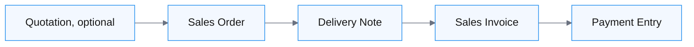
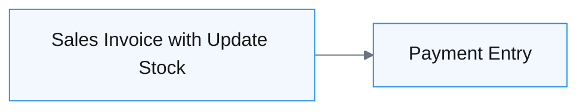
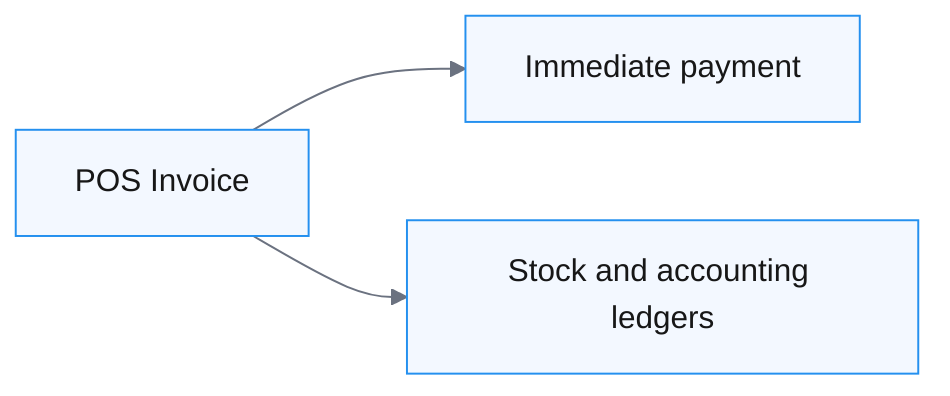
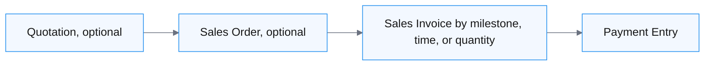
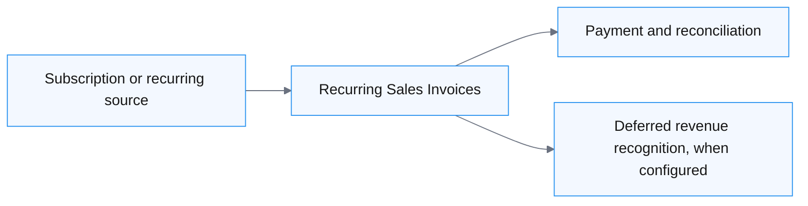
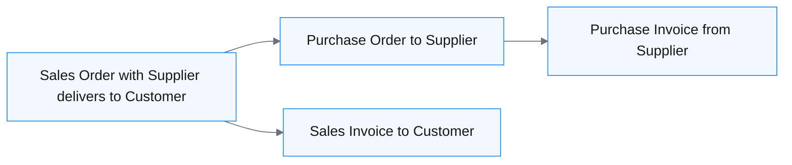
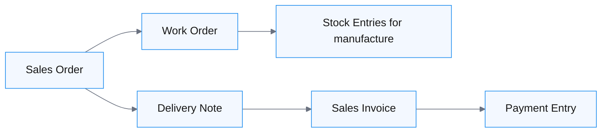
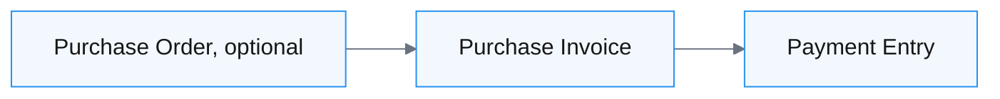
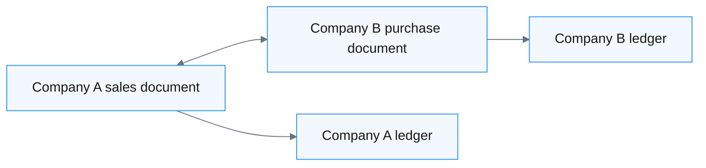

<!-- Frappe documentation: erpnext, part 3 of 69. Index: docs/INDEX.md -->

<!-- page: erpnext/erpnext__accounting-setup-checklist.md -->
---
title: "Accounting Setup Checklist | ERPNext Documentation"
description: "Use this ERPNext accounting setup checklist to verify company, accounts, banking, taxes, opening balances, controls, and go-live testing."
space: "ERPNext"
url: "https://docs.frappe.io/erpnext/accounting-setup-checklist"
updated: "2026-08-14"
---

Accounting setup is complete only when a real transaction can move from business activity to the correct ledger accounts without guesswork. The safest approach is to configure the foundation in sequence, then test one small sales, purchase, payment, and reporting cycle.

Nova Industries first establishes its fiscal year and Chart of Accounts, then adds taxes, Cost Centers, bank and payment defaults, credit terms, and company-level fallback accounts. Each later choice depends on the earlier structure, so testing as you go is easier than correcting many submitted transactions later.

Use this checklist as a practical readiness review. It links each setup decision to the transaction or report that proves the configuration works.

## 1. Company and calendar

- Create the legal entity in [Company](https://docs.frappe.io/erpnext/company-setup).
- Confirm abbreviation, country, currency, tax ID, and address.
- Create and assign the [Fiscal Year](https://docs.frappe.io/erpnext/fiscal-year).

## 2. Chart of Accounts and defaults

- Review the [Chart of Accounts](https://docs.frappe.io/erpnext/chart-of-accounts).
- Confirm receivable, payable, cash, bank, income, expense, tax, stock, fixed-asset, write-off, exchange, and rounding accounts.
- Configure [Company accounting defaults](https://docs.frappe.io/erpnext/company-accounting-defaults).
- Create the required [Cost Centers](https://docs.frappe.io/erpnext/cost-center) and other Accounting Dimensions.

## 3. Payments and banking

- Create Bank and Bank Account records.
- Map a ledger account to every company bank account.
- Configure [Modes of Payment](https://docs.frappe.io/erpnext/bank-accounts-and-modes-of-payment).
- Test a receipt, payment, statement import, and reconciliation.

## 4. Sales, purchases, and taxes

- Create Payment Terms and templates.
- Configure sales and purchase tax templates.
- Add Tax Categories, Tax Rules, and Item Tax Templates where required.
- Confirm Customer, Supplier, Item, and Item Group defaults.

## 5. Accounting controls

- Review [Accounts Settings](https://docs.frappe.io/erpnext/accounts-settings).
- Configure roles, approval workflows, and submission permissions.
- Decide how periods will be locked and closed.
- Configure document naming and print formats.

## 6. Opening data

- Choose a cutover date.
- Import parties, Items, fixed assets, and outstanding invoices.
- Import opening ledger balances through approved opening tools.
- Reconcile receivables, payables, bank, stock, fixed assets, tax balances, and equity with the previous system.

## 7. Test before go-live

Run one complete sales, purchase, payment, expense, asset, and return scenario. Verify:

- General Ledger debit and credit;
- Accounts Receivable and Payable;
- Trial Balance;
- Balance Sheet and Profit and Loss Statement;
- Stock Ledger and Stock Balance, if perpetual inventory is enabled;
- tax reports;
- bank reconciliation;
- printed and emailed documents.

Record who approved the opening balances and test results.

## Related topics

- [Opening Balance](https://docs.frappe.io/erpnext/opening-balance)
- [Opening Invoice Creation Tool](https://docs.frappe.io/erpnext/opening-invoice-creation-tool)
- [Data Import](https://docs.frappe.io/erpnext/data-import)
- [Accounting Period](https://docs.frappe.io/erpnext/accounting-period)

<!-- page: erpnext/erpnext__accounting-workflows-by-business-type.md -->
---
title: "Accounting Workflows by Business Type | ERPNext Documentation"
description: "Choose an ERPNext accounting workflow for goods, retail, services, subscriptions, drop shipping, manufacturing, purchasing, or intercompany operations."
space: "ERPNext"
url: "https://docs.frappe.io/erpnext/accounting-workflows-by-business-type"
updated: "2026-08-15"
---

Two companies can earn the same revenue while needing very different accounting workflows. A product business must track stock movement and cost, a service business may bill time or milestones, and a subscription business may receive cash before it has earned the income.

Nova Industries manufactures and distributes electronics, so a typical sale can affect receivables, income, inventory, and Cost of Goods Sold. Its installation team, however, can invoice a service without a Delivery Note or stock posting. ERPNext supports both flows, but the documents and settings must match the economic event.

This page helps you choose a sensible sales, purchase, stock, deferred-income, and payment workflow for your business model. It also shows which documents are optional and which ones create ledger or stock entries.

## [#](#choose-your-required-milestones)Choose your required milestones

Before selecting a workflow, answer these questions:

1. Do you need to record a Customer or Supplier commitment before billing?
2. Does physical stock move?
3. Must operations confirm delivery or receipt separately from finance?
4. Is billing based on quantity, time, milestones, usage, or a recurring schedule?
5. Is payment immediate, in advance, or on credit?
6. Do goods pass through your Warehouse, go directly between parties, or not exist as stock?

The following document types represent different milestones:

| Document                          | Milestone                        | General Ledger effect                  |
| --------------------------------- | -------------------------------- | -------------------------------------- |
| Quotation                         | Commercial offer                 | None                                   |
| Sales Order or Purchase Order     | Confirmed commitment             | None                                   |
| Delivery Note or Purchase Receipt | Physical fulfilment              | Stock entries with perpetual inventory |
| Sales Invoice or Purchase Invoice | Billing and amount due           | Yes                                    |
| Payment Entry                     | Movement and allocation of money | Yes                                    |

## [#](#standard-goods-sale)Standard goods sale

**Best for:** wholesale, distribution, equipment sales, and businesses where sales, warehouse, billing, and collection happen at different times.

**Benefits:** each team confirms its own milestone; partial delivery and partial billing are easy to track; the Sales Order shows delivered and billed percentages; stock and receivables are recorded at the correct stage.

**Tradeoffs:** more documents must be completed and reconciled. Users must create downstream documents from the order or delivery so the fulfilment chain remains linked.

**Configuration:** maintain stock Items and Warehouses, enable perpetual inventory if stock movement should post to the General Ledger, set Item income and expense defaults, and configure receivable, tax, and cost-of-goods-sold accounts.

The Sales Order is a commitment and does not normally post to the ledger. The [Delivery Note](/erpnext/delivery-note) reduces stock and recognizes cost. The [Sales Invoice](/erpnext/sales-invoice) records income, tax, and receivable. Payment clears the outstanding amount.

Use a separate Purchase Order, Purchase Receipt, Purchase Invoice, and payment cycle to replenish inventory.

## [#](#direct-invoice-with-stock-update)Direct invoice with stock update

**Best for:** small stores, simple counter sales, and low-complexity businesses that deliver and bill at the same moment but do not require a full POS workflow.

**Benefits:** one document records revenue, receivable, inventory reduction, and cost of goods sold. There is no separate Delivery Note to complete.

**Tradeoffs:** warehouse and finance do not have separate confirmation points. It is less suitable when picking, dispatch, proof of delivery, or partial fulfilment must be controlled independently.

**Configuration:** maintain stock Items and Warehouses, configure perpetual inventory and Item accounts, then enable **Update Stock** on the Sales Invoice. If payment is immediate, record it through a Payment Entry or the supported payment fields for the selected invoicing flow.

The invoice affects both the General Ledger and Stock Ledger. A separate Sales Order remains optional. If you create the invoice directly, there is no order whose delivery or billing progress can be tracked. See [Sales Invoice with Update Stock](/erpnext/sales-invoice#update-stock) for the combined path.

## [#](#retail-and-point-of-sale-sale)Retail and point-of-sale sale

**Best for:** retail stores and counters where the Customer receives goods and pays in the same interaction.

**Benefits:** Item selection, pricing, taxes, stock update, billing, and payment are combined in a checkout-oriented interface. POS Closing consolidates and reconciles shift activity.

**Tradeoffs:** it is not designed for long fulfilment cycles, negotiated project billing, or complex credit control. Returns and shift closing need consistent cashier procedures.

**Configuration:** create a [POS Profile](/erpnext/point-of-sale), choose the Company, Warehouse, price list, payment methods, taxes, and applicable users. Confirm opening and closing procedures and cash-difference responsibility.

## [#](#service-or-project-based-sale)Service or project-based sale

**Best for:** consulting, agencies, implementation partners, maintenance providers, and project businesses that do not deliver stocked goods.

**Benefits:** avoids unnecessary stock documents. A Sales Order can hold the commercial scope and track billing progress. Projects, Tasks, and Timesheets can collect delivery effort and cost.

**Tradeoffs:** progress depends on disciplined milestone, time, or quantity updates. A Sales Invoice proves billing, not acceptance of work, unless your process captures approval separately.

**Configuration:** create non-stock service Items, income and expense accounts, payment terms, and Projects where profitability is required. Use [Timesheet-based billing](/erpnext/sales-invoice#timesheet) when invoices are based on approved hours.

For milestone billing, use one service Item with a quantity such as `1.000`. Invoice `0.250`, `0.500`, and `0.250` across three invoices to represent 25%, 50%, and 25% of the engagement. Keep the rate equal to the full contract value. ERPNext uses the decimal quantities to track the billed portion of the Sales Order.

A Delivery Note is normally unnecessary for a non-stock service. Creating the Sales Invoice directly is valid, but it will not update a Sales Order's billing progress if no order is linked.

## [#](#recurring-service-or-subscription)Recurring service or subscription

**Best for:** software subscriptions, retainers, memberships, support plans, rentals, and other periodic services.

**Benefits:** automates regular invoice creation and can separate billing from revenue recognition. Payment terms, reminders, and receivable reports support collection.

**Tradeoffs:** plan dates, cancellations, upgrades, proration, failed payments, and tax changes need clear operating rules. Automatic invoice creation does not guarantee collection.

**Configuration:** set up [Subscriptions](/erpnext/subscription), plans, Customer defaults, taxes, due dates, and recurring processing. Configure [deferred revenue](/erpnext/deferred-revenue) when income must be recognized over the service period rather than entirely on the invoice date.

## [#](#drop-shipped-sale)Drop-shipped sale

**Best for:** distributors and online sellers whose Supplier sends goods directly to the Customer.

**Benefits:** avoids receiving and dispatching the goods through your Warehouse. Sales and purchase documents remain connected, making margin and Supplier fulfilment easier to trace.

**Tradeoffs:** you have less physical control over stock, packing, delivery timing, and proof of delivery. Supplier and Customer addresses and communication must be accurate. The normal Warehouse stock ledger does not represent the goods because your company does not receive them.

**Configuration:** mark applicable Items as supplied by a Supplier, set the default Supplier where useful, select **Supplier delivers to Customer** on the Sales Order item, and create the Purchase Order from that Sales Order. Follow the [Drop Ship](/erpnext/drop-ship) workflow so the documents remain linked.

The Sales Invoice records Customer revenue and receivable. The Purchase Invoice records Supplier cost and payable. The Sales Order and Purchase Order are commitments, not ledger postings.

## [#](#make-to-order-manufacturing)Make-to-order manufacturing

**Best for:** manufacturers that produce finished goods against confirmed demand.

**Benefits:** connects demand, material planning, production, finished-goods stock, delivery, billing, and profitability. Manufacturing stock entries carry component value into the finished Item.

**Tradeoffs:** Bills of Materials, Warehouses, Work Orders, valuation, scrap, and work-in-progress practices must be maintained accurately. Backdated stock entries can trigger valuation reposting.

**Configuration:** set up stock Items, Warehouses, Bills of Materials, Workstations, operations, and manufacturing defaults. Use [Request for Raw Materials from a Sales Order](/erpnext/request-for-raw-materials-from-sales-order) or production planning where needed.

The Sales Order creates demand but no accounting entry. Manufacturing Stock Entries affect inventory value. Delivery records cost of goods sold, and the invoice records income and receivable.

## [#](#purchase-led-service-and-expense-workflow)Purchase-led service and expense workflow

**Best for:** professional services, rent, utilities, software, and other purchases without a physical receipt into stock.

**Benefits:** avoids a Purchase Receipt that adds no operational value. The Purchase Order can still provide budget or approval control before the Supplier invoice arrives.

**Tradeoffs:** there is no separate goods-received confirmation. The team needs another way to verify that the service was accepted before invoice approval.

**Configuration:** use non-stock Items or appropriate expense accounts, Supplier payment terms, taxes, Cost Centers, Projects, and approval workflows. A [Purchase Invoice](/erpnext/purchase-invoice) records expense or asset value and the Supplier payable.

## [#](#multi-company-and-intercompany-workflow)Multi-company and intercompany workflow

**Best for:** groups with separate legal entities that trade with each other.

**Benefits:** each entity keeps an independent, balanced audit trail while linked documents reduce duplicate entry. Consolidated statements can provide a group view.

**Tradeoffs:** Companies, internal Customers and Suppliers, prices, taxes, currencies, and due-to or due-from accounts must be aligned. Consolidation is not a substitute for any elimination or statutory process required by your accounting policy.

**Configuration:** mark the relevant parties as internal, map them to Companies, configure intercompany accounts, and use [Inter Company Invoices](/erpnext/inter-company-invoices) or intercompany Journal Entries. Test both sides before using automation in production.

## [#](#decide-which-documents-are-optional)Decide which documents are optional

Do not ask only whether ERPNext permits a document to be skipped. Ask what control disappears if you skip it.

| If you skip      | You no longer have                                                         |
| ---------------- | -------------------------------------------------------------------------- |
| Quotation        | A versioned offer before Customer commitment                               |
| Sales Order      | A central record of committed quantity, delivery, and billing progress     |
| Delivery Note    | Separate warehouse confirmation and proof of stock delivery                |
| Purchase Order   | Pre-purchase commitment, authorization, and ordered-versus-billed tracking |
| Purchase Receipt | Separate receiving confirmation and received-not-billed accrual            |

Creating a downstream document directly can be correct for a short workflow. It does not update an omitted or unlinked upstream document. If an order exists, create its delivery, receipt, or invoice from that order so ERPNext updates the related percentages and status.

## [#](#implementation-recommendation)Implementation recommendation

Start with one primary workflow per business line. Document its required fields, approvals, handoffs, returns, and exceptions. Then test:

- full and partial fulfilment;
- advance, partial, and combined payments;
- returns and credit notes;
- tax and currency differences;
- cancellation and amendment;
- month-end reconciliation and reporting.

Only introduce a shorter alternate workflow when users can clearly identify when it applies. Review [How Transactions Affect the Ledger](/erpnext/how-transactions-affect-the-ledger) before approving the accounting result.

## [#](#related-topics)Related topics

- [Accounting Introduction](/erpnext/accounting-introduction)
- [How Transactions Affect the Ledger](/erpnext/how-transactions-affect-the-ledger)
- [Sales Invoice](/erpnext/sales-invoice)
- [Purchase Invoice](/erpnext/purchase-invoice)
- [Payment Entry](/erpnext/payment-entry)
- [Drop Ship](/erpnext/drop-ship)

<!-- page: erpnext/erpnext__accounts-receivable-and-payable.md -->
---
title: "Accounts Receivable and Payable"
space: "ERPNext"
url: "https://docs.frappe.io/erpnext/accounts-receivable-and-payable"
updated: "2026-08-14"
---

Nova Electronics Trading has sold goods on credit to Northstar Retail and bought devices on credit from Apex Devices. The finance team needs to know how much customers still owe, what Nova must pay suppliers, which balances are overdue, and which invoices need attention first.

Accounts Receivable reports track outstanding customer invoices and credits. Accounts Payable reports track outstanding supplier invoices and debits. Both use the Payment Ledger to present invoice-level balances and ageing without requiring the reader to reconstruct every allocation from General Ledger rows.

## Accounts Receivable

Use Accounts Receivable to review customer exposure, follow up overdue invoices, investigate unapplied credits, and estimate incoming cash.

[Screenshot on the live page: Loaded Accounts Receivable report with Nova customer balances and ageing]

## Accounts Payable

Use Accounts Payable to plan supplier payments, protect cash flow, capture early-payment opportunities, and avoid overdue bills.

[Screenshot on the live page: Loaded Accounts Payable report with Nova supplier balances and ageing]

## Run either report

1. Open Accounts Receivable or Accounts Payable.
2. Select the Company and reporting date.
3. Choose ageing based on Due Date or Posting Date according to the review.
4. Optionally filter by Party, Account, Territory, Supplier Group, Cost Center, Project, Finance Book, currency, or another available dimension.
5. Refresh the report and open significant invoice references.

## Understand ageing

| View               | Meaning                                                                                        |
| ------------------ | ---------------------------------------------------------------------------------------------- |
| Current or not due | The invoice has an outstanding amount, but its due date has not passed.                        |
| Ageing buckets     | Outstanding amounts grouped by the configured number of days.                                  |
| Total outstanding  | Invoice amount remaining after allocated payments, credit notes, debit notes, and adjustments. |
| Payment-term view  | Outstanding split across the invoice's payment schedule rather than treated as one due amount. |

## From report to action

| Finding                                 | Next action                                                                                                                    |
| --------------------------------------- | ------------------------------------------------------------------------------------------------------------------------------ |
| Customer invoice is overdue             | Review communications, send a statement, create a [Dunning](/erpnext/dunning) record where appropriate, or record the payment. |
| Payment exists but invoice remains open | Review the [Payment Entry](/erpnext/payment-entry) reference or use [Payment Reconciliation](/erpnext/payment-reconciliation). |
| Supplier invoice is due                 | Create or review a Payment Entry, Payment Request, or Payment Order according to the approval process.                         |
| Balance is disputed                     | Open the invoice, credit or debit notes, and General Ledger before changing any transaction.                                   |

## Troubleshooting

### An invoice is missing

Confirm that it is submitted, has a non-zero outstanding amount, uses the selected receivable or payable account, and falls within the report filters.

### Ageing does not match expectations

Check whether ageing is based on Posting Date, Due Date, or Payment Terms. Also confirm the ageing ranges and report date.

### A payment has not reduced outstanding

The payment may be unallocated, allocated to another invoice, or posted to a different party account. Review the References table and Payment Ledger.

## Frequently asked questions

### Why not create one receivable account for every customer?

ERPNext normally keeps one common receivable account and distinguishes balances by Customer. This keeps the Chart of Accounts manageable while preserving party-level detail.

### Do these reports include draft invoices?

Draft documents have not posted receivable or payable ledger entries and are not part of outstanding balances.

### Can I see balances in party currency?

Currency options depend on the account and report filters. Compare the account currency, party currency, and company base currency when reviewing foreign balances.

## Related topics

- [Sales Invoice](/erpnext/sales-invoice)
- [Purchase Invoice](/erpnext/purchase-invoice)
- [Payment Entry](/erpnext/payment-entry)
- [Payment Ledger](/erpnext/payment_ledger)
- [Process Statement of Accounts](/erpnext/process-statement-of-accounts)
- [Common Receivable Account](/erpnext/why-not-to-use-a-customer-specific-receivable-account)

<!-- page: erpnext/erpnext__accounts-receivables.md -->
---
title: "Accounts Receivables | ERPNext Documentation"
description: "Review customer outstanding balances, ageing, payments, and credits with the Accounts Receivable report in ERPNext."
space: "ERPNext"
url: "https://docs.frappe.io/erpnext/accounts-receivables"
updated: "2026-08-14"
---

Nova Industries has submitted invoices to several customers. The sales total shows how much was billed, but the collections team needs a different answer: who still owes money, which invoices are overdue, and where an existing payment or credit has not been allocated correctly?

The **Accounts Receivable** report brings every open customer receivable into one view. It shows the original invoiced amount, payments and Credit Notes already allocated, the remaining outstanding amount, the due date, and how long the balance has been open.

For example, the report can show that Northstar Retail still owes part of an invoice while another customer has an unallocated advance. Use it to prioritize collection follow-up, investigate mismatched allocations, and estimate incoming cash before opening the exact invoice or payment that needs attention.

## Before you begin

Submit your [Sales Invoices](/erpnext/sales-invoice) and record customer receipts through [Payment Entries](/erpnext/payment-entry). Draft transactions do not affect the receivable balance. Also confirm that the report date and Company are correct.

## Run the report

1. Search for **Accounts Receivable**.
2. Select the **Company** and **Posting Date**.
3. Add filters such as Customer, Receivable Account, Cost Center, Project, Territory, or Customer Group when you need a narrower view.
4. Review the invoice rows and the total outstanding amount.

[Screenshot on the live page: Accounts Receivable report with populated customer balances]

## Understand the columns

| Column             | What it means                                                       |
| ------------------ | ------------------------------------------------------------------- |
| Posting Date       | Date on which the accounting entry was posted                       |
| Party              | Customer that owes the amount                                       |
| Voucher No         | Sales Invoice, Journal Entry, or other source transaction           |
| Due Date           | Date by which payment was expected                                  |
| Invoiced Amount    | Original receivable created by the voucher                          |
| Paid Amount        | Amount already allocated against the voucher                        |
| Credit Note        | Credit already allocated against the voucher                        |
| Outstanding Amount | Amount still open after payments and credits                        |
| Age (Days)         | Number of days used for ageing                                      |
| Ageing buckets     | Outstanding amount grouped into periods such as 0–30 and 31–60 days |

The report can show a negative balance when a customer has an unallocated advance or credit. It can also show an old invoice as outstanding when a payment exists but has not been allocated to that invoice.

## Accounts Receivable Summary

Use **Accounts Receivable Summary** when you need one consolidated line per customer instead of invoice-level detail. It is useful for collection meetings and customer-level exposure checks. Return to the detailed report before taking action so you can identify the exact vouchers involved.

## Follow up on overdue balances

- Open the Sales Invoice from **Voucher No** to review its payment schedule.
- Use [Process Statement Of Accounts](/erpnext/process-statement-of-accounts) to send statements to several customers.
- Create a [Dunning](/erpnext/dunning) against an overdue invoice when you need a formal reminder with interest or fees.
- Use [Payment Reconciliation](/erpnext/payment-reconciliation) when a receipt or credit exists but is not allocated to the correct invoice.
- Create a [Credit Note](/erpnext/credit-note) for an approved return or invoice reduction.

## Common issues

**A submitted payment is not reducing the invoice**

Check whether the Payment Entry references that invoice. If it is unallocated, reconcile it against the invoice.

**The report does not match the General Ledger**

Confirm Company, date, currency, party, and receivable account filters. The Accounts Receivable report is voucher-oriented, while the [General Ledger](/erpnext/general-ledger) shows individual ledger postings.

**An invoice appears in the wrong ageing bucket**

Check whether ageing is based on Due Date or Posting Date, then review the invoice payment schedule.

## Related topics

- [Sales Invoice](/erpnext/sales-invoice)
- [Payment Entry](/erpnext/payment-entry)
- [Credit Note](/erpnext/credit-note)
- [Process Statement Of Accounts](/erpnext/process-statement-of-accounts)
- [Sales Interest / Dunning](/erpnext/dunning)
- [Accounts Receivable and Payable report](/erpnext/accounts-receivable-and-payable)

<!-- page: erpnext/erpnext__accounts-settings.md -->
---
title: "Accounts Settings | ERPNext Documentation"
description: "Configure invoicing, payments, credit limits, assets, closing, reports, and other accounting behavior in ERPNext Accounts Settings."
space: "ERPNext"
url: "https://docs.frappe.io/erpnext/accounts-settings"
updated: "2026-08-14"
---

Accounting policies often begin as a small operational decision and later affect every invoice, payment, exchange-rate calculation, and ledger posting. Accounts Settings is where ERPNext stores those site-wide rules, so a convenient-looking checkbox can change how future transactions behave.

Nova Industries may decide that supplier invoice numbers must be unique, overdue invoices should stop further credit, or cancelled invoices should release linked payments. The finance team should understand the accounting consequence of each option before enabling it, especially on a site that already contains submitted transactions.

This page explains each settings area in practical terms, the business decision behind it, and the checks to perform before changing production behavior.

## Invoice and Billing

This tab controls invoice validation, stock expense posting, analytical accounting, deferred accounting, taxes, printing, prices, and exchange rates.

### Invoice cancellation and invoicing

| Setting                                                               | What it changes                                                                          |
| --------------------------------------------------------------------- | ---------------------------------------------------------------------------------------- |
| Unlink Payment on cancellation of invoice                             | Converts linked payments into unallocated amounts when an invoice is cancelled           |
| Unlink Advance Payment on cancellation of order                       | Removes the allocation between an advance and a cancelled order                          |
| Delete Accounting and Stock Ledger entries on deletion of transaction | Allows ledger rows to be removed when an eligible cancelled document is deleted          |
| Enable Immutable Ledger                                               | Posts reversal entries instead of rewriting older ledger history                         |
| Check Supplier invoice number uniqueness                              | Prevents duplicate supplier invoice numbers within the configured scope                  |
| Automatically fetch Payment Terms from Order/Quotation                | Copies the schedule from the linked order or quotation                                   |
| Enable Common Party Accounting                                        | Supports adjustment entries when one party is both Customer and Supplier                 |
| Allow multi-currency invoices against single party account            | Permits foreign-currency invoices against a party account maintained in company currency |
| Enable Discount Accounting                                            | Posts discounts to configured discount accounts                                          |

[Screenshot on the live page: Invoice cancellation and invoicing controls]

Use cancellation options only after deciding how your audit trail should work. Immutable Ledger is the safer choice when accounting history must not be rewritten.

### Stock expense and analytical accounting

**Book Stock Expense GL Entries** posts purchase expense and expenses included in stock value through configured stock expense accounts. When enabled, confirm the required accounts on the Company or Item defaults.

Analytical Accounting settings can require Cost Center, Project, or Accounting Dimensions on profit-and-loss entries. Enable mandatory dimensions only after defaults and user workflows are ready.

### Journals and deferred accounting

Journal settings control when ERPNext uses Journal Entries for specific accounting processes. Deferred accounting is used for annual subscriptions, prepaid insurance, rent, service contracts, and other amounts recognized over time.

| Setting                                         | Use                                                                 |
| ----------------------------------------------- | ------------------------------------------------------------------- |
| Book Deferred entries based on                  | Spreads recognition by days or by months                            |
| Automatically process deferred Accounting entry | Lets scheduled jobs create recognition entries                      |
| Book deferred entries via Journal Entry         | Creates Journal Entry documents instead of posting only ledger rows |

[Screenshot on the live page: Deferred accounting settings]

If automatic processing is disabled, run [Process Deferred Accounting](https://docs.frappe.io/erpnext/process-deferred-accounting) manually and monitor unprocessed schedules.

### Tax, print, Item Price, and currency exchange

Tax settings determine how address Tax Categories and Item Tax Templates are applied. Print settings control whether inclusive tax, tax tables, and payment schedules appear in printed documents. Item Price options affect how prices are created or updated from transactions.

Currency Exchange settings determine whether stale rates are allowed and how old a saved rate may be. If stale rates are not allowed, ERPNext fetches or requires a current rate based on the configured tolerance.

## Payments

The Payments tab controls payment reconciliation, repost behavior, and payment options.

[Screenshot on the live page: Payment reconciliation and repost settings]

### Payment Reconciliation Settings

| Setting                                         | What it controls                                                     |
| ----------------------------------------------- | -------------------------------------------------------------------- |
| Auto reconcile Payments                         | Runs reconciliation automatically for eligible payments              |
| Posting Date inheritance for exchange gain/loss | Chooses whether exchange differences use the payment or invoice date |
| Auto Reconciliation job trigger                 | Frequency, in minutes, for processing queued reconciliation          |
| Reconciliation queue size                       | Number of documents processed in each run                            |

Use conservative queue settings on a busy production site. Automatic reconciliation reduces manual allocation work, but users should still review party balances and exceptions.

### Repost

The Allowed DocTypes table identifies transaction types whose account changes can trigger reposting. Include only documents that your correction process requires. Reposting may use background workers and can affect later ledger entries.

### Payment Options

Review payment-entry creation, allocation, and exchange-difference behavior. Test receipts, supplier payments, advances, refunds, multi-currency payments, and write-offs before changing defaults.

## Credit Limits

This tab controls overbilling and overdue-balance restrictions.

[Screenshot on the live page: Credit limit and overbilling settings]

| Setting                                      | What it means                                                             |
| -------------------------------------------- | ------------------------------------------------------------------------- |
| Over Billing Allowance (%)                   | Permits billing above the ordered amount within the stated percentage     |
| Role Allowed to Over Bill                    | Lets only the selected role exceed the normal allowance                   |
| Enable Overdue Billing Threshold             | Blocks new billing when overdue exposure crosses the configured threshold |
| Role allowed to bypass overdue billing limit | Allows an authorized role to proceed after reviewing the risk             |

Customer and Company records provide credit limits. Accounts Settings determines how strictly users must follow them. Keep override roles limited and require a documented approval process.

## Assets

The Assets tab controls automatic depreciation and other asset-accounting behavior.

[Screenshot on the live page: Asset accounting settings]

Enable automatic depreciation only after setting Asset Categories, finance books, depreciation methods, schedules, and default accounts. Confirm that scheduled jobs are running. Review depreciation entries, asset purchases, capitalization, transfers, disposals, and value adjustments in a test company.

Changing asset settings does not automatically correct previously posted depreciation. Use the appropriate asset transaction or adjustment workflow instead of editing submitted ledger entries.

## Accounts Closing

The Accounts Closing tab restricts backdated postings and identifies who can work in frozen periods.

[Screenshot on the live page: Accounts closing settings]

| Setting                                                     | Purpose                                                                                    |
| ----------------------------------------------------------- | ------------------------------------------------------------------------------------------ |
| Accounts Frozen Till Date                                   | Prevents ordinary users from creating or changing accounting entries on or before the date |
| Role Allowed to Set Frozen Accounts and Edit Frozen Entries | Grants a controlled exception for authorized accounting administrators                     |
| Credit Controller                                           | Identifies the role permitted to approve transactions beyond credit limits                 |

Use a freeze during month-end review, audit, or final reporting. For transaction-specific restrictions across a date range, use an [Accounting Period](https://docs.frappe.io/erpnext/accounting-period). For year-end profit transfer, use a [Period Closing Voucher](https://docs.frappe.io/erpnext/period-closing-voucher).

Before freezing a period, reconcile bank accounts, receivables, payables, taxes, stock, assets, payroll, and intercompany balances.

## Reports

The Reports tab tunes the output and performance of accounting reports.

[Screenshot on the live page: Accounting report settings]

**Remarks Column Length** limits how much voucher text appears in report results. Longer remarks may help investigation but can make reports harder to scan.

Accounts Receivable and Accounts Payable tuning settings control how those reports process large datasets. Change performance options only after testing with production-like volume. A faster report that omits required detail is not an acceptable tradeoff.

Legacy fields preserve compatibility with older reports or implementations. Leave them unchanged unless migration testing or an upgrade note requires them.

## Others

The Others tab groups Chart of Accounts, banking, Payment Request, and budget behavior.

[Screenshot on the live page: Other accounting settings]

### Chart of Accounts

Review options that affect account creation, validation, and ledger behavior. Make structural changes before importing opening balances.

### Banking

Banking options affect Bank Transactions, statement imports, reconciliation, and matching. Test a representative statement before enabling automation.

### Payment Request

Configure how payment requests and payment gateways create or update accounting documents. Confirm the clearing and bank accounts used by each gateway.

### Budget

Budget settings determine whether ERPNext warns or stops users when a transaction exceeds a budget. Test the action at monthly, quarterly, and annual limits and confirm which roles may override it.

## Document Naming

This tab controls naming series for accounting documents.

[Screenshot on the live page: Accounting document naming settings]

Choose naming series before go-live. A good series distinguishes company or document type without becoming difficult to read. Confirm legal invoice-number requirements, yearly resets, amendments, returns, credit notes, and multi-company use.

Changing a naming series affects new documents only. Do not rename submitted accounting documents to imitate another sequence.

## Before saving a change

1. Record the current value and reason for the change.
2. Confirm whether the setting affects all companies on the site.
3. Test the relevant transaction from draft through submission, cancellation, and amendment.
4. Check the General Ledger, Stock Ledger, receivable or payable report, and financial statements.
5. Test permissions and override roles.
6. Communicate the change to users and approvers.

## Troubleshooting

**A setting does not take effect**

Reload the form and create a new test transaction. Check whether Company, Item, Item Group, Customer, Supplier, Mode of Payment, or row-level values provide a more specific default.

**A user can still submit a restricted transaction**

Review their roles, workflow permissions, override role, and whether the configured limit applies to that transaction.

**A report changed after the setting was updated**

Compare the underlying General Ledger entries and report filters. Do not repost accounting data until the source transaction and expected result have been verified.

## Related topics

- [Company accounting defaults](https://docs.frappe.io/erpnext/company-accounting-defaults)
- [Chart of Accounts](https://docs.frappe.io/erpnext/chart-of-accounts)
- [Payment Reconciliation](https://docs.frappe.io/erpnext/payment-reconciliation)
- [Repost Accounting Ledger](https://docs.frappe.io/erpnext/accounting/tools/repost-accounting-ledger)
- [Accounting Period](https://docs.frappe.io/erpnext/accounting-period)
- [Period Closing Voucher](https://docs.frappe.io/erpnext/period-closing-voucher)
- [Asset Depreciation](https://docs.frappe.io/erpnext/asset-depreciation)

<!-- page: erpnext/erpnext__activity-cost.md -->
---
title: "Activity Cost\n"
space: "ERPNext"
url: "https://docs.frappe.io/erpnext/activity-cost"
updated: "2026-02-26"
---

**Activity Cost records the per-hour billing rate and costing rate of an Employee against a particular Activity Type.**

The system pulls this rate while making Timesheets. It is used to determine the Project Cost.

[Screenshot on the live page]

To access Activity Cost, go to,

> Home > Projects > Time Tracking > Activity Cost

## How to create Activity Cost

1. Go to the Activity Cost list and click on New.
2. Add the name of the Employee for whom you are configuring the Activity Cost.
3. Add the Costing Rate and the Billing Rate for the Employee.
4. Save.

Alternatively, an Activity Cost can also be created via the Activity List.

[Screenshot on the live page]

<!-- page: erpnext/erpnext__activity-type.md -->
---
title: "Activity Type"
space: "ERPNext"
url: "https://docs.frappe.io/erpnext/activity-type"
updated: "2026-02-26"
---

**Activity Type in ERPNext helps you maintain different types of activities against which a Timesheet can be made.**

To access Activity Type, go to,

> Home > Projects > Time Tracking > Activity Type

[Screenshot on the live page]

## How to create Activity Type

---

1. Go to the Activity Type List and click on New.
2. Add the subject of the Activity Type.
3. Specify 'Default Costing Rate' if any.
4. Mention 'Default Billing Rate' is applicable.
5. Save.

By default, the following Activity Types are created in ERPNext.

- Planning
- Research
- Proposal Writing
- Execution
- Communication

Further, The Default Costing Rate and the Default Billing Rate for Individual Employees can also be configured using Activity Cost.
