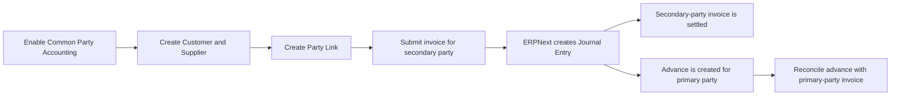

<!-- Frappe documentation: erpnext, part 4 of 18. Index: docs/INDEX.md -->

<!-- page: erpnext/erpnext__campaign.md -->
---
title: "Campaign | ERPNext Documentation"
description: "Learn how to create and use Campaigns in ERPNext to organize marketing activity and measure generated leads and opportunities."
space: "ERPNext"
url: "https://docs.frappe.io/erpnext/campaign"
updated: "2026-07-23"
---

**A Campaign is a full-scale implementation of a sales strategy to promote a**  
**product or service.**

In ERPNext CRM, a campaign refers to a structured marketing initiative aimed at achieving specific business objectives, such as generating leads, increasing sales, or promoting brand awareness.

The Campaign feature allows users to plan, execute, and monitor marketing campaigns effectively within the CRM module. By leveraging the Campaign feature in ERPNext CRM, organizations can streamline their marketing efforts, target the right audience with personalized messages, track campaign performance, and ultimately drive business growth through effective marketing initiatives.

This is done in a market segment of a particular geographical area to achieve specified objectives.

To access Campaign, go to:

> Home > CRM > Campaign > Campaign


## How to Create a Campaign

- Go to the Campaign list, select new.
- Enter a name for the campaign.
- Enter a description to describe what the campaign is about.
- Save.

## Features

### Tag Campaign in Lead, Opportunity, and Quotation

When a marketing campaign generates a lead or an opportunity, you can tag the campaign while creating the [Lead](/erpnext/lead) or [Opportunity](/erpnext/opportunity). You can also tag the campaign in [Quotation](/erpnext/quotation).

This helps in assessing the effectiveness of a marketing campaign by calculating the return on investment.


### View Leads Generated by a Campaign

- select 'View Leads' button in the campaign.[Campaign - View Leads](/files/campaign-view-leads.png)
- You will see a filtered list of leads made against the campaign.
- You can also create new leads against the campaign by clicking on 'New'

[Campaign - New Lead](/files/campaign-new-lead.png)

### Set up email schedules for Email Campaigns

If you want to carry out a campaign using emails for your leads or contacts, [Email Campaign](/erpnext/email-campaign) serves the purpose.

You will have to set up a schedule for the campaign. select 'Add Row' to add an entry to the campaign schedule.


- In **Email Template**, select an 'Email Template' which you would like to send via email to the lead or contact. You can create one as follows:


- In **Send After (days)**, specify the number of days after which the respective email should be sent. Using this field, the day on which email is to be sent is calculated relative to the **Start Date** of **Email Campaign**.

### Dashboard

The Campaign dashboard shows you all the Email Campaigns and Social Media Post linked to the Campaign. You can also create a new Email Campaign and Social Media Post from here.


## Related Topics

- [Lead](/erpnext/lead)
- [Opportunity](/erpnext/opportunity)
- [Quotation](/erpnext/quotation)
- [Email Campaign](/erpnext/email-campaign)

Next: [Email Campaign](/erpnext/email-campaign)

<!-- page: erpnext/erpnext__can-we-fetch-shipping-charges-based-items-value-or-weight-in-po.md -->
---
title: "Fetch shipping charges based item's value or weight "
space: "ERPNext"
url: "https://docs.frappe.io/erpnext/can-we-fetch-shipping-charges-based-items-value-or-weight-in-po"
updated: "2026-03-02"
---

In a Purchase order, we can fetch the **Shipping Charges** of an item based on its Value or weight.  
Go to **Shipping Rule list** --> **Calculate based on : Net Total or Net Weight** --> Select Shipping rule conditions --> Fill table  
  
This way, while creating a PO, shipping charges will be fetched for the item based on item's weight or Value. 

<!-- page: erpnext/erpnext__capacity-planning-based-on-production-order.md -->
---
title: "Capacity Planning based on Production Order"
space: "ERPNext"
url: "https://docs.frappe.io/erpnext/capacity-planning-based-on-production-order"
updated: "2026-02-26"
---

Capacity Planning functionality helps you in tracking production jobs allocated on each Workstation.


Follow are the steps to use Capacity Planning Feature in your ERPNext account.

**Operations**

To add operations, go to: Manufacturing > Bill of Materials > Operations

**Workstation**

Add each Workstation in your ERPNext account from: Manufacturing > Bill of Materials > Workstation

In the Workstation master, you can define which operations will be performed on it, what are the cost associated with it, and what are the working hours of that Workstation.

**Bill of Materials (BOM)**

In a BOM, with the list of raw material needed, for manufacturing, you can also list operation and workstations through which those raw materials will be processed.

**Production Order**

On submission of Production Order, Timesheet for Operations. This helps you allocate production jobs on each Workstation, as well as you can update actual time taken for each Operation.

 

\--

**Question** : On Submission of Production Order, we are getting following error message.


**Answer** : Please check if you have updated Working Hours in the Workstation master? If not, then please update it and then try to submit Production Order. On submission of Production Order, Operations (as added in the BOM) are allocated on the workstation. Each operation should start and end on the same day. If a system is not able to schedule that operation in a day, then system request you to divide that Project, so that system can allocate smaller operations in a day. If you have update working hours in the Workstation, but still getting this issue, that because one of your operation is taking too long, and cannot be completed in a day. Please divide that operation into smaller operations, so that it can be allocated on Workstation and completed on the same day.

<!-- page: erpnext/erpnext__capacity-planning.md -->
---
title: "Capacity Planning based on Work Order"
space: "ERPNext"
url: "https://docs.frappe.io/erpnext/capacity-planning"
updated: "2026-02-26"
---

Capacity Planning functionality helps you in tracking production jobs allocated on each Workstation.

  


Follow are the steps to use Capacity Planning Feature in your ERPNext account.

1. Operations

To add operations, go to:

`Manufacturing -> Bill of Materials -> Operations`
2. Workstation

Add each Workstation in your ERPNext account from:

`Manufacturing -> Bill of Materials -> Workstation`

In the Workstation master, you can define which operations will be performed on it, what are the cost associated with it, and what are the working hours of that Workstation.
3. Bill of Materials (BOM):

In a BOM, with the list of raw material needed, for manufacturing, you can also list operation and workstations through which those raw materials will be processed.
4. Work Order:

On submission of Work Order, Timesheet for Operations. This helps you allocate production jobs on each Workstation, as well as you can update actual time taken for each Operation.

  
**Error due to Capacity Planning**

**Question:** On Submission of Work Order, we are getting following error message.

  


**Answer: **Please check if you have updated Working Hours in the Workstation master? If not, then please update it and then try to submit Work Order.

On submission of Work Order, Operations (as added in the BOM) are allocated on the workstation. Each operation should start and end on the same day. If a system is not able to schedule that operation in a day, then system request you to divide that Project, so that system can allocate smaller operations in a day.

If you have update working hours in the Workstation, but still getting this issue, that because one of your operation is taking too long, and cannot be completed in a day. Please divide that operation into smaller operations, so that it can be allocated on Workstation and completed on the same day.

  
**Avoid Working Hours of Workstation**

If you want to ignore above validation and allow scheduling of production job beyond the working hours of the Workstation, enable Overtime in the Manufacturing Settings.

  


If you want to complete disable Capacity Planning feature, in the Manufacturing Settings, check field "Disable Capacity Planning and Time Tracking".

<!-- page: erpnext/erpnext__cash-flow-report.md -->
---
title: "Cash Flow Report"
space: "ERPNext"
url: "https://docs.frappe.io/erpnext/cash-flow-report"
updated: "2026-08-14"
---

Nova Industries earned $109,440 in 2026, yet cash from operations fell by $117,866. The owner needs to understand where the profit went before approving more spending.


The Cash Flow report explains changes in cash and cash equivalents through operating, investing, and financing activities. It starts from accounting results and adjusts for non-cash items and working-capital movement. Use the [Profit and Loss Report](/erpnext/profit-and-loss-report) to measure earnings and the [Balance Sheet](/erpnext/balance-sheet) to review financial position.

## Run Cash Flow

1. Open **Accounting** and select **Cash Flow**.
2. Select **Nova Industries** and the required fiscal year or date range.
3. Choose periodicity and optional [Finance Book](/erpnext/finance-book), [Cost Center](/erpnext/cost-center), Project, Department, or [Accounting Dimension](/erpnext/accounting-dimensions).
4. Enable opening and closing balances when the cash reconciliation requires them.
5. Refresh and wait for totals, chart, and report sections to load.


## Interpret Nova's cash movement


| Line                          | Value     | Interpretation                                             |
| ----------------------------- | --------- | ---------------------------------------------------------- |
| Profit for the year           | $109,440  | Accounting profit before cash-flow adjustments.            |
| Change in Accounts Receivable | -$316,212 | Income was recognized, but much of it remains uncollected. |
| Change in Accounts Payable    | $184,293  | Unpaid supplier balances temporarily preserved cash.       |
| Net Cash from Operations      | -$117,866 | Core operations consumed cash despite positive profit.     |


The largest pressure is receivables. Nova should review [Accounts Receivable](/erpnext/accounts-receivable), prioritize collections, and verify old balances before committing to new cash expenditure. Review [Accounts Payable](/erpnext/accounts-payable) before using delayed supplier payments as a source of cash.

## Understand the three sections


| Section   | Typical movements                                                                                   |
| --------- | --------------------------------------------------------------------------------------------------- |
| Operating | Profit, depreciation, receivables, payables, inventory, and taxes arising from ordinary operations. |
| Investing | Purchases and disposals of equipment, investments, and other long-term assets.                      |
| Financing | Owner capital, borrowings, repayments, dividends, and similar funding movements.                    |


## Trace a line to accounting evidence

Select an account or supporting value to inspect its [General Ledger](/erpnext/general-ledger) activity. Review source [Payment Entries](/erpnext/payment-entry) and approved [Journal Entries](/erpnext/journal-entry) when they explain a material movement. Working-capital lines are changes between reporting dates, so also compare the relevant Balance Sheet accounts and party reports.


## Default and customised formats

The standard report classifies accounts using ERPNext's financial-statement logic. When the organisation needs approved labels or more precise classifications, configure [Customise Cash Flow Report](/erpnext/customise-cash-flow-report). A [Financial Report Template](/erpnext/financial-report-template) can control presentation where supported. Customisation changes classification and layout, not the underlying ledger entries.

## Troubleshooting

### Profit and operating cash flow differ sharply

Review receivables, payables, inventory, depreciation, taxes, and other non-cash or working-capital lines. The difference is often expected and should be explained, not forced to match.

### A cash movement is in the wrong section

Review the account's mapping and report configuration. Confirm whether a custom cash-flow format is enabled before changing any classification.

### Net change does not reconcile to cash balances

Match Company, dates, Finance Book, currency, dimensions, and opening or closing balance options. Look for omitted bank or cash accounts and overlapping custom mappings.

## Frequently asked questions

### Does positive profit guarantee positive cash flow?

Credit sales, inventory purchases, debt payments, asset purchases, and other timing differences can make cash flow negative while profit is positive.

### Is Accounts Payable growth always good for cash?

Unpaid bills preserve cash temporarily but create obligations and may harm supplier relationships. Interpret the change with due dates and payment plans.

### Does a report mapping change ledger entries?

Mappings change how existing balances are classified and displayed. They do not repost transactions.

## Related topics

- [Accounting Reports](/erpnext/accounting-reports)
- [Profit and Loss Report](/erpnext/profit-and-loss-report)
- [Balance Sheet](/erpnext/balance-sheet)
- [Accounts Receivable](/erpnext/accounts-receivable)
- [Accounts Payable](/erpnext/accounts-payable)
- [Customise Cash Flow Report](/erpnext/customise-cash-flow-report)

<!-- page: erpnext/erpnext__centavo-being-printed-in-words-for-usd.md -->
---
title: "Print \"Centavo\" in Words for USD"
space: "ERPNext"
url: "https://docs.frappe.io/erpnext/centavo-being-printed-in-words-for-usd"
updated: "2026-03-02"
---

For currencies not present in the Currency list doctype:

You can go to Currency list doctype --> Add the currency --> Add Exchange rate --> Enable the currency --> You can then add the currency in any transaction required.


For instance:


Print format:


<!-- page: erpnext/erpnext__change-existing-users-email-id.md -->
---
title: "Change existing user's email ID or Rename User"
space: "ERPNext"
url: "https://docs.frappe.io/erpnext/change-existing-users-email-id"
updated: "2026-07-02"
---

The User ID is created based on the email address. When a user is renamed, its value is updated in all existing records, including change logs. As a result, this is a resource-intensive action. If you encounter time-out issues while renaming a user, consider creating a new User ID using the updated email address and disabling the old user.

If you need to change a user's email address or username, use ERPNext's built-in **Rename** tool. This updates the user's unique ID across all linked records while preserving assignments, permissions, and historical data.


To change a User's Email Id, follow the steps: 

> **User List -> Open the User** **> Click on Menu -> Rename > Enter the New Email Id . Save** 

#### Prerequisites

You must have **Administrator** privileges to rename a user.

#### Steps

1. Go to **Settings > Users and Permissions > User**.
2. Open the user you want to rename.
3. Click **Menu** (⋮) in the top-right corner of the form.
4. Select **Rename**.
5. Enter the new email address or username.
6. Click **Save**.

#### What Happens After Renaming?

ERPNext automatically updates all references to the user across the system. This ensures that:

- Existing document links remain intact.
- Assignments continue to work.
- User permissions are preserved.
- Historical records continue to reference the renamed user correctly.


<!-- page: erpnext/erpnext__change-password.md -->
---
title: "Change User Password"
space: "ERPNext"
url: "https://docs.frappe.io/erpnext/change-password"
updated: "2026-02-26"
---

**'Change Password' is used to change the password of any existing user.**

Each ERPNext user can change password for his/her ERPNext account. Also user with System Manager role will be able to reset password for himself as well as for other users.

**How to change password?**
---------------------------

1. Go to User List
2. Open the user for whom the password needs to be changed
3. Go to 'Settings', and expand the section named 'Change Password'
4. Enter the new password and save the form

**Note:-** Based on the complexity of the password, the system indicates whether the entered password is Weak or Strong

  

<!-- page: erpnext/erpnext__change-the-rate-of-items-in-the-sales-cycle.md -->
---
title: "Control Item Rate Changes Through the Sales Cycle | ERPNext Documentation"
description: "Configure ERPNext to preserve, warn about, or stop item-rate changes between Sales Orders, Delivery Notes, and Sales Invoices."
space: "ERPNext"
url: "https://docs.frappe.io/erpnext/change-the-rate-of-items-in-the-sales-cycle"
updated: "2026-07-25"
---

ERPNext can validate whether an Item's rate changes as it moves from a [Sales Order](/erpnext/sales-order) to a [Delivery Note](/erpnext/delivery-note) or [Sales Invoice](/erpnext/sales-invoice). Use this control when confirmed order rates should remain consistent through fulfilment and billing.

## Before you begin

Confirm:

- Item Prices and the intended [Price List](/erpnext/price-lists).
- The roles permitted to approve price exceptions.
- Whether your process requires a warning or a hard stop.
- How legitimate amendments and returns should be handled.

This setting does not replace pricing governance. Document when a rate may change and who may approve it.

## Configure rate validation

1. Open [Selling Settings](/erpnext/selling-settings).
2. Open the Item Price Settings section.
3. Enable **Maintain Same Rate Throughout Sales Cycle**.
4. Set **Action If Same Rate Is Not Maintained** to:
  - **Warn** to allow saving after notifying the user.
  - **Stop** to block the inconsistent rate.
5. When Stop is selected, choose the role allowed to override the action if your version provides that field.
6. Save.


## Test the control

1. Create and submit a Sales Order with an Item rate.
2. Create a Delivery Note or Sales Invoice from the Sales Order.
3. Select the highlighted pencil icon to open the complete Item row.
4. Change the Rate.
5. Save and confirm that ERPNext warns or stops the change according to Selling Settings.


The dot before an Item Code shows stock availability at a glance: green means in stock and red means out of stock.

## When a rate legitimately changes

Use the workflow that preserves the audit trail:

- Amend the confirmed Sales Order when the commercial agreement changed before fulfilment.
- Use [Update Items](/erpnext/amending-sales-order-after-submit) when the supported after-submit workflow fits the change.
- Create a Credit Note or return when correcting a submitted invoice.
- Use an authorized override only when policy permits it.

Do not silently change a downstream rate simply to make totals match.

## How pricing sources interact

A transaction rate can be influenced by:

- Item Price and Price List.
- [Pricing Rules](/erpnext/pricing-rule).
- [Promotional Schemes](/erpnext/promotional-scheme).
- Item-level margin or discount.
- Additional Discount.
- Currency conversion.
- A manually entered Rate when permissions allow it.

The same-rate validation compares the mapped sales-cycle rate. It does not prevent every possible upstream pricing configuration.

## Important settings


| Setting                                   | Effect                                                                             |
| ----------------------------------------- | ---------------------------------------------------------------------------------- |
| Maintain Same Rate Throughout Sales Cycle | Enables comparison against the upstream rate                                       |
| Action: Warn                              | Shows a warning but permits the user to continue                                   |
| Action: Stop                              | Blocks the rate change                                                             |
| Override Role                             | Lets authorized users bypass Stop when supported                                   |
| Allow User to Edit Price List Rate        | Controls editing of the Price List Rate field, not the complete sales-cycle policy |


## Troubleshooting


| Problem                                | What to check                                                                            |
| -------------------------------------- | ---------------------------------------------------------------------------------------- |
| No warning appears                     | Confirm the downstream document was mapped from the Sales Order and the setting is saved |
| Authorized user cannot override        | Confirm the configured role and the user's assigned roles                                |
| Rate changes before mapping            | Review Item Prices, Pricing Rules, discounts, currency, and the source document          |
| Return or credit correction is blocked | Use the appropriate return or amendment workflow                                         |
| Users confuse Rate and Price List Rate | Explain the reference rate, margin, discount, and final transaction rate                 |


## Frequently asked questions

### Does the setting apply to unrelated standalone invoices?

It is intended to validate rates through a linked sales cycle. A standalone invoice has no Sales Order rate to compare.

### Should I choose Warn or Stop?

Use Warn where exceptions are common and reviewed later. Use Stop where approval must happen before the document is saved.

### Can a role override Stop?

Yes, when the override-role field is available and configured in your ERPNext version.

### Does the setting stop Pricing Rules?

No. Pricing Rules remain part of rate calculation. Test the combined workflow.

## Related topics

- [Selling Settings](/erpnext/selling-settings)
- [Sales Order](/erpnext/sales-order)
- [Amending Sales Order after Submit](/erpnext/amending-sales-order-after-submit)
- [Pricing Rule](/erpnext/pricing-rule)
- [Applying a Discount](/erpnext/applying-discount)

<!-- page: erpnext/erpnext__change-valuation-method.md -->
---
title: "Change Valuation Method"
space: "ERPNext"
url: "https://docs.frappe.io/erpnext/change-valuation-method"
updated: "2026-02-20"
---

In the ERPNext, users can change the valuation method from FIFO to Moving Average, but not from Moving Average to FIFO, for items with existing stock transactions.

If a user changes the valuation method from FIFO to Moving Average for any item, the system will use the Moving Average method for new outward transactions. Additionally, if the user creates backdated transactions, all transactions created after that backdated entry will be reposted using the Moving Average method. This may result in changes to the closing balance value of earlier transactions.

To prevent this, users can freeze stock transactions before a specific date by setting the "Stock Frozen Up To" date in the stock settings.


<!-- page: erpnext/erpnext__changing-parent-account.md -->
---
title: "Change the Parent Account | ERPNext Documentation"
description: "Learn how to change an Account's parent in ERPNext, understand report reclassification, validate the new group, and verify the saved Chart of Accounts."
space: "ERPNext"
url: "https://docs.frappe.io/erpnext/changing-parent-account"
updated: "2026-08-03"
---

The Parent Account determines where an Account appears in the [Chart of Accounts](https://docs.frappe.io/erpnext/chart-of-accounts) tree and how its balance rolls up in financial reports. Change it when an existing ledger or group was placed under the wrong branch and must be reclassified.


For example, Nova Electronics Trading initially placed **Warranty Fulfilment Costs** under **Indirect Expenses**. Because these costs arise directly from fulfilling product warranties, the accounting team reclassifies the Account under **Direct Expenses**.


Changing the parent does not create a new Account and does not rewrite transaction amounts. It changes the structural classification of the existing Account, including how its current and historical balances roll up in reports.

## Before you begin

Confirm the accounting reason for the move with your accountant. A parent change can affect subtotals, gross profit, operating expenses, and the presentation of earlier periods even though total debit and credit remain unchanged.

Review the Account in the [General Ledger](https://docs.frappe.io/erpnext/general-ledger), then save the relevant [Trial Balance](https://docs.frappe.io/erpnext/trial-balance) and financial statements before the change. These provide a comparison point after reclassification.

The target parent must:


| Requirement                                                          | Reason                                                                                                                                                                                                       |
| -------------------------------------------------------------------- | ------------------------------------------------------------------------------------------------------------------------------------------------------------------------------------------------------------ |
| Belong to the same [Company](https://docs.frappe.io/erpnext/company) | Each company maintains a separate Chart of Accounts.                                                                                                                                                         |
| Be a group Account                                                   | A ledger cannot contain child Accounts.                                                                                                                                                                      |
| Belong to the correct root branch                                    | The Account must remain under the intended Asset, Liability, Equity, Income, or Expense structure.                                                                                                           |
| Support the intended report classification                           | The parent determines whether balances roll into the [Balance Sheet](https://docs.frappe.io/erpnext/balance-sheet) or [Profit and Loss Statement](https://docs.frappe.io/erpnext/profit-and-loss-statement). |


Do not use this procedure to combine duplicate Accounts. Use **Merge Account** for a genuine duplicate. Do not create a new Cost Center merely to repair an Account hierarchy; [Cost Centers](https://docs.frappe.io/erpnext/cost-center) serve a different reporting purpose.

## Open the Account

Open **Chart of Accounts**, select the company, and find the Account to move. Select the Account and open **Edit**, or open the Account directly from the Account list.

The example Account currently has **Indirect Expenses - NET** as its parent.


Before editing, confirm the Account name, Company, Root Type, Report Type, Currency, Account Type, and whether **Is Group** is enabled. If the Account is a group, the move also repositions every child beneath it.

## Select the new parent

In **Parent Account**, select the correct target group. For this example, choose **Direct Expenses - NET**.


Review the full target name and company suffix, then select **Save**. ERPNext validates that the target is a group in the same company and updates the tree relationship.

## Confirm the saved result

After saving, the Account retains its identity but shows the new parent. The activity timeline records the Parent Account change.


Return to Chart of Accounts and confirm the Account appears under the intended branch. Re-run the same reports used before the change.

For the example:


| Before                                                  | After                                                 | What stays the same                                                                      |
| ------------------------------------------------------- | ----------------------------------------------------- | ---------------------------------------------------------------------------------------- |
| Warranty Fulfilment Costs rolls into Indirect Expenses. | Warranty Fulfilment Costs rolls into Direct Expenses. | Account identity, linked vouchers, debit and credit amounts, parties, and posting dates. |


The [accounting entries](https://docs.frappe.io/erpnext/accounting-entries) remain linked to the same Account. Their presentation changes because the Account now rolls up through a different parent.

## How the parent affects other fields

ERPNext derives structural values from the parent. Understand the difference before changing anything:


| Field          | Meaning                                                                                                                                   |
| -------------- | ----------------------------------------------------------------------------------------------------------------------------------------- |
| Parent Account | Immediate group directly above the Account in the tree.                                                                                   |
| Root Type      | Top-level accounting class: Asset, Liability, Equity, Income, or Expense.                                                                 |
| Report Type    | Balance Sheet or Profit and Loss, derived from the root branch.                                                                           |
| Is Group       | Indicates that the Account contains child Accounts and cannot receive normal transaction postings.                                        |
| Account Type   | Describes a special use such as Bank, Receivable, Payable, Tax, or Cost of Goods Sold. It is not the same as Parent Account or Root Type. |


If you move an Account to a different root branch, ERPNext updates the structural classification from the target parent. Such a move can materially change financial statements and requires careful review.

## Important fields and controls


| Field or control | Guidance                                                                |
| ---------------- | ----------------------------------------------------------------------- |
| Account          | Existing ledger or group being moved. Do not create a duplicate.        |
| Parent Account   | Select the exact group that should contain the Account.                 |
| Company          | Must match the target parent.                                           |
| Root Type        | Review the resulting top-level classification.                          |
| Report Type      | Review whether the balance belongs in Balance Sheet or Profit and Loss. |
| Is Group         | If enabled, all child Accounts move with the group.                     |
| Account Type     | Confirm the special use still makes sense in the new branch.            |
| Save             | Applies the structural change and records it in the timeline.           |


## Troubleshooting

### The target does not appear in Parent Account

Confirm it is a group Account in the same company. A normal ledger cannot be selected as a parent. If the group does not exist, create it from the Chart of Accounts tree before moving the child.

### The Report Type is not editable

This is expected. ERPNext derives Report Type from the parent and root branch. Select the correct Parent Account instead of forcing the field through customization or browser scripts.

### Historical financial statements changed

The Account's balance now rolls up through the new parent, including historical transactions. Compare the before-and-after reports and confirm that this is the intended reclassification. The company's total balanced [Journal Entries](https://docs.frappe.io/erpnext/journal-entry) should not change.

### I moved a group and several Accounts moved with it

That is expected. A group carries its full subtree. Review every child before saving a group-level parent change.

### The tree still shows the previous structure

Reload Chart of Accounts and expand the target branch. If the saved Parent Account is correct but the tree remains inconsistent, investigate before using a repair tool.

## FAQs

### Is Parent Account the same as Root Type?

No, Parent Account is the immediate group above the Account. Root Type is the top-level accounting class inherited through the tree.

### Does changing the parent move existing transactions?

The transactions remain linked to the same Account. Their balances are presented under the Account's new parent hierarchy.

### Can I move an Account from Profit and Loss to Balance Sheet?

Only with a valid accounting reason and careful review. Such a move changes the report classification of all balances linked to the Account.

### Can a ledger Account become a parent?

No, A parent must be a group. Convert or create the correct group only when the Account has no incompatible transactions or children and the accounting design supports it.

### Should I change parents through Data Import?

For a small number of Accounts, use the Account form so each change can be reviewed. For a migration or large redesign, use a tested [Chart of Accounts Importer](https://docs.frappe.io/erpnext/chart-of-accounts-importer) plan in a non-production site before updating live data.

## Related topics

- [Merge Accounts](https://docs.frappe.io/erpnext/merging-accounts)
- [Freeze an Account](https://docs.frappe.io/erpnext/freeze-an-account)
- [Rebuild Tree](https://docs.frappe.io/erpnext/rebuild-tree)
- [Accounting Dimensions](https://docs.frappe.io/erpnext/accounting-dimensions)
- [Accounts Settings](https://docs.frappe.io/erpnext/accounts-settings)

<!-- page: erpnext/erpnext__changing-the-properties-of-a-field-based-on-role.md -->
---
title: "Field Level Permission Management"
space: "ERPNext"
url: "https://docs.frappe.io/erpnext/changing-the-properties-of-a-field-based-on-role"
updated: "2026-03-02"
---

Restricting a field based on Roles can be easily configured using Perm Level, which is required by most organizations. To define a **Perm Level**, you can go to the respective form and Customize it.

Let's take a scenario where the organization doesn't want its Employee (Accounts User) to edit the Rate of the item while creating a **Sales** **Invoice**. To do that, we can simply make the **Item Rate** field a read-only.


#### Step 1: Customize Form

To achieve this, go to **Customize Form**, select DocType as **Sales Invoice** **Item**, scroll to the **Item Rate** field and expand it.


#### Step 2: Perm Level

Search for the **Perm Level**, enter the number (0, 1, 2, 3, etc), and Save it.


#### Step 3: Permission Rule

Once saved, click on **Add a New Rule** in Role Permission Manager and select the Document Type and the Role, in our case, Accounts User, set the Perm Level as 2 and grant the Employee Read access.


This is how the Role Permissions Manager will display the newly created Rule with Perm Level as 2:


#### Step 4: Validate View

Now, as you can see in the Sales Invoice the User can only read the Item Rate field which will be fetched automatically from the Price List.


<!-- page: erpnext/erpnext__chart-of-accounts-importer.md -->
---
title: "Chart Of Accounts Importer\n"
space: "ERPNext"
url: "https://docs.frappe.io/erpnext/chart-of-accounts-importer"
updated: "2026-02-27"
---

> Introduced in Version 12

When a new company is created in ERPNext, the Chart of Accounts for it is created by default with a pre-set structure. However, if you have your own Chart of Accounts, you can import it using the Chart of Accounts Importer.

It allows you to create your own Chart of Accounts according to your requirement and import it into the system.

Any existing Chart Of Accounts against that company will be overwritten. Make sure the company you are selecting doesn't have any pre-existing transactions otherwise you'll receive a validation error.

To access, go to:

> Home > Getting Started > Chart of Accounts Importer

## 1. How to import Chart Of Accounts

1. Select the Company for which you want to import the Chart of Accounts.
2. Click on "Download Template" button to download the template. Select file type in which you want to download the template. Select the template type and click on "Download". "Sample Template" contains pre-filled sample data so that you get an idea of how to fill the template. You can edit the data in "Sample Template" itself or download "Blank Template" for a fresh template.
  [COA Import](/files/coa-template-download.png)


1. Once you download the template, fill in the details in the template as shown in the sample template below. Please make sure to make accounts for account types "Cost of Goods Sold", "Depreciation", "Fixed Asset", "Payable", "Receivable", "Stock Adjustment". Root types for these accounts must be one of Asset, Liability, Income, Expense, and Equity.
  o know more about "Account Types" and "Root Types" click here [click here](/erpnext/chart-of-accounts)


Click on "Attach" to upload the template.

[COA Import](/files/coa-attach.png)


Once you upload the template you'll be able to see the preview of the Chart of Accounts in the Chart Preview section.

[COA Import](/files/coa-preview.png)


If everything seems correct in the preview, click on "Import" in the top right corner and the accounts will be created.

[COA Import](/files/coa-start-import.png)


To verify the created accounts you can go to Chart of Accounts and see the newly created accounts for that company.

[COA Import](/files/coa-import.png)

<!-- page: erpnext/erpnext__chart-of-accounts.md -->
---
title: "Chart of Accounts | ERPNext Documentation"
description: "Structure, create, maintain, and verify ledger and group accounts in the ERPNext Chart of Accounts."
space: "ERPNext"
url: "https://docs.frappe.io/erpnext/chart-of-accounts"
updated: "2026-08-14"
---

The Chart of Accounts forms the *blueprint* of your organization. The overall structure of your Chart of Accounts is based on a system of double entry accounting that has become a standard all over the world to quantify how a company is doing financially.


It groups assets, liabilities, income, expenses, and equity so that a transaction posted today appears in the right place on tomorrow’s financial statements.


When Nova Industries sells a laptop, the system may increase Accounts Receivable, record Sales income, reduce Stock, and recognize Cost of Goods Sold. Those four postings make sense only because each account has the correct parent, root type, currency, and purpose.


A useful chart is detailed enough to answer management questions but not so fragmented that the team cannot reconcile it. This page explains the tree, account types, ledger accounts, safe structural changes, and the choices to make before importing or creating accounts.

## Understand the account tree

Open **Home &gt; Accounting &gt; Accounting Masters &gt; Chart of Accounts** and select the company.


Group accounts organize the tree and cannot receive General Ledger entries. Ledger accounts are the final nodes used in transactions.


| Root type | What it represents                     |
| --------- | -------------------------------------- |
| Asset     | Resources the company controls         |
| Liability | Amounts the company owes               |
| Equity    | Owners’ interest and retained earnings |
| Income    | Revenue and other income               |
| Expense   | Costs incurred by the company          |


## Add an account

1. Select the parent group.
2. Click **Add Child**.
3. Enter the account name and number, if numbering is used.
4. Enable **Is Group** only when the account will contain child accounts.
5. Select an **Account Type** when the account has a specific purpose, such as Bank, Cash, Receivable, Payable, Tax, Stock, or Fixed Asset.
6. Save.

Use account types consistently. ERPNext uses them to filter account fields and determine transaction behavior.

## Plan the structure

Keep the tree detailed enough for reporting but simple enough to use reliably. Prefer Cost Centers, Projects, and [Accounting Dimensions](https://docs.frappe.io/erpnext/accounting-dimensions) when you need to analyze the same account by department, branch, product line, or initiative.

Do not create a separate receivable or payable ledger for every Customer or Supplier. ERPNext maintains party-wise balances within the designated control accounts.

## Edit or disable an account

You can rename or move an account when there are no conflicting restrictions. Disable an unused account instead of deleting it when it has transaction history. Never convert a ledger into a group, or a group into a ledger, without reviewing its children and postings.

## Importing or migrating a Chart of Accounts

Finalize the structure before importing opening balances. Map accounts from the previous system, create required control accounts, and test financial statements. Avoid importing old transaction-level detail unless it is required for statutory, operational, or audit reasons.

## Verify the Chart of Accounts

Create draft Sales Invoice, Purchase Invoice, Payment Entry, and Journal Entry records. Confirm that account filters show the intended ledgers. Then review the [General Ledger](https://docs.frappe.io/erpnext/general-ledger), Balance Sheet, and Profit and Loss Statement after a controlled test posting.

## Troubleshooting

**An account is missing from a transaction**

Confirm its company, account type, root type, disabled status, and whether it is a group.

**An account cannot be deleted**

It may have child accounts, defaults, or transaction history. Disable it after replacing any defaults.

## Related topics

- [Company accounting defaults](https://docs.frappe.io/erpnext/company-accounting-defaults)
- [Cost Center](https://docs.frappe.io/erpnext/cost-center)
- [Opening Balance](https://docs.frappe.io/erpnext/opening-balance)
- [Chart of Accounts Importer](https://docs.frappe.io/erpnext/chart-of-accounts-importer)

<!-- page: erpnext/erpnext__check-link-between-documents.md -->
---
title: "Checking Link Between Documents"
space: "ERPNext"
url: "https://docs.frappe.io/erpnext/check-link-between-documents"
updated: "2026-03-04"
---

Every document can be linked to various other documents in ERPNext.

**The 'Links' tool gives you an option to check if the current document is linked to any previous documents and lists down all the forward links.**

To do so, you can simply go to the menu and click on 'Links'. A Pop-Up box will open which will list down all the documents that this document has been linked to.

  


> Note: This option will only show you the forward links in a document; the backward links can be found within the document itself.
> 
> 


> **E.g.**, if you want to check, which Sales Invoices are linked to your Sales Order, you can check the 'Links' from the dropdown menu. However, the information about the Quotation with which this Sales Order has been linked shall be present within the Document itself.
> 
> 

<!-- page: erpnext/erpnext__cheque-print-template.md -->
---
title: "Cheque Print Template"
space: "ERPNext"
url: "https://docs.frappe.io/erpnext/cheque-print-template"
updated: "2026-03-02"
---

**Cheque Print Template allows defining templates for bank cheques.**

Business involves making payment to various parties like suppliers and employees. Payment can be made in various modes like cash, NEFT or cheque. If you are making a payment via a cheque, you can also create a Print Format for printing Cheques from ERPNext based on the Payment Entry.

To access Cheque Print Template, go to: > Home > Accounting > Cheque Print Template

Using the Cheque Print Template you can generate a new Print Format for cheques. It will be created based on the cheque format provided by your bank.

A sample cheque:

  


1. How to create a Cheque Print Template
----------------------------------------

1. Go to the Cheque Print Template list, click on New.
2. You can set the position of various items in the cheque.
3. Save.

In the Cheque Print Template, for each value (say Payee, Date), exact coordinates are provided based on where that value should be printed on a cheque. Co-ordinates are provided in centimeters. Here is a representation the structure:

  


### 1.1 New Format by Scanning

To speed up the creation of a new cheque printing format, you can upload a scanned image of the cheque. Considering the scanned image for the cheque, the system automatically updates co-ordinates for each value like party name, amount, date, the amount in words, etc.

### 1.2 New Print Format manually

If the preview looks good, click on the **Create Print Format** button to create a new Print Format for printing the cheque. Based on the values provided in the Cheque Print Template, the system will auto-generate an HTML script for the cheque’s Print Format.

You can manually provide the co-ordinate for each value based on where you want it to be printed on the cheque and customize with HTML/CSS.

#### Preview

Based on coordinates provided for all the values, a preview will be shown as to how the values will be printed on the cheque.

  


### 1.3 Printing Cheques

New print format generated for the cheque will be visible in the Payment Entry form. After creating the payment entry, you will be able to print transaction details on the cheque.

  


### 2. Related Topics

1. [Address Template](/erpnext/address-template)
2. [Terms and Conditions Template](/erpnext/terms-and-conditions)

<!-- page: erpnext/erpnext__client-scripts.md -->
---
title: "Client Scripts"
space: "ERPNext"
url: "https://docs.frappe.io/erpnext/client-scripts"
updated: "2026-03-02"
---

**Client Scripts are small code snippets that are executed in the browser to extend or customize the standard functionality of ERPNext.**


> Build > Scripting > Client Script
> 
> 

  


1. How to Create a Custom Script
--------------------------------

Create a Custom Script (you must have System Manager role for this):

1. Go to Custom Script List and click on New.
2. You will be redirected to a page wherein you will be asked to enter the DocType for which you wish to create a Custom Script.
3. Type your Custom Script and make sure it is enabled.
4. Save.

2. Notes
--------

* Server Custom Scripts are only available for the Administrator.
* Client Custom Scripts are in JavaScript and Server Custom Scripts are in Python.
* For testing, make sure to go to Tools > Clear Cache and refresh after updating a Custom Script.

<!-- page: erpnext/erpnext__close-sales-order.md -->
---
title: "Close Sales Order | ERPNext Documentation"
description: "Learn how to close an ERPNext Sales Order, stop outstanding delivery or billing, understand its effects, and reopen the order when required."
space: "ERPNext"
url: "https://docs.frappe.io/erpnext/close-sales-order"
updated: "2026-07-24"
---

A submitted [Sales Order](/erpnext/sales-order) can be closed when the customer no longer wants the remaining quantity delivered or billed. Closing preserves the order and its completed transactions while removing the outstanding balance from active fulfilment.

## Before you begin

Confirm that:

- The Sales Order is submitted.
- Any accepted quantity has already been delivered through a [Delivery Note](/erpnext/delivery-note) or billed through a [Sales Invoice](/erpnext/sales-invoice).
- The customer has agreed that the remaining quantity will not be fulfilled.
- You do not need to correct the original order. Use [Cancel and Amend](/erpnext/amending-sales-order-after-submit) when the submitted details themselves are wrong.

> Closing is not the same as cancelling. Closing ends only the outstanding fulfilment. Existing deliveries, invoices, payments, and the audit trail remain intact.

## Close a Sales Order

1. Open the submitted Sales Order.
2. Check the **% Delivered** and **% Amount Billed** values so you know what remains outstanding.
3. Select **Status**, then select **Close**, as highlighted.


ERPNext changes the order status to **Closed**. You cannot create new Delivery Notes or Sales Invoices against its remaining quantity while it is closed.


## What closing changes

After closing the order:

- The undelivered quantity no longer appears as pending in fulfilment reports.
- The unbilled amount no longer appears as pending in billing reports.
- Completed [Delivery Notes](/erpnext/delivery-note), [Sales Invoices](/erpnext/sales-invoice), and [Payment Entries](/erpnext/payment-entry) remain linked to the order.
- The order remains available for reporting and audit history.
- ERPNext blocks new downstream transactions for the closed balance.

For example, if a customer orders 10 laptops, accepts delivery and billing for 7, and cancels the remaining 3, complete the documents for 7 first and then close the Sales Order. The three-unit balance will no longer remain open.

## Reopen a closed Sales Order

If the customer later asks you to fulfil the balance:

1. Open the closed Sales Order.
2. Select **Status**.
3. Select **Re-open**.
4. Create the required Delivery Note or Sales Invoice for the remaining quantity.

The available action can depend on your permissions and the current document state. Ask an administrator to check [Role-Based Permissions](/erpnext/role-based-permissions) if you cannot see it.

## When to use another action


| Situation                                                                         | Recommended action                                                                            |
| --------------------------------------------------------------------------------- | --------------------------------------------------------------------------------------------- |
| The customer no longer wants only the outstanding balance                         | Close the Sales Order                                                                         |
| The submitted order contains an incorrect customer, item, quantity, rate, or date | [Cancel and Amend](/erpnext/amending-sales-order-after-submit)                                |
| Several open orders need to be closed together                                    | [Short Close Multiple Orders](/erpnext/short-close-multiple-orders)                           |
| You need to deliver or invoice only part of the order now                         | Use [Partial Fulfilment](/erpnext/partial-fulfilment-of-sales-order) and leave the order open |
| Goods already delivered are being returned                                        | Create a [Sales Return](/erpnext/sales-return)                                                |
| The order should pause temporarily without ending the balance                     | Put the order on hold                                                                         |


## Frequently asked questions

### Does closing delete the Sales Order?

No. The document and all linked transactions remain available.

### Can I close a partly delivered or partly billed order?

Yes. Complete the documents the customer accepts, then close the remaining balance.

### Can I create another Delivery Note after closing?

Not until you reopen the Sales Order.

### Does closing create a credit note or refund?

No. Closing affects only the outstanding order balance. Use a return or credit note when you need to reverse delivered or invoiced quantities.

## Related topics

- [Sales Order](/erpnext/sales-order)
- [Partial Fulfilment of Sales Order](/erpnext/partial-fulfilment-of-sales-order)
- [Sales Order Statuses](/erpnext/sales-order#statuses)

<!-- page: erpnext/erpnext__closing-accounting-books-in-erpnext.md -->
---
title: "Closing Accounting Books in ERPNext in v15"
space: "ERPNext"
url: "https://docs.frappe.io/erpnext/closing-accounting-books-in-erpnext"
updated: "2026-08-14"
---

Closing the books is not one button. It is a controlled review that turns a year of operational documents into reliable financial statements. For Nova Industries, that means confirming what customers owe, what the company owes suppliers, whether bank and stock balances agree, whether depreciation and taxes are complete, and only then transferring the year’s profit or loss.

## Year-end sequence

1. Stop routine backdated changes and communicate the close timetable.
2. Review unbilled orders, receivables, payables, advances, credit notes, and debit notes.
3. Reconcile bank accounts with [Bank Reconciliation](/erpnext/bank-reconciliation) and allocate standalone payments with [Payment Reconciliation](/erpnext/payment-reconciliation).
4. Reconcile physical stock, stock valuation, fixed assets, depreciation, loans, payroll, taxes, and deferred balances.
5. Post approved accruals, provisions, write-offs, exchange adjustments, and audit corrections.
6. Validate Trial Balance, General Ledger, Balance Sheet, Profit and Loss, and Cash Flow.
7. Submit the [Period Closing Voucher](/erpnext/period-closing-voucher).
8. Protect the finished dates with an Accounting Period or frozen-accounts date.
9. Confirm the new Fiscal Year and defaults before routine posting resumes.


## What each control does


| Control                | Purpose                                                           | What it does not do                                   |
| ---------------------- | ----------------------------------------------------------------- | ----------------------------------------------------- |
| Period Closing Voucher | Transfers net income or loss to equity.                           | Does not lock later entries.                          |
| Accounting Period      | Blocks selected document types in a finished range.               | Does not transfer profit or loss.                     |
| Accounts Frozen Upto   | Applies a broad posting cut-off with a controlled role exception. | Does not replace reconciliation or closing entries.   |
| Fiscal Year            | Defines valid accounting dates and report periods.                | Does not by itself prove that the books are complete. |


## Troubleshooting

### Reports changed after the close

Find transactions posted or cancelled after the review date, compare the latest General Ledger with the approved export, post any required correction, submit another Period Closing Voucher for residual Profit and Loss balances, and then apply the appropriate lock.

### The Balance Sheet does not balance

Check incomplete opening balances, temporary opening account balances, cancelled or reposted entries, currency differences, and report filters before closing. Do not use the closing voucher to conceal an unexplained imbalance.

## Frequently asked questions

### Do unpaid invoices carry into the next year?

Receivables and payables are Balance Sheet balances and continue until settled, written off, or otherwise adjusted.

### Do I create opening entries every year?

Opening entries are normally a migration or first-setup activity. Ongoing Balance Sheet balances carry forward through the ledger.

## Related topics

- [Accounting overview](/erpnext/accounting/introduction)
- [Chart of Accounts](/erpnext/chart-of-accounts)
- [General Ledger](/erpnext/general-ledger)
- [Fiscal Year](/erpnext/fiscal-year)

<!-- page: erpnext/erpnext__closing-stock-balance.md -->
---
title: "Closing Stock Balance"
space: "ERPNext"
url: "https://docs.frappe.io/erpnext/closing-stock-balance"
updated: "2026-03-02"
---

Note: In v16 the closing stock balance has renamed as [Stock Closing Entry](/erpnext/stock-closing-entry)

#### How the Stock Balance Report is Prepared

The Stock Balance report is a crucial tool for businesses to monitor their inventory levels and make informed decisions. It consists of four main columns: Opening Stock, In Stock, Out Stock, and Balance Stock. The Balance Stock is calculated using the formula Opening Stock + In Stock - Out Stock.

One of the key challenges in preparing the Stock Balance report is the calculation of the Opening Stock. To determine the Opening Stock, the system reads all the rows in the Stock Ledger Entry table that come before the specified From Date filter. However, a potential issue arises when the filter for item code or warehouse is not set, and the Stock Ledger Entry table contains a vast number of records. This situation can significantly slow down the process and cause performance problems.

#### Closing Stock Balance


To address this issue, a solution has been introduced - the "Closing Stock Balance" feature. This feature allows the system to prepare the Opening Stock in advance, reducing the time taken to generate the Stock Balance report.

Here's how to use the "Closing Stock Balance" feature effectively:

1. Closing Stock Balance Creation: After the financial year has ended, and the necessary audits have been completed for that year (in this example, the financial year 2022-2023), you should create the Closing Stock Balance. This should be done for the specific end date of the financial year 2022-2023.
2. Data Preparation: Once the Closing Stock Balance is submitted, the system will take some time to prepare the data. During this process, the Opening Stock values are calculated and stored for future use.
3. Utilizing Closing Stock Balance: With the Closing Stock data prepared, the system will utilize this data to generate the Stock Balance report efficiently. Now, whenever a user opens the Stock Balance Report, the system can quickly read the necessary data from the Closing Stock Balance for the Opening Stock values.
4. Annual Closing Stock Balance: It is essential to create the closing stock balance every year after the closing of the financial year. This ensures that the Opening Stock values are updated and accurate for each reporting period.

By implementing the "Closing Stock Balance" feature and following the recommended steps, businesses can significantly improve the performance and efficiency of generating Stock Balance reports, even with a vast amount of data in the Stock Ledger Entry table. 

<!-- page: erpnext/erpnext__common-party-accounting.md -->
---
title: "Common Party Accounting | ERPNext Documentation"
description: "Link a Customer and Supplier with Common Party Accounting in ERPNext, understand automatic Journal Entries, reconcile advances, and verify invoice balances."
space: "ERPNext"
url: "https://docs.frappe.io/erpnext/common-party-accounting"
updated: "2026-08-03"
---

Use **Common Party Accounting** when the same real-world organization is both your Customer and your Supplier and you intend to offset eligible receivables and payables between its two ERPNext party records.


ERPNext keeps [Customer](https://docs.frappe.io/erpnext/customer) and [Supplier](https://docs.frappe.io/erpnext/supplier) as separate masters because their sales, purchase, pricing, tax, credit, and portal behavior differs. A **Party Link** tells ERPNext that the two records represent the same business party for this accounting workflow.


For example, Nova Electronics Trading buys services from Vertex Components and owes it $1,200. Vertex later buys $800 of device-setup services from Nova. When the records are linked with Supplier as the primary party and Customer as the secondary party, submitting the $800 [Sales Invoice](https://docs.frappe.io/erpnext/sales-invoice) creates a system-generated [Journal Entry](https://docs.frappe.io/erpnext/journal-entry). The Sales Invoice is settled and an $800 Supplier advance becomes available for reconciliation against the $1,200 [Purchase Invoice](https://docs.frappe.io/erpnext/purchase-invoice), leaving $400 payable.

## When to use it

Use Common Party Accounting when:

- the same legal or commercial party exists as both a Customer and a Supplier;
- your policy permits receivable and payable balances for that party to offset;
- you want ERPNext to create the cross-party accounting adjustment automatically when a qualifying secondary-party invoice is submitted;
- finance will review the generated Journal Entry and reconcile the resulting advance.

Do not enable it merely to show that two masters are related. The feature automates accounting. If invoices should normally remain independent, keep separate Customer and Supplier records, link their [Contacts](https://docs.frappe.io/erpnext/contact) and [Addresses](https://docs.frappe.io/erpnext/address) for visibility, and make an intentional adjustment only when policy allows it.

## Understand the workflow




The direction of the link matters:


| Primary role | Secondary role | Invoice submitted for secondary party | Automatic result                                                                                               |
| ------------ | -------------- | ------------------------------------- | -------------------------------------------------------------------------------------------------------------- |
| Supplier     | Customer       | Sales Invoice                         | Credits Customer receivables against the Sales Invoice and debits Supplier payables as an unallocated advance. |
| Customer     | Supplier       | Purchase Invoice                      | Creates the corresponding Customer-side advance while settling the linked Supplier invoice.                    |


Test the direction with controlled sample invoices before enabling the process for routine users.

## Before you begin

Confirm that:

1. both party records represent the same entity;
2. the Company and party currencies are compatible with the intended adjustment;
3. the correct receivable and payable Accounts are configured;
4. the user can submit invoices and review the generated Journal Entry;
5. finance has defined when cross-party offsets are permitted;
6. an outstanding primary-party invoice exists if the new advance should be allocated immediately.

## Enable Common Party Accounting

1. Open **Accounts Settings**.
2. Select **Invoice and Billing**.
3. Enable **Enable Common Party Accounting**.
4. Save Accounts Settings.


The setting applies to the site. There is no separate invoice-level switch to suppress the automatic adjustment while the feature is active. Enable it only after the policy and test results are approved.

## Create or identify both party records

Create a Customer and Supplier using the normal master workflows. They may use the same name because they are different DocTypes. Keep each master’s tax details, currency, payment terms, credit controls, Contacts, Addresses, and Company defaults accurate.

Do not merge the masters or create a shared receivable-payable ledger. ERPNext continues to track the Customer on a receivable Account and the Supplier on a payable Account.

## Link the Customer and Supplier

If the Supplier already exists:

1. Open the Supplier.
2. Select **Actions &gt; Link with Customer**.
3. Select or create the matching Customer.


If the Customer already exists, open it and select **Actions &gt; Link with Supplier** instead.

ERPNext creates a Party Link. Review the roles and parties carefully because the primary and secondary orientation determines which invoice triggers the automatic entry and where the advance is created.


| Field           | Meaning                                                                                        |
| --------------- | ---------------------------------------------------------------------------------------------- |
| Primary Role    | Party role that receives the unallocated advance after the secondary-party invoice is settled. |
| Primary Party   | Customer or Supplier record in the primary role.                                               |
| Secondary Role  | Opposite party role whose invoice triggers the automatic adjustment.                           |
| Secondary Party | Linked Customer or Supplier record in the secondary role.                                      |


## Submit the secondary-party invoice

Create and submit the invoice using the normal workflow. In this example, Vertex Components is the primary Supplier and secondary Customer, so the Sales Invoice is the triggering invoice.

After submission, the $800 Sales Invoice has an outstanding amount of $0 because the generated Journal Entry settles its receivable.


ERPNext creates and submits a system-generated Journal Entry:


| Account and party                     | Debit | Credit | Result                                   |
| ------------------------------------- | -----: | ------: | ---------------------------------------- |
| Debtors, Customer Vertex Components   | $0    | $800   | Settles the Sales Invoice receivable.    |
| Creditors, Supplier Vertex Components | $800  | $0     | Creates an unallocated Supplier advance. |


Review the generated entry before reconciliation. Confirm the Company, parties, Accounts, amounts, invoice reference, currencies, and posting date. The Journal Entry number may appear in the [General Ledger](https://docs.frappe.io/erpnext/general-ledger) because it is the voucher that performs the cross-party adjustment.

## Reconcile the advance

The generated primary-party amount is an advance until it is allocated. Use [Payment Reconciliation](https://docs.frappe.io/erpnext/payment-reconciliation) to match it with the outstanding invoice for that primary party.

1. Open Payment Reconciliation.
2. Select the Company, primary **Party Type**, and primary **Party**.
3. Optionally filter to the invoice and generated Journal Entry.
4. Select **Get Unreconciled Entries**.
5. Select the invoice and Journal Entry rows.


6. Select **Allocate**.
7. Review the allocation amount, then select **Reconcile**.


In the example, the $800 advance reduces the $1,200 Purchase Invoice to an outstanding amount of $400.


## Important behavior


| Behavior                | What to expect                                                                                                                           |
| ----------------------- | ---------------------------------------------------------------------------------------------------------------------------------------- |
| Separate masters        | Customer and Supplier remain separate records.                                                                                           |
| Automatic entry         | A qualifying secondary-party invoice creates a submitted system-generated Journal Entry.                                                 |
| Triggering invoice      | The automatic Journal Entry settles the secondary-party invoice.                                                                         |
| Primary-party balance   | The opposite side becomes an unallocated advance for the primary party.                                                                  |
| Reconciliation          | The advance is not tied to a primary-party invoice until it is reconciled.                                                               |
| Reporting               | Review Customer and Supplier balances separately and trace the generated Journal Entry.                                                  |
| Returns and corrections | Review the resulting accounting carefully. Do not assume every later return or amendment will express the business intent automatically. |


## Troubleshooting


| Issue                                                     | What to check                                                                                                                                      |
| --------------------------------------------------------- | -------------------------------------------------------------------------------------------------------------------------------------------------- |
| Link action is unavailable                                | Confirm Common Party Accounting is enabled and the party is not already linked.                                                                    |
| No automatic Journal Entry is created                     | Confirm the invoice is submitted for the **secondary** party in the Party Link and the setting was enabled before submission.                      |
| The wrong side becomes an advance                         | Review which record is Primary Party and which is Secondary Party.                                                                                 |
| Advance does not appear in reconciliation                 | Select the primary Party Type and Party, correct payable or receivable Account, and the Journal Entry date range.                                  |
| The General Ledger does not show a combined party balance | Customer and Supplier remain separate party types. Review each party view and the generated Journal Entry rather than expecting one merged ledger. |


## Frequently asked questions

### Does Party Link merge the Customer and Supplier?

No, It connects two separate masters for the accounting workflow. Their sales, purchase, tax, currency, and permission behavior remains separate.

### Can I enable the link without automatic Journal Entries?

The current Common Party Accounting setting is designed to automate the cross-party entry for qualifying invoices. There is no separate native switch that retains this automation-oriented link while disabling its generated entries.

### Why is the secondary-party invoice already paid?

The system-generated Journal Entry references and settles that invoice. Its opposite side becomes an advance for the primary party, which can then be reconciled.

### Does ERPNext automatically choose the primary-party invoice?

No, The generated amount remains unallocated until you select the correct outstanding invoice in Payment Reconciliation.

### Can I see Customer and Supplier transactions in one standard General Ledger party filter?

They are different party types. Review each side separately and use the Party Link and generated Journal Entry to trace the relationship. A custom combined report may be required if your organization needs a single presentation.

## Related topics

- [Customer](https://docs.frappe.io/erpnext/customer)
- [Supplier](https://docs.frappe.io/erpnext/supplier)
- [Sales Invoice](https://docs.frappe.io/erpnext/sales-invoice)
- [Purchase Invoice](https://docs.frappe.io/erpnext/purchase-invoice)
- [Journal Entry](https://docs.frappe.io/erpnext/journal-entry)
- [Payment Reconciliation](https://docs.frappe.io/erpnext/payment-reconciliation)
- [General Ledger](https://docs.frappe.io/erpnext/general-ledger)

<!-- page: erpnext/erpnext__common-receivable-account.md -->
---
title: "Common Receivable Account | ERPNext Documentation"
description: "Use a shared receivable control account while retaining customer and invoice-level balances in ERPNext."
space: "ERPNext"
url: "https://docs.frappe.io/erpnext/common-receivable-account"
updated: "2026-07-31"
---

ERPNext normally posts each Customer to the Company's default Receivable account while preserving the Customer as the party. A **Common Receivable Account** lets several customers share one receivable ledger account without losing customer-level outstanding balances.

## Configure the account

1. Open the Company or Accounts Settings and confirm the default Receivable account.
2. Ensure the account is a non-group Asset account with **Account Type** set to Receivable.
3. In the Customer's accounting details, add a Company-specific receivable account only when that Customer must override the default.
4. Create a test Sales Invoice and confirm its **Debit To** account.

The **Debit To** field on a Sales Invoice shows the receivable control account used for that customer transaction.


## How customer balances remain separate

The General Ledger entry contains both the receivable account and the Customer party. Reports such as Accounts Receivable use the party and voucher references to separate balances, even when all customers post to the same ledger account.


| Level              | Purpose                                        |
| ------------------ | ---------------------------------------------- |
| Receivable account | Total control balance in the Chart of Accounts |
| Customer party     | Balance for one customer                       |
| Voucher reference  | Outstanding amount for one invoice or credit   |


## Common problems

**The Customer posts to the wrong receivable account**

Check the Customer's Company-specific account first, then the Company's default Receivable account.

**Accounts Receivable does not match the control account**

Compare the same Company, date, currency, and receivable account. Look for Journal Entries without a Party or voucher reference.

**A receivable account cannot be selected**

Confirm it is a non-group account, belongs to the same Company, and has the correct account type.

## Related topics

- [Chart of Accounts](/erpnext/chart-of-accounts)
- [Company accounting defaults](/erpnext/company-accounting-defaults)
- [Customer](/erpnext/customer)
- [Sales Invoice](/erpnext/sales-invoice)
- [Accounts Receivables](/erpnext/accounts-receivables)
- [General Ledger](/erpnext/general-ledger)

<!-- page: erpnext/erpnext__company-accounting-defaults.md -->
---
title: "Company Accounting Defaults | ERPNext Documentation"
description: "Configure receivable, payable, cash, bank, income, expense, Cost Center, rounding, and exchange accounts for an ERPNext company."
space: "ERPNext"
url: "https://docs.frappe.io/erpnext/company-accounting-defaults"
updated: "2026-08-14"
---

A transaction can be complete in every business detail and still post to the wrong account if ERPNext does not know which defaults to use. Company accounting defaults provide many benefits

- Acts as a fallback accounts and Cost Center used when an Item, party, warehouse, Mode of Payment, or transaction row has not supplied a more specific value.
- Saves manual effort in entering accounts during every transaction. 
- Eliminates data entry errors which can happen if account selection is has to be done every single time by accountants managing books.


At Nova Industries, customer invoices normally post to Debtors, supplier invoices to Creditors, and bank receipts to the company bank account. Setting these defaults once prevents the accounts team from selecting the same ledger repeatedly and reduces the chance that two users classify similar transactions differently.


Defaults do not override every transaction. ERPNext uses the most specific valid value it can find, then falls back to the Company record. This page shows which defaults matter, where to configure them, and how to verify that transactions are choosing the intended accounts.

## Before you begin

Create the company’s [Chart of Accounts](https://docs.frappe.io/erpnext/chart-of-accounts), [Fiscal Year](https://docs.frappe.io/erpnext/fiscal-year), and [Cost Center](https://docs.frappe.io/erpnext/cost-center). The accounts must belong to the same company.

## Configure default party accounts

Open **Company**, select the company, and go to the **Accounts** tab.


| Field                      | Used for                                                             |
| -------------------------- | -------------------------------------------------------------------- |
| Default Receivable Account | Customer balances and Sales Invoices                                 |
| Default Payable Account    | Supplier balances and Purchase Invoices                              |
| Default Cash Account       | Cash payments and receipts                                           |
| Default Bank Account       | Bank payments and receipts when no more specific account is selected |


Party-specific accounts on a Customer or Supplier can override the company defaults. A Mode of Payment can also supply a payment account.

## Configure income, expense, and Cost Center defaults

Set the normal income account, expense account, and Cost Center for the company.


ERPNext normally resolves transaction defaults from the most specific source available. Item, Item Group, Warehouse, Customer, Supplier, and transaction values can take precedence over company defaults.

## Configure adjustment accounts

Set accounts used for write-offs, exchange differences, and rounding.


| Field                                 | Typical use                                                          |
| ------------------------------------- | -------------------------------------------------------------------- |
| Write Off Account                     | Small residual balances written off during payment or reconciliation |
| Exchange Gain/Loss Account            | Realized currency differences                                        |
| Unrealized Exchange Gain/Loss Account | Revaluation of outstanding foreign-currency balances                 |
| Round Off Account                     | Small differences caused by currency precision                       |
| Round Off Cost Center                 | Cost Center used for the rounding entry                              |


## Other company accounting defaults

Review deferred accounting, advance payments, exchange-rate revaluation, budgets, and fixed-asset defaults if your business uses those features. Do not fill every field simply because it exists. Configure a section when the related process is in scope.

## Verify the setup

Create one draft Sales Invoice, Purchase Invoice, Payment Entry, and Journal Entry. Confirm that accounts and Cost Centers are fetched as expected. Submit only test transactions that can be safely cancelled.

## Troubleshooting

**An account does not appear in the field**

Confirm it is a ledger account, belongs to the same company, is not disabled, and has the correct root or account type.

**A different account is selected**

Check the Item, Item Group, party, Warehouse, Mode of Payment, and transaction row. A more specific default may be taking precedence.

## Related topics

- [Accounts Settings](https://docs.frappe.io/erpnext/accounts-settings)
- [Chart of Accounts](https://docs.frappe.io/erpnext/chart-of-accounts)
- [Bank Accounts and Modes of Payment](https://docs.frappe.io/erpnext/bank-accounts-and-modes-of-payment)
- [Opening Balance](https://docs.frappe.io/erpnext/opening-balance)

<!-- page: erpnext/erpnext__company-setup.md -->
---
title: "Company"
space: "ERPNext"
url: "https://docs.frappe.io/erpnext/company-setup"
updated: "2026-08-14"
---

A Company in ERPNext represents a legal entity whose transactions, accounts, taxes, stock valuation, and financial statements must be kept together. Create separate Companies when entities maintain separate books or statutory registrations. Use branches, cost centers, accounting dimensions, or warehouses when the operation belongs to the same legal entity.

Nova Group uses a group record to show its structure. Nova Industries and Nova Electronics Trading remain separate Companies because each entity needs its own accounting and operational defaults.

## Before you begin

Confirm the legal name, abbreviation, country, default currency, chart of accounts, fiscal year, and whether the record will be a parent group or a transaction company. The abbreviation becomes part of generated accounts, cost centers, and warehouses, so choose it carefully.

## Create a Company

1. Open the Company tree view. Select **New** to create an independent Company, or select a group and use **Add Child** to create a subsidiary under it.


2. Enter the Company name, abbreviation, default currency, and Country.
3. Enable **Is Group** only for a parent used to organize child companies. A group does not post normal business transactions.
4. Select a Parent Company when the entity belongs to a group structure.
5. Save the Company and review the accounts, buying, selling, stock, manufacturing, and payroll defaults created for it.


## Important fields and what they mean


| Field              | Meaning                                                                                   |
| ------------------ | ----------------------------------------------------------------------------------------- |
| Abbreviation       | Short suffix used to distinguish company-specific accounts, cost centers, and warehouses. |
| Default Currency   | Base currency used for the Company ledger and financial statements.                       |
| Country            | Provides regional defaults and helps determine applicable localization.                   |
| Is Group           | Makes the record an organizational parent instead of a normal transaction company.        |
| Parent Company     | Places the entity under a group for consolidated navigation and reporting.                |
| Reporting Currency | Currency used when the organization needs reporting in addition to its base currency.     |


## Set up multiple companies

Use sibling Companies for entities at the same level. Use a parent and child structure for subsidiaries. Inter-company sales and purchases must still be recorded in the relevant legal entities. Review [Inter Company Invoices](/erpnext/inter-company-invoices) and [Inter Company Journal Entry](/erpnext/inter-company-journal-entry) for controlled cross-company transactions.

## What ERPNext creates

Depending on the selected setup options, ERPNext creates a chart of accounts, root cost center, and default warehouses. Review them before importing transactions. Configure Company accounting defaults, taxes, bank accounts, stock settings, and module-specific defaults before go-live.

## Troubleshooting

### The abbreviation cannot be changed

The abbreviation is embedded in linked masters. Avoid changing it after transactions or many company-specific records exist. Test the impact in a safe site first.

### A Company does not appear in a transaction

Confirm the user has permission for that Company and that user defaults or user permissions are not restricting the selection.

## Frequently asked questions

### Should each branch be a Company?

Only when the branch is a separate legal or accounting entity. Otherwise use branches, cost centers, warehouses, or accounting dimensions.

### Can Companies use different currencies?

Y

es. Each Company has its own base currency. Cross-company and foreign-currency transactions require appropriate accounts and exchange rates.

## Related topics

- [Chart of Accounts](/erpnext/chart-of-accounts)
- [Company Accounting Defaults](/erpnext/company-accounting-defaults)
- [Cost Center](/erpnext/cost-center)
- [Inter Company Invoices](/erpnext/inter-company-invoices)
- [User Permissions](/erpnext/user-permissions)

<!-- page: erpnext/erpnext__company-wise-naming-series.md -->
---
title: "Company-wise Naming Series"
space: "ERPNext"
url: "https://docs.frappe.io/erpnext/company-wise-naming-series"
updated: "2026-03-04"
---

Suppose you have a multi-company setup, and you need to create different naming series for documents belonging to different companies. For example, you have three companies:

* Company A
* Company B
* Company C

The need is to create naming series which is company-specific for documents such as Sales Invoice, Purchase Order, etc. For example, in case of Sales Invoice, for Company A, the naming series will be SINV-A-0001 and for Company B, the naming series will be SINV-B-0001. This can be easily achieved via customisation by following the steps given below:

1) First, go to the DocType for which you want different series based on company and open its Customize Form. In this case, we will Select From Type as Sales Invoice.

2) Next, below the field of Company, add another field and name it 'Abbr'. Add `company.abbr` in its Fetch From input.

  


Also, keep this field hidden (if needed).

  


3) Now, in the Customize Form itself, go to the Naming Series row and expand it. In the Options box, add another entry in new line (taking Sales Invoice as example) `SINV-.abbr.-.####` and set this as default.

  


  


Once this is done, click on Update.

Now, go to Sales Invoice and create one. Select the Company and the Naming Series will be updated automatically based on the company's abbreviation.

  


  


**Comments**

<!-- page: erpnext/erpnext__concepts-and-terms.md -->
---
title: "Concepts and Terms"
space: "ERPNext"
url: "https://docs.frappe.io/erpnext/concepts-and-terms"
updated: "2026-08-14"
---

Lets get familiar with the terminology that is used and some basic concepts in ERPNext.

### Basic Concepts

#### Company

This represents the Company records for which ERPNext is setup. With this same setup, you can create multiple Company records, each representing a different legal entity. The accounting for each Company will be different, but they will share the Customer, Supplier and Item records.

> Setup &gt; Company

#### Customer

Represents a customer. A Customer can be an individual or an organization. You can create multiple Contacts and Addresses for each Customer.

> Selling &gt; Customer

#### Supplier

Represents a supplier of goods or services. Your telephone company is a Supplier, so is your raw materials Supplier. Again, a Supplier can be an individual or an organization and has multiple Contacts and Addresses.

> Buying &gt; Supplier

#### Item

A Product, sub-product or Service that is either bought, sold or manufactured and is uniquely identified.

> Stock &gt; Item

#### Account

An Account is a heading under which financial and business transactions are carried on. Examples of accounts are "Debtors", "Creditors", "VAT Payable", “Travel Expenses”, "Sales", "Share Capital", etc. ERPNext keeps track of your customers' and suppliers' balances in the background, so you don't need to create dedicated Accounts for them.

> Accounting &gt; Chart of Accounts

#### Address

An address represents location details of a Customer or Supplier. These can be of different locations such as Head Office, Factory, Warehouse, Shop etc.

> Selling &gt; Address

#### Contact

An individual Contact belongs to a Customer or Supplier or is just an independent. A Contact has a name and contact details like email and phone number.

> Selling &gt; Contact

#### Communication

A list of all Communication with a Contact or Lead. All emails sent from the system are added to the Communication table.

> Support &gt; Communication

#### Price List

A Price List is a place where different rate plans can be stored. It’s a name you give to a set of Item Prices stored under a particular List.

> Selling &gt; Price List

> Buying &gt; Price List

---

### Accounting

#### Fiscal Year

Represents a Financial Year or Accounting Year. You can operate multiple Fiscal Years at the same time. Each Fiscal Year has a start date and an end date and transactions can only be recorded in this period. When you “close” a fiscal year, it's balances are transferred as “opening” balances for the next fiscal year.

> Setup &gt; Company &gt; Fiscal Year

#### Cost Center

A Cost Center is like an Account, but the only difference is that its structure represents your business more closely than Accounts. For example, in your Chart of Accounts, you can separate your expenses by its type (i.e., travel, marketing, etc.). In your Chart of Cost Centers, you can separate them by product line or business group (e.g., online sales, retail sales, etc.).

> Accounting &gt; Chart of Cost Centers

#### Journal Entry

A document that contains General Ledger (GL) entries and the sum of Debits and Credits of those entries is the same. In ERPNext you can update Payments, Returns, etc., using Journal Entries.

> Accounting &gt; Journal Entry

#### Sales Invoice

A bill sent to Customers for delivery of Items (goods or services).

> Accounting &gt; Sales Invoice

#### Purchase Invoice

A bill sent by a Supplier for delivery of Items (goods or services).

> Accounting &gt; Purchase Invoice

#### Currency

ERPNext allows you to book transactions in multiple currencies. There is only one currency for your book of accounts though. While posting your Invoices with payments in different currencies, the amount is converted to the default currency by the specified conversion rate.

> Setup &gt; Currency

---

### Selling

#### Customer Group

A classification of Customers, usually based on market segment.

> Selling &gt; Setup &gt; Customer Group

#### Lead

A person who could be a future source of business. A Lead may generate Opportunities. (from: “may lead to a sale”).

> CRM &gt; Lead

#### Opportunity

A potential sale. (from: “opportunity for a business”).

> CRM &gt; Opportunity

#### Quotation

Customer's request to price an item or service.

> Selling &gt; Quotation

#### Sales Order

A note confirming the terms of delivery and price of an Item (product or service) by the Customer. Deliveries, Work Orders and Invoices are made on basis of Sales Orders.

> Selling &gt; Sales Order

#### Territory

A geographical area classification for sales management. You can set targets for Territories and each sale is linked to a Territory.

> Selling &gt; Setup &gt; Territory

#### Sales Partner

A third party distributer / dealer / affiliate / commission agent who sells the company’s products usually for a commission.

> Selling &gt; Setup &gt; Sales Partner

#### Sales Person

Someone who pitches to the Customer and closes deals. You can set targets for Sales Persons and tag them in transactions.

> Selling &gt; Setup &gt; Sales Person

---

### Buying

#### Purchase Order

A contract given to a Supplier to deliver the specified Items at the specified cost, quantity, dates and other terms.

> Buying &gt; Purchase Order

#### Material Request

A request made by a system User, or automatically generated by ERPNext based on reorder level or projected quantity in Production Plan for purchasing a set of Items.

> Buying &gt; Material Request

---

### Stock (Inventory)

#### Warehouse

A logical Warehouse against which stock entries are made.

> Stock &gt; Warehouse

#### Stock Entry

Material transfer from a Warehouse, to a Warehouse or from one Warehouse to another.

> Stock &gt; Stock Entry

#### Delivery Note

A list of Items with quantities for shipment. A Delivery Note will reduce the stock of Items for the Warehouse from where you ship. A Delivery Note is usually made against a Sales Order.

> Stock &gt; Delivery Note

#### Purchase Receipt

A note stating that a particular set of Items were received from the Supplier, most likely against a Purchase Order.

> Stock &gt; Purchase Receipt

#### Serial Number

A unique number given to a particular unit of an Item.

> Stock &gt; Serial Number

#### Batch

A number given to a group of units of a particular Item that may be purchased or manufactured in a group.

> Stock &gt; Batch

#### Stock Ledger Entry

A unified table for all material movement from one warehouse to another. This is the table that is updated when a Stock Entry, Delivery Note, Purchase Receipt, and Sales Invoice (POS) is made.

#### Stock Reconciliation

Update Stock of multiple Items from a spreadsheet (CSV) file.

> Stock &gt; Stock Reconciliation

#### Quality Inspection

A note prepared to record certain parameters of an Item at the time of Receipt from Supplier, or Delivery to Customer.

> Stock &gt; Quality Inspection

#### Item Group

A classification of Item.

> Stock &gt; Setup &gt; Item Group

---

### Manufacturing

#### Bill of Materials (BOM)

A list of Operations and Items with their quantities, that are required to produce another Item. A Bill of Materials (BOM) is used to plan purchases and do product costing.

> Manufacturing &gt; BOM

#### Workstation

A place where a BOM operation takes place. It is useful to calculate the direct cost of the product.

> Manufacturing &gt; Workstation

#### Work Order

A document signaling production (manufacture) of a particular Item with specified quantities.

> Manufacturing &gt; Work Order

#### Production Planning Tool

A tool for automatic creation of Work Orders and Purchase Requests based on Open Sales Orders in a given period.

> Manufacturing &gt; Production Planning Tool

---

### Setup / Customization

#### Custom Field

A user defined field on a form / table.

> Setup &gt; Customize ERPNext &gt; Custom Field

#### Global Defaults

This is the section where you set default values for various parameters of the system.

> Setup &gt; Data &gt; Global Defaults

#### Print Heading

A title that can be set on a transaction just for printing. For example, you want to print a Quotation with a title “Proposal” or “Pro forma Invoice”.

> Setup &gt; Branding and Printing &gt; Print Headings

#### Terms and Conditions

Text of your terms of contract. In Sales/Purchase transactions there might be certain Terms and Conditions based on which the Supplier provides goods or services to the Customer. You can apply the Terms and Conditions to transactions and they will appear when printing the document. To know about Terms and Conditions, click here

> Selling &gt; Setup &gt; Terms and Conditions

#### Unit of Measure (UOM)

How quantity is measured for an Item. E.g., Kg, No., Pair, Packet, etc.

> Stock &gt; Setup &gt; UOM

<!-- page: erpnext/erpnext__configuring-a-reply-to-email-address-in-erpnext.md -->
---
title: "Configuring A Reply-To Email Address"
space: "ERPNext"
url: "https://docs.frappe.io/erpnext/configuring-a-reply-to-email-address-in-erpnext"
updated: "2026-03-04"
---

The 'Reply-To' Email Address is set based on the 'Default Incoming' checkbox in the required Email Account.


Prerequisites:

You must have an email address record created in the ‘Email Account’ DocType for the desired email address, for example, ‘[abc@test.com](mailto:abc@test.com)'.

Steps:

In the record for email address ‘[abc@test.com](mailto:abc@test.com)' created in the 'Email Account' DocType, enable the 'Enable Incoming' checkbox and then the 'Default Incoming' checkbox. Enabling the 'Default Incoming' checkbox will then set this email as the email in 'Reply-To' (sample screenshot below).

 

For more information on Email Accounts, please click [here](/erpnext/email-account).

<!-- page: erpnext/erpnext__consumed-materials-in-production.md -->
---
title: "Issued Items Against Work Order"
space: "ERPNext"
url: "https://docs.frappe.io/erpnext/consumed-materials-in-production"
updated: "2026-03-02"
---

To access the Issued Items Against Work Order, go to:

> Home > Manufacturing > Reports > Issued Items Against Work Order

  


Items that are issued against a Work Order and are transferred to the Work in Progress Warehouse are shown in this report.

<!-- page: erpnext/erpnext__contract.md -->
---
title: "Contract | ERPNext Documentation"
description: "Learn how to create and manage customer or supplier Contracts in ERPNext, including terms, dates, and fulfilment status."
space: "ERPNext"
url: "https://docs.frappe.io/erpnext/contract"
updated: "2026-07-23"
---

**A contract is a legally binding agreement between a Supplier and a Customer over the sale or products or services.**

A contract is legally enforceable because it meets the requirements and approval of the law. An agreement typically involves the exchange of goods, services, money, or promises of any of those.

To access the Contract list, go to:

> Home > Sales Pipeline > Contract

## How to Create a Contract

- Go to the Contract list and select New.
- Choose the Customer.
- Enter the Contract Terms. A template can also be created for easily fetching the terms.
- Save.[Contract](/files/contract.png)

**Party User**: The employee from your Company who is in contact with the Customer.

### Statuses

- **Unsigned**: The Contract has not yet been signed by the Customer.
- **Active**: The Contract has been signed and is active under the Contract Period.
- **Inactive**: The Contract is out of the Contract Period and not valid anymore.

## Features

### Contract Period

The Start and End date within which the Contract is valid.

### Signee Details

This section will appear when the 'Signed' checkbox is ticked to indicate that the Customer has signed and accepted the Contract.


- **Signee**: Enter the name of the person that has signed the Contract.
- **Signed On**: The date on which the Contract was signed.

### Contract Details

Enter the terms of the Contract in the Contract Terms field. You can create a Contract Template and the template can be selected to fetch the Contract Terms.

### Fulfilment Details

If the Contract requires some fulfilment from the Supplier's (your) end, their details can be recorded in the Fulfilment Terms table.


- **Requirement**: Enter a requirement that needs to be fulfiled. For example, 'installation'.
- **Notes**: Any notes about the requirement can be entered here.

### Contract Template

A contract template is a standardized outline of a contract without the specifics involved. You can create a new template by going to:

> Home > CRM > Contract Template

You can create templates by using Jinja. Eg:

The parties enter into this contract on {{ start_date }}.When you create a new contract using this template, the {{ start_date }} is replaced by the date entered into the field of the same name.


### References

If the Contract can be linked to a transaction in ERPNext. Select the transaction type and the specific transaction. The documents that can be linked are:

- Quotation
- Project
- Sales Order
- Purchase Order
- Sales Invoice
- Purchase Invoice


### Related Topics

- [Quotation](/erpnext/quotation)
- [Purchase Order](/erpnext/purchase-order)
- [Sales Order](/erpnext/sales-order)
- [Purchase Receipt](/erpnext/purchase-receipt)
- [Delivery Note](/erpnext/delivery-note)
- [Sales Invoice](/erpnext/sales-invoice)
- [Purchase Invoice](/erpnext/purchase-invoice)

<!-- page: erpnext/erpnext__copy-pasting-multiple-records-from-excel.md -->
---
title: "Copy Pasting Multiple Records From Excel\n"
space: "ERPNext"
url: "https://docs.frappe.io/erpnext/copy-pasting-multiple-records-from-excel"
updated: "2026-03-04"
---


**If you have a sequence of records saved in an excel sheet, that need to be mapped into a Child Table in ERPNext, the same can be done using this feature.**

Let's say, you have a list of items saved in an Excel sheet, and you need to copy the same to the 'Items' Child Table in the Sales Order.

**Steps to Copy Paste records from excel**

* Prepare the source data in Excel or text editor with each column separated by a tab.

 

* Drag to select the records, and click the copy menu button or by Ctrl + C (Cmd + C) for

 Case 1. The first column of the excel sheet should be the Column header and the contents therein.

 Case 2. When there is no defined column header, the data will be mapped to the visible columns.

 

* Place the cursor to the target input field of the child table, and paste it. Unlike the import via upload file feature, this copy & paste feature will trigger field change events automatically.

 

For performance consideration, you should only paste less than or equal to 100 records at a time.

<!-- page: erpnext/erpnext__cost-center-and-budgeting.md -->
---
title: "Cost Center and Budgeting"
space: "ERPNext"
url: "https://docs.frappe.io/erpnext/cost-center-and-budgeting"
updated: "2026-02-28"
---

In ERPNext, cost centers are crucial for budgeting and financial management. They represent distinct areas or departments within a company where costs are incurred and tracked. By associating expenses with specific cost centers, ERPNext provides a granular view of spending patterns and helps in analyzing budget performance.

Budgeting in ERPNext involves setting financial goals for each cost center based on historical data and projected expenses. This allows businesses to monitor their financial health, identify areas for improvement, and make informed decisions to achieve their financial objectives effectively.

* [Accounting Dimensions](/erpnext/user/manual/en/accounting-dimensions)
* [Cost Centre](/erpnext/cost-center)
* [Cost Centre Allocation](/erpnext/user/manual/en/cost_center_allocation)
* [Budgeting](/erpnext/user/manual/en/budgeting)

<!-- page: erpnext/erpnext__cost-center.md -->
---
title: "Cost Center | ERPNext Documentation"
description: "Create a Cost Center hierarchy in ERPNext and use it to analyze income, expense, budgets, and profitability."
space: "ERPNext"
url: "https://docs.frappe.io/erpnext/cost-center"
updated: "2026-08-14"
---

The general ledger can tell you what Nova Industries spent. A Cost Center helps answer where the cost arose and which team, branch, project, or business unit is responsible for it.


Most businesses have multiple activities like different product lines, market

segments, areas of business that share some common overheads but should ideally have their own structure to report whether they are profitable or not. For this purpose, there is an alternate structure, called the

Cost Centers. Assigning Cost Centers lets managers compare the operating cost and profitability of each part of the business.


Let's take Nova Industries for example, and assume that their electronics company has multiple products lines - Mobile phones, Laptops and Tablets. Each is headed by a separate head of department who is responsible for the profitability of each of the product lines. Nova's Board and CEO needs the P&amp;L reported by each product line every month. How can this be enabled

Answer: Cost Center. 


Create the cost center for each product line, and tag every revenue or expense invoices to the correct cost center and Nova's finance team will be able to pull a report for profitability by each department. 


This page explains how to build the Cost Center tree, set sensible defaults, use Cost Centers in transactions such as Sales Invoices, and report on performance without creating separate ledger accounts for every internal team.

## Create the Cost Center tree

Go to **Home &gt; Accounting &gt; Accounting Masters &gt; Cost Center** and select the company.


Use group Cost Centers to organize the hierarchy. Use non-group Cost Centers on transactions.

1. Select the parent Cost Center.
2. Click **Add Child**.
3. Enter the name and company.
4. Enable **Is Group** only when the record will contain child Cost Centers.
5. Save.


## Use Cost Centers in transactions

Cost Centers appear on income and expense rows in Sales Invoices, Purchase Invoices, Journal Entries, and other accounting transactions. A company, Item, or transaction can provide the default.

### Example: assign a Cost Center on a Sales Invoice

Suppose Nova Electronics Trading wants to measure revenue from its online channel separately:

1. Create or open a **Sales Invoice**.
2. Add the Items being sold.
3. In the Items table, click the pencil icon for the required row.
4. Scroll to **Cost Center** and select **Online Sales - NET**.
5. Close the row editor and verify the remaining invoice details.
6. Save and submit the invoice.


The Cost Center is stored on the item row. This means one invoice can allocate different lines to different Cost Centers. When the invoice is submitted, ERPNext includes the selected Cost Center in the income and expense ledger entries. You can then filter the Profit and Loss Statement or General Ledger by **Online Sales - NET** without using a separate income account.

If every row normally uses the same Cost Center, configure an appropriate default on the Company or Item. Always review the fetched value before submitting the invoice.

Use [Cost Center Allocation](https://docs.frappe.io/erpnext/cost-center-allocation) when one amount should be distributed among multiple Cost Centers by percentage.

## Reporting and budgets

Filter the Profit and Loss Statement, General Ledger, and other accounting reports by Cost Center. Group Cost Centers can summarize results for their descendants. You can also create [Budgets](https://docs.frappe.io/erpnext/budgeting) against Cost Centers to monitor or restrict spending.

## Design guidance

Use a stable hierarchy that reflects management responsibility. Avoid creating a Cost Center for every short project or customer. Use Project, party, or another Accounting Dimension when it represents the analysis more accurately.

## Troubleshooting

**A Cost Center does not appear**

Confirm it belongs to the transaction company, is enabled, and is not a group.

**The wrong Cost Center is fetched**

Check the Item, company default, and transaction row. The row value is the one used for posting.

## Related topics

- [Company accounting defaults](https://docs.frappe.io/erpnext/company-accounting-defaults)
- [Accounting Dimensions](https://docs.frappe.io/erpnext/accounting-dimensions)
- [Budgeting](https://docs.frappe.io/erpnext/budgeting)
- [General Ledger](https://docs.frappe.io/erpnext/general-ledger)

<!-- page: erpnext/erpnext__cost_center_allocation.md -->
---
title: "Cost Center Allocation"
space: "ERPNext"
url: "https://docs.frappe.io/erpnext/cost_center_allocation"
updated: "2026-08-14"
---

Cost Center Allocation automatically splits an amount posted to one main cost center across several receiving cost centers. It is useful when a shared transaction is entered once but management reporting needs the amount distributed consistently.


For example, Nova Electronics Trading may book a shared advertising expense to Main - NET. Instead of manually dividing every invoice, an allocation can send 50% to Retail Operations, 30% to Online Sales, and 20% to Corporate Sales.

## Before you begin

Create the required [Cost Centers](/erpnext/cost-center) and decide which cost center users will select in transactions. The receiving cost centers must belong to the same company.


Choose percentages that represent a defensible business basis, such as revenue, headcount, floor area, or usage. The total allocation must equal 100%.

## Create a Cost Center Allocation

Open the Cost Center Allocation list and select **Add Cost Center Allocation**.


Select the **Main Cost Center**. This is the cost center that users will choose on invoices, journal entries, and other accounting transactions. Set **Valid From** to the date from which the rule should apply.


In **Cost Center Allocation Percentages**, add each receiving cost center and its percentage. Use the pencil icon when you need to open a row and edit its details.


Save and submit the allocation. ERPNext applies only submitted allocations.

## How allocation changes the ledger

The source transaction still shows the main cost center. When ERPNext creates General Ledger entries, it replaces the main cost center on eligible lines with the receiving cost centers and divides the amount using the submitted percentages.


If a $10,000 expense is posted to Main - NET using the example allocation, the expense-side ledger entries are distributed as follows:


| Receiving cost center   | Percentage | Allocated amount |
| ----------------------- | ---------- | ---------------- |
| Retail Operations - NET | 50%        | $5,000           |
| Online Sales - NET      | 30%        | $3,000           |
| Corporate Sales - NET   | 20%        | $2,000           |


The transaction total does not change. Only the cost center classification of the affected ledger amount is split. The payable, receivable, bank, or other balancing account continues to follow the transaction's normal accounting treatment.

## Important fields and what they mean


| Field            | Meaning                                                                   |
| ---------------- | ------------------------------------------------------------------------- |
| Main Cost Center | The cost center entered in transactions that triggers the allocation.     |
| Company          | The company to which the allocation and cost centers belong.              |
| Valid From       | The first date on which the allocation can be applied.                    |
| Cost Center      | A receiving cost center that will appear on the resulting ledger entries. |
| Percentage       | The share assigned to that receiving cost center.                         |


## Review the result

After submitting a transaction that uses the main cost center, open its **Accounting Ledger** from the document menu. Confirm that the relevant ledger amount has been divided across the expected cost centers and that the split totals the original amount.


You can also open the [General Ledger](/erpnext/general-ledger) report and filter by each receiving cost center. For period-level comparison, use the [Profit and Loss Statement](/erpnext/profit-and-loss-statement) with a cost center filter.

## Changing an allocation

Do not alter an allocation to rewrite the meaning of transactions already posted. Create a new allocation with a later Valid From date when the business basis changes. This keeps historical and future reporting rules understandable.


ERPNext checks the most recent applicable submitted rule for the transaction date. Avoid overlapping or ambiguous rules for the same main cost center.

## Troubleshooting

### The percentages cannot be saved

Check that every row has a cost center and percentage and that the percentages total exactly 100%.

### The transaction was not split

Confirm that the allocation is submitted, its Valid From date is on or before the transaction posting date, and the transaction uses the exact Main Cost Center from the allocation.

### ERPNext rejects the Valid From date

A new allocation cannot begin before the latest ledger entry already posted against that main cost center. Use a later date, then apply the rule to future transactions.

## Frequently asked questions

### Does allocation split the source invoice into several invoices?

The business document remains one transaction. ERPNext splits the applicable General Ledger amount by cost center.

### Can I allocate between companies?

A Cost Center Allocation works within one company. Use inter-company transactions for cross-company accounting.

### Can I use different percentages from a later date?

Create a new allocation with the revised percentages and a later Valid From date.

### Does the user need to select every receiving cost center?

The user selects the main cost center. The submitted allocation supplies the receiving cost centers automatically.

## Related topics

- [Cost Center](/erpnext/cost-center)
- [Accounting Dimensions](/erpnext/accounting-dimensions)
- [General Ledger](/erpnext/general-ledger)
- [Journal Entry](/erpnext/journal-entry)
- [Purchase Invoice](/erpnext/purchase-invoice)
- [Budget](/erpnext/budgeting)

<!-- page: erpnext/erpnext__country.md -->
---
title: "Country"
space: "ERPNext"
url: "https://docs.frappe.io/erpnext/country"
updated: "2026-08-14"
---

Country records provide shared localization defaults such as ISO code, date format, time format, and time zones. ERPNext includes a prepared country list, so administrators normally review the required record instead of creating a new one.


For Nova Industries in the United States, the Country record keeps US formatting available wherever ERPNext uses country-level defaults. Company, address, contact, and regional configuration can then refer to the same country consistently.

## Open a Country

Search for **Country** from the Awesomebar and open the list. Select the required record.


## Review localization fields


| Field       | What it controls                                                        |
| ----------- | ----------------------------------------------------------------------- |
| Code        | ISO 3166 alpha-2 country code used by integrations and structured data. |
| Date Format | Default date presentation associated with the country.                  |
| Time format | Default presentation of time values.                                    |
| Time Zones  | Recognized time zones for the country.                                  |


## Country versus system defaults

The Country record stores country-level reference data. [System Settings](/erpnext/system-settings) controls the site language, time zone, date format, and number format used by default. [Global Defaults](/erpnext/global-defaults) and user preferences can further determine what a user sees. Review all three when formatting is unexpected.

## Troubleshooting

### The displayed date format is different

Check System Settings and the user’s language or locale. Country reference data does not override every site or user-level display preference.

### A regional feature is unavailable

Country alone may not enable a localization. Confirm the Company country, installed regional app, Domain Settings, and any required tax or compliance setup.

## Frequently asked questions

### Should I add a Country that already exists?

Reuse the prepared record and correct it only when verified country reference data is incomplete or outdated.

### Does changing Country convert existing transaction data?

It changes reference or default behavior. It does not rewrite historical addresses, currencies, taxes, or ledger entries.

## Related topics

- [Company](/erpnext/company-setup)
- [System Settings](/erpnext/system-settings)
- [Global Defaults](/erpnext/global-defaults)
- [Address](/erpnext/address)
- [Currency](/erpnext/currency)

<!-- page: erpnext/erpnext__coupon-code.md -->
---
title: "Create and Apply Coupon Codes | ERPNext Documentation"
description: "Configure ERPNext Coupon Codes with Pricing Rules, validity and usage limits, then apply promotional or gift-card codes in the web store."
space: "ERPNext"
url: "https://docs.frappe.io/erpnext/coupon-code"
updated: "2026-07-25"
---

A Coupon Code connects a customer-entered web-store code to a coupon-based [Pricing Rule](/erpnext/pricing-rule). Use it to offer a controlled discount through a promotional code or a customer-specific gift-card-style code.

## Before you begin

Confirm that:

- Your ERPNext web store is configured.
- Coupon entry is enabled in [E-commerce Settings](/erpnext/e-commerce-settings).
- The eligible [Items](/erpnext/item) and prices are available online.
- You have created a Selling Pricing Rule with **Coupon Code Based** enabled.

Coupon Code does not define the discount by itself. The linked Pricing Rule defines eligibility and the price or product discount.

## Create a coupon-based Pricing Rule

1. Open **Pricing Rule** and select **Add Pricing Rule**.
2. Configure the eligible Items, Item Groups, transaction conditions, quantity or amount limits, and validity.
3. Choose Price Discount or Product Discount.
4. Enable **Coupon Code Based**.
5. Save the rule.


Avoid overlapping coupon rules unless their intended priority is tested.

## Create a Coupon Code

1. Open the **Coupon Code** list and select **Add Coupon Code**.
2. Enter a Coupon Name.
3. Select the Coupon Type:
  - **Promotional** creates a reusable code derived from the name.
  - **Gift Card** generates a random code intended for more controlled distribution.
4. Select the coupon-based Pricing Rule.
5. Set Valid From and Valid Upto.
6. Set Maximum Use when total redemptions must be capped.
7. Add a description that can be reused in campaign communication.
8. Save.


The generated Coupon Code is unique and read-only. Review it before sending campaign material.

## Apply a Coupon Code

A shopper can enter the code in the web-store coupon field. After ERPNext validates the code and linked rule, eligible prices are recalculated.

A campaign link can also include a coupon parameter:

`https://shop.example.com/products/aerobook-14?cc=SUMMER20`

Use only URLs supported by your current web-store implementation and test the complete customer journey before distribution.

## Usage and validity


| Field                   | What it controls                                          |
| ----------------------- | --------------------------------------------------------- |
| Coupon Type             | Whether the code is promotional or randomly generated     |
| Pricing Rule            | The discount and eligibility conditions                   |
| Valid From / Valid Upto | The redemption period                                     |
| Maximum Use             | Total number of permitted uses                            |
| Used                    | Number of submitted Sales Orders that consumed the coupon |
| Coupon Code Description | Supporting campaign or email text                         |


The Used count increases when qualifying orders are submitted. Cancelling or amending transactions can affect operational interpretation, so audit the linked sales records when usage appears unexpected.

## Test before launch

Test at least:

- An eligible Item and quantity.
- An ineligible Item.
- Dates before, during, and after validity.
- The maximum-use boundary.
- Logged-in and guest checkout when both are supported.
- Another automatic [Promotional Scheme](/erpnext/promotional-scheme) or discount that could overlap.

## Troubleshooting


| Problem                    | What to check                                                  |
| -------------------------- | -------------------------------------------------------------- |
| Coupon field is missing    | Enable coupon entry in E-commerce Settings                     |
| Code is rejected           | Check spelling, validity, maximum use, and linked Pricing Rule |
| Code applies no discount   | Confirm that the cart satisfies every Pricing Rule condition   |
| The wrong discount applies | Review overlapping Pricing Rules and priority                  |
| Used count is unexpected   | Review submitted Sales Orders that contain the coupon          |


## Frequently asked questions

### Can a Coupon Code be used in Desk sales transactions?

Coupon Code is designed for the web-store application flow. Use a Pricing Rule directly for Desk transactions.

### Is a Gift Card Coupon Code a stored-value payment instrument?

No. In this feature it is a generated code linked to a Pricing Rule, not a financial wallet.

### Can one Coupon Code link to several Pricing Rules?

A Coupon Code links to one Pricing Rule. Use that rule's conditions to define the offer.

### Can I limit one redemption per customer?

Maximum Use caps overall use. Confirm whether your current web-store workflow enforces any customer-specific limit you require.

## Related topics

- [Pricing Rule](/erpnext/pricing-rule)
- [Promotional Scheme](/erpnext/promotional-scheme)
- [Applying a Discount](/erpnext/applying-discount)
- [Shopping Cart](/erpnext/shopping-cart)
- [Sales Order](/erpnext/sales-order)

<!-- page: erpnext/erpnext__creating-custom-link-field.md -->
---
title: "Creating Custom Link Field"
space: "ERPNext"
url: "https://docs.frappe.io/erpnext/creating-custom-link-field"
updated: "2026-03-04"
---

Link fields are the ones linked to another document type. For example, Customer field is a Link Field in Sales Order. This field is linked to the Customer master.

You can insert Custom Link Field by following the steps below.

#### Step 1: Go to Customize Form

> Home > Customization > Form Customize > Customize Form

#### Step 2: Select Form

In Customize Form, select Document Type (Quotation, Sales Order, Purchase Invoice Item etc.). Once fields are updated in the accompanying table below, open a field above the one you wish to insert your Custom Field. Then click on "Insert Above" to insert the new Custom Field.

  


#### Step 4: Custom Field Values

To set field as Link, enter values as below.

1. Label: Desired label that user wishes to display in the form.
2. Type: Set as 'Link'
3. Name: Desired name for the field
4. Options: Enter the name of the DocType to which the field is linked

  


Adding Filters to Link Field
----------------------------


> Note: The feature will be available from version 15 and above.
> 
> 

Frappe provides a user-friendly approach to apply filters on Link Fields using the Form Builder.

You'll notice an action icon on all Link Fields within a Doctype, which gives you the option to select the filters you want to apply.  


For example, in the case of "Company", clicking on the icon will open a dialogue box where you can choose your desired filters.

  


Once you've made your selection and clicked on apply, the filtered results will be displayed accordingly.

  


If you're customizing a form and decide to change the filters, a "Reset To Default" button will appear. Clicking on this will revert the filters back to their original state. **However, it's important to note that any filters in "Customize Form" will override the default filters**

  


**Eval Support**

Users can add dynamic filters based on some value from the form.

**Use:**

`eval: doc.fieldname`

or

`eval: doc.fieldname1 + doc.fieldname2`

  


**For Child Tables:**  
2 types of filters can be added.

* From the Child Table Row: to add these filters use `doc.child_table_field_name`
* From Parent Document: to add these use `parent.parent_doc_fieldname`

  


the expression added after "eval:" is evaluated and its value is returned.

  


```
Note: Filters applied through frm.set_query, will take preference over filters applied via the User Interface (UI).
```
  

<!-- page: erpnext/erpnext__credit-limit.md -->
---
title: "Credit Limit | ERPNext Documentation"
description: "Learn how to set customer, customer group, and company credit limits in ERPNext, control sales exposure, and configure authorized overrides."
space: "ERPNext"
url: "https://docs.frappe.io/erpnext/credit-limit"
updated: "2026-07-23"
---

A Credit Limit in ERPNext is the maximum credit exposure your business allows for a Customer. When the applicable limit is reached, ERPNext can stop users from submitting a new Sales Order or Sales Invoice until the exposure is reduced or an authorized role approves the exception.

Credit limits help sales and finance teams apply a consistent credit policy without checking each customer balance manually. ERPNext supports limits at the Customer, Customer Group, and Company levels, so you can define a specific limit for an important account and use broader defaults for everyone else.

## Before you begin

- Agree on a credit policy with the finance team, including who can approve exceptions.
- Confirm that opening receivables, Sales Invoices, Payment Entries, and credit notes are current. The control is only as reliable as the outstanding balance.
- Create the relevant [Customer](/erpnext/customer), [Customer Group](/erpnext/customer-group), and [Company](/erpnext/company-setup) records.
- Assign the appropriate Company to each limit when your ERPNext site contains more than one company.
- Decide whether Sales Orders should reserve credit or whether the check should rely mainly on outstanding invoices.

## How ERPNext chooses the credit limit

ERPNext checks the available limits in this order:

1. **Customer:** A company-specific limit on the Customer record has the highest priority.
2. **Customer Group:** If the Customer has no applicable limit, ERPNext checks the Customer Group.
3. **Company:** If neither the Customer nor its group provides a limit, ERPNext uses the Company limit.


| Level          | When to use it                                                                           | Example                                                        |
| -------------- | ---------------------------------------------------------------------------------------- | -------------------------------------------------------------- |
| Customer       | Use for an account with an individually approved facility.                               | Summit Digital Stores receives a USD 50,000 limit.             |
| Customer Group | Use as a shared policy for a class of customers when individual limits are not required. | Nova Commercial Customers receive a USD 100,000 default limit. |
| Company        | Use as the final fallback for customers without a more specific limit.                   | Nova Electronics Trading uses USD 250,000.                     |


A value of **0** does not create an effective limit at that level. ERPNext continues to the next applicable level. Set an explicit positive amount wherever you want the control to apply.

## Set a Credit Limit for a Customer

1. Open the Customer.
2. Select the **Accounting** tab.
3. In **Credit & Overdue Limits**, select **Add row**.
4. Select the Company.
5. Enter the approved Credit Limit.
6. Choose whether to enable **Bypass credit limit check at sales order**.
7. Save the Customer.


The highlighted row gives Summit Digital Stores a USD 50,000 limit for Nova Electronics Trading. A Customer can have a different row for each Company.

## Alternative ways to set a Credit Limit

### Set a limit for a Customer Group

1. Go to **Selling > Settings > Customer Group**.
2. Open the required group.
3. In **Credit & Overdue Limits**, select **Add row**.
4. Select the Company and enter the Credit Limit.
5. Save the Customer Group.


Use a group limit to apply the same policy to customers in that group that do not have a customer-specific limit. It is not a combined pool shared by every customer in the group. The limit is evaluated for each customer.

### Set the Company fallback limit

1. Open the Company record.
2. Select the **Buying and Selling** tab.
3. Enter the fallback value in **Credit Limit**.
4. Save the Company.


The Company limit is useful as a safety net, but it is usually broader than an individually approved customer facility. Review it together with the more specific limits before changing your credit policy.

## Important fields and what they mean


| Field                                    | What it means                                                                                                                                              |
| ---------------------------------------- | ---------------------------------------------------------------------------------------------------------------------------------------------------------- |
| Company                                  | The legal entity for which the limit applies. Add separate rows when the same Customer trades with multiple companies.                                     |
| Credit Limit                             | The maximum credit exposure permitted for that Customer and Company before ERPNext blocks a controlled transaction.                                        |
| Bypass credit limit check at sales order | Stops Sales Orders from reserving or validating against the credit limit for that Customer. Outstanding invoices can still affect the Sales Invoice check. |
| Credit Manager                           | The role allowed to approve and submit a transaction after the credit-limit validation is triggered.                                                       |
| Enable Overdue Billing Threshold         | Activates an additional Sales Invoice check based on the Customer’s overdue amount and configured overdue threshold.                                       |
| Overdue Billing Threshold                | The overdue amount permitted before a new Sales Invoice is blocked when the Accounts Setting is enabled.                                                   |


## Understand what uses the limit

ERPNext performs the credit check when a controlled sales transaction is submitted. The result depends on the Customer configuration and the current exposure for the selected Company.


- **Sales Order:** By default, open order value can use available credit. This helps prevent the business from accepting more commitments than the approved facility supports.
- **Sales Invoice:** Outstanding receivables are checked before a new invoice is submitted.
- **Payments and credit notes:** A submitted [Payment Entry](/erpnext/payment-entry) or [Sales Return](/erpnext/sales-return) can reduce the outstanding balance and restore available credit after ledgers are updated.

For example, if a Customer has a USD 50,000 limit and applicable exposure of USD 42,000, only USD 8,000 remains available. A new controlled transaction for USD 10,000 is blocked unless exposure is reduced or the authorized role approves the exception.

## Bypass the Sales Order check

Enable **Bypass credit limit check at sales order** when your policy should allow Sales Orders without reserving the customer’s credit facility. This can suit businesses that treat an order as a forecast or commitment but apply firm control only when billing.

Use this option carefully. It does not mean the Customer has unlimited credit. A later Sales Invoice may still be blocked when the outstanding exposure exceeds the applicable limit. Explain the policy to users so an accepted order does not create an expectation that finance will approve every invoice.

## Configure the override role

1. Open **[Accounts Settings](/erpnext/accounts-settings)**.
2. Select the **Credit Limits** tab.
3. Select the required role in **Credit Manager**.
4. Save Accounts Settings.


When the validation is triggered, a user with the configured role can approve the exception and submit the transaction. Keep membership of this role limited to people who are authorized to accept credit risk. In older ERPNext documentation this setting may be called Credit Controller. The current field is Credit Manager and it selects a role.

## Submit and next steps

After saving the limits, create or open the required [Sales Order](/erpnext/sales-order) or [Sales Invoice](/erpnext/sales-invoice) and submit it normally. If the transaction is within available credit, submission continues. If it exceeds the applicable limit, ERPNext displays a validation message and stops submission for users who cannot approve the exception.

When a transaction is blocked:


1. Review the Customer’s outstanding invoices using [Accounts Receivable](/erpnext/accounts-receivable) or the Customer ledger.
2. Check whether payments, returns, or credit notes have been submitted and allocated correctly.
3. Confirm which Customer, Customer Group, or Company limit is taking precedence.
4. Collect or allocate payment, revise the transaction, change the approved limit, or request an authorized override.

## Good practices

- Record the approved amount in the most specific appropriate level.
- Review limits periodically and after material changes in payment behavior.
- Avoid giving every user the Credit Manager role.
- Use [Payment Terms](/erpnext/payment-terms) together with credit limits. Payment terms define when an amount is due, while the credit limit controls maximum exposure.
- Use [Dunning](/erpnext/dunning) and receivables reports for overdue follow-up rather than relying on the limit alone.
- Document why a limit was raised, lowered, or overridden.

## Troubleshooting

### The Customer limit is ignored

Confirm that the row uses the same Company as the transaction and contains a positive amount. Also check that the row was saved. If no applicable Customer limit exists, ERPNext uses the Customer Group and then the Company fallback.

### A Sales Order is not blocked

Open the Customer’s Accounting tab and check **Bypass credit limit check at sales order**. If it is enabled, the Sales Order check is intentionally bypassed. The later invoice can still be checked.

### A payment has not restored available credit

Confirm that the Payment Entry is submitted, posted to the correct Customer and Company, and allocated against the invoice where required. Review the [General Ledger](/erpnext/general-ledger) and Accounts Receivable report for the resulting balance.

### An authorized user still cannot submit

Check the Credit Manager role in Accounts Settings and confirm that the user has that role. Ask the user to reload ERPNext after a role change so the current session receives the updated permissions.

### The wrong fallback limit is applied

Review the Customer Group assigned to the Customer and the Company selected on the transaction. Remember that Customer takes precedence over Customer Group, and Customer Group takes precedence over Company.

## Frequently asked questions

### Can one Customer have different limits for different companies?

Yes. Add one row per Company on the Customer record. This keeps the credit policy separate for each legal entity.

### Is a Customer Group limit shared by all customers?

No. It acts as the default limit evaluated for each customer in that group when a more specific Customer limit is not available.

### Does setting 0 mean no credit is allowed?

No. A zero value does not create an effective limit at that level. ERPNext continues to the next applicable level.

### Can a user submit a transaction above the limit?

Only a user with the role configured as Credit Manager can approve the exception. Restrict that role according to your credit policy.

### Should I bypass the Sales Order check?

Bypass it only when your business intentionally controls credit at invoicing rather than at order acceptance. Keep the default check when accepted orders should reserve available credit.

<!-- page: erpnext/erpnext__credit-note.md -->
---
title: "Credit Note | ERPNext Documentation"
description: "Create full or partial credit notes in ERPNext, return stock, reverse receivables, and allocate or refund customer credit."
space: "ERPNext"
url: "https://docs.frappe.io/erpnext/credit-note"
updated: "2026-08-14"
---

Northstar Retail returns one phone after Nova Industries has already submitted the Sales Invoice. Nova must reduce what the customer owes and, if the phone physically comes back, return it to stock. Editing or deleting the original invoice would hide what actually happened.


A **Credit Note** records the correction while preserving the original sale and its audit trail. It can reduce the Customer's outstanding balance, reverse the related income and tax, and optionally bring returned goods back into the Warehouse.


In ERPNext, a Credit Note is a Sales Invoice marked as a return, with negative quantities and amounts. Use it for a full or partial return, an agreed price reduction, or another post-invoice correction. This guide explains how to create it from the original invoice and decide whether to refund, allocate, or retain the resulting credit.

## Before you begin

Identify the original submitted [Sales Invoice](/erpnext/sales-invoice). If stock is being returned, confirm the receiving Warehouse. If the customer has already paid, decide whether the credit will be refunded or allocated against another invoice.

## Create a Credit Note from a Sales Invoice

1. Open the original Sales Invoice.
2. Select **Create &gt; Return / Credit Note**.


3. Review the Customer, Company, posting date, return Warehouse, and reference invoice.
4. Keep only the returned lines and enter the returned quantity. ERPNext displays return quantities and amounts as negative values.
5. Enable **Update Stock** when the goods physically return to inventory.
6. Review taxes and totals, then save and submit.

Creating the Credit Note from the original invoice preserves the reference and copies the original items, rates, taxes, and accounts. This is safer than creating an unreferenced return when the original invoice is known.


## Full and partial credits

For a full return, return the complete invoiced quantity. For a partial return, remove unaffected lines or reduce the returned quantity. ERPNext prevents the cumulative returned quantity from exceeding the original invoiced quantity.


For price-only corrections where no goods move, leave **Update Stock** off. The Credit Note will reverse the receivable and income or tax effect without changing the Stock Ledger.

When stock is returning, confirm the receiving **Warehouse** shown for each item row before submission. Use the highlighted row edit action when you need to change it.

## Refund or allocate the credit

After submission, the Credit Note creates a negative receivable against the Customer.

- To refund the customer, create a [Payment Entry](/erpnext/payment-entry) against the Credit Note.
- To use the credit against another Sales Invoice, allocate it through [Payment Reconciliation](/erpnext/payment-reconciliation) or a correctly referenced Journal Entry.
- To leave it available for a future purchase, keep the credit unallocated until the next invoice is ready.

Always reference both the Credit Note and the invoice being settled. A general Customer ledger entry without voucher references will not close the individual outstanding documents.

## Ledger and stock effect


| Action                           | Receivable                     | Income and tax               | Stock                                    |
| -------------------------------- | ------------------------------ | ---------------------------- | ---------------------------------------- |
| Credit Note without Update Stock | Reduced                        | Reversed for credited amount | No change                                |
| Credit Note with Update Stock    | Reduced                        | Reversed for credited amount | Returned quantity and stock value posted |
| Refund Payment Entry             | Credit is settled              | No new sales reversal        | No change                                |
| Allocate against new invoice     | Both open vouchers are reduced | No new sales reversal        | No change                                |


## When to cancel instead

If an unpaid invoice was created by mistake and the entire transaction should not exist, cancellation may be simpler. Use a Credit Note when you need to keep the original invoice and record a partial return, a post-invoice adjustment, or a refund after payment.

## Troubleshooting

**The return quantity is rejected**

Check previous Credit Notes against the same invoice. The total returned quantity cannot exceed the invoiced quantity.

**Stock should not move**

Turn off **Update Stock** before submitting. Do not use a stock return for a price-only adjustment.

**The Customer still has an outstanding balance**

Open the Accounts Receivable report and check whether the Credit Note or refund has been allocated to the correct voucher.

## Related topics

- [Sales Invoice](/erpnext/sales-invoice)
- [Sales Return](/erpnext/sales-return)
- [Payment Entry](/erpnext/payment-entry)
- [Payment Reconciliation](/erpnext/payment-reconciliation)
- [Accounts Receivables](/erpnext/accounts-receivables)
- [Debit Note](/erpnext/debit-note)

<!-- page: erpnext/erpnext__CRM.md -->
---
title: "Introduction to CRM | ERPNext Documentation"
description: "Learn how ERPNext CRM manages leads, opportunities, customers, activities, campaigns, and pipeline reporting, plus the planned version 17 transition."
space: "ERPNext"
url: "https://docs.frappe.io/erpnext/CRM"
updated: "2026-07-23"
---

Customer relationship management (CRM) in ERPNext helps sales teams organize prospects, qualify potential business, record follow-ups, and move an enquiry toward a sale. The records are connected, so a salesperson can begin with a [Lead](/erpnext/lead), create an [Opportunity](/erpnext/opportunity), prepare a [Quotation](/erpnext/quotation), and continue into the selling cycle without entering the same information again.

ERPNext CRM is useful when your organization wants customer context and sales transactions in one system. It connects pre-sales activity with the [Customer](/erpnext/customer), Sales Order, delivery, billing, and reporting records maintained by other ERPNext teams.

## Important: ERPNext CRM is scheduled for removal

On the develop version, the CRM workspace states that this module is scheduled for deprecation and will be completely removed in version 17. Frappe recommends using [Frappe CRM](https://frappe.io/crm) instead.

If you are starting a new CRM implementation, evaluate Frappe CRM before configuring a long-term workflow in the ERPNext CRM module. If you already use the module, inventory your leads, opportunities, activities, reports, integrations, and custom fields, then plan the transition with your implementation team. The transactional selling records in ERPNext remain relevant, but do not assume that custom CRM behavior will move automatically.

The CRM workspace brings together pipeline records, customer masters, campaigns, settings, and reports. The notice at the top identifies the planned version 17 change.

## How the CRM and selling cycle fits together


| Stage                 | Record                              | What happens                                                                                                             |
| --------------------- | ----------------------------------- | ------------------------------------------------------------------------------------------------------------------------ |
| Capture interest      | Lead                                | Store an unqualified person or organization that may become a customer.                                                  |
| Qualify demand        | Opportunity                         | Record the potential requirement, expected value, probability, sales stage, and next action.                             |
| Make an offer         | Quotation                           | Share proposed items, quantities, prices, taxes, validity, and commercial terms.                                         |
| Establish the account | Customer                            | Create the party used for transactions and accounting. Add Contacts and Addresses to keep people and locations reusable. |
| Confirm the sale      | [Sales Order](/erpnext/sales-order) | Record the accepted order and drive delivery, billing, procurement, or production.                                       |


This sequence is a common path, not a mandatory one. You can create an Opportunity for an existing Customer, prepare a Quotation from a Lead, or create a Customer before a Quotation when your process requires it. The correct path depends on when your team qualifies a prospect and when it needs a formal customer account.

## What ERPNext CRM covers

### Lead management

A Lead represents a person or organization that has shown interest but has not yet been qualified as a customer. Capture the lead name, organization, contact details, source, territory, industry, and notes. Assign an owner and record each call, email, or meeting so another team member can understand the history.

Use clear qualification criteria. For example, confirm the requirement, approximate budget, decision process, and expected timing before converting a Lead into an Opportunity. Keeping low-quality enquiries at the Lead stage makes the active pipeline more meaningful.

### Opportunity tracking

An Opportunity represents potential revenue being actively pursued. It can be linked to a Lead, Customer, or Prospect. Add the requested items or services, expected closing date, probability, opportunity amount, source, and sales stage. The [Sales Stage](/erpnext/sales-stage) helps teams distinguish early discovery from evaluation, negotiation, and other defined stages.


The Opportunity list provides a shared view of active deals and their status. Filters, assignments, and saved views can help each salesperson focus on the records that need attention.

### Customer, contact, and address management

A Customer is the organization or individual you sell to. A [Contact](/erpnext/contact) stores a person and their communication details, while an [Address](/erpnext/address) stores a billing, shipping, office, or other location. Linking Contacts and Addresses to the Customer lets ERPNext reuse them in Quotations, Sales Orders, deliveries, and invoices.

Avoid creating a new Customer for every contact or branch unless the branch must be treated as a separate commercial or accounting party. Use Contacts and Addresses to model people and locations beneath the correct customer account.

### Activities and communication history

Calls, emails, meetings, comments, assignments, and other interactions provide the context behind a deal. Use the timeline on the relevant record and link communication to the correct Lead, Opportunity, or Customer. An [Appointment](/erpnext/appointment) can support scheduled interactions, while assignments and due dates make ownership visible.

Record the outcome and next action, not only that contact occurred. A useful note tells the next user what was discussed, what the prospect agreed to, and when the team should follow up.

### Campaigns and outreach

A [Campaign](/erpnext/campaign) groups marketing activity so leads and opportunities can be traced to an initiative. An [Email Campaign](/erpnext/email-campaign) can send a scheduled sequence using Email Templates. Use Lead Source, Campaign, and consistent naming to compare which channels generate qualified opportunities rather than only raw enquiries.

### Reports and analytics

The CRM workspace includes pipeline and efficiency reports. [Sales Pipeline](/erpnext/sales-pipeline) helps teams review opportunities by stage or status, and CRM Analytics can summarize activity and conversion information. Report quality depends on disciplined data entry, especially owners, stages, probabilities, expected closing dates, sources, and loss reasons.

## Before you begin

- Decide whether the ERPNext CRM module or Frappe CRM is the right long-term system for your version and roadmap.
- Define what qualifies a Lead and when users should create an Opportunity or Customer.
- Create a small, controlled list of Lead Sources, Opportunity Types, Sales Stages, Territories, and Campaign naming rules.
- Assign record ownership and agree on how quickly new leads must receive a first response.
- Configure [CRM Settings](/erpnext/crm-settings) only after the team agrees on conversion and naming behavior.
- Review roles and permissions so users can access the customers and opportunities they are responsible for.

## A typical CRM workflow

1. Create a Lead from an enquiry, website form, email, event, referral, or manual entry.
2. Assign the Lead to a salesperson and record the next follow-up.
3. Qualify the requirement. Update the status and capture the source, territory, organization, and communication details.
4. Create an Opportunity when the enquiry becomes a genuine potential deal.
5. Add the expected value, probability, sales stage, closing date, requested items, and next action.
6. Create and send a Quotation when the solution and commercial proposal are ready.
7. Create or select the Customer before the transaction requires a customer account.
8. Convert the accepted proposal into a Sales Order and continue with fulfilment and billing.

Review the pipeline regularly. Close or mark lost opportunities that are no longer active and record a meaningful loss reason. An accurate smaller pipeline is more useful than a large pipeline filled with stale records.

## Important records and what they mean


| Record or field       | What it means                                                                                                           |
| --------------------- | ----------------------------------------------------------------------------------------------------------------------- |
| Lead                  | An unqualified prospect. Use it before your organization is ready to treat the party as an active customer or deal.     |
| Opportunity           | A qualified potential sale being pursued, with value, probability, timing, items, and ownership.                        |
| Opportunity From      | Identifies whether the Opportunity is linked to a Lead, Customer, or Prospect.                                          |
| Source                | The channel or origin that generated the Lead or Opportunity, such as referral, website, or event.                      |
| Sales Stage           | The current step in your qualification and sales process.                                                               |
| Probability           | Your estimated likelihood that the Opportunity will convert. Use a consistent team rule rather than personal guesswork. |
| Expected Closing Date | The date the team currently expects the decision or conversion to occur.                                                |
| Next Contact Date     | The planned date for the next follow-up with the prospect or customer.                                                  |
| Campaign              | The marketing initiative associated with the enquiry or opportunity.                                                    |
| Lost Reason           | The reason an Opportunity did not proceed. Consistent reasons support useful analysis.                                  |


## Good practices

- Keep one clear owner for every active Lead and Opportunity.
- Record the next action and due date after every meaningful interaction.
- Use stages, sources, and loss reasons consistently across the team.
- Update expected values and closing dates when circumstances change.
- Do not convert every enquiry immediately. Keep the pipeline reserved for qualified work.
- Review duplicate Customers, Contacts, and Leads before creating new records.
- Close stale opportunities so forecasts reflect current reality.

## Frequently asked questions

### What is the difference between a Lead, Contact, and Customer?

A Lead is an unqualified prospect. A Contact is a person linked to one or more parties. A Customer is the commercial party used in sales and accounting transactions. See [Difference between Lead, Contact, and Customer](/erpnext/difference-between-lead-contact-and-customer) for a focused comparison.

### Do I need to create a Lead before every Opportunity?

No. An Opportunity can be created for a Lead, Customer, or Prospect. Use a Lead when qualification is still needed and create an Opportunity directly for an existing Customer when the potential deal is already known.

### When should I create a Customer?

Create the Customer when the party is qualified and your process needs a reusable customer account for a Quotation, Sales Order, invoice, address, contact, pricing, or accounting control. Avoid creating Customers for spam or early unqualified enquiries.

### Can ERPNext create Leads automatically?

Yes. Leads can be created through supported email and web workflows or integrations. See [Automate Lead Creation](/erpnext/automate-lead-creation) and test the source, assignment, duplicate-handling, and consent behavior before enabling automation.

### Should a new implementation use ERPNext CRM?

Because the develop version announces removal of the module in version 17, evaluate Frappe CRM first. Confirm the supported integration and migration approach for the exact versions you plan to deploy.

## Video tutorials

For guided learning, see the existing course: [Lead, Opportunity and Quotation](https://school.frappe.io/lms/courses/erpnext-sales-crm).

You can also use [Newsletter](/erpnext/newsletter) for email outreach to subscribed recipients.

## Related topics

- [CRM Masters](/erpnext/crm-masters)
- [Opportunity Type](/erpnext/opportunity-type)
- [Lead Source](/erpnext/lead-source)
- [CRM Reports](/erpnext/crm-reports)
- [CRM Analytics](/erpnext/crm-analytics)

<!-- page: erpnext/erpnext__crm_reports.md -->
---
title: "CRM Reports | ERPNext Documentation"
description: "Use ERPNext CRM Reports to review leads, opportunities, sales activity, conversions, and pipeline performance."
space: "ERPNext"
url: "https://docs.frappe.io/erpnext/crm_reports"
updated: "2026-07-23"
---

CRM reports in ERPNext offer valuable insights into lead management. They help businesses track key metrics, evaluate the success of various campaigns, and understand customer behaviour. 

By analyzing these reports, companies can make informed decisions, streamline their sales processes, and enhance customer relationships, leading to improved overall efficiency and growth.

> Home > CRM > Reports

### Lead Details

It typically provides an overview of the leads you are managing, including key details and metrics related to lead status, source, conversion, and more.


### Sales Funnel

The Sales Funnel Report provides a visual and analytical view of your sales pipeline, helping you understand the status and progression of leads and opportunities through various stages of your sales process.

For more details check [Sales Funnel](/erpnext/sales_funnel).


### Prospects Engaged But Not Converted

It helps you identify and analyze leads or opportunities that were engaged but did not result in a conversion.


### Minutes to First Response for Opportunity

In this internet era, we all expect a quicker response time to any of our queries. This report gives you the details about time taken by sales executives for response to an opportunity. Lesser the average time for first response the better.

You can input the date range for which you would like to analyse the minutes to first response. The line graph is shown on the top and date wise details at the bottom.

### Inactive Customers

This report shows the list of customers who have not purchased since specific number of days. You can mention the number of days in 'Days Since Last Order' filter. Also you can mention if Sales Order or Sales Invoice is to be considered in DocType filter.


### Lost Opportunity

This report provides Lost Opportunity details like opportunity from, party, customer name, lost reasons, sales stage, territory, and other details.


### Campaign Efficiency

This report evaluates the effectiveness of your marketing campaigns by analyzing various performance metrics. This report helps you understand how well your campaigns are performing, the return on investment (ROI), and areas where improvements can be made.


<!-- page: erpnext/erpnext__crm_settings.md -->
---
title: "CRM Settings | ERPNext Documentation"
description: "Configure ERPNext CRM Settings for lead naming, conversion, contact handling, and opportunity behavior."
space: "ERPNext"
url: "https://docs.frappe.io/erpnext/crm_settings"
updated: "2026-07-23"
---

> Introduced in Version 14.

CRM Settings allow you to configure your leads, opportunities, quotations and communication as per the business tules..

To access CRM Settings, go to:

> Home > CRM > Settings > CRM Settings

## Lead


### Campaign Naming By

It ensures consistency in the naming convention used by the organisation by automatically generating names for new campaigns based on predefined rules or patterns. It helps users create and maintain unique campaigns and track their effectiveness.

### Allow Lead Duplication based on Emails

If this is enabled, the system will allow users to create multiple leads with the same email address at the same time.

### Auto Creation of Contact

The system will automatically create a new Contact on creation of a Lead.

## Opportunity


### Close Replied Opportunity After Days

If there are many Opportunities having a status other than Open, then they will be auto-closed after the no. of days mentioned in this field if there is no action.

## Quotation


### Default Quotation Validity Days

You can configure quotations to the customer to be valid only for certain days. In the Quotation, you can update Valid Till Date manually. By default, the Valid Till date is auto-set as 30 days from the Quotation's Posting Date. You can change the no. of days in this field as per your business case.

## Other Settings


### Carry Forward Communication and Comments

If this is enabled, When converting a Lead into Opportunity and Opportunity to Quotation, the system will auto copy the emails and comments from the source document.

<!-- page: erpnext/erpnext__currency-exchange-settings.md -->
---
title: "Currency Exchange Settings | ERPNext Documentation"
description: "Configure the exchange-rate provider ERPNext uses when no eligible manual Currency Exchange record is available."
space: "ERPNext"
url: "https://docs.frappe.io/erpnext/currency-exchange-settings"
updated: "2026-08-14"
---

International transactions at Nova Industries sometimes need a market rate when finance has not stored one manually.


A Nova sales user creates a EUR invoice, but finance has not entered a manual rate for that date. ERPNext can either stop the user or ask an online exchange-rate service for a rate. Currency Exchange Settings controls that fallback through the provider, endpoint, request parameters, credentials, and result mapping.


The setting is global, so one incorrect configuration can affect transactions and period-end revaluation across several Companies. Use it when market rates are acceptable, or disable it when finance requires only approved [Currency Exchange](/erpnext/currency-exchange) records. This page helps you configure and test the provider before users depend on it.

## Before you begin

List the required currency pairs, transaction dates, and rate types. Confirm whether the provider covers historical dates as well as current rates. Decide who owns provider credentials, rate-source approval, outage handling, and manual fallback.

Enable the required [Currency](/erpnext/currency) records. Review the stale-rate controls in [Accounts Settings](/erpnext/accounts-settings), because a valid manual record is preferred before the provider is called. If **Allow Stale Exchange Rates** is enabled, an old manual rate can continue to win indefinitely.

## Review the configured provider

1. Open Currency Exchange Settings.
2. Confirm that **Disabled** is clear when provider fallback is required.
3. Select the Service Provider.
4. Review the API Endpoint and protocol.
5. Enter an Access Key only for a provider that requires one.
6. Review request Parameters and Result Key mappings.
7. Save, then test from a draft foreign-currency transaction.


The current develop options include `frankfurter.dev`, `frankfurter.dev - v2`, `exchangerate.host`, and `Custom`. Frankfurter v2 supports more currencies than the older v1 configuration. Exchangerate.host requires an access key. Provider coverage and commercial terms can change, so validate them directly with the provider before rollout.

## Important fields and what they mean


| Field             | Meaning                                                                                                                       |
| ----------------- | ----------------------------------------------------------------------------------------------------------------------------- |
| Disabled          | Stops provider requests. ERPNext can still use eligible stored Currency Exchange records.                                     |
| Service Provider  | Loads a predefined provider mapping or allows a Custom configuration.                                                         |
| API Endpoint      | URL template called by ERPNext. It can use placeholders such as `{transaction_date}`, `{from_currency}`, and `{to_currency}`. |
| Use HTTP Protocol | Uses HTTP instead of HTTPS. Leave this clear unless a trusted internal service specifically requires HTTP.                    |
| Access Key        | Credential required by some providers. Protect it like any external API secret.                                               |
| Parameters        | Key-value pairs sent with the request. Values can contain the supported placeholders.                                         |
| Result Key        | Path used to extract the numeric rate from the provider response.                                                             |
| Example URL       | A preview that helps validate the resulting request format.                                                                   |


Do not paste a secret into documentation, screenshots, support posts, or client scripts. Restrict write permission to this setting.

Use [Role Based Permissions](/erpnext/role-based-permissions) to limit who can alter the provider or its credentials. A rate source is an accounting control, not merely a technical preference. Record the owner, renewal date, approved providers, supported currency pairs, and manual fallback in the finance operating procedure.

## Provider choices

### Frankfurter v2

Use the v2 predefined configuration for a keyless, centrally sourced rate when its supported currencies and historical coverage match your need. The configured endpoint on the demo site requests a rate for the From Currency, To Currency, and transaction date.

### Frankfurter v1

The older endpoint covers fewer currencies. Keep it only when an existing integration has been tested against its supported list. New setups should evaluate v2 first.

### Exchangerate.host

This provider supports a broader commercial service but requires an access key in the current predefined setup. Review its free or paid plan, rate limits, historical coverage, licensing, and uptime before use.

### Custom

Use Custom for an approved treasury service or internal rate endpoint. Configure the URL, parameters, and result path carefully. The response must provide a numeric rate in the direction ERPNext requests.

## Understand lookup priority

When ERPNext requests a rate for a direction, date, and buying or selling context, it first searches stored Currency Exchange records. If none is eligible, the provider is called. If the provider fails or returns no usable value, ERPNext asks for a manual record.

This priority matters when users report that the system is not using the market rate. The cause may be an eligible stored record, not the provider. Review [Freeze Exchange Rate](/erpnext/exchange-rate-field-frozen) and stale-rate settings before changing the API configuration.

## Test the configuration

Create a Draft [Sales Invoice](/erpnext/sales-invoice) or [Purchase Invoice](/erpnext/purchase-invoice) dated on a known business day. Select a supported foreign currency and verify:

- the Exchange Rate populates;
- the direction in the field label is correct;
- the Company-currency total matches the rate;
- a historical date returns a plausible historical rate;
- a deliberately unsupported pair produces a clear fallback process;
- no API key or response detail is exposed to ordinary users.

Also test a [Payment Entry](/erpnext/payment-entry), because its source and target account currencies can request a different direction. Test [Exchange Rate Revaluation](/erpnext/exchange-rate-revaluation) separately for a closing date.

Repeat the test after application upgrades or provider configuration changes. Compare the returned value with an independently approved reference on a known date, and confirm that the same request is not unexpectedly using an older manual master.

## Disable provider fallback

Select **Disabled** when every rate must come from a manually approved master or another controlled process. Before doing so, create the required directional and dated records and test the behavior when a rate is missing. Disabling the provider does not create a warning-based approval workflow by itself.

If finance imports rates, use [Data Import](/erpnext/data-import) with a controlled template and validation process. Do not allow duplicate or incorrectly directed records to accumulate unnoticed.

## Troubleshooting

### ERPNext cannot find a rate for one currency

Confirm that the provider supports both currencies and the requested historical date. A provider can cover USD and EUR but not a regional currency. Try an approved alternative provider or create a manual record.

### The provider is configured but a different rate appears

Search Currency Exchange for a matching manual record. Check the transaction date, direction, buying or selling flag, Allow Stale Exchange Rates, and Stale Days.

### A custom provider returns data but ERPNext reads zero

Review the Result Key path and verify that the extracted value is numeric. Compare the request URL and response structure without exposing credentials.

### Historical rates fail while current rates work

The provider or plan may not support historical dates. Use a provider with suitable coverage or import approved historical Currency Exchange records.

## FAQs

### Does ERPNext always call the configured provider?

No, an eligible manual Currency Exchange record is preferred.

### Which provider should I choose?

Choose based on currency coverage, historical support, accuracy policy, licensing, rate limits, reliability, and security. There is no universal best provider.

### Are provider rates automatically posted to the ledger?

No, the fetched rate populates a document. The ledger changes only when a submittable accounting transaction or resulting Journal Entry is submitted.

### Can each Company use a different provider?

Currency Exchange Settings is a site-level singleton. Use controlled manual records or customization if Companies require separate approved sources.

### Should I enable HTTP for an external provider?

No, use HTTPS for external services. HTTP should be limited to a deliberately secured internal architecture.

## Related topics

- [Currency Exchange](/erpnext/currency-exchange)
- [Multi Currency Setup](/erpnext/multi-currency-setup)
- [Accounts Settings](/erpnext/accounts-settings)
- [Managing Transactions in Multiple Currency](/erpnext/managing-transactions-in-multiple-currencies)
- [Exchange Rate Revaluation](/erpnext/exchange-rate-revaluation)
