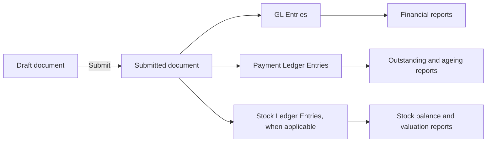

<!-- Frappe documentation: erpnext, part 8 of 18. Index: docs/INDEX.md -->

<!-- page: erpnext/erpnext__handing-deductions-in-payment-entry.md -->
---
title: "Additional Charges in Payment | ERPNext Documentation"
description: "Record bank fees, withholding, write-offs, and other payment differences in ERPNext."
space: "ERPNext"
url: "https://docs.frappe.io/erpnext/handing-deductions-in-payment-entry"
updated: "2026-08-01"
---

A payment can differ from an invoice because of bank charges, withholding, exchange differences, or an approved write-off. Record each difference explicitly in the Deductions or Loss table instead of changing the invoice value.

## Before you begin

Confirm the correct Company, currency, receivable or payable account, and bank or cash ledger. Use submitted source documents and keep the bank reference or remittance advice available.

## Use Additional Charges in Payment

1. Enter the actual amount paid or received.
2. Allocate the intended amount against the invoice references.
3. Open **Deductions or Loss** and add one row for each difference.
4. Select the correct ledger, amount, Cost Center, and explanation.
5. Confirm that the Difference Amount is zero and submit.


## Important fields and what they mean


| Field                 | What it controls                                          |
| --------------------- | --------------------------------------------------------- |
| Account               | Ledger that explains the charge or deduction.             |
| Cost Center           | Required reporting dimension for the amount.              |
| Amount                | Signed value needed to balance the Payment Entry.         |
| Difference Amount     | Balance still unexplained.                                |
| Exchange Gain or Loss | Difference caused by currency conversion when applicable. |


## What happens after you submit or process

ERPNext updates the relevant accounting records and, where applicable, the outstanding or unallocated amounts. Review the General Ledger, party ledger, and source document status before treating the workflow as complete. A saved draft does not affect the ledger.

## Troubleshooting

### Difference Amount is not zero after adding a deduction

Confirm the actual bank amount, invoice allocation, and whether the deduction should be added or subtracted. The allocated amount commonly represents the amount clearing the invoice, while the bank amount reflects cash movement.

### A bank charge was posted as a tax

Use **Deductions or Losses** with the bank charges account. Taxes and Charges is for amounts connected to the party transaction, not a fee retained by the bank.

### A deduction unexpectedly changes the customer or supplier balance

Review the account head and whether it is a party receivable or payable account. Deductions such as fees, withholding, discounts, and exchange differences require different ledger accounts.

## Frequently asked questions

### Which differences belong in Deductions or Losses?

Common examples include bank charges, exchange gains or losses, write-offs, withholding, and approved settlement differences. Each line should have an explicit account and business explanation.

### Should the source invoice be edited to match the payment?

Keep a valid submitted invoice unchanged. Record the actual payment and account for the legitimate difference in the Payment Entry or another supported adjustment.

### Can several deductions be recorded in one Payment Entry?

Several lines can be used when the settlement contains distinct components. Use separate accounts so the ledger and audit trail remain clear.

### Can deductions be negative?

Use signs and Add or Deduct behavior only according to the field's accounting logic. Preview the ledger impact because a negative amount can reverse the intended account effect.

## Related topics

- [Payment Entry](/erpnext/payment-entry)
- [Payment Reconciliation](/erpnext/payment-reconciliation)
- [Bank Reconciliation](/erpnext/bank-reconciliation)
- [Bank Transaction](/erpnext/bank-transaction)
- [Journal Entry](/erpnext/journal-entry)

<!-- page: erpnext/erpnext__handling-excess-customer-payments.md -->
---
title: "Handling Excess Customer Payments | ERPNext Documentation"
description: "Record overpayments and keep the excess available for future ERPNext invoices or refunds."
space: "ERPNext"
url: "https://docs.frappe.io/erpnext/handling-excess-customer-payments"
updated: "2026-08-01"
---

If a Customer pays more than the invoice balance, allocate only the amount that clears the invoice. Leave the excess unallocated as a Customer advance, then apply it to a future invoice or refund it through an approved payment.

## Before you begin

Confirm the correct Company, currency, receivable or payable account, and bank or cash ledger. Use submitted source documents and keep the bank reference or remittance advice available.

## Use Handling Excess Customer Payments

1. Record the full amount received in one Payment Entry.
2. Allocate the invoice balance in References.
3. Leave the remaining amount unallocated.
4. Use Payment Reconciliation to apply the balance to a later invoice, or create a controlled refund.
5. Review the Customer ledger after the allocation or refund.


## Important fields and what they mean


| Field              | What it controls                         |
| ------------------ | ---------------------------------------- |
| Paid Amount        | Full cash received.                      |
| Allocated Amount   | Amount used to clear current invoices.   |
| Unallocated Amount | Customer credit available for later use. |
| Party              | Customer who owns the credit.            |
| Reference No       | Bank evidence for the overpayment.       |


## What happens after you submit or process

ERPNext updates the relevant accounting records and, where applicable, the outstanding or unallocated amounts. Review the General Ledger, party ledger, and source document status before treating the workflow as complete. A saved draft does not affect the ledger.

## Troubleshooting

### The excess amount does not appear on a later invoice

Confirm that it remains unallocated for the same Customer, Company, currency, and receivable account. Fetch advances on a draft invoice or use Payment Reconciliation for a submitted invoice.

### An extra gateway surcharge appears as a customer advance

ERPNext treats money received above invoice allocations as an unallocated balance. If the extra amount is revenue or fee recovery rather than customer credit, invoice or account for it through the appropriate supported workflow.

### The excess was allocated to the wrong invoice

Use Unreconcile Payments and then Payment Reconciliation when only the allocation is wrong. Cancel and amend the Payment Entry when the money, party, or ledger account is incorrect.

## Frequently asked questions

### What happens when a customer pays more than the invoice total?

Allocate the invoice amount and leave the remainder unallocated. ERPNext can treat that balance as an advance available to the same Customer.

### Can the excess be refunded?

Use a traceable outgoing payment or approved adjustment that clears the customer balance. Preserve the original receipt and reference the reason for the refund.

### Can an excess payment be transferred to another customer?

Do not change the party on the original receipt. Use an approved accounting transfer with a clear audit trail and authorization when the credit genuinely belongs to another party.

### Does an unallocated payment reduce a specific invoice's outstanding amount?

It does not reduce an invoice until it is allocated. The party may have an overall credit while individual invoices remain outstanding.

## Related topics

- [Payment Entry](/erpnext/payment-entry)
- [Payment Reconciliation](/erpnext/payment-reconciliation)
- [Bank Reconciliation](/erpnext/bank-reconciliation)
- [Bank Transaction](/erpnext/bank-transaction)
- [Journal Entry](/erpnext/journal-entry)

<!-- page: erpnext/erpnext__help-articles.md -->
---
title: "Help Articles Index"
space: "ERPNext"
url: "https://docs.frappe.io/erpnext/help-articles"
updated: "2026-07-05"
---

Below is a few help articles which can help you configure the system as per your requirements.

### System

- [Document Versioning](/erpnext/document-versioning)
- [Adding Attachment to Ongoing Messages](/erpnext/adding-attachments-to-outgoing-messages)
- [Copy Pasting Multiple Records](/erpnext/copy-pasting-multiple-records-from-excel)
- [Renaming Documents](/erpnext/renaming-documents)
- [Bulk Rename](/erpnext/bulk-rename)
- [Deleting and restoring Documents](/erpnext/how-to-restore-deleted-documents-in-erpnext)
- [Deleting Custom Reports](/erpnext/deleting-custom-reports)
- [Restore Deleted Documents](/erpnext/how-to-restore-deleted-documents-in-erpnext)
- [Duplicate Records](/erpnext/duplicate-record)
- [Checking Link Between Documents](/erpnext/check-link-between-documents)
- [Filter Option in Select Field](/erpnext/filter-options-in-select-field)
- [Automating Assignment](/erpnext/automating-issue-assignments-to-support-team-in-erpnext)
- [Email Error in Sending and Receiving](/erpnext/email-error)
- [Maximum User Limit Issue](/erpnext/how-to-fix-the-reached-maximum-user-limit-for-your-subscription-issue)
- [Perm Level Error](/erpnext/perm-level-error-in-permission-manager)
- [Permission Error Problems](/erpnext/report-permission-error)
- [Using Prepared Report](/erpnext/prepared-report)
- [Emails Are Not Received](/erpnext/what-if-emails-are-not-being-received-by-the-recipients)
- [Maximum Number of Fields in a Form](/erpnext/maximum-number-of-fields-in-a-form)
- [Making Custom Reports](/erpnext/making-custom-reports)
- [Deleting Custom Reports](/erpnext/deleting-custom-reports)
- [Reports Showing Multiple Lines for One Document](/erpnext/reports-showing-multiple-lines-for-one-document)
- [Add Columns in Standard Reports](/erpnext/how-to-add-columns-in-the-standard-report-and-export)
- [Fetch Child Table Values Using Jinja](/erpnext/fetch-child-table-values-using-jinja-tags)
- [Change Custom Field Datatype After Field Creation](/erpnext/change-custom-field-datatype-after-field-creation)
- [Company Wise Naming Series](/erpnext/company-wise-naming-series)
- [Feedback Request Using Web Form](/erpnext/feedback-request-using-web-form)
- [Manage Tree Structure of Masters](/erpnext/managing-tree-structure-masters)
- [Set Default Value for Any Field](/erpnext/setting-default-values-for-any-field-in-erpnext)
- [Set Precision](/erpnext/set-precision)
- [Set Language](/erpnext/set-language)
- [Edit Submitted Documents](/erpnext/edit-submitted-document)
- [Delete Submitted Documents](/erpnext/delete-submitted-document)
- [Set Current Value for Naming series](/erpnext/naming-series-current-value)
- [Easy Steps To Setup Workflow](/erpnext/easy-steps-to-setup-workflow)
- [Tree Master Renaming](/erpnext/tree-master-renaming)
- [Letter Head in Report](/erpnext/letter-head-in-the-report)
- [Sync Doctypes with Events Calendar](/erpnext/how-to-sync-doc-types-with-calendar)
- [User Permissions Based on Hierarchy](/erpnext/user-permission-based-on-hierarchy)
- [Add/Remove Fields from Print Format](/erpnext/add-remove-fields-from-print-format)
- [Customise Tables in Print Format](/erpnext/customise-your-items-tables-within-your-print-format-builder)
- [Customise Field Visibility in Print Format](/erpnext/making-fields-visible-in-print-format)
- [Remove Description in Print Format](/erpnext/removing-description-removed-item-code-and-name)
- [Print 'Centavo' in Words for USD](/erpnext/centavo-being-printed-in-words-for-usd)

### Accounting

- [Merging Accounts](/erpnext/merging-accounts)
- [Changing Parent Account](/erpnext/changing-parent-account)
- [Freeze an Account](/erpnext/freeze-account)
- [Freeze Accounting Entries](/erpnext/freeze-accounting-entries)
- [Common Receivable Account](/erpnext/common-receivable-account)
- [Sales Return Management](/erpnext/sales-return-use-cases)
- [Delivery From Sales Invoice](/erpnext/update-stock-option-in-sales-invoice)
- [Default Receivable / Payable Account](/erpnext/accounts/articles/default-receivable-payable-account)
- [Payment Entry for Capital Account](/erpnext/payment-entry-for-capital-account)
- [Book Petty Cash Entry](/erpnext/petty-cash-entry-in-erpnext)
- [Accounting for Bad Debts](/erpnext/accounting-for-bad-debts)
- [Purchase Invoice Account Type Error](/erpnext/purchase-invoice-account-type-error)
- [Book Discount Allowed and Received Separately](/erpnext/book-discount-allowed-and-received-separately)
- [Adding Reference To Journal Entry](/erpnext/adding-reference-to-journal-entry)
- [Invoice Discount in Payment Entry](/erpnext/adding-reference-to-journal-entry)
- [Withdrawing Salary from Owner's Equity Account](/erpnext/withdrawing-salary-from-owners-equity-account)
- [Buy 1 Get 1 Free Pricing Rule](/erpnext/setting-up-buy-1-get-1-free-pricing-rule)
- [Adjusting Without Amount](/erpnext/adjusting-withhold-amount)
- [Post Dated Cheque Entry](/erpnext/post-dated-cheque-entry)
- [Difference Entry](/erpnext/difference-entry-button)
- [Setting Up Taxes](/erpnext/setting-up-taxes)
- [Unreconciled](/erpnext/unreconciliation)
- [Period Closing Voucher](/erpnext/period-closing-voucher)
- [ERPNext QuickBooks Migrator](/erpnext/quickbooks-migrator)
- [Process Statement of Accounts](/erpnext/process-statement-of-accounts)
- [Payment Terms Status Report](/erpnext/payment_terms_status_report)
- [Inter Company Journal Entry](/erpnext/inter-company-journal-entry)
- [Advance in Separate Party Account](/erpnext/advance-in-separate-party-account)
- [Fiscal Year Error](/erpnext/fiscal-year-error)
- [Round Off Account Validation Message](/erpnext/round-off-account-validation)
- [Delete Entries Linked With GL Entries](/erpnext/delete-entries-linked-with-gl-entries)
- [Invoice Rounding Issue](/erpnext/invoice-rounding-issue)
- [Customise Cash Flow Report](/erpnext/customise-cash-flow-report)
- [Export Data for Specific Year or Filter](/erpnext/export-data-for-specific-year-or-filter)
- [Allocating Credit Note and Payment](/erpnext/allocating-credit-note-and-payment)
- [Reconcile Advance Payment to Supplier](/erpnext/reconcile-advance-payment-made-to-the-supplier)
- [Balance in Temporary Account](/erpnext/balance-in-temporary-account)
- [Calculate Freight Taxes](/erpnext/calculatin-freight-in-taxes-in-erpnext)
- [Purpose of Stock Received But Not Billed](/erpnext/stock-received-but-not-billed)
- [Closing Accounting Books](/erpnext/closing-accounting-books-in-erpnext)

### Buying

- [Purchase Invoice for Services](/erpnext/item-creation-not-required-in-purchase-invoice)
- [Debit Note for Price Adjustment](/erpnext/debit-note-for-price-adjustment)
- [Procurement Tracker Report](/erpnext/procurement-tracker-report)
- [Amending Purchase Order After Submit](/erpnext/amending-purchase-order-after-submit)

### Selling

- [Sales Person Target Allocation](/erpnext/sales-person-target-allocation)
- [Change The Rate Of Item in Sales Cycle](/erpnext/need-to-change-rate-of-items-during-sales-cycle)
- [Sales Persons in Sales Transactions](/erpnext/sales-persons-in-the-sales-transactions)
- [Record Commission to Sales Partner](/erpnext/how-to-give-commission-to-sales-partner)
- [Short Close Multiple Orders](/erpnext/how-to-short-close-multiple-orders-in-erpnext)
- [Close Sales Order](/erpnext/close-sales-order)
- [Amending Sales Order After Submit](/erpnext/amending-sales-order-after-submit)
- [Applying A Discount](/erpnext/applying-discount)
- [Request for Raw Materials from Sales Order](/erpnext/request-for-raw-materials-from-sales-order)
- [Setting Company Sales Goal](/erpnext/setting-company-sales-goal)
- [Sales Invoice Without an Item](/erpnext/sales-invoice-without-an-item)
- [Drop Ship Between Subsidiary](/erpnext/assistance-sales-purchase-between-companies)
- [Loyalty Points Redemption in POS](/erpnext/loyalty-points-redemption-in-pos)
- [Selling in Different UOM](/erpnext/Selling-in-different-UOM)

### Assets

- [Moving Asset from Stock Item to Fixed Asset Item](/erpnext/moving-asset-from-stock-item-to-fixed-asset-item)

### CRM

- [Automate Lead Creation](/erpnext/automate_lead_capturing)
- [Difference Between Lead, Contact and Customer](/erpnext/difference_between_lead_contact_and_customer)

### Stock

- [Track Items Using Barcode](/erpnext/track-items-using-barcode)
- [Item Valuation Setup and Transactions](/erpnext/item-valuation-transactions)
- [Raw Material Valuation](/erpnext/valuation-based-on-field-in-bom)
- [Return Rejected Items](/erpnext/sales-return-use-cases)
- [Repack Entry](/erpnext/repack-entry)
- [Incoterm and Named Place](/erpnext/incoterm-and-named-place)
- [Quick Stock Balance](/erpnext/quick-stock-balance)
- [Quality Inspection Summary](/erpnext/quality-inspction-summary)
- [Migrate to Perpetual Inventory](/erpnext/migrate-to-perpetual-inventory)
- [FIFO and Moving Average](/erpnext/calculation-of-valuation-rate-in-fifo-and-moving-average)
- [Perpetual Inventory for Non Stock Items](/erpnext/perpetual-inventory-for-non-stock-item)
- [Projected Quantity](/erpnext/projected-quantity)
- [Opening Stock Balance entry for Serialised and Batch Items](/erpnext/opening-stock-balance-entry-for-serialized-and-batch-item)
- [Linking Stock Warehouse and Accounts](/erpnext/warehouse-ledger-link)
- [Maintaining Supplier Item Code in Item Master](/erpnext/maintaining-suppliers-part-no-in-item)
- [Purchasing in Different UOM](/erpnext/purchasing-in-different-unit)
- [Production Scrap Management](/erpnext/scrap-management)
- [Customer Provided Items](/erpnext/customer-provided-items)
- [Multiple Finished Goods With Single Raw Material](/erpnext/how-to-handle-a-scenario-of-1-raw-material-multiple-finish-goods)
- [Manufacturing Without Creating BOM](/erpnext/manufacturing-without-creating-bom)
- [Material Consumption](/erpnext/material_consumption)
- [Production Analytics](/erpnext/production-analytics)
- [Open Work Order Report](/erpnext/open-work-orders)
- [Demand Driven Forecasting](/erpnext/demand-driven-forecasting)
- [Product Planning Report](/erpnext/production-planning-report)
- [Downtime Analysis](/erpnext/downtime-analysis)
- [Work Order Consumed Materials](/erpnext/work-order-consumed-materials)
- [Returned Material Against Work Order](/erpnext/returned_materials_against_work_order)
- [Issued Items Against Work Order](/erpnext/consumed-materials-in-production)
- [Material Transfer from Delivery Note and Purchase Receipt](/erpnext/material-transfer-from-delivery-note)
- [Allow Over Delivery / Billing](/erpnext/allow-over-delivery-billing-against-sales-order-upto-certain-limit)
- [Item Codification](/erpnext/item-codification)

### Project

- [Make a Colourful Gantt Chart](/erpnext/make-a-colorful-gantt-chart)
- [Bulk Assign Tasks in Projects](/erpnext/bulk-assign-tasks-in-a-project)
- [Project Profitability Report](/erpnext/project-profitability-report)
- [Project and Managing Expenses](/erpnext/project-expense-claims)
- [Project from Customer Portal](/erpnext/project-customer-portal)

### Website

- [Disable Signup in ERPNext Website](/erpnext/disable-signup)
- [Website Homepage](/erpnext/website-home-page)
- [Website Banner Resizing](/erpnext/website-banner)
- [SEO for ERPNext](/erpnext/how-to-setup-seo-for-your-website-on-erpnext)
- [301 Redirect in ERPNext](/erpnext/2-step-301-redirect-in-your-erpnext-website)

<!-- page: erpnext/erpnext__homepage.md -->
---
title: "Homepage\n"
space: "ERPNext"
url: "https://docs.frappe.io/erpnext/homepage"
updated: "2026-02-28"
---


**A homepage is the default landing page of your website.**

ERPNext's Website Module generates a default landing page for your website. You
can customize it in Homepage.

To access the Homepage page in ERPNext, go to:

> Home > Website > Portal > Homepage

## 1. How to setup Home Page
1. Select the Company.
1. Set the Title. This will be shown in the Browser Tab.
1. Configure the Hero Section as explained in the next section.


*Homepage*

> Make sure your default 'Home Page' is set as `home` in Website Settings for
> this to work.

## 2. Hero Section

There are three ways in which you can customize the way the Hero Section looks:

1. Tag Line and Description (Default).
1. Homepage Slideshow.
1. Custom Hero Section.

### 2.1 Tag Line and Description

After you set your Tag Line, Description and Hero Image you'll have a decent
looking front page. You can also change the URL for the Explore button under **URL for "All Products"**.


*Website Homepage*

### 2.2 Homepage Slideshow

Set the **Hero Section Based On** to **Slideshow** and the **Homepage Slideshow**
field will appear.


*Homepage Slideshow Setting*

Now, select an existing Slideshow or create a new one shown as follows:


*Website Slideshow*

> For best results, make sure all of your slideshow images have same height and
> their width is greater than the height.


### 2.3 Custom Hero Section

The third type of Hero Section allows you to write your own HTML.

Set **Hero Section Based On** to **Hero Section**.

Now create a new Hero Section. Set **Section Based On** as **Custom HTML**.
Write your custom HTML in the Section HTML field.


*Homepage Settings*

You can write any valid [Bootstrap 4](https://getbootstrap.com/) markup here.


*New Hero Section*

It will look something like this:

*Homepage Hero Custom*

## 3. Featured Products

You can also show featured products on your Homepage by adding them to the
Products table.


*Homepage Products Table*

It will look something like this:

*Featured Products on Homepage*

## 4. Homepage Section

You can add custom sections on your Homepage by creating new Homepage Sections.

> Go to Website > Portal > Homepage Section

A homepage section can consist of cards or Custom HTML. Set **Section Based On**
to **Cards**.


*New Homepage Section*

Add details for each card like Title, Subtitle, Image, Content and Route in the
Section Cards table.

It will look something like this:

*Homepage Section*

You can also control the order in which these sections appear by setting the
**Section Order**. 0 will be shown first, followed by 1, and so on.

> To add Sections with Custom HTML refer [Custom Hero Section](#23-custom-hero-section).

## 5. Custom Homepage

ERPNext allows you to have a completely different homepage if you don't want to
use the default one described above.

To setup a custom homepage:

1. Create a [Web Page](/erpnext/web-page).
1. Go to Website > Setup > Website Settings.
1. Set Home Page as the `route` of your Web Page.
 

<!-- page: erpnext/erpnext__how-is-valuation-rate-of-serialised-item-calculated-in-erpnext.md -->
---
title: "Serialised Item Valuation Rate calculation"
space: "ERPNext"
url: "https://docs.frappe.io/erpnext/how-is-valuation-rate-of-serialised-item-calculated-in-erpnext"
updated: "2026-03-02"
---

In ERPNext, Item's stock **valuation rate** is updated on creation of the following transaction:  
1. Purchase Receipt
2. Stock Entry of type Material Receipt
3. Stock Reconciliation made for updating stock opening balance

  
ERPNext supports 2 valuation types: FIFO & Moving Average.   
You can select valuation method based on which item's value will be calculated. It can be set as per individual item as well as globally for all the items from Stock Settings.  
  
  
Item valuation rates are calculated as per the valuation method set for them. However, in the case of **serialised Item**, these settings are *ignored*. The below Item, "Macbook Pro" is a serialised Item and it's valuation rate is not fetched from Item master. Instead, the valuation rate is updated from the *first incoming stock entry rate*, RS 199.80. Consequently, it is updated as per the other transactions carried out on this Item.  
Item Master:  
  
  
Stock Ledger:  
  
To learn more about ERPNext Stocks module, click [here](https://erpnext.com/docs/user/manual/en/stock)

<!-- page: erpnext/erpnext__how-to-add-columns-in-the-standard-report-and-export.md -->
---
title: "Add columns in Standard Report and Export"
space: "ERPNext"
url: "https://docs.frappe.io/erpnext/how-to-add-columns-in-the-standard-report-and-export"
updated: "2026-03-04"
---

In **Standard Reports** of **ERPNext** such as *SOA, Accounts Receivable/Payable etc*, we provide an option to **Add/Remove Columns** from the documents and display it in the Report, these columns are only meant for reference at that particular moment of time.  
  
If the User needs to *Export* along with the changes made by him in the Report, the User needs to Save the Report and then *Export* it.   
  
  

<!-- page: erpnext/erpnext__how-to-add-master-link-and-fetch-data-from-the-same.md -->
---
title: "Fetching data from a linked master"
space: "ERPNext"
url: "https://docs.frappe.io/erpnext/how-to-add-master-link-and-fetch-data-from-the-same"
updated: "2026-03-04"
---

**Question:** How to add terms and conditions in driver form?  
**Steps:**  
1. Go to the doctype where you want the to add the terms and conditions.
2. Go to Menu > Customize

  
1. You will see a table with a list of fields. These are the fields in your driver page.
2. Scroll down to the section/field after which you want to add terms and conditions.
3. Click on the small icon on the right side. This will expand the selected field.
4. You can add a new field above on below by clicking on *Insert Above/Below*.
5. Add a new field as show below:For more details on adding a custom link field, refer [this link](/erpnext/creating-custom-link-field).
6. Add a second field below this:How does this work? In Fetch from, we are adding the following details: doctype.field. In the Terms and Conditions doctype, the field where we add the terms is named *terms* and it is of type: Text Editor. For *fetch from*to work, the data must be in the following format: link_field_name.field_to_fetch
7. Once this is done, click on **Update**, and go back to your list. Click on Ctrl + Shift + R to reload.
8. When you select the terms template in the driver, the system will fetch the conditions from the selected template:

<!-- page: erpnext/erpnext__how-to-apply-tax-on-tax.md -->
---
title: "Apply Tax on Another Tax or Charge"
space: "ERPNext"
url: "https://docs.frappe.io/erpnext/how-to-apply-tax-on-tax"
updated: "2026-08-14"
---

Use **On Previous Row Total** when a tax or charge must be calculated on the running total after an earlier row. The base includes the item Net Total and every amount included up to the referenced row.


Consider Nova Industries, an electronics manufacturer and distributor. a transaction has a Net Total of $1,000. Row 1 adds an 8% tax of $80, bringing the running total to $1,080. Row 2 applies 2% to that $1,080:


`$1,080 × 2% = $21.60`


The Grand Total becomes $1,101.60.


This calculation is often described as tax on tax or a compound tax. Use it only when the applicable rule requires the later tax to include the earlier tax or charge in its base.

## Before you begin

Confirm the required calculation order with your accountant or tax adviser. A different row order can change the result even when the same rates are used.

You need:

- An Account Head for each tax or charge that must be posted separately.
- A [Sales Taxes and Charges Template](/erpnext/sales-taxes-and-charges-template) or [Purchase Taxes and Charges Template](/erpnext/purchase-taxes-and-charges-template), or a transaction where tax rows can be entered directly.
- The earlier tax or charge above the compound row.
- A small manual example with an expected result.

Review [Types in Tax Template](/erpnext/types-in-tax-template) if the calculation bases are unfamiliar.

## Understand the calculation

The example produces:


| Row | Type                  | Calculation base | Rate | Amount | Running Total |
| --- | --------------------- | ----------------: | ----: | ------: | -------------: |
| 1   | On Net Total          | $1,000.00        | 8%   | $80.00 | $1,080.00     |
| 2   | On Previous Row Total | $1,080.00        | 2%   | $21.60 | $1,101.60     |


The formula for row 2 is:

`Referenced row Total × Tax Rate ÷ 100`

The referenced row's **Total** is the cumulative transaction total after that row. It is not the $80 Amount produced by row 1.

## Configure the earlier tax or charge

Create or open the reusable tax template.

1. Add the tax or charge that must be included first.
2. Choose its calculation Type, such as **On Net Total**.
3. Select the correct Account Head.
4. Enter the Tax Rate and a clear Description.
5. Save the row.

In the worked example, row 1 applies 8% to the $1,000 Net Total and produces $80. The resulting row Total is $1,080.

## Add the compound-tax row

Add the later tax below the row it depends on.

1. Set **Type** to **On Previous Row Total**.
2. Set **Reference Row #** to the earlier row. Enter 1 for this example.
3. Select the Account Head for the compound tax.
4. Enter the Tax Rate, such as 2.
5. Confirm whether ERPNext should add or deduct the row.
6. Save the template.

Reference Row # refers to the numbered row in the tax table. It must point to an earlier row. Recheck it whenever rows are inserted, deleted, moved, or duplicated.

## Apply the template to a transaction

Select the template on a draft [Sales Invoice](/erpnext/sales-invoice), [Quotation](/erpnext/quotation), Sales Order, Purchase Invoice, or another supported transaction.

Use one item with a Net Total of $1,000 for the first test. ERPNext should show:

- Row 1 Amount: $80.00.
- Row 1 Total: $1,080.00.
- Row 2 Net Amount: $1,080.00.
- Row 2 Amount: $21.60.
- Total Taxes and Charges: $101.60.
- Grand Total: $1,101.60.


The row 2 Net Amount is a useful verification point because it exposes the base used by the formula.

## Compare it with tax on another tax amount

**On Previous Row Total** and **On Previous Row Amount** are not interchangeable.


| Type for row 2         | Base from row 1  | 2% result | Grand Total |
| ---------------------- | ----------------: | ---------: | -----------: |
| On Previous Row Amount | Amount: $80.00   | $1.60     | $1,081.60   |
| On Previous Row Total  | Total: $1,080.00 | $21.60    | $1,101.60   |


Use [Tax on Another Tax Amount](/erpnext/tax-on-another-tax-amount) when the later levy applies only to the earlier $80 tax. Use Previous Row Total when it applies to the full $1,080 subtotal after that tax.

## Build a longer calculation sequence

A later row can reference the Total after any earlier row. For example:


| Row | Purpose                             |
| --- | ----------------------------------- |
| 1   | Base tax on Net Total               |
| 2   | Fixed charge added after the tax    |
| 3   | Percentage on the Total after row 2 |


If row 3 references row 2, its base includes the item value, row 1, and row 2. If it references row 1, it excludes row 2. This lets ERPNext model ordered calculations, but it also makes templates sensitive to row sequence.

Keep descriptions explicit. A description such as “2% on total after base tax” is easier to audit than a generic “Tax 2%”.

## Account for item-specific tax rates

When items have different rates, use an [Item Tax Template](/erpnext/item-tax-template) for the base row. ERPNext first determines the referenced row's actual Amount and Total, then calculates the later row from the configured reference.

Test taxable, exempt, and reduced-rate items together before reusing the template. Confirm that the compound row's legal base should include the mix of earlier item-wise amounts.

## Verify the submitted result

Before applying the template widely:

1. Calculate a small draft manually.
2. Compare each row's Net Amount, Amount, and Total.
3. Confirm Reference Row # and row order.
4. Review Grand Total.
5. Submit a controlled transaction.
6. Open the [General Ledger](/erpnext/general-ledger) and confirm each tax account and the party balance.

If a [Tax Rule](/erpnext/tax-rule) selects the template automatically, test every relevant party, item, and transaction combination. A correct template can still be unexpected when the wrong rule applies it.

## Troubleshooting

### The compound tax is too small

The row may be set to On Previous Row Amount, which uses only the earlier row's charge. Change it to On Previous Row Total only when the required base is the cumulative total.

### The compound tax includes an unwanted charge

Check Reference Row #. It may point to a later running total than intended. Reference the row whose Total contains exactly the components required by the rule.

### The result changed after editing the template

Row numbers can change after inserting, deleting, or moving rows. Reopen every previous-row calculation and verify its Type and Reference Row #.

### ERPNext rejects the reference row

The referenced row must come earlier. Reference Row # is supported only for On Previous Row Amount and On Previous Row Total.

## Frequently asked questions

### Does On Previous Row Total always mean tax on tax?

It means tax or charge on a running total. That running total can include item value, taxes, and other charges through the referenced row.

### Can I reference row 2 from row 4?

Yes, provided row 2 comes earlier. Row 4 then uses row 2's Amount or Total according to the selected Type.

### Should the compound tax use a separate ledger account?

Use the accounts required by your chart of accounts and reporting rules. Separate accounts generally make distinct liabilities easier to inspect.

### Does a discount change the compound-tax base?

It can, depending on where and how the discount is applied. Test the actual discount workflow and inspect the tax rows rather than assuming the pre-discount base remains unchanged.

### Can I use this calculation on purchase documents?

Y

es. On purchase rows, also decide whether each calculated amount affects the supplier Total, stock Valuation, or both. See [Include Tax or Charge in Valuation or Total?](/erpnext/include-tax-or-charge-in-valuation-or-total).

## Related topics

- [Tax on Another Tax Amount](/erpnext/tax-on-another-tax-amount)
- [Types in Tax Template](/erpnext/types-in-tax-template)
- [Sales Taxes and Charges Template](/erpnext/sales-taxes-and-charges-template)
- [Purchase Taxes and Charges Template](/erpnext/purchase-taxes-and-charges-template)
- [Item Tax Template](/erpnext/item-tax-template)
- [Tax Rule](/erpnext/tax-rule)

<!-- page: erpnext/erpnext__how-to-create-a-supplier-quotation-through-the-supplier-portal.md -->
---
title: "Create Supplier Quotation through Supplier Portal"
space: "ERPNext"
url: "https://docs.frappe.io/erpnext/how-to-create-a-supplier-quotation-through-the-supplier-portal"
updated: "2026-02-26"
---

In ERPNext, Supplier Quotations can either be created manually or via the Supplier Portal. Suppliers can create Quotations via the Supplier Portal once they have logged into the system. 

Pre-requisites:

* The Supplier must be a registered Website User with "Supplier" role.
* Supplier user account's Contact must be linked to the Supplier document.


  


For a Supplier to create a Quotation, there should be an existing Request for Quotation (RFQ) against them. To do this entire process, follow the following steps:

  


1) Create a Request for Quotation for the Supplier in the system. For example, we are creating an RFQ for "MNO Suppliers".

  


  


2) Now, the Supplier (MNO Suppliers in our case) has to log into the Supplier Portal using their login credentials. There, the Supplier will be able to view the RFQ

  


The Supplier has to enter the Item Rate and submit the RFQ.

  


  


  


  


Once the RFQ is submitted, a Supplier Quotation gets automatically created in the system against this RFQ. Click on the "View" option.

  


  


Observe that the Supplier Quotation is in the Draft state. After reviewing the Supplier Quotation, the user can submit it. This will also be reflected in the Supplier Portal.

  


  


  

<!-- page: erpnext/erpnext__how-to-create-and-print-proforma-invoice-in-erpnext.md -->
---
title: "How to create and print proforma invoice in ERPNext"
space: "ERPNext"
url: "https://docs.frappe.io/erpnext/how-to-create-and-print-proforma-invoice-in-erpnext"
updated: "2026-07-02"
---

ERPNext does not have a dedicated "Proforma Invoice" document. To print one, you can simulate it by opening a **Quotation** or **Sales Order**, changing the document's Print Heading to "Proforma Invoice", and printing the document.

Follow these exact steps to print a proforma invoice for a customer:

**1. Create and Open the Document**

- Navigate to the Quotation or Sales Order you wish to send.
- Open the specific document record you want to print.

**2. Update the Print Heading**

- Scroll down to the Printing Settings section in the Quotation or Sales Order.
- In the Print Heading field, click the dropdown and select Create a new Print Heading.
- Type Proforma Invoice as the new heading name and save.
- Select this newly created Proforma Invoice heading from the dropdown and save your document.

**3. Print or Save as PDF**

- Click the Menu button (three dots) or the Print icon at the top left of the screen.
- Ensure you have the proper Letterhead selected if you need your company logo and contact details.
- Click PDF to download it to your computer, or click Print to send it directly to your hardware.

---

**Additional Customization Resources**

- **[ERPNext Print Designer Tutorial (Video Guide)](https://www.youtube.com/watch?v=-wH9jAUP4CE)**
- **[Frappe Customize Print Format Guide (Official Documentation)](https://docs.frappe.io/erpnext/records-print-format)**

<!-- page: erpnext/erpnext__how-to-disable-users-in-the-erpnext-system.md -->
---
title: "Disable Any User"
space: "ERPNext"
url: "https://docs.frappe.io/erpnext/how-to-disable-users-in-the-erpnext-system"
updated: "2026-02-26"
---

If you want to prohibit an ERPNext user from using the system then you can follow the below steps. This will be useful when your employees resign or in case you want to ban certain users from accessing the system.

**How to disable a user?**
--------------------------

1. Type ‘User List’ in the awesome bar
2. Select the user you want to disable
3. Uncheck the ‘Enabled’ checkbox for the selected user
4. Save your changes

Once the changes are saved, the user will be marked as 'Disabled' in the list which can always be re-enabled as per the need. After re-enabling a user, all the configurations associated with it will be retrieved as is.

  

<!-- page: erpnext/erpnext__how-to-fix-the-reached-maximum-user-limit-for-your-subscription-issue.md -->
---
title: "Maximum User Limit Issue"
space: "ERPNext"
url: "https://docs.frappe.io/erpnext/how-to-fix-the-reached-maximum-user-limit-for-your-subscription-issue"
updated: "2026-03-04"
---

Your ERPNext subscription depends on the number of System Users you subscribe for. Once you cross that limit, the system will not let you create any further number of users. For example, you have subscribed for 10 users. If you already have already created 10 System Users in your account, the system wont let you create the 11th System User, and you will get the below message.

  


  


To fix this, you will either have to:

1) Buy new users or

2) Disable the current users

  


However, sometimes, you may still face this issue even when you have not exhausted the number of System Users as per your subscription plan. For example, you have a limit of 5 System Users and you have only created 3 users. Yet while creating the 4th user, you get the above message. The reason for this can be that for some of the uses, the field of "Simultaneous Sessions" is greater than 1.

  


Every simultaneous session is considered as 1 System User. For example, if you have created 3 users and one of them has "Simultaneous Session" set to 3, then you have a total of 5 users, i.e. 3 + 1 + 1 = 5 simultaneous sessions/system users.

  


To allow the system to let you create more users, you will have to reduce the simultaneous sessions of these users. To do so, go to the User's profile, under Security Settings, set/reduce the "Simultaneous Session" accordingly.

  


  


**Note:** You will still be able to create Website Users as there is no limit for the same.

<!-- page: erpnext/erpnext__how-to-give-commission-to-sales-partner.md -->
---
title: "Setting Company Sales Goal | ERPNext Documentation"
description: "Set a monthly Company sales target in ERPNext and compare it with submitted current-month sales for practical progress tracking."
space: "ERPNext"
url: "https://docs.frappe.io/erpnext/how-to-give-commission-to-sales-partner"
updated: "2026-07-24"
---

A Company sales goal gives users a simple monthly revenue benchmark in ERPNext. Set the goal on the Company record, then compare it with **Total Monthly Sales**, which ERPNext updates from current-month sales activity.

Use this setting for a company-wide monthly target. Use [Sales Person Target Allocation](/erpnext/sales-person-target-allocation) when targets must be assigned by salesperson, Item Group, Fiscal Year, or monthly distribution.

## Before you begin

Confirm that:

- The [Company](/erpnext/company-setup) is a leaf company, not only a group node.
- The default currency is correct because the goal is stored in the Company currency.
- Sales transactions use the correct company and posting dates.
- Users responsible for the goal can read the Company record and relevant sales reports.

Choose a target approved by the business. The field does not create a forecast, budget, incentive plan, or accounting entry.

## Set the monthly Company sales goal

1. Open the required Company.
2. Select the **Buying and Selling** tab.
3. In **Buying & Selling Settings**, enter the **Monthly Sales Target**, as highlighted.
4. Save.
5. Review **Total Monthly Sales**, also highlighted, to compare actual current-month sales with the target.


In this example, Nova Electronics Trading has a monthly target of $100,000 and current monthly sales of $13,949.

## Fields and what they mean


| Field                | Meaning                                                                       |
| -------------------- | ----------------------------------------------------------------------------- |
| Monthly Sales Target | Company-wide sales goal for each month, entered in the Company currency       |
| Total Monthly Sales  | Current-month sales total maintained by ERPNext from submitted sales activity |
| Default Currency     | Currency used to display and interpret the goal and total                     |
| Company              | Legal entity whose sales contribute to the total                              |


The target is one recurring monthly value. It does not store a different target for every month. When the plan changes, update the field according to your approval process and record the reason separately if an audit trail is required.

## What contributes to monthly sales

ERPNext updates the Company sales history from submitted [Sales Invoices](/erpnext/sales-invoice). The posting date and Company determine which month and entity receive the value.

For reliable comparison:

- Submit invoices only after the sale is approved.
- Use the correct posting date.
- Keep returns and credit notes in the same accounting workflow so net sales remain meaningful.
- Review [Sales Returns](/erpnext/sales-return) when goods or invoiced value must be reversed.
- Use consistent company and currency configuration in multi-company environments.

Draft transactions should not be treated as achieved revenue. A [Sales Order](/erpnext/sales-order) represents a customer commitment, while a Sales Invoice records billed sales activity.

## Track progress during the month

Calculate simple achievement using:

**Achievement % = Total Monthly Sales ÷ Monthly Sales Target × 100**

For the example above:

**$13,949 ÷ $100,000 × 100 = 13.949%**

Use ERPNext reports for the supporting detail:

- [Sales Analytics](/erpnext/sales-analytics) for trends by customer, item, territory, or other dimensions.
- [Accounts Receivable](/erpnext/accounts-receivable) for billed amounts that remain outstanding.
- [Sales Person Target Variance](/erpnext/sales-person-target-allocation) for salesperson performance against allocated targets.
- [Profit and Loss Statement](/erpnext/profit-and-loss-statement) when management needs accounting revenue and profitability rather than the Company goal indicator.

The Company goal is intentionally simple. Build dashboards or reports when the organization requires forecasts, weighted pipelines, separate product targets, or quarter-to-date analysis.

## Multi-company considerations

Set the target separately on each operating Company. A parent group company does not automatically combine or distribute the goals of its child companies.

When Nova Electronics Trading is a child of Nova Industries, its monthly target and actual sales belong to Nova Electronics Trading. Review consolidated financial reports separately when the group needs combined performance.

Use [Inter Company Invoices](/erpnext/inter-company-invoices) carefully. Internal revenue can distort operational sales goals if the target definition is meant to measure only external customers.

## Change or remove a goal

To change the target, update **Monthly Sales Target** and save. ERPNext uses the new value for comparison with the current total.

To stop using the indicator, set the value according to your organization's convention, usually zero, and save. This does not change invoices, accounting entries, or historical transactions.

## Troubleshooting

### Total Monthly Sales is not updating

Confirm that the Sales Invoice is submitted, uses the same Company, and has a posting date in the current month. Refresh the Company record after the transaction completes.

### The total is lower than expected

Review credit notes, returns, posting dates, and company filters. Confirm that expected invoices are submitted rather than saved as drafts.

### The total is in the wrong currency

Check the Company's Default Currency and the invoice conversion rate. The Company goal is interpreted in company currency.

### Users cannot edit the target

The user may lack permission to write the Company record. An administrator can review [Role-Based Permissions](/erpnext/role-based-permissions) and the user's company permissions.

### A parent company does not show combined child sales

Use consolidated reports or a dashboard designed for group analysis. The field is maintained per Company.

## Frequently asked questions

### Can I enter a different target for each month?

Not in the single Company field. Use target allocation and Monthly Distribution for more detailed planning.

### Does the target block sales when it is exceeded?

No. It is an informational benchmark.

### Does changing the target alter accounting records?

No. It changes only the goal used for comparison.

### Can I use Sales Orders instead of Sales Invoices for actual performance?

Use an order-based report or dashboard for bookings. The Company monthly sales total is based on submitted sales activity maintained by ERPNext.

### Is this the same as a budget?

No. Use [Budgeting](/erpnext/budgeting) for accounting budgets by account and cost center.

## Related topics

- [Company](/erpnext/company-setup)
- [Sales Person Target Allocation](/erpnext/sales-person-target-allocation)
- [Sales Analytics](/erpnext/sales-analytics)

<!-- page: erpnext/erpnext__how-to-grant-permissions-for-reports.md -->
---
title: "Edit Export/Print permissions for reports"
space: "ERPNext"
url: "https://docs.frappe.io/erpnext/how-to-grant-permissions-for-reports"
updated: "2026-03-04"
---

To handle Export/Print permissions for a report, use Role Permission Manager of the DocType the report is created from.

### Step 1:

Find out from which Document Type the Report is generated from


### Step 2: 

Go to Role Permission Manager, filter using the same Document Type *(Sales Invoice in our example)* and edit the permissions based on Roles


<!-- page: erpnext/erpnext__how-to-handle-a-scenario-of-1-raw-material-multiple-finish-goods.md -->
---
title: "Multiple finished goods with single raw material"
space: "ERPNext"
url: "https://docs.frappe.io/erpnext/how-to-handle-a-scenario-of-1-raw-material-multiple-finish-goods"
updated: "2026-03-02"
---

In many Manufacturing industries deal with a scenario where they use one RM (Raw Material) & produce multiple Finish goods. Most of the chemical manufacturing industries you can find this business use-case. Now how you can map this use-case in ERPNext? Lets take an example of Oil manufacturing Industry where from Crude oil multiple products are produced like Petrol, Gas, Diesel, Kerosene etc.  
* First create an Item master where crude oil will be RM & Petrol, Gas, Diesel, Kerosene etc. will be your FG. Here every product can also have different UOM.

  
* After creation of item master create a BOM for any of the FG you are going to produce from Crude oil (RM). Here I have created BOM of Petrol for 25 litres where I am going to use Crude oil (RM) of qty. 100 litres. Rest of the FG like Gas, Diesel & Kerosene I have added in Scrap section.

  
  
  
  
* While creating a BOM you can add operations as well & run your production cycle (Work order) accordingly.

  
* After completion of work-order at the time of Back-flush entry your Raw material will get consumed & you will have multiple finish goods.

<!-- page: erpnext/erpnext__how-to-manage-material-transfers-and-goods-in-transit.md -->
---
title: "How to Manage Material Transfers and Goods in Transit"
space: "ERPNext"
url: "https://docs.frappe.io/erpnext/how-to-manage-material-transfers-and-goods-in-transit"
updated: "2026-07-02"
---

# Goods in Transit

Goods in Transit is used when stock has left one warehouse but has not yet been received at the destination warehouse. In ERPNext, this is handled through a **Material Transfer** Stock Entry. The outgoing entry moves stock out of the sending warehouse and into transit. The receiving entry later moves the same stock from transit into the receiving warehouse.

This is useful when goods physically travel between warehouses, branches, stores, or locations, and the transfer should not appear as completed until the receiving location confirms the stock.

## How it works

- **Send to Warehouse:** records that goods have been sent out from the source warehouse and are now in transit.
- **Receive at Warehouse:** records that the goods have reached the destination warehouse and should be added to its stock.
- **Goods in Transit:** keeps the stock separate while it is between the two warehouses.

In the current ERPNext Stock Entry form, the Goods in Transit flow is visible on a **Material Transfer** entry through the **Add to Transit** checkbox and the **Stock Entry (Outward GIT)** reference field.

## Create the outward transfer

1. Go to **Stock Entry** and create a new Stock Entry.
2. Set **Stock Entry Type** to **Material Transfer**.
3. In the item table, select the **Source Warehouse**, item, and quantity to send.
4. Enable **Add to Transit**.
5. Save and submit the Stock Entry.

When **Material Transfer** is selected, ERPNext shows the Goods in Transit fields on the Stock Entry.


*(screenshot — not bundled; see the live page URL in this file's front matter)*

Enable **Add to Transit** when the transfer should first go into Goods in Transit instead of being received directly into the destination warehouse.


*(screenshot — not bundled; see the live page URL in this file's front matter)*

## Create the inward transfer

1. Create another **Material Transfer** Stock Entry.
2. Use **Stock Entry (Outward GIT)** to select the outward Goods in Transit Stock Entry.
3. Set the receiving warehouse in the item table.
4. Save and submit the Stock Entry.

The inward entry completes the transfer. Stock is removed from Goods in Transit and added to the receiving warehouse.

## Example

A company sends 10 units from **Stores - Mumbai** to **Stores - Delhi**.

1. The Mumbai team creates an outward Material Transfer and enables **Add to Transit**.
2. The stock is no longer available in the Mumbai warehouse and is shown as in transit.
3. When the Delhi team receives the goods, they create the inward Material Transfer against the outward Goods in Transit entry.
4. The stock is added to the Delhi warehouse.

## When to use Goods in Transit

- Transfers between warehouses take time to complete.
- The sending and receiving locations are handled by different teams.
- You need visibility of stock that has been dispatched but not yet received.
- You want the receiving warehouse to confirm the receipt before stock is available there.

## Important notes

- Use Goods in Transit only for warehouse-to-warehouse movement, not for sales delivery or purchase receipt.
- The outward and inward Stock Entries should use the same item and quantity unless there is a documented difference.
- Do not use the receiving entry until the goods have physically arrived at the destination warehouse.
- If the transfer is immediate and does not need an in-transit stage, use a normal Material Transfer without enabling **Add to Transit**.

<!-- page: erpnext/erpnext__how-to-restore-deleted-documents-in-erpnext.md -->
---
title: "Restore Deleted Documents"
space: "ERPNext"
url: "https://docs.frappe.io/erpnext/how-to-restore-deleted-documents-in-erpnext"
updated: "2026-03-04"
---

**Use Case:** Need to restore/ retrieve the documents that were deleted.  
**Steps:**  
1) Go to Settings > Deleted Documents (or search for "Deleted Document list" in the search bar).  
2) Search for the deleted document. You can also filter out the document based on the Deleted DocType. For example we need to restore the Purchase Order, PUR-ORD-2019-00019. To do so, search for the same in the deleted document list and open it.  
  
3) Click on the "Restore" button as shown below. Also note the Data box which gives the information on various fields of the document. This helps you confirm whether it is the same document you want to restore.  
  
4) Once the Restore button is clicked, the document gets restored in Draft State with a New Name according to the Naming Series.  
  
  
  
5) You can directly open the newly restored document through the "Open" button or search for the same in that document's list (in this case, Purchase Order list).  
  
  


<!-- page: erpnext/erpnext__how-to-setup-seo-for-your-website-on-erpnext.md -->
---
title: "3 Step SEO for your ERPNext Website"
space: "ERPNext"
url: "https://docs.frappe.io/erpnext/how-to-setup-seo-for-your-website-on-erpnext"
updated: "2026-03-04"
---

SEO stands for **Search Engine Optimisation** and is the process of increasing the quality and quantity of website traffic by increasing the visibility of a website or a web page to users of a web search engine. SEO refers to the improvement of unpaid results and excludes direct traffic/visitors and the purchase of paid placement.  
  
  
Having a presence in the top positions for keywords that your prospects are looking for will increase the probability of your business expansion. Enhance the visibility of your products and offerings by optimizing SEO and using it to maximize the social promotion of your website.   
You can setup meta tags in ERPNext within 3 steps:  
**Step 1: Using awesome bar (Global search bar), open "New Website Route Meta"**  
  
  
**Step 2: Enter the key and value for the meta tag. In our example, we are making it for privacy, and have entered the key and value as below:**  
  
**Step 3: Save this document.**  
  
**Watch SEO in action on your webpage. In this case, the webpage "privacy" holds the corresponding meta tag:**  
  
To learn more about Websites in ERPNext, click [here](https://erpnext.com/docs/user/manual/en/website)

<!-- page: erpnext/erpnext__how-to-short-close-multiple-orders-in-erpnext.md -->
---
title: "Short Close Multiple Orders | ERPNext Documentation"
description: "Learn how to bulk close or reopen multiple Sales Orders in ERPNext while preserving fulfilled quantities and linked transactions."
space: "ERPNext"
url: "https://docs.frappe.io/erpnext/how-to-short-close-multiple-orders-in-erpnext"
updated: "2026-07-24"
---

Use the Sales Order list to close several submitted orders whose remaining quantities will no longer be delivered or billed. Bulk closing keeps every [Sales Order](/erpnext/sales-order) and its linked transactions in the audit trail while removing outstanding balances from active fulfilment.

> Closing is not deletion. The orders, completed deliveries, invoices, and payments remain available.

## Before you begin

Review the selected orders and confirm that:

- Each order is submitted and still open.
- Any quantity accepted by the customer has already been handled through a [Delivery Note](/erpnext/delivery-note) or [Sales Invoice](/erpnext/sales-invoice).
- The customer does not want the remaining quantity fulfilled.
- You are not selecting a draft, completed, cancelled, or already closed order by mistake.

Use [Cancel and Amend](/erpnext/amending-sales-order-after-submit) instead when the original order contains incorrect information.

## Close multiple Sales Orders

1. Open the **Sales Order** list.
2. Use filters such as **Company**, **Customer**, **Delivery Status**, or **Billing Status** to narrow the list.
3. Select the checkbox beside each order you want to close.
4. Select **Actions**.
5. Select **Close**, as highlighted.


ERPNext changes eligible orders to **Closed**. Review the list after the operation and confirm that each intended order has the correct status.

A closed order cannot create new Delivery Notes or Sales Invoices against its outstanding quantity. Submitted downstream documents remain linked and unchanged.

## Reopen multiple Sales Orders

Reopen orders when fulfilment should continue:

1. Filter the Sales Order list to show **Closed** orders.
2. Select the required orders.
3. Select **Actions**.
4. Select **Re-open**, as highlighted.


After reopening, verify the outstanding quantities before creating a [Pick List](/erpnext/pick-list), Delivery Note, or Sales Invoice.

## What happens to partially fulfilled orders

If an order is partly delivered or partly billed, closing affects only the outstanding balance. Completed transactions remain valid.

For example, if five selected orders each contain 10 units and 8 units have already been delivered, closing the orders removes the remaining 2 units per order from pending fulfilment. It does not reverse the 8 delivered units.

Use [Partial Fulfilment of Sales Order](/erpnext/partial-fulfilment-of-sales-order) when the balance is still expected later. Use [Sales Return](/erpnext/sales-return) when delivered goods are coming back.

## Troubleshooting

### Close is not available under Actions

Confirm that you selected at least one Sales Order and that your role has permission to update submitted orders. An administrator can review [Role-Based Permissions](/erpnext/role-based-permissions).

### Some selected orders were not closed

A mixed selection can include ineligible documents, such as drafts, completed orders, cancelled orders, or orders already closed. Filter the list by status and retry only with eligible submitted orders.

### The wrong orders were closed

Select the affected orders and use **Actions > Re-open**. Then review the intended selection before closing again.

### Pending quantities still appear in a report

Refresh the report and check its company, date, and status filters. Also confirm that the Sales Order itself shows **Closed**.

## Frequently asked questions

### Does bulk close cancel linked Delivery Notes or Sales Invoices?

No. It closes only the outstanding Sales Order balance.

### Can I close orders from different customers together?

Yes, provided every selected order is eligible. Filtering by customer or company reduces selection mistakes.

### Can I use the same process for Purchase Orders?

The Purchase Order list provides equivalent bulk close and reopen actions for eligible orders. Review each order type separately before applying a bulk action.

### Is there an undo button?

There is no single undo command. Use **Re-open** for the selected closed orders.

## Related topics

- [Close Sales Order](/erpnext/close-sales-order)
- [Amending Sales Order after Submit](/erpnext/amending-sales-order-after-submit)
- [Sales Order Statuses](/erpnext/sales-order#statuses)

<!-- page: erpnext/erpnext__how-to-sync-doc-types-with-calendar.md -->
---
title: "Sync DocTypes with Events Calendar"
space: "ERPNext"
url: "https://docs.frappe.io/erpnext/how-to-sync-doc-types-with-calendar"
updated: "2026-03-04"
---

Create calendar view for sales order, sales invoice or any other doc-types by following these simple steps  
* Type 'Calendar View List' in the awesome bar/ Search bar.
* Click on new to create a new Calendar List
* Select the Reference Doc-Type you want to be view in the calendar. Eg: Sales Order
* Set the Start date and End date fields. Eg: Delivery Date.
* Save your changes.

  
  
  
  


<!-- page: erpnext/erpnext__how-transactions-affect-the-ledger.md -->
---
title: "How Transactions Affect the Ledger | ERPNext Documentation"
description: "Learn how ERPNext invoices, payments, stock transactions, assets, returns, and adjustments create General Ledger, Payment Ledger, and Stock Ledger entries."
space: "ERPNext"
url: "https://docs.frappe.io/erpnext/how-transactions-affect-the-ledger"
updated: "2026-07-30"
---

ERPNext creates ledger entries when an accounting or stock transaction is submitted. The source document describes what happened in the business; the generated entries record its financial effect. Understanding this connection helps you verify setup, investigate balances, and choose the correct document for a workflow.




## When a transaction affects the books

A draft normally has no ledger effect. On submission, ERPNext validates the posting date, company, currency, accounts, cost centers, dimensions, totals, and debit-credit balance. If validation succeeds, it creates the applicable entries.

The **Posting Date** determines the accounting period. The document's creation date and submission time may be different. If stock is involved, **Posting Time** can also affect the sequence used for stock valuation.

Cancelling a submitted transaction reverses its ledger effect if cancellation is allowed. ERPNext does not simply remove the original history. This supports the [immutable ledger](/erpnext/immutable-ledger-in-erpnext) and makes the sequence of posting and reversal traceable. To correct and replace a document, cancel it and create an amended copy.

## The ledgers serve different purposes


| Ledger             | Primary purpose                                                                       | Common sources                                                           |
| ------------------ | ------------------------------------------------------------------------------------- | ------------------------------------------------------------------------ |
| **General Ledger** | Records debit and credit amounts by account                                           | Invoices, payments, journal entries, stock transactions, assets, payroll |
| **Payment Ledger** | Tracks receivable and payable references, allocations, and outstanding amounts        | Invoices, payments, credit notes, journal entries                        |
| **Stock Ledger**   | Tracks quantity, incoming rate, valuation rate, and stock value by Item and Warehouse | Receipts, deliveries, stock entries, stock-updating invoices             |


One document can affect more than one ledger. For example, a stock-updating Sales Invoice records income and receivable in the General Ledger, reduces inventory in both the Stock and General Ledgers, and creates the Customer's outstanding amount in the Payment Ledger.

## Common transaction effects

The entries below show the normal pattern. Actual account names come from the Company, Item, Item Group, Warehouse, party, and tax configuration.

### Sales Invoice

Submitting a [Sales Invoice](/erpnext/sales-invoice) normally records:


| Account             | Debit         | Credit     |
| ------------------- | -------------: | ----------: |
| Customer receivable | Invoice total |            |
| Income              |               | Net sales  |
| Output tax payable  |               | Tax amount |


The Customer's outstanding amount remains open until it is paid, allocated, written off, or reversed.

If **Update Stock** is enabled, the same invoice also reduces stock:


| Account            | Debit          | Credit         |
| ------------------ | --------------: | --------------: |
| Cost of goods sold | Valuation cost |                |
| Stock asset        |                | Valuation cost |


Without **Update Stock**, a Delivery Note normally records the stock and cost effect separately.

### Purchase Invoice

Submitting a [Purchase Invoice](/erpnext/purchase-invoice) normally records:


| Account               | Debit        | Credit        |
| --------------------- | ------------: | -------------: |
| Expense or asset      | Net purchase |               |
| Recoverable input tax | Tax amount   |               |
| Supplier payable      |              | Invoice total |


When perpetual inventory is used with a Purchase Receipt, the Purchase Invoice can clear the **Stock Received But Not Billed** account rather than debit stock again. This prevents the same receipt from being capitalized twice.

### Payment Entry

An incoming [Payment Entry](/erpnext/payment-entry) normally debits Bank or Cash and credits the Customer receivable account. An outgoing payment debits the Supplier payable account and credits Bank or Cash. An internal transfer moves value between two cash or bank accounts.

Payment allocation is separate from the cash posting. A payment can:

- settle one invoice;
- be divided across several invoices;
- partially settle an invoice;
- remain unallocated for later use;
- be recorded as an advance against an order.

Use [Payment Reconciliation](/erpnext/payment-reconciliation) to connect existing payments or credits to invoices without recording the money again.

### Credit Note and Debit Note

A return Sales Invoice, commonly called a Credit Note, reverses or reduces sales, tax, receivable, and stock effects according to the selected return options. A return Purchase Invoice, commonly called a Debit Note, reverses or reduces purchase, tax, payable, and stock effects.

Create returns against the original invoice whenever possible. The reference improves traceability and updates the original document's returned and outstanding values.

### Journal Entry

A [Journal Entry](/erpnext/journal-entry) posts the debit and credit rows entered by an authorized user. It is suitable for accruals, provisions, reclassifications, opening entries, write-offs, inter-account transfers, and other adjustments without a more specific transaction.

Do not replace a Sales Invoice, Purchase Invoice, or Payment Entry with a generic Journal Entry merely to save time. Specialized documents carry parties, taxes, items, due dates, stock behavior, and operational references that a manual entry may not provide.

### Delivery Note and Purchase Receipt

With perpetual inventory:

- A [Delivery Note](/erpnext/delivery-note) credits the Warehouse's stock asset account and debits cost of goods sold.
- A [Purchase Receipt](/erpnext/purchase-receipt) debits the Warehouse's stock asset account and credits stock received but not billed.

These documents do not normally create Customer receivables or Supplier payables. Billing happens when the invoice is submitted.

### Stock Entry and Stock Reconciliation

A Stock Entry changes quantity and value for material receipt, issue, transfer, manufacture, and repack operations. Transfers can move value between Warehouse accounts. Manufacturing entries consume component value and add the resulting value to finished goods.

[Stock Reconciliation](/erpnext/stock-reconciliation) sets counted quantities and valuation rates at a point in time. The difference is posted to the configured stock adjustment account when perpetual inventory is active.

### Assets and depreciation

Buying or capitalizing an Asset records its value in an asset account. Submitted depreciation entries debit depreciation expense and credit accumulated depreciation. Asset sale, disposal, scraping, and value adjustment create additional entries based on the Asset's current book value and proceeds.

### Payroll and expenses

Payroll entries generally debit salary and benefit expenses and credit payroll payables. Paying employees clears the liability against Bank. An [Expense Claim](/erpnext/expense-claim) records the approved expense and an amount payable to the employee; payment later clears that payable.

### Deferred revenue and expense

When deferred accounting is configured on an invoice item, the invoice first posts to a deferred account. ERPNext then recognizes income or expense across the configured service period through scheduled accounting entries. This separates billing date from recognition period.

### Foreign-currency transactions

ERPNext stores the party or account currency amount and its value in the Company's base currency. The invoice uses the exchange rate on its posting date. If settlement uses a different rate, the difference is posted as exchange gain or loss.

An [Exchange Rate Revaluation](/erpnext/exchange-rate-revaluation) adjusts eligible open foreign-currency balances for reporting at a selected date. Revaluation entries should be distinguished from realized differences created during payment.

## Commitment documents versus ledger documents

Not every submitted business document posts accounting entries.


| Document         | Business effect                         | Usual ledger effect                                        |
| ---------------- | --------------------------------------- | ---------------------------------------------------------- |
| Quotation        | Offer to a prospect or Customer         | None                                                       |
| Sales Order      | Customer commitment and fulfilment plan | None, except linked advances recorded separately           |
| Purchase Order   | Commitment to a Supplier                | None, except linked advances recorded separately           |
| Delivery Note    | Goods delivered                         | Stock and cost entries with perpetual inventory            |
| Purchase Receipt | Goods received                          | Stock and receipt accrual entries with perpetual inventory |
| Sales Invoice    | Customer billing                        | Income, tax, receivable, and optional stock                |
| Purchase Invoice | Supplier billing                        | Expense or asset, tax, payable, and optional stock         |
| Payment Entry    | Movement of money                       | Bank or cash and party account                             |


Orders affect operational reports even when they do not affect the General Ledger. They can reserve or plan stock, track fulfilment, establish payment schedules, and provide references for advances.

## Trace an amount from document to report

1. Open the submitted transaction.
2. Use **View &gt; Accounting Ledger** to inspect its GL Entries.
3. Confirm that total debits equal total credits and that the posting date, accounts, party, cost center, project, and dimensions are correct.
4. If stock is involved, open **Stock Ledger** and compare the quantity and valuation effect.
5. Review the [General Ledger](/erpnext/general-ledger) for the account and voucher.
6. Review Accounts Receivable or Accounts Payable when an outstanding amount is involved.
7. Open the relevant financial statement and drill into the amount when further analysis is needed.

If the source document is correct but the account is wrong, inspect Company defaults, Item and Item Group defaults, Warehouse accounts, party accounts, tax templates, and rules. Correct configuration before posting additional transactions.

## What downstream documents created directly can change

ERPNext allows many downstream documents to be created without an order or receipt. A direct invoice can be valid, but it loses the upstream reference and its operational controls.

- A direct Sales Invoice bills the Customer but does not update a Sales Order's billed percentage.
- A direct Delivery Note reduces stock but does not update an order's delivered percentage.
- A direct Purchase Invoice creates a payable but does not update a Purchase Order's billed percentage.
- A direct stock-updating invoice combines stock and billing, so there is no separate delivery or receipt document.

Choose the shorter path only when the business does not need the omitted commitment, approval, fulfilment, or audit milestone. See [Accounting Workflows by Business Type](/erpnext/accounting-workflows-by-business-type) for workflow choices.

## Troubleshooting


| Problem                                       | What to check                                                                                                                |
| --------------------------------------------- | ---------------------------------------------------------------------------------------------------------------------------- |
| A submitted document has no expected GL Entry | Confirm whether the document is a commitment or ledger document, then check perpetual inventory and stock-update settings.   |
| The wrong income or expense account was used  | Review Item, Item Group, Company, and party defaults in their precedence order.                                              |
| The invoice is paid but still outstanding     | Check Payment Entry references and allocations; reconcile an unallocated payment if necessary.                               |
| Stock Ledger and General Ledger values differ | Check backdated stock entries, valuation reposting, cancelled vouchers, and the Stock and Account Balance Comparison report. |
| A backdated correction is blocked             | Check Accounts Frozen Upto, Accounting Period restrictions, permissions, and the requested posting date.                     |


## Related topics

- [Accounting Introduction](/erpnext/accounting-introduction)
- [Understanding Debit and Credit](/erpnext/understand-debit-and-credit)
- [General Ledger](/erpnext/general-ledger)
- [Payment Entry](/erpnext/payment-entry)
- [Perpetual Inventory](/erpnext/perpetual-inventory)
- [Accounting Reports](/erpnext/accounting-reports)

<!-- page: erpnext/erpnext__immutable-ledger-in-erpnext.md -->
---
title: "Immutable Ledger | ERPNext Documentation"
description: "Understand ERPNext immutable ledger behavior, cancellation reversals, backdated stock reposting, audit trails, correction workflows, and closed-period controls."
space: "ERPNext"
url: "https://docs.frappe.io/erpnext/immutable-ledger-in-erpnext"
updated: "2026-08-14"
---

After Nova Industries closes a month, an accountant discovers that a submitted invoice was wrong. Quietly replacing its original ledger rows would make the audit trail impossible to trust because reviewers could no longer see what was posted first.


ERPNext's immutable ledger keeps the original accounting and stock entries and records matching reversals when a transaction is cancelled. Corrections are made through traceable follow-up documents instead of silently rewriting history.


This design makes period reviews, audits, and reconciliations more reliable because every posting and reversal remains visible.


## Why the ledger is protected

Accounting and stock transactions form ordered histories. A backdated change can affect later records:

- Under FIFO valuation, inserting or changing an earlier stock movement can change which inventory layers are consumed later.
- Under moving-average valuation, it can change later valuation rates and Cost of Goods Sold.
- A changed invoice or tax entry can alter reports or tax declarations for an earlier period.
- Recomputing every later stock or accounting entry can be expensive on a large database.

The [General Ledger](https://docs.frappe.io/erpnext/general-ledger) and [Stock Ledger](https://docs.frappe.io/erpnext/stock-ledger-report) therefore retain traceable posting rows and use supported correction and reposting logic rather than inviting users to edit or delete ledger entries directly.

## What happens when you cancel a transaction

Consider a submitted [Journal Entry](https://docs.frappe.io/erpnext/journal-entry) that debits Office Maintenance Expense by $120 and credits Nova Operating Bank by $120. Cancelling the document changes its status to **Cancelled**.


ERPNext retains the original debit and credit and adds opposite rows for the same voucher. The combined effect is zero, but the audit trail still shows what was posted and how it was cancelled.


In the General Ledger report, enable **Show Cancelled Entries** to see these rows. Without that filter, cancelled rows are excluded from normal balances so the report shows only active accounting effects.

The same principle applies to posting documents such as a [Payment Entry](https://docs.frappe.io/erpnext/payment-entry), [Sales Invoice](https://docs.frappe.io/erpnext/sales-invoice), and [Purchase Invoice](https://docs.frappe.io/erpnext/purchase-invoice). The exact linked records and reversal logic depend on the document.

## Why cancelled transactions cannot normally be deleted

A cancelled posting document remains the source of its original and reversal ledger rows. Deleting it would break that audit trail and remove the business context behind the entries. ERPNext therefore prevents normal deletion of cancelled documents linked to ledger entries.

If a document is wrong, use its supported correction workflow:


| Situation                                                    | Recommended correction                                                                                   |
| ------------------------------------------------------------ | -------------------------------------------------------------------------------------------------------- |
| Draft is wrong                                               | Edit or delete the draft before submission.                                                              |
| Submitted invoice is wrong                                   | Cancel and amend when the period and links permit it.                                                    |
| Customer returns goods                                       | Create a return or [Credit Note](https://docs.frappe.io/erpnext/credit-note).                            |
| Supplier return or rate correction                           | Create the appropriate return or [Debit Note](https://docs.frappe.io/erpnext/debit-note).                |
| Journal needs an opposite entry without cancellation         | Use **Reverse Journal Entry** and review the generated draft.                                            |
| Source document is correct but generated accounting is stale | Use [Repost Accounting Ledger](https://docs.frappe.io/erpnext/repost-accounting-ledger) after diagnosis. |


Do not delete GL Entry or Stock Ledger Entry rows through the database or API. Those rows are system-generated evidence, not transaction-entry forms.

## Backdated stock transactions and reposting

The original immutable-ledger release placed a strict restriction on stock transactions dated before a later movement for the same item and warehouse. For example, after posting Item A at `19-06-2020 23:00:10`, an earlier posting could be blocked because recalculating all later FIFO or moving-average values was expensive.

Current ERPNext builds include controlled stock-reposting infrastructure. A permitted backdated stock transaction can create a **Repost Item Valuation** job so later Stock Ledger Entries are recalculated in sequence. Whether the transaction is accepted also depends on Stock Settings, negative-stock rules, frozen periods, Accounting Period restrictions, serial and batch constraints, and other validations.


This means you should not assume that every backdated stock transaction is always prohibited, or that every backdated transaction is safe. Enter transactions promptly and in chronological order. When a backdated correction is unavoidable:

1. Confirm that the posting period is open under [Freeze Accounting Entries](https://docs.frappe.io/erpnext/freeze-accounting-entries) and [Accounting Period](https://docs.frappe.io/erpnext/accounting-period).
2. Check the item, warehouse, batch, serial number, posting date, and posting time.
3. Submit the smallest necessary correction.
4. Allow any Repost Item Valuation job to complete.
5. Verify the Stock Ledger, Stock Balance, valuation rate, stock value, and affected accounting reports.

Large or old corrections can require substantial processing. Test them on a restored backup when they can materially change valuation or closed reports.

## Corrections in a closed period

Immutable-ledger behavior does not replace period controls. A submitted [Period Closing Voucher](https://docs.frappe.io/erpnext/period-closing-voucher), frozen date, or Accounting Period can block cancellation, amendment, or reposting.

Do not change a closed period simply to make an error disappear. Decide with your accountant whether to reopen the period under controlled approval, post an adjustment in the current open period, issue a return or credit note, or create a reversal Journal Entry. The correct treatment depends on reporting and regulatory requirements.

## Verify the audit trail

After any correction:

1. Open the source document and confirm its status and amended-from or return reference.
2. Use **View &gt; Ledger** or filter the General Ledger by voucher number.
3. Enable **Show Cancelled Entries** when you need to inspect reversal rows.
4. For stock documents, review the Stock Ledger Report and any Repost Item Valuation record.
5. Confirm that active balances are correct and that original plus reversal rows net to zero where expected.
6. Recheck the Profit and Loss Statement, Balance Sheet, stock valuation, tax reports, and outstanding balances affected by the change.

## Troubleshooting

### A cancelled voucher does not appear in the General Ledger

Enable **Show Cancelled Entries** in the report filters. Cancelled rows are hidden from the normal report because their net accounting effect is zero.

### ERPNext will not let me delete a cancelled transaction

This is expected when the document has linked ledger entries. Keep the cancelled source document as part of the audit trail. Create the corrected document through amendment, return, or another supported workflow.

### A backdated stock transaction is blocked

Read the validation message before changing settings. Check later stock movements, negative stock, batches or serial numbers, frozen dates, closed Accounting Periods, and permissions. Do not alter the posting time merely to bypass valuation controls.

### Stock values changed after a backdated posting

The repost recalculated later FIFO or moving-average values. Wait for Repost Item Valuation to finish, then compare the Stock Ledger before and after the inserted transaction and verify related Cost of Goods Sold entries.

### A cancellation is blocked by a closed period

Follow your approved period-correction policy. You may need accounting authorization to reopen the period or to post a current-period reversal or adjustment instead.

## FAQs

### Is immutable ledger a blockchain?

No, It is ERPNext's application-level audit and posting design. It retains and reverses ledger effects through database records; it is not a distributed blockchain network.

### Can System Manager delete GL Entries directly?

Normal business corrections should never be made by deleting GL Entries. Correct the source document through a supported workflow so linked ledgers and reports remain consistent.

### Does cancelling a document erase its original accounting entry?

No, The original rows and opposite cancellation rows remain available as cancelled entries. Their combined effect is zero in active balances.

### Are all backdated stock entries prohibited?

No, Current ERPNext can process permitted backdated entries through controlled valuation reposting, but validations and period controls still apply. Backdating can change later valuations and should be used carefully.

### Is Repost Accounting Ledger the same as cancelling a transaction?

No, Cancellation removes the active business and accounting effect through reversal logic. Reposting regenerates ledger entries from a source document that remains submitted and valid.

## Related topics

- [General Ledger](https://docs.frappe.io/erpnext/general-ledger)
- [Stock Ledger Report](https://docs.frappe.io/erpnext/stock-ledger-report)
- [Journal Entry](https://docs.frappe.io/erpnext/journal-entry)
- [Repost Accounting Ledger](https://docs.frappe.io/erpnext/repost-accounting-ledger)
- [Period Closing Voucher](https://docs.frappe.io/erpnext/period-closing-voucher)
- [Accounting Entries](https://docs.frappe.io/erpnext/accounting-entries)

<!-- page: erpnext/erpnext__import-accounting-masters.md -->
---
title: "Import Accounting Masters | ERPNext Documentation"
description: "Import ERPNext accounting masters in dependency order using Data Import, test representative records, correct failures, and validate links and defaults."
space: "ERPNext"
url: "https://docs.frappe.io/erpnext/import-accounting-masters"
updated: "2026-07-30"
---

Import masters before opening transactions and balances. Use ERPNext’s Data Import tool for records that do not have a specialized importer.

## Import order

1. Groups and parent records
2. Company-independent masters
3. Company-specific masters
4. Parties and addresses
5. Items and Warehouses
6. Banks, payments, taxes, and terms

For example, import Customer Groups and Territories before Customers, and Item Groups and UOMs before Items.

## Download the ERPNext template

1. Go to **Home &gt; Data Import and Settings &gt; Import Data**.
2. Create a new Data Import.
3. Select the DocType.
4. Choose **Insert New Records**.
5. Download the template.
6. Include only the columns needed for the approved mapping.


Do not build a template from memory. Current mandatory and dependent fields may differ from an older version.

## Fill the template

Keep column headers unchanged. Use exact ERPNext names for Link fields.

For tree masters, import parents first and set **Is Group** correctly. For child tables, use the importer’s row structure and test with one record before loading the full file.

## Test a small batch

Import two to five representative records:

- one simple record;
- one record with every optional link;
- one record with a child table;
- one foreign-currency party, if applicable;
- one disabled or historical record.

Open each imported record and test it in a draft transaction.

## Run the full import

1. Upload the approved file.
2. Start the import.
3. Download or copy the failure log.
4. Correct the source working file, not only the failed ERPNext row.
5. Re-import rejected records.
6. Record imported and rejected counts in the control workbook.

## Addresses and Contacts

Import Address and Contact only after parties exist. Add the Links child table so each record is connected to its Customer, Supplier, or other party.

For primary records, set the appropriate billing, shipping, or primary flags and verify the party form shows the correct defaults.

## Items and accounting defaults

For Items, verify:

- Maintain Stock;
- stock UOM;
- Item Group;
- default Warehouse;
- income and expense accounts;
- Cost Center;
- tax template;
- valuation method where relevant.

A successful import does not prove that accounting defaults are correct.

## Correcting master imports

Use **Update Existing Records** for approved corrections. Do not create a second record because the first import had a spelling error. If a duplicate has already been used in a transaction, follow the supported rename or merge process.

## Validation checklist

- source count equals imported plus rejected count;
- no unexpected duplicates;
- parent trees are correct;
- party and Item defaults are correct;
- addresses and contacts are linked;
- disabled records remain disabled;
- draft sales, purchase, payment, and stock transactions fetch expected values.

## Related topics

- [Data Import](https://docs.frappe.io/erpnext/data-import)
- [Accounting Masters for Migration](https://docs.frappe.io/erpnext/accounting-masters)
- [Prepare and Map Legacy Data](https://docs.frappe.io/erpnext/prepare-and-map-legacy-data)
- [Import Chart of Accounts](https://docs.frappe.io/erpnext/import-chart-of-accounts)

<!-- page: erpnext/erpnext__import-advances-unallocated-payments-bank-stock-and-asset-balances.md -->
---
title: "Import Special Opening Balances | ERPNext Documentation"
description: "Import ERPNext opening advances, unallocated payments, bank and cash, stock, fixed assets, deferred amounts, and foreign-currency balances safely."
space: "ERPNext"
url: "https://docs.frappe.io/erpnext/import-advances-unallocated-payments-bank-stock-and-asset-balances"
updated: "2026-07-31"
---

These balances need specialized opening documents. Import them before the residual opening Journal Entry so their control-account balances are not duplicated.

## Customer and Supplier advances

Prepare one row per advance with:

- party;
- receipt or payment date;
- currency and exchange rate;
- amount;
- bank or cash account;
- party account;
- legacy reference;
- order reference, if the allocation must be retained.

Create opening Payment Entries or use the approved opening-journal method for your version and process. Mark entries as opening where supported. Leave genuinely unallocated amounts unallocated so they can be reconciled against future invoices.

After posting, compare party-wise advances with the source schedule and check the General Ledger.

## Unallocated receipts and payments

Do not convert unallocated money into an invoice simply to make ageing agree. Import the payment against the correct party and leave the unallocated amount available.

Use the Payment Reconciliation Tool after the related opening invoices exist if legacy allocations must be recreated.

## Bank and cash balances

Create the Bank, Bank Account, ledger account, and Mode of Payment before import.

The General Ledger bank balance at cutover should match the reconciled legacy book balance, not necessarily the statement closing balance. Carry unreconciled deposits, withdrawals, checks, and fees in the reconciliation schedule.

Import each cash account separately and obtain a signed cash count where applicable.

## Stock quantities and values

Use Stock Reconciliation with an opening purpose:

1. Select the cutover date and Company.
2. Add each Item and Warehouse.
3. Enter opening quantity.
4. Enter valuation rate.
5. Verify the total stock value.
6. Submit after quantity and value totals match the approved stock report.


Do not import stock value again through the opening Journal Entry when perpetual inventory creates the accounting balance.

Test serial numbers, batches, negative stock, alternative UOMs, and multiple Warehouses before the final import.

## Fixed assets

Import each active asset with:

- Asset Category;
- Company;
- gross purchase amount;
- purchase and available-for-use dates;
- accumulated depreciation;
- opening number of booked depreciations;
- remaining useful life or depreciation periods;
- location and custodian;
- finance book;
- asset and accumulated depreciation accounts.

Verify:

`Gross cost - accumulated depreciation = opening net book value`

After import, inspect the depreciation schedule. The next depreciation date and remaining amount must agree with the source asset register.

## Loans, deposits, accruals, and prepayments

Use the supported operational record when future schedules or allocations are required. Otherwise include the approved balance in the opening Journal Entry with the correct party, Cost Center, Project, and dimensions.

For deferred revenue and expense, decide whether to recreate the remaining schedule or bring only the cutover balance. Test automatic future recognition.

## Foreign-currency balances

Retain foreign amount and company-currency amount. Use the approved cutover rate. Reconcile both values and keep exchange differences separate from operating balances.

## Reconciliation


| Balance                           | ERPNext report                          |
| --------------------------------- | --------------------------------------- |
| Advances and unallocated payments | Party ledger and Payment Reconciliation |
| Bank                              | Bank Reconciliation and General Ledger  |
| Cash                              | General Ledger and cash count           |
| Stock                             | Stock Balance and Stock Ledger          |
| Assets                            | Fixed Asset Register and General Ledger |


## Related topics

- [Payment Entry](https://docs.frappe.io/erpnext/payment-entry)
- [Bank Reconciliation](https://docs.frappe.io/erpnext/bank-reconciliation)
- [Stock Reconciliation](https://docs.frappe.io/erpnext/stock-reconciliation)
- [Asset](https://docs.frappe.io/erpnext/asset)
- [Opening Balance in Accounts](https://docs.frappe.io/erpnext/opening-balance)

<!-- page: erpnext/erpnext__import-e-invoice.md -->
---
title: "Importing e-Invoice from Supplier\n"
space: "ERPNext"
url: "https://docs.frappe.io/erpnext/import-e-invoice"
updated: "2026-02-26"
---


> Introduced in Version 13

As of January 1, 2019, electronic Invoicing is mandatory for domestic businesses operating with domestic B2B and B2C transactions in Italy. ERPNext has a feature to import supplier invoices from XML files provided by suppliers to the government.

ERPNext has a feature to import supplier invoices from XML files provided by suppliers to the government. Using this you can import Supplier e-invoices into ERPNext. The supplier details like supplier names, addresses and purchase invoices will get created automatically in the system from the XML files.

## 1. Prerequisites
- Default Stock UOM should be specified in the Stock Settings Doctype.
- Enable Check Supplier Invoice Uniqueness in the Accounts Settings Doctype.
- Create a Zip file with all your supplier invoice XML files.

### 2. How to use Import Supplier Invoice

1. Navigate to Import Supplier Invoice doctype from the global search bar and enter the Invoice Series, Company, Supplier Group, Tax Account, Item Code and Default Buying Price List.
 

 - Invoice Series - The series with which the new Purchase Invoices will be created.
 - Company - The company for which the new Purchase Invoices will be created.
 - Supplier Group - The supplier group under which the new suppliers will be created.
 - Tax Account - The account under which the taxes would be entered for the Purchase Invoices created.
 - Item Code - The item code which would be used for Purchase Invoice creation.
 - Default Buying Price list - The default buying price list to be used for the Purchase Invoice.

2. After entering the above details click on Save.

3. Attach the zip file with XML invoices.

4. Click on Import invoices and the Purchase Invoices will be created. Suppliers would be created if they do not exist in the system already.
 

5. If the file import completes successfully you would see a status of File Import Completed. If there are any errors you can view them from the Error Log.
 

<!-- page: erpnext/erpnext__include-document-link-in-notification-email.md -->
---
title: "Include Document Link in Notification Email"
space: "ERPNext"
url: "https://docs.frappe.io/erpnext/include-document-link-in-notification-email"
updated: "2026-03-04"
---

While sending an email notification in ERPNext, many a times, we need the document ID to be a part of the email message as a link. For example, if we have set a reminder (notification) for every new Material Request, then we would want the link of the new Material Request to be also sent in email to us. To set that up, following the below steps:  
1) Go to Notification list, click on New.  
2) Create a new Notification for any DocType. In this case, we have taken an example of sending an Email Notification on creation of every new Material Request as shown below.  
  
  
3) To send the document ID of the associated record as a link, copy the below snippet in the email message: 
    
    `<a href="{{frappe.utils.get_url_to_form(doc.doctype, doc.name)}}">{{doc.name}}</a>`  
      
4) Now on creation of a new Material Request, following email will be received because of the above set Notification.  
  
On clicking the link, you will be taken to the new Material Request.  
   

<!-- page: erpnext/erpnext__incoterm-and-named-place.md -->
---
title: "Record Incoterms and Named Places | ERPNext Documentation"
description: "Record an Incoterm and its named place on ERPNext sales and purchase transactions so delivery responsibilities are captured consistently."
space: "ERPNext"
url: "https://docs.frappe.io/erpnext/incoterm-and-named-place"
updated: "2026-07-25"
---

Use **Incoterm** and **Named Place** to record the agreed trade term and location on sales and purchase transactions. Together they provide commercial context about delivery responsibilities, costs, and risk transfer.

ERPNext records the agreement. It does not interpret the legal obligations, calculate every freight or insurance charge, or replace the complete contract.

## Before you begin

Confirm:

- The Incoterm edition and term agreed with the counterparty.
- The exact named port, terminal, warehouse, city, or other place.
- Currency, freight, insurance, taxes, and delivery terms.
- Whether the term is appropriate for the transport mode.

Seek qualified trade or legal advice when choosing the term. A short code without a named place is incomplete for many practical uses.

## Add an Incoterm to a transaction

The fields are available on supported documents such as a [Quotation](/erpnext/quotation), [Sales Order](/erpnext/sales-order), [Delivery Note](/erpnext/delivery-note), [Sales Invoice](/erpnext/sales-invoice), [Purchase Order](/erpnext/purchase-order), and [Purchase Invoice](/erpnext/purchase-invoice).

1. Open or create the transaction.
2. Find the shipping or terms section.
3. Select the agreed **Incoterm**.
4. Enter the complete **Named Place**.
5. Confirm that freight, taxes, shipping address, and Terms and Conditions are consistent.
6. Save.


Example: **CIP, Seattle-Tacoma International Airport, Seattle, WA, USA, Incoterms 2020**.

Use the location detail your contract requires. Avoid a vague value such as only “USA” or “Port”.

## Understand the two fields


| Field       | What to record                                 |
| ----------- | ---------------------------------------------- |
| Incoterm    | Standard trade-term code agreed by the parties |
| Named Place | Exact agreed location associated with the term |


The meaning of the named place depends on the selected term. For one term it may identify the place of delivery; for another it may identify a destination to which specified costs are paid. Do not infer all obligations from the location alone.

## Keep the sales cycle consistent

When creating downstream documents, verify that the Incoterm and Named Place remain aligned with the latest agreement.

If the agreement changes after a Sales Order is submitted:

- Use the supported amendment or after-submit update workflow.
- Retain approval evidence.
- Update downstream documents that have not yet been submitted.
- Use a revised commercial document when required.

Do not overwrite a completed historical agreement merely to show the latest terms.

## Freight, insurance, and accounting

Incoterm fields do not automatically create every related charge or accounting entry. Configure freight through shipping charges, taxes, landed costs, or supplier invoices according to the transaction and accounting policy.

For stock purchases, [Landed Cost Voucher](/erpnext/landed-cost-voucher) may be relevant when additional costs need to be included in inventory valuation.

## Terms and printed documents

Use [Terms and Conditions](/erpnext/terms-and-conditions) to state the complete commercial wording, Incoterm edition, responsibilities, exclusions, and documentary requirements.

Check the Print Format to ensure Incoterm and Named Place appear on the document sent to the Customer or Supplier.

## Troubleshooting


| Problem                               | What to check                                               |
| ------------------------------------- | ----------------------------------------------------------- |
| Named Place is hidden                 | Select the Incoterm first                                   |
| Downstream document has old terms     | Review mapped values and whether the source was amended     |
| Freight is not calculated             | Configure charges separately; Incoterm is descriptive       |
| The printed document omits the fields | Update the Print Format                                     |
| Users select inconsistent terms       | Add approval, training, or a Workflow for commercial review |


## Frequently asked questions

### Does ERPNext choose the correct Incoterm?

No. Users must select the term agreed by the parties.

### Is the Named Place always the delivery destination?

No. Its role depends on the selected Incoterm.

### Do Incoterm fields calculate freight or insurance?

Not by themselves. Configure the relevant charges and accounting separately.

### Should the Incoterm edition be recorded?

Yes. Include the agreed edition in Terms and Conditions or another controlled field or print format.

## Related topics

- [Terms and Conditions](/erpnext/terms-and-conditions)
- [Sales Order](/erpnext/sales-order)
- [Purchase Order](/erpnext/purchase-order)
- [Shipping Rule](/erpnext/shipping-rule)
- [Landed Cost Voucher](/erpnext/landed-cost-voucher)

<!-- page: erpnext/erpnext__india-compliance-app.md -->
---
title: "India Compliance"
space: "ERPNext"
url: "https://docs.frappe.io/erpnext/india-compliance-app"
updated: "2026-07-02"
---

Any ERPNext user who needs India-specific statutory features can install the India Compliance app to unlock the capabilities inside ERPNext. After installation and setup, the app adds the workflows, fields, reports, and validations required for operating ERPNext in India.

Official documentation: [https://docs.indiacompliance.app/docs/getting-started/introduction](https://docs.indiacompliance.app/docs/getting-started/introduction)

## What the India Compliance app provides

The India Compliance app extends ERPNext for Indian tax and regulatory needs. It is especially useful for companies that need to manage GST, e-Invoicing, e-Way Bills, TDS, TCS, and India-specific reporting from within ERPNext.

Broadly, the app helps with:

- GST setup and GST-aware transactions
- GSTIN and party tax details
- HSN/SAC handling for items and services
- GST tax templates and tax treatment
- GST returns and statutory reports
- e-Invoice generation and management
- e-Way Bill generation and management
- TDS and TCS compliance
- India-specific validations on transactions
- Regional fields and workflows needed by Indian businesses

The exact features available may depend on the installed app version, ERPNext version, and the configuration enabled for the company.

## Why it is separate from ERPNext

ERPNext serves users across many countries. Keeping India-specific compliance in a separate app makes the core product cleaner while still allowing Indian companies to get the workflows they need.

This means a company that does not need Indian compliance can continue using standard ERPNext, while an Indian company can install the India Compliance app and enable the additional features required for local operations.

## Typical usage flow

```
Install ERPNext
      |
      v
Install India Compliance app
      |
      v
Configure company and GST settings
      |
      v
Set up masters such as GSTIN, HSN/SAC, tax templates
      |
      v
Create transactions in ERPNext
      |
      v
Generate India-specific compliance outputs
```

## Common areas affected

### Masters

The app can add or use India-specific details in masters such as Company, Customer, Supplier, Address, Item, and tax templates. These details help ERPNext understand how GST and other rules should apply during transactions.

### Transactions

Sales Invoices, Purchase Invoices, Delivery Notes, and other documents can include India-specific tax information. The app helps validate and process these transactions according to Indian compliance needs.

### Reporting

The app provides reports and outputs needed for Indian statutory compliance, including GST-related reporting and other tax summaries.

### Electronic compliance

For businesses that need e-Invoicing or e-Way Bill workflows, the India Compliance app provides the required integration and document handling experience inside ERPNext.

## When should you install it?

Install the India Compliance app if your ERPNext site is used by an Indian company or by a company that must comply with Indian tax and invoicing rules.

You may not need it if your company does not operate in India and does not need Indian statutory reporting.

## Learn more

Read the official India Compliance documentation here:

[https://docs.indiacompliance.app/docs/getting-started/introduction](https://docs.indiacompliance.app/docs/getting-started/introduction)

<!-- page: erpnext/erpnext__installation-note.md -->
---
title: "Installation Note\n"
space: "ERPNext"
url: "https://docs.frappe.io/erpnext/installation-note"
updated: "2026-02-27"
---


**An Installation Note can be created when a product/item is being installed or set up at the Customer's place.**

For example, if you sell an Air Conditioner, a service person generally accompanies the delivery to install the Air Conditioner at the Customer’s place. The service person can create an “Installation Note”, to track the date and details of the installation.

To access the Installation Note list, go to:
> Home > Stock > Serial No and Batch > Installation Note

## 1. How to create an Installation Note
An Installation Note is usually created from a Delivery Note. You can also create it manually and click on the 'From Delivery Note' button to fetch details from a selected Delivery Note.

1. Go to the Installation Note list, click on New.
1. The Customer, Item, and quantity will be fetched from the Delivery Note.
1. The date and time are set to when the note is created.
1. Save and submit.

 

Any additional remarks about the installation can be added. If the Item is serialized, the serial numbers can be added in Items table.

### 2. Related Topics
1. [Delivery Note](/erpnext/delivery-note)
1. [Delivery Trip](/erpnext/delivery-trip)

<!-- page: erpnext/erpnext__installing_redisearch_to_enable_super_fast_e_commerce_search.md -->
---
title: "Installing RediSearch to enable fast E-commerce Search"
space: "ERPNext"
url: "https://docs.frappe.io/erpnext/installing_redisearch_to_enable_super_fast_e_commerce_search"
updated: "2026-03-02"
---


> **Experimental**
> 
> 

The E-Commerce module of ERPNext optionally uses RediSearch to enable search functionality which is configurable via **E Commerce Settings**.

Once installed and configured, RediSearch will be used to charge the search functionality of the E-Commerce website. This includes features like fuzzy-word searching, autocomplete, results ranking and customizable field indexing.

### Pre-requisites

1. Frappe Framework + ERPNext Setup
2. Redis 6+

### Installation Instructions


```
$ git clone --recursive https://github.com/RediSearch/RediSearch.git
$ cd RediSearch
$ sudo make setup # Remove `sudo` on macOS
$ make build
  

```

> Please Note: the latest version of RediSearch requires Redis 7.1+, while the stable redis as on 01-Aug-2023 available in snap repos is 7.0. Therefore, Redis need to be compiled from source for Redissearch to be compatible with Redis.
> 
> Also note ERPNext requires Redis 6+, therefore using Redis 7.1+ might break thinks. Use Redis 7.1+ with caution.
> 
> 

On successful completion of the above instructions, a `redisearch.so` binary file will be generated in the `RediSearch/build` directory.

Move this binary to the `/etc` directory and restart your Frappe Server:


```
sudo mv build/redisearch.so /etc/
  

```
Now, open the `redis_cache.conf` file located in the `config` directory (inside the bench directory). Add the following line before the `save ""` line and then restart bench server:


```
loadmodule /etc/redisearch.so
  

```
This will load the redisearch module at startup. You can check if the module was loaded successfully by running the following command in the `redis-cli -p 13000` (assuming port as 13000 default port for redis in frappe config):


```
> MODULE LIST
  

```
and `search` should be one of the modules.

You can also load the module on a running redis instance by running the following command in the `redis-cli`:


```
> MODULE LOAD /etc/redisearch.so
  

```

> We placed the `redisearch.so` module in the `/etc` directory, but it can be placed anywhere in the file system. We have used this directory because in the future the `loadmodule` line will be populated in the config file automatically and it will assume the binary is in the `/etc` directory.
> 
> 


> More detailed instructions can be found [here](https://github.com/RediSearch/redisearch-getting-started/blob/master/docs/002-install-redisearch.md).
> 
> 

<!-- page: erpnext/erpnext__integrating-erpnext-with-other-applications.md -->
---
title: "Integrating ERPNext with other Applications"
space: "ERPNext"
url: "https://docs.frappe.io/erpnext/integrating-erpnext-with-other-applications"
updated: "2026-07-04"
---

ERPNext is designed to be integrated with other applications. Because ERPNext is built on Frappe Framework, business records are exposed through a consistent REST API. This makes it straightforward to connect ERPNext with external systems such as CRM platforms, logistics providers, order management systems, recommerce platforms, Google services, banking systems, payment gateways, and internal business applications.

## Why ERPNext Is Easy To Integrate

Most ERPNext business objects are DocTypes. Customers, Items, Sales Orders, Purchase Orders, Sales Invoices, Delivery Notes, Payment Entries, Stock Entries, Projects, and many other records follow the same document model. Frappe automatically provides REST API access for DocTypes, so integrations can read, create, update, and delete records using predictable endpoints.

This means a third-party application does not need a separate custom API for every ERPNext module. Once the external system knows the DocType and field names, it can exchange data with ERPNext using standard HTTPS requests and JSON payloads.

Custom fields added in ERPNext become part of the DocType metadata and are available to integrations immediately. For example, if a business adds a custom field such as `marketplace_order_id` on Sales Order or `courier_tracking_id` on Delivery Note, third-party applications can send and receive those values through the same REST API used for standard fields.

This is especially useful when ERPNext is connected to external systems that need their own identifiers, statuses, references, or operational data. Custom fields let teams extend ERPNext without breaking the standard data model.

## How REST APIs Work

Frappe provides REST API endpoints for DocTypes. A third-party application can authenticate with an API key and API secret, then call endpoints to list documents, fetch a specific document, create a new record, update an existing record, or delete a record where permissions allow it.

Common integration patterns include:

- **Read from ERPNext:** Fetch customers, items, prices, stock levels, invoices, or payment status.
- **Write to ERPNext:** Create leads, customers, sales orders, purchase orders, delivery notes, payment entries, or support tickets.
- **Update ERPNext:** Send shipping updates, reconciliation references, bank transaction IDs, marketplace order IDs, or fulfillment statuses.
- **React to ERPNext events:** Use webhooks to notify another application when a document is created, updated, submitted, or cancelled.

## Examples Of Integrations

- **CRM:** Sync leads, opportunities, customers, quotations, and follow-up status between ERPNext and a sales CRM.
- **Logistics:** Send delivery notes or shipment requests to a courier platform and receive tracking numbers back into ERPNext.
- **Order Management:** Push orders from an order management system into ERPNext as Sales Orders, then send fulfillment and invoice status back.
- **Recommerce Platforms:** Sync product catalog, customer orders, stock availability, returns, refurbishment status, and payouts.
- **Google Services:** Connect ERPNext with Google Workspace, Google Calendar, Google Sheets, or reporting workflows.
- **Banks And Payment Systems:** Import bank transactions, update payment references, reconcile payments, or connect payment collection workflows.

## Typical Integration Flow

1. Identify the ERPNext DocTypes involved, such as Customer, Item, Sales Order, Delivery Note, Sales Invoice, Payment Entry, or a custom DocType.
2. Map the fields between ERPNext and the external application, including any custom fields required by the business process.
3. Create an integration user in ERPNext with only the roles and permissions required for the integration.
4. Generate API credentials for that user and authenticate API calls securely.
5. Use REST API endpoints to create, fetch, update, or delete records as needed.
6. Use webhooks or background jobs for event-driven sync, retries, and asynchronous processing.

## Good Practices

- Use a dedicated integration user instead of an administrator account.
- Apply role-based permissions so the integration can access only the records it needs.
- Store external IDs in custom fields to make reconciliation and troubleshooting easier.
- Design integrations to be idempotent, so retrying a request does not create duplicate records.
- Use webhooks or queues for high-volume workflows instead of making everything synchronous.
- Log request IDs, external references, and error messages so failures can be traced quickly.

## Related Topics

- [Frappe REST API](https://docs.frappe.io/framework/user/en/api/rest)
- [Token Based Authentication](https://docs.frappe.io/framework/user/en/guides/integration/token_based_authentication)
- [Webhooks](https://docs.frappe.io/framework/user/en/guides/integration/webhooks)
- [Insert A Document Via API](https://docs.frappe.io/framework/user/en/guides/app-development/insert-a-document-via-api)
- [Custom Field](https://docs.frappe.io/erpnext/custom-field)

<!-- page: erpnext/erpnext__inter-company-invoices.md -->
---
title: "Inter Company Invoices | ERPNext Documentation"
description: "Create linked Sales and Purchase Invoices between companies in ERPNext and verify parties, accounts, taxes, stock, and balances."
space: "ERPNext"
url: "https://docs.frappe.io/erpnext/inter-company-invoices"
updated: "2026-07-23"
---

Inter Company Invoices in ERPNext create the matching receivable and payable transactions when one Company sells goods or services to another Company in the same ERPNext site. A submitted Sales Invoice can create a linked Purchase Invoice for the buying Company, reducing duplicate entry while preserving separate ledgers.

## Before you begin

- Create both Companies and their charts of accounts.
- Create a Customer that represents the buying Company.
- Create a Supplier that represents the selling Company.
- In the Customer and Supplier records, set the corresponding **Represents Company** value.
- Make sure both Companies can transact in the required Currency.
- Create matching Items, UOMs, taxes, warehouses, and accounts for both Companies.

The Customer and Supplier links are essential. They tell ERPNext which legal entity is on the other side of the transaction.

## Configure the inter-company parties

For the buying Company, create or open the Customer used by the selling Company and set **Represents Company** to the buying Company.


For the selling Company, create or open the Supplier used by the buying Company and set **Represents Company** to the selling Company.


Use distinct party records for each legal entity, even when the Companies share ownership. Confirm the tax identifiers, addresses, payment terms, and receivable or payable accounts that apply to each entity.

## Create a Purchase Invoice from a Sales Invoice

1. Create and submit a [Sales Invoice](/erpnext/sales-invoice) in the selling Company for the Customer that represents the buying Company.
2. Confirm the items, quantities, rates, taxes, Company, and posting date.
3. From the submitted Sales Invoice, select **Create > Inter Company Purchase Invoice**.
4. Review the mapped document in the buying Company.
5. Select the correct expense or asset accounts, warehouses, taxes, and cost centers.
6. Save and submit the Purchase Invoice.


The Purchase Invoice is a separate accounting transaction. ERPNext maps source values, but the user must verify the accounts and taxes appropriate to the buying Company.

## Create a Sales Invoice from a Purchase Invoice

The flow can also begin with a submitted Purchase Invoice in the buying Company. Use **Create > Inter Company Sales Invoice** to create the corresponding Sales Invoice in the selling Company, then review and submit it.

Choose one direction for each transaction. Do not create both counterparts independently, or the same trade may be recorded twice.

## Important fields and what they mean


| Field                   | What it means                                                                           |
| ----------------------- | --------------------------------------------------------------------------------------- |
| Company                 | The legal entity whose books receive the transaction.                                   |
| Customer                | The inter-company Customer used on the Sales Invoice.                                   |
| Supplier                | The inter-company Supplier used on the Purchase Invoice.                                |
| Represents Company      | Links a Customer or Supplier to the other Company in the same site.                     |
| Inter Company Reference | Identifies the linked source transaction where available.                               |
| Currency                | The transaction currency. Conversion rates apply when it differs from Company currency. |
| Debit To                | The receivable account used by the selling Company.                                     |
| Credit To               | The payable account used by the buying Company.                                         |
| Income Account          | The revenue account for the selling Company.                                            |
| Expense Account         | The expense or asset account for the buying Company.                                    |
| Cost Center             | The organizational unit to which income or expense is assigned.                         |


## Items, warehouses, and taxes

Item Codes should exist and be usable in both Companies. Accounts and warehouses remain Company-specific, so review every mapped row. Open a child-table row with the pencil icon when you need to verify hidden item fields.

Tax treatment can differ between the selling and buying entities. Do not assume the tax rows on the source document are correct for the target Company. Check tax templates, accounts, rates, addresses, and regional compliance before submission.

For stock items, the invoice pair does not by itself replace the required stock movement. Use the approved Delivery Note, Purchase Receipt, or inter-company stock process so physical inventory agrees with accounting.

## Cancel or amend linked invoices

The two invoices remain separate submitted documents. If one must be cancelled or amended, review the effect on its counterpart and any linked payments, returns, or stock transactions. Follow your accounting period and audit controls. Do not leave one Company with a valid invoice while the corresponding document in the other Company is incorrect.

## Reconcile inter-company balances

Run receivable, payable, and general ledger reports for both Companies. The balances should agree after accounting for timing differences, currency conversion, taxes, credit notes, and payments. Use a consistent reference or naming practice so finance users can match the two sides quickly.

## Frequently asked questions

### Why is the inter-company create option missing?

Check that the source invoice is submitted, the party has **Represents Company** set, the represented Company is different from the source Company, and a counterpart has not already been created.

### Are both invoices submitted automatically?

No. Review and submit the mapped target invoice separately.

### Can the Companies use different currencies?

Yes, when the required currencies and conversion rates are configured. Review exchange rates and Company-currency totals on both documents.

### Does this consolidate the Companies?

No. It records transactions in separate Company ledgers. Consolidated reporting and elimination entries are separate accounting activities.

### Can I create inter-company credit notes?

Use the applicable return or credit-note process for both Companies and link the transactions according to your controls.

## Related topics

- [Sales Invoice](/erpnext/sales-invoice)
- [Purchase Invoice](/erpnext/purchase-invoice)
- [Company](/erpnext/company)
- [Customer](/erpnext/customer)
- [Supplier](/erpnext/supplier)
- [Inter Company Journal Entry](/erpnext/inter-company-journal-entry)
- [Drop Ship Between Subsidiary Companies](/erpnext/drop-ship-between-subsidiary-companies)

<!-- page: erpnext/erpnext__inter-company-journal-entry.md -->
---
title: "Inter Company Journal Entry | ERPNext Documentation"
description: "Create linked Inter Company Journal Entries in ERPNext, record both companies' debit and credit treatment, and verify each company's separate ledger posting."
space: "ERPNext"
url: "https://docs.frappe.io/erpnext/inter-company-journal-entry"
updated: "2026-08-14"
---

Nova Industries pays a shared software bill on behalf of Nova Electronics Distribution, another company in the same group. One bank account paid the money, but each legal entity needs its own balanced books and a clear inter-company balance showing who owes whom.


An Inter Company Journal Entry records the two sides as separate linked Journal Entries. The first entry posts only in the first Company; ERPNext then helps you create the corresponding entry for the second Company with opposite totals.


Use this workflow for shared costs, fund transfers, and adjustments between related entities when the event does not originate from an inter-company invoice. The event is complete across the group only after both linked entries are reviewed and submitted.


DIAGRAM\_PLACEHOLDER

## Before you begin

Confirm that:

1. At least two non-group companies exist in ERPNext.
2. Each company has its own [Chart of Accounts](https://docs.frappe.io/erpnext/chart-of-accounts), default currency, fiscal year, and Cost Center.
3. The required due-from, due-to, bank, income, and expense accounts exist in the appropriate company.
4. You know the debit and credit treatment required in both companies.
5. Users creating the pair have permission to access both companies and their accounts.
6. If the companies use different currencies, [multi-currency accounting](https://docs.frappe.io/erpnext/multi-currency-accounting) and exchange rates are configured.

For routine trade between group companies, consider [Inter Company Invoices](https://docs.frappe.io/erpnext/inter-company-invoices). Use Inter Company Journal Entry for a deliberate accounting adjustment where invoices are not the appropriate business documents.

## Understand the example

Nova Electronics Trading pays a $1,200 trade show expense on behalf of Nova Electronics Distribution. The first company records the cash outflow and a receivable from the related company. The second company records the expense and an amount payable to the first company.


| Company                       | Account                                | Debit  | Credit | Meaning                                         |
| ----------------------------- | -------------------------------------- | ------: | ------: | ----------------------------------------------- |
| Nova Electronics Trading      | Due from Nova Electronics Distribution | $1,200 |        | The related company owes this amount.           |
| Nova Electronics Trading      | Nova Operating Bank                    |        | $1,200 | Cash leaves the paying company.                 |
| Nova Electronics Distribution | Trade Show Expenses                    | $1,200 |        | The benefiting company recognizes the expense.  |
| Nova Electronics Distribution | Due to Nova Electronics Trading        |        | $1,200 | The benefiting company owes the paying company. |


Each company’s entry balances independently. The linked second entry also reverses the first entry’s total sides: the second entry’s total credit must equal the first entry’s total debit, and its total debit must equal the first entry’s total credit when both companies use the same currency.

## Create the first company’s entry

From the Journal Entry list, select **Add Journal Entry**.

Set **Entry Type** to **Inter Company Journal Entry** and select the company that records the first side. In this example, select **Nova Electronics Trading**.


In **Accounting Entries**, add the accounts and amounts for that company. Add a Cost Center or another [Accounting Dimension](https://docs.frappe.io/erpnext/accounting-dimensions) when required.

For the example:

1. Debit **Due from Nova Electronics Distribution** by $1,200.
2. Credit **Nova Operating Bank** by $1,200.

Select the pencil icon to open a child row when you need to enter a Cost Center, Project, party, currency, reference, or another row-level field.


Confirm that **Total Debit** equals **Total Credit**, add a clear remark, then save and submit the first Journal Entry. Submission posts the first company’s [General Ledger](https://docs.frappe.io/erpnext/general-ledger) entries. It does not yet post the other company’s side.

## Create the linked entry for the second company

Open the submitted first entry. Select **Make**, then select **Create Inter Company Journal Entry**.


Select the company that should receive the other side, then select **Create**.


ERPNext opens a new draft and carries forward the following context:


| Field                                 | What ERPNext carries forward                              |
| ------------------------------------- | --------------------------------------------------------- |
| Entry Type                            | Inter Company Journal Entry                               |
| Company                               | The company selected in the dialog                        |
| Posting Date                          | The current date used by the linked-entry creation action |
| Inter Company Journal Entry Reference | The submitted first Journal Entry                         |


ERPNext does not copy the first company’s account rows because account names belong to different company ledgers. The draft starts with an empty **Accounting Entries** table. This is intentional.


## Enter the second company’s accounts

Add the second company’s accounting treatment. In this example:

1. Debit **Trade Show Expenses** by $1,200.
2. Credit **Due to Nova Electronics Trading** by $1,200.
3. Use the second company’s Cost Center.


The individual accounts do not need to have the same names as the first company’s accounts. What must agree is the economic treatment and, for companies using the same currency, the reversed debit and credit totals.

Review the entry, confirm that it balances, and submit it. ERPNext then stores the link on both Journal Entries.

## Verify the linked pair

On either submitted entry, open **More Info**, then expand **Reference**. **Inter Company Journal Entry Reference** links to the other Journal Entry.


You can also review both entries from the Journal Entry list.


Use **View &gt; Ledger** on each entry to confirm the separate [GL Entries](https://docs.frappe.io/erpnext/accounting-entries). If consolidated group reporting is used, review the due-from and due-to balances and apply the organization’s elimination process outside the operating entries where required.

## Important fields and what they mean


| Field                                 | What it means                                                         | Guidance                                                                                                  |
| ------------------------------------- | --------------------------------------------------------------------- | --------------------------------------------------------------------------------------------------------- |
| Company                               | The company whose ledger receives this entry                          | Every account row must belong to this company.                                                            |
| Entry Type                            | Enables the linked inter-company workflow                             | Select Inter Company Journal Entry on the first entry. ERPNext carries it to the linked draft.            |
| Posting Date                          | The accounting date for that company’s entry                          | Review the date on both entries, especially near a period end.                                            |
| Multi Currency                        | Allows account currencies different from the company currency         | Review exchange rates and company-currency totals before submission.                                      |
| Accounting Entries                    | The accounts, parties, dimensions, and amounts posted in this company | The linked draft requires its own rows.                                                                   |
| Inter Company Journal Entry Reference | Links the two submitted Journal Entries                               | ERPNext sets this through the creation workflow and updates the first entry when the second is submitted. |
| Total Debit and Total Credit          | The balanced totals for one company                                   | Both must match within each entry. Same-currency linked entries must also have opposite totals.           |


## When a party is required

If a row uses a Receivable or Payable account, ERPNext requires **Party Type** and **Party**. Select the internal Customer or Supplier that represents the related company. For a dedicated due-from or due-to account that is not configured as a Receivable or Payable account type, a party is not mandatory, but your accounting policy may still require a separate account for each related company.

The earlier ERPNext restriction that exposed only accounts marked specifically for inter-company use was removed. Current versions filter account choices by the selected company and whether the account is a ledger account. Choose accounts that reflect the real accounting treatment instead of duplicating every normal bank or expense account solely for this entry type.

## Cancel or correct a linked pair

The two Journal Entries are separate submitted accounting documents. Cancelling one entry reverses its own ledger effect and removes the inter-company reference from the linked pair. It does not replace the need to review and correct the other company’s entry.

If both sides are wrong, correct both companies using the organization’s cancellation, amendment, or Reverse Journal Entry procedure. Keep the posting dates and explanations aligned so the audit trail remains clear.

## Troubleshooting

### Create Inter Company Journal Entry is not available

Confirm that the first Journal Entry is submitted, its Entry Type is Inter Company Journal Entry, and it does not already have an Inter Company Journal Entry Reference. The action is available only on the first submitted entry before a counterpart is linked.

### The linked draft has no account rows

This is expected in the current workflow. ERPNext cannot reuse accounts from another company’s Chart of Accounts. Add the second company’s own accounts and opposite totals.

### ERPNext says the linked debit and credit amounts do not match

For companies with the same default currency, the second entry’s total debit must equal the first entry’s total credit, and the second entry’s total credit must equal the first entry’s total debit. Check the amounts, precision, and exchange-rate treatment.

### A Receivable or Payable row asks for a party

Select the relevant Customer or Supplier in **Party Type** and **Party**. These fields are mandatory for Receivable and Payable account types unless the transaction is created through a special workflow that explicitly bypasses the requirement.

### I created both entries separately and they are not linked

Use **Make &gt; Create Inter Company Journal Entry** from the first submitted entry. Manually creating two unrelated Journal Entries does not populate the inter-company reference automatically.

## FAQs

### Does one Inter Company Journal Entry post to both companies?

No, The first entry posts only to its selected company. The linked second entry must be completed and submitted to post the other company’s side.

### Does ERPNext create the second entry automatically?

ERPNext creates the linked draft and prefills its company, entry type, posting date, and reference. You must choose the second company’s accounts, enter the amounts, review the entry, and submit it.

### Must the same accounts be used in both companies?

No, Each entry uses accounts from its own company. The accounts should express opposite sides of the same economic event, and the linked totals must agree according to the currency rules.

### Should I use an Inter Company Journal Entry or inter-company invoices?

Use invoices when one entity is selling goods or services to another and the transaction needs commercial documents, taxes, items, and receivable or payable workflow. Use this Journal Entry workflow for a direct accounting adjustment without an invoice.

### Is there a separate inter-company ledger report?

ERPNext posts the entries to the normal General Ledger. Use dedicated due-from and due-to accounts, Company filters, and consolidated reports to analyze inter-company balances.

### What happens if one linked entry is cancelled?

Its own ledger entries are reversed under ERPNext’s cancellation rules, and the reference between the pair is removed. Review the other company’s entry separately and correct it when necessary.

## Related topics

- [Journal Entry Template](https://docs.frappe.io/erpnext/journal-entry-template)
- [Finance Book](https://docs.frappe.io/erpnext/finance-book)
- [Consolidated Financial Statement](https://docs.frappe.io/erpnext/consolidated-financial-statement)

/mermaidTESTCURSOR/mermaid

<!-- page: erpnext/erpnext__introduction.md -->
---
title: "Introduction"
space: "ERPNext"
url: "https://docs.frappe.io/erpnext/introduction"
updated: "2026-04-27"
---

## What is ERPNext?

ERPNext is business management software that helps companies stay on top of their operations, whether it's tracking inventory, managing finances, handling projects, or keeping customers happy. Think of it as the central nervous system for your business, bringing everything together in one place.

Most ERPs are clunky, expensive, and a headache to customize. ERPNext is different. It is open-source, cloud-ready, and built to be flexible. You get the power of an enterprise system without the usual complications.


## Why ERPNext?

Because running a business is already hard enough. Your ERP should not make it harder.

With ERPNext, you get a complete set of tools for all your business needs, built in and ready to use. With ERPNext, you get:

1. A complete suite of tools : From Assets to Accounting to Inventory, everything you need is built-in.
2. No vendor lock-in : Open-source means you own your data and have the freedom to customize.
3. Easy to use : A clean, modern interface that doesn't feel like it was built in the '90s.
4. Cost-effective : No sky-high licensing fees. Just powerful software that works.

Whether you are a small business or a growing enterprise, ERPNext helps you stay organized, automate the boring stuff, and focus on what really matters - running your business.

## Key features

ERPNext will help you:

1. Keep track of the financial indicators of the organization.
2. Track all invoices and payments.
3. Know what quantity of product is available in stock.
4. Identify and track your key performance indicators (KPIs).
5. Identify open customer queries.
6. Manage employee payroll.
7. Assign tasks and follow up on them.
8. Maintain a database of all your customers, suppliers, and contacts.
9. Prepare quotations.
10. Track your budgets and spending.
11. Determine effective selling price based on the actual raw material, machinery, and effort cost.
12. Get reminders on maintenance schedules.
13. Publish your website.

And a ton more.

## **Under the Hood**

- [Frappe Framework](https://github.com/frappe/frappe): A full-stack web application framework written in Python and Javascript. The framework provides a robust foundation for building web applications, including a database abstraction layer, user authentication, and a REST API.
- [Frappe UI](https://github.com/frappe/frappe-ui): A Vue-based UI library, to provide a modern user interface. The Frappe UI library provides a variety of components that can be used to build single-page applications on top of the Frappe Framework.

## Installation

To install/setup the app, follow the [guidelines here](https://github.com/frappe/erpnext/#production-setup).

## Learning and community

1. [Frappe School](https://frappe.school/) - Learn Frappe Framework and ERPNext from various courses by the maintainers or from the community.
2. [Documentation](https://docs.frappe.io/erpnext) - Extensive documentation for ERPNext.
3. [User Forum](https://discuss.frappe.io/c/erpnext/6) - Engage with the community of ERPNext users and service providers.
4. [Telegram Group](https://t.me/erpnext_public) - Get instant help from the community of users.

<!-- page: erpnext/erpnext__inventory-account.md -->
---
title: "Inventory Account"
space: "ERPNext"
url: "https://docs.frappe.io/erpnext/inventory-account"
updated: "2026-02-25"
---

In ERPNext, users can either set up a Warehouse-wise Inventory Account or use the default Inventory Account from the Company master, which is 'Stock In Hand.'


From the Version 16, users can also able to set the Item-wise Inventory Account. To do this, they need to enable the option 'Enable Item-wise Inventory Account' in the Company master.


After enabling it, users can define the Default Inventory Account in the Item master. Alternatively, they can set a Default Inventory Account at the Item Group or Brand level if they do not wish to define it for each item individually. 


Users can choose to use either item-wise or warehouse-wise inventory accounts, but not both.

<!-- page: erpnext/erpnext__inventory_dimension.md -->
---
title: "Inventory Dimension"
space: "ERPNext"
url: "https://docs.frappe.io/erpnext/inventory_dimension"
updated: "2026-02-26"
---


> Introduced in Version 14
> 
> 

Inventory dimensions in ERPNext are used to track an inventory with multiple parameters. By default, ERPNext allows to track an inventory using warehouses, batches, and serial numbers. If users want to track inventory with custom parameters then they can configure it using the Inventory Dimension feature. The user gets an option to select the Inventory Dimension on respective inventory documents as well in the stock ledger and stock balance report. With this feature, you can view dimension-wise stock ledger and stock balance reports.

To access the Inventory Dimension list, go to:


> Stock > Settings > Inventory Dimension
> 
> 

Create Inventory Dimension
--------------------------

  


* Create a new record and select the Reference Document which you want to use as a custom Inventory Dimension.
* You can select any non-child document in the reference document.
* Next, the user has to put the dimension name against which the system will create a custom link field in the Applicable Documents.

Applicable For Documents
------------------------

### Apply to All Inventory Documents

  


* It will be used to select the custom Dimension in the inventory-related documents.
* For example, the user has created Inventory Dimension with the name "Shelf" and enabled "Apply to All Inventory Document Types". Then the system will create the custom link field with the name "Shelf" in the inventory documents where Batch No and Serial No fields exist.

### Apply to Specific Document

  


* If the user wants to add Inventory Dimension to a specific document then they have to disable the checkbox "Apply to All Inventory Document Types" and select the respective document in the "Applicable to Document" field.
* Also if you want to add Inventory Dimension for a specific condition like for stock entry type Issue you want separate dimension as "From Shelf" and stock entry type Material Receipt you want separate dimension as "To Shelf" then that can be possible using "Applicable Condition"
* Applicable Condition only can be visible if "Apply to All Inventory Document Types" is disabled
* You can also use the "Type of Transaction" with options such as Inward or Outward for a condition.
 
### Fetch value from

Users can set the 'Fetch Value From' field to fetch data from a field that exists at the parent form level. For example, on the Purchase Receipt form, a user has added a custom field called 'Shelf' and created the inventory dimension to 'Shelf'. If a Purchase Receipt contains 200 line items, the user would typically need to set the 'Shelf' value manually for each row—even if the value is the same across all items. However, by setting the 'Fetch Value From' option in the inventory dimension as 'Shelf' and specifying the value at the parent (Purchase Receipt) level, the system will automatically apply the same 'Shelf' value to all Stock Ledger Entries, even if the user hasn’t entered it in each individual line item.


Use of Inventory Dimension
--------------------------

  


* Once the Inventory Dimension is created system will create the custom field in respective documents
* User gets an option to select the Inventory Dimension in the respective transaction.
* For example, if the user has added Inventory Dimension as "Shelf" in the Stock Entry Detail document. Then in the stock entry, the child table user gets an option to select shelf (see above image). Post submission of the stock entry system will create the stock ledgers with selected inventory dimensions.

Validate Negative Stock
-----------------------

  


If user has enabled the "Validate Negative Stock" checkbox in the inventory dimension, system will not allow to make stock transactions if the respective dimensions has negative stock in the respective warehouse. If user has tried to create the stock transaction with negative stock for the inventory dimension then system will throw the below error

  


  


Stock Balance and Stock Ledger Report
-------------------------------------

* Users can able to filter the Stock Balance and Stock Ledger report using Inventory Dimension
* With this feature, users can able to see Inventory Dimension wise available quantity

### Stock Balance Report

  


### Stock Ledger Report

  


  


Note:

User can only use the stock reconciliation with inventory dimensions to enter opening values and they can't use the stock reconciliation to modify the available stock or the valuation. Since we are not maintaining inventory dimensions wise valuation rate there is not sense to allow to modify valuation rate through stock reconciliation. in case if they tried to update the quantity or valuation rate through stock reconciliation, system will throw the below error

  


  

<!-- page: erpnext/erpnext__invoice-rounding-issue.md -->
---
title: "Invoice rounding issue"
space: "ERPNext"
url: "https://docs.frappe.io/erpnext/invoice-rounding-issue"
updated: "2026-08-14"
---

Nova Industries disables rounded totals, but an invoice print still rounds the amount in words. Two settings can influence the result: the global rounded-total preference and the smallest currency fraction. The currency master must describe the real precision of the transaction currency.

## Check both settings

1. Open Global Defaults and confirm **Disable Rounded Total** matches the company’s policy.
2. Open the Currency used on the invoice.
3. Set **Smallest Currency Fraction Value** correctly, such as 0.01 for a currency whose smallest unit is one cent.
4. Save, reload the invoice, and regenerate the print.


## Troubleshooting

### The printed words still differ

Check the Print Format, currency, precision, Rounded Total field, and cached print preview. Compare the numeric Grand Total, Rounded Total, and amount in words before changing any ledger posting.

## Frequently asked questions

### Does changing currency precision rewrite old invoices?

It changes how later calculations and displays use that currency. Review the effect carefully and do not expect submitted historical ledger entries to be recalculated automatically.

## Related topics

- [Accounting overview](/erpnext/accounting/introduction)
- [Chart of Accounts](/erpnext/chart-of-accounts)
- [General Ledger](/erpnext/general-ledger)
- [Fiscal Year](/erpnext/fiscal-year)

<!-- page: erpnext/erpnext__invoice_discounting.md -->
---
title: "Invoice Discounting | ERPNext Documentation"
description: "Record invoice-backed short-term financing, disbursement, settlement, charges, and receivable accounts in ERPNext."
space: "ERPNext"
url: "https://docs.frappe.io/erpnext/invoice_discounting"
updated: "2026-08-01"
---

**Invoice Discounting** uses unpaid Sales Invoices as collateral for short-term financing from a Bank or finance company. ERPNext tracks the financed invoices, loan period, Bank charges, status, and the accounts used when financing is sanctioned, disbursed, and settled.

Use this feature only after finance has approved the accounting design. The receivable remains connected to the Customer while the financing creates a separate obligation to the lender.

## Before you begin

You need:

- one or more submitted [Sales Invoices](/erpnext/sales-invoice) with an outstanding balance;
- a Company Bank Account and Bank ledger;
- short-term loan and Bank charges accounts;
- Accounts Receivable credit, discounted, and unpaid accounts configured for the workflow;
- agreed financing amount, period, fees, recourse terms, and settlement process.

Test the complete lifecycle with finance before using it for live financing. The account names in examples are illustrative and must match your Chart of Accounts and policy.

## Create Invoice Discounting

1. Go to **Accounting &gt; Banking &gt; Invoice Discounting**.
2. Select **Add Invoice Discounting**.


3. Select the Company and enter the Posting Date.
4. Enter the **Loan Start Date** and **Loan Period (Days)**. Verify the calculated Loan End Date against the lender agreement.


5. Select **Get Invoices** or add eligible Sales Invoices to the Invoices table.
6. Verify the Customer, date, outstanding amount, and receivable account for every row.
7. Select the highlighted pencil icon to open the full discounted-invoice row when you need to inspect row details.


8. Enter Bank charges and verify the Total Amount.
9. Select the **Short Term Loan Account**.


10. Select the Bank Account that receives the disbursement.


11. Select the Bank Charges Account and the three Accounts Receivable control accounts.


12. Save and submit after the selected invoices and accounts have been reviewed.

## Important fields and what they mean


| Field                                  | What it controls                                                                     |
| -------------------------------------- | ------------------------------------------------------------------------------------ |
| Posting Date                           | Accounting date for the workflow action.                                             |
| Loan Start Date                        | Date financing begins.                                                               |
| Loan Period                            | Financing duration in days.                                                          |
| Loan End Date                          | Expected maturity or settlement date.                                                |
| Status                                 | Draft, Sanctioned, Disbursed, Settled, or Cancelled stage.                           |
| Invoices                               | Sales Invoices pledged or discounted. Each must have an eligible outstanding amount. |
| Total Amount                           | Total outstanding value represented by selected invoices.                            |
| Bank Charges                           | Fees deducted or charged by the financier.                                           |
| Short Term Loan Account                | Liability account for the financing obligation.                                      |
| Bank Account                           | Ledger receiving the disbursed funds.                                                |
| Bank Charges Account                   | Expense account for financing fees.                                                  |
| Accounts Receivable Credit Account     | Control account used when receivables are credited in the financing entries.         |
| Accounts Receivable Discounted Account | Tracks receivables assigned or discounted.                                           |
| Accounts Receivable Unpaid Account     | Tracks financed invoices that remain unpaid under the configured lifecycle.          |


## Status and lifecycle


| Status     | Operational meaning                                                            |
| ---------- | ------------------------------------------------------------------------------ |
| Draft      | Financing proposal is being prepared and has not posted the lifecycle actions. |
| Sanctioned | Lender has approved the facility or selected invoices.                         |
| Disbursed  | Funds have been received and the financing obligation is active.               |
| Settled    | Customer receipt and lender settlement have completed the financing lifecycle. |
| Cancelled  | The arrangement was canceled under ERPNext cancellation rules.                 |


Use the actions available on the document to move through sanctioned, disbursed, and settled stages. Review every generated [Journal Entry](/erpnext/journal-entry) and [Payment Entry](/erpnext/payment-entry) before submission.

## When the Customer pays

Record the Customer receipt using the agreed collection route. Depending on whether the Customer pays your Company or the lender, the accounting and bank movement may differ. Follow the facility agreement and the configured ERPNext workflow.

After collection:

1. allocate the receipt to the correct Sales Invoice;
2. settle the lender liability and fees;
3. update the Invoice Discounting status;
4. confirm that the Customer outstanding, discounted receivable, Bank, and loan balances are correct;
5. reconcile the bank statement.

Use [Payment Reconciliation](/erpnext/payment-reconciliation) only when allocations need adjustment. Do not use reconciliation to hide an incorrect accounting entry.

## Controls and reporting

Maintain evidence for lender approval, disbursement, charges, pledged invoices, Customer receipts, and settlement. Reconcile:

- the Invoice Discounting register to short-term loan balances;
- discounted and unpaid receivable accounts to individual invoices;
- disbursement and settlement to [Bank Transactions](/erpnext/bank-transaction);
- charges to lender statements and agreements;
- maturity dates to open facilities.

Prevent the same Sales Invoice from being financed twice unless the product and agreement explicitly support it and the remaining eligible balance is clear.

## Troubleshooting

### Get Invoices returns no records

Confirm that Sales Invoices are submitted, belong to the selected Company, have an outstanding balance, and are not already fully allocated to another discounting record.

### An account cannot be selected

Check its Company, root type, group status, and currency. Use ledger accounts, not groups, and confirm the account purpose with finance.

### The disbursed amount differs from the invoice total

Review Bank charges, holdbacks, advance rates, and lender deductions. Record each difference in the correct account instead of forcing the Bank amount to equal the gross invoice value.

### The Customer paid after the loan maturity date

Follow the lender agreement for interest, penalties, or recourse. Record additional charges separately and settle the open liability using supported vouchers.

## Frequently asked questions

### Does Invoice Discounting sell the invoice?

Not always. The legal and accounting substance depends on the agreement, recourse, control, and local standards. Confirm treatment with finance and auditors.

### Can several invoices be financed together?

They can when eligible. Add each invoice row and verify the outstanding amount and Customer.

### Does creating the record receive money automatically?

It does not at the draft stage. Use the documented lifecycle action and verify the generated accounting entries when funds are disbursed.

## Related topics

- [Sales Invoice](/erpnext/sales-invoice)
- [Bank Account](/erpnext/bank-account)
- [Payment Entry](/erpnext/payment-entry)
- [Journal Entry](/erpnext/journal-entry)
- [Payment Reconciliation](/erpnext/payment-reconciliation)
- [Bank Reconciliation](/erpnext/bank-reconciliation)

<!-- page: erpnext/erpnext__issue-type-and-priority.md -->
---
title: "Issue Type\n"
space: "ERPNext"
url: "https://docs.frappe.io/erpnext/issue-type-and-priority"
updated: "2026-02-28"
---

**Issue Type is useful for tagging and classifying Issues.**

Classifying Issues helps in assigning the concerned team members to specific Issues. Examples of Issue Types can be: 'Functional', 'Technical', 'Hardware', etc. So engineers can be assigned to technical or hardware issues and consultants would be assigned to address functional issues.

To access the Issue Type list, go to:

> Home > Support > Issues > Issue Type

To create an Issue Type, click on New and enter a name for the type. A description can be added.


Issue Priority
==============

**Issue Priority indicates the urgency of solving an Issue**

User can create priorities like "Low", "Medium", "High", "Critical", etc. Issue Priority will be used while creating the [Service Level Agreement](/erpnext/service-level-agreement).

To access the Issue Priority list, go to:

> Home > Support > Issues > Issue Priority

To create an Issue Priority, click on New and enter a name for the type. A description can be added.


**Issue Priority list**


### Related Topics

1. [Issue](/erpnext/issue)
2. [Service Level Agreement](/erpnext/service-level-agreement)

<!-- page: erpnext/erpnext__issue.md -->
---
title: "Issue\n"
space: "ERPNext"
url: "https://docs.frappe.io/erpnext/issue"
updated: "2026-02-28"
---


**An Issue is an incoming query from a Customer, usually via email or from the *Contact* section of your website.**

> Tip: A dedicated support Email Address is a good way to keep track of incoming
queries. For example, you can send support queries to ERPNext at
support@erpnext.com and it will automatically create an Issue in our system.

To access the Issue list, go to:
> Home > Support > Issues > Issue


## 1. Prerequisites
Before creating and using Issues, it is advised that you create the following first:

* [Customer](/erpnext/customer)
* [Email Account](/erpnext/email-account)

## 2. How to Create Issue
Issues are automatically created if you use the **append to feature** in [Email Account](/erpnext/email-account#32-incoming-email-accounts).

You can also create an Issue manually, to do that:

1. Go to the Issue list, click on New.
1. Enter the Subject, Raised By, and a description of the Issue.

### 2.1 Additional Options when Creating an Issue
* **Status**: When a new Issue is created, its status will be "Open", when it is
replied, its status becomes "Replied".
 * Open: The Issue has been created and yet to be replied to.
 * Replied: A reply has been sent to the Issue.
 * Hold: The Issue is on Hold due to some reason.
 * Resolved: When the users are reasonably sure that they have provided the customer with a solution to their problem but have not received an acknowledgment about the resolution from the customer.
 * Closed: The Customer got a satisfactory resolution that he has indicated with an acknowledgment and the Issue was closed.

 If the sender replies to the thread, the status becomes "Open" again. User can "Close" the Issue manually by clicking on the **Close** button on the top right.

> Note: If SLA has been set up, then the fulfillment status of the SLA will be updated on both, the **Closed** as well as the **Resolved** status.

* **Customer**: If the email was sent from a [Customer](/erpnext/customer) stored in your ERPNext account, then a Customer link will appear in this field.
* **Priority**: Priority can be set as per the requirements. By default, there are three priorities--Low, Medium, and High. You can delete these or add more as needed.
* **Issue Type**: An Issue can be classified using Issue Type. Examples of Issue Types can be: 'Functional', 'Technical', 'Hardware', etc.
* **Raised By (Email)**: The email ID from which the Issue was sent will be shown here.

## 3. Features

### 3.1 Details
* **Description**: This is a text field in which details about the Issue can be seen. This can also contain an image or a table.

### 3.2 Service Level Agreement
It is a contract between a service provider and the end user that defines the level of service expected from the service provider.

User can select the [Service Level Agreement](/erpnext/service-level-agreement) (SLA) from the list.

* Every Issue will have a Time to Response and Time to Resolve within which the Support team has to Respond and Resolve the Issue.
* The Priority can be changed to escalate the Issue. The priorities need to be specified in the Service Level Agreement.
* If needed, the Service Level Agreement can be reset by clicking on the **Reset Service Level Agreement** button in Issues shown as follows:


### 3.3 Response
* **Mins to First Response**: Time in minutes from when the Issue was created to when the first reply was sent.

* **First Responded on**: When a Support team member first replies to the issue, first response date and time will be updated.

* **Average Response Time**: The average time taken to respond to the Customer. This is calculated by taking the average of all time spans between Received and Sent Communications. This field will be updated on every reply sent to the customer.


### 3.4 Reference
User can filter the issues based on these fields linked to the Issue:

* Lead
* Contact
* Email Account
* Project
* Company

### 3.5 Resolution
* **Opening Date**: When the issue is created or logged the date be posted.
* **Opening Time**: When the issue is created or logged the exact time will automatically be posted.
* **Resolution Date**: When the user resolved the issue, Date and Time will get updated in this field.
* **Resolution Details**: User can enter the details of the issue, once it is resolved. This is a text field. Also, user can upload the image, enter or create a table.
* **Resolution Time**: Total time taken to close the ticket (from Issue creation to closing).
* **User Resolution Time**: Many times a user has to wait for a customer's reply in order to solve some Issue. While measuring User's productivity this wait time shouldn't be taken into consideration. Hence, user resolution time is the total time taken by a user to close the ticket and can be calculated as:

 _Resolution time - Total Time for which the user had to wait for a customer's reply_

The Resolution Time and User Resolution Time metrics are set on "Close". These metrics reset automatically when the Issue reopens or splits.


#### Via Customer Portal
If the Customer raising the Issue is a Website User (no access to modules), this checkbox will be ticked to indicate that.

## 4. After Saving

### 4.1 Add Comments
Once the Issue is registered, support team Users can add comments for the issue. This field is editable. Comments in Issues are for internal discussions and will not be visible to the Customers.

### 4.2 New Email
Users can compose an email to the person that has raised the Issue. All the mails (received as well as sent) can be seen in a thread in the Issue.

### 4.3 Discussion Thread

The email discussion thread in an Issue maintains all the emails which are sent back and forth against this Issue in the system so that you can track what transpired between the sender and the person responding.

* When a New Email is sent from your mailbox, an automatic reply is sent to the sender with your message and the Support Ticket Number.
* The sender can send additional information to this email.
* All subsequent emails containing this Issue number in the subject will be added to this Issue thread.
* The sender can also add attachments to the email.

### 4.4 Assigning Issues to Users

> Issues can be assigned automatically among Users using [Assignment Rule](/erpnext/assignment-rule).

You can assign an Issue to a specific User by clicking on "Assign" feature in the left sidebar. This will add a new To Do to the user and also send a message indicating that this Issue is allocated.


### 4.5 Closing

* You can close the Issue manually by clicking on 'Close' in the toolbar.
* If the sender does not reply in 7 days, then the Issue gets closed automatically.

### 5. Related Topics
1. [Issue Type and Priority](/erpnext/issue-type-and-priority)

<!-- page: erpnext/erpnext__italy.md -->
---
title: "Requirements for Italy"
space: "ERPNext"
url: "https://docs.frappe.io/erpnext/italy"
updated: "2026-02-27"
---


ERPNext aims to support local regulation for different regions in the world. In most cases ERPNext is very flexible so you can easily add Custom Fields and make Custom Reports to support the regulation of your region.

This section contains region specific features for Italy. 

- [Importing e-invoice from Supplier](/erpnext/import-e-invoice)

<!-- page: erpnext/erpnext__item-alternative.md -->
---
title: "Item Alternative\n"
space: "ERPNext"
url: "https://docs.frappe.io/erpnext/item-alternative"
updated: "2026-02-27"
---


**An Item Alternative is an Item similar to the original one and can be used instead of the original Item in manufacturing.**

If the raw material defined in the BOM is not available during the production process then their respective available alternative Item can be used to complete the production process.

First you need to enable the "Allow Alternative Item" in the Item.


To access the Item alternative list, go to:
> Home > Stock > Items and Pricing > Item Alternative

This can also be done by clicking the plus sign next to 'Item Alternative' from the Item master dashboard.
You can enable Two-Way replacement between an Item and their alternative item if both can be used as an alternative to each other.


## 1. Prerequisites
Before creating and using an Item Alternative, it is advised that you create the following first:

* [Item](/erpnext/item)

## 2. Item Alternative for Work Order

To allow to using alternative Items in the manufacturing process, the user can configure to 'Allow Alternative Item' in the BOM/Work Order

### 2.1 Provision to allow alternative item in the BOM
You can enable 'Allow Alternative Item' in a BOM then select the alternative item in the Stock Entry. This can also be done with a Work Order.


### 2.2 Provision to allow alternative item in the Work Order
User can also enable/disable allow alternative item for individual Work Orders.


Ticking on the 'Allow Alternative Item' checkbox will show a button named 'Alternate Item'. You can click on this to set the Item Alternative in the Work Order. This is how you use Item Alternative in a Work Order:


This is how you use Item Alternative with a Stock Entry:


If the 'Allow Alternative Item' checkbox in the Item table is disabled, you cannot set an Alternate Item for this Item.

### 2.3 Item Alternative for subcontract
In subcontract, the user has to transfer raw materials to the subcontracted supplier to get finished good from them. If the raw material is not available in the stock, with this feature, the user can transfer the alternate item of the subcontracted raw material to the supplier. This is done in the Stock Entry.


After this, when you create a Purchase Receipt from the Work Order, the alternate item will be shown.

### 3. Related Topics
1. [Bill Of Materials](/erpnext/bill-of-materials)
1. [Work Order](/erpnext/work-order)

<!-- page: erpnext/erpnext__item-attribute.md -->
---
title: "Item Attribute"
space: "ERPNext"
url: "https://docs.frappe.io/erpnext/item-attribute"
updated: "2026-03-06"
---

### **'Item Attributes' are the characteristics based on which Item Variants are created.**

The attributes can be defined based on item's physical appearance and capabilities. Defining item attributes properly will be helpful in creating item variants as a combination of multiple attributes.


To access the Item Attribute list, go to:

> Home > Stock > Settings > Item Attribute

## How to create an Item Attribute?

1. Go to the Item Attribute list, click on 'Add Item Attribute'.
2. Enter a name for the Attribute.
3. Enter the attribute values in the table.
4. Save.

The attribute values can be numeric or non-numeric.

##### Non-Numeric Attributes

For Non-numeric attributes, specify attribute values along with their abbreviations in the Attribute Values table.


##### Numeric Attribute

If your attribute is 'Numeric', then specify the range and increment so that the system can generate respective variants.

In the following example, the cable length is of range 1 to 5 and the increment is 1. Hence, the variants will be 1,2,3,4,5.


<!-- page: erpnext/erpnext__item-codification.md -->
---
title: "Item Codification\n"
space: "ERPNext"
url: "https://docs.frappe.io/erpnext/item-codification"
updated: "2026-03-02"
---


If you already have a full-fledged business with a number of physical items,
you would have probably coded your items. If you have not, you have a choice.
We recommend that you should codify if you have lot of products with long or
complicated names. In case you have few products with short names, it is
preferable to keep the Item Code same as Item Name.

Item codification has been a sensitive topic and wars have been fought on this
(not joking). In our experience, when you have items that cross a certain
size, life without codification is a nightmare.

### 1. Benefits

 * Standard way of naming things.
 * Less likely to have duplicates.
 * Explicit definition.
 * Helps to quickly find if a similar item exists.
 * Item names get longer and longer as more types get introduced. Codes are shorter.

### 2. Challenges

 * You have to remember the codes!
 * Harder for new team members to pick up.
 * You have to create new codes all the time.

### 3. Example

You should have a simple manual / cheat-sheet to codify your Items instead of
just numbering them sequentially. Each letter should mean something. Here is
an example:

If your business involves wooden furniture, then you may codify as follows:

Item Codification Summary Sheet (SAMPLE)


 First letter: "Material" Third letter: "Size"

 - W - Wood - 0 - less than 1mm
 - H - Hardware - 1 - 1mm - 5mm
 - G - Glass - 2 - 5mm - 10mm
 - U - Upholstery - 3 - 10mm - 10cm
 - P - Plastic

 Second Letter: "Type"

 For Wood: For Hardware:

 - S - Sheet - S - Screw
 - B - Bar - N - Nut
 - L - L-section - W - Washer
 - M - Molded - B - Bracket
 - R - Round


The last few letters could be sequential. So by looking at code **WM304** \-
you know its a wooden molding less than 10cm in size

### 4. Standardization

If you have more than one person naming items, the style of naming items will
change for everyone. Sometimes, even for one person, he or she may forget how
they had named the item and may create a duplicate name _"Wooden Sheet 3mm" or
"3mm Sheet of Wood"?_

### 5. Rationalizing

It is a good practice to have minimum varieties of items so that you keep
minimum stock, housekeeping is simpler etc. When you are planning a new
product and you want to know if you are already purchasing a part in some
other product, the item codes will help you quickly determine if you are using
a similar raw material in another product.

We believe if you do this small investment, it will help you rationalize
things as your business grows, though its okay not to codify if you have less
items.

#### 6. Related Topics
1. [Item Group](/erpnext/item-group)
1. [Item Attribute](/erpnext/item-attribute)
1. [Item Price](/erpnext/item-price)
1. [Item Variants](/erpnext/item-variants)
