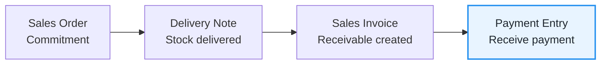
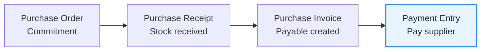
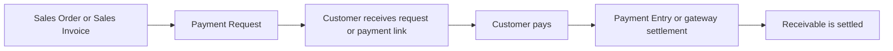
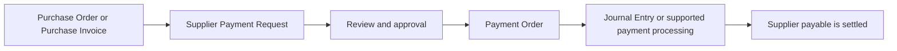

<!-- Frappe documentation: erpnext, part 11 of 18. Index: docs/INDEX.md -->

<!-- page: erpnext/erpnext__payment-entry.md -->
---
title: "Payment Entry | ERPNext Documentation"
description: "Record customer receipts, supplier payments, transfers, advances, and allocations in ERPNext."
space: "ERPNext"
url: "https://docs.frappe.io/erpnext/payment-entry"
updated: "2026-08-02"
---

## Why use a Payment Entry?

Use a Payment Entry when money is received, paid, or transferred between bank and cash accounts. It is the standard operational document for recording a customer receipt, supplier payment, advance, partial payment, payment covering several invoices, or internal account transfer.

A Payment Entry does more than create debit and credit postings. It can link the money to a [Sales Invoice](/erpnext/sales-invoice), [Purchase Invoice](/erpnext/purchase-invoice), Sales Order, Purchase Order, or another supported reference. ERPNext then updates the allocated and outstanding amounts. An advance or standalone payment can remain unallocated and be matched later using [Payment Reconciliation](/erpnext/payment-reconciliation).

The guided form also records the party, payment mode, bank or cash accounts, reference number, currencies, exchange rates, deductions, and invoice allocations. This provides a clearer payment trail and reduces the risk of manually choosing the wrong debit or credit account.

## How a Payment Entry affects the ledger

Submitting a Payment Entry creates General Ledger entries. The exact account names depend on your Chart of Accounts, but the usual postings are:

| Payment type          | Debit                            | Credit                      | Operational result                                                                                                                                           |
| --------------------- | -------------------------------- | --------------------------- | ------------------------------------------------------------------------------------------------------------------------------------------------------------ |
| **Receive**           | Bank or Cash                     | Customer receivable         | Money increases in the selected bank or cash account. When allocated to a Sales Invoice, its outstanding amount decreases.                                   |
| **Pay**               | Supplier payable                 | Bank or Cash                | The supplier liability decreases and money leaves the selected bank or cash account. When allocated to a Purchase Invoice, its outstanding amount decreases. |
| **Internal Transfer** | Destination bank or cash account | Source bank or cash account | Money moves between company accounts without creating a customer or supplier balance.                                                                        |

A Payment Entry normally settles an amount already recognized by another transaction. For example, a Sales Invoice records income and the customer receivable. The later Payment Entry moves that amount from receivables to bank or cash. It does not record the sales income again.

## Payment Entry or Journal Entry?

Use a Payment Entry when the event is primarily a movement of money. Use a [Journal Entry](/erpnext/journal-entry) when the event is primarily an accounting adjustment and no customer or supplier payment is taking place.

| Situation                                                                                        | Use           | Why                                                                                            |
| ------------------------------------------------------------------------------------------------ | ------------- | ---------------------------------------------------------------------------------------------- |
| Receive money from a customer                                                                    | Payment Entry | It records the bank receipt, party, references, and invoice allocation.                        |
| Pay a supplier                                                                                   | Payment Entry | It records the bank payment and reduces the selected payable.                                  |
| Record an advance or partial payment                                                             | Payment Entry | It supports unallocated amounts and later reconciliation.                                      |
| Transfer money between bank or cash accounts                                                     | Payment Entry | Internal Transfer provides a guided account-to-account flow.                                   |
| Write off a bad debt, accrue an expense, reclassify a balance, or enter an accounting adjustment | Journal Entry | You control the debit and credit accounts directly because the purpose is a ledger adjustment. |

Use a **Payment Entry** when money is received, paid, or transferred between accounts. ERPNext helps you:

- Select the correct bank, cash, customer, and supplier accounts.
- Record money received from a customer or paid to a supplier.
- Transfer money between bank or cash accounts.
- Link a payment to one or more invoices.
- Update invoice outstanding amounts automatically.
- Record full payments, partial payments, and advances.
- Handle currencies and store bank references, cheque numbers, and payment dates.
- Keep unallocated payments available for later reconciliation.
- Create the required General Ledger entries when you submit.

### Why not use a Journal Entry for routine payments?

A Journal Entry can also record some bank or cash movements, but you must:

- Choose the debit and credit accounts yourself.
- Enter the correct amount on each side.
- Understand the required accounting treatment.
- Take greater care to avoid posting to the wrong account.

If you use journal entry to record payments, you will not be able to track receivables, reconcile invoices and complete a sales / purchase cycle.

For most customer receipts, supplier payments, advances, and bank transfers, use a **Payment Entry**. Use a **Journal Entry** mainly for accounting adjustments where no actual payment is being made.

## Where Payment Entry fits in the business cycle

In the standard invoice-first workflow, Payment Entry is the settlement step at the end of both the selling and buying cycles. The order records the commitment, the delivery or receipt records the movement of goods, the invoice records the amount due, and the Payment Entry records the money received or paid.

### Selling cycle

Use a **Receive** Payment Entry when the customer pays. ERPNext debits the bank or cash account, credits Accounts Receivable, and reduces the Sales Invoice outstanding amount.

### Buying cycle

Use a **Pay** Payment Entry when you pay the supplier. ERPNext debits Accounts Payable, credits the bank or cash account, and reduces the Purchase Invoice outstanding amount.

| Cycle   | Payment Type | Debit            | Credit              | Result                       |
| ------- | ------------ | ---------------- | ------------------- | ---------------------------- |
| Selling | Receive      | Bank or Cash     | Accounts Receivable | Customer outstanding reduces |
| Buying  | Pay          | Accounts Payable | Bank or Cash        | Supplier outstanding reduces |

**Payment Entry is not always the last document.** If you receive a customer advance or pay a supplier advance, create the Payment Entry before the invoice. Link or reconcile that advance with the invoice later to complete the settlement.

## Before you begin

Confirm the correct Company, currency, receivable or payable account, and bank or cash ledger. Use submitted source documents and keep the bank reference or remittance advice available.

## Create a Payment Entry

1. Select **Receive**, **Pay**, or **Internal Transfer**.
2. Set the Company, posting date, Mode of Payment, and party.
3. Check the paid-from and paid-to accounts and currencies.
4. Enter the amount and reference details.
5. Use **Get Outstanding Invoices** or add references manually.
6. Review allocations and deductions, then submit.

## Important fields and what they mean

| Field                           | What it controls                                                                             |
| ------------------------------- | -------------------------------------------------------------------------------------------- |
| Payment Type                    | Receive, Pay, or Internal Transfer.                                                          |
| Party Type and Party            | Customer, Supplier, Employee, Shareholder, or another supported party.                       |
| Paid From and Paid To           | Source and destination ledger accounts.                                                      |
| Paid Amount and Received Amount | Amounts in the respective account currencies.                                                |
| Reference No and Date           | Bank, check, or transfer evidence.                                                           |
| References                      | Invoices, Orders, or other documents against which the payment is allocated.                 |
| Deductions or Loss              | Bank fees, write-offs, withholding, or exchange differences recorded with explicit accounts. |

## Troubleshooting

### Get Outstanding Invoices does not show an invoice

Confirm that the invoice is submitted, belongs to the selected party and Company, uses the same receivable or payable account, and still has an outstanding amount. Also check the **From Date**, **To Date**, and other filters in the outstanding-invoice dialog. An invoice already fully allocated will not appear.

### Difference Amount is not zero

First confirm the Paid Amount, Received Amount, exchange rates, and invoice allocations. Record bank fees, withholding, small write-offs, or exchange differences in **Deductions or Losses** with the appropriate account. Do not put a bank fee in Taxes and Charges because it is not money paid to the party.

### The payment was submitted against the wrong invoice

If the money and party are correct but the allocation is wrong, use [Unreconcile Payments](/erpnext/unreconcile-payments) and then [Payment Reconciliation](/erpnext/payment-reconciliation) to apply it correctly. Cancel and amend the Payment Entry only when the payment details or accounts themselves are wrong.

### A foreign-currency payment leaves a small outstanding balance

Check both account currencies and the source and target exchange rates. Allocate the invoice in its account currency, then post the genuine exchange difference through **Deductions or Losses** to the configured exchange gain or loss account. Verify the party ledger after submission.

## Frequently asked questions

### Can one Payment Entry settle several invoices for the same party?

One Payment Entry can settle several invoices for the selected party. Fetch the outstanding invoices and enter an allocation against each reference. The total allocated amount can be less than or equal to the payment, but it cannot exceed the available amount.

### What happens when a customer pays more than the selected invoice amount?

Allocate only the invoice balance. ERPNext keeps the remainder as an unallocated advance for that customer, which can later be applied through Payment Reconciliation or a supported invoice workflow.

### Can one Payment Entry allocate money across different customers or suppliers?

A standard Payment Entry has one party. Use separate Payment Entries when money belongs to different parties, even if the bank deposited or paid a single combined amount. Reconcile the bank transaction to the individual entries afterward.

### Can a Payment Entry require approval above a specified amount?

Configure a [Workflow](/framework/workflows) for Payment Entry with amount-based conditions and roles. Test the states, transition permissions, and who can submit before using it for live payments.

### Can I preview the ledger impact before submitting?

Use the document's **Accounting Ledger** or ledger preview action when it is available in your version. At minimum, verify Paid From, Paid To, amounts, exchange rates, allocations, and deductions. A draft does not post to the General Ledger.

## Related topics

- [Payment Entry](/erpnext/payment-entry)
- [Payment Reconciliation](/erpnext/payment-reconciliation)
- [Bank Reconciliation](/erpnext/bank-reconciliation)
- [Bank Transaction](/erpnext/bank-transaction)
- [Journal Entry](/erpnext/journal-entry)

<!-- page: erpnext/erpnext__payment-order.md -->
---
title: "Payment Order | ERPNext Documentation"
description: "Prepare and control bulk supplier payments in ERPNext."
space: "ERPNext"
url: "https://docs.frappe.io/erpnext/payment-order"
updated: "2026-08-14"
---

A Payment Order groups Supplier payments into a controlled payment run. It tells the finance team which payments have been selected and approved, but submitting the Payment Order does not itself transfer money through the bank.

In current ERPNext, a Payment Order can fetch either initiated Supplier [Payment Requests](/erpnext/payment-request) or submitted Supplier [Payment Entries](/erpnext/payment-entry) whose Payment Order Status is **Initiated**. A Supplier Payment Request is therefore useful, but it is not mandatory before creating a Payment Order.

Use it when:

- You pay many suppliers together, such as in a weekly payment run.
- A purchase or department manager decides what should be paid.
- An accountant or treasury employee executes the approved payments.
- You need a documented approval handoff before payments are recorded.
- You want to generate several Payment Entries together.

 Mermaid diagram

 Start typing Mermaid to preview your diagram.

Unsupported color format: "oklch(.946 0 0)"

For a small business paying one Supplier invoice at a time, a Payment Order is usually unnecessary. Create a Payment Entry directly from the Purchase Invoice. Payment Order becomes valuable when several payments must be selected, reviewed, grouped, and handed to another person or system for execution.

## Before you begin

Confirm the correct Company, currency, receivable or payable account, and bank or cash ledger. Use submitted source documents and keep the bank reference or remittance advice available.

## Create a Payment Order

1. Create a Payment Order for the correct Company.

2. Select the Company bank account from which the payment run will be made.
3. Under **Get Payments from**, choose **Payment Request** or **Payment Entry**.

4. Filter and select the approved Supplier references.
5. Verify the Supplier, reference document, amount, Mode of Payment, and beneficiary bank account in every row.

6. Review the batch total and submit the Payment Order according to your approval process.
7. Complete the action provided for the selected Payment Order Type, then verify the resulting accounting documents and bank processing.

## Important fields and what they mean

| Field                 | What it controls                                                                 |
| --------------------- | -------------------------------------------------------------------------------- |
| Company               | Legal entity making the payment.                                                 |
| Payment Order Type    | Identifies whether the batch was built from Payment Requests or Payment Entries. |
| Company Bank Account  | Account from which the batch will be paid.                                       |
| References            | Supplier Payment Requests or Payment Entries included in the batch.              |
| Supplier Bank Account | Beneficiary account for each row.                                                |
| Amount                | Approved amount to pay for the reference.                                        |

## What happens after you submit

ERPNext marks the included source records as **Payment Ordered**. When the Payment Order was created from Payment Requests, current ERPNext provides an action to create the corresponding Journal Entries. When it was created from Payment Entries, those submitted entries already contain the accounting postings and the Payment Order records that they have been included in the payment run.

The Payment Order does not confirm that the bank has transferred the money. Complete the bank upload, integration, or manual transfer used by your organization, then use [Bank Reconciliation](/erpnext/bank-reconciliation) to match the accounting entries with the bank statement.

## Troubleshooting

### A supplier invoice or request is not available for selection

Confirm that the source document is submitted, approved, unpaid, and belongs to the Payment Order's Company. Check the Payment Order Type and whether the reference has already been included in another active batch.

### A supplier bank account is missing

Create and validate the supplier's [Bank Account](/erpnext/bank-account), link it to the correct party, and include the beneficiary name and required routing details. Reopen the Payment Order and fetch the reference again if the existing row does not refresh.

### The bank rejects the exported or transferred batch

Compare the bank's required file or API specification with the data exported from ERPNext. Payment Order organizes approved references, but bank-specific file formats and automated transmission can require an integration or customization. Validate a small test batch before production use.

### The order includes the wrong supplier or amount

Correct the draft before submission. If it is already submitted, follow the supported cancellation or amendment process and keep the audit trail. Do not create compensating Payment Entries until you confirm whether the bank actually processed the batch.

## Frequently asked questions

### Does submitting a Payment Order pay suppliers or post the ledger?

Submitting a Payment Order does not transfer money through the bank. If it was built from Payment Requests, the resulting accounting entries still need to be created and processed. If it was built from submitted Payment Entries, the ledger entries already exist, but the real bank movement must still be completed and reconciled.

### Is Payment Order the same as paying several invoices with one Payment Entry?

The documents serve different purposes. A Payment Order can group payments for multiple suppliers and beneficiaries. A standard Payment Entry belongs to one party and records the actual accounting movement.

### Can Payment Order generate a bank upload file automatically?

Only when your ERPNext version, regional app, or integration implements the bank's required format. The standard document should not be assumed to produce a file accepted by every bank.

### Can I use Payment Order for customers, employees, or shareholders?

Use only the party and reference types supported by the current Payment Order form and its validation. Supplier payment batching is the common workflow. Test other supported sources in a non-production site before relying on them.

### How should approvals be handled for large batches?

Use roles and a [Workflow](/framework/workflows) so preparation, review, and submission are performed by the appropriate users. Review beneficiary details and batch totals independently before releasing payment to the bank.

## Related topics

- [Payment Entry](/erpnext/payment-entry)
- [Payment Reconciliation](/erpnext/payment-reconciliation)
- [Bank Reconciliation](/erpnext/bank-reconciliation)
- [Bank Transaction](/erpnext/bank-transaction)
- [Journal Entry](/erpnext/journal-entry)

<!-- page: erpnext/erpnext__payment-reconciliation.md -->
---
title: "Payment Reconciliation | ERPNext Documentation"
description: "Allocate unlinked payments and credits against ERPNext invoices."
space: "ERPNext"
url: "https://docs.frappe.io/erpnext/payment-reconciliation"
updated: "2026-08-14"
---

Payment Reconciliation links a submitted payment or credit with one or more outstanding invoices for the same Customer or Supplier. Use it when money has already been recorded in ERPNext but the correct invoice was not selected in the original transaction.

Reconciliation does not create another bank movement. It updates how the existing amount is allocated and recalculates the invoice outstanding balance.

## Before you begin

Confirm that the invoice and payment are submitted, belong to the same Company and party, use the same receivable or payable account, and still have an outstanding or unallocated amount.

For this example, Northstar Retail has an outstanding Sales Invoice of $1,796 and an unallocated Payment Entry of $525.

## Reconcile a payment against an invoice

### 1. Select the company and party

Open **Payment Reconciliation**. Select the **Company**, **Party Type**, and **Party**. ERPNext fills the relevant **Receivable / Payable Account** when a default account is available.

Use the optional Filters section when you need to narrow a long list by invoice date, payment date, amount, bank or cash account, or result limit.

Click **Get Unreconciled Entries**.

### 2. Review the unreconciled entries

ERPNext displays outstanding invoices on the left and unallocated payments or credits on the right. Check the document number, date, and amount before selecting anything.

If no rows are selected, ERPNext can allocate entries in first-in, first-out order. Select rows when you need to control exactly which payment settles which invoice.

### 3. Select the invoice and payment

Select the invoice that should receive the payment. Then select the matching Payment Entry or credit.

In this example, Payment Entry **ACC-PAY-2026-00010** is matched with Sales Invoice **ACC-SINV-2026-00009**.

### 4. Create the allocation

Click **Allocate**. ERPNext proposes an allocation based on the smaller of the invoice outstanding amount and the payment amount.

### 5. Review and reconcile

Review every row under **Allocated Entries**. Confirm the Payment Entry, invoice, **Allocated Amount**, and **Difference Amount**. Edit a row if only part of the available payment should be applied.

Click **Reconcile** only after the allocation is correct.

### 6. Verify the result

Before reconciliation, Sales Invoice **ACC-SINV-2026-00009** had an outstanding amount of **$746**. After the **$525** payment was reconciled, the outstanding amount became **$221**.

Open Payment Entry **ACC-PAY-2026-00010** and verify that the invoice appears under **Payment References**. The **Total Allocated Amount** is **$525**, while **Unallocated Amount** is **$0**.

You can also open the [Accounts Receivable report](/erpnext/accounts-receivable) and confirm that it shows the reduced invoice balance.

### Video demo

<iframe src="https://www.youtube.com/embed/Y63Cbmcp7wA" title="Payment Reconciliation in ERPNext" allow="accelerometer; autoplay; clipboard-write; encrypted-media; gyroscope; picture-in-picture; web-share" frameborder="0"></iframe>

## Important fields and what they mean

| Field                        | What it controls                                                                                              |
| ---------------------------- | ------------------------------------------------------------------------------------------------------------- |
| Company                      | Limits the tool to one legal entity and its accounts.                                                         |
| Party Type                   | Chooses whether you are reconciling a Customer or Supplier.                                                   |
| Party                        | Loads documents for the selected Customer or Supplier.                                                        |
| Receivable / Payable Account | Limits results to documents posted to the same control account.                                               |
| Default Advance Account      | Includes supported Payment Entries posted to the selected advance account.                                    |
| Invoice and Payment filters  | Narrow results by date, amount, document name, bank account, or result limit.                                 |
| Invoices                     | Lists submitted documents with an outstanding balance.                                                        |
| Payments                     | Lists submitted Payment Entries, Journal Entries, and supported credits with an amount available to allocate. |
| Allocated Amount             | Amount from the payment or credit that will be applied to the invoice.                                        |
| Difference Amount            | Amount left unmatched in that allocation row.                                                                 |

## What changes after reconciliation

ERPNext adds or updates the payment reference, reduces the invoice outstanding amount, and reduces the payment unallocated amount. The original bank or cash posting remains unchanged because the money was already recorded when the payment was submitted.

## Troubleshooting

### The invoice or payment is missing

Check the Company, party, receivable or payable account, document status, currency, filters, and date range. A fully allocated payment or fully settled invoice is not an unreconciled entry.

### The payment and invoice use different receivable or payable accounts

The tool cannot match entries across different control accounts. Correct the account on the source document through the supported cancellation and amendment workflow, or use an appropriate accounting adjustment reviewed by your finance team.

### Allocate uses the wrong invoice

Select the exact invoice and payment before clicking **Allocate**. Leaving rows unselected allows FIFO allocation.

### The allocation amount is too high

Open the allocation row and reduce **Allocated Amount**. It cannot exceed the available payment amount or invoice outstanding amount.

### A payment was reconciled incorrectly

Use [Unreconcile Payments](/erpnext/unreconcile-payments) to remove the incorrect link, verify the restored balances, and then reconcile the payment again.

## Frequently asked questions

### When should I use Payment Reconciliation instead of Payment Entry?

Use [Payment Entry](/erpnext/payment-entry) when recording the receipt or payment and you already know the invoices to settle. Use Payment Reconciliation when the payment or credit already exists but remains unallocated or was not linked to the right invoice.

### Can one payment settle several invoices?

ERPNext supports this. Select the payment and the required invoices, allocate the available amount across them, and review every allocation row before reconciling.

### Can one invoice be settled by several payments?

ERPNext supports this. Reconcile each available payment against the same invoice until its outstanding amount reaches zero.

### Can I allocate only part of a payment?

ERPNext supports this. Edit **Allocated Amount** before reconciling. The remaining amount stays unallocated and can be used later.

### Does Payment Reconciliation change the bank balance?

Payment Reconciliation does not change the bank balance. It changes the link between existing accounting entries and does not post the receipt or payment again.

### Is this the same as Bank Reconciliation?

These tools serve different purposes. Payment Reconciliation matches ERPNext payments and credits with ERPNext invoices. [Bank Reconciliation](/erpnext/bank-reconciliation) matches ERPNext bank ledger entries with transactions shown by the bank.

## Related topics

- [Payment Entry](/erpnext/payment-entry)
- [Receiving Bulk Payments](/erpnext/receiving-bulk-payments)
- [Unreconcile Payments](/erpnext/unreconcile-payments)
- [Process Payment Reconciliation Tool](/erpnext/process-payment-reconciliation-tool)
- [Accounts Receivable](/erpnext/accounts-receivable)
- [Accounts Payable](/erpnext/accounts-payable)

<!-- page: erpnext/erpnext__payment-request.md -->
---
title: "Payment Request | ERPNext Documentation"
description: "Request and track online or offline customer payments from ERPNext transactions."
space: "ERPNext"
url: "https://docs.frappe.io/erpnext/payment-request"
updated: "2026-08-02"
---

A Payment Request records that a specific amount needs to be paid. It is a request or instruction, not proof that money has moved, so creating it does not post to the General Ledger.

For a Customer, create an inward Payment Request from a submitted [Sales Order](/erpnext/sales-order) or [Sales Invoice](/erpnext/sales-invoice). ERPNext can email the request with an online payment link when a [Payment Gateway Account](/erpnext/payment-gateway-account) is configured, or you can use it to communicate offline bank-transfer instructions.

For a Supplier, an outward Payment Request can become the internal instruction that an approved [Purchase Order](/erpnext/purchase-order) or [Purchase Invoice](/erpnext/purchase-invoice) should be paid. The finance team can later collect approved Supplier Payment Requests in a [Payment Order](/erpnext/payment-order).

Use Payment Request when you need to ask for payment, send a payment link, request an advance, or introduce an approval step before paying a Supplier. If money has already been received or paid and you only need to record it, create a [Payment Entry](/erpnext/payment-entry) directly.

## Before you begin

Confirm the correct Company, currency, receivable or payable account, and bank or cash ledger. Use submitted source documents and keep the bank reference or remittance advice available.

## Create a Customer Payment Request

1. Open the submitted Sales Order or Sales Invoice.
2. Choose **Create &gt; Payment** to create the Payment Request.

3. Confirm the amount, currency, recipient, and reference document.

4. Select the payment gateway account when collecting online.
5. Save and send the request.
6. Track its status and verify the resulting payment before treating the source document as paid.

## Request a Supplier payment

1. Open the submitted Purchase Order or Purchase Invoice that should be paid.
2. Create an outward Payment Request.
3. Confirm the Supplier, amount, Company bank details, and supporting reference.

4. Submit the request according to your approval process.
5. Add the approved request to a Payment Order, or process the payment through the supported accounting workflow.

## Watch Video

<iframe src="https://www.youtube.com/embed/CRrEiA2Myj4" title="Payment Request in ERPNext" allow="accelerometer; autoplay; clipboard-write; encrypted-media; gyroscope; picture-in-picture; web-share" frameborder="0" allowfullscreen></iframe>

## Important fields and what they mean

| Field                   | What it controls                                                     |
| ----------------------- | -------------------------------------------------------------------- |
| Payment Request Type    | Inward for Customer receipts or Outward for supported payment flows. |
| Reference Document      | Sales Order, Sales Invoice, or another supported source.             |
| Grand Total             | Amount requested.                                                    |
| Currency                | Currency presented to the payer.                                     |
| Payment Gateway Account | Gateway and settlement account used for online collection.           |
| Status                  | Tracks initiation, request, and payment state.                       |

## What happens after you submit or process

Submitting a Payment Request records and communicates the request. It does not, by itself, settle the invoice or post a bank transaction. For a Customer request, the accounting impact occurs when the gateway completes the payment or a Payment Entry is recorded. For a Supplier request, the accounting impact occurs only when the approved payment is processed through the resulting accounting document.

## Troubleshooting

### The recipient email address is blank or incorrect

Check the Contact linked to the Customer and confirm that it has the correct email address. Select or correct **Email To** before sending. Use one valid recipient address when the payment provider accepts only a single payer email.

### Submitting or sending the request times out

Test the outgoing [Email Account](/framework/email-account) separately. Incorrect SMTP host, port, SSL, or STARTTLS settings can make the request appear to hang while ERPNext tries to send the message. Review the Email Queue and Error Log before resending.

### The customer paid, but the request still shows Initiated

Verify the transaction in the payment provider first. Then check the [Payment Gateway Account](/erpnext/payment-gateway-account), webhook or callback configuration, site URL, and Error Log. Do not manually mark a request paid until the actual settlement and resulting accounting entry have been verified.

### The payment link does not open or uses the wrong gateway

Confirm that the selected gateway account is enabled, belongs to the correct Company, supports the transaction currency, and has valid credentials. Generate a fresh request after correcting the configuration rather than editing a link already sent to the customer.

## Frequently asked questions

### Does a Payment Request itself post to the General Ledger?

A Payment Request does not post to the ledger. It records and communicates the request. The ledger is affected when the successful payment creates or is recorded through the appropriate Payment Entry or gateway transaction.

### Can I request only part of an invoice or order amount?

A partial amount can be requested when the source workflow and gateway support it. Confirm the remaining outstanding amount afterward and avoid sending overlapping active requests for the same portion.

### Can I customize the email sent with the request?

The available message comes from the Payment Request and gateway configuration in your version. Review the generated subject, body, recipient, and print format before sending. Use supported templates or a controlled customization when the standard message is insufficient.

### Can a Payment Request be used without an online gateway?

It can still document an offline request, but it will not automatically collect money. Share the relevant payment instructions, then record the receipt with a Payment Entry and verify it against the source document.

### Should I send another request when a customer says the first link failed?

First check whether the original request or provider transaction succeeded. If it did not, correct the configuration and create or resend a valid request. Avoid multiple active links that could let the customer pay the same amount twice.

## Related topics

- [Payment Entry](/erpnext/payment-entry)
- [Payment Reconciliation](/erpnext/payment-reconciliation)
- [Bank Reconciliation](/erpnext/bank-reconciliation)
- [Bank Transaction](/erpnext/bank-transaction)
- [Journal Entry](/erpnext/journal-entry)

<!-- page: erpnext/erpnext__payment-terms-template.md -->
---
title: "Payment Terms Template | ERPNext Documentation"
description: "Create reusable installment and due-date schedules for ERPNext transactions."
space: "ERPNext"
url: "https://docs.frappe.io/erpnext/payment-terms-template"
updated: "2026-08-14"
---

A Payment Terms Template combines reusable Payment Term records into a schedule for sales and purchase transactions. For Nova Industries, an electronics manufacturer and distributor, Net 30 contains one term for 100% due after 30 days. A 50% Advance, 50% Net 30 template contains two installments.

## Before you begin

Decide which schedules you offer to [Customers](/erpnext/customer) or accept from [Suppliers](/erpnext/supplier). Create the individual [Payment Term](/erpnext/payment-term) records first. Each term defines an installment percentage and its due-date rule.

## Create a Payment Terms Template

1. Create the Payment Term records required by the schedule.
2. Open **Payment Terms Template** and enter a descriptive name.
3. Add the terms in sequence and set each **Invoice Portion**.
4. Confirm that the total invoice portion is 100%.
5. Enable **Allocate Payment Based on Payment Terms** only when payments must be tracked against individual installments.
6. Save the template and select it in a [Sales Order](/erpnext/sales-order), [Sales Invoice](/erpnext/sales-invoice), [Purchase Order](/erpnext/purchase-order), or [Purchase Invoice](/erpnext/purchase-invoice).

The template list below shows how individual terms can be combined into reusable schedules. These are demonstration records, not a fixed catalogue installed on every ERPNext site.

## Important fields and what they mean

| Field                                   | What it controls                                                                                  |
| --------------------------------------- | ------------------------------------------------------------------------------------------------- |
| Template Name                           | Name shown in transactions.                                                                       |
| Payment Term                            | Reusable installment and due-date rule.                                                           |
| Invoice Portion                         | Percentage of the transaction assigned to the row.                                                |
| Credit Days or Months                   | Time allowed before the installment is due.                                                       |
| Due Date Based On                       | Date from which ERPNext calculates the deadline.                                                  |
| Allocate Payment Based on Payment Terms | Tracks allocations against individual schedule rows in a [Payment Entry](/erpnext/payment-entry). |

## Troubleshooting

### The template cannot be saved

Make sure every row has a Payment Term and the Invoice Portions total exactly 100%. If ERPNext reports that a term may be duplicated, review whether two rows use the same term or the same due-date rule. Use distinct terms for genuinely different installments.

### The due dates are not what I expected

Open each Payment Term and review **Due Date Based On**, **Credit Days**, and **Credit Months**. When a template is selected, its schedule controls the calculated due dates. If you need a one-off schedule, clear or replace the template before editing the schedule manually.

### The template is missing or was not copied to the next document

Confirm that the template is saved and selected on the source transaction. A schedule normally carries through supported mapped flows, such as Sales Order to Sales Invoice. A Delivery Note does not itself hold payment terms, so a Sales Invoice created only from a Delivery Note may need the template selected again.

### A payment cannot be allocated to the invoice

If term-based allocation is enabled, ERPNext expects the Payment Entry reference to identify the relevant Payment Term and will not allow an allocation above that term's outstanding amount. Refresh outstanding references before retrying.

## Frequently asked questions

### Does ERPNext install standard Payment Terms Templates automatically?

ERPNext provides the feature, but the records available on a site depend on its setup and imported data. Create a small catalogue that matches your actual commercial policy, such as Due on Receipt, Net 30, and an advance-plus-balance schedule.

### Which date takes priority when a template is selected?

The payment schedule generated from the selected template controls the installment due dates. If you manually change a due date that conflicts with the template, ERPNext may ask you to clear the template or schedule first.

### Can one template contain several installments?

Y

es. Add one row for each installment and make sure all Invoice Portions total 100%. ERPNext calculates each payment amount from the transaction total.

### Can the first installment be a fixed amount instead of a percentage?

The standard template is percentage-based. For a genuinely variable fixed advance followed by percentages of the remaining balance, adjust the transaction's payment schedule manually or use a controlled customization.

### Where should I set a default template?

Set the appropriate default on the relevant [Customer](/erpnext/customer), Supplier, or Company where the field is available. A party-specific default is useful when different customers or suppliers follow different schedules. Verify the populated schedule before submitting the transaction.

## Related topics

- [Payment Term](/erpnext/payment-term)
- [Payment Entry](/erpnext/payment-entry)
- [Sales Invoice](/erpnext/sales-invoice)
- [Purchase Invoice](/erpnext/purchase-invoice)
- [Sales Order](/erpnext/sales-order)
- [Purchase Order](/erpnext/purchase-order)

<!-- page: erpnext/erpnext__payment-terms.md -->
---
title: "Payment Terms | ERPNext Documentation"
description: "Create ERPNext Payment Terms and templates for due dates, deposits, instalments, milestones, and early-payment discounts."
space: "ERPNext"
url: "https://docs.frappe.io/erpnext/payment-terms"
updated: "2026-08-14"
---

A sale or purchase does not always become due in one amount on one date. Payment Terms let ERPNext express the commercial promise clearly, including deposits, instalments, credit periods, and milestone-based payments.

Nova Industries might collect 30% when a bulk laptop order is confirmed and the remaining 70% within 30 days of delivery. Recording that schedule on the transaction gives both teams the same due dates and lets receivables and payables reports show what is actually overdue.

This page explains individual Payment Terms, reusable templates, due-date calculation, allocation percentages, and how the schedule flows into invoices and payment follow-up.

## Create a Payment Term

Go to **Home &gt; Accounting &gt; Accounting Masters &gt; Payment Term**.

1. Enter a clear name.
2. Choose how the due date is calculated.
3. Enter the credit days or due date basis.
4. Enter an invoice-portion percentage if this term represents one instalment.
5. Optionally configure an early-payment discount.
6. Save.

## Create a Payment Terms Template

1. Open **Payment Terms Template**.
2. Add terms in the required order.
3. Enter the invoice portion for each row.
4. Confirm that the total allocation is 100%.
5. Mark it as default only if it should apply broadly.
6. Save.

A template can represent Net 30, a deposit plus balance, milestones, or staged payments.

## Apply payment terms

Select the template on a Quotation, Sales Order, Purchase Order, Sales Invoice, or Purchase Invoice. ERPNext creates the payment schedule from the transaction date and the configured rules.

Check the schedule before submitting. The invoice schedule drives due dates, overdue calculations, payment allocation, and receivable or payable reporting.

## Early-payment discounts

A Payment Term can define a discount percentage or amount and a validity period. The customer or supplier must pay within that period for the discount to apply. Test the accounting result before making this part of a production collection process.

## Troubleshooting

**The due date is unexpected**

Check the posting date, due-date basis, credit days, and whether the term uses a day of the month.

**The template cannot be saved**

Verify that invoice portions total 100% and that every row has a Payment Term.

**The schedule was not copied**

Check whether the transaction or party has another template and whether the schedule was edited manually.

## Related topics

- [Sales Invoice](https://docs.frappe.io/erpnext/sales-invoice)
- [Purchase Invoice](https://docs.frappe.io/erpnext/purchase-invoice)
- [Payment Entry](https://docs.frappe.io/erpnext/payment-entry)
- [Accounts Receivable](https://docs.frappe.io/erpnext/accounts-receivable)

<!-- page: erpnext/erpnext__payment_ledger.md -->
---
title: "Payment Ledger | ERPNext Documentation"
description: "Understand the immutable payment allocation ledger used by ERPNext."
space: "ERPNext"
url: "https://docs.frappe.io/erpnext/payment_ledger"
updated: "2026-08-14"
---

Northstar Retail has a $1,796 Sales Invoice from Nova Industries and makes a separate payment of $525. The bank movement is already recorded, but the invoice will remain fully outstanding until ERPNext knows that the payment belongs to it. The Payment Ledger keeps that invoice-to-payment relationship.

The Payment Ledger is a specialised ledger for Receivable and Payable accounts. ERPNext uses its entries to calculate invoice outstanding amounts, advances, allocations, ageing, and reconciliation. It does not create a second accounting posting or replace the [General Ledger](/erpnext/general-ledger). The General Ledger explains debits and credits. The Payment Ledger explains which receivable or payable reference those amounts settle.

## How the Payment Ledger works

| Event                                                                                   | Payment Ledger effect                                                                      |
| --------------------------------------------------------------------------------------- | ------------------------------------------------------------------------------------------ |
| A [Sales Invoice](/erpnext/sales-invoice) is submitted                                  | Creates a Customer receivable reference and its initial outstanding amount.                |
| A [Purchase Invoice](/erpnext/purchase-invoice) is submitted                            | Creates a Supplier payable reference and its initial outstanding amount.                   |
| A [Payment Entry](/erpnext/payment-entry) is submitted with an invoice reference        | Allocates the payment immediately and reduces the referenced invoice.                      |
| A standalone payment or advance is submitted                                            | Creates an unallocated party amount that can be matched later.                             |
| A [Credit Note](/erpnext/credit-note) or [Debit Note](/erpnext/debit-note) is allocated | Reduces the corresponding receivable or payable reference.                                 |
| A payment is reconciled or unreconciled                                                 | Updates the invoice-payment relationship while preserving the underlying bank transaction. |

## Run the Payment Ledger report

1. Open **Accounting** and select **Payment Ledger**.
2. Select **Nova Industries** and the required date range.
3. Select Party Type and Party when investigating one Customer or Supplier.
4. Use Account, Voucher No, or Against Voucher No to trace a specific receivable, payable, payment, or invoice.
5. Refresh the report and wait until all entries and outstanding rows have loaded.

## Understand Voucher and Against Voucher

| Column                                      | Meaning                                                                                                   |
| ------------------------------------------- | --------------------------------------------------------------------------------------------------------- |
| Voucher Type and Voucher No                 | The document that created this Payment Ledger entry, such as an invoice, Payment Entry, or Journal Entry. |
| Against Voucher Type and Against Voucher No | The invoice or other reference that the voucher is settling.                                              |
| Amount                                      | The value created, allocated, reversed, or left outstanding by the row.                                   |
| Account and Party                           | The Receivable or Payable account and the Customer or Supplier whose balance is affected.                 |
| Account Currency                            | The currency of the party account when account-currency values are included.                              |

An invoice row can initially point against itself because it creates the original outstanding reference. A later Payment Entry row points against that invoice. The report then shows the remaining outstanding amount after applying the related entries.

## Follow the $525 reconciliation

Before reconciliation, the $1,796 Sales Invoice remains fully outstanding even though the $525 Payment Entry exists. This happens because the payment was submitted without allocating that invoice in its References table.

Use [Payment Reconciliation](/erpnext/payment-reconciliation) to match the unallocated payment to the invoice. After reconciliation, the invoice outstanding amount becomes $1,271 and its status becomes Partly Paid.

The Payment Entry now carries a $525 reference allocation to the Sales Invoice. ERPNext has not moved another $525 through the bank. It has updated which invoice the existing payment settles.

## Where Payment Ledger data appears

[Accounts Receivable](/erpnext/accounts-receivable) and [Accounts Payable](/erpnext/accounts-payable) use Payment Ledger references to calculate invoice-level outstanding amounts and ageing. [Process Statement of Accounts](/erpnext/process-statement-of-accounts) uses those outstanding balances when preparing customer statements. Reconciliation tools use the same ledger to locate eligible unallocated entries and update their references.

## Payment Ledger and General Ledger

| Question                                             | Use                                                   |
| ---------------------------------------------------- | ----------------------------------------------------- |
| Which accounts were debited and credited?            | General Ledger                                        |
| Why is this invoice still outstanding?               | Payment Ledger                                        |
| Did the bank balance change?                         | General Ledger and the source Payment Entry           |
| Which invoice received the payment?                  | Payment Ledger and the Payment Entry References table |
| Which invoices require collection or payment action? | Accounts Receivable or Accounts Payable               |

## Troubleshooting

### An invoice does not appear

Confirm that the invoice is submitted and posts to an Account whose Account Type is Receivable or Payable. Verify Company, Party, dates, and Account filters. Draft invoices have not created Payment Ledger entries.

### A payment exists but the invoice is still outstanding

The Payment Entry may be unallocated, allocated to another invoice, or posted for a different Party or Account. Review its References table, then use Payment Reconciliation when the correct invoice was not selected during payment entry.

### The outstanding amount changed unexpectedly

Review Payment Entries, Credit Notes, Debit Notes, Journal Entries, reconciliation activity, and cancellations linked to the invoice. Compare Voucher No and Against Voucher No to see which entry changed the reference balance.

### Payment Ledger and General Ledger look different

The reports answer different questions. Compare the same Company, dates, Account, Party, voucher, and currency. General Ledger values are accounting postings, while Payment Ledger values describe outstanding references and allocations.

## Frequently asked questions

### Does reconciliation create another bank entry?

Reconciliation normally changes the invoice reference attached to an existing payment. The submitted Payment Entry already recorded the bank movement.

### Can a payment be split across several invoices?

A Payment Entry can allocate its amount across multiple eligible invoices for the same party and account. Each allocation contributes to the outstanding balance of its referenced invoice.

### Can Payment Ledger rows be edited directly?

ERPNext generates these rows from submitted source documents and supported reconciliation actions. Correct the source voucher or use reconciliation and unreconciliation rather than editing a ledger row.

### Does the report include ordinary non-party accounts?

The Payment Ledger focuses on accounts configured as Receivable or Payable and the parties associated with them. Use General Ledger for other account types.

## Related topics

- [Payment Entry](/erpnext/payment-entry)
- [Payment Reconciliation](/erpnext/payment-reconciliation)
- [General Ledger](/erpnext/general-ledger)
- [Accounts Receivable](/erpnext/accounts-receivable)
- [Accounts Payable](/erpnext/accounts-payable)
- [Credit Note](/erpnext/credit-note)

<!-- page: erpnext/erpnext__payment_terms_status_report.md -->
---
title: "Payment Terms Status Report"
space: "ERPNext"
url: "https://docs.frappe.io/erpnext/payment_terms_status_report"
updated: "2026-08-14"
---

Nova Industries accepts a $7,000 Sales Order from Northstar Retail with two payment terms: 50% first and 50% later. Nova invoices $4,900. Finance needs to know which part of the agreed schedule has been covered by invoices rather than treating the order as one undivided amount.

The Payment Terms Status for Sales Order report splits invoiced value across the Sales Order's payment schedule in first-in, first-out order. In this example, the first $3,500 term is Completed and $1,400 of the second term is covered, so the second term is Partly Billed.

## Before you begin

- Create reusable [Payment Terms](/erpnext/payment-terms) and a [Payment Terms Template](/erpnext/payment-terms-template).
- Apply the template to a submitted Sales Order.
- Create and submit Sales Invoices against that Sales Order.

## Run the report

1. Open **Payment Terms Status for Sales Order**.
2. Select Nova Industries and the relevant date range.
3. Filter by Customer, Sales Order, status, or other available fields when needed.
4. Refresh the report and compare each payment term with its invoiced allocation.

## How FIFO allocation works

| Term       | Scheduled amount | Invoice allocation | Status        |
| ---------- | ---------------- | ------------------ | ------------- |
| First 50%  | $3,500           | $3,500             | Completed     |
| Second 50% | $3,500           | $1,400             | Partly Billed |
| Total      | $7,000           | $4,900             | 70% billed    |

## What the report does not show

This report tracks Sales Order billing against scheduled terms. It does not prove that the customer has paid the Sales Invoice. Use [Accounts Receivable](/erpnext/accounts-receivable-and-payable), the invoice outstanding amount, or the [Payment Ledger](/erpnext/payment_ledger) for payment status.

## Troubleshooting

### A Sales Order is missing

Confirm that the order is submitted, contains a Payment Schedule, falls inside the filters, and belongs to the selected company.

### The status does not match the customer's payment

The report measures invoicing against Sales Order terms, not cash collection. Review the linked Sales Invoices and Payment Entries separately.

### Allocation appears against the wrong term

ERPNext allocates invoice value to the earliest scheduled term first. Check the Payment Schedule order, percentages, and amounts on the Sales Order.

## Frequently asked questions

### Does the invoice need to copy the same Payment Terms Template?

The report evaluates invoice value created against the Sales Order's schedule. Review both documents when contractual invoice due dates must also match.

### What happens after the full $7,000 is invoiced?

Both 50% terms should be fully allocated and appear completed, provided the linked submitted invoices cover the full order value.

### Can partial invoices cover selected items?

The report allocates the linked invoiced amount across the schedule in FIFO order. Item selection affects the invoice value but does not change that allocation principle.

## Related topics

- [Sales Order](/erpnext/sales-order)
- [Sales Invoice](/erpnext/sales-invoice)
- [Payment Terms](/erpnext/payment-terms)
- [Payment Terms Template](/erpnext/payment-terms-template)
- [Accounts Receivable](/erpnext/accounts-receivable-and-payable)

<!-- page: erpnext/erpnext__paypal-integration.md -->
---
title: "Setting up PayPal\n"
space: "ERPNext"
url: "https://docs.frappe.io/erpnext/paypal-integration"
updated: "2026-02-26"
---

A payment gateway is an e-commerce application service provider service that authorizes credit card payments for e-businesses, online retailers, bricks and clicks, or traditional brick and mortar.

A payment gateway facilitates the transfer of information between a payment portal (such as a website, mobile phone or interactive voice response service) and the Front End Processor or acquiring bank.

To setup PayPal ,
`Explore > Integrations > PayPal Settings`

#### Setup PayPal

To enable PayPal payment service, you need to configure parameters like API Username, API Password and Signature.

You also can set test payment environment, by settings `Use Sandbox`

On enabling service, the system will create Payment Gateway record and Account head in chart of accounts having account type as Bank.

Also it will create Payment Gateway Account entry. Payment Gateway Account is configuration hub from this you can set account head from existing COA, default Payment Request email body template.

After enabling service and configuring Payment Gateway Account your system is able to accept online payments.

####Supporting transaction currencies
AUD, BRL, CAD, CZK, DKK, EUR, HKD, HUF, ILS, JPY, MYR, MXN, TWD, NZD, NOK, PHP, PLN, GBP, RUB, SGD, SEK, CHF, THB, TRY, USD

##Get PayPal credentials

#### Paypal Sanbox API Signature
 - Login to paypal developer account, [PayPal Developer Account](https://developer.paypal.com/)
 - From **Accounts** tab. create a new business account.

 - From this account profile you will get your sandbox api credentials

---

#### PayPal Account API Signature
 - Login to PayPal Account and go to profile

 - From **My Selling Tools** go to **api Access**

 - On API Access Page, choose option 2 to generate API credentials

<!-- page: erpnext/erpnext__paytm-integration.md -->
---
title: "Paytm Integration\n"
space: "ERPNext"
url: "https://docs.frappe.io/erpnext/paytm-integration"
updated: "2026-02-26"
---

**Paytm integration allows processing transactions with the payment gateway provider Paytm.**

Paytm Integration facilitates processing of payments between Paytm payment portal and ERPNext. Your customers can choose to pay from any credit/debit card, UPI, Netbanking, Paytm Wallet.

To set up Paytm, go to:
> Integrations > Payments > Paytm Settings

## 1.How to get your Paytm API credentials?
1. In order to activate your API credentials, you need to log in to your Paytm account.
2. Then, open the Developer Settings option in the sidebar.
3. Choose API Keys option, it should display a two types of API details (Test/Production).
4. Details mentioned in the Production API details are the credentials that you are supposed to use in Paytm Settings.

## 2.Setting up Paytm

To enable Paytm payment service, you need to configure all the mandatory parameters which you received from the Paytm. If you want to use staging environment of the integration, you can select the staging option and use the test API developer credentials provided by Paytm.

On enabling the Paytm integration in ERPNext, the system will create a Payment Gateway record and an Account Head in Chart of Account with the Account type as Bank as seen in the following screenshot.

Also, it will create a Payment Gateway Account entry. Payment Gateway Account is the configuration hub from where you can set Account Heads and the default Payment Request email template for requesting payments from customers.

After configuring Payment Gateway Account, you will be able to accept online payments via Paytm.

## 3.Supporting transaction currencies

Paytm will only work for the Company which has INR (Indian Rupee) as Company Currency.

<!-- page: erpnext/erpnext__period-closing-voucher.md -->
---
title: "Period Closing Voucher\n"
space: "ERPNext"
url: "https://docs.frappe.io/erpnext/period-closing-voucher"
updated: "2026-08-14"
---

At year end, Nova Industries has finished invoicing, posted depreciation and accruals, reconciled its bank accounts, and reviewed receivables and payables. Its income and expense accounts still contain the year’s activity. A Period Closing Voucher transfers their net balance to an equity account so the next period starts with fresh Profit and Loss balances while Balance Sheet balances continue.

The voucher does not erase history or stop backdated entries. It creates balanced General Ledger entries. Use an [Accounting Period](/erpnext/accounting-period) or [Accounts Frozen Upto](/erpnext/freeze-accounting-entries) when the closed period must also be protected from later changes.

## Before you begin

- Complete bank, payment, stock, tax, depreciation, deferred accounting, accrual, and correction entries.
- Review the [Profit and Loss Statement](/erpnext/profit-and-loss-report), [Balance Sheet](/erpnext/balance-sheet), Trial Balance, Accounts Receivable, and Accounts Payable.
- Confirm the closing account with your accountant. It is commonly a Retained Earnings, Reserves and Surplus, or owner’s equity account.
- Take a backup and close only after the period’s adjustments are approved.

## Create a Period Closing Voucher

1. Open **Period Closing Voucher** and click **Add Period Closing Voucher**.
2. Select the company and the fiscal year being closed.
3. Set the posting date to the last day of the period.
4. Select the closing account that will receive the net profit or loss.
5. Enable **Book Cost Center Wise Profit/Loss** when retained earnings must preserve the cost center split.
6. Add a clear remark, save, review, and submit.

## What submission posts

| Result for the period | Debit                                      | Credit                                     |
| --------------------- | ------------------------------------------ | ------------------------------------------ |
| Net profit            | Net balance of income and expense accounts | Closing equity account                     |
| Net loss              | Closing equity account                     | Net balance of income and expense accounts |

The entries reduce the period’s income and expense balances to zero and move the difference to equity. They do not close receivable, payable, bank, stock, asset, liability, or other Balance Sheet accounts.

## If entries are posted after closing

ERPNext does not silently rewrite the submitted voucher. Complete the new approved adjustments and submit another Period Closing Voucher for the same fiscal year. The later voucher transfers only the remaining Profit and Loss balance.

Do not create a new opening entry every year. Opening entries are for migration or first-time setup. The previous year’s Balance Sheet balances carry forward through the ledger.

## Troubleshooting

### The closing balance is not what you expected

Run Profit and Loss with the same company, dates, Finance Book, and dimensions. Check draft or missing adjustments, unusual income and expense accounts, and entries posted after the earlier closing voucher.

### The voucher takes too long

Review the [Period Closing Voucher controller](/erpnext/legacy-controller-for-period-closing-voucher). Large ledgers can use batched background processing instead of one large database transaction.

## Frequently asked questions

### Does a Period Closing Voucher lock the year?

It transfers Profit and Loss balances. Use Accounting Period or the frozen-accounts date to restrict later postings.

### Can I close monthly or quarterly?

You can, but confirm the policy with your accountant. Year-end closing is the most common use, and extra vouchers add audit activity.

## Related topics

- [Accounting overview](/erpnext/accounting/introduction)
- [Chart of Accounts](/erpnext/chart-of-accounts)
- [General Ledger](/erpnext/general-ledger)
- [Fiscal Year](/erpnext/fiscal-year)

<!-- page: erpnext/erpnext__periodic-inventory.md -->
---
title: "Periodic Inventory"
space: "ERPNext"
url: "https://docs.frappe.io/erpnext/periodic-inventory"
updated: "2026-02-20"
---

If you enable Perpetual Inventory in the Company master, the system will automatically create the GL entries for stock transactions. However, if Perpetual Inventory is disabled for your company, you will need to manually create periodic accounting entries.

To make a periodic accounting entry, you must create a Journal Entry manually. For the calculations, you need to compare the closing balance in the Stock Balance Report with the Trial Balance report for stock asset accounts. This process takes time, as it requires verifying and matching the differences in closing balances.

To address this in Version 16, we introduced a new Journal Entry type called 'Periodic Accounting Entry'. With this, users don’t need to perform manual calculations. The system will automatically fetch the difference in balance when the user clicks the 'Get Balance' button.

<!-- page: erpnext/erpnext__perm-level-error-in-permission-manager.md -->
---
title: "Perm Level Error"
space: "ERPNext"
url: "https://docs.frappe.io/erpnext/perm-level-error-in-permission-manager"
updated: "2026-03-04"
---

While customizing rules in the [Permission Manager](/erpnext/role-based-permissions), you might receive an error message saying:

> For System Manager _(or any other role)_ at level 2 _(or another level)_ in Customer _(or any other document)_ in row 8: Permission at level 0 must be set before higher levels are set.

Error message indicates problem is in the existing permission setting for this document.

For any role, before assigning permission at Perm Level 1 or 2 (and so on), permission at Perm Level 0 must be assigned. Error message says that System Manager has been assigned permission at Perm Level 1 and 2, but not at level 0. You should first correct the permission for System Manager's role by:

- Assigning permission to System Manager at level 0.

 Or

- By removing permission at level 1 and 2.

After executing one of the above steps, you should be able to successfully add new permissions rules in the Role Permission Manager.

<!-- page: erpnext/erpnext__perm-levels.md -->
---
title: "Perm Levels"
space: "ERPNext"
url: "https://docs.frappe.io/erpnext/perm-levels"
updated: "2026-07-04"
---

Perm Level, short for Permission Level, is a field-level permission system in ERPNext and Frappe. It lets administrators control access to sensitive fields within a DocType without hiding or restricting the entire document.

## What Perm Levels Control

Every field in a DocType has a **Perm Level**. By default, fields are at perm level **0**. Fields at level 0 are controlled by the normal permissions for the DocType.

When a field is assigned a higher perm level, such as **1** or **2**, users need a matching permission row for that level in Role Permission Manager. Without that matching permission, the user may still be able to open the document, but the higher-level field can be hidden or read-only depending on the configured permissions.

## Why Perm Levels Are Useful

Perm levels are useful when most users should work with a document, but only some users should see or edit sensitive information. This avoids creating separate DocTypes or custom workflows just to protect a few fields.

- **Sales:** A sales user may create a quotation, while only a manager can edit the discount approval field.
- **HR:** An HR user may view an Employee record, while salary details are available only to payroll roles.
- **Accounts:** A user may view a supplier invoice, while bank or tax-related fields are restricted to accounts managers.
- **Support:** A support user may update ticket details, while internal escalation notes are visible only to senior users.

## How Perm Levels Work

1. A field is assigned a perm level in the DocType or Customize Form.
2. Role Permission Manager is used to define what each role can do at each perm level.
3. When a user opens a document, ERPNext checks both the user's roles and the permission level of each field.
4. If the user has permission for the field's perm level, the field is available according to the allowed actions, such as read or write.
5. If the user does not have permission for that perm level, the field is restricted even if the user can access the document itself.

## Example

Suppose a Sales Order has these fields:

- **Customer** at perm level 0
- **Items** at perm level 0
- **Delivery Date** at perm level 0
- **Approved Discount** at perm level 1
- **Management Remarks** at perm level 2

A Sales User with permission only at level 0 can work with the regular sales order fields. A Sales Manager with level 1 permission can also read or update the Approved Discount field. A Sales Director with level 2 permission can access Management Remarks as well.

## Perm Levels And Role Permission Manager

Perm levels become useful only when they are paired with role permissions. In Role Permission Manager, each permission row has a **Level** value. That value must match the field's perm level.

For example, if a field is set to perm level 1, a role needs a permission row for level 1 on that DocType. The row can then allow actions such as read, write, create, submit, cancel, or amend depending on the DocType and business requirement.

## Good Practices

- Keep most fields at perm level 0.
- Use higher perm levels only for fields that genuinely need extra control.
- Use clear field labels so restricted fields are easy to identify during configuration.
- Test permissions with a non-administrator user before relying on the setup.
- Avoid creating too many levels, because permission rules can become hard to audit.
- Document why each restricted field was assigned a higher perm level.

## Common Mistakes

- **Setting a field to level 1 but not adding level 1 role permissions:** Users may lose access to the field unexpectedly.
- **Assuming document access means field access:** A user can have access to the document but still not have access to higher-level fields.
- **Using perm levels instead of workflow approvals:** Perm levels control field access. They do not replace approval workflows where business process control is required.
- **Testing only as Administrator:** Administrator access can hide permission problems. Always test with the target role.

## Related Topics

- [Users And Permissions](https://docs.frappe.io/erpnext/user/manual/en/setting-up/users-and-permissions)
- [Role Permissions Manager](https://docs.frappe.io/erpnext/user/manual/en/role-permissions-manager)
- [DocType Permissions](https://docs.frappe.io/framework/user/en/basics/doctypes/permissions)
- [Customize Form](https://docs.frappe.io/erpnext/customize-form)

<!-- page: erpnext/erpnext__permissions.md -->
---
title: "Role Based Permissions"
space: "ERPNext"
url: "https://docs.frappe.io/erpnext/permissions"
updated: "2026-02-28"
---

**Permission to different documents can be controlled using Role Based Permissions.**

ERPNext has a role-based permission system. It means that you can assign Roles to Users, and Permissions can be set on Roles. The Role Permissions Manager allows you to set which roles can access which documents and with what permissions (read, write, submit, etc.).

Once roles are assigned to a user, their access can be limited to specific documents. The permission structure allows you to define different permission rules for different fields using a concept called **Permission Level** of a field.

1. How to use the Role Permissions Manager

---

To start using the Role Permission Manager, go to: > Home > Users and Permissions > Role Permissions Manager

Permissions are applied on a combination of:

- **Roles:** As we saw earlier, Users are assigned Roles and it is on these Roles that permission rules are applied. For example, a sales user may be given the roles of an Employee and a Sales User.

Examples of Roles include Accounts Manager, Employee, HR User, etc.

- **Document Types:** Each type of document, master or transaction, has a separate list of role-based permissions as seen in the preceding screenshot.

Examples of Document Types are Sales Invoice, Leave Application, Stock Entry, etc.

- **Permission Levels:** In each document, you can group fields by "levels". Each group of fields is denoted by a unique number (0 to 9). A separate set of permission rules can be applied to each field group. By default, all fields are of level 0.

Permission "Level" connects fields with level X to a permission rule with level X. To know more click [here](/erpnext/changing-the-properties-of-a-field-based-on-role).

- **Document Stages:** Permissions are applied on each stage of the document like Creation, Saving, Submission, Cancellation, and Amendment. A role can be permitted to Print, Email, Import or Export data, access Reports, or define User Permissions.
- **User Permissions:** Using User Permissions in ERPNext a user can be restricted to access only specific Documents for that Document Type. Eg: Only one Territory from all Territories. User Permissions defined for other Document Types also get applied if they are related to the current Document Type through Link Fields.

For example, a Customer is a link field in a Sales Order or Quotation. In the Role Permissions Manager, User Permissions can be set using the 'Set User Permissions' button.

To set User Permissions based on documents/fields go to: > Home > Users and Permissions > Permissions > [User Permissions](/erpnext/user-permissions)

- **Add a New Rule**: In the Role Permissions Manager, to add a new rule, click on the **Add a New Rule** button and a pop-up box will ask you to select a Role and a Permission Level. Once you select this and click on 'Add', this will add a new row to your rules table.

2. How Role Based Permissions Work

---

Leave Application is a good example that encompasses all areas of a Permission System.

- It should be created by an Employee. For this, Employee Role should be given Read, Write, Create permissions.

* An *

*Employee** should only be able to access his/her Leave Application. Hence, User Permissions record should be created for each User-Employee combination.

* If you want an *

*Employee** to only select a document in another document and not have read access to that document as a whole, then grant only Select perm to the role, Employee.

* *

*HR Manager** should be able to see all Leave Applications. Create a Permission Rule for HR Manager at Level 0, with Read permissions. Apply User Permissions should be disabled.

* *

*Leave Approver** should be able to see and update Leave Applications of employees under him/her. Leave Approver is given Read and Write access at Level 0. Relevant Employee Documents should be enlisted in the User Permissions of Leave Approvers. (This effort is reduced for Leave Approvers mentioned in Employee Documents, by programmatically creating User Permission records).

* It should be Approved/Rejected only by HR User or Leave Approver. The Status field of a Leave Application is set at Level 1. HR User and Leave Approver are given Read and Write permissions for Level 0, while everyone else (All) are given Read permission for Level 1.

*

 **HR User** should be able to delegate Leave Applications to his/her subordinates. HR User is given the right to Set User Permissions. A User with HR User role would be able to define User Permissions on Leave Application for other users.

In case you have correctly assigned the roles but still you're getting errors when accessing documents, refer [this page](/erpnext/report-permission-error).

### 3. Permission Type

In the Role Permission Manager, multiple permissions can be enabled for each Role. Below are the details of the available permission options and their usage.

| Permission | Description                                                   | Example                                                                                         |
| ---------- | ------------------------------------------------------------- | ----------------------------------------------------------------------------------------------- |
| Select     | Allows the user to search and see records.                    | The user can select a Customer in Sales Order but cannot open the Customer master.              |
| Read       | Allows the user to view the document.                         | The user can view Sales Invoices but cannot change them.                                        |
| Write      | Allows the user to edit existing records they have access to. | The user can update a Customer address but cannot create a new Customer.                        |
| Create     | Allows the user to create new documents.                      | The user can create a new Item but cannot edit existing items.                                  |
| Delete     | Allows the user to delete documents.                          | The user can delete submitted documents.                                                        |
| Print      | Allows printing or PDF download of documents.                 | The print button is enabled for the user in the document.                                       |
| Email      | Allows the user to email from the document.                   | The email button is enabled for the user in the document.                                       |
| Report     | Allows the user to access reports related to the document.    | If the user has access to Employee and Report is enabled, they can view Employee-based reports. |
| Export     | Allows the user to export data from the Report view.          | The user can export report data.                                                                |
| Import     | Allows the user to import data into the document.             | The user can import data for the document.                                                      |
| Share      | Allows sharing document access with other users.              | The user can share document access with another user.                                           |

|                     |                                                                                                                                                                                                 |                                                                                                              |
| ------------------- | ----------------------------------------------------------------------------------------------------------------------------------------------------------------------------------------------- | ------------------------------------------------------------------------------------------------------------ |
|                     |                                                                                                                                                                                                 |                                                                                                              |
| Mask (Data Masking) | In ERPNext Version 16, Data Masking allows configuration of specific fields to display masked or hidden values based on the user's roles and permissions, without restricting field visibility. | Ensures sensitive information remains protected while keeping the user interface consistent and informative. |

<!-- page: erpnext/erpnext__perpetual-inventory-for-non-stock-item.md -->
---
title: "Perpetual Inventory for Non-stock Item"
space: "ERPNext"
url: "https://docs.frappe.io/erpnext/perpetual-inventory-for-non-stock-item"
updated: "2026-03-02"
---

  

**Question:**   

We have enabled Perpetual Inventory in the Company master. Still, in some Purchase Invoice, posting if done in the Expense Account.
  

**Answer:**
As per the perpetual inventory, when item is a stock item, then only it's value is booked under Stock-in-hand at the time of Purchase. In this case, the posting in the GL Entry for Purchase Invoice will be as follows.

|  |  |  |
| --- | --- | --- |
| **Account** | **Debit** | **Credit** |
| Creditors |  | 100 |
| Stock Received but not Billed | 90 |  |
| Tax | 10 |  |
|  |  |  |

Perpetual Inventory doesn't apply on the non-stock item, and expense is booked for them as soon as Purchase Invoice is submitted. The posting in General Ledger for in this scenario will look like:

|  |  |  |
| --- | --- | --- |
| **Account** | **Debit** | **Credit** |
| Creditors |  | 100 |
| COGS / Other Expense Account | 90 |  |
| Tax | 10 |  |
|  |  |  |

<!-- page: erpnext/erpnext__perpetual-inventory.md -->
---
title: "Perpetual Inventory\n"
space: "ERPNext"
url: "https://docs.frappe.io/erpnext/perpetual-inventory"
updated: "2026-02-27"
---

As per the perpetual inventory system, accounting entry is done for every stock transaction. Otherwise, it's done in larger intervals for example monthly or quarterly. Each warehouse is linked with a corresponding account head.

On receipt of items in a particular warehouse, the balance in the Warehouse Account will increase. Similarly, when items are delivered from the Warehouse, an expense will be booked, and the balance in the Warehouse Account will reduce.

:::note
In a new ERPNext site, Perpetual Accounting is enabled by default.
:::

### 1. Activate perpetual inventory

1. Go to:
  *Home > Accounting > Company > Enable Perpetual Inventory**
  [Perpetual Inventory](/files/perpetual-1.png)  
  Note that if you disable perpetual inventory, users will have to create manual entry to update actual stock balance in the Stock in hand account (or ledger).
2. Set up the following default accounts for each Company if not set. These accounts are created automatically in the new ERPNext accounts.
  Default Inventory Account (Asset)  
   Stock Received But Not Billed (Liability)  
   Stock Adjustment Account (Expense)  
   Expenses Included In Valuation (Expense)  
   Cost Center
3. If the user wants to set an individual account for each warehouse, create account head for each account. Go to:
  *Accounts > Chart of Accounts > Company > Application of Funds (Assets) > Current Asset > Stock Assets > Create a new account with same name as Warehouse**
  Now, go to a warehouse and link this account to the warehouse. This helps in filtering and viewing statements warehouse-wise.
4. For stock transactions, general ledger entries made against the Account Head set on the warehouse, if the user had not set the account for the warehouse then the system gets the account head from the parent warehouse. If Account was not set for parent warehouse then the system gets the account(Default Inventory Account) from the company master.

---

### 2. Example

Consider the following Chart of Accounts and Warehouse setup for your company:

Chart of Accounts:

- **Assets (Dr)**
  - Current Assets
    - Accounts Receivable
      - Debtors
  - Stock Assets
    - Stores
    - Finished Goods
    - Work In Progress
  - Tax Assets
    - VAT
- **Liabilities (Cr)**
  - Current Liabilities
    - Accounts Payable
      - Creditors
  - Stock Liabilities
    - Stock Received But Not Billed
  - Tax Liabilities
  - Service Tax
    - Income (Cr)
- Direct Income
  - Sales Account
- Expenses (Dr)
  - Direct Expenses
    - Stock Expenses
    - Cost of Goods Sold
    - Expenses Included In Valuation
    - Stock Adjustment
- Indirect Expenses
  - Shipping Charges
  - Customs Duty

#### 2.1 Warehouse - Account Configuration

- Stores
- Work In Progress
- Finished Goods

#### 2.2 Purchase Receipt

Suppose you have purchased 10 nos of item "RM0001" at $200 from supplier "Arcu Vel Quam Fabricators". Following are the details of Purchase Receipt:

**Supplier:** Arcu Vel Quam Fabricators

**Items:**

| Item   | Warehouse | Qty | Rate | Amount | Valuation Amount |
| ------ | --------- | --- | ---- | ------ | ---------------- |
| RM0001 | Stores    | 10  | 200  | 2000   | 2250             |

**Taxes:**

| Account          | Amount | Category            |
| ---------------- | ------ | ------------------- |
| Shipping Charges | 100    | Total and Valuation |
| VAT (10%)        | 200    | Total               |
| Customs Duty     | 150    | Valuation           |

**Stock Ledger**

**General Ledger**

As stock balance increases through Purchase Receipt, "Store" accounts are debited and a temporary account "Stock Receipt But Not Billed" account is credited, to maintain double-entry accounting system. At the same time, the negative expense is booked in account head having category as "Valuation" or "Total and Valuation" in taxes and charges table for the amount added for valuation purpose, to avoid double expense booking.

#### 2.3 Purchase Invoice

On receiving Bill from supplier, for the above Purchase Receipt, you will make Purchase Invoice for the same. The general ledger entries are as follows:

**General Ledger**

Here "Stock Received But Not Billed" account is debited and nullified the  
effect of Purchase Receipt.

#### 2.4 Delivery Note

Let's say, you have an order from "Utah Automation Services" to deliver 5 qty of item "RM0001" at $300. Following are the details of Delivery Note:

**Customer:** Utah Automation Services

**Items:**

| Item   | Warehouse | Qty | Rate | Amount |
| ------ | --------- | --- | ---- | ------ |
| RM0001 | Stores    | 5   | 300  | 1500   |

**Taxes:**

| Account     | Amount |
| ----------- | ------ |
| Service Tax | 150    |
| VAT         | 100    |

**Stock Ledger**

**General Ledger**

As an item is delivered from "Stores" warehouse, "Stores" account is credited and  
an equal amount is debited to the expense account "Cost of Goods Sold". The  
debit/credit amount is equal to the total valuation amount (buying cost) of  
the selling items. And the valuation amount is calculated based on your preferred  
valuation method (FIFO / Moving Average) or actual cost of serialized items.

 In this example, we have considered the valuation method as FIFO.  
 

:::tip
Valuation Rate = Purchase Rate + Charges Included in Valuation
                         = 200 + (250 / 10)
                         = 225

Total Valuation Amount = 225 * 5  = 1,125
:::

---

### 2.5 Sales Invoice with Update Stock

Let's say, you did not make Delivery Note against the above order and instead,  
you have made Sales Invoice directly, with "Update Stock" options. The details  
of the Sales Invoice are same as the above Delivery Note.

**Stock Ledger**

**General Ledger**

Here, apart from normal account entries for an invoice, "Stores" and "Cost of  
Goods Sold" accounts are also affected based on the valuation amount.

#### 2.6 Stock Entry (Material Receipt)

**Items:**

| Item   | Target Warehouse | Qty | Rate | Amount |
| ------ | ---------------- | --- | ---- | ------ |
| RM0001 | Stores           | 50  | 220  | 11000  |

**Stock Ledger**

**General Ledger**

#### 2.7 Stock Entry (Material Issue)

**Items:**

| Item   | Source Warehouse | Qty | Rate | Amount |
| ------ | ---------------- | --- | ---- | ------ |
| RM0001 | Stores           | 10  | 220  | 2200   |

**Stock Ledger**

**General Ledger**

#### 2.8 Stock Entry (Material Transfer)

**Items:**

| Item   | Source Warehouse | Target Warehouse | Qty | Rate | Amount |
| ------ | ---------------- | ---------------- | --- | ---- | ------ |
| RM0001 | Stores           | Work In Progress | 10  | 220  | 2200   |

**Stock Ledger**

**General Ledger**

#### 3. Related Topics

1. [Accounting Of Inventory Stock](/erpnext/accounting-of-inventory-stock)
2. [Migrate to Perpetual Inventory](/erpnext/migrate-to-perpetual-inventory)

<!-- page: erpnext/erpnext__personal-data-deletion.md -->
---
title: "Personal Data Deletion\n"
space: "ERPNext"
url: "https://docs.frappe.io/erpnext/personal-data-deletion"
updated: "2026-02-26"
---

Personal data deletion tool enables a user to delete their account and anonymize all the personally identifiable data a user has generated while using ERPNext. That is, personally identifiable information will be randomized. This includes personally identifiable data from your user account like: username, full name, birth date, phone numbers, mobile numbers, location, interests, bio, email signature, Email, Contact, Address, Communication, etc. It also includes data from Leads and Opportunities, the details you have saved like phone numbers, mobile numbers, fax, website, and name.

However, this excludes data that is required by law to be maintained by a business.

## How to request account deletion

1. To begin deleting users account and personally identifiable data, you need to visit [host-name]/request-for-account-deletion (e.g. example.erpnext.com/request-for-account-deletion) in the URL field.
  
2. Enter the email associated with your ERPNext account. After submitting your request, you will receive a success response.
  
3. This will send an email with a verification link to delete data to the email address associated with the user.
  
4. Once the user clicks on the verification link. A confirmation message will be displayed.

## How deleting a user's personal data works

The request to delete data is recorded in the doctype "Personal Data Deletion Request".

This doctype maintains three states of status to complete the process of removal of user data.

### Pending Verification

This status indicates that the user has requested data deletion via the web-form. However, verification of this request is still pending. Search for Personal Data Deletion Request from the search bar.

### Pending Approval

This indicates that the user has verified the request via email. This enables the option of "Delete Data" for System Managers.

### Deleted

This indicates that the System Manager has clicked on the "Delete Data" button. This means that the user's personally identifiable data has been anonymized.

### Setting SLA for Personal Data Deletion Request.

You can also set an SLA for Personal Data Deletion Request through Website Settings. This will appear on the web form description.

- Go to Website Settings
- Scroll to the section called Account Deletion Settings
- In the **Account Deletion SLA (Days)** field set the number of days within which users request for Account Deletion will be fulfilled.
- If you enable **Show Account Deletion link in My Account page**, the form link will be visible to users on the My Account Page of the website

<!-- page: erpnext/erpnext__personal-data-download.md -->
---
title: "Personal Data Download\n"
space: "ERPNext"
url: "https://docs.frappe.io/erpnext/personal-data-download"
updated: "2026-02-26"
---

Personal data download tool enables a user to automatically download all the personal data they have generated while using ERPNext. This includes personally identifiable data from your user account like: username, full name, birth date, phone numbers, mobile numbers, location, interests, bio, email signature, Email, Contact, Address, Communication, etc. It also includes data from Leads and Opportunities, the details you have saved like phone numbers, mobile numbers, fax, website, and name.

## How to request a user data download

1. To begin downloading data, the user has to **log in** and visit [host-name]/request-data (e.g. erpnext.com/request-data) in the URL field.
  
2. After submitting your request, you will receive a success response.
  
3. This will send an email with a download link of the data to the email address associated with the user.The file available for download will be in the JSON format.

## Personal Data Download Request DocType

The request is also recorded in the DocType "Personal Data Download Request", the file link that is sent to the user via email is also attached to the doc. Search for Personal Data Download Request from the search bar.

<!-- page: erpnext/erpnext__petty-cash-entry-in-erpnext.md -->
---
title: "Book Petty Cash Entry | ERPNext Documentation"
description: "Record petty cash funding and expenses with a clear ERPNext audit trail."
space: "ERPNext"
url: "https://docs.frappe.io/erpnext/petty-cash-entry-in-erpnext"
updated: "2026-08-01"
---

Petty cash should use a dedicated cash ledger and a controlled custodian process. Record replenishment separately from the expenses paid from the float.

## Before you begin

Confirm the correct Company, currency, receivable or payable account, and bank or cash ledger. Use submitted source documents and keep the bank reference or remittance advice available.

## Use Book Petty Cash Entry

1. Create a dedicated Petty Cash account and assign responsibility for it.
2. Transfer money from the bank or main cash account into Petty Cash.
3. Record each expense with its date, expense account, amount, Cost Center, and receipt.
4. Reconcile the physical cash plus receipts to the ledger balance.
5. Post an approved adjustment only when the difference is explained.

## Important fields and what they mean

| Field              | What it controls                                    |
| ------------------ | --------------------------------------------------- |
| Petty Cash Account | Asset ledger holding the float.                     |
| Expense Account    | Nature of the expense.                              |
| Cost Center        | Team, branch, or function responsible for the cost. |
| Reference          | Receipt or voucher number.                          |
| User Remark        | Business purpose and supporting explanation.        |

## What happens after you submit or process

ERPNext updates the relevant accounting records and, where applicable, the outstanding or unallocated amounts. Review the General Ledger, party ledger, and source document status before treating the workflow as complete. A saved draft does not affect the ledger.

## Troubleshooting

### Petty cash shows a negative balance

Check whether the fund was replenished before expenses were posted and whether all entries use the correct petty cash account. Investigate duplicate or backdated expenses rather than forcing the balance.

### An expense was posted without a Cost Center

Correct the draft or amend the submitted transaction through the supported workflow. Configure mandatory dimensions when departmental reporting is required.

### The receipt total does not match the cash issued

Record the actual expense and return or advance balance explicitly. Attach receipts and explain small approved differences according to company policy.

## Frequently asked questions

### Should petty cash use Payment Entry or Journal Entry?

Use the document that best represents the controlled workflow and permissions. Payment Entry suits cash movement, while expense claims or Journal Entries may be appropriate for reimbursement or adjustment scenarios.

### How should the petty cash fund be replenished?

Transfer the approved amount from bank or main cash to the petty cash account and retain the supporting authorization.

### Should every small purchase be entered separately?

Preserve enough detail for receipts, tax, Cost Centers, and audit. A summarized entry should be used only when company policy and local requirements permit it.

### Can employees receive a petty cash advance?

Use Employee Advance and Expense Claim when the money is accountable to a specific employee. That workflow provides clearer settlement than treating it as an ordinary expense immediately.

## Related topics

- [Payment Entry](/erpnext/payment-entry)
- [Payment Reconciliation](/erpnext/payment-reconciliation)
- [Bank Reconciliation](/erpnext/bank-reconciliation)
- [Bank Transaction](/erpnext/bank-transaction)
- [Journal Entry](/erpnext/journal-entry)

<!-- page: erpnext/erpnext__pick-list.md -->
---
title: "Pick List"
space: "ERPNext"
url: "https://docs.frappe.io/erpnext/pick-list"
updated: "2026-03-02"
---

**A Pick List is a document that indicates which items should be taken from your inventory to fulfill orders.**

This is particularly useful for shippers with a large amount of inventory, volume of orders, or customers ordering many Stock Keeping Unit(SKU). Pick list selects Warehouse where an Item is available on FIFO (First-In-First-Out) basis. Selection of Warehouse for a batched item is different. In case of batched items, Warehouse where the batch is nearer to its expiry will be selected.

To access Pick List, go to:

> Home > Stock > Stock Transactions > Pick List
> 
> 

1. Prerequisites
----------------

Before creating and using a Pick List, it is advised that you create the following first:

* [Stock Item](/erpnext/item)
* [Warehouse](/erpnext/warehouse)

2. How to create Pick List
--------------------------

1. Go to the Pick List list, click on New. 
2. Set the Company.
3. Select the Purpose of Pick List. These are the options under Purpose:

	* **Delivery:** This option will let you add Items from a Sales Order, to deliver. After submitting Pick List a new Delivery Note can be created based on the Warehouse from which items were picked.
	* **Material Transfer for Manufacture:** This will let you select a Work Order from which raw materials will be pulled for picking. You will be presented with an option to select the number of finished goods for which you want to pick raw materials. After picking the stock you can create Stock Entry for the picked items i.e., raw materials.
	* **Material Transfer:** This will let you select a Material Request for which you want to pick items. After picking the stock you can create a Stock Entry for the picked items.
4. Add Item and the quantity you want to pick in the Item Locations table. Click on **Get Item Locations** to get the Warehouse and other details for each Item.
5. **Parent Warehouse:** If a parent Warehouse is selected, Warehouses only under that parent Warehouse will be suggested.
6. **Get Item Locations:** Once items to be picked is finalized you can click on the **Get Item Locations** button to get Warehouse selection for each item. Since Warehouse will be automatically fetched if you get an Item from any reference document, this button can be useful to manually add additional Items or change the quantity of existing Items in the Item Locations table.
7. **Item Locations:** This will have the information of the item location (Warehouse), Serial Number for serialized items and batch no for batched items.   

If Serial Numbers are involved, the Item row will look like this: 
8. Save and Submit. 

### 2.1 Create Pick List from a Sales Order

1. Go to a [Sales Order](/erpnext/sales-order).
2. Click on the **Create** button on the top right of the form and then click the **Pick List** option.
3. Once you click Pick List, all the data required for Pick List will be fetched from the Sales Order.
4. Alternatively, you can create a new Pick List and click on "Get Items". This would show a popup of all pending Sales Orders.

  

1. You should be able to see the Item Locations Table with the Warehouse selected for each item.
2. Save this document and it can be used for stock picking by the person performing this activity.
3. Submit the document once the stock picking is done and picked item quantities are updated in the document.

> **Note:** > > - Pick list can only be created for Sales Orders which has '% picked' < 100 > - A **Delivery Note** can be created only if the Pick List is submitted.

### 2.2 Create Pick List from a Work Order

1. Go to a [Work Order](/erpnext/work-order).
2. Click **Create Pick List** button.
3. You'll see the dialog box asking for the quantity of Finished Goods Item. This is required to calculate the number of raw material items required to manufacture the entered quantity of Finished Goods Item. 
4. You should be able to see the Item locations table with the Warehouse selected for each raw material item.
5. Save this document and then this document can be forwarded to the person who is picking the stock.
6. Submit the document once the stock picking is done and the picked item is updated in the document accordingly.

> **Note:** > > - Pick list can only be created for Work Orders that are still in the state of 'Not Started' or 'In Progress'. > - A **Stock Entry** can be created only after the Pick List is submitted.

### 2.3 Create Pick List from Material Request

1. Go to a [Material Request](/erpnext/material-request).
2. Click on **Create** button and then click **Pick List** option.
3. You should be able to see the Item Locations table with the Warehouse selected for each item in Material Request.
4. Save this document and then this document can be forwarded to the person picking the stock.
5. Submit the document once the stock picking is done and the picked item is updated in the document accordingly.

> **Note:** > > - Only Material Requests with type 'Material Transfer' can be used for Pick List creation. > - A **Stock Entry** of type 'Material Transfer' can be created after the Pick List is submitted.

3. Features
-----------

### 3.1. Update Current Stock

If a Pick List is outdated, there could be a shift in stock availability by the time a Delivery Note or Stock Entry is created against it. Clicking **Update Current Stock** will update the quantities and warehouses in the Item Locations table.

> **Note:** This button is visible as long as there are no Delivery Notes or Stock Entries against the Pick List.

### 3.2 Barcode Scanning

Pick list supports barcode scanning, introducing two check boxes. **Scan Mode**, and **Prompt Qty**.

**Scan Mode**: Scan Mode in ERPNext's Pick List feature is designed to streamline and verify the item-picking process in a warehouse or store environment. When using Scan Mode, users can scan barcodes on items to confirm that they are picking the correct products according to the Picklist. This mode is particularly useful for ensuring accuracy and efficiency during the picking process.

**Prompt Qty**: When enabled, instead of incrementing the scanned items qty by 1, a dialog will prompt the user to enter a qty to increment by.

4. Pick Manually
----------------

In the pick list, if a user manually selects batches, the system overrides the changes upon saving the pick list. To solve this issue added a checkbox 'Pick Manually' in the pick list. If this checkbox is enabled, the system will not override the user's changes in the pick list.

  

5. Related Topics
-----------------

1. [Sales Order](/erpnext/sales-order)
2. [Work Order](/erpnext/work-order)
3. [Material Request](/erpnext/material-request)

<!-- page: erpnext/erpnext__plaid_integration.md -->
---
title: "Plaid Integration\n"
space: "ERPNext"
url: "https://docs.frappe.io/erpnext/plaid_integration"
updated: "2026-02-26"
---

ERPNext offers the possibility to synchronize your bank accounts through a service called [Plaid](https://plaid.com/). Please check [the Plaid FAQ](https://support-my.plaid.com/hc/en-us) to see if your country is supported.

If your instance is connected to Plaid, you are able to synchronize your bank account transactions without having to manually import a CSV or XLSX file.

## Settings

In order to give ERPNext access to Plaid, you need to add the following three parameters to your `site_config.json` file.

- `plaid_env`
- `plaid_public_key`
- `plaid_secret`

## Activation

In order to activate Plaid on an instance, click on the button "Enable" in the Plaid Settings DocType.

Once activated, you can create a new account directly from the Bank Reconciliation dashboard.

## Bank account creation

In order to link one of your existing bank accounts to ERPNext, click on "Link a new bank account" and follow the steps proposed by Plaid.

## Bank synchronization

In order to synchronize a bank account with ERPNext, select an account and click on the "Action" button to select "Synchronize this account".

The synchronization is based on the "Last integration date" available in the "Bank Account" doctype.

If, for any reason, you want to redo a synchronization, you can change this date and synchronize the account again.
Since all bank transactions are tagged with a specific transaction ID, the synchronization will only be incremental.

## Automatic Synchronization

You can allow plaid to synchronize your bank account with ERPNex every hour by selecting "Synchronize all accounts every hour" in Plaid Settings.

<!-- page: erpnext/erpnext__plant-floor.md -->
---
title: "Plant Floor"
space: "ERPNext"
url: "https://docs.frappe.io/erpnext/plant-floor"
updated: "2026-02-26"
---

  

Plant Floor feature in the ERPNext is used to visualize the status of machines and workstations within the corresponding plant floor. This feature provides visual interface for processing job cards.

How It Works
------------

* Create the plant floor and set the warehouse (Manufacturing -> Plant Floor -> New)
* Create machine using workstation and select the plant floor.
* Set the Illustration for the active and inactive status in the workstation.

After that you can see the status of machines and workstations using plant floor.

### Visualize Stock Summary

Using plant floor, users can visualize the stock of the corresponding plant floor. Using this feature user can add or move the stock.

  

### Visualize Job Cards

  

<!-- page: erpnext/erpnext__point-of-sale.md -->
---
title: "Introduction"
space: "ERPNext"
url: "https://docs.frappe.io/erpnext/point-of-sale"
updated: "2026-02-28"
---

## **Introduction**

### **What is POS?**

The Point of Sale module in ERPNext offers a streamlined solution for managing retail transactions efficiently. It seamlessly integrates with inventory management, updating stock levels in real-time and preventing stock discrepancies. ERPNext’s POS also supports multiple payment methods, streamlining the payment process for customers and reducing transaction errors.

With built-in reporting and analytics, businesses can gain valuable insights into sales performance, top-selling items, and customer trends, helping them make informed decisions to improve overall efficiency and profitability in their retail operation.

###  **Why Use POS in ERPNext?**

- Seamlessly integrates retail transactions with Inventory and Accounting. 
- Enables real-time or deferred posting depending on session closing. 
- Supports multiple payment methods and loyalty programs. 
- Reduces stock discrepancies and improves operational efficiency. 

<!-- page: erpnext/erpnext__point-of-sale__setup.md -->
---
title: "Getting Started"
space: "ERPNext"
url: "https://docs.frappe.io/erpnext/point-of-sale/setup"
updated: "2026-02-28"
---

You require to setup a few things to ensure smooth POS billing. 

Ensure you already have:

1. POS Profile (defined with payment methods & defaults)
2. Items with selling prices in Price Lists
3. Customers defined
4. Warehouse configured (for stock posting)

<!-- page: erpnext/erpnext__portal-login.md -->
---
title: "Portal Login"
space: "ERPNext"
url: "https://docs.frappe.io/erpnext/portal-login"
updated: "2026-02-28"
---

To login into the customer account, the customer has to use his Email Address and the password sent by ERPNext; generated through the sign-up process.

  

<!-- page: erpnext/erpnext__pos-invoice-consolidation.md -->
---
title: "POS Invoice Consolidation"
space: "ERPNext"
url: "https://docs.frappe.io/erpnext/pos-invoice-consolidation"
updated: "2026-02-26"
---

In the version 13 refactor of the Point of Sale, in an effort to add speed to the Point of Sale, the sales from the POS session do not affect the stock and accounting ledgers until a Closing POS Voucher is submitted for that session. It functions like so: 

1. Each transaction from the POS screen now creates an intermediate invoice (called a POS Invoice) which doesn’t update the stock and accounting ledgers to keep it as fast as possible. This is also called a “sub-ledger”. Separating the POS ledger from the General Ledger makes the system a lot more scalable.
2. The stock and accounting entries are now created at the end of day while closing a POS session by a single sales invoice which merges all the intermediate invoices created throughout the day.
3. This single consolidated sales invoice only creates 3-4 ledger entries. The older system would create n x 3 ledger entries where ‘n’ is the number of invoices created throughout the day.
4. Since drastically fewer ledger entries are made, the load on the general ledger is also eased, making it faster.

### How Stock is Tracked Until a POS Session is Closed

While it is true that the Stock Ledger will disclude transactions from any active POS session, the stock levels from this "sub-ledger" update the Stock Projected Quantity Report.

> Stock > Stock Reports > Stock Projected Quantity

In the above image, the "Actual Qty" column represents the value of the stock ledger. The "Reserved for POS Transactions" represents the "Actual Qty" less what quantities are currently reserved because of active POS sessions that have not yet made entries on the Stock Ledger because the sessions have not been closed. Note also that "Projected Qty" ("Active Qty" less quantities reserved for the POS, production, etc.) adds a quantity of 100 to the first line item because of an order for 100 units that has yet to be received.

Within the Point of Sale, however, quantities on order but not received will not be reflected in the "Available Qty at Warehouse" field in the Item Details view. In the instance below, as there's not enough quantity on-hand, the transaction won't be permitted. This applies to any and all open POS sessions active at any time and is applied globally (as in, the transaction from one session affects the quantities available for all other open sessions).

<!-- page: erpnext/erpnext__pos-profile.md -->
---
title: "POS Profile"
space: "ERPNext"
url: "https://docs.frappe.io/erpnext/pos-profile"
updated: "2026-02-26"
---

In ERPNext, a POS profile allows using the Point of Sale feature to some extent for “Paid” Sales Invoice.

POS includes advanced features to cater to different functionality, such as inventory management, financials, warehousing, etc., all built into the POS software. 

If you are in retail operations, you want your Point of Sale to be as quick and efficient as possible. To do this, you can create a POS Profile for a user.

POS Profile is also utilized in 

To access the POS Profile list, go to:

*Home > Selling > POS > POS Profile*

### How to create POS Profile

1. Go to POS Profile List, click on “Add POS Profile”.
2. Select the Company and Warehouse. 
3. Add Payment Methods.
4. Set Currency, Write Off Account, Write Off Cost Center and Write Off Limit.
5. Save.

## Additional Options when creating a POS Profile

*(screenshot — not bundled; see the live page URL in this file's front matter)*

- **Customer:** If a Customer is set on POS Profile, selecting the POS Profile on the Sales Invoice/POS Invoice will set the same Customer.

### Applicable for Users

By default, all Sales Users can access the POS Profiles created in ERPNext. However, if you want only certain Users to access certain POS Profiles, you can add them to the table. Once even one User is set in the POS Profile, other Users cannot use this POS Profile for retail transactions.

Setting POS Profile as default: On ticking the Default checkbox in the table, the current POS Profile becomes the default POS Profile for that User. So, the next time the User logs into the system, the POS Profile will be set by default.

*(screenshot — not bundled; see the live page URL in this file's front matter)*

*Note: If you specify a particular User, the POS setting will be applied only to that User. If the User option is left blank, the setting will be set for all users. To understand how POS works, visit the Point of Sale page.*

### Payment Methods

*(screenshot — not bundled; see the live page URL in this file's front matter)*

  

Set up payment modes in the table; the default will be cash if nothing is set here. Only the modes set here will be available when using POS. After adding payment modes, set one of them as the default payment method by ticking the checkbox.

To allow Payment Methods on Return Invoices, set the “Allow in Returns”.

### Configurations

*(screenshot — not bundled; see the live page URL in this file's front matter)*

The Configurations section in the POS Profile applies only to the Point of Sale (POS) view in ERPNext. These settings control the behavior, layout, and user experience of the POS interface and do not affect standard Sales Invoices or other views.

- **Hide images**: By default, POS displays items in Grid View. However, enabling “Hide images” configuration will switch to List View.
- **Ignore Pricing Rul**e: Any active Pricing Rule will be ignored for this POS Profile.
- **Hide unavailable Items**: Items with non-positive stock will not be displayed.
- **Allow User to Edit Rate**: Users will be allowed to edit the rate on the POS Item Detail View.
- **Automatically Add Filtered Item To Cart**: When enabled, the filtered item is automatically added to the POS cart without manual selection. Applies only to the POS view.
- **Allow User to Edit Discount**: Users will be allowed to edit the discount on the POS Item Detail View.
- **Validate Stock on Save**: Validate stock availability on saving the Invoice.
- **Set Grand Total to Default Payment Method**: Auto-set Grand Total to Default Payment Method during checkout.
- **Print Receipt on Order Complete**: Open Print Preview for Invoice automatically on Order Complete.
- **Allow Partial Payment**: Allow partial payment to POS Invoices.
- **Action on New Invoice**: Action on clicking the New Invoice Button on POS in case of an unsaved invoice for an ongoing Order.
  - **Always Ask**: Ask the user if they want to save the ongoing invoice or discard the invoice and load a new invoice.
  - **Save Changes and Load New Invoice**: Auto-save the ongoing incomplete invoice and load a new invoice.
  - **Discard Changes and Load New Invoice**: Discard the incomplete invoice and load a new invoice.  

### Setting Item Group and Customer Group

On setting an Item Group/Customer Group in a POS Profile, the group will be automatically selected when making transactions with the POS Profile.

  

*(screenshot — not bundled; see the live page URL in this file's front matter)*

### Print Settings

*(screenshot — not bundled; see the live page URL in this file's front matter)*

- **Print Format:** You can set a Print Format which will decide what the layout of the printed document will look like. To know more, visit the Print Format page.
- **Letterhead:** You can print your POS Sales Invoice on your Company's letterhead. Know more here.
- **Print Headings:** POS Sales Invoice headings can also be changed when printing the document. For example, the heading can be 'Invoice', or 'Bill'. You can do this by selecting a Print Heading. To create new Print Headings go to: Home > Settings > Printing > Print Heading. Know more here.
- **Terms and Conditions:** There may be certain terms and conditions on the Item you're selling, these can be applied here. To know about adding Terms and Conditions, click here.

### **Accounting**

- **Price List**: A Price List stores the Item Prices. Setting a Price List here will fetch the Item Prices for the current POS Profile from that Price List.
- **Currency**: By default, this will be set according to the Company's default currency. However, you can change it. In case you change the currency, remember to change the accounts too.
- **Taxes and Charges**: Selecting a Sales Taxes and Charges Template or Purchase Taxes and Charges Template here will automatically apply the taxes and charges to the POS transaction.
- **Apply Discount On**: Here you can set whether the discount is to be applied on the Grand Total (pre tax amount) or the Net Total (post tax amount).
- **Tax Category**: On selecting a Tax Category here, the Tax Rules associated with the Tax Category will be applied to each transaction performed from this POS Profile.

The following accounts can be set so that the general ledger is updated accordingly:

- Account for Change Amount
- Write Off Account
- Write Off Cost Center
- Income Account
- Expense Account

### **Accounting Dimensions**

Accounting Dimensions lets you tag transactions based on a specific Territory, Branch, Customer, etc. This helps in viewing accounting statements separately based on the criteria selected. To know more, visit the Accounting Dimensions page.

*Note: Cost Center is treated as a dimension by default.*

<!-- page: erpnext/erpnext__pos-workflows.md -->
---
title: "POS Workflows"
space: "ERPNext"
url: "https://docs.frappe.io/erpnext/pos-workflows"
updated: "2026-02-28"
---

### **POS Workflows**

#### **Open POS Session**

1. Go to **Point of Sale** workspace.
2. Select a **POS Profile**.
3. Select Customer.
4. Add items from the item list.
5. Edit quantities as needed.

*Note:* You need to set a default Warehouse for stock impact. If both Item and POS Profile define a Warehouse, the POS profile warehouse gets priority. 

 **How to Create a POS Invoice**

1. Add items to cart in the POS screen.
2. If editing rate/discount is needed, enable options in the POS Profile.
3. Click **Pay** and select payment mode.
4. Submit — a **POS Invoice** is created.

**POS Opening Entry**

Before selling, open a session with an **Opening Entry**.  
This sets the session start and can capture opening cash if required. 

**POS Closing Entry**

At the end of the session:

1. Go to **POS Closing Entry**
2. Select the POS Profile and closing period
3. Submit — stock and accounting postings occur.

**Loyalty Integration**

ERPNext supports linkage of loyalty programs to customers, allowing:

- Earning points on POS invoices
- Redemption during checkout  
To set up the loyalty program, follow the ++[Loyalty Program](https://docs.frappe.io/erpnext/user/manual/en/loyalty-points-redemption-in-pos)++ documentation.

<!-- page: erpnext/erpnext__post-dated-cheque-entry.md -->
---
title: "Post Dated Cheque Entry | ERPNext Documentation"
description: "Record and clear post-dated checks without recognizing bank settlement too early in ERPNext."
space: "ERPNext"
url: "https://docs.frappe.io/erpnext/post-dated-cheque-entry"
updated: "2026-08-01"
---

A post-dated check is received or issued before the date on which it can be deposited. Record it with its reference date and use a clearing account when your accounting policy requires settlement to be recognized only after the bank clears it.

## Before you begin

Confirm the correct Company, currency, receivable or payable account, and bank or cash ledger. Use submitted source documents and keep the bank reference or remittance advice available.

## Use Post Dated Cheque Entry

1. Create the Payment Entry with the check number and future reference date.
2. Use the configured post-dated check or clearing account when required.
3. Submit only according to your approval and accounting policy.
4. After the bank clears the check, transfer or reconcile the amount to the bank account.
5. If it is returned or becomes stale, reverse it through the approved process.

## Important fields and what they mean

| Field                 | What it controls                                   |
| --------------------- | -------------------------------------------------- |
| Reference No          | Check number.                                      |
| Reference Date        | Date printed on the check.                         |
| Posting Date          | Accounting date of the entry.                      |
| Paid From and Paid To | Party and clearing or bank accounts.               |
| Clearance Date        | Actual settlement date used during reconciliation. |

## What happens after you submit or process

ERPNext updates the relevant accounting records and, where applicable, the outstanding or unallocated amounts. Review the General Ledger, party ledger, and source document status before treating the workflow as complete. A saved draft does not affect the ledger.

## Troubleshooting

### The cheque affects the ledger earlier than expected

Posting Date controls the General Ledger date. Reference Date records the cheque date but does not move the accounting entry. Follow the documented clearing-account workflow when recognition and bank clearance occur at different times.

### The cheque is missing from Bank Reconciliation

Confirm that the submitted entry uses the selected bank account and has not already been cleared. Check the reconciliation date range and bank clearance status.

### A post-dated cheque was dishonoured

Reverse or cancel it using the approved workflow so the invoice becomes outstanding again, and record bank charges separately when applicable. Preserve the cheque reference and dishonour evidence.

## Frequently asked questions

### What is the difference between Posting Date, Reference Date, and Clearance Date?

Posting Date determines the ledger period. Reference Date records the cheque or bank reference date. Clearance Date records when the bank actually cleared it.

### Can a post-dated cheque remain in draft until it clears?

A draft does not affect the ledger or invoice outstanding amount. Use this only when it matches your accounting policy; otherwise use a clearing account workflow that records receipt without treating the bank as cleared.

### Does setting a Clearance Date change the original ledger date?

It does not. The clearance date supports bank reconciliation while the original posting remains on its Posting Date.

### How can future cheque obligations be reported?

Use consistent cheque references, dates, clearing accounts, and reports. Add a controlled custom report only when standard views do not meet the operational requirement.

## Related topics

- [Payment Entry](/erpnext/payment-entry)
- [Payment Reconciliation](/erpnext/payment-reconciliation)
- [Bank Reconciliation](/erpnext/bank-reconciliation)
- [Bank Transaction](/erpnext/bank-transaction)
- [Journal Entry](/erpnext/journal-entry)

<!-- page: erpnext/erpnext__prepare-and-map-legacy-data.md -->
---
title: "Prepare and Map Legacy Accounting Data | ERPNext Documentation"
description: "Clean, map, classify, and validate legacy accounting data before importing masters, invoices, balances, stock, and assets into ERPNext."
space: "ERPNext"
url: "https://docs.frappe.io/erpnext/prepare-and-map-legacy-data"
updated: "2026-08-14"
---

Data exported from an older accounting system rarely matches ERPNext exactly. Preparing and mapping means cleaning that export and translating its customers, suppliers, accounts, tax codes, currencies, and identifiers into values ERPNext can import safely.

Nova Industries may have three spellings for the same customer, inactive ledger accounts, dates in mixed formats, and tax labels that do not exist in the new Chart of Accounts. Resolving those differences before import prevents duplicates and makes validation far easier than correcting submitted records later.

This page shows how to profile the source data, define a mapping workbook, remove unnecessary history, standardize values, and produce import files that can be tested repeatedly.

## Freeze the source extract

Create a dated migration folder and store:

- the original unedited exports;
- cleaned working files;
- approved import files;
- ERPNext import results;
- reconciliation files;
- sign-off evidence.

Never overwrite the original export. Record the source system, report name, filters, company, currency, period, extraction time, and person responsible.

## Clean source records

Standardize:

- names, capitalization, and spaces;
- date format as `YYYY-MM-DD`;
- decimal and thousands separators;
- currency codes;
- tax identifiers;
- country, state, and postal codes;
- units of measure;
- blank values and zero values;
- debit and credit signs.

Remove duplicate parties only after deciding which record survives and how the balances are combined.

## Build mapping tables

Create an approved old-to-new mapping for every controlled field.

| Legacy value    | ERPNext value         | Action        |
| --------------- | --------------------- | ------------- |
| Sales - Devices | Product Sales - NET   | Map           |
| Admin East      | Corporate Sales - NET | Map           |
| Cust-00482      | Northstar Retail      | Merge and map |
| WH-A            | Main Warehouse - NET  | Map           |
| USD             | USD                   | Keep          |

Do not use spreadsheet formulas that silently return blank when a mapping is missing. Add a validation column that marks every unmapped value as an error.

## Map the Chart of Accounts

For every legacy account, record:

- ERPNext account;
- parent group;
- root type;
- group or ledger;
- account type;
- account currency;
- whether it is a control account;
- opening import method;
- whether it will be disabled after migration.

Map retired accounts to an appropriate active account only with finance approval. Keep separate tax, bank, receivable, payable, stock, fixed-asset, depreciation, and equity accounts when reporting requires them.

## Prepare outstanding invoices

Include one row per open invoice or credit note:

- party;
- invoice number;
- posting date;
- due date;
- invoice currency;
- exchange rate;
- original total;
- outstanding amount;
- receivable or payable account;
- Cost Center where required;
- legacy reference.

Do not import paid invoices through the Opening Invoice Creation Tool.

## Prepare the opening Trial Balance

Start from the final Trial Balance after all legacy adjustments. Add columns for:

- legacy account and balance;
- ERPNext account;
- debit;
- credit;
- import method;
- document reference;
- imported amount;
- difference;
- reviewer note.

Classify each line as **Invoice**, **Payment/Advance**, **Bank/Cash**, **Stock**, **Asset**, or **Residual Journal Entry**. Each source balance must appear in one category only.

## Prepare stock and assets

For stock, include Item, Warehouse, quantity, valuation rate, and total value. Reconcile quantity and value separately.

For assets, include asset category, asset name, purchase date, available-for-use date, gross cost, accumulated depreciation, net book value, useful life, remaining periods, location, custodian, and finance book.

## Run pre-import checks

- every required parent exists;
- every linked value uses the exact ERPNext name;
- dates fall in a valid Fiscal Year;
- debit equals credit;
- outstanding invoice totals match ageing;
- stock quantity times rate explains total value;
- asset cost less accumulated depreciation equals net book value;
- no account is assigned to two import methods;
- foreign-currency totals reconcile in both currencies.

## Related topics

- [Import Accounting Masters](https://docs.frappe.io/erpnext/import-accounting-masters)
- [Import Chart of Accounts](https://docs.frappe.io/erpnext/import-chart-of-accounts)
- [Opening Balance in Accounts](https://docs.frappe.io/erpnext/opening-balance)
- [Data Import](https://docs.frappe.io/erpnext/data-import)

<!-- page: erpnext/erpnext__prepared-report.md -->
---
title: "Using Prepared Report\n"
space: "ERPNext"
url: "https://docs.frappe.io/erpnext/prepared-report"
updated: "2026-03-04"
---

Many times when generating a report that deals with a large volume of data, say, a GL report for the entire year, you may end up getting the following error message: **Request Timed Out**. This occurs as there is a lot of data to be processed and presented on the report page, but not enough server resource hence resulting in a time out.

For better processing of such reports, ERPNext offers Prepared Reports (since v11). When a report is set as a Prepared Report, it is generated through a [background job](/framework/user/en/guides/app-development/running-background-jobs), and once ready, is available for users to view.

## Steps to Set Up Prepared Reports

1. Go to [Role Permission for Page and Report](/erpnext/role-permission-for-page-and-report).
1. In the field 'Set Role For' select **Report**.
1. In the 'Report' field select the report for which you want to enable/disable prepared report.
1. Use the **Disable Prepared Report** checkbox to enable/disable the prepared report. If the option is checked, the prepared report option will be disabled for the selected report.
1. Click on **Update**.

## How To Use A Prepared Report

1. Open said report (say General Ledger) and apply all filters needed.
1. If the prepared report option is enabled for that report, you will see a **Generate Report** button. Click on the same.
 
1. You will see a notification on the bottom-right of the screen saying "Report initiated. You can track its status _here_"
 
1. You can either wait on the said screen or click on _here_ in the above message to open the page for the report. This will open a new page for the report:
 
 As you see, the report page has status as "Queued". Once the report is ready, you will see a **Show Report** button which you can click to view the report:
 
1. Since Prepared Report is also a doctype, to view the list of Prepared Reports, you can use the [Role Permission Manager](/erpnext/role-based-permissions) to grant access to the same.

<!-- page: erpnext/erpnext__price-lists.md -->
---
title: "Price Lists"
space: "ERPNext"
url: "https://docs.frappe.io/erpnext/price-lists"
updated: "2026-03-06"
---

**A Price List is a collection of Item Prices either Selling, Buying, or both.**

ERPNext lets you maintain multiple Selling and Buying [Item Prices](/erpnext/item-price) using Price Lists.

Price Lists can be used in scenarios where you have different prices for different zones (based on the shipping costs), for different currencies, etc. An Item can have multiple prices based on customer, currency, region, shipping cost, etc, which can be stored as different rate plans.

In ERPNext, all the Item Prices are stored separately. Buying Price for an item is different from Selling Price and thus they're stored separately.

To access a Price List go to:

> Home > Selling/Buying/Stock > Items and Pricing > Price List

1. How to use a Price List

---

- Price Lists will be used when creating item prices to track the selling or buying price of an item.
- Specific countries can be assigned in the Price List.
- To disable a specific Price List, untick the 'Enabled' checkbox. The Disabled Price List will not be available for selection in the Sales and Purchase transactions.
- **Price Not UOM Dependent**: Consider an item, Tomatoes, which you buy in Boxes and sell in Kilos. 1 Box = 10 Kilos, and 1 Kilo buying price is 10rs. If this Box is unchecked and you select 1 Box in your transaction, the price will show up only for a Kilo since that's the only Item Price saved.

Now, if you tick this checkbox and make a transaction with a Box of Tomatoes, then the price will be automatically set as 100 since the price of 1 Box (10 Kilos) is 100.

- Standard Buying and Selling Price Lists are created by default.

**Note**: If you have multiple Price Lists, you can select a Price List or tag it to a Customer (so that it is auto-selected). Your Item Prices will automatically be updated from the Price List.

### Related Topics

1. [Item Price](/erpnext/item-price)

<!-- page: erpnext/erpnext__pricing-rule.md -->
---
title: "Pricing Rule | ERPNext Documentation"
description: "Create ERPNext Pricing Rules for rates, discounts, margins, free products, parties, quantities, dates, priorities, and cumulative conditions."
space: "ERPNext"
url: "https://docs.frappe.io/erpnext/pricing-rule"
updated: "2026-07-24"
---

A Pricing Rule tells ERPNext when to replace a standard rate, apply a discount or margin, or add a free product. The rule can be limited by item, party, quantity, value, date, warehouse, company, currency, or another condition. ERPNext evaluates eligible rules when an item is added or the transaction is recalculated.

Use Pricing Rules for repeatable exceptions. For a one-time adjustment, enter a discount directly on the transaction. For tiered campaigns with several slabs, consider a [Promotional Scheme](/erpnext/promotional-scheme).

## Before you begin

- Create the relevant [Items](/erpnext/item), Item Groups, Brands, Customers, Suppliers, and [Price Lists](/erpnext/price-lists).
- Confirm whether the rule is for selling, buying, or both.
- Decide whether the outcome should be a new rate, a percentage or fixed discount, a margin, or a free product.
- Check for overlapping Pricing Rules. If more than one rule can match, define the intended priority and stacking behavior before using the rule in live transactions.

To open Pricing Rule, use the search bar or go to **Selling > Items and Pricing > Pricing Rule**.

## Create a Pricing Rule

1. Click **Add Pricing Rule**.
2. Enter a clear **Title** that identifies the audience and offer.
3. In **Apply On**, select Item Code, Item Group, Brand, or Transaction.
4. Select **Price** for a rate, discount, or margin. Select **Product** for a free-item offer.
5. Add the Item Codes, Item Groups, or Brands covered by the rule. Select the highlighted pencil icon to edit all fields in a child-table row.
6. Under **Party Information**, enable Selling or Buying and, if required, limit the rule to a Customer, Customer Group, Territory, Sales Partner, Campaign, Supplier, or Supplier Group.
7. Set quantity, amount, validity, company, and currency conditions.
8. Enter the rate, discount, margin, or free-product result.
9. Save the Pricing Rule.

## Important fields and what they mean

| Field                      | What it controls                                                                                                                                          |
| -------------------------- | --------------------------------------------------------------------------------------------------------------------------------------------------------- |
| Disable                    | Stops ERPNext from applying the rule without deleting its configuration or history.                                                                       |
| Apply On                   | Chooses whether eligibility is evaluated by Item Code, Item Group, Brand, or the complete transaction.                                                    |
| Price or Product Discount  | **Price** changes the commercial value. **Product** adds a free item according to the configured quantity.                                                |
| Warehouse                  | Restricts the rule to items supplied from a specific Warehouse.                                                                                           |
| Mixed Conditions           | Combines quantities or values across the selected items before checking the threshold.                                                                    |
| Is Cumulative              | Checks eligible transactions cumulatively across the defined period. The rule is applied to the transaction that crosses the threshold.                   |
| Coupon Code Based          | Requires a matching [Coupon Code](/erpnext/coupon-code) before the rule is applied.                                                                       |
| Applicable For             | Limits the rule to a selected sales or purchase party dimension, such as Customer, Customer Group, Territory, Sales Partner, Supplier, or Supplier Group. |
| Min and Max Qty            | Sets the eligible quantity range in the Item's Stock UOM. Leave Max Qty at zero when no upper limit is required.                                          |
| Min and Max Amt            | Sets the eligible value range. Transaction-level rules can apply the discount to Grand Total or Net Total.                                                |
| Valid From and Valid Up To | Defines the active date range. Blank dates leave that side of the range open.                                                                             |
| Company and Currency       | Restricts the rule to the selected Company and currency.                                                                                                  |
| For Price List             | Limits the result to transactions using a specific Price List. Leave it blank only when the rule should work with every eligible Price List.              |
| Priority                   | Resolves overlapping rules when ERPNext needs one rule to take precedence.                                                                                |

## Set quantity, value, and validity conditions

Quantity and amount fields define the threshold for the rule. In this example, Northstar Retail must order at least two AeroBook 14 laptops. The rule is restricted to Nova Electronics Trading, USD, and the 2026 validity period.

If the order falls below Min Qty or Min Amt, or exceeds a non-zero maximum, ERPNext does not apply the rule. When **Mixed Conditions** is enabled, ERPNext checks the combined quantity or amount of the selected items. When **Is Cumulative** is enabled, it checks qualifying transactions across the configured period.

## Choose the pricing result

For a price-based rule, select one of these outcomes:

- **Rate:** replaces the normal Item Price with the rate entered in the rule.
- **Discount Percentage:** reduces the eligible price by a percentage.
- **Discount Amount:** subtracts a fixed amount in the rule currency.
- **Margin:** adds a percentage or amount over the fetched rate. See [Adding Margin](/erpnext/adding-margin).

A Rate defined in a Pricing Rule takes precedence over the normal Item Price rate when the rule is eligible. Restrict the rule with **For Price List** when the result should not apply to every sales or purchase price list.

## Create a product discount

Select **Product** when the promotion adds a free item.

- Enable **Same Item** for an offer such as buy two of an item and receive one more of the same item.
- Leave Same Item cleared and select **Free Item** when the free product is different.
- Enter the free quantity, UOM, and rate. Use **Round Free Qty** when a fractional calculated quantity is not appropriate.
- Enable **Don't Enforce Free Item Qty** when users may reduce or remove the initially fetched free quantity. This is useful when stock is limited or the seller can vary the giveaway.

For a focused example, see [Setting up a Buy 1 Get 1 Free Pricing Rule](/erpnext/setting-up-buy-1-get-1-free-pricing-rule).

## Apply and verify the Pricing Rule

1. Create or open a supported sales or purchase transaction, such as a [Quotation](/erpnext/quotation), [Sales Order](/erpnext/sales-order), Purchase Order, or [Sales Invoice](/erpnext/sales-invoice).
2. Select the party, company, currency, price list, and transaction date required by the rule.
3. Add an eligible item and meet the configured quantity or amount threshold.
4. Check the item's rate, discount, or free-product row. Recalculate the transaction after changing a condition.

If the transaction must deliberately bypass all matching rules, use **Ignore Pricing Rule** where that option is available. Use it only for an approved exception.

## Overlapping and advanced rules

Test overlapping rules before activating them. Use **Has Priority** and **Priority** when a more specific rule must win. Enable **Apply Multiple Pricing Rules** only when eligible discounts are intended to stack. With **Apply Discount on Discounted Rate**, ERPNext compounds successive discounts instead of adding their percentages.

**Threshold for Suggestion** can prompt users when the entered quantity or amount is close to the minimum. **Validate Applied Rule** can show the configured Rule Description when a manually entered value does not match the expected rule.

The **Dynamic Condition** tab accepts a single-line Python expression based on fields in the target transaction. Use it only when standard fields cannot express the requirement. Keep the condition simple, test it in a non-production company, and document who maintains it.

## Troubleshooting

| Issue                                            | What to check                                                                                                                                                                                                |
| ------------------------------------------------ | ------------------------------------------------------------------------------------------------------------------------------------------------------------------------------------------------------------ |
| The rule is not applied                          | Check Disable, Selling or Buying, item scope, party scope, quantity, amount, validity dates, company, currency, warehouse, and price list. Then remove and re-add the item or recalculate the transaction.   |
| An unexpected rule is applied                    | Search for other active rules matching the same item and party. Review priority and multiple-rule settings.                                                                                                  |
| The discount disappears after changing the order | The updated quantity, value, party, date, or price list may no longer meet the rule. Recheck the eligibility fields.                                                                                         |
| A free item returns after removal                | Enable Don't Enforce Free Item Qty if users are allowed to change or remove the fetched giveaway.                                                                                                            |
| A cumulative rule does not trigger               | Confirm Min Amt, Max Amt, validity period, party, item, and transaction status. The discount is applied to the qualifying transaction that crosses the threshold, not retroactively to earlier transactions. |

## FAQs

### Can one Pricing Rule cover every item?

Yes. Apply the rule to an appropriate parent Item Group, such as All Item Groups, or use a transaction-level rule. Broad rules should have clear party, period, or value limits to avoid unintended discounts.

### Can a rule be limited to one Customer?

Yes. Select Selling, set Applicable For to Customer, and choose the Customer.

### Does a Pricing Rule change the Item Price record?

No. It changes the result on eligible transactions. The underlying Item Price remains available for transactions that do not meet the rule.

### Can I pause a rule and reuse it later?

Yes. Enable Disable. Update its validity dates and review its conditions before reactivating it.

### Should I use a Pricing Rule or a Promotional Scheme?

Use a Pricing Rule for a direct conditional result. Use a Promotional Scheme when a campaign needs several quantity or amount slabs that generate multiple Pricing Rules.

## Related topics

- [Price List](/erpnext/price-lists)
- [Applying a Discount](/erpnext/applying-discount)
- [Adding Margin](/erpnext/adding-margin)
- [Promotional Scheme](/erpnext/promotional-scheme)
- [Coupon Code](/erpnext/coupon-code)
- [Loyalty Program](/erpnext/loyalty-program)

<!-- page: erpnext/erpnext__print-format-builder.md -->
---
title: "Print Format Builder\n"
space: "ERPNext"
url: "https://docs.frappe.io/erpnext/print-format-builder"
updated: "2026-03-02"
---

**The Print Format builder helps you quickly make a simple customized Print Format by dragging and dropping data fields and adding custom text or HTML.**

The 'Standard' Print Format is created by default, it cannot be edited.

To access the Print Format Builder, go to:

> Home > Settings > Print Format Builder

Or via a document.

## 1. Using the Print Format Builder

###1.1 Via the menu navigation
1. Go to the Print Format Builder.
1. Here you can edit an existing print format or create a new Print Format for a document type like Item, Quotation, etc.
1. Let's see how to edit an existing Print Format in this section. To know about creating a new Print Format, see the next section.
1. Select the Print Format to edit.
 

1. Click on the Edit button, you will be taken to the Print Format Builder UI.
 

1. Here you can drag and drop fields from the sidebar to the page and vice versa.
1. After making the changes, click on Save.

### 1.2 Via a document
1. Open the document for which you want to make a Print Format. Click the Printer icon, or go to Menu > Print and click on the Customize... button. Note: You must have System Manager permission to do this.

 

1. To add a field, just drag it from the left sidebar and add it in your layout. You can edit the layouts in sections or individual fields by clicking on the settings  icon.

1. To remove a field, just drag it back into the fields sidebar.

1. Save.

You can add customized text, HTML in your print format, just drag and drop the **Custom HTML** field (in dark color) and add it to the place where you want to add the Custom HTML content.

Then click on **Edit HTML** to edit your content.

## 2. Video

<iframe allowfullscreen="" frameborder="0" src="https://www.youtube.com/embed/cKZHcx1znMc?start=82&amp;rel=0">
</iframe>

### 3. Related Topics
1. [Print Style](/erpnext/print-style)
1. [Print Headings](/erpnext/print-headings)
1. [Letter Head](/erpnext/letter-head)
1. [Cheque Print Template](/erpnext/cheque-print-template)

<!-- page: erpnext/erpnext__print-format.md -->
---
title: "Print Format\n"
space: "ERPNext"
url: "https://docs.frappe.io/erpnext/print-format"
updated: "2026-03-02"
---

**With Print Format, you can set how document types look when printing.**

Every transaction has a default Print Format called 'Standard'. You can change Print Formats by:

* Using the Print Format form
* Using Jinja/JS scripting under Print Format
* Using the [Print Format Builder](/erpnext/print-format-builder) to create print formats with UI
* Using Customize Form to hide/unhide fields

To access Print Format, go to:

> Home > Settings > Print Format

## 1. How to create a Print Format
1. Go to the Print Format List, click on New.
1. Enter a name and select a DocType for which the Print Format is to be used.
1. The module for which it should apply will be selected automatically.

 

1. Save.

Under Style Settings, there are options to change the styling options. With those options, you can change the font, align the labels together on the left or right, add headings for sections, etc.

To style the Print Format using custom Jinja/JS, click on Custom Format. If you select this option, there'll be a checkbox for raw printing. To know more about raw printing, [click here](/erpnext/raw-printing).

If developer mode is enabled, you can select Standard as yes to contribute a print format as a standard (preset) print format in the system.

## 1.1 Using Customize form to change the Print Format items
Fields in the transactions and their child tables can be hidden/shown using Customize Form.
For example, if you want to hide the 'Item Code' when printing a Quotation, click on the print icon to enter the print screen.

Go to Menu > Customize, select Quotation Item in the 'Enter Form Type' field.

To know more, visit the [Customize Print Format](/erpnext/print-format) page.

In the fields table, expand the 'Item Code' row, scroll down and tick the 'Print Hide' checkbox.

A newly created Print Format can be selected on the print screen of a transaction. From there you can see how it looks and proceed to print.

## 2. Video

<iframe allowfullscreen="" frameborder="0" src="https://www.youtube.com/embed/cKZHcx1znMc?start=82&amp;rel=0">
</iframe>

### 3. Related Topics
1. [Print Style](/erpnext/print-style)
1. [Print Headings](/erpnext/print-headings)
1. [Letter Head](/erpnext/letter-head)
1. [Cheque Print Template](/erpnext/cheque-print-template)
1. [Disabling Line Breaks in Print Format Sections](/erpnext/print-format-sections)

<!-- page: erpnext/erpnext__print-headings.md -->
---
title: "Print Headings\n"
space: "ERPNext"
url: "https://docs.frappe.io/erpnext/print-headings"
updated: "2026-03-02"
---

**Print Headings are the names/titles you can give your transactions.**

These transactions include Sales Invoices, Supplier Quotations, etc. You can create a list of names for different business communications.

If you want to rename a transaction on how it appears when printing, you can do so via Print Headings. For example, a Quotation is also called a "Proposal", Estimate", or "Pro Forma Invoice".

To access Print Headings go to:

> Home > Settings > Print Heading

## 1. How to create a Print Heading
1. Go to the Print Heading list, click on New.
1. Enter the heading that will appear on the document.
1. Save.

 

To use the print heading, select the created print heading in the 'Print Heading' field transaction, shown as follows:

Example of a change in print heading is shown as follows:

## 2. Video

<iframe allowfullscreen="" frameborder="0" src="https://www.youtube.com/embed/cKZHcx1znMc?start=58&amp;end=82&amp;rel=0">
</iframe>

### 3. Related Topics
1. [Print Format](/erpnext/print-format)
1. [Print Style](/erpnext/print-style)
1. [Letter Head](/erpnext/letter-head)
1. [Cheque Print Template](/erpnext/cheque-print-template)
1. [Quotation](/erpnext/quotation)

<!-- page: erpnext/erpnext__print-settings.md -->
---
title: "Print Settings\n"
space: "ERPNext"
url: "https://docs.frappe.io/erpnext/print-settings"
updated: "2026-03-02"
---

**In Print Settings you can set your printing preferences like Paper Size, default text size, whether you want to output as PDF or HTML, etc.**

Since ERPNext is a browser-based application, the actual print command is executed by the browser you're using.

To edit Print Settings, go to:
> Home > Settings > Print Settings

There are various configurations available in the Print Settings. Let's learn about them.

## 1. PDF Settings

### 1.1 PDF or HTML

When you email any document (like Sales Order/Invoice) from ERPNext, it is sent in the PDF or HTML format. The file is sent in PDF by default. If you wish to send a document in the HTML format, just uncheck the option "Send Print as PDF".

### 1.2 Repeat Header and Footer in PDF

The letterhead is a master where you can define the standard Header and Footer which is appended to the document's Print Format. If this property is enabled, then Header and Footer are added to each page. If you don't want header and footer repeat on each page, just disable this setting.

### 1.3 PDF Page Size
The default size for printing PDF pages is A4, and you can choose any size from the options defined [here](https://doc.qt.io/archives/qt-4.8/qprinter.html#PaperSize-enum), including custom dimensions defined in millimeters.

## 2. Page Settings

### 2.1 Print With Letterhead

Enabling this property will automatically tick the Letter Head option when printing a document. Note that you need to either set Letter Head as default or select one in the transaction for it to appear in the print view.

### 2.2 Compact Item Print

Transactions like sales orders/invoices have a table detailing items bought or sold. It has multiple columns like Item Name, Description, UoM, Rate Amount, etc. If there are many columns in the Item table, then Print Format looks bit cluttered. You can improve the view of the table by enabling Compact Item Print.

As per this setting, there will be only four columns in the Print Format, namely: Description, Qty, Rate, and Amount.

The values of other columns (like name, description, image, serial nos. etc.) are concatenated in the Description column.

When the checkbox is unticked, the print format looks like this:

This is what the Compact Print Format looks like:

### 2.3 Allow Print for Draft

The documents (mostly transactions) have two stages of authentication, Save and Submit. The saved documents are the first draft and not submitted to the system. Hence printing is restricted for the documents at this stage. However, if you wish to permit users to print documents at the Draft stage as well, enable this checkbox.

### 2.4 Always add "Draft" Heading for printing draft documents

Enabling this setting also print "Draft" in the Print Format, thus indicating that document shared is not completely authenticated yet.

### 2.5 Allow Page Break Inside Table

If an item's description captures more than usual space of a page, then enabling this setting will split the item's details to the next page. Hence, a page break will be inserted between the Item Description, and the rest of the details will be pushed to the next page.

### 2.6 Allow Print for Canceled

Canceled transactions are the ones which don't have any impact on the reports. If you wish to allow printing for the canceled transactions, then enable this setting. A transaction can be canceled only once it is submitted.

### 2.7 Print Taxes with Zero Amount

In the sales and purchase transactions, you can add apply multiple taxes on the item. By default, in the print format, only taxes which have some amount calculated are visible. If you wish to also print the tax which was not applied and has zero tax amount, enable this setting.

## 3. Network Printer / Print Server

You can enable print server by filling the print server IP and port. Then chose the default printer.

Before enabling this feature you have to install the `pycups` library.

You may need first to install `cups` library if is not already on your system

For Debian OS Family:

`sudo apt-get install libcups2-dev`

For Red Hat OS Family:

`sudo yum install cups-libs`

After that, install `pycups` in the env using the command:

`./env/bin/pip install pycups`

This is executed from the `frappe-bench` directory.

## 4. Raw Printing

You can enable raw printing and print to many supported thermal printers. Read [Raw Printing](/erpnext/raw-printing) to know more.

### 5. Related Topics
1. [Print Format](/erpnext/print-format)
1. [Print Style](/erpnext/print-style)
1. [Print Headings](/erpnext/print-headings)
1. [Custom Translations](/erpnext/custom-translations)

<!-- page: erpnext/erpnext__print-style.md -->
---
title: "Print Style"
space: "ERPNext"
url: "https://docs.frappe.io/erpnext/print-style"
updated: "2026-03-02"
---

**'Print Style' helps you define custom CSS styles which can be applied to Print Formats.**

ERPNext comes with preset styles for printing documents. You can also create new styles using CSS that can be applied to all your print formats.

The standard print Styles in ERPNext are: Monochrome, Modern, Redesign and Classic. 

To create a new Print Style go to:

> Home > Settings > Print Style
> 
> 

How to create a new Print Style?
--------------------------------

1. Go to the Print Style list and click on New.
2. Enter a name for the Print Style.
3. Enter the CSS that'll define how the style will look like.
4. Save.

The styles you create here apply to both standard and custom print formats. To find out the various CSS classes available, you can make a standard print format, open in a new page and see the source.

A default Print Style, can be set from [Print Settings](/erpnext/print-settings).

All Print Format styles are based on Bootstrap (Version 3) CSS Framework.

  

If you have enabled developer mode and tick on Standard then system will generate the JSON file for the Print Style. You can contribute a default print style with this.

### Related Topics

1. [Print Format](/erpnext/print-format)
2. [Print Headings](/erpnext/print-headings)
3. [Letter Head](/erpnext/letter-head)
4. [Cheque Print Template](/erpnext/cheque-print-template)

<!-- page: erpnext/erpnext__print.md -->
---
title: "Printing and Branding\n"
space: "ERPNext"
url: "https://docs.frappe.io/erpnext/print"
updated: "2026-03-02"
---

Documents that you send to your customers carry your brand and image and they must be tailored to your requirements. ERPNext gives you many options so that you can set your oraganization's branding in your documents.

ERPNext also gives you the option to print barcode labels, POS receipts and send other raw commands to printers using the Raw Printing feature.

### Topics

* print-settings
* print-format-builder
* print-style
* print-headings
* letter-head
* address-template
* terms-and-conditions
* cheque-print-template
* custom-translations
* raw-printing

<!-- page: erpnext/erpnext__printing.md -->
---
title: "Printing"
space: "ERPNext"
url: "https://docs.frappe.io/erpnext/printing"
updated: "2026-03-02"
---

In ERPNext, the printing feature facilitates the generation of desired documents directly from the system pertaining to the business. Users can effortlessly create and customise templates for various documents such as invoices, purchase orders, sales orders, pay slips etc.

The users can build and maintain various print formats as per the company's branding guidelines including relevant information as per business requirements.

* [Print Format Builder](/erpnext/user/manual/en/print-format-builder)
* [Print Style](/erpnext/user/manual/en/print-style)
* [Print Headings](/erpnext/user/manual/en/print-headings)
* [Letterhead](/erpnext/letter-head)
* [Address Template](/erpnext/user/manual/en/address-template)
* [Terms and Conditions](/erpnext/user/manual/en/terms-and-conditions)
* [Cheque Print Template](/erpnext/user/manual/en/cheque-print-template)
* [Custom Translations](/erpnext/user/manual/en/custom-translations)
* [Raw Printing](/erpnext/user/manual/en/raw-printing)
* [Print Settings](/erpnext/user/manual/en/configurations-print-settings)

  
