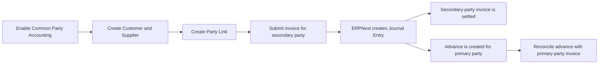

<!-- Frappe documentation: erpnext, part 14 of 69. Index: docs/INDEX.md -->

<!-- page: erpnext/erpnext__common-party-accounting.md -->
---
title: "Common Party Accounting | ERPNext Documentation"
description: "Link a Customer and Supplier with Common Party Accounting in ERPNext, understand automatic Journal Entries, reconcile advances, and verify invoice balances."
space: "ERPNext"
url: "https://docs.frappe.io/erpnext/common-party-accounting"
updated: "2026-08-03"
---

Use **Common Party Accounting** when the same real-world organization is both your Customer and your Supplier and you intend to offset eligible receivables and payables between its two ERPNext party records.

ERPNext keeps [Customer](https://docs.frappe.io/erpnext/customer) and [Supplier](https://docs.frappe.io/erpnext/supplier) as separate masters because their sales, purchase, pricing, tax, credit, and portal behavior differs. A **Party Link** tells ERPNext that the two records represent the same business party for this accounting workflow.

For example, Nova Electronics Trading buys services from Vertex Components and owes it $1,200. Vertex later buys $800 of device-setup services from Nova. When the records are linked with Supplier as the primary party and Customer as the secondary party, submitting the $800 [Sales Invoice](https://docs.frappe.io/erpnext/sales-invoice) creates a system-generated [Journal Entry](https://docs.frappe.io/erpnext/journal-entry). The Sales Invoice is settled and an $800 Supplier advance becomes available for reconciliation against the $1,200 [Purchase Invoice](https://docs.frappe.io/erpnext/purchase-invoice), leaving $400 payable.

## When to use it

Use Common Party Accounting when:

- the same legal or commercial party exists as both a Customer and a Supplier;
- your policy permits receivable and payable balances for that party to offset;
- you want ERPNext to create the cross-party accounting adjustment automatically when a qualifying secondary-party invoice is submitted;
- finance will review the generated Journal Entry and reconcile the resulting advance.

Do not enable it merely to show that two masters are related. The feature automates accounting. If invoices should normally remain independent, keep separate Customer and Supplier records, link their [Contacts](https://docs.frappe.io/erpnext/contact) and [Addresses](https://docs.frappe.io/erpnext/address) for visibility, and make an intentional adjustment only when policy allows it.

## Understand the workflow

The direction of the link matters:

| Primary role | Secondary role | Invoice submitted for secondary party | Automatic result                                                                                               |
| ------------ | -------------- | ------------------------------------- | -------------------------------------------------------------------------------------------------------------- |
| Supplier     | Customer       | Sales Invoice                         | Credits Customer receivables against the Sales Invoice and debits Supplier payables as an unallocated advance. |
| Customer     | Supplier       | Purchase Invoice                      | Creates the corresponding Customer-side advance while settling the linked Supplier invoice.                    |

Test the direction with controlled sample invoices before enabling the process for routine users.

## Before you begin

Confirm that:

1. both party records represent the same entity;
2. the Company and party currencies are compatible with the intended adjustment;
3. the correct receivable and payable Accounts are configured;
4. the user can submit invoices and review the generated Journal Entry;
5. finance has defined when cross-party offsets are permitted;
6. an outstanding primary-party invoice exists if the new advance should be allocated immediately.

## Enable Common Party Accounting

1. Open **Accounts Settings**.
2. Select **Invoice and Billing**.
3. Enable **Enable Common Party Accounting**.
4. Save Accounts Settings.

[Screenshot on the live page: Accounts Settings with Enable Common Party Accounting highlighted]

The setting applies to the site. There is no separate invoice-level switch to suppress the automatic adjustment while the feature is active. Enable it only after the policy and test results are approved.

## Create or identify both party records

Create a Customer and Supplier using the normal master workflows. They may use the same name because they are different DocTypes. Keep each master’s tax details, currency, payment terms, credit controls, Contacts, Addresses, and Company defaults accurate.

Do not merge the masters or create a shared receivable-payable ledger. ERPNext continues to track the Customer on a receivable Account and the Supplier on a payable Account.

## Link the Customer and Supplier

If the Supplier already exists:

1. Open the Supplier.
2. Select **Actions &gt; Link with Customer**.
3. Select or create the matching Customer.

[Screenshot on the live page: Supplier Actions menu with Link with Customer highlighted]

If the Customer already exists, open it and select **Actions &gt; Link with Supplier** instead.

ERPNext creates a Party Link. Review the roles and parties carefully because the primary and secondary orientation determines which invoice triggers the automatic entry and where the advance is created.

[Screenshot on the live page: Party Link connecting Vertex Components as Supplier and Customer]

| Field           | Meaning                                                                                        |
| --------------- | ---------------------------------------------------------------------------------------------- |
| Primary Role    | Party role that receives the unallocated advance after the secondary-party invoice is settled. |
| Primary Party   | Customer or Supplier record in the primary role.                                               |
| Secondary Role  | Opposite party role whose invoice triggers the automatic adjustment.                           |
| Secondary Party | Linked Customer or Supplier record in the secondary role.                                      |

## Submit the secondary-party invoice

Create and submit the invoice using the normal workflow. In this example, Vertex Components is the primary Supplier and secondary Customer, so the Sales Invoice is the triggering invoice.

After submission, the $800 Sales Invoice has an outstanding amount of $0 because the generated Journal Entry settles its receivable.

[Screenshot on the live page: Sales Invoice with zero outstanding amount after Common Party Accounting]

ERPNext creates and submits a system-generated Journal Entry:

| Account and party                     | Debit | Credit | Result                                   |
| ------------------------------------- | -----: | ------: | ---------------------------------------- |
| Debtors, Customer Vertex Components   | $0    | $800   | Settles the Sales Invoice receivable.    |
| Creditors, Supplier Vertex Components | $800  | $0     | Creates an unallocated Supplier advance. |

[Screenshot on the live page: System-generated Journal Entry for the linked Customer and Supplier]

Review the generated entry before reconciliation. Confirm the Company, parties, Accounts, amounts, invoice reference, currencies, and posting date. The Journal Entry number may appear in the [General Ledger](https://docs.frappe.io/erpnext/general-ledger) because it is the voucher that performs the cross-party adjustment.

## Reconcile the advance

The generated primary-party amount is an advance until it is allocated. Use [Payment Reconciliation](https://docs.frappe.io/erpnext/payment-reconciliation) to match it with the outstanding invoice for that primary party.

1. Open Payment Reconciliation.
2. Select the Company, primary **Party Type**, and primary **Party**.
3. Optionally filter to the invoice and generated Journal Entry.
4. Select **Get Unreconciled Entries**.
5. Select the invoice and Journal Entry rows.

[Screenshot on the live page: Purchase Invoice and generated Journal Entry ready for Supplier reconciliation]

6. Select **Allocate**.
7. Review the allocation amount, then select **Reconcile**.

[Screenshot on the live page: Common Party allocation ready to reconcile]

In the example, the $800 advance reduces the $1,200 Purchase Invoice to an outstanding amount of $400.

[Screenshot on the live page: Purchase Invoice with $400 outstanding after Common Party reconciliation]

## Important behavior

| Behavior                | What to expect                                                                                                                           |
| ----------------------- | ---------------------------------------------------------------------------------------------------------------------------------------- |
| Separate masters        | Customer and Supplier remain separate records.                                                                                           |
| Automatic entry         | A qualifying secondary-party invoice creates a submitted system-generated Journal Entry.                                                 |
| Triggering invoice      | The automatic Journal Entry settles the secondary-party invoice.                                                                         |
| Primary-party balance   | The opposite side becomes an unallocated advance for the primary party.                                                                  |
| Reconciliation          | The advance is not tied to a primary-party invoice until it is reconciled.                                                               |
| Reporting               | Review Customer and Supplier balances separately and trace the generated Journal Entry.                                                  |
| Returns and corrections | Review the resulting accounting carefully. Do not assume every later return or amendment will express the business intent automatically. |

## Troubleshooting

| Issue                                                     | What to check                                                                                                                                      |
| --------------------------------------------------------- | -------------------------------------------------------------------------------------------------------------------------------------------------- |
| Link action is unavailable                                | Confirm Common Party Accounting is enabled and the party is not already linked.                                                                    |
| No automatic Journal Entry is created                     | Confirm the invoice is submitted for the **secondary** party in the Party Link and the setting was enabled before submission.                      |
| The wrong side becomes an advance                         | Review which record is Primary Party and which is Secondary Party.                                                                                 |
| Advance does not appear in reconciliation                 | Select the primary Party Type and Party, correct payable or receivable Account, and the Journal Entry date range.                                  |
| The General Ledger does not show a combined party balance | Customer and Supplier remain separate party types. Review each party view and the generated Journal Entry rather than expecting one merged ledger. |

## Frequently asked questions

### Does Party Link merge the Customer and Supplier?

No, It connects two separate masters for the accounting workflow. Their sales, purchase, tax, currency, and permission behavior remains separate.

### Can I enable the link without automatic Journal Entries?

The current Common Party Accounting setting is designed to automate the cross-party entry for qualifying invoices. There is no separate native switch that retains this automation-oriented link while disabling its generated entries.

### Why is the secondary-party invoice already paid?

The system-generated Journal Entry references and settles that invoice. Its opposite side becomes an advance for the primary party, which can then be reconciled.

### Does ERPNext automatically choose the primary-party invoice?

No, The generated amount remains unallocated until you select the correct outstanding invoice in Payment Reconciliation.

### Can I see Customer and Supplier transactions in one standard General Ledger party filter?

They are different party types. Review each side separately and use the Party Link and generated Journal Entry to trace the relationship. A custom combined report may be required if your organization needs a single presentation.

## Related topics

- [Customer](https://docs.frappe.io/erpnext/customer)
- [Supplier](https://docs.frappe.io/erpnext/supplier)
- [Sales Invoice](https://docs.frappe.io/erpnext/sales-invoice)
- [Purchase Invoice](https://docs.frappe.io/erpnext/purchase-invoice)
- [Journal Entry](https://docs.frappe.io/erpnext/journal-entry)
- [Payment Reconciliation](https://docs.frappe.io/erpnext/payment-reconciliation)
- [General Ledger](https://docs.frappe.io/erpnext/general-ledger)

<!-- page: erpnext/erpnext__common-receivable-account.md -->
---
title: "Common Receivable Account | ERPNext Documentation"
description: "Use a shared receivable control account while retaining customer and invoice-level balances in ERPNext."
space: "ERPNext"
url: "https://docs.frappe.io/erpnext/common-receivable-account"
updated: "2026-07-31"
---

ERPNext normally posts each Customer to the Company's default Receivable account while preserving the Customer as the party. A **Common Receivable Account** lets several customers share one receivable ledger account without losing customer-level outstanding balances.

## Configure the account

1. Open the Company or Accounts Settings and confirm the default Receivable account.
2. Ensure the account is a non-group Asset account with **Account Type** set to Receivable.
3. In the Customer's accounting details, add a Company-specific receivable account only when that Customer must override the default.
4. Create a test Sales Invoice and confirm its **Debit To** account.

The **Debit To** field on a Sales Invoice shows the receivable control account used for that customer transaction.

[Screenshot on the live page: Sales Invoice accounting details showing the shared Debit To receivable account]

## How customer balances remain separate

The General Ledger entry contains both the receivable account and the Customer party. Reports such as Accounts Receivable use the party and voucher references to separate balances, even when all customers post to the same ledger account.

| Level              | Purpose                                        |
| ------------------ | ---------------------------------------------- |
| Receivable account | Total control balance in the Chart of Accounts |
| Customer party     | Balance for one customer                       |
| Voucher reference  | Outstanding amount for one invoice or credit   |

## Common problems

**The Customer posts to the wrong receivable account**

Check the Customer's Company-specific account first, then the Company's default Receivable account.

**Accounts Receivable does not match the control account**

Compare the same Company, date, currency, and receivable account. Look for Journal Entries without a Party or voucher reference.

**A receivable account cannot be selected**

Confirm it is a non-group account, belongs to the same Company, and has the correct account type.

## Related topics

- [Chart of Accounts](/erpnext/chart-of-accounts)
- [Company accounting defaults](/erpnext/company-accounting-defaults)
- [Customer](/erpnext/customer)
- [Sales Invoice](/erpnext/sales-invoice)
- [Accounts Receivables](/erpnext/accounts-receivables)
- [General Ledger](/erpnext/general-ledger)

<!-- page: erpnext/erpnext__company-accounting-defaults.md -->
---
title: "Company Accounting Defaults | ERPNext Documentation"
description: "Configure receivable, payable, cash, bank, income, expense, Cost Center, rounding, and exchange accounts for an ERPNext company."
space: "ERPNext"
url: "https://docs.frappe.io/erpnext/company-accounting-defaults"
updated: "2026-08-14"
---

A transaction can be complete in every business detail and still post to the wrong account if ERPNext does not know which defaults to use. Company accounting defaults provide many benefits

- Acts as a fallback accounts and Cost Center used when an Item, party, warehouse, Mode of Payment, or transaction row has not supplied a more specific value.
- Saves manual effort in entering accounts during every transaction. 
- Eliminates data entry errors which can happen if account selection is has to be done every single time by accountants managing books.

At Nova Industries, customer invoices normally post to Debtors, supplier invoices to Creditors, and bank receipts to the company bank account. Setting these defaults once prevents the accounts team from selecting the same ledger repeatedly and reduces the chance that two users classify similar transactions differently.

Defaults do not override every transaction. ERPNext uses the most specific valid value it can find, then falls back to the Company record. This page shows which defaults matter, where to configure them, and how to verify that transactions are choosing the intended accounts.

## Before you begin

Create the company’s [Chart of Accounts](https://docs.frappe.io/erpnext/chart-of-accounts), [Fiscal Year](https://docs.frappe.io/erpnext/fiscal-year), and [Cost Center](https://docs.frappe.io/erpnext/cost-center). The accounts must belong to the same company.

## Configure default party accounts

Open **Company**, select the company, and go to the **Accounts** tab.

| Field                      | Used for                                                             |
| -------------------------- | -------------------------------------------------------------------- |
| Default Receivable Account | Customer balances and Sales Invoices                                 |
| Default Payable Account    | Supplier balances and Purchase Invoices                              |
| Default Cash Account       | Cash payments and receipts                                           |
| Default Bank Account       | Bank payments and receipts when no more specific account is selected |

[Screenshot on the live page: Company party account defaults]

Party-specific accounts on a Customer or Supplier can override the company defaults. A Mode of Payment can also supply a payment account.

## Configure income, expense, and Cost Center defaults

Set the normal income account, expense account, and Cost Center for the company.

[Screenshot on the live page: Company income and expense defaults]

ERPNext normally resolves transaction defaults from the most specific source available. Item, Item Group, Warehouse, Customer, Supplier, and transaction values can take precedence over company defaults.

## Configure adjustment accounts

Set accounts used for write-offs, exchange differences, and rounding.

| Field                                 | Typical use                                                          |
| ------------------------------------- | -------------------------------------------------------------------- |
| Write Off Account                     | Small residual balances written off during payment or reconciliation |
| Exchange Gain/Loss Account            | Realized currency differences                                        |
| Unrealized Exchange Gain/Loss Account | Revaluation of outstanding foreign-currency balances                 |
| Round Off Account                     | Small differences caused by currency precision                       |
| Round Off Cost Center                 | Cost Center used for the rounding entry                              |

[Screenshot on the live page: Company adjustment account defaults]

## Other company accounting defaults

Review deferred accounting, advance payments, exchange-rate revaluation, budgets, and fixed-asset defaults if your business uses those features. Do not fill every field simply because it exists. Configure a section when the related process is in scope.

## Verify the setup

Create one draft Sales Invoice, Purchase Invoice, Payment Entry, and Journal Entry. Confirm that accounts and Cost Centers are fetched as expected. Submit only test transactions that can be safely cancelled.

## Troubleshooting

**An account does not appear in the field**

Confirm it is a ledger account, belongs to the same company, is not disabled, and has the correct root or account type.

**A different account is selected**

Check the Item, Item Group, party, Warehouse, Mode of Payment, and transaction row. A more specific default may be taking precedence.

## Related topics

- [Accounts Settings](https://docs.frappe.io/erpnext/accounts-settings)
- [Chart of Accounts](https://docs.frappe.io/erpnext/chart-of-accounts)
- [Bank Accounts and Modes of Payment](https://docs.frappe.io/erpnext/bank-accounts-and-modes-of-payment)
- [Opening Balance](https://docs.frappe.io/erpnext/opening-balance)

<!-- page: erpnext/erpnext__company-setup.md -->
---
title: "Company"
space: "ERPNext"
url: "https://docs.frappe.io/erpnext/company-setup"
updated: "2026-08-14"
---

A Company in ERPNext represents a legal entity whose transactions, accounts, taxes, stock valuation, and financial statements must be kept together. Create separate Companies when entities maintain separate books or statutory registrations. Use branches, cost centers, accounting dimensions, or warehouses when the operation belongs to the same legal entity.

Nova Group uses a group record to show its structure. Nova Industries and Nova Electronics Trading remain separate Companies because each entity needs its own accounting and operational defaults.

## Before you begin

Confirm the legal name, abbreviation, country, default currency, chart of accounts, fiscal year, and whether the record will be a parent group or a transaction company. The abbreviation becomes part of generated accounts, cost centers, and warehouses, so choose it carefully.

## Create a Company

1. Open the Company tree view. Select **New** to create an independent Company, or select a group and use **Add Child** to create a subsidiary under it.

[Screenshot on the live page: Company tree showing Nova Group, its two child companies, and Nova Industries]

2. Enter the Company name, abbreviation, default currency, and Country.
3. Enable **Is Group** only for a parent used to organize child companies. A group does not post normal business transactions.
4. Select a Parent Company when the entity belongs to a group structure.
5. Save the Company and review the accounts, buying, selling, stock, manufacturing, and payroll defaults created for it.

[Screenshot on the live page: Nova Industries Company form showing identity, currency, country, and parent-company fields]

## Important fields and what they mean

| Field              | Meaning                                                                                   |
| ------------------ | ----------------------------------------------------------------------------------------- |
| Abbreviation       | Short suffix used to distinguish company-specific accounts, cost centers, and warehouses. |
| Default Currency   | Base currency used for the Company ledger and financial statements.                       |
| Country            | Provides regional defaults and helps determine applicable localization.                   |
| Is Group           | Makes the record an organizational parent instead of a normal transaction company.        |
| Parent Company     | Places the entity under a group for consolidated navigation and reporting.                |
| Reporting Currency | Currency used when the organization needs reporting in addition to its base currency.     |

## Set up multiple companies

Use sibling Companies for entities at the same level. Use a parent and child structure for subsidiaries. Inter-company sales and purchases must still be recorded in the relevant legal entities. Review [Inter Company Invoices](/erpnext/inter-company-invoices) and [Inter Company Journal Entry](/erpnext/inter-company-journal-entry) for controlled cross-company transactions.

## What ERPNext creates

Depending on the selected setup options, ERPNext creates a chart of accounts, root cost center, and default warehouses. Review them before importing transactions. Configure Company accounting defaults, taxes, bank accounts, stock settings, and module-specific defaults before go-live.

## Troubleshooting

### The abbreviation cannot be changed

The abbreviation is embedded in linked masters. Avoid changing it after transactions or many company-specific records exist. Test the impact in a safe site first.

### A Company does not appear in a transaction

Confirm the user has permission for that Company and that user defaults or user permissions are not restricting the selection.

## Frequently asked questions

### Should each branch be a Company?

Only when the branch is a separate legal or accounting entity. Otherwise use branches, cost centers, warehouses, or accounting dimensions.

### Can Companies use different currencies?

Y

es. Each Company has its own base currency. Cross-company and foreign-currency transactions require appropriate accounts and exchange rates.

## Related topics

- [Chart of Accounts](/erpnext/chart-of-accounts)
- [Company Accounting Defaults](/erpnext/company-accounting-defaults)
- [Cost Center](/erpnext/cost-center)
- [Inter Company Invoices](/erpnext/inter-company-invoices)
- [User Permissions](/erpnext/user-permissions)

<!-- page: erpnext/erpnext__company-wise-naming-series.md -->
---
title: "Company-wise Naming Series"
space: "ERPNext"
url: "https://docs.frappe.io/erpnext/company-wise-naming-series"
updated: "2026-03-04"
---

Suppose you have a multi-company setup, and you need to create different naming series for documents belonging to different companies. For example, you have three companies:

* Company A
* Company B
* Company C

The need is to create naming series which is company-specific for documents such as Sales Invoice, Purchase Order, etc. For example, in case of Sales Invoice, for Company A, the naming series will be SINV-A-0001 and for Company B, the naming series will be SINV-B-0001. This can be easily achieved via customisation by following the steps given below:

1) First, go to the DocType for which you want different series based on company and open its Customize Form. In this case, we will Select From Type as Sales Invoice.

2) Next, below the field of Company, add another field and name it 'Abbr'. Add `company.abbr` in its Fetch From input.

[Screenshot on the live page]  

Also, keep this field hidden (if needed).

[Screenshot on the live page]  

3) Now, in the Customize Form itself, go to the Naming Series row and expand it. In the Options box, add another entry in new line (taking Sales Invoice as example) `SINV-.abbr.-.####` and set this as default.

[Screenshot on the live page]  

[Screenshot on the live page]  

Once this is done, click on Update.

Now, go to Sales Invoice and create one. Select the Company and the Naming Series will be updated automatically based on the company's abbreviation.

[Screenshot on the live page]  

  

**Comments**

<!-- page: erpnext/erpnext__concepts-and-terms.md -->
---
title: "Concepts and Terms"
space: "ERPNext"
url: "https://docs.frappe.io/erpnext/concepts-and-terms"
updated: "2026-08-14"
---

Lets get familiar with the terminology that is used and some basic concepts in ERPNext.

### Basic Concepts

#### Company

This represents the Company records for which ERPNext is setup. With this same setup, you can create multiple Company records, each representing a different legal entity. The accounting for each Company will be different, but they will share the Customer, Supplier and Item records.

> Setup &gt; Company

#### Customer

Represents a customer. A Customer can be an individual or an organization. You can create multiple Contacts and Addresses for each Customer.

> Selling &gt; Customer

#### Supplier

Represents a supplier of goods or services. Your telephone company is a Supplier, so is your raw materials Supplier. Again, a Supplier can be an individual or an organization and has multiple Contacts and Addresses.

> Buying &gt; Supplier

#### Item

A Product, sub-product or Service that is either bought, sold or manufactured and is uniquely identified.

> Stock &gt; Item

#### Account

An Account is a heading under which financial and business transactions are carried on. Examples of accounts are "Debtors", "Creditors", "VAT Payable", “Travel Expenses”, "Sales", "Share Capital", etc. ERPNext keeps track of your customers' and suppliers' balances in the background, so you don't need to create dedicated Accounts for them.

> Accounting &gt; Chart of Accounts

#### Address

An address represents location details of a Customer or Supplier. These can be of different locations such as Head Office, Factory, Warehouse, Shop etc.

> Selling &gt; Address

#### Contact

An individual Contact belongs to a Customer or Supplier or is just an independent. A Contact has a name and contact details like email and phone number.

> Selling &gt; Contact

#### Communication

A list of all Communication with a Contact or Lead. All emails sent from the system are added to the Communication table.

> Support &gt; Communication

#### Price List

A Price List is a place where different rate plans can be stored. It’s a name you give to a set of Item Prices stored under a particular List.

> Selling &gt; Price List

> Buying &gt; Price List

---

### Accounting

#### Fiscal Year

Represents a Financial Year or Accounting Year. You can operate multiple Fiscal Years at the same time. Each Fiscal Year has a start date and an end date and transactions can only be recorded in this period. When you “close” a fiscal year, it's balances are transferred as “opening” balances for the next fiscal year.

> Setup &gt; Company &gt; Fiscal Year

#### Cost Center

A Cost Center is like an Account, but the only difference is that its structure represents your business more closely than Accounts. For example, in your Chart of Accounts, you can separate your expenses by its type (i.e., travel, marketing, etc.). In your Chart of Cost Centers, you can separate them by product line or business group (e.g., online sales, retail sales, etc.).

> Accounting &gt; Chart of Cost Centers

#### Journal Entry

A document that contains General Ledger (GL) entries and the sum of Debits and Credits of those entries is the same. In ERPNext you can update Payments, Returns, etc., using Journal Entries.

> Accounting &gt; Journal Entry

#### Sales Invoice

A bill sent to Customers for delivery of Items (goods or services).

> Accounting &gt; Sales Invoice

#### Purchase Invoice

A bill sent by a Supplier for delivery of Items (goods or services).

> Accounting &gt; Purchase Invoice

#### Currency

ERPNext allows you to book transactions in multiple currencies. There is only one currency for your book of accounts though. While posting your Invoices with payments in different currencies, the amount is converted to the default currency by the specified conversion rate.

> Setup &gt; Currency

---

### Selling

#### Customer Group

A classification of Customers, usually based on market segment.

> Selling &gt; Setup &gt; Customer Group

#### Lead

A person who could be a future source of business. A Lead may generate Opportunities. (from: “may lead to a sale”).

> CRM &gt; Lead

#### Opportunity

A potential sale. (from: “opportunity for a business”).

> CRM &gt; Opportunity

#### Quotation

Customer's request to price an item or service.

> Selling &gt; Quotation

#### Sales Order

A note confirming the terms of delivery and price of an Item (product or service) by the Customer. Deliveries, Work Orders and Invoices are made on basis of Sales Orders.

> Selling &gt; Sales Order

#### Territory

A geographical area classification for sales management. You can set targets for Territories and each sale is linked to a Territory.

> Selling &gt; Setup &gt; Territory

#### Sales Partner

A third party distributer / dealer / affiliate / commission agent who sells the company’s products usually for a commission.

> Selling &gt; Setup &gt; Sales Partner

#### Sales Person

Someone who pitches to the Customer and closes deals. You can set targets for Sales Persons and tag them in transactions.

> Selling &gt; Setup &gt; Sales Person

---

### Buying

#### Purchase Order

A contract given to a Supplier to deliver the specified Items at the specified cost, quantity, dates and other terms.

> Buying &gt; Purchase Order

#### Material Request

A request made by a system User, or automatically generated by ERPNext based on reorder level or projected quantity in Production Plan for purchasing a set of Items.

> Buying &gt; Material Request

---

### Stock (Inventory)

#### Warehouse

A logical Warehouse against which stock entries are made.

> Stock &gt; Warehouse

#### Stock Entry

Material transfer from a Warehouse, to a Warehouse or from one Warehouse to another.

> Stock &gt; Stock Entry

#### Delivery Note

A list of Items with quantities for shipment. A Delivery Note will reduce the stock of Items for the Warehouse from where you ship. A Delivery Note is usually made against a Sales Order.

> Stock &gt; Delivery Note

#### Purchase Receipt

A note stating that a particular set of Items were received from the Supplier, most likely against a Purchase Order.

> Stock &gt; Purchase Receipt

#### Serial Number

A unique number given to a particular unit of an Item.

> Stock &gt; Serial Number

#### Batch

A number given to a group of units of a particular Item that may be purchased or manufactured in a group.

> Stock &gt; Batch

#### Stock Ledger Entry

A unified table for all material movement from one warehouse to another. This is the table that is updated when a Stock Entry, Delivery Note, Purchase Receipt, and Sales Invoice (POS) is made.

#### Stock Reconciliation

Update Stock of multiple Items from a spreadsheet (CSV) file.

> Stock &gt; Stock Reconciliation

#### Quality Inspection

A note prepared to record certain parameters of an Item at the time of Receipt from Supplier, or Delivery to Customer.

> Stock &gt; Quality Inspection

#### Item Group

A classification of Item.

> Stock &gt; Setup &gt; Item Group

---

### Manufacturing

#### Bill of Materials (BOM)

A list of Operations and Items with their quantities, that are required to produce another Item. A Bill of Materials (BOM) is used to plan purchases and do product costing.

> Manufacturing &gt; BOM

#### Workstation

A place where a BOM operation takes place. It is useful to calculate the direct cost of the product.

> Manufacturing &gt; Workstation

#### Work Order

A document signaling production (manufacture) of a particular Item with specified quantities.

> Manufacturing &gt; Work Order

#### Production Planning Tool

A tool for automatic creation of Work Orders and Purchase Requests based on Open Sales Orders in a given period.

> Manufacturing &gt; Production Planning Tool

---

### Setup / Customization

#### Custom Field

A user defined field on a form / table.

> Setup &gt; Customize ERPNext &gt; Custom Field

#### Global Defaults

This is the section where you set default values for various parameters of the system.

> Setup &gt; Data &gt; Global Defaults

#### Print Heading

A title that can be set on a transaction just for printing. For example, you want to print a Quotation with a title “Proposal” or “Pro forma Invoice”.

> Setup &gt; Branding and Printing &gt; Print Headings

#### Terms and Conditions

Text of your terms of contract. In Sales/Purchase transactions there might be certain Terms and Conditions based on which the Supplier provides goods or services to the Customer. You can apply the Terms and Conditions to transactions and they will appear when printing the document. To know about Terms and Conditions, click here

> Selling &gt; Setup &gt; Terms and Conditions

#### Unit of Measure (UOM)

How quantity is measured for an Item. E.g., Kg, No., Pair, Packet, etc.

> Stock &gt; Setup &gt; UOM

<!-- page: erpnext/erpnext__configuring-a-reply-to-email-address-in-erpnext.md -->
---
title: "Configuring A Reply-To Email Address"
space: "ERPNext"
url: "https://docs.frappe.io/erpnext/configuring-a-reply-to-email-address-in-erpnext"
updated: "2026-03-04"
---

The 'Reply-To' Email Address is set based on the 'Default Incoming' checkbox in the required Email Account.

[Screenshot on the live page]

Prerequisites:

You must have an email address record created in the ‘Email Account’ DocType for the desired email address, for example, ‘[abc@test.com](mailto:abc@test.com)'.

Steps:

In the record for email address ‘[abc@test.com](mailto:abc@test.com)' created in the 'Email Account' DocType, enable the 'Enable Incoming' checkbox and then the 'Default Incoming' checkbox. Enabling the 'Default Incoming' checkbox will then set this email as the email in 'Reply-To' (sample screenshot below).

 [Screenshot on the live page]

For more information on Email Accounts, please click [here](/erpnext/email-account).

<!-- page: erpnext/erpnext__consumed-materials-in-production.md -->
---
title: "Issued Items Against Work Order"
space: "ERPNext"
url: "https://docs.frappe.io/erpnext/consumed-materials-in-production"
updated: "2026-03-02"
---

To access the Issued Items Against Work Order, go to:

> Home > Manufacturing > Reports > Issued Items Against Work Order

[Screenshot on the live page: Task]  

Items that are issued against a Work Order and are transferred to the Work in Progress Warehouse are shown in this report.

<!-- page: erpnext/erpnext__contract.md -->
---
title: "Contract | ERPNext Documentation"
description: "Learn how to create and manage customer or supplier Contracts in ERPNext, including terms, dates, and fulfilment status."
space: "ERPNext"
url: "https://docs.frappe.io/erpnext/contract"
updated: "2026-07-23"
---

**A contract is a legally binding agreement between a Supplier and a Customer over the sale or products or services.**

A contract is legally enforceable because it meets the requirements and approval of the law. An agreement typically involves the exchange of goods, services, money, or promises of any of those.

To access the Contract list, go to:

> Home > Sales Pipeline > Contract

## How to Create a Contract

- Go to the Contract list and select New.
- Choose the Customer.
- Enter the Contract Terms. A template can also be created for easily fetching the terms.
- Save.Contract (picture on the live page)

**Party User**: The employee from your Company who is in contact with the Customer.

### Statuses

- **Unsigned**: The Contract has not yet been signed by the Customer.
- **Active**: The Contract has been signed and is active under the Contract Period.
- **Inactive**: The Contract is out of the Contract Period and not valid anymore.

## Features

### Contract Period

The Start and End date within which the Contract is valid.

### Signee Details

This section will appear when the 'Signed' checkbox is ticked to indicate that the Customer has signed and accepted the Contract.

[Screenshot on the live page: Contract Signee]

- **Signee**: Enter the name of the person that has signed the Contract.
- **Signed On**: The date on which the Contract was signed.

### Contract Details

Enter the terms of the Contract in the Contract Terms field. You can create a Contract Template and the template can be selected to fetch the Contract Terms.

### Fulfilment Details

If the Contract requires some fulfilment from the Supplier's (your) end, their details can be recorded in the Fulfilment Terms table.

[Screenshot on the live page: Contract Fulfilment]

- **Requirement**: Enter a requirement that needs to be fulfiled. For example, 'installation'.
- **Notes**: Any notes about the requirement can be entered here.

### Contract Template

A contract template is a standardized outline of a contract without the specifics involved. You can create a new template by going to:

> Home > CRM > Contract Template

You can create templates by using Jinja. Eg:

The parties enter into this contract on {{ start_date }}.When you create a new contract using this template, the {{ start_date }} is replaced by the date entered into the field of the same name.

[Screenshot on the live page: Contract Template]

### References

If the Contract can be linked to a transaction in ERPNext. Select the transaction type and the specific transaction. The documents that can be linked are:

- Quotation
- Project
- Sales Order
- Purchase Order
- Sales Invoice
- Purchase Invoice

[Screenshot on the live page: Contract References]

### Related Topics

- [Quotation](/erpnext/quotation)
- [Purchase Order](/erpnext/purchase-order)
- [Sales Order](/erpnext/sales-order)
- [Purchase Receipt](/erpnext/purchase-receipt)
- [Delivery Note](/erpnext/delivery-note)
- [Sales Invoice](/erpnext/sales-invoice)
- [Purchase Invoice](/erpnext/purchase-invoice)

<!-- page: erpnext/erpnext__copy-pasting-multiple-records-from-excel.md -->
---
title: "Copy Pasting Multiple Records From Excel\n"
space: "ERPNext"
url: "https://docs.frappe.io/erpnext/copy-pasting-multiple-records-from-excel"
updated: "2026-03-04"
---

**If you have a sequence of records saved in an excel sheet, that need to be mapped into a Child Table in ERPNext, the same can be done using this feature.**

Let's say, you have a list of items saved in an Excel sheet, and you need to copy the same to the 'Items' Child Table in the Sales Order.

**Steps to Copy Paste records from excel**

* Prepare the source data in Excel or text editor with each column separated by a tab.

 [Screenshot on the live page: Copy Pasting]

* Drag to select the records, and click the copy menu button or by Ctrl + C (Cmd + C) for

 Case 1. The first column of the excel sheet should be the Column header and the contents therein.

 Case 2. When there is no defined column header, the data will be mapped to the visible columns.

 [Screenshot on the live page: Copy Pasting]

* Place the cursor to the target input field of the child table, and paste it. Unlike the import via upload file feature, this copy & paste feature will trigger field change events automatically.

 [Screenshot on the live page: Copy Pasting]

For performance consideration, you should only paste less than or equal to 100 records at a time.

<!-- page: erpnext/erpnext__cost-center-and-budgeting.md -->
---
title: "Cost Center and Budgeting"
space: "ERPNext"
url: "https://docs.frappe.io/erpnext/cost-center-and-budgeting"
updated: "2026-02-28"
---

In ERPNext, cost centers are crucial for budgeting and financial management. They represent distinct areas or departments within a company where costs are incurred and tracked. By associating expenses with specific cost centers, ERPNext provides a granular view of spending patterns and helps in analyzing budget performance.

Budgeting in ERPNext involves setting financial goals for each cost center based on historical data and projected expenses. This allows businesses to monitor their financial health, identify areas for improvement, and make informed decisions to achieve their financial objectives effectively.

* [Accounting Dimensions](/erpnext/user/manual/en/accounting-dimensions)
* [Cost Centre](/erpnext/cost-center)
* [Cost Centre Allocation](/erpnext/user/manual/en/cost_center_allocation)
* [Budgeting](/erpnext/user/manual/en/budgeting)
