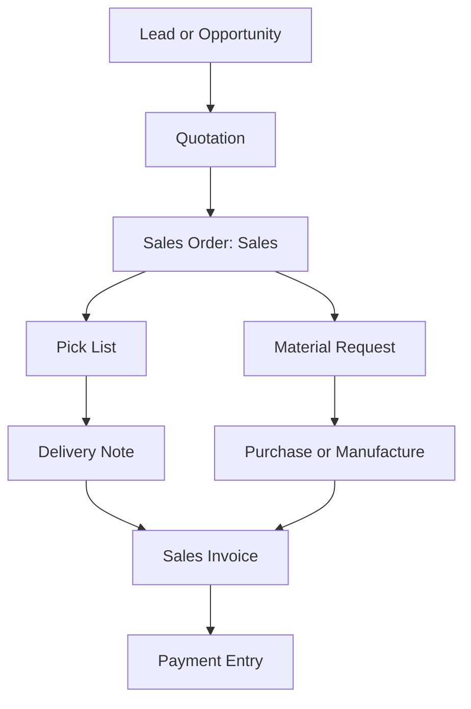
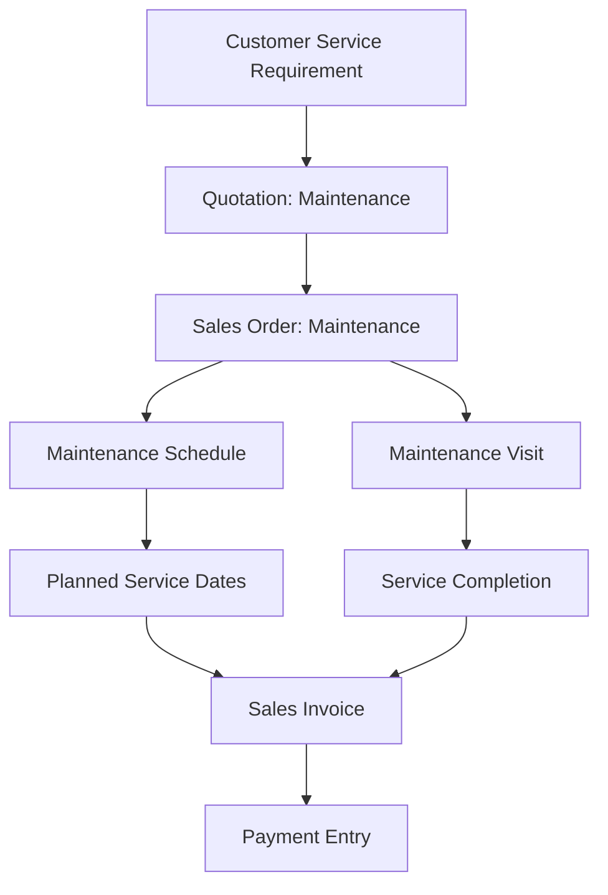
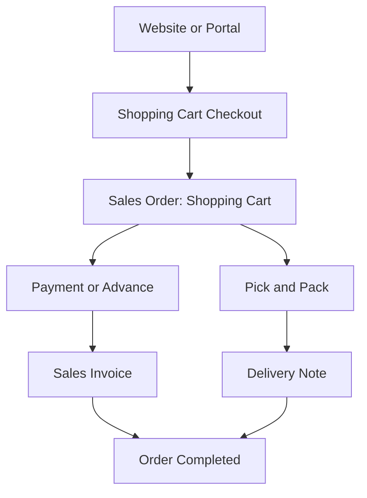

<!-- Frappe documentation: erpnext, part 14 of 18. Index: docs/INDEX.md -->

<!-- page: erpnext/erpnext__sales-analytics.md -->
---
title: "Sales Reports and Analytics | ERPNext Documentation"
description: "Choose and use ERPNext sales reports for orders, billing, customers, items, salespeople, targets, gross profit, and sales pipeline analysis."
space: "ERPNext"
url: "https://docs.frappe.io/erpnext/sales-analytics"
updated: "2026-07-25"
---

ERPNext sales reports help teams review pipeline, orders, fulfilment, billing, customer activity, item performance, salesperson attribution, targets, and profitability. Choose a report based on the business question and confirm which transaction type, date field, and document status it uses.

## Before you begin

For reliable reports:

- Use consistent [Customers](/erpnext/customer), Territories, Sales Persons, Item Groups, and Warehouses.
- Submit operational transactions when the report measures confirmed activity.
- Assign the correct Company and posting or transaction dates.
- Keep Sales Team contribution and target allocations current.
- Use accurate buying or valuation rates for profitability reports.

## Open a sales report

1. Open the Selling workspace.
2. Select a report, or search for it by name.
3. Set Company, date range, and other filters.
4. Select **Refresh**.
5. Review, export, print, or chart the results as required.


## Choose the right report


| Question                                       | Useful report                                              |
| ---------------------------------------------- | ---------------------------------------------------------- |
| Which orders are confirmed and still open?     | Sales Order Analysis                                       |
| What has been sold by Customer?                | Sales Analytics or Customer-wise Sales                     |
| What has been sold by Item or Item Group?      | Sales Analytics or Item-wise Sales                         |
| Which orders remain to be delivered or billed? | Sales Order Analysis and order status views                |
| How much has each Sales Person contributed?    | Sales Person-wise Transaction Summary                      |
| Are Sales Persons meeting targets?             | Sales Person Target Variance                               |
| Are Territories meeting targets?               | Territory Target Variance                                  |
| Which invoices remain unpaid?                  | [Accounts Receivable](/erpnext/accounts-receivable)        |
| Which sales are profitable?                    | Gross Profit                                               |
| What is the CRM pipeline?                      | [Sales Pipeline](/erpnext/sales-pipeline) or CRM Analytics |


Report names and available filters can vary by ERPNext version and installed apps.

## Sales Analytics

Use Sales Analytics to compare sales across dimensions such as Customer, Customer Group, Territory, Item, Item Group, and Sales Person. Select the value or quantity basis and the period grouping needed for the comparison.

Use it for trends and concentration, not as a substitute for invoice-level audit.

## Sales Order reporting

[Sales Orders](/erpnext/sales-order) track confirmed demand, delivery progress, and billing progress. Review statuses and percentage fields to separate:

- To Deliver and Bill.
- To Deliver.
- To Bill.
- Completed.
- Closed.

Returns, cancellations, partial fulfilment, and short-closing can change outstanding values.

## Salesperson and target reporting

Salesperson reports depend on the Sales Team table. Confirm each transaction contains the correct [Sales Person contribution](/erpnext/sales-persons-in-the-sales-transactions).

Target variance also depends on [Sales Person Target Allocation](/erpnext/sales-person-target-allocation), Fiscal Year, Item Group, and Monthly Distribution.

## Gross Profit

Gross Profit compares sales value with buying or valuation information. Investigate:

- Missing or unusual buying rates.
- Returns and credit notes.
- Stock and non-stock Items.
- Currency conversion.
- Costing and valuation method.

Use the [General Ledger](/erpnext/general-ledger) and stock reports when accounting or inventory values need reconciliation.

## Export and saved views

Use report export for further analysis, but keep ERPNext as the source of the transactional record. Save commonly used filters or views where supported so teams compare the same scope.

## Troubleshooting


| Problem                           | What to check                                                                                 |
| --------------------------------- | --------------------------------------------------------------------------------------------- |
| Report shows no data              | Company, dates, transaction type, status, permissions, and dimension filters                  |
| Totals differ from another report | Confirm both reports use the same document type, date field, status, and return treatment     |
| Sales Person totals are missing   | Review Sales Team rows and contribution percentages                                           |
| Target variance is empty          | Review target rows, Fiscal Year, Item Group, Monthly Distribution, and submitted transactions |
| Gross profit is unexpected        | Review valuation, buying rates, returns, and currency                                         |


## Frequently asked questions

### Do draft transactions appear in sales reports?

It depends on the report. Reports of confirmed activity usually use submitted transactions, while pipeline-style reports may include drafts or opportunities.

### Why do two reports show different totals?

They may use different source DocTypes, statuses, dates, or grouping logic. Compare filters and report definitions.

### Can I add custom columns?

Use report customization or a custom Query or Script Report when standard output does not meet the requirement.

### Which report should I use for unpaid invoices?

Use Accounts Receivable rather than an order or sales analytics report.

## Related topics

- [Sales Order](/erpnext/sales-order)
- [Sales Invoice](/erpnext/sales-invoice)
- [Sales Person Target Allocation](/erpnext/sales-person-target-allocation)
- [Sales Pipeline](/erpnext/sales-pipeline)
- [CRM Analytics](/erpnext/crm-analytics)

<!-- page: erpnext/erpnext__sales-invoice-from-timesheet.md -->
---
title: "Sales Invoice from Timesheet\n"
space: "ERPNext"
url: "https://docs.frappe.io/erpnext/sales-invoice-from-timesheet"
updated: "2026-02-26"
---

A customer can be billed based on the total number of hours an employee has worked for that customer. The actual number of hours of billable work can be tracked via a Timesheet.

**A sales invoice can be generated from each Timesheet submitted by an employee which can be used to bill the customer.**


## How to Create A Sales Invoice from A Timesheet

1. Once the Timesheet is submitted, click on 'Create Sales Invoice'.
2. Enter the Item Code and name of the Customer who has to be billed against this Timesheet. The Item could be a Product as well as a Service. Click on 'Create Sales Invoice'.
3. All the details of the Timesheet will get auto-populated in the Sales Invoice.
4. The posting date and time will be set to current, you can edit after you tick the checkbox below Posting Time.
5. Optionally, you can include payments for POS or make this a credit note.
6. Save and Submit.

To fetch the details automatically in a Sales Invoice, click on the **Get items from** button. The details can be fetched from a Sales Order, Delivery Note, or a Quotation. The details like Customer PO, Address and Contact Number, Currency and Price List, Items will get auto-populated.


*Sales invoice from timesheet*

## Features

Additional Details while creating a Sales Invoice from a Timesheet:

- **Accounting Dimensions**: Accounting Dimensions lets you tag transactions to a specific Territory, Branch, Project, etc. This helps in viewing accounting statements separately based on the criteria selected. To know more, visit the Accounting Dimensions page.
- **Time Sheet List**: Since the Project is created from a Time Sheet, the details of the Time Sheet will get auto-fetched. You can click on 'Add Row' to add more Time Sheets to this Invoice.

All the other details can be added as you would add them in any Sales Invoice.

## After submitting

Once you have submitted the Sales Invoice, The details like 'Total Billed Hours', 'Total Billed Amount' and '% Amount Billed' will get updated in the Timesheet. Further, a Salary Slip can also be generated from the Timesheet.

<!-- page: erpnext/erpnext__sales-invoice-without-an-item.md -->
---
title: "Create a Sales Invoice without an Item Code | ERPNext Documentation"
description: "Create ERPNext Sales Invoices and Credit Notes for one-time charges without an Item Code by completing the required child-row fields."
space: "ERPNext"
url: "https://docs.frappe.io/erpnext/sales-invoice-without-an-item"
updated: "2026-07-25"
---

ERPNext can invoice a one-time charge without selecting an Item Code. Enter the required details directly in the Sales Invoice Items child row. Use this sparingly because an [Item](/erpnext/item) provides better reporting, tax, UOM, income-account, and pricing consistency.

## Before you begin

Confirm:

- The [Customer](/erpnext/customer), Company, currency, and receivable account.
- The correct Income Account, Cost Center, UOM, and tax treatment for the charge.
- Whether your organization's controls require an Item master for every invoice line.
- Permission to create and submit a [Sales Invoice](/erpnext/sales-invoice).

Create a non-stock service or charge Item instead when the same charge is likely to recur.

## Create a Sales Invoice without an Item Code

1. Open the Sales Invoice list and select **Add Sales Invoice**.
2. Select the Customer.
3. Set the Posting Date, Due Date, and Company.
4. In the Items table, add a row.
5. Select the highlighted pencil icon to open the complete child-row editor.
6. Leave Item Code blank.
7. Enter Item Name, Description, Quantity, UOM, Rate, and Income Account.
8. Complete the Cost Center and tax-related fields required by your configuration.
9. Review totals, save, and submit.


Because there is no Item Code, the stock-availability dot used for normal Item rows does not apply.

## Required line information


| Field          | Purpose                                         |
| -------------- | ----------------------------------------------- |
| Item Name      | Short label printed and reported for the charge |
| Description    | Complete explanation shown on the invoice       |
| Quantity       | Number of units billed                          |
| UOM            | Unit used to interpret Quantity                 |
| Rate           | Price per unit                                  |
| Income Account | Revenue account credited by the invoice         |
| Cost Center    | Organizational dimension used for reporting     |


Additional mandatory fields can appear through accounting dimensions, tax rules, or customization.

## Example

Nova Electronics Trading needs to bill a one-time **Expedited handling service**:


| Field          | Value                      |
| -------------- | -------------------------- |
| Item Name      | Expedited handling service |
| Quantity       | 1                          |
| UOM            | Nos                        |
| Rate           | $125                       |
| Income Account | Service Revenue            |


After submission, the Sales Invoice creates the normal receivable and income accounting entries. It does not create a stock movement.

## Create a Credit Note without an Item Code

Create a return against the original invoice where possible so the audit link is retained.

1. Open the submitted Sales Invoice.
2. Create a Return or [Credit Note](/erpnext/credit-note).
3. Confirm **Is Return** and the reference invoice.
4. Enter the one-time line with a negative quantity or mapped return values.
5. Review accounts and submit.

Do not create an unrelated negative invoice when a linked return is available.

## When to create an Item instead

Create a non-stock Item when:

- The charge will be used repeatedly.
- It requires consistent taxes or income accounts.
- Users need Item-wise reporting.
- It has a standard [Item Price](/erpnext/item-price).
- It appears in Quotations or [Sales Orders](/erpnext/sales-order).

## Troubleshooting


| Problem                                   | What to check                                                                                        |
| ----------------------------------------- | ---------------------------------------------------------------------------------------------------- |
| Invoice cannot be saved                   | Complete Item Name, Quantity, UOM, Rate, Income Account, Cost Center, and other mandatory dimensions |
| Stock validation appears                  | Confirm the row has no stock Item and no stock-update requirement                                    |
| Tax is incorrect                          | Review tax templates, Item Tax Template behavior, and charge classification                          |
| Reporting is inconsistent                 | Create a reusable non-stock Item instead                                                             |
| Credit Note does not reverse the original | Create it from the submitted invoice and verify the return reference                                 |


## Frequently asked questions

### Can I update stock for a row without an Item Code?

No meaningful stock ledger entry can be created without a stock Item. Use an Item when inventory is involved.

### Can I use this method for services?

Yes, but a reusable non-stock service Item is better when the service is sold regularly.

### Does the invoice create accounting entries?

Yes. The configured Income Account and receivable account are used on submission.

### Can a Sales Order contain a line without an Item Code?

This page covers Sales Invoice. Use a proper Item for a controlled multi-step sales cycle.

## Related topics

- [Sales Invoice](/erpnext/sales-invoice)
- [Credit Note](/erpnext/credit-note)
- [Item](/erpnext/item)
- [Item Price](/erpnext/item-price)
- [Chart of Accounts](/erpnext/chart-of-accounts)

<!-- page: erpnext/erpnext__sales-invoice.md -->
---
title: "Sales Invoice | ERPNext Documentation"
description: "Learn how to create, submit, and collect payment for a Sales Invoice in ERPNext, including taxes, stock updates, ledger impact, and common fixes."
space: "ERPNext"
url: "https://docs.frappe.io/erpnext/sales-invoice"
updated: "2026-08-14"
---

Nova Industries has delivered two phones to Northstar Retail. The sale is operationally complete, but until finance issues a Sales Invoice, the customer has no formal bill and Nova has no posted receivable or sales income.


A Sales Invoice converts that sale into an amount the Customer owes. When it is submitted, ERPNext records the receivable, income, and taxes in the general ledger. If **Update Stock** is enabled, the same invoice can also record the goods leaving the Warehouse, which is useful for a direct sale without a Delivery Note.


Create the invoice from a [Sales Order](/erpnext/sales-order) or [Delivery Note](/erpnext/delivery-note) when those documents already exist. Create it directly for a service sale or an immediate stock sale. This guide explains how to prepare the invoice, choose the correct stock flow, submit it, and understand its accounting effect.

## Before you begin

Prepare these records before creating an invoice:

- A [Customer](/erpnext/customer) with the correct billing address, contact, currency, and receivable account.
- Each product or service as an [Item](/erpnext/item), with its income account and default Unit of Measure.
- A selling [Price List](/erpnext/price-list) if rates should be fetched automatically.
- Sales tax accounts or a Sales Taxes and Charges Template if tax applies.
- [Payment Terms](/erpnext/payment-terms) if the Customer pays in installments.
- A Warehouse and available stock if the invoice will update stock.

## Create a Sales Invoice

1. Go to **Accounting &gt; Sales and Receivables &gt; Sales Invoice**.
2. Click **Add Sales Invoice**.


3. Select the **Company** and **Customer**. ERPNext fetches the Customer's billing address, contact, currency, price list, and receivable account when defaults exist.
4. Check the **Posting Date** and **Payment Due Date**. The posting date decides the accounting period. The due date is used to determine whether the invoice is overdue.


5. In **Items**, add each product or service. Check the Quantity, Rate, Amount, and Warehouse.


The dot before an Item Code shows stock availability at a glance: green means in stock and red means out of stock.

6. Click the pencil icon to edit a row. This opens fields that do not fit in the table, including UOM, Income Account, Cost Center, Project, Warehouse, serial or batch details, and deferred revenue settings.


7. Add the applicable taxes or select a Sales Taxes and Charges Template. Review the tax amount and Grand Total.


8. Open the **Payments** tab. Review the payment schedule, allocate any advances, and confirm the payment terms.
9. Review the billing and shipping addresses, Customer purchase order details, currency, terms, and totals.
10. Save the draft, then click **Submit** when the invoice is ready to affect the books.

## Alternative ways to create a Sales Invoice

Creating the invoice from an upstream document carries forward items, quantities, rates, taxes, addresses, and references. It also lets ERPNext update the upstream document's billed percentage.

### From a Sales Order

Open a submitted Sales Order, click **Create**, and select **Sales Invoice**. Invoice only the lines and quantities that are ready for billing. You can create several invoices from one order for [partial fulfilment](/erpnext/partial-fulfilment-of-sales-order).


### From a Delivery Note

Open a submitted Delivery Note, click **Create**, and select **Sales Invoice**. This is the usual route when stock has already been delivered. Do not enable Update Stock on the invoice because the Delivery Note has already updated the Stock Ledger.

### Direct invoice with stock update

For an immediate counter sale or another flow without a Delivery Note, create the invoice directly and enable **Update Stock**. Select the correct Warehouse on every stock Item.


On submission, this single document updates both the Stock Ledger and General Ledger. Do not use this option when a Delivery Note has already recorded the same movement.

### Services, projects, and timesheets

For services, use non-stock Items and leave Update Stock disabled. You can link a Project and Cost Center to the invoice or its item rows. For time-based billing, use **Get Items From &gt; Timesheet** to fetch billable hours and rates.

Subscriptions and Auto Repeat can create recurring invoices. Point of Sale can create paid retail invoices with payment and stock effects in one flow.

## Important fields and what they mean


| Field                                           | What it controls                                                                                                                       |
| ----------------------------------------------- | -------------------------------------------------------------------------------------------------------------------------------------- |
| Customer                                        | The party being billed. It supplies address, contact, currency, price list, tax, and account defaults.                                 |
| Posting Date                                    | The date on which the invoice affects accounting. Backdating may be restricted by frozen accounts or an Accounting Period.             |
| Payment Due Date                                | The date used for aging and Overdue status. Payment Terms can calculate it.                                                            |
| Currency and Conversion Rate                    | The invoice currency and its conversion into the Company's base currency.                                                              |
| Update Stock                                    | Posts the item quantities to the Stock Ledger when the invoice is submitted.                                                           |
| Item, Quantity, and UOM                         | What is billed and how much. The Stock UOM and conversion factor matter when selling in another UOM.                                   |
| Rate and Price List Rate                        | The charged price and the reference rate fetched from the Price List. Pricing Rules, margins, and discounts can change the final rate. |
| Warehouse                                       | The stock source when Update Stock is enabled. It is also useful as a reference on other invoices.                                     |
| Income Account                                  | The income ledger credited for the item value. Defaults normally come from the Item or Item Group.                                     |
| Cost Center, Project, and Accounting Dimensions | Tags income and related postings for management reporting.                                                                             |
| Sales Taxes and Charges                         | Calculates tax, shipping, or other charges and posts each amount to its Account Head.                                                  |
| Debit To                                        | The receivable account debited for the Customer.                                                                                       |
| Payment Terms Template and Payment Schedule     | Splits the invoice into due dates and amounts.                                                                                         |
| Allocate Advances Automatically                 | Applies eligible Customer advances against the invoice. Review every allocation before submission.                                     |
| Is Return (Credit Note)                         | Creates a return or credit note. Prefer creating it from the original invoice so references and amounts are carried forward.           |
| Is Rate Adjustment Entry (Debit Note)           | Adjusts the rate of an existing invoice while retaining its quantity.                                                                  |
| Customer PO Number and Date                     | Stores the Customer's purchase reference for matching and duplicate control.                                                           |
| Terms and Conditions                            | Adds the commercial or legal text used on the invoice print.                                                                           |


## Submit and next steps

Submitting a normal accrual invoice usually creates these General Ledger entries:


| Entry                   | Debit       | Credit                          |
| ----------------------- | -----------: | -------------------------------: |
| Customer receivable     | Grand Total |                                 |
| Income accounts         |             | Net item amount                 |
| Tax and charge accounts |             | Applicable tax or charge amount |


If Update Stock is enabled, ERPNext also posts Stock Ledger entries and the related cost-of-goods accounting entries when perpetual inventory is enabled.

After submission, use **Create &gt; Payment** to make a [Payment Entry](/erpnext/payment-entry). The payment reduces the invoice's outstanding amount.


You can also create a Payment Request, a return or [Credit Note](/erpnext/sales-return), or a Dunning document. Use **View Ledger** to inspect the accounting entries. Cancel only after handling linked payments, returns, and stock transactions.

## Status


| Status             | Meaning                                                                   |
| ------------------ | ------------------------------------------------------------------------- |
| Draft              | Saved but not submitted. It has no ledger effect.                         |
| Unpaid             | Submitted with an outstanding amount that is not yet overdue.             |
| Overdue            | The due date has passed and an amount remains outstanding.                |
| Partly Paid        | A payment or credit has reduced, but not cleared, the outstanding amount. |
| Paid               | The outstanding amount is zero.                                           |
| Credit Note Issued | A submitted return or credit note exists against the invoice.             |
| Return             | The document is itself a submitted credit note.                           |
| Cancelled          | The invoice was cancelled and its ledger effects were reversed.           |


## Troubleshooting

### The invoice does not update the Sales Order's billed percentage

Create the invoice from the Sales Order or use **Get Items From** so each invoice item retains its Sales Order reference. A manually created invoice without that link does not update the order.

### Payment was received, but the invoice is still outstanding

Confirm the Payment Entry is submitted and allocated to this invoice. If the payment was recorded without an invoice reference, use [Payment Reconciliation](/erpnext/payment-reconciliation) to allocate it.

### The tax or rate is unexpected

Check the Customer's Tax Category, Item Tax Template, Sales Taxes and Charges Template, Price List, Pricing Rules, and transaction date. Review the calculated rows before submission.

### ERPNext reports insufficient stock

Check Update Stock, the Warehouse on each row, available quantity, reserved stock, and serial or batch selection. If stock was already delivered through a Delivery Note, disable Update Stock on the invoice.

### The invoice posts to the wrong account or Cost Center

Check the Item row's Income Account, Cost Center, Project, and other Accounting Dimensions. Correct the defaults on the Item or Item Group to prevent the same issue on later invoices.

## FAQs

### Can I invoice a Customer without a Sales Order?

Yes, unless Selling Settings or the Customer requires a Sales Order. Direct invoices are common for services and immediate sales.

### Can one Sales Order have multiple Sales Invoices?

Y

es. Create an invoice for selected lines or partial quantities, then create more invoices for the remaining balance.

### Do I need a Delivery Note?

Not always. Use a Delivery Note when delivery needs separate control or proof. For a direct stock sale, enable Update Stock on the invoice. For services, neither a Delivery Note nor stock update is required.

### How do I correct a submitted invoice?

Use a Credit Note for a return or reduction. Use a rate adjustment Debit Note when the current version and your accounting policy support it. Amend the invoice only after cancellation and after resolving linked documents.

### Can I bill in another currency?

You can bill in another currency. Select the transaction currency and verify the exchange rate. The receivable account must support the chosen currency when the balance is maintained in that currency.

## Related topics

- [Sales Order](/erpnext/sales-order)
- [Delivery Note](/erpnext/delivery-note)
- [Payment Entry](/erpnext/payment-entry)
- [Credit Note and Sales Return](/erpnext/sales-return)
- [Payment Reconciliation](/erpnext/payment-reconciliation)
- [Applying a Discount](/erpnext/applying-discount)
- [Accounting Dimensions](/erpnext/accounting-dimensions)

<!-- page: erpnext/erpnext__sales-order-type.md -->
---
title: "Sales Order Type: Sales, Maintenance, Shopping Cart"
space: "ERPNext"
url: "https://docs.frappe.io/erpnext/sales-order-type"
updated: "2026-07-24"
---

A Sales Order is the customer-confirmed commitment to sell goods or services. In ERPNext, the Order Type helps the system understand what kind of sales cycle should follow after the order is submitted.

ERPNext includes three standard Sales Order types:

- Sales
- Maintenance
- Shopping Cart

Each type uses the same Sales Order document, but the downstream cycle is slightly different.

## 1. Sales Order Type: Sales

Use Sales when the customer is buying goods or services through the regular sales process. This is the most common order type.

A Sales order usually starts after a customer accepts a quotation, or when the sales team directly records a confirmed customer order.

Typical examples:

- Selling stock items to a customer
- Selling finished goods
- Selling services that need billing
- Selling products that need delivery before invoicing

### Typical Sales Cycle




The exact path depends on how the company operates. If the item is in stock, the team may create a Pick List and Delivery Note. If the item needs to be purchased or manufactured, the Sales Order can help create a Material Request, Purchase Order, Work Order, or Production Plan.

A Sales Invoice can be created after delivery, before delivery, or independently, depending on company policy and configuration.

### When to use it

Use Sales when the order will normally result in delivery, billing, or both.

## 2. Sales Order Type: Maintenance

Use Maintenance when the customer order is for after-sales service, repair, annual maintenance, support visits, or scheduled maintenance.

This order type is useful when the main activity is not simply shipping goods, but performing service work for a customer.

Typical examples:

- Annual maintenance contracts
- Equipment repair visits
- Preventive maintenance
- Customer support visits
- Service work linked to installed products

### Typical Maintenance Cycle




A Maintenance Schedule is used when service needs to happen on planned dates. A Maintenance Visit is used to record the actual work done. The order can still be billed through a Sales Invoice.

### When to use it

Use Maintenance when the customer is buying service work that must be scheduled, visited, tracked, or completed over time.

## 3. Sales Order Type: Shopping Cart

Use Shopping Cart when the Sales Order is created from an e-commerce or website checkout flow.

This order type is still a Sales Order, but it usually starts from the customer placing an online order instead of the internal sales team creating the order manually.

Typical examples:

- Website orders
- E-commerce checkout
- Customer self-service orders
- Online orders using coupons or loyalty points

### Typical Shopping Cart Cycle




Shopping Cart orders may include website-specific information such as loyalty points, coupons, shipping charges, or online payment information. After the order is submitted, the fulfillment and billing steps are similar to a regular Sales order.

### When to use it

Use Shopping Cart when the order originates from the website or e-commerce flow.

## Quick Comparison


| Order Type    | Best For                                   | Common Next Documents                                                                  |
| ------------- | ------------------------------------------ | -------------------------------------------------------------------------------------- |
| Sales         | Regular sale of goods or services          | Pick List, Delivery Note, Sales Invoice, Material Request, Work Order, Production Plan |
| Maintenance   | Service, repair, support, scheduled visits | Maintenance Schedule, Maintenance Visit, Sales Invoice                                 |
| Shopping Cart | Website or e-commerce orders               | Sales Invoice, Delivery Note, Payment Entry                                            |


## How to choose the right Sales Order type

Choose Sales when the order is part of the normal selling and fulfillment process.

Choose Maintenance when the customer has ordered service work that needs scheduling, visits, or completion tracking.

Choose Shopping Cart when the order came from the website or customer portal checkout.

In all cases, the Sales Order remains the central document that confirms what the customer ordered, at what price, and under what terms. The Order Type simply helps guide the next steps in the sales cycle.

<!-- page: erpnext/erpnext__sales-order.md -->
---
title: "Sales Order | ERPNext Documentation"
description: "Learn how to create and submit a Sales Order in ERPNext, add customers and items, apply pricing, and continue to delivery, billing, and payment."
space: "ERPNext"
url: "https://docs.frappe.io/erpnext/sales-order"
updated: "2026-08-22"
---

Imagine you manage sales at Nova Chemicals. A customer confirms an order for 200 drums of industrial cleaner, to be delivered next month at an agreed price. If this agreement remains in an email or spreadsheet, the warehouse may not know what to prepare, finance may invoice the wrong quantity, and the sales team cannot easily track what remains to be delivered.


A Sales Order turns this confirmed agreement into a shared operational record. It records the customer, items, quantities, prices, delivery dates, taxes, and terms before the goods are dispatched or the customer is invoiced.


For Nova Chemicals, the Sales Order becomes the starting point for preparing the goods, creating one or more Delivery Notes, billing the customer, and tracking the order until it is fully delivered and invoiced.


A **Sales Order** in ERPNext records a customer's confirmed request, including Items, prices, quantities, delivery dates, shipping details, and terms.


Submitting the Sales Order confirms the commitment and makes it available for the next steps, such as picking, delivery, invoicing, purchasing, manufacturing, or collecting payment.


The standard order-to-cash flow is **[Quotation](/erpnext/quotation) → Sales Order → [Delivery Note](/erpnext/delivery-note) → [Sales Invoice](/erpnext/sales-invoice) → [Payment Entry](/erpnext/payment-entry)**. You can also create a Sales Invoice directly from a submitted Sales Order when a separate delivery transaction is not required. You can also start without a Quotation or add picking, manufacturing, and purchasing steps.

## Before you begin

Create or confirm the following records:

- a [Company](/erpnext/company) and [Customer](/erpnext/customer);
- at least one [Item](/erpnext/item);
- an [Item Price](/erpnext/item-price) or a rate you can enter manually;
- a source [Warehouse](/erpnext/warehouse) if you deliver stock items;
- [taxes](/erpnext/setting-up-taxes), [payment terms](/erpnext/payment-terms), and [shipping rules](/erpnext/shipping-rule) when your sales process requires them.

You need create permission and submit permission to confirm an order.

## Create a Sales Order

1. Open **Sales Order** from the Selling workspace.
2. Select **Add Sales Order**.
3. Select the **Company** and **Customer**.
4. Keep **Order Type** as **Sales** for a standard customer order.
5. Set the transaction **Date** and promised **Delivery Date**.
6. Under **Items**, optionally set **Set Source Warehouse** to apply one warehouse to all stock items.
7. Add each Item and enter its **Quantity**. Review the delivery date, rate, and amount for every row.
8. Review taxes, totals, addresses, and commercial terms.
9. Save the document. ERPNext keeps it in **Draft** status.
10. Select **Submit** when the order is confirmed.


Select the **pencil icon** at the end of an item row to open its full row editor. Use it when you need to review or update fields that are not visible as table columns.

The dot before an Item Code shows stock availability at a glance: green means the Item is in stock, while red means it is out of stock.

> Saving and submitting are different actions. You can edit a draft freely. Submission confirms the order and enables downstream transactions.

## Alternative ways to create a Sales Order

You can create a Sales Order from a submitted Quotation, which carries forward the customer, items, rates, taxes, and terms. Depending on your configuration, orders can also originate from integrations or the shopping cart.

For recurring requirements, use a Blanket Order or [Auto Repeat](/recurring-sales-orders-with-auto-repeat) only when the corresponding business process calls for it.

## Important fields and what they mean

The table covers fields that affect pricing, fulfillment, accounting, or downstream documents.


| Area               | Field                                    | What it means                                                                                                                                                       |
| ------------------ | ---------------------------------------- | ------------------------------------------------------------------------------------------------------------------------------------------------------------------- |
| Order              | Company                                  | The company fulfilling the order and the basis for its currency, warehouses, and accounting defaults.                                                               |
| Order              | Customer                                 | The party placing the order. ERPNext can fetch its address, contact, territory, price list, and payment terms.                                                      |
| Order              | Order Type                               | Use **Sales** for a normal customer order, **Maintenance** for maintenance work, or **Shopping Cart** for website orders.                                           |
| Order              | Date                                     | The Sales Order transaction date.                                                                                                                                   |
| Order              | Delivery Date                            | The default promised date. An item row can use a different date for split delivery schedules.                                                                       |
| Order              | Customer's Purchase Order                | The customer's purchase-order reference and date, useful for matching documents and communication.                                                                  |
| Pricing            | Currency                                 | The transaction currency used for rates and totals.                                                                                                                 |
| Pricing            | Price List                               | The [Price List](/erpnext/price-lists) from which ERPNext fetches item rates. Whether users can change a fetched Price List Rate is controlled in Selling Settings. |
| Pricing            | Exchange Rate                            | Converts the transaction currency to company currency when they differ.                                                                                             |
| Pricing            | Ignore Pricing Rule                      | Prevents configured [Pricing Rules](/erpnext/pricing-rule) from being applied. Use it only when the order requires an exception.                                    |
| Items              | Scan Barcode                             | Finds and adds an Item using its configured barcode; scanning the same barcode again increases its quantity.                                                        |
| Items              | Set Source Warehouse                     | Applies one source warehouse to stock-item rows and overrides an Item's default warehouse; a row-level Warehouse can override it again.                             |
| Items              | Item Code                                | Identifies the product or service being ordered.                                                                                                                    |
| Items              | Delivery Date                            | Sets the promised date for that item row.                                                                                                                           |
| Items              | Quantity                                 | Records how many units the customer ordered in the selected unit of measure.                                                                                        |
| Items              | Rate                                     | The selling price per unit before row-level taxes; you can change a fetched rate when permissions allow.                                                            |
| Items              | Warehouse                                | Sets the location that will fulfill a stock-item row.                                                                                                               |
| Items              | Reserve Stock                            | Allocates available stock to the order when [stock reservation](/erpnext/stock-reservation) is configured; it does not create a stock-ledger movement.              |
| Address            | Customer Address                         | The customer's billing address used on the order and print format.                                                                                                  |
| Address            | Shipping Address                         | The destination for delivery. Confirm it when it differs from the billing address.                                                                                  |
| Address            | Contact Person                           | The customer contact associated with the order.                                                                                                                     |
| Taxes and delivery | Tax Category                             | Helps ERPNext select the applicable tax treatment or template.                                                                                                      |
| Taxes and delivery | Sales Taxes and Charges Template         | Applies a reusable tax and charge structure; its rows can be adjusted when permitted.                                                                               |
| Taxes and delivery | Sales Taxes and Charges                  | Lets you add tax or charge rows manually when a template is not suitable. Review **Tax Breakup** to understand the calculated taxes.                                |
| Taxes and delivery | Shipping Rule                            | Adds freight or shipping charges according to the rule's conditions.                                                                                                |
| Taxes and delivery | Incoterm and Named Place                 | Records agreed delivery responsibilities and the location to which the Incoterm applies.                                                                            |
| Discount           | Apply Additional Discount On             | Chooses whether an order-level discount applies to the Net Total or Grand Total.                                                                                    |
| Discount           | Additional Discount Percentage or Amount | Reduces the order total by the entered percentage or value; item-level discounts remain on their rows.                                                              |
| Terms              | Payment Terms Template                   | Generates the payment schedule from reusable payment terms.                                                                                                         |
| Terms              | Payment Schedule                         | Shows due dates and amounts generated by a template, or lets you enter the schedule manually.                                                                       |
| Terms              | Terms and Conditions                     | Adds standard or order-specific commercial terms to the document.                                                                                                   |
| Reference          | Project                                  | Links the order to an existing Project for project-based tracking.                                                                                                  |
| Reference          | Inter Company Order Reference            | Links the related Purchase Order when the Sales Order belongs to an inter-company transaction.                                                                      |


X

## Submit and next steps

After submission, the Sales Order normally moves to **To Deliver and Bill**. Available actions depend on the order, installed modules, settings, and your permissions.

From **Create**, ERPNext v17 can offer documents such as:

- **Pick List** to organize item picking;
- **Delivery Note** to record shipment or delivery;
- **Sales Invoice** to bill the customer;
- **Payment Request** or **Payment** to collect or record funds;
- **Material Request** or **Purchase Order** for procurement;
- **Work Order**, **Production Plan**, or **Request for Raw Materials** for manufacturing;
- **Project** for project-based delivery.


An order can be partially delivered or billed across multiple documents. ERPNext updates its delivery and billing percentages.

### Skip a Delivery Note

For a **Maintenance** Sales Order, enable **Skip Delivery Note** when the service should be invoiced without a separate delivery transaction. See [Maintenance Sales Orders](/erpnext/maintenance-sales-orders) for the complete workflow.


### Update, hold, close, amend, or cancel

- Use **Update Items** after submission when the allowed item values need to change. ERPNext restricts changes that conflict with quantities already picked, delivered, billed, or assigned to production.
- Use **Status &gt; Hold** to pause fulfillment and **Resume** when work can continue.
- Close an order when you intentionally will not fulfill its remaining quantity.
- Cancel a submitted order when the entire transaction should be reversed and its linked-document state permits cancellation.
- To revise a cancelled order, use **Amend**. ERPNext creates a new draft linked to the cancelled order.

## Status

The Sales Order list shows the overall status, delivery date, grand total, percentage delivered, and percentage billed.


Important statuses include:


| Status              | Meaning                                        |
| ------------------- | ---------------------------------------------- |
| Draft               | Saved but not confirmed                        |
| To Deliver and Bill | Submitted; delivery and billing are pending    |
| To Deliver          | Billing is complete but delivery remains       |
| To Bill             | Delivery is complete but billing remains       |
| Completed           | Delivery and billing requirements are complete |
| On Hold             | Processing is paused                           |
| Closed              | Remaining fulfillment was intentionally closed |
| Cancelled           | The submitted order was cancelled              |


Use the separate **Delivery Status**, **Billing Status**, and **Advance Payment Status** filters for a more precise view.

## Types of Sales Order

- **Sales** is the standard order for goods or services.
- **Maintenance** supports maintenance-related fulfillment. See [Maintenance Sales Orders](/erpnext/maintenance-sales-orders).
- **Shopping Cart** identifies orders originating from the web-shopping flow.

Downstream actions change with the order type and installed features.

## Troubleshooting

### Item rates are empty

Confirm that the Item has an active price in the selected selling Price List and currency. Otherwise, enter an allowed rate manually. Also check whether a pricing rule changes the expected rate.

### The expected address or contact is unavailable

Open the Customer and confirm that the Address or Contact is linked to that Customer. Then reload or reselect the Customer on the draft Sales Order.

### Submit is unavailable or fails

Confirm that all mandatory fields are complete and that your role has submit permission. Review the validation message for missing delivery dates, invalid items, disabled masters, or other configuration issues.

### A fulfillment option is missing from Create

The menu is conditional. Check the Sales Order's status and order type, your permissions, installed modules, company settings, and whether the relevant quantity has already been delivered or billed.

### The order remains open after delivery or billing

Check both the delivered and billed percentages and review all linked Delivery Notes and Sales Invoices. A partially processed item or an intentionally skipped step can leave a remaining quantity.

## Frequently asked questions

### Does submitting a Sales Order change stock or create accounting entries?

The Sales Order itself records a commitment. Normal submission does not deliver stock or recognize an invoice. Stock and accounting effects occur through the linked fulfillment and billing documents used by your process.

### Can one Sales Order have multiple delivery dates?

Y

es. The order has a default Delivery Date, and individual item rows can use different dates.

### Can I deliver or invoice only part of an order?

Y

es. Create the Delivery Note or Sales Invoice for the required rows and quantities. ERPNext tracks the remaining percentages on the Sales Order.

### Can I edit a Sales Order after submission?

You can use **Update Items** for supported changes, subject to linked-document and fulfilled-quantity restrictions. For broader changes, cancel and amend the order when the transaction state allows it.

### When should I close instead of cancel a Sales Order?

Close the order when the submitted order remains historically valid but you will not fulfill the outstanding quantity. Cancel it when the submitted transaction itself should be reversed.

## Related topics

- [Quotation](/erpnext/quotation)
- [Delivery Note](/erpnext/delivery-note)
- [Sales Invoice](/erpnext/sales-invoice)
- [Payment Entry](/erpnext/payment-entry)
- [Partial Fulfilment of a Sales Order](/erpnext/partial-fulfilment-of-sales-order)
- [Close Sales Order](/erpnext/close-sales-order)
- [Amend a Sales Order after submission](/erpnext/amending-sales-order-after-submit)

<!-- page: erpnext/erpnext__sales-partner.md -->
---
title: "Sales Partner Commission | ERPNext Documentation"
description: "Set up Sales Partners, commission, targets, referrals, website details, and performance reports in ERPNext."
space: "ERPNext"
url: "https://docs.frappe.io/erpnext/sales-partner"
updated: "2026-07-24"
---

A Sales Partner is an external reseller, dealer, agent, affiliate, implementation partner, or other organization that helps generate business. ERPNext can attribute sales, calculate commission, allocate targets, track referrals, and report partner performance.

Use a [Sales Person](/erpnext/sales-person) for internal sales-team contribution and incentives. Use a Sales Partner when the relationship is external and may require commission settlement through a Supplier.

## Before you begin

Prepare:

- A Sales Partner Type such as Reseller, Dealer, or Affiliate.
- The partner's default [Territory](/erpnext/territory).
- The agreed commission rate and eligible sales basis.
- Address and contact information.
- A [Fiscal Year](/erpnext/fiscal-year) and [Monthly Distribution](/erpnext/monthly-distribution) when partner targets will be used.
- A [Supplier](/erpnext/supplier) when commission must be recorded and paid through Accounts Payable.

## Create a Sales Partner

1. Open **Sales Partner** and select **New**.
2. Enter the **Sales Partner Name**.
3. Select the **Partner Type**.
4. Select the **Territory**.
5. Enter the default **Commission Rate**.
6. Save.

The highlighted fields define the partner category, geographic association, and default commission percentage.


## Important fields and what they mean


| Field              | Meaning                                                                   |
| ------------------ | ------------------------------------------------------------------------- |
| Sales Partner Name | Partner shown on transactions, targets, and reports                       |
| Partner Type       | Classification used to organize partners                                  |
| Territory          | Default market area associated with the partner                           |
| Commission Rate    | Default percentage copied to supported sales transactions                 |
| Targets            | Item Group-wise quantity or amount targets for a Fiscal Year              |
| Show in Website    | Exposes website-related partner fields when website publishing is used    |
| Referral Code      | Code used to attribute supported website traffic or orders to the partner |
| Partner Website    | External website maintained by the partner                                |
| Route              | Website route generated for the partner page when applicable              |


## Add addresses and contacts

After saving the Sales Partner, use **New Address** and **New Contact** in **Address & Contacts**.

Create an [Address](/erpnext/address) for the partner's business or payment location and a [Contact](/erpnext/contact) for the person responsible for sales, statements, or commission queries. A partner can have more than one address or contact when different teams handle commercial and finance activities.

Keep legal payment details on the Supplier record when the partner is also paid through Accounts Payable.

## Record Sales Partner commission

Sales Partner fields are available on supported transactions such as a [Sales Order](/erpnext/sales-order), [Delivery Note](/erpnext/delivery-note), and [Sales Invoice](/erpnext/sales-invoice).

1. Open the sales transaction and select **More Info**.
2. Expand **Commission**.
3. Select the Sales Partner.
4. Review the amount eligible for commission.
5. Confirm the commission rate and calculated total.
6. Save and submit the transaction through the normal approval process.


The commission value is operational data. It does not automatically create an expense, payable, or payment. See [Sales Commission](/erpnext/how-to-give-commission-to-sales-partner) for the accounting handoff.

## Allocate a Sales Partner target

Targets help compare planned partner performance with actual submitted sales.

1. Open the Sales Partner.
2. In **Sales Partner Target**, select **Add row**.
3. Enter the Item Group, Fiscal Year, Target Qty, Target Amount, and Target Distribution.
4. Use the highlighted pencil icon to open the complete child-row editor when needed.
5. Save.


| Target field        | Meaning                                                   |
| ------------------- | --------------------------------------------------------- |
| Item Group          | Product category measured by the target                   |
| Fiscal Year         | Year in which planned and actual performance are compared |
| Target Qty          | Planned unit volume                                       |
| Target Amount       | Planned sales value                                       |
| Target Distribution | Monthly percentage distribution for the annual target     |


You can set quantity, amount, or both. Avoid overlapping rows unless the reporting design intentionally measures an all-item target and separate Item Group targets.

## Track referrals

A Referral Code can identify traffic or supported e-commerce orders associated with the partner.

1. Enter a unique **Referral Code**, as highlighted.
2. Save the Sales Partner.
3. Give the partner an approved campaign URL containing the referral parameter used by your website implementation.
4. Test the complete checkout flow before launching the campaign.


A typical parameter uses the partner code, for example:

**[https://shop.example.com/?sp=APEX5](https://shop.example.com/?sp=APEX5)**

Referral behavior depends on the installed website and e-commerce configuration. Test attribution on the current site and confirm that the resulting transaction contains the Sales Partner.

## Show a Sales Partner on the website

Select **Show in Website** when the site should publish partner information and the website implementation supports Sales Partner pages. Complete the route, logo, partner website, introduction, and description fields that appear.

Before publishing:

- Obtain permission to use the partner's name and logo.
- Use approved marketing copy.
- Confirm the route and public page in the current website theme.
- Avoid placing private contacts, commission rates, targets, or internal notes on the public page.

The exact listing route and presentation can vary by ERPNext version and website setup. Verify the rendered page instead of assuming an older default partners page is active.

## Review Sales Partner Commission Summary

Open **Sales Partner Commission Summary** and set:

1. Company.
2. Sales Partner when reviewing one partner.
3. Document type, such as Sales Order, Delivery Note, Sales Invoice, or POS Invoice.
4. From Date and To Date.
5. Optional Customer and Territory filters.

The highlighted result shows the calculated commission for the submitted transaction.


Use this report to review transaction-level commission totals. Reconcile approved totals with Supplier invoices and [Payment Entries](/erpnext/payment-entry) before marking the partner as paid.

## Other Sales Partner reports


| Report                            | Use                                                                                          |
| --------------------------------- | -------------------------------------------------------------------------------------------- |
| Sales Partner Commission Summary  | Summarizes commission by sales transaction                                                   |
| Sales Partner Transaction Summary | Reviews partner-attributed transaction details, including item-level context where available |
| Sales Partner Target Variance     | Compares allocated targets with qualifying actual performance by period                      |


For target variance, confirm that transactions are submitted, contain the Sales Partner, fall within the correct period, and use the expected Item Group and company.

## Pay Sales Partner commission

The report does not create accounting entries. A controlled payment workflow usually requires:

1. A Supplier representing the Sales Partner.
2. A dedicated [Supplier Group](/erpnext/supplier-group) when partner payables should be separated.
3. A finance-approved [Purchase Invoice](/erpnext/purchase-invoice) or other payable document for the commission.
4. Applicable tax or withholding treatment.
5. A Payment Entry against the approved payable.
6. Reconciliation to the Sales Partner commission report.

Follow local accounting and tax advice. The commission field itself is not a tax calculation.

## Disable or change a partner relationship

Sales Partner does not have a transactional submission lifecycle. Update master details carefully because defaults affect new transactions.

When a relationship ends:

- Stop selecting the partner on new transactions.
- Remove or deactivate referral campaigns in the website or marketing system.
- Preserve historical transactions and commission records.
- Settle or dispute outstanding commissions through the approved finance process.
- Retain public website content only when the agreement permits it.

## Troubleshooting

### The partner is missing from a transaction

Confirm that the Sales Partner master exists and that the user has read permission. Check link-field filters and spelling.

### The transaction shows zero commission

Review the amount eligible for commission, commission rate, and item eligibility. Save the transaction after correcting the values.

### The report shows no transactions

Check Company, Sales Partner, document type, date range, and submission status. Draft transactions do not appear as confirmed commission activity.

### The referral code does not populate the order

Verify the URL parameter, website implementation, cookies or session behavior, and checkout workflow. Test with a new browser session and confirm the Sales Partner field on the resulting order.

### Target variance is incorrect

Check the target Fiscal Year, Item Group, Monthly Distribution, transaction dates, and Sales Partner attribution.

## Frequently asked questions

### Can a Sales Partner also be a Customer or Supplier?

Yes, but each party role has a separate purpose. Link and reconcile the records according to your master-data policy.

### Can one transaction have both a Sales Partner and Sales Persons?

Yes. The external partner commission and internal Sales Team contribution are separate fields and processes.

### Does ERPNext pay commission automatically?

No. It calculates and reports the value. Finance must record and pay the approved amount.

### Can different transactions use different commission rates?

Yes, when permissions and commercial policy allow an exception to the default rate.

### Can targets be seasonal?

Yes. Link a Monthly Distribution that allocates a larger percentage to peak months.

## Related topics

- [Sales Commission](/erpnext/how-to-give-commission-to-sales-partner)
- [Sales Person](/erpnext/sales-person)
- [Sales Person Target Allocation](/erpnext/sales-person-target-allocation)

<!-- page: erpnext/erpnext__sales-person-target-allocation.md -->
---
title: "Sales Person Target Allocation | ERPNext Documentation"
description: "Allocate Sales Person and Territory targets, apply Monthly Distribution, and review target variance in ERPNext."
space: "ERPNext"
url: "https://docs.frappe.io/erpnext/sales-person-target-allocation"
updated: "2026-07-24"
---

Sales targets in ERPNext compare planned quantity or revenue with actual performance from submitted sales transactions. Targets can be assigned to a [Sales Person](/erpnext/sales-person) or a [Territory](/erpnext/territory), then distributed across months for seasonal or uneven sales plans.

## Before you begin

Create or confirm:

- The required Sales Person hierarchy.
- The relevant [Fiscal Year](/erpnext/fiscal-year).
- Item Groups when targets should apply to specific product categories.
- A [Monthly Distribution](/erpnext/monthly-distribution) when the target should not be spread evenly by the report logic.
- Sales transactions that identify the responsible Sales Person in the **Sales Team** table.

Targets are useful only when transaction attribution is consistent. Submitted Sales Orders must contain the correct Sales Person and contribution percentage for Sales Person variance reporting.

## Allocate a target to a Sales Person

1. Open the required Sales Person.
2. Scroll to **Sales Person Targets**.
3. Select **Add row**, as highlighted.
4. Complete the target values. Use the highlighted pencil icon to open the child row when you need the full editor.
5. Save the Sales Person.


## Target fields and what they mean


| Field               | What it controls                                                                                                                  |
| ------------------- | --------------------------------------------------------------------------------------------------------------------------------- |
| Item Group          | Limits the target to sales of items in that Item Group; leave it blank only when your reporting design expects an all-item target |
| Fiscal Year         | The year in which ERPNext measures target and actual performance                                                                  |
| Target Qty          | Planned sales quantity for the Fiscal Year                                                                                        |
| Target Amount       | Planned sales value for the Fiscal Year                                                                                           |
| Target Distribution | Monthly Distribution used to spread the annual target across months                                                               |


You can enter a quantity target, an amount target, or both. Use quantity when unit volume is meaningful and stable. Use amount when revenue is the primary measure. Use both when managers need to monitor volume and value together.

Avoid overlapping target rows unless you understand how the selected report groups them. For example, an all-item target and a separate Laptops target for the same person and Fiscal Year can represent different management goals, but they should not be interpreted as one simple total without review.

## Distribute the annual target across months

A Monthly Distribution assigns a percentage of the annual target to each month. Use it for seasonal demand, ramp periods, product launches, or quarter-heavy sales cycles.

1. Open **Monthly Distribution**.
2. Select the Fiscal Year.
3. Enter the percentage allocation for every month.
4. Confirm that the full-year allocation totals 100%.
5. Save, then select the record in **Target Distribution** on the Sales Person target row.


For an annual amount target of $144,000, an even distribution produces roughly $12,000 per month. A seasonal plan might allocate a larger percentage to the months in which demand is expected to peak.

## Record Sales Person contribution on transactions

Actual performance is derived from submitted transactions and their Sales Team allocation.

On each supported [Quotation](/erpnext/quotation), [Sales Order](/erpnext/sales-order), [Delivery Note](/erpnext/delivery-note), or [Sales Invoice](/erpnext/sales-invoice), open the **Sales Team** table and:

1. Select the Sales Person.
2. Enter **Contribution (%)**.
3. Add other Sales Persons when the sale is shared.
4. Confirm that the allocation reflects your reporting policy.

For target variance based on Sales Orders, the order must be submitted and contain the relevant Sales Person. Draft orders do not represent confirmed actual performance.

See [Sales Persons in Sales Transactions](/erpnext/sales-persons-in-the-sales-transactions) for the complete transaction workflow.

## Review Sales Person target variance

Open **Sales Person Target Variance** from Selling reports. Set the company, Fiscal Year, period, and other filters required by your version.

The report compares:


| Measure     | Meaning                                                       |
| ----------- | ------------------------------------------------------------- |
| Target      | Planned quantity or amount for the selected period            |
| Actual      | Performance derived from qualifying submitted transactions    |
| Variance    | Difference between target and actual performance              |
| Achievement | Progress toward the target, often interpreted as a percentage |


If an annual quantity target of 120 is evenly distributed, the monthly target is about 10 units. If qualifying orders contain 8 units for the month, the quantity variance is 2 units below target.

## Allocate a target to a Territory

Territory targets measure sales performance for customers assigned to a geographic or market hierarchy.

1. Open the required Territory.
2. Select a **Territory Manager** for reference when appropriate.
3. In **Territory Targets**, select **Add row**.
4. Enter the Item Group, Fiscal Year, quantity or amount, and Target Distribution.
5. Use the highlighted pencil icon to open the child row when needed.
6. Save.


The Territory Manager link is for reference. Territory target variance is driven by the transaction's Territory, not by treating the manager as the Sales Person in a Sales Person variance report.

For accurate Territory reporting:

- Assign the correct Territory to each [Customer](/erpnext/customer).
- Confirm that sales transactions carry the expected Territory.
- Use leaf territories for customer transactions where required by your hierarchy.
- Review the report's company, date, and Item Group filters.

Open **Territory Target Variance Item Group-wise** to compare planned and actual sales for the territory.

## Choose the right target level


| Goal                                     | Recommended target                                        |
| ---------------------------------------- | --------------------------------------------------------- |
| Measure an individual's performance      | Sales Person target                                       |
| Measure a team through hierarchy roll-up | Sales Person targets under a group                        |
| Measure a geographic or market area      | Territory target                                          |
| Measure a company-wide goal              | [Company Sales Goal](/erpnext/setting-company-sales-goal) |
| Spread an annual plan across months      | Monthly Distribution                                      |


## Troubleshooting

### The variance report shows no actual sales

Confirm that the Sales Orders are submitted, fall inside the report period, and contain the Sales Person in the Sales Team table. Also verify company and Fiscal Year filters.

### The target does not appear for a month

Check that the target Fiscal Year matches the report and that the linked Monthly Distribution contains a valid percentage for that month.

### Territory actuals are missing

Verify the Customer and transaction Territory. The Territory Manager alone does not assign sales to a territory report.

### Actual value is lower than expected

Review contribution percentages when several Sales Persons share a transaction. Also confirm which document type and status the report uses in your ERPNext version.

### The annual target is distributed incorrectly

Open the Monthly Distribution and confirm that all monthly percentages total 100%. Check that the intended distribution is selected on the target row.

## Frequently asked questions

### Can I set only an amount target?

Yes. Quantity and amount targets can be used independently or together.

### Can one Sales Person have targets for several Item Groups?

Yes. Add one row for each Item Group and Fiscal Year combination that you need to track.

### Can I use a different monthly distribution for each target row?

Yes. Each target row can link to its own Monthly Distribution.

### Does a Territory Manager automatically receive Sales Person credit?

No. Add the Sales Person to the transaction's Sales Team table when individual credit is required.

### Do draft Sales Orders count as actual performance?

No for the Sales Order target variance workflow described here. Submit the order after approval so it can qualify for actual performance.

## Related topics

- [Sales Person](/erpnext/sales-person)
- [Territory](/erpnext/territory)
- [Sales Persons in Sales Transactions](/erpnext/sales-persons-in-the-sales-transactions)

<!-- page: erpnext/erpnext__sales-person.md -->
---
title: "Sales Person | ERPNext Documentation"
description: "Set up Sales Persons, hierarchies, contribution, commission rates, and sales targets in ERPNext for accurate performance reporting."
space: "ERPNext"
url: "https://docs.frappe.io/erpnext/sales-person"
updated: "2026-07-24"
---

A Sales Person represents an individual or team responsible for selling to customers. Assigning Sales Persons to transactions lets ERPNext attribute revenue, calculate contribution percentages, track targets, and report performance across a hierarchy.

Sales Persons can be arranged under group nodes such as **Retail Sales**, **Enterprise Sales**, or regional teams. This structure lets managers review both individual and rolled-up team performance.

## Before you begin

Decide:

- Whether the record represents an individual or a group.
- Where it belongs in the Sales Person hierarchy.
- Whether it should be linked to an [Employee](/erpnext/employee).
- Which commission rate, if any, should be stored as the default.
- Whether you will allocate targets by Item Group and Fiscal Year.

## Create a Sales Person

1. Open **Sales Person** in the Selling or CRM workspace.
2. Review the hierarchy and select **New**, as highlighted.


3. Enter the **Sales Person Name**.
4. Select the **Parent Sales Person**.
5. Link an **Employee** when the salesperson is also maintained in Frappe HR.
6. Enter a **Commission Rate** if your process uses it as a default reference.
7. Select **Is Group** only when the record will contain child Sales Persons.
8. Keep **Enabled** selected for an active salesperson.
9. Save.

The highlighted fields show how an individual Sales Person is placed under a parent group. Use **Is Group** for team or regional nodes, not for an individual.


## Important fields and what they mean


| Field               | What it controls                                                                                             |
| ------------------- | ------------------------------------------------------------------------------------------------------------ |
| Sales Person Name   | The name shown in transactions, reports, and the hierarchy                                                   |
| Parent Sales Person | The group or manager node under which the record appears                                                     |
| Employee            | Optional link to the corresponding employee record                                                           |
| Commission Rate     | Default commission percentage associated with the Sales Person                                               |
| Is Group            | Allows child Sales Persons below this record; group nodes are not intended for direct individual attribution |
| Enabled             | Determines whether the Sales Person is available for current use                                             |
| Targets             | Item Group-wise quantity or amount goals for a Fiscal Year                                                   |


## Build a useful hierarchy

Use group nodes to match how performance is reviewed. For example:

- Sales Team
  - Retail Sales
    - Alex Morgan
    - Jordan Lee
  - Enterprise Sales
    - Casey Brooks

A clean hierarchy provides several benefits:

- Team totals can roll up from individual Sales Persons.
- transaction attribution remains consistent when the organization grows.
- reports can compare individuals, teams, or branches of the sales structure.
- targets can be assigned at the level that managers actually review.

Avoid creating duplicate individuals under several groups. A sales transaction can already split contribution among multiple Sales Persons when several people share credit.

## Add Sales Persons to transactions

Sales Persons are added in the **Sales Team** child table of supported transactions such as a [Quotation](/erpnext/quotation), [Sales Order](/erpnext/sales-order), [Delivery Note](/erpnext/delivery-note), and [Sales Invoice](/erpnext/sales-invoice).

For each row:

1. Select the Sales Person.
2. Enter the **Contribution (%)**.
3. Use the highlighted pencil icon to open the child row when more fields are needed.
4. Ensure the total contribution across rows is 100% when the full transaction value must be allocated.

Contribution controls how ERPNext attributes the transaction amount to each Sales Person. It does not by itself create a payroll payment or accounting entry.

Read [Sales Persons in Sales Transactions](/erpnext/sales-persons-in-the-sales-transactions) for transaction-level examples.

## Set and review targets

Use the **Targets** table to assign Item Group-wise goals for a Fiscal Year. A target can be based on quantity, amount, or both, and can use a [Monthly Distribution](/erpnext/monthly-distribution) to spread the goal across the year.

See [Sales Person Target Allocation](/erpnext/sales-person-target-allocation) for the complete setup and reporting workflow.

## Commission and incentives

The **Commission Rate** on the Sales Person is a stored percentage that can support commission calculations and reports. The actual incentive process can depend on contribution, transaction status, collected revenue, custom rules, or payroll policy.

For team incentive workflows, see [Calculate Incentive for Sales Team](/erpnext/calculate-incentive-for-sales-team) and [Sales Commission](/erpnext/sales-commission).

## Disable or reorganize a Sales Person

Disable a Sales Person when they should no longer be selected in new transactions. Historical transaction links remain available.

To reorganize the hierarchy, change the parent or use the tree controls according to your permissions. Review reports after moving a record because the new hierarchy can change how future roll-up analysis is presented.

## Troubleshooting

### A Sales Person is missing from a transaction

Confirm that the record is enabled and is not a group node. Also check user permissions and any company-specific restrictions.

### Contribution totals are incorrect

Review every row in the Sales Team table. The percentages should match how credit is shared and normally total 100%.

### Performance reports show no value

Confirm that the Sales Person is present on submitted transactions, the report dates and company are correct, and the relevant document status is included.

### The hierarchy is hard to maintain

Use a small number of durable group nodes based on teams, channels, or regions. Avoid mirroring every temporary reporting relationship.

## Frequently asked questions

### Must every Sales Person be linked to an Employee?

No. The Employee link is optional, but it is useful when sales responsibility and HR records should connect.

### Can one transaction have several Sales Persons?

Yes. Add multiple rows and divide contribution among them.

### Does disabling a Sales Person remove historical sales?

No. Existing links and reports remain available.

### Can a group node receive transaction credit?

Use individual Sales Persons for direct attribution. Group nodes are intended to organize and roll up the hierarchy.

## Related topics

- [Sales Person Target Allocation](/erpnext/sales-person-target-allocation)
- [Sales Persons in Sales Transactions](/erpnext/sales-persons-in-the-sales-transactions)
- [Setting Company Sales Goal](/erpnext/setting-company-sales-goal)

<!-- page: erpnext/erpnext__sales-persons-in-the-sales-transactions.md -->
---
title: "Add Sales Persons to Sales Transactions | ERPNext Documentation"
description: "Assign ERPNext Sales Persons to quotations, orders, deliveries, and invoices, split contribution, and review salesperson transaction reports."
space: "ERPNext"
url: "https://docs.frappe.io/erpnext/sales-persons-in-the-sales-transactions"
updated: "2026-07-25"
---

Use the **Sales Team** table to attribute a sales transaction to one or more [Sales Persons](/erpnext/sales-person). ERPNext uses each person's Contribution (%) to calculate their contribution to the transaction's Net Total and to populate salesperson reports.

## Before you begin

Create the required:

- [Sales Person hierarchy](/erpnext/sales-person).
- Employees linked to Sales Persons when employee attribution is required.
- [Customer](/erpnext/customer) records and sales transactions.

Decide how your team will allocate shared sales. The total contribution on a transaction must equal 100%.

## Add a default Sales Team to a Customer

1. Open the Customer.
2. Find the **Sales Team** table.
3. Add the Sales Person and Contribution (%).
4. Add additional rows when several people normally share the Customer.
5. Save.


ERPNext can carry this allocation into new sales transactions for that Customer. Review it on each document because responsibility may differ for a particular deal.

## Add Sales Persons to a transaction

The Sales Team table is available in supported transactions such as a [Quotation](/erpnext/quotation), [Sales Order](/erpnext/sales-order), [Delivery Note](/erpnext/delivery-note), and [Sales Invoice](/erpnext/sales-invoice).

1. Open or create the transaction.
2. Select the Customer and add the Items.
3. Open the **Sales Team** section or tab.
4. Add a Sales Person.
5. Enter Contribution (%).
6. Add other Sales Persons when the sale is shared.
7. Confirm that the total contribution is 100%, then save or submit the transaction.


Select the highlighted pencil icon to open the full child-row editor when you need fields that are not visible in the table.

## Contribution calculation

ERPNext calculates **Contribution to Net Total** from the document's Net Total and each row's Contribution (%).

For a Sales Order with a Net Total of $20,000:


| Sales Person | Contribution | Contribution to Net Total |
| ------------ | ------------ | ------------------------- |
| Morgan Lee   | 60%          | $12,000                   |
| Jordan Bell  | 40%          | $8,000                    |


Taxes and the Grand Total do not replace the Net Total as the contribution basis shown in the Sales Team table.

## Carrying the Sales Team through the sales cycle

When you create a downstream document from an upstream transaction, verify the mapped Sales Team before submitting. The sales cycle can include:

- Quotation to Sales Order.
- Sales Order to Delivery Note.
- Sales Order or Delivery Note to Sales Invoice.

Changes to the Customer's default Sales Team do not retroactively update existing transactions. Likewise, editing an upstream document does not automatically rewrite already-created downstream documents.

## Review salesperson performance

Open **Sales Person-wise Transaction Summary** from Selling reports. Select the Company, date range, Sales Person, and transaction type required by your analysis.

Use [Sales Person Target Allocation](/erpnext/sales-person-target-allocation) and target-variance reports when planned quantity or revenue must be compared with actual sales.

## Sales Person contribution and commission

Contribution attributes transaction value to internal Sales Persons. It does not by itself calculate a payroll incentive.

For internal incentive calculations, see [Calculate Incentive for Sales Team](/erpnext/calculate-incentive-for-sales-team). For an external reseller or referral partner, use a [Sales Partner](/erpnext/sales-partner) and [Sales Partner Commission](/erpnext/how-to-give-commission-to-sales-partner).

## Troubleshooting


| Problem                                     | What to check                                                                                          |
| ------------------------------------------- | ------------------------------------------------------------------------------------------------------ |
| Contribution total validation appears       | Ensure all Sales Team rows total exactly 100%                                                          |
| A Sales Person is missing from the report   | Confirm the person is on the submitted transaction and the report filters include its date and Company |
| The Customer's default team was not fetched | Save the Customer allocation, then select the Customer again on a new transaction                      |
| Downstream documents show the wrong split   | Review the Sales Team before submitting each mapped document                                           |
| Commission is not calculated                | Sales Person contribution is not the same as Sales Partner commission                                  |


## Frequently asked questions

### Can one transaction have several Sales Persons?

Yes. Add one row per person and divide Contribution (%) so the total is 100%.

### Can I change the Sales Team after submission?

Availability depends on the field's after-submit configuration and your permissions. Prefer correcting attribution before submission.

### Does a Sales Person need to be a system user?

No. A Sales Person can be linked to an Employee without being a login user.

### Which amount is used for contribution?

ERPNext displays contribution against the transaction's Net Total.

## Related topics

- [Sales Person](/erpnext/sales-person)
- [Sales Person Target Allocation](/erpnext/sales-person-target-allocation)
- [Calculate Incentive for Sales Team](/erpnext/calculate-incentive-for-sales-team)
- [Sales Partner Commission](/erpnext/how-to-give-commission-to-sales-partner)
- [Sales Reports](/erpnext/sales-reports)

<!-- page: erpnext/erpnext__sales-pipeline.md -->
---
title: "Sales Pipeline | ERPNext Documentation"
description: "Learn how to manage the ERPNext CRM sales pipeline from lead qualification through opportunity tracking, quotation, and conversion."
space: "ERPNext"
url: "https://docs.frappe.io/erpnext/sales-pipeline"
updated: "2026-07-23"
---

ERPNext CRM uses a sales pipeline to track potential business from the first enquiry through qualification and conversion. Keeping each record current gives sales teams a shared view of active work, expected revenue, ownership, and next actions.

## Typical pipeline

1. Capture an enquiry as a [Lead](/erpnext/lead).
2. Qualify genuine demand and create an [Opportunity](/erpnext/opportunity).
3. Record follow-ups, communications, and [Appointments](/erpnext/appointment).
4. Prepare a [Quotation](/erpnext/quotation) when the requirement and pricing are clear.
5. Create or select the [Customer](/erpnext/customer), then continue with a [Sales Order](/erpnext/sales-order) when the proposal is accepted.

Not every enquiry must pass through every record. An Opportunity can also be created for an existing Customer.

## Keep the pipeline accurate

- Assign one owner to every active Lead and Opportunity.
- Record the next action and follow-up date after each meaningful interaction.
- Use Sales Stage, probability, expected closing date, and opportunity value consistently.
- Close stale records and capture a meaningful loss reason.
- Review the pipeline regularly instead of relying on outdated forecasts.

## Related topics

- [Sales Stage](/erpnext/sales-stage)
- [CRM Analytics](/erpnext/crm-analytics)
- [CRM Reports](/erpnext/crm-reports)
- [Appointment Booking Settings](/erpnext/appointment-booking-settings)
- [Contract](/erpnext/contract)

<!-- page: erpnext/erpnext__sales-return.md -->
---
title: "Sales Return | ERPNext Documentation"
description: "Learn how to create complete or partial sales returns in ERPNext, receive returned stock, issue Credit Notes, and handle unpaid or paid invoices."
space: "ERPNext"
url: "https://docs.frappe.io/erpnext/sales-return"
updated: "2026-07-29"
---

A **Sales Return** records goods returned by a [Customer](/erpnext/customer) after delivery or invoicing. Depending on how the original sale was processed, ERPNext records the return through a return [Delivery Note](/erpnext/delivery-note), a return [Sales Invoice](/erpnext/sales-invoice) (Credit Note), or both.


Use the original submitted transaction as the starting point. This preserves the link to the sale, fetches the original items and rates, and updates returned quantities correctly.

## Before you begin

Confirm:

- the original Delivery Note or Sales Invoice is submitted;
- which [Items](/erpnext/item) and quantities the Customer is returning;
- whether the goods are physically returning to a [Warehouse](/erpnext/warehouse);
- whether the original invoice is unpaid, partially paid, or fully paid;
- whether the return is a refund, a credit for a future invoice, or only a stock correction; and
- the correct serial numbers or batch numbers for tracked Items.

If local law requires a Credit Note, do not cancel the original invoice merely because it is unpaid. Follow your accounting and tax policy.

## Choose the correct return method


| Situation                                                                           | Recommended document                          | Stock effect                                 | Accounting effect                         |
| ----------------------------------------------------------------------------------- | --------------------------------------------- | -------------------------------------------- | ----------------------------------------- |
| Goods were delivered using a Delivery Note, but the sale should not be credited yet | Return Delivery Note                          | Returned stock enters the selected Warehouse | No Customer credit from the Delivery Note |
| Goods and Customer credit must be recorded together                                 | Return Sales Invoice with **Update Stock**    | Returned stock enters the selected Warehouse | Creates a Credit Note                     |
| Goods already returned through a Delivery Note                                      | Return Sales Invoice without **Update Stock** | No second stock movement                     | Creates a Credit Note                     |
| Price, tax, or billing value must be reduced without receiving goods                | Return Sales Invoice without **Update Stock** | No stock movement                            | Creates a Credit Note                     |


Do not return the same stock through both documents. If a return Delivery Note has already received the goods, leave **Update Stock** cleared on the Credit Note.

## Create a return from a Delivery Note

1. Open the original submitted Delivery Note.  
*(screenshot — not bundled; see the live page URL in this file's front matter)*
2. Select **Create &gt; Sales Return**.  
*(screenshot — not bundled; see the live page URL in this file's front matter)*
3. Review the Customer, return warehouse, posting date, items, and rates fetched from the original document.  
*(screenshot — not bundled; see the live page URL in this file's front matter)*
4. Keep only the returned lines. Enter the returned quantity for each Item. ERPNext represents return quantities as negative values.
5. For serialized or batched Items, select the returned [Serial Numbers](/erpnext/serial-number) or [Batch Numbers](/erpnext/batch).
6. Save and submit the return Delivery Note.

For a partial return, reduce the negative quantity to the amount actually received. For example, if the draft fetches `-10` and the Customer returns 3 units, enter `-3`.


*(screenshot — not bundled; see the live page URL in this file's front matter)*

After submission, the stock balance increases in the selected Warehouse. ERPNext also updates the returned quantity against the original Delivery Note and any linked [Sales Order](/erpnext/sales-order). A fully returned Delivery Note can show **Return Issued**.


*(screenshot — not bundled; see the live page URL in this file's front matter)*

## Create a return from a Sales Invoice

1. Open the original submitted Sales Invoice.  
*(screenshot — not bundled; see the live page URL in this file's front matter)*
2. Select **Create &gt; Return / Credit Note**.  
*(screenshot — not bundled; see the live page URL in this file's front matter)*
3. Confirm that **Is Return (Credit Note)** and **Return Against** identify the return and its original invoice.
4. Remove lines that are not being returned and enter negative quantities for the returned lines.
5. Enable **Update Stock** only when the goods must be received into stock through this Credit Note.  
*(screenshot — not bundled; see the live page URL in this file's front matter)*
6. When stock is updated, confirm the Warehouse and any required serial or batch information.
7. Review the rates, taxes, posting date, and returned total.
8. Save and submit the Credit Note.

The submitted Credit Note reverses the applicable receivable, income, and tax amounts. When **Update Stock** is enabled, it also receives the returned Items and creates the corresponding stock movement.

## Important fields and what they mean


| Field                                   | What it controls                                                                                                |
| --------------------------------------- | --------------------------------------------------------------------------------------------------------------- |
| **Is Return (Credit Note)**             | Identifies a Sales Invoice as a return transaction                                                              |
| **Return Against**                      | Links the return to its original Delivery Note or Sales Invoice                                                 |
| **Update Stock**                        | Receives returned goods through a Credit Note; leave it cleared if a return Delivery Note already updated stock |
| **Posting Date and Time**               | Determines when stock and accounting effects are recorded, subject to posting rules                             |
| **Warehouse**                           | Warehouse receiving the returned goods                                                                          |
| **Quantity**                            | Negative quantity being returned; reduce its magnitude for a partial return                                     |
| **Rate**                                | Original selling rate used to calculate the returned value                                                      |
| **Serial and Batch Bundle**             | Identifies the exact serialized or batched stock returning to the Warehouse                                     |
| **Mode of Payment and Payment Account** | Used when the return transaction itself records an immediate payment or refund                                  |


In an Item table, the dot before an Item Code indicates stock availability: green means in stock and red means out of stock.

## Handle unpaid, partially paid, and paid invoices

### The Sales Invoice is unpaid

Create a Credit Note for the returned quantity or value. If the goods are physically returning, either enable **Update Stock** on the Credit Note or create a separate return Delivery Note.

Cancel the original Sales Invoice only when the entire transaction should be reversed, ERPNext permits cancellation, and your statutory and audit rules allow it. Use a Credit Note when the original invoice must remain in the audit trail or only part of the sale is being returned.

### The Sales Invoice is partially or fully paid

Create the Credit Note against the original invoice. The resulting Customer credit can be:

- allocated against another outstanding Sales Invoice;
- retained for a future sale; or
- refunded through an outgoing [Payment Entry](/erpnext/payment-entry), according to your accounting process.

Use [Payment Reconciliation](/erpnext/payment-reconciliation) when invoices, payments, and credits need to be allocated or corrected. Confirm the Customer, references, and allocated amounts before submitting an adjustment.

### The Customer exchanges an Item

Record the returned Item through the appropriate return document. Create a new Sales Invoice or sales transaction for the replacement Item. Allocate the Customer credit against the new invoice when applicable. Keeping the return and replacement as separate linked transactions makes stock and accounting effects easier to audit.

## Stock and accounting impact

A submitted return Delivery Note increases stock and updates returned quantities, but it does not create a Customer credit.

A submitted Credit Note reverses the applicable receivable, income, and tax amounts. If **Update Stock** is enabled, it also increases stock. With [Perpetual Inventory](/erpnext/perpetual-inventory), ERPNext posts the related warehouse accounting entries so the stock ledger and warehouse account remain synchronized.

Use the [Stock Ledger Report](/erpnext/stock-ledger-report) to verify the quantity and valuation movement. Use the [General Ledger](/erpnext/general-ledger) and Accounts Receivable report to verify the Customer credit and accounting entries.

## Status


| Status                 | Meaning                                                                                             |
| ---------------------- | --------------------------------------------------------------------------------------------------- |
| **Draft**              | Return has not affected stock or accounts                                                           |
| **Return**             | Document is a submitted return transaction                                                          |
| **Credit Note Issued** | A Credit Note has been created against the original Sales Invoice                                   |
| **Return Issued**      | A return has been created against the original Delivery Note; a full return can produce this status |
| **Cancelled**          | Submitted return was cancelled and its effects were reversed                                        |


## Troubleshooting


| Problem                               | What to check                                                                                        |
| ------------------------------------- | ---------------------------------------------------------------------------------------------------- |
| Stock increased twice                 | Check whether both the return Delivery Note and Credit Note updated stock                            |
| Returned quantity is rejected         | Confirm it does not exceed the quantity available to return against the original document            |
| Serial or batch validation fails      | Select serial or batch records from the original delivery and use the correct receiving Warehouse    |
| Customer credit is not available      | Confirm the Credit Note is submitted and review its outstanding amount and payment-ledger references |
| Return posts on the wrong date        | Check posting date, posting time, closed accounting periods, and stock posting restrictions          |
| Original document cannot be cancelled | Use a return document or Credit Note instead of forcing cancellation                                 |


## Frequently asked questions

### Can I return only some items or part of an item quantity?

Y

es. Remove lines that are not being returned and change the negative quantity to the amount actually returned.  
*(screenshot — not bundled; see the live page URL in this file's front matter)*  
*(screenshot — not bundled; see the live page URL in this file's front matter)*

### Should I use a Delivery Note return or a Credit Note?

Use a return Delivery Note for stock movement and a Credit Note for Customer accounting. Use a Credit Note with **Update Stock** when both effects should happen in one document.

### Can I issue a credit without receiving goods?

Y

es. Create a Credit Note and leave **Update Stock** cleared.

### Can a Customer credit be used on a future invoice?

Y

es. Allocate the submitted Credit Note through the appropriate payment or reconciliation workflow.

### Can I refund a paid Customer?

Y

es. Record the Credit Note first, then process and reconcile the outgoing payment according to your accounting policy.

## Related topics

- [Credit Note](/erpnext/credit-note)
- [Delivery Note](/erpnext/delivery-note)
- [Sales Invoice](/erpnext/sales-invoice)
- [Payment Entry](/erpnext/payment-entry)
- [Payment Reconciliation](/erpnext/payment-reconciliation)
- [Purchase Return](/erpnext/purchase-return)

<!-- page: erpnext/erpnext__sales-taxes-and-charges-template.md -->
---
title: "Sales Taxes and Charges Template\n"
space: "ERPNext"
url: "https://docs.frappe.io/erpnext/sales-taxes-and-charges-template"
updated: "2026-08-14"
---

A Sales Taxes and Charges Template is a reusable set of tax and charge rows for selling transactions. It can calculate sales tax, shipping, insurance, handling, duties, or another amount that belongs in the transaction total.


The template is available in Quotations, Sales Orders, Delivery Notes, Sales Invoices, and other supported selling flows. Selecting it copies its rows into the transaction, where ERPNext calculates the actual amounts from the items and quantities.


Use separate templates when the tax jurisdiction, treatment, company, or commercial charge structure differs. A [Tax Rule](/erpnext/tax-rule) can select the correct template automatically from the customer, address, Tax Category, item context, date, and priority.

## Before you begin

Create or identify the ledger accounts that each row should use. A tax liability account should normally have **Account Type** set to **Tax** in the [Chart of Accounts](/erpnext/chart-of-accounts). Charges such as shipping or insurance may use an income or expense account instead, depending on how your organization recognizes them.

Decide whether prices are tax-exclusive or tax-inclusive, whether a charge is fixed or percentage-based, and whether any row depends on a previous row. Write out one numerical example before configuring compound taxes.

Create the required [Tax Category](/erpnext/tax-category) if the template represents a specific treatment. In current ERPNext, only one Sales Taxes and Charges Template can use a particular Tax Category for the same company, so use categories deliberately rather than as labels for several otherwise identical templates.

## Create a Sales Taxes and Charges Template

Go to **Accounting &gt; Taxes &gt; Sales Taxes and Charges Template** and select **Add Sales Taxes and Charges Template**.

1. Enter a clear **Title**, such as `Nova Standard Sales Tax 8%`.
2. Select the **Company**.
3. Select a **Tax Category**, when the template participates in category-based selection.
4. Enable **Default** only when this should be the normal template for new selling transactions for the company.
5. Add a row under **Sales Taxes and Charges**.
6. Use the pencil icon to open the row and configure its calculation, account, rate, and description.
7. Add more rows in the exact order in which they should calculate.
8. Save.


The **Disabled** checkbox makes the template unavailable for new selection without removing its historical references.

## Add and edit a tax or charge row

The table shows the calculation type, account, rate, and calculated values. Values such as Net Amount, Amount, and Total are zero on the template because they are calculated only after the rows are copied into a transaction.

Use the pencil icon to open the complete child-table row.


Select the calculation type, account, and rate. A clear description is useful because it can appear on quotations and invoices.


## Important row fields and what they mean


| Field                               | What it controls                                                                                        |
| ----------------------------------- | ------------------------------------------------------------------------------------------------------- |
| Type                                | The base used to calculate the row, such as Net Total, a fixed amount, a previous row, or item quantity |
| Account Head                        | The ledger account to which the tax or charge posts                                                     |
| Description                         | The user-facing explanation that can appear in printed transactions                                     |
| Tax Rate                            | The percentage or per-unit amount used by the selected Type                                             |
| Tax Amount                          | The fixed amount used when Type is Actual                                                               |
| Reference Row #                     | The earlier row whose Amount or Total becomes the base for a dependent calculation                      |
| Is this Tax included in Basic Rate? | Back-calculates the net value when the entered item price already includes this tax                     |
| Considered In Paid Amount           | Treats the row as part of the amount already represented by a payment in supported payment flows        |
| Is Tax Withholding Account          | Identifies a row posted to a withholding account when that behavior is applicable                       |
| Cost Center                         | Allocates an income or expense charge to a Cost Center when the selected account requires one           |


Do not select **Is Tax Withholding Account** merely because the row is a normal sales tax. Withholding is a separate deduction workflow. Use [Tax Withholding Category](/erpnext/tax-withholding-category) and the appropriate party or payment configuration.

## Choose the calculation type

ERPNext provides five calculation types:


| Type                   | Calculation                                                  | Common use                                              |
| ---------------------- | ------------------------------------------------------------ | ------------------------------------------------------- |
| Actual                 | A fixed amount entered in Tax Amount                         | Fixed shipping or documentation charge                  |
| On Net Total           | Net Total multiplied by Tax Rate                             | A standard percentage tax on the items                  |
| On Previous Row Amount | The Amount of a referenced row multiplied by Tax Rate        | A levy calculated only on another tax amount            |
| On Previous Row Total  | The running Total of a referenced row multiplied by Tax Rate | A charge on the subtotal after an earlier tax or charge |
| On Item Quantity       | Total item quantity multiplied by Tax Rate                   | A fixed amount per unit                                 |


See [Types in Tax Template](/erpnext/types-in-tax-template) for worked calculations and the difference between the two previous-row options.

The Rate for **On Item Quantity** is an amount per unit, not a percentage. For example, a rate of 2 with a total quantity of 5 adds 10 in the transaction currency.

## Configure inclusive tax

Enable **Is this Tax included in Basic Rate?** when the item rate entered by the user already contains the tax. ERPNext works backwards from the tax-inclusive amount to derive the net amount and tax component.

For example, if a displayed item rate of $108 includes 8% tax, ERPNext derives a net amount of $100 and tax of $8. It does not add another $8.64 on top.

The inclusive setting belongs to the Sales Taxes and Charges row. An [Item Tax Template](/erpnext/item-tax-template) can override the rate for an item, but it follows the inclusive or exclusive calculation behavior of the matching transaction tax row. A single matching tax row therefore cannot be inclusive for some items and exclusive for others without a different transaction structure.

## Configure tax on another tax or charge

Place the base row first. On the dependent row, select **On Previous Row Amount** or **On Previous Row Total**, enter the earlier row number in **Reference Row #**, and set the dependent rate.

If row 1 calculates $200 tax and row 2 is 15% **On Previous Row Amount** with Reference Row 1, row 2 is $30. If row 2 is **On Previous Row Total**, its base is the running total after row 1, not only the $200 tax.

Do not reorder compound rows without reviewing their references. ERPNext validates that Reference Row # is used only with a previous-row calculation type.

## Use the template on a transaction

Create a draft [Sales Invoice](/erpnext/sales-invoice), Sales Order, Quotation, or Delivery Note. Select the company, customer, address, Tax Category, and Sales Taxes and Charges Template.

After the rows are copied:

1. Review every Type, account, rate, and description.
2. Confirm any Reference Row # values.
3. Check Net Total, each row Amount, Total Taxes and Charges, and Grand Total.
4. Verify tax-inclusive rows against the item Net Rate.
5. Review the accounting ledger after submitting an invoice.

In the demo transaction, an 8% row calculates $55.92 on a $699 net item value, producing a Grand Total of $754.92.


Selecting a template copies its current rows to the transaction. Later edits to the master template do not safely substitute for checking existing drafts. Reselect the template or recreate the draft when configuration has materially changed, then verify the result again.

## Apply different rates to individual items

The rate in the Sales Taxes and Charges Template is the standard rate for the matching account. Assign Item Tax Templates when individual products or services require reduced, zero, or otherwise different rates.

The Item Tax Template account must also appear in the transaction tax table. If the account names do not match, the item override cannot calculate against the row. See [Item Tax Template](/erpnext/item-tax-template) for mixed-rate examples and validity rules.

## Regional selection

Regional apps can add fields and automatic selection behavior to a tax template. For example, India localization can provide **Is Inter State** logic so an inter-state template is selected when the place of supply differs from the relevant customer address.

Treat such fields as localization-specific. Follow the documentation for the installed regional app and verify the party tax identifiers, place of supply, billing or shipping address, and transaction type. Do not reproduce another country's template logic in a country-neutral company merely because the field is visible.

## Troubleshooting

### The template is not selected automatically

Check the company, Default flag, Tax Category, matching Tax Rule, party, address, date, and rule priority. A default is company-specific, while a Tax Rule can select a more appropriate template from the transaction context.

### Tax is calculated twice

Check whether an inclusive tax row was configured as exclusive, whether the same charge appears in two rows, and whether a manually entered row duplicates a template row. Compare the item rate, Net Total, tax Amount, and Grand Total.

### An item-specific rate is ignored

Confirm the Item Tax Template assignment, Tax Category, validity date, and matching Account Head. Recheck the item row after changing the transaction category or template.

### A compound row produces an unexpected amount

Confirm whether the intended base is the previous row's Amount or running Total. Check Reference Row # after inserting, deleting, or moving rows.

## Frequently asked questions

### Can I use the template for shipping or insurance instead of tax?

Y

es. Use an appropriate calculation type and income or expense account. Add a Cost Center when the selected account and accounting policy require one.

### Can more than one template be the default?

Keep one clear default for each company and transaction side. Use Tax Rules and Tax Categories for context-specific selection rather than competing defaults.

### Why are Amount and Total zero on the template?

The master stores reusable formulas. ERPNext calculates monetary values only after it copies the rows into a transaction with actual items, quantities, and net values.

### Does changing a template update submitted invoices?

1. Submitted transactions preserve their own rows and accounting history. Update the master for future transactions and amend or correct existing records only through supported accounting workflows.

### Should each tax rate have a separate ledger account?

Use separate accounts when your reporting or statutory posting requires separate components. Item-wise rate overrides can use the same matching tax account when the rates differ but the ledger destination is the same.

## Related topics

- [Taxes](/erpnext/taxes)
- [Types in Tax Template](/erpnext/types-in-tax-template)
- [Purchase Taxes and Charges Template](/erpnext/purchase-taxes-and-charges-template)
- [Tax Rule](/erpnext/tax-rule)
- [Tax Inclusive Accounting](/erpnext/tax-inclusive-accounting)
- [Apply Tax on Another Tax or Charge](/erpnext/apply-tax-on-another-tax-or-charge)
- [Sales Invoice](/erpnext/sales-invoice)

<!-- page: erpnext/erpnext__sales_funnel.md -->
---
title: "CRM Analytics | ERPNext Documentation"
description: "Use ERPNext CRM Analytics to review the sales funnel, pipeline value, and opportunities by lead source across a selected period."
space: "ERPNext"
url: "https://docs.frappe.io/erpnext/sales_funnel"
updated: "2026-07-23"
---

For example, if you notice that very few communications with the prospects have taken place in a month which may have led to decrease in the sales. You can make sure that the sales executives reach out and follow-up on the leads and opportunities regularly.

### Sales Funnel

By using the sales funnel report, you can quantify the number of prospects at each stage of the process and you can get an idea of your potential customers.

More than this, by looking at the way these numbers change over time, you can identify problems in the sales pipeline and take any corrective action at an early stage.

Select the Company, select the From Date, To Date and select Sales Funnel in Chart.


### Sales Pipeline

An opportunity will pass through many sales stages before it yields any business. Using this report you can visualise the total amount of business the opportunities have and compare them across the stages.

Select the Company, select the From Date, To Date and select Sales Pipeline in Chart.


### Opportunities by Lead Source

This report helps you visualise the business potential of opportunities based on the Lead Sources.

Select the Company, select the From Date, To Date and select 'Opportunities by Lead Source' in Chart.


<!-- page: erpnext/erpnext__sales_stage.md -->
---
title: "Sales Stage | ERPNext Documentation"
description: "Configure Sales Stages in ERPNext to track the progress of opportunities through your sales process."
space: "ERPNext"
url: "https://docs.frappe.io/erpnext/sales_stage"
updated: "2026-07-23"
---

**A Sales Stage indicates the level at which an opportunity is in the sales cycle.**

Generally high values deals go through a number of stages before the sale is concluded. You will have to nurture high value opportunities over a period of time before you can successfully close a sale.

You can create the sales stages and in each opportunity you can select the stage it is in and update it as you nurture the opportunity. This helps you getting an overview of how many opportunities you have in each stage.

To access Sales Stage, go to:

> Home > CRM > Settings > Sales Stage

- How to Create a Sales Stage
- Go to the Sales Stage and select New.
- Enter the Stage Name.


The system allows you to maintain a list of different sales stages.


<!-- page: erpnext/erpnext__salesperson-permissions.md -->
---
title: "Restrict Sales Users to Their Customers and Transactions | ERPNext Documentation"
description: "Learn how to use ERPNext roles and User Permissions so sales users see only assigned Leads, Customers, and transactions linked to those Customers."
space: "ERPNext"
url: "https://docs.frappe.io/erpnext/salesperson-permissions"
updated: "2026-07-25"
---

Use [User Permissions](/erpnext/user-permissions) when a sales user should work only with named Leads, Customers, and the sales transactions connected to those Customers. A [Sales Person](/erpnext/sales-person) record is useful for targets, commissions, and the Sales Team table, but assigning a Sales Person does not by itself create record-level access restrictions.

This guide uses Avery Stone as a sales user. Avery can work with Northstar Retail, Summit Digital Stores, and two assigned Leads, but not the rest of the sales portfolio.

## Before you begin

- You need System Manager or equivalent permission to manage Users and User Permissions.
- The user must be a System User with the roles required for their work.
- Create the relevant [Customers](/erpnext/customer) and [Leads](/erpnext/lead) first.
- Decide whether access will be maintained customer by customer or through a grouping master such as [Territory](/erpnext/territory).

> **Roles and User Permissions do different jobs.** A role grants access to a document type. A User Permission limits which records of that type the user can access.

## 1. Give the user the required sales role

1. Open **User** and select the sales user.
2. Open **Roles &amp; Permissions**.
3. Enable **Sales User**.
4. Add another role only when the person needs the corresponding actions. For example, do not assign Sales Manager merely to make the workspace visible.
5. Save the User.


The Sales User role normally provides access to sales masters and transactions according to the configured [Role Permission Manager](/erpnext/permissions). User Permissions added in the following steps narrow that access.

## 2. Open User Permission

Go to **Users and Permissions &gt; User Permission**, then select **Add User Permission**.


You can also open the User and use **Permissions &gt; Set User Permissions**. Both routes create the same User Permission records.

## 3. Allow the Customers assigned to the sales user

Create one User Permission for each Customer in the user's portfolio:

1. In **User**, select the sales user.
2. Set **Allow** to **Customer**.
3. In **For Value**, select an allowed Customer.
4. Save the User Permission.
5. Repeat for each additional Customer.


For example, Avery has separate permissions for Northstar Retail and Summit Digital Stores. ERPNext combines permissions for the same master, so Avery can access either Customer.

### Why this also restricts sales transactions

A Customer is linked from documents such as a [Quotation](/erpnext/quotation), [Sales Order](/erpnext/sales-order), [Delivery Note](/erpnext/delivery-note), and [Sales Invoice](/erpnext/sales-invoice). When the user's role applies User Permissions, the Customer restriction is carried into those linked documents.

This means you normally do not create separate User Permissions for every Sales Order or Sales Invoice. Maintain the Customer portfolio, and the restriction follows the Customer link.

## 4. Add Lead permissions separately

A Lead is not yet a Customer. A Customer permission therefore cannot decide which unconverted Leads the user may access.

Create a separate User Permission for each assigned Lead:

1. Select the same sales user.
2. Set **Allow** to **Lead**.
3. Select the permitted Lead in **For Value**.
4. Save and repeat for the user's other Leads.

When a Lead is converted, add the resulting Customer to the user's Customer permissions. Review the old Lead permission according to your retention policy.

## 5. Apply the restriction to linked document types

Keep **Apply To All Document Types** enabled when the Customer permission should restrict every supported document containing a Customer link.


Clear this option only when the permission must apply to one specific document type. After clearing it, select that document type in **Applicable For**. For example, limiting a Customer permission to Sales Order would not provide the same restriction across Quotations, Delivery Notes, and Sales Invoices.

## 6. Review the complete portfolio

Open the User Permission list and filter by the user. Confirm that every permitted Customer and every unconverted Lead appears once.


In this example, Avery can access:

- Northstar Retail and Summit Digital Stores;
- the sales transactions linked to those Customers; and
- Leads CRM-LEAD-2026-00001 and CRM-LEAD-2026-00002.

Avery should not receive a broad Customer, Customer Group, or Territory permission that includes the rest of the portfolio. A broader permission expands access rather than overriding the individual Customer permissions.

## 7. Verify access before handing over the account

Do not assume that a saved permission produces the intended result.

1. Open the User.
2. Select **Permissions &gt; View Permitted Documents**.
3. Check Customer, Lead, Quotation, Sales Order, Delivery Note, and Sales Invoice.
4. Confirm that permitted records appear and an unrelated Customer does not.
5. Test list views and the reports the user will actually use.


For a final security check, sign in with a non-administrator test user that has the same roles and permissions. System Manager and Administrator accounts can bypass restrictions and are not suitable for validating a salesperson's experience.

## How access is determined


| Configuration                 | What it controls                                                        |
| ----------------------------- | ----------------------------------------------------------------------- |
| Sales User role               | Which sales document types and actions are available                    |
| Customer User Permission      | Which Customers and Customer-linked transactions the user can access    |
| Lead User Permission          | Which specific unconverted Leads the user can access                    |
| Apply To All Document Types   | Whether the allowed value restricts all supported linked document types |
| Applicable For                | Limits one User Permission to a selected document type                  |
| Apply Strict User Permissions | Controls whether records with a blank restricted link remain visible    |


## When there are many Customers

Individual Customer permissions are precise and easy to audit, but they require maintenance when portfolios change. If Customers and Leads are cleanly divided by region, create a User Permission for the appropriate Territory instead. A parent Territory can also include descendants unless **Hide Descendants** is enabled.

Use a grouping master only when it matches the real access boundary. Do not use [Customer Group](/erpnext/customer-group) for access if the group exists mainly for pricing or reporting and contains Customers belonging to several salespeople.

## Records with a blank Customer or Territory

Review **Apply Strict User Permissions** in [System Settings](/erpnext/system-settings). When strict permissions are enabled, a record with a blank restricted link is hidden. When they are not enabled, records whose restricted link is blank may remain visible.

Before enabling this setting, review integrations and older data for missing Customer or Territory values. Test the effect on all teams because it is a system-level setting.

## Troubleshooting


| Problem                                             | What to check                                                                                                                      |
| --------------------------------------------------- | ---------------------------------------------------------------------------------------------------------------------------------- |
| The user can still see every Customer               | Check for a broader Customer, Customer Group, or Territory permission. Confirm the user's role has Apply User Permissions enabled. |
| The user cannot open any sales transactions         | Confirm the Sales User role grants Read access and that the transaction contains an allowed Customer.                              |
| The user can see unrelated records with blank links | Review missing Customer or Territory values and the Apply Strict User Permissions setting.                                         |
| Assigned Leads are missing                          | Create Lead User Permissions separately. Customer permissions do not cover unconverted Leads.                                      |
| A report shows more data than expected              | Test the report with the restricted user. Review custom or script reports to confirm they apply permission-aware queries.          |
| A manager cannot see a salesperson's portfolio      | Add the required broader permissions to the manager. A Sales Person hierarchy does not automatically replace User Permissions.     |


## Frequently asked questions

### Is linking a User to a Sales Person enough?

Sales Person assignment supports sales attribution, targets, and commission reporting. Use User Permissions for record-level restrictions.

### Must I add every Sales Order to User Permissions?

Allow the Customer and keep Apply To All Document Types enabled. Supported Customer-linked transactions inherit that restriction.

### Can one salesperson have several Customers and Leads?

Y

es. Create one User Permission for each allowed value, or use a suitable Territory when the portfolio follows that hierarchy.

### Can sales managers see all records?

Yes, if their roles and User Permissions grant the broader access. Test managers separately instead of assuming the Sales Person tree controls visibility.

## Related topics

- [User Permissions](/erpnext/user-permissions)
- [Role Based Permissions](/erpnext/permissions)
- [Adding Users](/erpnext/adding-users)
- [Sales Person](/erpnext/sales-person)
- [System Settings](/erpnext/system-settings)

<!-- page: erpnext/erpnext__scrap-management.md -->
---
title: "Production Scrap Management\n"
space: "ERPNext"
url: "https://docs.frappe.io/erpnext/scrap-management"
updated: "2026-03-02"
---


Scrap means waste that either has no economic value or only the value of its basic material content recoverable through recycling.

Scrap is generally availed at the end of the manufacture process. Also you can find some products that are damaged or that are unusable due to expiry or for some other reason, which needs to be scraped.

In ERPNext, at the end of manufacturing process, scrap items are accounted in the scrap warehouses.

## Scrap in Bill of Materials

You can update estimated scrap quantity of an item in the BOM, Scrap table. If required, you can reselect a raw-material item as scrap.


## Scrap in Manufacture Entry

When production is completed, Finish / Manufacture Entry is created against a Production Order. In this entry, scrap item is fetched in the Item table, with only Target Warehouse updated for it. Ensure that Valuation Rate is updated for this item for the accounts posting purposes.


> Scrap from the BOM will only work if Manufacture Entry is created based on BOM, and not based on Material Transfer. This is configurable from Manufacturing Settings.


<!-- page: erpnext/erpnext__scrapping-an-asset.md -->
---
title: "Scrapping an Asset | ERPNext Documentation"
description: "Scrap an unusable ERPNext Asset and verify the write-off, status, and remaining book value."
space: "ERPNext"
url: "https://docs.frappe.io/erpnext/scrapping-an-asset"
updated: "2026-08-15"
---

Imagine a Nova Industries machine is damaged beyond repair and has no resale value. It is still shown in the accounts with some remaining value, so simply throwing it away would leave the books saying the company owns something that no longer exists.


Scrapping an Asset closes that gap. ERPNext marks the asset as scrapped, removes its remaining carrying value through the correct accounts, and keeps the disposal history for audit.

## Before you begin

Confirm the Asset is physically retired, approvals are complete, depreciation is current, and the correct loss or disposal account is configured. Scrapping is an accounting action, not a way to hide a missing asset.

## Scrap the Asset

1. Open the submitted Asset.
2. Use the **Scrap Asset** action.
3. Confirm the posting or disposal date.
4. Review the generated Journal Entry before final submission where the workflow allows.
5. Complete the action.


## Verify the write-off

The Asset status becomes **Scrapped**. The entry removes the remaining carrying value using the fixed-asset, accumulated depreciation, and loss accounts.


Confirm the Fixed Asset Register no longer treats the asset as active after the disposal date.


## Troubleshooting

### The Scrap action is unavailable

Confirm the Asset is submitted, not already disposed, and has no blocking draft or submitted lifecycle documents.

### The write-off amount is unexpected

Reconcile capitalized value, booked depreciation, value adjustments, and the disposal date before proceeding.

## Frequently asked questions

### Is scrapping the same as selling for zero?

In ERPNext, no. Scrapping is a write-off workflow without customer proceeds.

### Can a fully depreciated asset be scrapped?

In ERPNext, yes. The remaining carrying value may be only the residual value, but status and disposal history still need to be closed correctly.

### Can a scrapped asset be used again?

Treat scrapping as a final disposal. Reverse only through the supported accounting correction process when the original action was genuinely wrong.

## Related topics

- [Asset Category](https://docs.frappe.io/erpnext/asset-category)
- [Asset Location](https://docs.frappe.io/erpnext/asset-location)
- [Asset](https://docs.frappe.io/erpnext/asset)
- [Purchasing an Asset](https://docs.frappe.io/erpnext/purchasing-an-asset)
- [Depreciation](https://docs.frappe.io/erpnext/asset-depreciation)
- [Asset Movement](https://docs.frappe.io/erpnext/asset-movement)
- [Asset Repair](https://docs.frappe.io/erpnext/asset-repair)
- [Asset Reports](https://docs.frappe.io/erpnext/asset-reports)

<!-- page: erpnext/erpnext__search-record-by-specific-field.md -->
---
title: "Search Record by Specific Field\n"
space: "ERPNext"
url: "https://docs.frappe.io/erpnext/search-record-by-specific-field"
updated: "2026-03-04"
---


While creating any DocType, you may want to link a particular field to another DocType. For example, in Sales Order DocType, 'Customer' field allows you to select an existing customer. Such fields are called [Link Fields](/erpnext/field-types#link).

Using Link Fields you can create a


Let's assume that you want to see that Item in a Sales Order along with its Item Group. The steps to do this are given below:

#### Step 1: Go to Customize Form

> Home > Customization > Form Customization > Customize Form

#### Step 2: Select the Document for which you want multiple fields to be visible in the Search Field

Here, we will select the Document Item.

#### Step 3: Search Field

Update Warehouse field name in the Search By field.


Once these settings have been updated, while creating a Sales Order, when you select the Item, you will also be able to the warehouse there.


<!-- page: erpnext/erpnext__secondary-items.md -->
---
title: "Secondary Items"
space: "ERPNext"
url: "https://docs.frappe.io/erpnext/secondary-items"
updated: "2026-08-26"
---

:::note
**Available only in version 16 of ERPNext**
:::


Starting from version 16, Scrap Items table in the BOM DocType has been renamed to Secondary Items table. The secondary items table now includes items of 3 more types: `Co-Product`, `By-Product` and `Additional Finished Good` . Using this table, users can now specify the distribution of the outgoing cost (or raw material cost) amongst all the outputs based on a percentage system.

Let's first understand the difference between `Scrap`, `Co-Product` , `By-Product` and `Additional Finished Good`.

1. Scrap: An item which is produced alongside the Finished Good which, in most cases, does not have much value.
2. Co-Product: Item produced alongside the main Finished Good which is planned and has significant value.
3. By-Product: This item is produced alongside the finished good which is not planned. This item may or may not have significant value.
4. Additional Finished Good: This item is planned and has significant value. It is usually produced separately from extra materials, leftover capacity or further processing.

In ERPNext, there is virtually no difference on how these secondary items' value and quantity is calculated. The different names are merely for distinction purposes.

You can specify the process loss percentage and cost allocation percentage of each secondary item in the table.


In this example, we are saying that in manufacturing petrol, 10% of the outgoing (raw material) cost should be allocated to LPG and 5% to Bitumen. The remaining 85% will be allocated to the actual finished good (Petrol).

Let's see it in action:


Here, the outgoing cost is Rs. 100. 10% of 100 is 10 which is allocated to LPG and 5% is 5 which is allocated to Bitumen. Since we specified a 5% process loss for Bitumen, it's quantity has been calculated as 9.5 ( `10 - (5% * 10)`).

:::note
**If you are migrating from earlier versions of ERPNext, the scrap items table will stay as it was. The calculations in Manufacture Entry and Subcontracting Receipt will stay the same as it was before migrating.**
:::

<!-- page: erpnext/erpnext__selling-an-asset.md -->
---
title: "Selling an Asset | ERPNext Documentation"
description: "Sell an ERPNext Asset, calculate gain or loss, and verify its disposal and ledger impact."
space: "ERPNext"
url: "https://docs.frappe.io/erpnext/selling-an-asset"
updated: "2026-08-15"
---

Imagine Nova Industries sells an old inspection camera for $1,500. The camera originally cost more, but part of that cost has already been recorded as depreciation. The accountant cannot treat the $1,500 like an ordinary product sale because the remaining asset value must also be removed.


Selling an Asset records the customer amount, removes the asset's cost and accumulated depreciation, and calculates the gain or loss. The Asset remains in the register with a **Sold** status so its history is not lost.

## Before you begin

Confirm the Asset is submitted, not already sold or scrapped, and that depreciation is posted up to the disposal date according to policy. Prepare the customer and disposal accounts.

## Create the sale

1. Open the Asset and use **Create &gt; Sales Invoice**, or create a [Sales Invoice](https://docs.frappe.io/erpnext/sales-invoice) and select the fixed-asset Item and Asset.
2. Enter the customer, posting date, Asset, quantity, and sale rate.
3. Review taxes and disposal accounts.
4. Submit the Sales Invoice.


## Verify the disposal

The Asset status becomes **Sold** and its disposal date is recorded. Review the Sales Invoice, Journal Entry or General Ledger to confirm receivable, asset cost, accumulated depreciation, and gain or loss.


Use the Fixed Asset Register to confirm the asset no longer appears as an active existing asset for the relevant date.


## Troubleshooting

### The Asset cannot be selected on the Sales Invoice

Confirm the Item is a fixed asset, the Asset is submitted and available, and the company matches.

### Gain or loss looks wrong

Check sale proceeds, disposal date, net book value, booked depreciation, taxes, and selected accounts.

## Frequently asked questions

### Should I create a normal sales item for the asset?

Use the fixed-asset Item and link the specific Asset so ERPNext can perform disposal accounting.

### Does selling cancel the Asset?

In ERPNext, no. It changes lifecycle status to Sold and preserves the history.

### Can I sell a partially depreciated asset?

In ERPNext, yes. Gain or loss is based on sale proceeds versus carrying value at disposal.

## Related topics

- [Asset Category](https://docs.frappe.io/erpnext/asset-category)
- [Asset Location](https://docs.frappe.io/erpnext/asset-location)
- [Asset](https://docs.frappe.io/erpnext/asset)
- [Purchasing an Asset](https://docs.frappe.io/erpnext/purchasing-an-asset)
- [Depreciation](https://docs.frappe.io/erpnext/asset-depreciation)
- [Asset Movement](https://docs.frappe.io/erpnext/asset-movement)
- [Asset Repair](https://docs.frappe.io/erpnext/asset-repair)
- [Asset Reports](https://docs.frappe.io/erpnext/asset-reports)

<!-- page: erpnext/erpnext__selling-cycle-ledger-impact.md -->
---
title: "Selling Cycle Ledger Impact"
space: "ERPNext"
url: "https://docs.frappe.io/erpnext/selling-cycle-ledger-impact"
updated: "2026-08-14"
---

The selling cycle begins with a commercial commitment and ends when the customer pays. Not every document creates an accounting entry. 


A Sales Order records what you have agreed to sell, while Delivery Notes, Sales Invoices, and Payment Entries record the financial events that follow.


The examples below use common account names and exclude sales tax to keep the entries easy to follow. Your account names may differ. ERPNext posts to the accounts configured for your Company, Item, Item Group, warehouse, and transaction.

## Understand when the ledger changes

ERPNext creates General Ledger entries when an accounting or stock transaction is submitted. Saving a draft does not affect the ledger.


| Document                      | Typical ledger impact                                                         | What it represents                                                        |
| ----------------------------- | ----------------------------------------------------------------------------- | ------------------------------------------------------------------------- |
| Sales Order                   | No General Ledger entry                                                       | A commitment to supply goods or services at an agreed quantity and price. |
| Delivery Note for stock items | Debit Cost of Goods Sold; credit Stock In Hand                                | The inventory has left the company and its valuation becomes an expense.  |
| Sales Invoice                 | Debit Accounts Receivable; credit Sales. Credit Tax Payable when tax applies. | Revenue is recognized and the customer now owes the invoiced amount.      |
| Payment Entry, Receive        | Debit Bank or Cash; credit Accounts Receivable                                | Money is received and the customer's outstanding balance is reduced.      |


The debit and credit are two sides of the same event. For example, receiving a customer payment increases Bank, so Bank is debited. It also reduces the customer's receivable balance, so Accounts Receivable is credited.

## Example 1: Manufacturing company selling finished goods

Assume a manufacturer sells two finished phones to Cedar Commerce for $699 each, for a total selling price of $1,398. ERPNext values the two finished units at $866.76. The manufacturing costs were accumulated into inventory before this selling cycle began.

### 1. Submit the Sales Order

The submitted Sales Order records the customer's order for two finished phones. It reserves the commercial commitment, but it does not recognize revenue, reduce inventory, or create a receivable.

**Ledger impact:** None.


### 2. Submit the Delivery Note

The Delivery Note confirms that the finished goods have left the warehouse. ERPNext removes their current valuation from the stock asset and recognizes that valuation as the cost of the sale.


| Account            | Debit   | Credit  | Explanation                                           |
| ------------------ | -------: | -------: | ----------------------------------------------------- |
| Cost of Goods Sold | $866.76 |         | The inventory cost becomes an expense.                |
| Stock In Hand      |         | $866.76 | The value of inventory held by the company decreases. |


The debit is based on valuation, not the customer selling price. That is why the Delivery Note posts $866.76 even though the customer will be invoiced $1,398.

### 3. Submit the Sales Invoice

The Sales Invoice recognizes revenue and creates the amount due from the customer.


| Account                       | Debit     | Credit    | Explanation                          |
| ----------------------------- | ---------: | ---------: | ------------------------------------ |
| Accounts Receivable (Debtors) | $1,398.00 |           | The customer now owes the company.   |
| Sales                         |           | $1,398.00 | Revenue from the sale is recognized. |


Ignoring tax and other costs, the gross profit visible from these two events is $531.24: sales of $1,398.00 less cost of goods sold of $866.76.

### 4. Receive the customer payment

When the customer pays the full invoice, submit a Receive-type Payment Entry and allocate it to the Sales Invoice.


| Account                       | Debit     | Credit    | Explanation                                 |
| ----------------------------- | ---------: | ---------: | ------------------------------------------- |
| Bank                          | $1,398.00 |           | Money received increases the bank balance.  |
| Accounts Receivable (Debtors) |           | $1,398.00 | The amount owed by the customer is cleared. |


The Payment Entry does not recognize sales income again. The Sales Invoice already recorded the income. The payment only moves the balance from Accounts Receivable to Bank.

## Example 2: Services company

Assume a service company agrees to perform 20 device-setup sessions for Bluewave Systems at $150 each. The total contract value is $3,000.

Services do not normally move inventory, so this workflow can go directly from Sales Order to Sales Invoice and Payment Entry. A Delivery Note is unnecessary unless the company uses it as an operational confirmation of service delivery.

### 1. Submit the Sales Order

The Sales Order records the agreed scope, quantity, rate, and delivery date. It does not create revenue or a receivable.

**Ledger impact:** None.


### 2. Submit the Sales Invoice

After completing the agreed work, submit the Sales Invoice. Because the Item is a non-stock service, no Stock In Hand or Cost of Goods Sold entry is created by this invoice.


| Account                       | Debit     | Credit    | Explanation                                 |
| ----------------------------- | ---------: | ---------: | ------------------------------------------- |
| Accounts Receivable (Debtors) | $3,000.00 |           | The customer owes the invoiced service fee. |
| Sales or Service Income       |           | $3,000.00 | Service revenue is recognized.              |


Employee costs, contractor charges, travel, and other delivery expenses are recorded through their own payroll, expense, purchase, or journal workflows. They are not automatically posted as Cost of Goods Sold merely because a service Sales Invoice is submitted.

### 3. Receive the customer payment

The Payment Entry has the same basic effect as it does for a goods sale.


| Account                       | Debit     | Credit    | Explanation                                    |
| ----------------------------- | ---------: | ---------: | ---------------------------------------------- |
| Bank                          | $3,000.00 |           | The company's bank balance increases.          |
| Accounts Receivable (Debtors) |           | $3,000.00 | The customer's outstanding balance is cleared. |


## Compare the two workflows


| Stage       | Manufacturing or stock goods                                      | Services                                                       |
| ----------- | ----------------------------------------------------------------- | -------------------------------------------------------------- |
| Sales Order | No ledger impact                                                  | No ledger impact                                               |
| Delivery    | Delivery Note reduces Stock In Hand and debits Cost of Goods Sold | Usually no stock Delivery Note or stock posting                |
| Invoice     | Debits Accounts Receivable and credits Sales                      | Debits Accounts Receivable and credits Sales or Service Income |
| Payment     | Debits Bank and credits Accounts Receivable                       | Debits Bank and credits Accounts Receivable                    |


If a stock-item Sales Invoice is submitted with **Update Stock** enabled, ERPNext combines the stock effect of the Delivery Note with the revenue and receivable effect of the Sales Invoice. The result is valid, but the company loses a separate delivery document in the audit trail.

If users create a Sales Invoice directly without a Sales Order, the Sales Invoice still creates the same ledger entries. What is missing is the earlier commercial commitment, order tracking, and link between ordered and billed quantities.

## Frequently asked questions

### Does submitting a Sales Order affect the General Ledger?

A Sales Order is a commercial commitment. It can influence order, delivery, reservation, and billing reports, but it does not create debit or credit entries.

### Why is Cost of Goods Sold different from the selling price?

Cost of Goods Sold uses the item's stock valuation. Sales uses the price charged to the customer. The difference contributes to gross profit.

### What changes when sales tax is included?

Accounts Receivable is debited for the full invoice total. Sales is credited for the net revenue, and the applicable tax liability account is credited for the tax collected from the customer.

### Can a services company use a Delivery Note?

Yes, if it wants a separate operational record confirming service delivery. A non-stock service Delivery Note does not reduce Stock In Hand. Many service companies invoice directly from the Sales Order instead.

## Related topics

- [Sales Order](/erpnext/sales-order)
- [Delivery Note](/erpnext/delivery-note)
- [Sales Invoice](/erpnext/sales-invoice)
- [Payment Entry](/erpnext/payment-entry)
- [General Ledger](/erpnext/general-ledger)
- [Selling cycle](/erpnext/selling)

<!-- page: erpnext/erpnext__Selling-in-different-UOM.md -->
---
title: "Sell Items in Different Units of Measure | ERPNext Documentation"
description: "Configure ERPNext UOM conversions, UOM-specific Item Prices, and sales transaction quantities for packs, cartons, units, and fractional measures."
space: "ERPNext"
url: "https://docs.frappe.io/erpnext/Selling-in-different-UOM"
updated: "2026-07-25"
---

ERPNext can sell the same Item in different Units of Measure while maintaining stock in one Stock UOM. Configure each allowed UOM and conversion factor on the Item, then select the selling UOM in a transaction.

## Before you begin

Confirm:

- The required [Units of Measure](/erpnext/unit-of-measure-uom).
- The Item's Stock UOM.
- Accurate conversion factors.
- UOM-specific [Item Prices](/erpnext/item-price) or a conversion-based pricing policy.
- Whether fractional quantities are allowed.

Changing a conversion factor affects how transaction quantity translates into stock quantity. Test it before use.

## Add an alternative UOM to an Item

1. Open the [Item](/erpnext/item).
2. Confirm the Stock UOM.
3. In the **UOMs** table, add the selling UOM.
4. Enter the Conversion Factor relative to one Stock UOM.
5. Save.


Example: if one Carton contains 10 Units and Unit is the Stock UOM, set the Carton conversion factor to 10.

## Create UOM-specific prices

Create one Item Price for each deliberately priced UOM:

1. Open Item Price.
2. Select the Item and selling Price List.
3. Select the UOM.
4. Enter the Rate.
5. Save.


Use separate prices when a carton has a negotiated price rather than exactly ten times the unit price.

Alternatively, enable **Price Not UOM Dependent** on the [Price List](/erpnext/price-lists) when ERPNext should derive the alternate-UOM price using the conversion factor.

## Sell in an alternative UOM

1. Create a [Quotation](/erpnext/quotation), [Sales Order](/erpnext/sales-order), [Delivery Note](/erpnext/delivery-note), or [Sales Invoice](/erpnext/sales-invoice).
2. Add the Item.
3. Select the highlighted pencil icon to open the complete row editor.
4. Select the UOM.
5. Confirm the Conversion Factor, Quantity, Stock Qty, and Rate.
6. Save or submit.


The dot before an Item Code shows stock availability at a glance: green means in stock and red means out of stock.

## Understand transaction and stock quantities

If one Carton equals 10 Units:


| Transaction value | Result   |
| ----------------- | -------- |
| UOM               | Carton   |
| Qty               | 3        |
| Conversion Factor | 10       |
| Stock Qty         | 30 Units |


Inventory reports and stock ledgers use the Stock UOM. The sales document can display the selected selling UOM.

## Fractional quantities

Use fractional quantities only when the UOM and Item allow them. For example, a service can be billed as 1.5 Hours, while a serialized laptop cannot usually be sold as 0.5 Unit.

Review UOM **Must be Whole Number** behavior and Item serialization or batching requirements.

## Troubleshooting


| Problem                                       | What to check                                                               |
| --------------------------------------------- | --------------------------------------------------------------------------- |
| Alternative UOM is unavailable                | Add it to the Item's UOM table and save                                     |
| Stock Qty is incorrect                        | Correct the conversion factor                                               |
| No rate is fetched                            | Create an Item Price for the selected UOM or review Price Not UOM Dependent |
| Fractional quantity is rejected               | Check the UOM whole-number setting and Item constraints                     |
| Delivered stock differs from ordered quantity | Compare transaction Qty, UOM, Conversion Factor, and Stock Qty              |


## Frequently asked questions

### Can I keep stock in cartons and sell in units?

Yes. Choose the most appropriate Stock UOM and define the reciprocal business conversion accurately.

### Do I need a separate Item Price for every UOM?

Use separate Item Prices for deliberate UOM pricing. Use Price Not UOM Dependent for conversion-based pricing.

### Can the UOM change after submission?

Submitted stock and sales quantities should not be reinterpreted. Use the supported amendment or return workflow.

### Which quantity appears in the stock ledger?

Stock Qty in the Item's Stock UOM.

## Related topics

- [Unit of Measure](/erpnext/unit-of-measure-uom)
- [Item](/erpnext/item)
- [Item Price](/erpnext/item-price)
- [Price Lists](/erpnext/price-lists)
- [Sales Order](/erpnext/sales-order)

<!-- page: erpnext/erpnext__selling-settings.md -->
---
title: "Selling Settings | ERPNext Documentation"
description: "Configure ERPNext Selling Settings for customer defaults, pricing, transaction rules, commissions, subcontracting, and document naming."
space: "ERPNext"
url: "https://docs.frappe.io/erpnext/selling-settings"
updated: "2026-08-25"
---

Selling Settings controls the defaults and validations used across the ERPNext sales cycle. These settings affect customers, pricing, quotations, sales orders, delivery notes, sales invoices, returns, commissions, and document naming.

Review the settings with your sales, fulfilment, and finance teams before enabling them. A validation that improves control for one business can interrupt a different sales process.

## Before you begin

- You need permission to edit Selling Settings.
- Create the required [Customer Groups](/erpnext/customer-group), [Territories](/erpnext/territory), and [Price Lists](/erpnext/price-list) first.
- Test changes with representative transactions before applying them to production users.

To open the page, go to **Selling &gt; Settings &gt; Selling Settings**. Settings are organized into six tabs. Select **Save** after making changes.

## Customer Defaults

Customer defaults reduce data entry when creating a [Customer](/erpnext/customer) or converting a Lead or Quotation into a Customer.


| Field                  | What it means                                                                                                                                                         |
| ---------------------- | --------------------------------------------------------------------------------------------------------------------------------------------------------------------- |
| Customer Naming By     | Choose Customer Name, Naming Series, or Auto Name for the customer ID. Customer Name is the default. Naming Series produces IDs such as CUST-00001.                   |
| Default Customer Group | Sets the Customer Group on new customers when another value is not provided. It is also used when ERPNext creates a Customer while converting a Lead-based Quotation. |
| Default Territory      | Sets the Territory on new customers and supports automatic Customer creation from a Lead-based Quotation.                                                             |


If Default Customer Group or Default Territory is blank, automatic conversion can stop and ask for the missing value.

## Pricing

The Pricing tab determines how ERPNext fetches and validates item rates throughout the sales cycle.


| Field                                                     | What it means                                                                                                                                                                                                                                                                   |
| --------------------------------------------------------- | ------------------------------------------------------------------------------------------------------------------------------------------------------------------------------------------------------------------------------------------------------------------------------- |
| Default Price List                                        | Provides the default selling Price List for a [Quotation](/erpnext/quotation), [Sales Order](/erpnext/sales-order), Delivery Note, and Sales Invoice.                                                                                                                           |
| Use prices from Default Price List as fallback            | Fetches an Item Price from the default Price List when the transaction’s selected Price List has no matching Item Price. Do not combine it with automatic insertion of missing Item Prices in Stock Settings, because a fallback rate could be written into another Price List. |
| Allow editing Price List rate in transactions             | Makes Price List Rate editable in sales item tables. Keep it disabled when rates must always come from [Item Price](/erpnext/item-price) records.                                                                                                                               |
| Maintain same rate throughout sales cycle                 | Checks whether an item rate changes in a Delivery Note or Sales Invoice created from a Sales Order.                                                                                                                                                                             |
| Action if same rate is not maintained                     | Appears after maintaining the same rate is enabled. Warn allows the transaction after showing a message. Stop prevents the change.                                                                                                                                              |
| Role allowed to override Stop action                      | Appears when the action is Stop. Users with the selected role can override the validation.                                                                                                                                                                                      |
| Validate selling price against purchase or valuation rate | Blocks a sale when the selling rate is below the relevant purchase or valuation rate. Test this carefully for promotions and clearance items.                                                                                                                                   |
| Calculate Product Bundle price based on child Item rates  | Makes packed-item rates editable and calculates the [Product Bundle](/erpnext/product-bundle) price from its child items. A manually changed bundle rate is recalculated when the document is saved.                                                                            |
| Allow negative rates for Items                            | Permits negative item rates for supported adjustments, refunds, returns, or special pricing. Use this only with appropriate accounting review.                                                                                                                                  |


## Transaction

Transaction settings define which documents are required and which exceptions users may use.


| Field                                                             | What it means                                                                                                                                                                                                       |
| ----------------------------------------------------------------- | ------------------------------------------------------------------------------------------------------------------------------------------------------------------------------------------------------------------- |
| Is Sales Order required to create Sales Invoice or Delivery Note? | Set to Yes to require a Sales Order before a [Sales Invoice](/erpnext/sales-invoice) or [Delivery Note](/erpnext/delivery-note). A Customer can allow Sales Invoice creation without a Sales Order as an exception. |
| Is Delivery Note required to create Sales Invoice?                | Set to Yes to require a Delivery Note before invoicing. A Customer can allow invoicing without a Delivery Note as an exception.                                                                                     |
| How often should sales data be updated in Company or Project?     | Choose Each Transaction, Daily, or Monthly. Daily or Monthly can reduce repeated updates on sites with a high transaction volume.                                                                                   |
| Allow same Item to be added multiple times                        | Allows the same item on more than one row of a transaction. Disable it when duplicate lines are usually an error.                                                                                                   |
| Allow multiple Sales Orders against a customer’s Purchase Order   | Allows several Sales Orders to use the same customer purchase order number and date.                                                                                                                                |
| Hide Customer’s Tax ID from sales transactions                    | Stops the Customer Tax ID from appearing in selling transactions when your process does not require it.                                                                                                             |
| Allow Sales Order creation for expired Quotation                  | Allows an expired Quotation to be converted. Users should still confirm that the rate and terms remain valid.                                                                                                       |
| Don’t reserve Sales Order qty on sales return                     | Prevents a return from automatically reserving quantity against the linked Sales Order.                                                                                                                             |
| Enable cut-off date on creating bulk Delivery Notes               | Adds a cut-off date to bulk Delivery Note creation so only eligible Sales Orders up to that date are processed.                                                                                                     |
| Set incoming rate as zero for expired Batch                       | Sets the incoming rate to zero for a stand-alone credit note containing an item from an expired Batch.                                                                                                              |
| Allow Quotation with zero quantity                                | Allows zero-quantity lines when the rate is agreed before the quantity, such as a rate contract.                                                                                                                    |
| Allow Sales Order with zero quantity                              | Allows zero-quantity Sales Order lines for a similar rate-contract workflow.                                                                                                                                        |
| Blanket Order Allowance (%)                                       | Controls how much a Sales Order may exceed the quantity agreed in a [Blanket Order](/erpnext/blanket-order).                                                                                                        |


## **Skip Delivery Note Creation for Service Items**


Sales Orders that contain services no longer wait for a delivery that will never happen. When this setting is on, non-stock items are excluded from delivery tracking, and an order made up entirely of them completes as soon as it is fully billed.

### The problem it solves

A Sales Order for services — consulting, installation, an AMC — has nothing to deliver. Without this feature the order still expects a Delivery Note, so after billing it sits at **To Deliver** and eventually shows as **Overdue**, even though the work is done and paid for.

### Enabling it

> **Selling Settings → Skip Delivery Note for Service Items**

The switch applies to all order types — Sales, Maintenance, and Shopping Cart alike. No per-order checkbox is needed; each order works it out from its items.

### How items qualify

Every time a Sales Order is saved, each item row is marked with a hidden `Skip Delivery` flag. A row is exempt from delivery only when **all** of these hold:

- the item is not a stock item
- the item is not a fixed asset
- the item is not a Product Bundle that contains stock items
- the row is not delivered by the supplier (drop shipping)

Anything failing a check keeps normal delivery tracking. The flags refresh on every save — including **Update Items** on a submitted order — so changing the item mix or the setting is always reflected.

### Order status

When every row on the order is exempt, the order needs no delivery at all: **% Delivered** is set to 100 and the delivery status shows **Not Applicable**.

```
To Bill  →  (Sales Invoice for the full amount)  →  Completed
```

On a mixed order, only the deliverable rows count toward **% Delivered**, and the Delivery Note picks up only those rows. The order completes once the stock items are delivered and everything is billed.

### Examples


| Order contents         | Delivery Note   | Completed when                        |
| ---------------------- | --------------- | ------------------------------------- |
| Services only          | Not required    | Fully billed                          |
| Stock items + services | Stock rows only | Stock rows delivered and fully billed |
| Setting disabled       | All rows        | Fully delivered and fully billed      |


## Advanced Features

Use these settings when your implementation requires commission tracking, separate discount accounting, or campaign attribution.


| Field                                  | What it means                                                                                                                             |
| -------------------------------------- | ----------------------------------------------------------------------------------------------------------------------------------------- |
| Enable tracking sales commissions      | Enables commission management for Sales Partners and the sales team.                                                                      |
| Enable discount accounting for selling | Creates additional ledger entries to post discounts to a separate Discount Account.                                                       |
| Enable UTM                             | Adds UTM attribution fields to supported documents including Lead, Quotation, Sales Order, Delivery Note, Sales Invoice, and POS Invoice. |
| Use Legacy (Client side) Reactivity    | An experimental compatibility option. Keep the default unless a tested customization requires the legacy behavior.                        |


## Subcontracting Inward

These controls apply when your company receives materials from a customer, processes them, and delivers finished goods back to that customer.


| Field                                   | What it means                                                                                                      |
| --------------------------------------- | ------------------------------------------------------------------------------------------------------------------ |
| Allow delivery of overproduced quantity | Allows the entire produced quantity to be delivered even when it exceeds the Subcontracting Inward Order quantity. |
| Deliver secondary Items                 | Adds secondary items generated with a finished good to the Stock Entry used for delivery.                          |


## Document Naming

This tab shows the current naming series for Quotation, Sales Order, Sales Invoice, and Delivery Note, including separate return series where applicable.


Configure or extend naming series according to your company’s document-control policy. Avoid changing an active series without checking reporting, integrations, and print formats.

## Frequently asked questions

### Can I require a Sales Order for most customers but allow exceptions?

Y

es. Set the global requirement in Selling Settings, then use the relevant exception on the Customer record for approved cases.

### Why are some pricing fields not visible?

Action and override-role fields appear only after Maintain same rate throughout sales cycle is enabled. The override role is relevant when the selected action is Stop.

### Should I allow users to edit Price List Rate?

Enable it only when users are authorized to depart from maintained Item Prices. Otherwise, keep the field controlled and use Pricing Rules for repeatable exceptions.

### When should zero-quantity transactions be allowed?

Use them for rate contracts or agreements where the unit rate is confirmed before the final quantity. They should not replace quantities in normal orders.

### What should I test after changing Selling Settings?

Create a test Customer, Quotation, Sales Order, Delivery Note, Sales Invoice, and return that reflect your normal and exception workflows. Confirm rates, document links, accounting entries, and permissions before production use.
