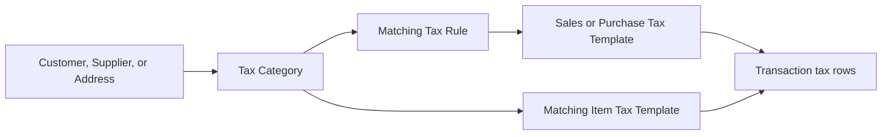

<!-- Frappe documentation: erpnext, part 16 of 18. Index: docs/INDEX.md -->

<!-- page: erpnext/erpnext__stock-reconciliation.md -->
---
title: "Stock Reconciliation"
space: "ERPNext"
url: "https://docs.frappe.io/erpnext/stock-reconciliation"
updated: "2026-03-06"
---

**Stock Reconciliation is the process of counting and evaluating material/products, periodically at the year-end.**

This is done in order to:

- Keep the actual physical stock count and book stock count in sync
- Value the stock for the preparation of the accounting statements

The Stock Reconciliation feature in ERPNext is used for:

- Posting opening stock
- Reconciling the book and the actual stock

To access the Stock Reconciliation list, go to: > Home > Stock > Tools > Stock Reconciliation

### 1. Opening Stock

---

Using stock reconciliation, you can update the number of specific items in a warehouse as of a specific time. You can also add Items in the stock that have Serial Numbers or batch numbers.

1. Go to the Stock Reconciliation list, click on New.
2. Select the Purpose as 'Opening Stock'. You can edit the posting Date and Time.
3. Select Item Code, Warehouse, Quantity, and Valuation Rate. If there is a Serial / Batch No involved, add it.
4. If you want to auto-generate Serial No / Batch No. then keep those fields blank.
  For auto-generation of Serial No, you need to set "Serial Number Series" in the Item master. To auto-generate the batch number, enable the "Automatically Create New Batch" checkbox in the item master.
5. The Difference Account will be set as 'Temporary Opening'.
6. Save and Submit.


> Note: Maintain Stock option should be enabled in Item master for this to work.


## 2. Stock Reconciliation

---

Stock Reconciliation is the process of counting and evaluating stock-in-trade, periodically and at year-end, in order to value the total stock for preparing accounting statements. In this process, the actual physical stocks are checked and recorded in the system. The actual stocks and the stock in the system should be in agreement and accurate. If they are not, you can use the Stock Reconciliation tool to reconcile the stock balance and value with actuals.

To reconcile the stock:

1. Go to the Stock Reconciliation list, click on New
2. Select the Purpose as 'Stock Reconciliation'. You can edit the posting Date and Time.
3. Set Item Code, Warehouse.
4. The current Quantity and Valuation Rate will be fetched, and the quantity will be changed as required.
5. The expense account in the Difference Account will be set to 'Stock Adjustment' by default.
6. The Cost Centre default will be 'Main', change if needed.
7. Save and Submit.


## 3. Reconciliation Features

### 3.1 Upload Data Through Spreadsheet

If you have a lot of items, you can upload the details via a spreadsheet.

1. Download Template

Open a new Stock Reconciliation and click on the Download button to download the template in CSV format.


2. Enter Data in CSV Template.

The CSV format is case-sensitive. Do not edit the headers that are preset in the template. In the Item Code and Warehouse column, enter the exact Item Code and Warehouse as created in your ERPNext account. For quantity, enter the stock level you wish to set for that item in a specific warehouse.


3. Upload the CSV file with the data by clicking on the 'Upload' button.
4. Review, Save and Submit.
5. Check the Stock Ledger Report for the updated stock balance.


### 3.2 Get Stock Balance and Valuation as of Specific Date and Time

You can import the stock balance and valuation as of a specific date and time from a selected Warehouse by clicking on the **Items** button. You can update the Quantity and Valuation Rate as needed.


### 3.3 Using a barcode scanner to scan physical inventory

If you have configured barcodes for your items, you can use a barcode scanner to reconcile physical quantities. To do this, follow these steps:

1. Set default warehouse
2. Enable "Scan Mode" This will disable fetching existing quantity and let you add quantities by incrementally scanning items.
3. Click on the "Scan Barcode" field and use your barcode scanner to send input. The reconciliation items table will keep getting updated as you scan items. The following video demonstrates this process.


## 4. Serial and Batch Bundle

In version 15, the [serial and batch bundle](https://docs.erpnext.com/docs/user/manual/en/serial-and-batch-bundle) feature has introduced to make stock transactions against the serial no/batch items. For stock reconciliation, the user gets two options to make a serial and a batch bundle.

- **Use Serial / Batch Fields**

The user can use the old serial/batch fields to make a serial and batch bundle automatically. In this case user has to enable the checkbox "  
Use Serial No / Batch Fields" in the line item


## **5. Use Serial & Batch Bundle**

The user can use the Serial / Batch bundle to make stock reconciliation for serialised/batched items. Here, the user gets the option to either "**Reconcile All Serial Nos / Batches**" or "**Reconcile Selected Serial Nos / Batches**".

Reconcile Selected Serial Nos / Batches: The user needs to disable the "Reconcile All Serial Nos / Batches" checkbox and create a serial and batch bundle for specific serial numbers or batches. By doing this, the system will automatically create the Current Serial / Batch Bundle for the serial numbers or batches that have been selected by the user manually within the Serial and Batch Bundle.

For example, if the user has 10 batches and wants to change the valuation rate of only 2 batches, then the user should disable the "Reconcile All Serial Nos / Batches" checkbox and create the serial and batch bundle for those 2 batches with the new valuation rate.

### **Reconcile All Serial Nos / Batches**

The user needs to enable the checkbox "Reconcile All Serial Nos / Batches" and create a serial and batch bundle.

For example, if the user has 10 batches and wants to reconcile and keep only one batch. Using the stock reconciliation, the user will be able to consume 9 batches automatically and retain one batch. For that, the user has to enable the "Reconcile All Serial Nos / Batches" checkbox in the Stock Reconciliation Item, and then the system will automatically consume 9 batches and add one batch on submission of the stock reconciliation.


<!-- page: erpnext/erpnext__stock-reposting-settings.md -->
---
title: "Stock Reposting Settings"
space: "ERPNext"
url: "https://docs.frappe.io/erpnext/stock-reposting-settings"
updated: "2026-05-15"
---


### **Limit timeslot for Stock Reposting**

If you want to run the reposting in a specific time then you can enable the checkbox "**Limit timeslot for Stock Reposting**". With this configuration you can avoid deadlock issues which occurs during the reposting.

### Limits don't apply on

If you want to run the reposting full day and not on a specific time, especially when you have weekly off then you can use this configuration.

### Use Item Based Reposting

This option is helpful when you want to speed up reposting. The system skips reposting for duplicate items and warehouses to improve speed.

### Do reposting for each Stock Transaction

The system creates a reposting record for backdated entries. This means that the system only generates a reposting record if a future transaction exists for the same item and warehouse. We have seen cases where system has not created reposting entry for backdated transaction because of concurrency issues. So to solve them added this option which won't check whether the future transaction exists for the same item and warehouse to make reporting record. This is also added for an audit purpose.

### **Notify Reposting Error to Role**

If reposting fails due to any issues, the system sends emails to the system managers. If you don't want to send failure emails to the system managers, you can configure a role, and the system will then send the email to the users assigned to that respective role.

### **Enable Parallel Reposting**


Allows the system to use multiple background workers to repost stock entries in parallel per item. This setting is effective only when Item-Based Reposting is enabled.

#### No of Parallel Reposting (Per Item)

Defines the number of parallel workers that can execute repost item valuation entries in parallel. Higher values may speed up reposting but can increase system load.


### **Note for usage**

Reposting is a tough computational problem to solve because it involves reposting 1000s may be 10,000s of entries depending on volume of transaction. Please use Reposting Wisely. It is recommended to limit back dated entries to not more than one month. Reposting entries with dates ranging more than one month may lead to failure in reposting for multiple reasons including but not limited to 

1. Reposting Time may be limited to prevent utilisation of resources during working hours, therefore the actual reposting may come up at a later date than when it was created, therefore leading to inconsistencies in the vouchers on the system
2. Reposting is limited to a timeout of 1500 seconds, which may be exceeded if the volume of reposting is too long

### **Issue for Legacy Serial Numbers**

For example

- Inward serial number ABC with a rate of 14,000
- Outward transaction for the same serial number with a valuation rate of 14,000 
- Inward the same serial number ABC again with a rate of 4,000 
- Outward transaction for the same serial number with a valuation rate of 4,000


At this point, the incoming rate stored in the serial number becomes 4,000.  If reposting is performed from the second transaction (outward), the valuation rate is calculated incorrectly  

- Inward serial number ABC with a rate of 14,000
- Outward transaction for the same serial number with a valuation rate of 4,000 (**Incorrect because fetched from Serial No document**)
- Inward the same serial number ABC with a rate of 4,000
- Outward transaction for the same serial number with a valuation rate of 4,000


The valuation rate in the second row should be 14,000, not 4,000.  This issue affects legacy serial numbers created before Version 15, when the Serial and Batch Bundle feature was not available.  

**Solution**  

Provided an option to fetch the incoming rate either from the last inward transaction during reposting. To enable this users needs to enable the checkbox "Do not fetch incoming rate from Serial No" in the Stock Reposting Settings

<!-- page: erpnext/erpnext__stock-reposting.md -->
---
title: "Stock Ledger Variance Report"
space: "ERPNext"
url: "https://docs.frappe.io/erpnext/stock-reposting"
updated: "2026-02-27"
---


The Stock Ledger Variance report in the ERPNext helps identify incorrect Stock Ledger Entries (SLEs) where the Running Available Stock and Stock Balance are inconsistent. These inconsistencies usually occur due to reposting issues, backdated entries, or data mismatches.

This report allows users to easily detect affected entries and correct them by creating reposting entries.


### Use this report to:


* Identify Stock Ledger Entries with incorrect running balances
* Detect stock quantity mismatches between calculated and stored values
* Repost affected entries to fix stock inconsistencies


### How to Use the Report


* Open the Stock Ledger Variance report.
* Apply filters like 
    Quantity (A - B) to find ledgers with incorrect balance qty
    Value (G - D) to find ledgers with incorrect balance value
    Valuation (I - K) to find ledgers with incorrect valuation rate


### Reposting Affected Entries

To fix the incorrect stock ledger entries:


* Select the rows that show inconsistencies.
* Click on Create Reposting Entries.
* The system will generate reposting entries for the selected records.
* Once reposting is completed, re-run the report to verify that the issue is resolved.

### Notes


* Reposting may take time depending on the number of affected entries.
* It is recommended to perform reposting during non-peak hours.
* Always verify stock balances after reposting.


### When to Use This Report


* After fixing reposting-related issues
* When negative stock errors appear unexpectedly
* After importing or creating backdated stock transactions
* During stock audit or reconciliation

<!-- page: erpnext/erpnext__stock-reservation-for-production-plan.md -->
---
title: "Stock Reservation for Production Plan"
space: "ERPNext"
url: "https://docs.frappe.io/erpnext/stock-reservation-for-production-plan"
updated: "2026-02-19"
---


> Note: This feature will be available in the ERPNext version 16
> 
> 

Stock reservation in a production plan is important because it ensures that the required raw materials and sub-assemblies are available to start the manufacturing process. It also ensures that the purchased raw materials against the production plan are used exclusively for the respective production plan.

## How it Works in ERPNext 

The user activity diagram for the production plan reservation is shown below.


The user must enable the checkbox "Enable Stock Reservation" in the stock settings to use this feature. After enabling it, the checkbox "Reserve Stock" will appear in the Production Plan.

If the 'Reserve Stock' checkbox is selected, the system will automatically create a stock reservation entry for the sub-assembly items and raw materials if the stock exists.

If stock does not exist for the sub-assemblies or raw materials, the user must create work orders for the sub-assemblies and raise material requests (purchase) for the raw materials. Once the raw materials are purchased through these material requests, they will be automatically reserved against the respective production plan.

The materials reserved against the production plan will then be used for the work orders linked to that specific production plan.

<!-- page: erpnext/erpnext__stock-reservation-for-work-order.md -->
---
title: "Stock Reservation for Work Order\t\t\t\t\t\t\t\t\t\t\t\t\t\t\t\t\t\t\t\t\t\t\t\t\t\t\t\t\t\t\t\t\t\t\t\t\t\t\t\t\t\t\t\t\t\t\t\t\t\t\t\t\t\t\t\t\t\t\t\t\t\t\t\t\t\t\t\t\t\t\t\t\t\t\t\t\t\t"
space: "ERPNext"
url: "https://docs.frappe.io/erpnext/stock-reservation-for-work-order"
updated: "2026-02-19"
---


> Note: This feature will be available in the ERPNext version 16
> 
> 

Stock reservation for a work order is essential as it ensures that materials are available, enabling the manufacturing process to begin and produce finished goods.

It also helps to improve inventory management and ensures timely fulfillment of customer orders.

## How it Works in ERPNext

The user must enable the checkbox "Enable Stock Reservation" in the stock settings to use this feature. After enabling it, the checkbox "Reserve Stock" will appear in the work order.

If the "Reserve Stock" checkbox is selected, the system will automatically create a stock reservation entry against the source warehouse for the available stock upon submission of the work order.


The reserved stock can only be used for the respective work order and cannot be used in any other transactions.

## Unreserve Stock

If the reserved stock needs to be assigned to another work order, unreserve it from the current work order and assign it to the work order that does not have stock reserved.


## Reservation for WIP

Once the user transfers the materials from the source warehouse to the WIP warehouse using a stock entry with the type "Material Transfer for Manufacture", the system unreserves the stock from the source warehouse and reserves it against the WIP warehouse.

## Finished Goods Reservation

If the sales order is linked to the work order, the system reserves the finished goods against the respective sales order upon completion of the work order.

<!-- page: erpnext/erpnext__stock-reservation.md -->
---
title: "Stock Reservation"
space: "ERPNext"
url: "https://docs.frappe.io/erpnext/stock-reservation"
updated: "2026-03-02"
---


> Introduced in Version 15
> 
> 

Stock reservation, also known as inventory reservation, refers to the practice of setting aside a specific quantity of stock or inventory for a particular purpose or customer.

### 1. Prerequisites

* Enable Stock Reservation in Stock Settings. 

### 2. Stock Reservation against Sales Order

* Create a Sales Order. 
* Check the reserve stock for items you want to reserve. 
* Click on **Stock Reservation**, then select **Reserve**. Choose the warehouse and quantity, then click on the **Reserve Stock** button. 
* Stock reservation entries are created against the sales order items. 

### 3. Stock Reservation from Pick List

* Create a Sales Order.
* Create a Pick List for the Sales Order.
* In Pick List click on **Stock Reservation**, then select **Reserve**, the Stock Reservation Entries will be created against the Pick List. 

### 4. Auto Reserve Stock on Purchase

* Navigate to Stock Settings and enable **Auto Reserve Stock for Sales Order on Purchase**.
* Create a Sales Order.
* Create a Material Request from the Sales Order.
* Create Purchase Order from Material Request.
* Complete the process by creating a Purchase Receipt for the Purchase Order. The stock will be automatically reserved upon submission of the Purchase Receipt.

### 5. Stock Unreservation

There are two ways to unreserve the stock.

1. Stock Unreservation from Sales Order or Pick List:


	* Open a document and click on **Stock Reservation > Unreserve** button, the listed Stock Reservation Entries get cancelled. 
2. Unreserve the stock from the Stock Reservation Entry DocType:


	* 2.1 Open a Stock Reservation Entry and cancel it by clicking the **Cancel** button. 
	* 2.2 Go to the Stock Reservation Entry List, select the entries you wish to cancel, and then click on **Actions > Cancel**. 

### 6. Related Topics

1. [Sales Order](/erpnext/sales-order)
2. [Pick List](/erpnext/pick-list)

<!-- page: erpnext/erpnext__stock-settings.md -->
---
title: "Stock Settings"
space: "ERPNext"
url: "https://docs.frappe.io/erpnext/stock-settings"
updated: "2026-06-13"
---

You can set default settings for your stock-related transactions from the Stock Settings page...

### Item Naming By

---


By default, the Item Name is set as per the Item Code entered. If you want Items to be named by a set [Naming Series,](/erpnext/naming-series) choose the 'Naming Series' option.

## Defaults

---

### Default Item Group

This will be the default item group allocated to a newly created item. Item groups are useful for classification and setting properties for the whole group. To know more visit the [Item Group](/erpnext/item-group) page.

### Default Stock UOM

The default unit of measure for stock is set as numbers (Nos), it can be changed from here.

### Default Warehouse

Set the default Warehouse from which the stock transactions are done. This will be fetched into the Default Warehouse in the Item master: 


### Sample Retention Warehouse

This is the Warehouse where sample retentions are stored. To know more, visit [this page](/erpnext/retain-sample-stock).

### Default Valuation method

You can choose between FIFO (first in first out), LIFO (last in first out) or moving average valuation for your items. The default method is FIFO. If you select Moving Average or LIFO, new Items will be valuated on new method. You can change this when creating new Items in the Item form. Once the Item is saved, the Valuation Method cannot be changed. Read more [here](https://frappe.io/blog/erpnext-features/inventory-valuation-method-fifo-vs-moving-average).

### Limit Percent

---

This is the percentage you are allowed to receive or deliver more against the quantity ordered. For example: If you have ordered 100 units, Supplier sends 120 units and the percentage is set to 10% then you are allowed to receive 110 units. By default, this is set to 0.

### Role Allowed to Over Deliver/Receive

---

Users with this role are allowed to over deliver/receive against orders above the allowance percentage

### Show Barcode Field

---

A field to enter Barcode details for an item. If unticked, the field won't be visible in the Item form.

### Convert Item Description to Clean HTML

---

Usually, descriptions are copy-pasted from a website or Word/PDF file and they contain a lot of embedded styles. This messes up the Print view of your invoices or quotes.

To fix this, you can check "Convert Item Description to Clean HTML" in Stock Settings. This will ensure that when you save the Items, their descriptions will be cleaned up.

If you want to control your description, views, and allow any HTML to be embedded, you can uncheck this property.

### Auto insert

---


### Auto insert Price List rate if missing

Enabling this will insert an Item Price to the Price List of an Item automatically when using the Item in its first transaction. This price is fetched from the 'Rate' set in the first transaction with the Item. The Price List depends on whether you're using a Purchase or Sales transaction.

Note that, the Item Price will be automatically inserted only in the first transaction if not already present.

If this is unticked, the 'Standard Selling Rate' set in the Item when creating the Item will be added as Item Price.

### Automatically Set Serial Nos based on FIFO

Serial numbers for stock will be set automatically based on the Items entered based on first in first out. The Serial Numbers will be set automatically in transactions like Purchase/Sales Invoices, Delivery Notes, etc.

## Allow Negative Stock

---

This will allow stock items to be displayed in negative values. Using this option depends on your use case. For example, the stock transaction entries are entered at the weekend or month-end. In this case, negative stock needs to be enabled so that you can continue with your purchase/sales transaction entries.

Instead of enabling negative stock globally you can also enable it for specific items.

> Allow Negative Stock has removed for Serial / Batch Items from version 15. So from version 15, users won't be able to make negative stock transactions for serial /batch items even though Allow Negative Stock has enabled in the Stock Settings.

## Set Qty in Transactions based on Serial No Input

---

The quantity of items will be set according to the serial numbers. For example, if the user has added serial nos like A001, A002, and A003 then the system will set the quantity as 3 in the transaction.

## Automatic Material Request

---


### Raise Material Request when the stock reaches re-order level

This option is useful if you want to ensure a constant supply of raw materials/products and avoid shortage. A [Material Request](/erpnext/material-request) will be raised automatically when stock reached the re-order level defined in the [Item form](/erpnext/item#34-automatic-reordering).

### Notify by Email on the creation of automatic Material Request

An email will be sent to notify the User with the role 'Purchase Manager' when an automatic Material Request is created.

## Inter Warehouse Transfer Settings

---


### Enable customer warehouse for material transfer from Delivery Note and Sales Invoice

This option is useful when material transfer needs to be presented as a Delivery Note. For example, if there are statutory requirements where taxes are to be applied on each transfer of Material. It is easier to manage in a transaction like Delivery Note, than in the Stock Entry

### Enable supplier warehouse for material transfer from Purchase Receipt and Purchase Invoice

Similar to above option this option is useful when material transfer needs to be presented as Purchase Receipt.

To know more about inter warehouse material transfer via Delivery Note and Purchase Invoice please refer this article [Material Transfer From Delivery Note](/erpnext/material-transfer-from-delivery-note)

## Freeze Stock Entries

---

The User will not be allowed to make stock postings beyond this date.


- **Stock Frozen Upto**: A threshold date till which stocks will be frozen.
- **Freeze Stocks Older Than [Days]**: Stocks older than x days will be frozen. This is calculated based on the creation date of the item.
- **Role Allowed to edit frozen stock**: The role you choose here will be allowed to edit frozen stock.

### Batch identification

---

Global setting for batches of stocks to be identified by a [Naming Series](/erpnext/naming-series). You can override this in the Item DocType.

## Allow to Edit Stock Quantity

---


Enable "Allow to Edit Stock UOM Qty for Sales Documents / Allow to Edit Stock UOM Qty for Purchase Documents" in the stock settings.


## Allow to Edit Qty as per Stock UOM in Stock Entry

---


### **Why to Edit Stock Qty / Qty as Per Stock UOM**

If you're using multi-uom and your stock uom is a whole number, then you might face the issue that the Stock UOM should be non-decimal. Users experience this problem when they are unable to set an accurate conversion factor..

**Solution**

User will set the Stock Quantity and system will calculate the conversion factor


### Allow UOM with Conversion Rate Defined in Item

---

If enabled, the system will allow selecting UOMs in sales and purchase transactions only if the conversion rate is set in the item master.


<!-- page: erpnext/erpnext__stock-transactions-landed-cost-voucher.md -->
---
title: "Landed Cost Voucher"
space: "ERPNext"
url: "https://docs.frappe.io/erpnext/stock-transactions-landed-cost-voucher"
updated: "2026-07-04"
---

**Landed Cost is the final total cost associated with a product for it to reach the buyer’s doorstep.**

Landed costs include the original cost of the item, complete shipping costs, customs duties, taxes, insurance, currency conversion fees, etc. All of these components might not be applicable in every shipment, but relevant components must be considered as a part of the landed cost.

> **What is Landed Cost?**

> To understand landed cost better, let’s take an example based on our daily lives. You need to purchase a new washing machine for your home. Before making an actual purchase, you probably do some research to know the best price. In this process, you often found a better deal from a store which is long away from your home. But you should also consider shipping cost while buying from that store. Total cost including shipping might be more than the price you get in your nearby store. In that case, you will choose to buy from your nearest store, as the landed cost of the item is cheaper in the nearest store.

Similarly in business, identifying landed cost for an Item/product is very crucial, as it helps to decide selling cost of that item and impacts the company’s profitability. Hence all applicable landed cost charges should be included in Item’s valuation rate.

According to the [Third-Party Logistics Study](http://www.3plstudy.com/), only 45% of the respondents stated that they use Landed Cost extensively. The main reasons of not using Landed Cost were unavailability of necessary data (49%), lack of right tools (48%), insufficient time (31%), and not sure how to apply landed cost (27%).

To access the Landed Cost Voucher list, go to: > Home > Stock > Tools > Landed Cost Voucher

1. Prerequisites

---

Before creating and using Landed Cost Voucher, it is advised that you create the following first:

- A **Purchase Receipt** or **Purchase Invoice** with *Update Stock* enabled. This is your original receipt of goods.
- A **Purchase Invoice** for the landed costs (e.g. Freight, Insurance, etc.)

We will then use the **Landed Cost Voucher** to decrease the costs recorded through the second **Purchase Invoice** and increase the stock value. 

2. How to create a Landed Cost Voucher

---

1. Go to the Landed Cost Voucher list, click on New.
2. Select Receipt Document Type whether Purchase Invoice or Receipt. You can select multiple documents.
3. Select the specific Invoice or Receipt. The supplier name and Grand Total will be fetched automatically.
4. Click on the Get Items from Purchase Receipts button to fetch the item details from the Purchase Invoice/Receipt.
5. Select whether Distribute Charges Based On should be on quantity or Amount.
6. Enter the Expense Account and the Amount for Additional Costs in the Taxes and Charges table. The amount will be distributed equally based on the quantity or amount as per your selection.
7. Save and Submit.


In the document, you can select multiple Purchase Receipts/Invoices and fetch all items from those Purchase Receipts. Then you should add applicable charges in “Taxes and Charges” table. You can easily delete an item if the added charges do not apply to that item.

The added charges are proportionately distributed among all the items based their amount or quantity. If you selected based on the amount, the Item with the highest amount will be allocated the highest proportion of the charges. In case of quantity, Item with the highest quantity will be allocated most of the charges and the other Items will be allocated lesser amounts. This is shown in the following screenshot:


3. Related Actions

---

### 3.1 Adding Landed Cost in the Purchase Receipt itself

In ERPNext, you can add landed cost-related charges in “Taxes and Charges” table while creating Purchase Receipt (PR). You should add those charges for “Total and Valuation” or “Valuation” in the 'Consider Tax or Charge for' field. Charges which are payable to the same Supplier from whom you are buying the items should be tagged as “Total and Valuation”. Otherwise, if applicable charges are payable to a 3rd party, it should be tagged as “Valuation”. On submission of Purchase Receipt, the system will calculate the landed cost of all items, considering those charges. This landed cost will be considered to calculate the item’s Valuation Rate (based on FIFO / Moving Average method).

But in reality, while making Purchase Receipt we might not know all the charges which are applicable for landed cost. Your transporter can send the invoice after 1 month, but there is no point in waiting for booking Purchase Receipt till then. Companies that import their products/parts, pay a huge amount as Customs Duty. And generally, they get invoices from the Customs Department after a while. In these cases, “Landed Cost Voucher” becomes handy, as it allows you to add those additional charges on a later date, and to update landed cost of purchased items.

### 3.2 What happens on submission?

1. Valuation Rate of items is recalculated based on new landed cost.
2. If you are using “Perpetual Inventory”, the system will post general ledger entries to correct Stock-in-Hand balance. It will debit (increase) corresponding “warehouse account” and credit (decrease) **Expense Account** mentioned in Taxes and Charges table. If items are already delivered, the Cost-of-Goods-Sold (CoGS) value has been booked as per the old valuation rate. Hence, general ledger entries are reposted for all future outgoing entries of associated items, to correct CoGS value.

### 3.3 LCV for Stock Entry

From version 16 of ERPNext, users can create a Landed Cost Voucher against a Stock Entry with the purpose set to 'Manufacture'.  
This feature allows users to include additional costs—such as electricity charges or rent—into the final valuation rate of the manufactured product.

### 3.4 LCV for Subcontracting Receipt

From version 16 of ERPNext, users can create a Landed Cost Voucher against a Subcontracting Receipt items which has been manufactured by the subcontractor.

This feature allows users to include additional costs—such as freight charges, excise duty into the final valuation rate of the subcontracted product.


### 3.5 Vendor Invoices

You can link vendor invoices in the Landed Cost Voucher, and the system will ensure that the Landed Cost matches the total vendor invoice amount. Make sure the vendor invoices do not include any stock items.


### 4. Related Topics

1. [Delivery Trip](/erpnext/delivery-trip)
2. [Purchase Receipt](/erpnext/purchase-receipt)

<!-- page: erpnext/erpnext__stock-transactions.md -->
---
title: "Stock Transactions"
space: "ERPNext"
url: "https://docs.frappe.io/erpnext/stock-transactions"
updated: "2026-02-26"
---

Stock transactions in ERPNext contains a wide range of activities related to managing inventory movements within an organisation. These transactions include stock transfers between warehouses, stock adjustments to correct inventory discrepancies, stock reconciliation to ensure accurate stock levels, and stock entries for recording stock movements such as purchases, sales, production, and consumption.

These transactions play a crucial role in maintaining accurate stock levels, tracking stock movements, analysing inventory performance, and making informed decisions related to procurement, sales, and production planning within the organisation.

- [Material Request](/erpnext/user/manual/en/material-request)
- [Auto Creation of Material Request](/erpnext/user/manual/en/auto-creation-of-material-request)
- [Opening stock](/erpnext/user/manual/en/opening-stock)
- [Stock Entry](/erpnext/user/manual/en/stock-entry)
- [Accounting of Inventory Stock](/erpnext/user/manual/en/accounting-of-inventory-stock)
- [Shipment](/erpnext/user/manual/en/shipment)
- [Delivery Note](/erpnext/user/manual/en/delivery-note)
- [Pick List](/erpnext/user/manual/en/pick-list)
- [Purchase Receipt](/erpnext/user/manual/en/purchase-receipt)
- [Delivery Trip](/erpnext/user/manual/en/delivery-trip)
- [Packing Slip](/erpnext/user/manual/en/packing-slip)
- [Putaway rule](/erpnext/user/manual/en/putaway-rule)
- [Stock Reconcilliation](/erpnext/user/manual/en/stock-reconciliation)
- [Stock Reservation](/erpnext/user/manual/en/stock-reservation)
- [Perpetual Inventory](/erpnext/user/manual/en/perpetual-inventory)
- [Landed Stock Voucher](/erpnext/user/manual/en/stock-transactions-landed-cost-voucher)

<!-- page: erpnext/erpnext__stock-transfer-with-gst.md -->
---
title: "Stock Transfer with GST"
space: "ERPNext"
url: "https://docs.frappe.io/erpnext/stock-transfer-with-gst"
updated: "2026-07-31"
---

In certain situations, there are statutory requirements where taxes are to be applied on each transfer of Material. It is easier to manage it in a transaction like a Sales Invoice, than in the Stock Entry. Please follow the following steps to transfer material from one branch to another using Sales and Purchase Invoice

  


**Step 1 - Add default Unrealized Profit and loss account and default In-Transit warehouse in the company master** 


  


  


  


**Step 2 - Create Internal Customer and Supplier and allow them to transact with the same company. Also, link appropriate address and GST details with the respective parties**

  


  


  


  


**Step 3 - Create Sales Invoice (Delivering the items from source)**

  


3.1 Select the internal customer you created in your previous step

3.2 Check update stock

3.3 Add items to be transferred along with the Source Warehouse and Target Warehouse as the In-Transit warehouse

  


  


3.4 Save and Submit

  


Stock Ledger


  


Accounting Ledger


  


**Step 4 - Create Purchase Invoice (Receiving Items at destination)**

  


Use the "Create Internal Purchase Invoice" button from the sales invoice to create Purchase Invoice

  


  


Select the Accepted Warehouse (warehouse at which stock has been received) and save and submit


  


Stock Ledger


  


Accounting Ledger


  


**Note: Application of GST automatically on invoices is subjective to your GST configuration. Make sure you have proper tax templates configurated and appropriate addresses and GST details linked to the internal parties**

<!-- page: erpnext/erpnext__stock-value-account-value-comparison.md -->
---
title: "Stock Value and Account Value Comparison Report\n"
space: "ERPNext"
url: "https://docs.frappe.io/erpnext/stock-value-account-value-comparison"
updated: "2026-02-27"
---

This report helps the user to understand the difference value between the stock account and stock balance report. At the end of the financial year, every organization has to match its closing stock balance with the closing stock account. Sometimes they do not match due to some issues. In that case, users can view the "Stock Value and Account Value Comparison" report to understand the incorrect transactions. Then, users can make adjustments entries accordingly.

To view the report, go to:

> Home > Stock > Other Reports > Stock and Account Value Comparison


<!-- page: erpnext/erpnext__stock.md -->
---
title: "Introduction to Stock Module"
space: "ERPNext"
url: "https://docs.frappe.io/erpnext/stock"
updated: "2026-03-06"
---

The Stock module in ERPNext is a comprehensive tool designed to manage inventory and streamline supply chain operations. It offers functionalities to handle various aspects of stock management as mentioned below.

1. **Inventory Tracking**: Monitor stock levels, track movements, and manage warehouses effectively.
2. **Item Management**: Define and categorise products, track item variants, and manage pricing.
3. **Stock Transactions**: Record and process transactions, including stock receipts, deliveries, and transfers.
4. **Stock Reconciliation**: Perform periodic audits to ensure stock records align with physical inventory.
5. **Reports and Analytics**: Generate detailed reports on stock levels, valuations, and trends to support decision-making.

Overall, the Stock module helps businesses maintain optimal inventory levels, reduce carrying costs, and improve operational efficiency.

## Video Tutorials

[Frappe School Course on Stock Module](https://frappe.school/courses/inventory-management)

<!-- page: erpnext/erpnext__stock__reports__negative-batch-report.md -->
---
title: "Negative Batch Report"
space: "ERPNext"
url: "https://docs.frappe.io/erpnext/stock/reports/negative-batch-report"
updated: "2026-02-27"
---


The **Negative Batch Report** is designed to identify and analyze transactions where batch stock has gone into negative quantity. This report helps users detect inconsistencies caused by backdated entries, incorrect stock movements, or improper batch usage, enabling timely corrections and accurate stock valuation.

### Purpose

The main purpose of this report is to:

- Identify batches with negative stock quantities
- Track transactions that caused negative stock
- Help users investigate and resolve stock inconsistencies
- Improve stock accuracy and valuation
- Assist in auditing batch-wise inventory movements

<!-- page: erpnext/erpnext__store-landing-page.md -->
---
title: "Store Landing Page\n"
space: "ERPNext"
url: "https://docs.frappe.io/erpnext/store-landing-page"
updated: "2026-03-02"
---


After enabling Shopping Cart for your app you can create a custom landing page for your
store using the [Web Page Builder](/erpnext/web-page-builder).


*Custom Store Landing Page*

## 1. How to create a Custom Store Landing Page

1. Follow the steps mentioned here to [create a Web Page](/erpnext/web-page).
1. Set a Route for your page (eg. */store*).
1. Select Content Type as **Page Builder**.
1. Click on Add Row in the Page Building Blocks Table.
1. Select a Web Template.

 ERPNext comes with a great set of standard web templates that can be used to create your Web Page.

 The configuration for the page in the screenshot above looks like this:

 
 *Store Page Building Blocks*

1. Add Values.

 Click on the Edit Values button on the right of each block, and enter the values in the dialog to
 set the content for each section.

 The Web Templates that will be useful for building your store landing page are:

 - **Hero Slider:**
 Up to 5 slides can be created. The image, title, primary action, alignment, theme for each slide
 is configurable.
 
 *Hero Slider Configuration*

 - **Product Category Cards:**
 Up to 8 product category cards can be configured. Each product categories will link to an
 [Item Group](/erpnext/item-group).
 Ensure that the **Show in Website** option is ticked in the Item Group form so that the
 route for the product category is generated.

 
 *Product Categories Configuration*

 - **Item Card Group:**
 This section can be used to showcase your featured items. Up to 12 cards can be configured.
 Each card will link to an [Item](/erpnext/item). If **featured** is checked,
 the item will take up 2 columns of space.

 
 *Item Cards Configuration*


1. Publish your Web Page.

 The web page will be published only when the Published option is checked.
 Once the page is published, click on **See on Website** on the sidebar or visit the configured route
 and check out the page!

 
 *Publish your Web Page*

1. Set as your Home Page.

 Follow the steps [here](/erpnext/website-home-page) to set
 this page as your Website home page.

<!-- page: erpnext/erpnext__stripe-integration.md -->
---
title: "Setting up Stripe"
space: "ERPNext"
url: "https://docs.frappe.io/erpnext/stripe-integration"
updated: "2026-02-26"
---


To setup Stripe,
`Explore > Integrations > Stripe Settings`

#### Setup Stripe

To enable Stripe payment service, you need to configure parameters like Publishable Key, Secret Key


On enabling service, the system will create Payment Gateway record and Account head in chart of account with account type as Bank.


Also it will create Payment Gateway Account entry. Payment Gateway Account is configuration hub from this you can set account head from existing COA, default Payment Request email body template.


After configuring Payment Gateway Account your system is able to accept online payments.

### Setup subscriptions plans

If you need to bill a recurring amount instead of a one-time charge, you can use Stripe's subscription system.

Once you have created your billing plans in Stripe, add one or several new "Payment Plan" in Frappe.


Afterwards, when you create your payment request, click the check field "Is a subscription" and add the system will fetch the corresponding susbscription plans from within the corresponding subscription.


ERPNext will automatically create a new subscription for this customer in Stripe.


####Supporting transaction currencies
```
 "AED",
 "ALL",
 "ANG",
 "ARS",
 "AUD",
 "AWG",
 "BBD",
 "BDT",
 "BIF",
 "BMD",
 "BND",
 "BOB",
 "BRL",
 "BSD",
 "BWP",
 "BZD",
 "CAD",
 "CHF",
 "CLP",
 "CNY",
 "COP",
 "CRC",
 "CVE",
 "CZK",
 "DJF",
 "DKK",
 "DOP",
 "DZD",
 "EGP",
 "ETB",
 "EUR",
 "FJD",
 "FKP",
 "GBP",
 "GIP",
 "GMD",
 "GNF",
 "GTQ",
 "GYD",
 "HKD",
 "HNL",
 "HRK",
 "HTG",
 "HUF",
 "IDR",
 "ILS",
 "INR",
 "ISK",
 "JMD",
 "JPY",
 "KES",
 "KHR",
 "KMF",
 "KRW",
 "KYD",
 "KZT",
 "LAK",
 "LBP",
 "LKR",
 "LRD",
 "MAD",
 "MDL",
 "MNT",
 "MOP",
 "MRO",
 "MUR",
 "MVR",
 "MWK",
 "MXN",
 "MYR",
 "NAD",
 "NGN",
 "NIO",
 "NOK",
 "NPR",
 "NZD",
 "PAB",
 "PEN",
 "PGK",
 "PHP",
 "PKR",
 "PLN",
 "PYG",
 "QAR",
 "RUB",
 "SAR",
 "SBD",
 "SCR",
 "SEK",
 "SGD",
 "SHP",
 "SLL",
 "SOS",
 "STD",
 "SVC",
 "SZL",
 "THB",
 "TOP",
 "TTD",
 "TWD",
 "TZS",
 "UAH",
 "UGX",
 "USD",
 "UYU",
 "UZS",
 "VND",
 "VUV",
 "WST",
 "XAF",
 "XOF",
 "XPF",
 "YER",
 "ZAR"
```

<!-- page: erpnext/erpnext__subcontracting-in-erpnext.md -->
---
title: "Introduction"
space: "ERPNext"
url: "https://docs.frappe.io/erpnext/subcontracting-in-erpnext"
updated: "2026-02-26"
---

## Subcontracting 

Subcontracting is a type of job contract that seeks to **outsource** certain types of work to other companies. It allows work on more than one phase of the project to be done at once, often leading to quicker completion. It is practiced by various industries.

For example, manufacturers who make a number of products from complex components subcontract certain components and package them at their facilities.


If your business involves outsourcing certain processes to a third party Supplier where you supply the raw materials and the third party does the labor/production, you can track this by using the [subcontracting feature](https://docs.frappe.io/erpnext/user/manual/en/subcontracting) of ERPNext. 

## Subcontracting Inward

ERPNext also supports **[Subcontracting Inward](https://docs.frappe.io/erpnext/user/manual/en/subcontracting-inward)**, where your company acts as the subcontractor. In this case, a customer provides materials to you for processing or manufacturing. ERPNext enables you to track customer-supplied materials, manage production activities, and bill for the services performed.

<!-- page: erpnext/erpnext__subcontracting-inward.md -->
---
title: "Subcontracting Inward"
space: "ERPNext"
url: "https://docs.frappe.io/erpnext/subcontracting-inward"
updated: "2026-07-22"
---

**In Subcontracting Inward, a customer employs you to carry out tasks for their organization, especially manufacturing.**

Not to be confused with the [standard Subcontracting module in ERPNext](https://docs.frappe.io/erpnext/user/manual/en/subcontracting). This is an extension of that module, which allows you to do the exact inverse of it, that is, instead of you outsourcing your manufacturing process to a third party (Supplier), a third party (Customer) outsources their manufacturing process to you.

While this was already possible in ERPNext even before v16, this heavily streamlines the entire process, thereby making it very easy to use.

## Features

1. Receive Raw Materials from Customer without impacting your books
2. Track Raw Materials that you have received from the customer
3. Use extra Raw Materials given by the customer on a per transaction basis if needed
4. Use Raw Materials sourced by you along side the Raw Materials given by the customer and bill them to the customer
5. Reserve the Raw Materials received by the customer to prevent accidental use of the stock committed against another order
6. Create additional Work Orders incase of process loss during manufacturing
7. Optionally, deliver overproduced quantity incase of overproduction
8. Return Raw Materials to customer if required (for ex. QC failure, sent by mistake etc.)
9. Optionally, deliver secondary items produced during manufacturing to the customer
10. Incase of serial or batch Finished Good item, deliver items with the same serial and/or batches that were produced against the order
11. Receive the Finished Goods from the Customer if required (ex. QC fail)

## Prerequisites

1. Every Customer needs to have their own warehouse (dummy) in the masters. This is done by creating a new Warehouse and setting the newly added Customer Link field.
  
2. While optional, we strongly recommend you to create a group warehouse which will hold all the customer warehouses in it as it will make data analysis much easier. Note that a Group Warehouse does not need the `Customer` Link field set however if your Customer has multiple warehouses, we recommend you to structure the warehouses accordingly.
  
3. The Raw Materials provided by the Customer in the Item master. Each Customer Provided Item needs to have the field set in the master. Conversely, Customer Provided Items cannot be purchased so the `Allow Purchase` field has to be unchecked (checked by default in ERPNext).


4. The non-stock/service item that will be sold or billed to the Customer. The `Maintain Stock`  field has to be unchecked (checked by default in ERPNext) for this.
  
5. The Finished Good to be produced needs to be marked as a Subcontracted Item


6. A standard ERPNext [Bill of Materials or ‘BOM’](https://docs.frappe.io/erpnext/user/manual/en/bill-of-materials) for the finished good to be produced.
7. A Subcontracting BOM which specifies the relationship between the non-stock/service item and the Finished Good to be produced. Note that it is also possible to create a Subcontracted Sales Order even without a Subcontracting BOM provided that the Finished Good to be produced has a default BOM set in it’s master.


## How to use

1. Start by creating a Sales Order and check the “Is Subcontracted” checkbox. The Sales Order will now be subcontracted and the schema/form of the child table will change. Proceed by setting the service item in the `Item Code` field. If you have a Subcontracting BOM for this service item, the Finished Good field will be set automatically. Upon changing the quantity of the Service Item, the quantity of the Finished Good will also change based on the conversion factor in the Subcontracting BOM. If you have multiple Subcontracting BOMs for the same service/non-stock item, a dialog box will popup asking you to select the Finished Good from the Subcontracting BOMs present against that service/non-stock item. Save and submit once done.
  


2. From the Sales Order, click on `Create > Subcontracting Inward Order`. This DocType holds the list of Finished Goods, Raw Materials required, Service Items and secondary items (if produced). Start by selecting the Customer warehouse you created at the start of the process. If only a single Customer warehouse exists against the Customer, the field will be pre-filled with it. Then select a Delivery Warehouse for each of the Finished Goods to be produced. This will be where the Finished Goods produced by you will be delivered. If all the Finished Goods are to be delivered to the same warehouse, use the `Set Delivery Warehouse` field to set the delivery warehouse for all the Finished Goods in one go.


3. If you need to “explode” the BOM, click on the Finished Good (pencil icon towards the right of the row) and check the `Include Exploded Items` field and click on save. You will see that the Raw Materials in the “Required Items” table will be updated with the exploded items. You may also additionally alter the quantity of the Finished Goods. This will allow you to create another Subcontracting Inward Order against the same Subcontracted Sales Order until the item is fully subcontracted should you need that.


4. Save and submit the Subcontracting Inward Order. You can now receive Raw Materials from the Customer which will be used for the manufacturing process by clicking on Receive -> Raw Material from Customer. This will create a Stock Entry and the Raw Materials will be filled automatically upon creation. You may also additionally add extra Customer Provided Items here should you need it. The extra items, if added, will also be visible in the Required Items table of the Subcontracting Inward Order upon submission of the Stock Entry. Note that for additional Customer Provided Items, you will mandatorily need to specify the Finished Good against which you will be using the Raw Material using the `Against Finished Good` field in the child table.
  
5. In this Stock Entry, you may enter the basic rate for each item. Note that this is done purely for taxation purposes and will have no accounting impact on the valuation of your stock. You may verify this by clicking on `View> Accounting Ledger` after submission of the Stock Entry. You will see that everything will be 0.
  
6. It is also possible to create more Stock Entries to receive additional Customer Provided Items at any time, even after receiving the required quantity of the Raw Materials as per the Finished Good’s BOM.
7. Go back to the Subcontracting Inward Order and reload the page. You will now see two new buttons at the top right, “Return” and “Create”. By clicking on `Return > Raw Materials` to Customer, you can return the Raw Material to the customer if needed. By clicking on `Create > Work Order`, a standard Work Order will be created for each of the Finished Good(s) based on the quantity of Raw Materials available for production. Use this Work Order to produce the Finished Good(s) then go back to the Subcontracting Inward Order and reload the page.
  

:::note
Additional Raw Materials used in the Manufacturing Stock Entry against Work Orders will also be added to the Required Items table in the Subcontracting Inward Order.
:::


8. You will now see the option for “Subcontracting Delivery” under the “Create” button. A new Stock Entry will be created upon clicking it which you can use to deliver the Finished Good(s) to the Customer.

Notes

1. By default, ERPNext will not add the generated secondary Item(s) to this Stock Entry. If you need to deliver the secondary Item(s) generated as well, enable the `Deliver secondary items` in the `Selling Settings` Single DocType.
2. ERPNext by default will only you to deliver the agreed upon quantity if Finished Good(s) as specified in the Subcontracted Sales Order. If you have produced more than the required quantity and want to deliver the overproduced quantity as well, enable the `Allow Delivery of Overproduced Qty` in the `Selling Settings` Single DocType.


9. Go back to the Subcontracting Inward Order and reload the page. You will now see the option “Subcontracting Return” under the “Return” button. On clicking it, a new Stock Entry will be created which will allow you to receive the Finished Good(s) that you have produced and delivered to the Customer should you need it.
10. Since the Finished Goods have been produced and delivered, it is time to bill the Customer. Go to the Sales Order created in the first step, from here you can deliver the service/non-stock item by creating a Delivery Note and bill it as well as all the Raw Materials you have used in the process. The Raw Materials procured by you (not provided by the Customer) will already be present in the child table when you create the Sales Invoice against the Subcontracted Sales Order.

Note You can deliver and bill the service/non-stock items even without creating a single Subcontracting Inward Order.


## Important Notes

1. [Stock Reservation](https://docs.frappe.io/erpnext/user/manual/en/stock-reservation) Entries will be created and used extensively by default in this process even if its disabled in `Stock Settings`.
2. If the Raw Material received from the Customer goes unused, it cannot be directly used in another Subcontracting Inward Order. We recommend you to return the unused Raw Material to the Customer and receive it again using another Subcontracting Inward Order where it is to be reused. You do not need to move the Raw Material physically for this and it will be a pure dummy transaction.
3. For any Subcontracting Inward transaction where multiple batches are involved for an item, the Serial and Batch Bundle feature is to be used. Duplicating of child tables is not recommended or even permitted in various transaction types throughout.
4. It is mandatory for the Finished Good BOM to have atleast 1 Customer Provided Item.
5. Do not cancel any Stock Reservation Entries related to the Subcontracting Inward process, doing so will most definitely cause unintended consequences.
6. Using [Alternative Items](https://docs.frappe.io/erpnext/user/manual/en/item-alternative) in Work Orders created against Subcontracting Inward Orders is currently not supported and the checkbox is hidden for the same.
7. While you *can* use [Inventory Dimension](https://docs.frappe.io/erpnext/user/manual/en/inventory_dimension) in this process, it is not officially supported as of yet.
8. [Continuous Raw Material Consumption](https://docs.frappe.io/erpnext/user/manual/en/manufacturing-settings#1-allow-continuous-material-consumption) and [Disassembly Order](https://docs.frappe.io/erpnext/user/manual/en/disassembly-order) are also not supported as of yet.
9. To accurately reflect the value of the finished goods, a *batched item* is recommended. For example: if you have purchased stock of the finished good in the past and its sitting in the same warehouse as your manufactured batch, FIFO will consider the value of the purchased good in the `Deliver to Customer` Stock Entry instead of the batch you manufactured against the Subcontracting Inward Order. A batched item with `Batch-wise Valuation` enabled will ensure that this does not happen.

<!-- page: erpnext/erpnext__subcontracting.md -->
---
title: "Subcontracting"
space: "ERPNext"
url: "https://docs.frappe.io/erpnext/subcontracting"
updated: "2026-02-27"
---

**In subcontracting, you employ an external party to carry out tasks for your organization, especially manufacturing.**

Subcontracting is a type of job contract that seeks to outsource certain kinds of work to other companies. It allows work on more than one phase of the project to be done at once, often leading to quicker completion.

Subcontracting is practised by various industries. For example, manufacturers who make several products from complex components subcontract certain components and package them at their facilities.

If your business involves outsourcing certain processes to a third-party Supplier where you supply the raw materials and the third party does the labour/production, you can track this by using the subcontracting feature of ERPNext.

## How to Set up Subcontracting

---

1. Create a Service Item (Non-stock Item). It represents the service cost of the subcontracted operation.
  
2. Create separate Items for the unprocessed and the processed product. For example, if you supply unpainted X to your Supplier and the Supplier returns you X, you can create two Items: “X-unpainted” and “X”.
3. Create a Warehouse for your Supplier so that you can keep track of Items supplied. (You may supply a month's worth of Items in one go).
4. For the processed Item, in the Item master, enable “Supply Raw Materials for Purchase”.
  

### Creating a BOM

Make a [Bill Of Materials](/erpnext/bill-of-materials) for the processed Item, with the unprocessed Items as sub-items. Let's consider a simple example, where you manufacture a pen. The processed pen will be named under the Bill of Materials(BOM), whereas the nib, plastic, ink, etc. ,will be categorized as sub-items.

This BOM will be without Operations if all of the production work is done by a third party. Let's see with a simple example of a CPU Assembly:


### Creating a Subcontracting BOM

While optional, creating a Subcontracting BOM allows you to predefine a relationship between your Service Item and Finished Good Item.

When you create a Subcontracted Purchase Order, if you have created a Subcontracting BOM for your Service Item or Finished Good Item, selecting either one will automatically fill out the other details of the Purchase Order line item. If you create a lot of Subcontracted Purchase Orders for the same Service Item and Finished Good Item combination, you can save some time and effort by creating a Subcontracting BOM for that combination in advance.

Using a Subcontracting BOM, you can:

1. Select a default BOM for your Finished Good Item.
2. Select a default UOM for your Service Item.
3. Specify the conversion factor between your Service Item and Finished Good Item.


In the above image, we have specified that 1 unit of "Painting" will produce 2 units of "Tiles" after the subcontracting process is complete. Upon saving this document, you will see that the conversion factor for this relationship is calculated automatically (0.5 in this case).

Note:

1. There can only be 1 Subcontracting BOM for any Finished Good Item.
2. If there are multiple Subcontracting BOMs for a single Service Item, upon making a Subcontracted Purchase Order and selecting that Service Item, a dialog box will appear which will ask you to select the Finished Good Item for that specific Service Item. The list of those Finished Good Items will be fetched from the list of Subcontracting BOMs, where the Service Item is the one you have entered.

### Creating a Purchase Order

Make a Subcontract Purchase Order for the Service Item and select the Finished Good Item, the one for which you've created a BOM.

1. Enable the "Is Subcontracted" since this Purchase Order is for Subcontracting.
  
2. Here the Rate field value of the Items table in the Purchase Order will be the service cost you have agreed with the third party or the Supplier.
3. After filling in the details, Save and Submit the [Purchase Order](/erpnext/purchase-order#35-raw-materials-supplied).

### Creating a Subcontracting Order

Make a Subcontracting Order for the Purchase Order by clicking on Create > Subcontracting Order. When you “Save”, in the “Raw Materials Supplied”, all your un-processed Items will be updated based on your Bill of Materials. You can also select the Warehouse in which the raw materials would be reserved for subcontracting under Reserve Warehouse.


1. The costs involved with the subcontracting process should be recorded in the Rate field of the Items table in the Subcontracting Order shown as follows:
  
2. In the previous image, we are providing the subcontractor with the following items:
  ```
  8 Motherboards
  8 Processors
  16 RAMs
  8 Hard Disks
  8 Cabinets
  The cost for one CPU including Raw Materials and Service Costs is 1,02,994 and the total cost for all CPUs is 8,23,952
  ```
  
3. From a Subcontracting Order, select the raw materials to transfer to the subcontractor:
  


4. Once the Subcontracting Order is submitted, you can also view the item's reserved quantity on the item dashboard.


### Creating Stock Entry to Transfer Raw Materials

Now that the raw materials are reserved, make a Stock Entry and deliver the raw material Items to your Supplier.

In the Subcontracting Order, click on Transfer > Material to Supplier. Set the Source and Target Warehouses. The Stock Entry will be of type 'Send to Subcontractor' where you transfer from one Warehouse to another. Tick 'From BOM', select the BOM, enter the quantity, and click the Get Items button.


### Creating a Subcontracting Receipt to receive the Finished and Scrap items

Receive the Items from your Supplier using a Subcontracting Receipt. You need to enter the Supplier Warehouse from where the raw materials will be taken and finished goods will be received in the Accepted Warehouse. Consider this like a backflush for subcontracting.

Click on Create > Subcontracting Receipt from the Subcontracting Order. Set the Accepted and Supplier Warehouses. Make sure to check the “Consumed Quantity” in the “Raw Materials” table so that the correct stock is maintained at the Supplier’s end. You need to select the Supplier's Warehouse where you'll receive the finished goods.

Scrap items are fetched from the chosen Bill of Materials (BOM) for Finished Goods within the Items table. The Qty is computed using the Qty of the Finished Good Item, while the Rate is determined by either the Valuation Rate or the Scrap Rate specified in the BOM.


#### Service Expense Account in Subcontracting Receipt

User can set the expense account for the service item in the subcontracting receipt.


If the user sets the expense account in the service item, the same account will be auto-filled in the Service Expense Account field. The user can also manually set the service expense account in the subcontracting receipt. If no service expense account is set, the system will use the Finished Item’s expense account to book the service cost. Once the subcontracting receipt is submitted, the system books the service cost against the service expense account.


### Backflush of Raw Material


- **BOM**
  - If you set backflush based on BOM, system will consume raw materials even though you have not transferred materials against the Subcontracting Order and have enough stock at supplier's warehouse.
- **Material Transferred for Subcontract** 
  - If you set backflush based on "Material Transferred for Subcontract" system will consume raw materials based on the materials transferred against the Subcontracting Order. If no stock transferred then no materials will be consume at the time of Subcontracting Receipt.

### Creating a Purchase Receipt

Back to Purchase Order, click on `Create > Purchase Receipt.` There will be no effect on the Stock Ledger and Accounting Ledger since both the Stock and Accounting Ledger are updated when you Submit the Subcontracting Receipt. In case you have "Purchase Taxes and Charges" the Accounting Ledger will update accordingly.

### Supplier Sourced Raw Material

While creating a BOM for subcontracting, there might be a few raw materials like nuts and bolts that the Suppliers will have to procure themselves.

While creating a Stock Entry for "Transfer" from a Subcontracting Order, these items can be excluded one by one, but it is impossible to do so if you have more than 100 items.

If some raw material is sourced by the Supplier directly, then such raw materials have to be included in the BOM.

- It will have zero value in BOM
- In the Subcontracting Order, this raw material will not appear in Supplied Items since it is not supplied
- Also, while creating a "Transfer", such items will be excluded from the Stock Entry


However, the Supplier may choose to include the supplier-provided items in their Sales Order sent to you.

## Notes

---

- Make sure that the “Rate” of the processed Item is the processing/service cost (excluding the raw material cost).
- ERPNext will automatically add the raw material rate for your valuation purpose when you receive the finished item in your stock.
- ERPNext will automatically default the 'Reserve Warehouse' in the Subcontracting Order from the BOM. If not found in the BOM, it would default it from the default Warehouse set in the Item. You can set the default Reserve Warehouse for all the Items in the Subcontracting Order from the 'Reserve Warehouse' field in the Raw Materials Supplied section.

:::note
New in V16
:::


## Features

### Creating multiple Subcontracting Orders from a single Subcontracted Purchase Order

ERPNext now allows users to create multiple Subcontracting Orders from a single Purchase Order.

How to use:

1. When you click on Create Subcontracting Order from your Purchase Order, by default ERPNext will fill the Finished Good Items and Service Items table based on the Purchase Order.
2. The user is now allowed to edit the quantity of each Finished Good Item as per their needs.
3. If you create a partial Subcontracting Order and then try to create a new one against the same PO, ERPNext will automatically calculate the remaining quantity left to subcontract and fill out the new document accordingly.

Note:

1. Once the PO is fully subcontracted ie. no items in the PO are left to be subcontracted, user will not be allowed to create new Subcontracting Orders from the PO.
2. The quantity entered by the user cannot exceed the available quantity to subcontract (fetched from the PO).

In both the above cases, an error will be thrown accordingly.

### Stock Reservation

In ERPNext v16, you can now reserve the Raw Materials to be sent to the Supplier.

Just above the Raw Materials table, you will now see the checkbox `Reserve Stock`. If you check this option and submit the Subcontracting Order, the stock will be reserved against the Subcontracting Order which will essentially make sure that the committed stock is not used anywhere else by mistake. The reserved stock will be automatically utilised if and when Raw Material is sent to the Supplier by using the `Send to Subcontractor` Stock Entry made against the Subcontracting Order.


Note that if the `Auto Reserve Stock` option is enabled in `Stock Settings`, this option will be checked by default.


## Related Topics

---

1. [Purchase Order](/erpnext/purchase-order)
2. [Purchase Receipt](/erpnext/purchase-receipt)
3. [Quality Inspection](https://docs.erpnext.com/docs/user/manual/en/quality-inspection)

<!-- page: erpnext/erpnext__subcontracting__reports.md -->
---
title: "Reports"
space: "ERPNext"
url: "https://docs.frappe.io/erpnext/subcontracting/reports"
updated: "2026-02-19"
---

# Subcontracting Reports in ERPNext

ERPNext provides dedicated reports to help monitor materials sent to subcontractors, track pending receipts, and review the overall status of subcontracting orders. These reports improve visibility, prevent material loss, and ensure accurate production and costing control.

## Subcontracted Raw Materials to be Transferred

This report shows the raw materials that need to be sent to subcontractors against open subcontracting Purchase Orders. It helps identify pending material transfers so that suppliers receive the required inputs on time and production is not delayed.


*Subcontracted raw materials to be transferred report*

## Subcontracted Item to be Received

This report lists subcontracted finished goods that are yet to be received from suppliers. It provides visibility into pending receipts and helps teams follow up on delayed deliveries and plan inventory accordingly.


*Subcontracted Item to be received*

## Subcontract Order Summary

This report provides an overall view of subcontracting Purchase Orders, including material transfer status and receipt progress. It is useful for monitoring order completion and tracking the end-to-end subcontracting cycle.


<!-- page: erpnext/erpnext__subscription-plan.md -->
---
title: "Subscription Plan | ERPNext Documentation"
description: "Create an ERPNext Subscription Plan to define the item, price, billing interval, payment gateway, and accounting dimensions used for recurring invoices."
space: "ERPNext"
url: "https://docs.frappe.io/erpnext/subscription-plan"
updated: "2026-08-14"
---

A Subscription Plan defines what ERPNext bills on a recurring basis, how much it charges, and how often it charges it. You add one or more plans to a [Subscription](/erpnext/subscription), and ERPNext uses them when it creates recurring Sales Invoices or Purchase Invoices.


Use a separate plan for each distinct combination of item, price, currency, and billing frequency. For example, Nova Industries can use **Nova Device Care Monthly** for a USD 199 monthly warranty service and a separate yearly plan for customers who pay in advance.


## Before you begin

Create the following records first:

- An [Item](/erpnext/item) for the product or service being billed. Use a non-stock service Item when no stock delivery is involved.
- An [Item Price](/erpnext/item-price) and [Price List](/erpnext/price-lists) if the plan will obtain its rate from a Price List.
- A [Payment Gateway Account](/erpnext/payment-gateway) if an external payment integration will collect the recurring charge.
- A [Cost Center](/erpnext/cost-center) or other accounting dimensions if subscription income or expense must be reported separately.

Accounts Users, Accounts Managers, and System Managers can create Subscription Plans when their role permissions have not been customized.

## Create a Subscription Plan

1. Go to **Accounting &gt; Subscriptions &gt; Subscription Plan**.
2. Select **Add Subscription Plan**.
3. Enter a unique **Plan Name**. Use a name that communicates the service and interval, such as `Nova Device Care Monthly`.
4. Select the **Currency** and the **Item** being billed.
5. Choose how ERPNext determines the subscription price and enter the corresponding rate or Price List.
6. Set the **Billing Interval** and **Billing Interval Count**.
7. Add payment and accounting details when required.
8. Save the plan.

Saving a plan does not create an invoice. Add the saved plan to a Subscription to begin the recurring billing workflow.

## Choose how the price is determined

The highlighted fields control the rate ERPNext uses when it generates an invoice from the Subscription.


| Subscription Price Based On | How ERPNext calculates the rate                                                                                                                                                              | Use it when                                                                                                 |
| --------------------------- | -------------------------------------------------------------------------------------------------------------------------------------------------------------------------------------------- | ----------------------------------------------------------------------------------------------------------- |
| **Fixed Rate**              | Uses the value entered in **Cost**.                                                                                                                                                          | The charge remains the same for every billing cycle.                                                        |
| **Based On Price List**     | Reads the Item rate from the selected Price List. The applicable customer or supplier context can affect the returned Item Price.                                                            | You maintain recurring rates through standard Item Prices.                                                  |
| **Monthly Rate**            | Treats **Cost** as the monthly rate and calculates the charge for the covered number of months. Proration can apply when enabled in [Subscription Settings](/erpnext/subscription-settings). | The billing period may span one or more months and you want the amount calculated from a monthly base rate. |


Changing a plan does not rewrite invoices that have already been generated. Review the next invoice after changing a rate, Price List, or billing interval.

## Set the billing frequency

The **Billing Interval** supplies the unit: Day, Week, Month, or Year. The **Billing Interval Count** tells ERPNext how many of those units make one billing cycle.


Examples:


| Billing Interval | Count | Result                   |
| ---------------- | -----: | ------------------------ |
| Month            | 1     | Bills every month        |
| Month            | 3     | Bills every three months |
| Week             | 2     | Bills every two weeks    |
| Year             | 1     | Bills every year         |


The count must be at least 1. The Subscription's start date and invoice-generation settings determine the actual billing dates. Calendar-month alignment, invoice timing, trial periods, and renewal behavior belong on the Subscription rather than the plan.

## Important fields and what they mean


| Field                           | What it controls                                                                                                                                  |
| ------------------------------- | ------------------------------------------------------------------------------------------------------------------------------------------------- |
| **Plan Name**                   | The unique name shown when you add the plan to a Subscription.                                                                                    |
| **Currency**                    | The currency used for the plan's rate and generated invoice line. Keep it consistent with the party and transaction currency.                     |
| **Item**                        | The product or service added to the generated invoice. ERPNext uses the Item's accounting defaults when it builds the invoice line.               |
| **Subscription Price Based On** | Selects the fixed-rate, Price List, or monthly-rate calculation.                                                                                  |
| **Cost**                        | Stores the fixed or monthly base rate. It appears only when the selected pricing method requires it.                                              |
| **Price List**                  | Supplies the Item Price when pricing is based on a Price List.                                                                                    |
| **Billing Interval**            | Defines whether the cycle is measured in days, weeks, months, or years.                                                                           |
| **Billing Interval Count**      | Defines how many intervals make one billing cycle.                                                                                                |
| **Product Price ID**            | Stores an external payment provider's price identifier when an integration requires it. Leave it blank for ordinary ERPNext invoicing.            |
| **Payment Gateway**             | Links the plan to a configured Payment Gateway Account for integrated collection workflows.                                                       |
| **Cost Center**                 | Assigns the generated invoice line to the selected Cost Center when the integration and Subscription flow carry the accounting dimension forward. |


## Use the plan in a Subscription

Open a new Subscription, select the Customer or Supplier, set the service dates, and add the plan in the **Subscription Plans** table. A customer Subscription generates [Sales Invoices](/erpnext/sales-invoice), while a supplier Subscription generates [Purchase Invoices](/erpnext/purchase-invoice).

One Subscription can contain multiple plans. This is useful when the same Customer receives a base service plus separately priced support, storage, or add-ons. Keep each charge as its own plan so rates and intervals remain understandable.

## Troubleshooting

### The generated invoice rate is zero

For **Based On Price List**, confirm that the selected Price List contains an active Item Price for the plan's Item, currency, quantity, party context, and invoice date. If no applicable price is found, ERPNext can return a zero plan rate.

### The plan bills at the wrong frequency

Check both **Billing Interval** and **Billing Interval Count**. A Month interval with a count of 3 means one invoice every three months, not three invoices each month. Then verify the Subscription's start date and invoice-generation settings.

### The plan cannot be saved

Confirm that the Plan Name is unique, all required fields are present, and Billing Interval Count is 1 or higher.

### The payment gateway does not collect payment

Linking a gateway on the plan does not complete the integration by itself. Verify the Payment Gateway Account, provider credentials, Product Price ID when required, and the Subscription payment workflow.

## Frequently asked questions

### Can I use one plan for several customers?

You can reuse a Subscription Plan. Add the same plan to multiple customer Subscriptions when the item, currency, pricing method, and billing interval are identical.

### Can one Subscription contain several plans?

You can add several plans. Each plan becomes a separate recurring invoice line. Use this for a base service with optional add-ons.

### Should I create separate monthly and yearly plans?

Usually, yes. Separate plans make the price and billing commitment explicit and reduce the chance of selecting the wrong interval.

### Does saving a plan create an invoice?

Saving the plan does not create an invoice. The plan is a reusable billing definition, and invoice generation begins only after it is added to an active Subscription.

## Related topics

- [Subscription](/erpnext/subscription)
- [Subscription Settings](/erpnext/subscription-settings)
- [Item](/erpnext/item)
- [Price Lists](/erpnext/price-lists)
- [Sales Invoice](/erpnext/sales-invoice)
- [Purchase Invoice](/erpnext/purchase-invoice)

<!-- page: erpnext/erpnext__subscription-settings.md -->
---
title: "Subscription Settings | ERPNext Documentation"
description: "Configure grace periods and automatic cancellation for unpaid recurring invoices generated by ERPNext subscriptions."
space: "ERPNext"
url: "https://docs.frappe.io/erpnext/subscription-settings"
updated: "2026-07-31"
---

**Subscription Settings** controls how ERPNext handles unpaid subscription invoices across the site. Configure it before relying on automatic recurring billing.

## Configure unpaid-invoice handling

Search for **Subscription Settings** and review:


| Setting                                | What it controls                                                                                 |
| -------------------------------------- | ------------------------------------------------------------------------------------------------ |
| Grace Period                           | Time allowed after an invoice becomes overdue before the subscription is treated as unpaid       |
| Cancel Subscription After Grace Period | Automatically cancels a subscription when the unpaid condition continues beyond the grace period |


Use a grace period that matches your collection process. A short period stops service quickly but may cancel customers after a temporary payment delay. A longer period is more forgiving but allows unpaid exposure to grow.

## Recommended rollout

1. Create a test Subscription with a short billing period.
2. Generate an invoice and confirm its due date.
3. Test both paid and unpaid outcomes.
4. Confirm the Subscription moves through the expected Active, Grace Period, Unpaid, and Cancelled states.
5. Only then enable automatic cancellation for production subscriptions.

These settings affect future subscription processing. They do not cancel or reverse Sales Invoices that have already been generated.

## Related topics

- [Subscription](/erpnext/subscription)
- [Sales Invoice](/erpnext/sales-invoice)
- [Payment Entry](/erpnext/payment-entry)
- [Accounts Receivables](/erpnext/accounts-receivables)

<!-- page: erpnext/erpnext__subscription.md -->
---
title: "Subscription | ERPNext Documentation"
description: "Configure recurring customer or supplier billing with plans, invoice timing, taxes, discounts, and billing history in ERPNext."
space: "ERPNext"
url: "https://docs.frappe.io/erpnext/subscription"
updated: "2026-08-14"
---

Northstar Retail, a customer of Nova Industries, buys a monthly device-care plan for the phones it resells. Creating each Sales Invoice by hand would be repetitive and makes it easy to miss a billing date.


A Subscription turns that continuing customer relationship into scheduled billing. ERPNext uses the selected Subscription Plan to create recurring Sales Invoices for Northstar Retail, while a supplier subscription would instead create recurring Purchase Invoices for services Nova Industries buys.


Use a Subscription when the same product or service is billed on a regular schedule, such as maintenance, software access, rentals, retainers, or support plans.


## Before you begin

Create an Item for the recurring charge, then create a **Subscription Plan** that defines its price and billing interval. Confirm the Company's income, receivable, tax, and Cost Center defaults before generating invoices.

## Create a Subscription Plan

In the Subscription Plan, select the Item and currency, then choose how ERPNext determines the price:


| Price basis         | Use it when                                       |
| ------------------- | ------------------------------------------------- |
| Fixed Rate          | Every subscriber pays the same rate               |
| Based On Price List | The rate should come from an Item Price           |
| Monthly Rate        | The charge should be prorated from a monthly rate |


Set the billing interval and interval count. For example, **Month** with a count of **1** bills monthly, while a count of **3** bills every three months.


## Create a Subscription

1. Search for **Subscription** and select **Add Subscription**.
2. Select **Customer** or **Supplier**, then choose the Party and Company.
3. Enter the subscription start date and, if applicable, the end date.
4. Configure when invoices should be generated.
5. Add one or more Subscription Plans.
6. Add taxes, a Cost Center, or an additional discount when needed.
7. Save.


## Choose when invoices are generated


| Generate Invoice At             | Result                                                            |
| ------------------------------- | ----------------------------------------------------------------- |
| Postpaid (bill at period end)   | Invoice is created after the service period                       |
| Prepaid (bill at period start)  | Invoice is created at the beginning of the period                 |
| Bill N days before period start | Invoice is created the specified number of days before the period |


**Days Until Due** controls the invoice due date. **Submit Generated Invoices** submits generated invoices automatically; leave it off if someone should review each invoice first. **Bill Even If Previous Invoice Unpaid** keeps generating invoices even when an earlier invoice is unpaid. Use that option deliberately because it can increase the customer's outstanding balance.

Enable **Follow Calendar Months** when billing should align to calendar boundaries rather than the original start date. Enable **Cancel When Period Ends** when the subscription must stop at the end of its current billing period.

## Plans, taxes, and discounts

Add every recurring component as a row in **Plans**. You can combine a base plan and add-ons in one subscription. The generated invoice uses the plan quantity, tax template, and any additional discount saved on the Subscription.


## Billing history and status

The billing history shows planned and generated periods. Subscription status moves through states such as Trialing, Active, Grace Period, Unpaid, Completed, Cancelled, and Refunded based on dates and payment conditions.

Review generated Sales Invoices from the Subscription dashboard. Cancelling a Subscription stops future billing but does not cancel invoices that already exist.

## Troubleshooting

**No invoice is generated**

Check the start date, next billing period, invoice timing, scheduler, and whether an earlier invoice is unpaid. Also confirm that the plan Item and Company accounting defaults are valid.

**The invoice amount is unexpected**

Open the linked Subscription Plan and confirm its price basis, rate, interval, quantity, taxes, and discount.

**A subscription should stop after the current term**

Enable **Cancel When Period Ends** instead of cancelling immediately.

## Related topics

- [Subscription Settings](/erpnext/subscription-settings)
- [Sales Invoice](/erpnext/sales-invoice)
- [Item Price](/erpnext/item-price)
- [Payment Request](/erpnext/payment-request)
- [Auto Repeat Recurring Orders and Invoices](/erpnext/auto-repeat-recurring-orders-and-invoices)

<!-- page: erpnext/erpnext__supplier-essentials.md -->
---
title: "Supplier Essentials"
space: "ERPNext"
url: "https://docs.frappe.io/erpnext/supplier-essentials"
updated: "2026-02-26"
---

In ERPNext, supplier doctypes refer to the types of documents or records associated with managing suppliers within the system. By utilizing supplier doctypes effectively, businesses can streamline their supplier management processes, maintain accurate records, and ensure timely and efficient procurement operations.

* [Supplier Group](/erpnext/user/manual/en/supplier-group)
* [Supplier](/erpnext/user/manual/en/supplier)

<!-- page: erpnext/erpnext__supplier-group.md -->
---
title: "Supplier Group\n"
space: "ERPNext"
url: "https://docs.frappe.io/erpnext/supplier-group"
updated: "2026-02-27"
---

**Supplier Group is an aggregation of suppliers that are similar in some way.**

A supplier may be distinguished from a contractor or subcontractor, who
commonly adds specialized input to deliverables. A supplier is also known as a
vendor. There are different types of suppliers based on the goods and
products they supply.

ERPNext allows you to create your own categories of suppliers. These
categories are known as Supplier Groups. For example, if your suppliers are
mainly pharmaceutical companies and FMCG distributors, you can create a new
Supplier Groups for them and name the groups accordingly.

To access Supplier Group, go to:
> Home Buying > Supplier > Supplier Group

## 1. Prerequisites
Before creating and using a Supplier Group, it is advised that you create the following first:

* [Supplier](/erpnext/supplier)

## 2. How to create a Supplier Group
1. Go to the Supplier Group list, click on New.
1. Type a name for your new Supplier Category.
1. You can set a Parent Supplier Group for this Supplier Group.
1. Ticking the Is Group checkbox will make it a Parent Supplier Group.
1. You can also assign a default Payment Terms Template to the Supplier Group. Useful in a case where all your hardware suppliers take half payment on sales order and half post shipment.
1. Save.

?

You can classify your suppliers from a range of choices available in ERPNext.
Choose from a set of given options like Distributor, Electrical, Hardware, Local, Pharmaceutical, Raw Material, Services etc. Classifying your supplier into different types facilitates accounting and payments.

## 3. Supplier Group Tree

You can also construct Supplier Group in the form of a tree hierarchy, similar
to Chart of Accounts.

To view the Tree structure, click on **Tree** from the sidebar. To go back to the
list view, simply select: **Menu > View List**.


With the new [User Permissions](/erpnext/users-and-permissions)
in place, you can now apply hierarchy based permissions.
That is, if a User is permitted to view parent node of Supplier Group,
he/she automatically qualifies to view the child nodes of that parent node.

For example, in the above image, let's say that user permission is applied for a User to
view 'Distributor' document. Then the user also gets permitted to view its
child nodes 'Book Distributor', 'Electronic Distributor', etc.

### 4. Related Topics
1. [Supplier](/erpnext/supplier)

<!-- page: erpnext/erpnext__supplier-quotation.md -->
---
title: "Supplier Quotation\n"
space: "ERPNext"
url: "https://docs.frappe.io/erpnext/supplier-quotation"
updated: "2026-02-27"
---


**A Supplier Quotation is document by a potential supplier specifying the cost of goods or services they'll provide within a specified period.**

A Supplier Quotation may also contain terms of sale, terms of payment, and warranties. Acceptance of quotation by the buyer can be considered as an agreement binding on both parties.


To access Supplier Quotation, go to:
> Home > Buying > Purchasing > Supplier Quotation

## 1. Prerequisites
Before creating and using a Supplier Quotation, it is advised that you create the following first:

* [Supplier](/erpnext/supplier)
* [Item](/erpnext/item)

## 2. How to create a Supplier Quotation

### 2.1 Supplier Quotation from Material Request

You can make a supplier quotation from a Material Request:


Or:

A Supplier Quotation can be created from a [Supplier master](/erpnext/supplier).

Or:

The supplier can submit you a quotation himself via ERPNext. To know more about this, see section visit the [Request for Quotation page](/erpnext/request-for-quotation#4-creating-a-supplier-quotation-after-rfq).

### 2.2 Creating a Supplier Quotation manually
1. You can also make a Supplier Quotation directly from:

 **Buying > Purchasing > Supplier Quotation > New**.
1. Select the Supplier who sent you the quotation.
1. The Address and Contact will be fetched if you've saved it in the supplier master.
1. Enter the Item code, select the quantity. Rate will be fetched if you've set the Standard Buying rate for the item in [Item Price](/erpnext/item-price).
 

If you have multiple Suppliers who supply you with the same Item, you
usually send out a [Request for Quotation](/erpnext/request-for-quotation) to various Suppliers. In
many cases, especially if you have centralized buying, you may want to record all the quotes so that:

 * You can easily compare prices in the future
 * Audit whether all Suppliers were given the opportunity to quote.

Supplier Quotations are not necessary for most small businesses. Always
evaluate the cost of collecting information to the value it really provides!
As a recommendation, you can do this only for high value items.

## 3. Features
### 3.1 Taxes and Charges
If your Supplier is going to charge you additional taxes or charge like a shipping or insurance charge, you can add it here. This will help you accurately track your costs. Also, if some of these charges add to the value of the product you will have to mention them in the Taxes table. You can also use templates for your taxes. For more information on setting up your taxes see the [Purchase Taxes and Charges Template](/erpnext/purchase-taxes-and-charges-template).

### 3.2 More
There are fields for Tax Category, Shipping Rule, Purchase Taxes and Charges Template, Discount, Terms and Conditions, Quotation Number, Printing Settings. You can fill these fields for your record. Visit the [Quotation](/erpnext/quotation) page to know more about these sections. Note that the details like Shipping Rule, taxes, Discount, Terms and Conditions, Quotation Number, etc., are from your supplier and can be recorded for accurate tracking.

Note:

- Tax Category will be fetched from supplier master if set
- Print settings is for making changes to the supplier quotation print
- The Terms and Conditions here are your supplier's
- The Supplier Quotation can be linked to a Material Request using the 'Link to material requests' button

### 3.3 After Submitting
The following records can be created after submitting a Supplier Quotation:

* Purchase Order - A Purchase Order if you agree with the supplier's quotation.
* Quotation - A quotation to your customer.
* Auto Repeat - Auto Repeat the supplier quotation at specified intervals.

### 4. Related Topics
1. [Supplier](/erpnext/supplier)
1. [Supplier Group](/erpnext/supplier-group)
1. [Purchase Order](/erpnext/purchase-order)
1. [Request for Quotation](/erpnext/request-for-quotation)

<!-- page: erpnext/erpnext__supplier-scorecard.md -->
---
title: "Supplier Scorecard\n"
space: "ERPNext"
url: "https://docs.frappe.io/erpnext/supplier-scorecard"
updated: "2026-02-27"
---


**A Supplier Scorecard is an evaluation tool used to assess the performance of suppliers.**

Supplier scorecards can be used to keep track of item quality, delivery, and responsiveness of suppliers across long periods of time. This data is typically used to help in purchasing decisions.
A Supplier Scorecard is manually created for each supplier.

To access Supplier Scorecard, go to:
> Home > Buying > Supplier Scorecard > Supplier Scorecard


## 1. Prerequisites
Before creating and using a Supplier Scorecard, it is advised that you create the following first:

* [Supplier](/erpnext/supplier)

## 1. How to create Supplier Scorecard

1. Go to the Supplier Scorecard list, click on New.
2. Select a Supplier to score.
3. Select the evaluating period whether weekly, monthly, or yearly.
4. Setup the scoring function (details in next section).
5. A supplier scorecard is created for each supplier individually. Only one supplier scorecard can be created for each supplier.


## 2. Features
### 2.1 Scoring Setup
The supplier scorecard consists of a set evaluation periods, during which the performance of a supplier is evaluated. This period can be weekly, monthly or yearly. The current score is calculated from the score of each evaluation period based on the weighting function. The default formula is linearly weighed over the previous 12 scoring periods.

This formula is customizable.

#### Supplier Standings

The supplier standing is used to quickly sort suppliers based on their performance. These are customizable for each supplier.

The scorecard standing of a supplier can also be used to restrict suppliers from being included in Request for Quotations or being issued Purchase Orders. The following screen can be seen on expanding a row in the 'Scoring Standings' table, click on the downward facing arrow.


### 2.2 Criteria Setup
A supplier can be evaluated on several individual evaluation criteria, including (but not limited to) quotation response time, delivered item quality, and delivery timeliness. These criteria are weighed to determine the final period score.

To create a new Criteria, go to Buying > Supplier Scorecard > Supplier Scorecard Criteria:


Note: Criteria weights for a scorecard should add up to 100.

### 2.3 Supplier Scorecard Variables
The method for calculating each criteria is determined through the Criteria Formula field, which can use a number of pre-established variables. This can be seen in the preceding screenshot.

The value of each of these variables is calculated over the scoring period for each supplier. Examples of such variables include:

 - The total number of items received from the supplier
 - The total number of accepted items from the supplier
 - The total number of rejected items from the supplier
 - The total number of deliveries from the supplier
 - The total amount (in dollars) received from a supplier


Variables are pre-set, additional variables can be added through server-side customizations. Tick the Custom checkbox if the variable you're creating is for a custom field.

The criteria formula should be customized to evaluate the suppliers in each criteria in a way that best fits the company requirements.

### 2.4 Evaluation Formulas
The evaluation formula uses the pre-established or custom variables to evaluate an aspect of supplier performance over the scoring period. Formulas can use the following mathematical functions:

* addition: +
* subtraction: -
* multiplication: *
* division: /
* min: min(x,y)
* max: max(x,y)
* if/else: (x) if (formula) else (y)
* less than: <
* greater than: >
* variables: {variable_name}

It is crucial that the formula be solvable for all variable values. This is most often an issue if the value resolves to 0. For example:
```
{total_accepted_items} / {total_received_items}
```

This example would resolve to 0 / 0 in periods where there are no received items, and therefore should have a check to protect in this case:
```
({total_accepted_items} / {total_received_items})
if {total_received_items} > 0
else 1.
```

### 2.5 Evaluating the Supplier
An evaluation is generated for each Supplier Scorecard Period by clicking the "Generate Missing Scorecard Periods" button. The supplier's current score can be seen, as well as a visual graphic showing the performance of the supplier over time. Any actions against the supplier are also noted here, including warnings when creating RFQs and POs or preventing these features for this supplier altogether.

### 3. Related Topics
1. [Supplier](/erpnext/supplier)
1. [Supplier Quotation](/erpnext/supplier-quotation)

<!-- page: erpnext/erpnext__supplier.md -->
---
title: "Supplier"
space: "ERPNext"
url: "https://docs.frappe.io/erpnext/supplier"
updated: "2026-07-02"
---

**Suppliers are companies or individuals who provide you with products or services.**

To access the Supplier list, go to: > Home > Buying > Supplier > Supplier

1. How to create a Supplier

---

1. Go to the Supplier list and click on New.
2. Enter a name for the supplier.
3. Select the supplier group whether Pharmaceutical, Hardware etc.
4. Save. 

The options to Warn RFQs, POs, Prevent RFQs, POs will be available once you create a Supplier Scorecard and transactions are made.

1. Features

---

Fields in future transactions will be auto-populated if the 'Default' fields like Default Bank Account, Default Payment Terms Template etc., are set in Supplier.

### 2.1 Tax details

- **Country**: If the supplier is from another country, you can change it here.
- **Tax ID**: Tax identification number of the supplier.
- **Tax Category**: This is linked to Tax Rule. If a Tax Category is set here, when you select this supplier, the respective Purchase Tax and Charges template will be applied. This template is linked to the Tax Rule and the Tax Rule is linked with a Tax Category. Tax Category can be used to group suppliers to whom same tax will be applied. For example: Government, commercial, etc,.
- **Print Language**: The language in which the document will be printed.
- **Tax Withholding Category**: For India, TDS category for the Supplier. On setting a category here, it will be fetched into the Purchase Invoice. For more information, visit the Tax Withholding Category page.
- **Disabled**: Disables the Supplier and they won't be shown in the Supplier List.
- **Is Transporter**: If the supplier is selling your transport services, tick this box. 'GST Transporter ID' field will be visible if this field is ticked.
- **Internal Supplier**: If the supplier is from a sister or parent/child company, tick this field and select the company which they represent.

For India:

- **GST Category**: Select a GST Category of the supplier.
- **PAN**: For India, PAN (Permanent Account Number) card details of the Supplier.

### 2.2 Allow creation of Purchase Invoice without Purchase Order and Purchase Receipt

If the "Purchase Order Required" or "Purchase Receipt Required" option is configured as "Yes" in Buying Settings, it can be overridden for a particular supplier by enabling the "Allow Purchase Invoice Creation Without Purchase Order" or "Allow Purchase Invoice Creation Without Purchase Receipt" in the Supplier Master.


### 2.3 Currency and Price List

**Billing Currency**: Your supplier's currency can be different from your company currency. If you choose JPY for a supplier, then the currency will be filled as JPY and the exchange rate shown for future purchase transactions.


Each Supplier can have a default **Price List** so that every time you buy a new item from this supplier for different prices, the price list associated with the supplier would be updated as well. Under the price list comes item price, you can see the prices in Buying > Items and Pricing > Item Price.

If you select this particular supplier, then the associated Price List will be fetched in Purchase transactions.

### 2.4 **Payment Terms and Block Supplier**

- **Default Payment Terms Template**: If a Payment Terms template is set here, it'll be automatically selected for future purchase transactions.
- **Block Supplier**: You can block invoices, payments or both from a supplier till specific date. Choose 'Hold Type', if you do not select a hold type, ERPNext will set it to "All". When a supplier is blocked, their status will be shown as 'On Hold'.

The hold types are as follows:

```
+ Invoices: ERPNext will not allow Purchase Invoices or Purchase Orders to be created for the supplier
+ Payments: ERPNext will not allow Payment Entries to be created for the Supplier
+ All: ERPNext will apply both hold types aboveIf you do not set a release date, ERPNext will hold the Supplier **indefinitely**.
```

### 2.5 Default Payable Accounts

Add the default account from which invoices against this supplier will be paid. Add additional rows for more companies, you can select only one account per company.

You can **integrate** a supplier with an account. For all Suppliers, "Creditor" account is set as the default payable Account. When Purchase Invoice is created, payable towards the supplier is booked against "Creditors" account.

If you want to customize payable account for the Supplier, you should first add a payable Account in the Chart of Account, and then select that Payable Account in the Supplier master.


If you don't want to customize payable account, and proceed with default payable account "Creditor", then do not update any value in the Default Supplier Account's table.

> Tip: Default Payable Account is set in the Company master. If you want to set another account as Account as default for payable instead of Creditors Account, go to Company master, and set that account as "Default Payable Account".

Depending on your plan, you can add multiple companies in your ERPNext instance. One Supplier can be used across multiple companies. In this case, you should define Company-wise Payable Account for the Supplier in the "Default Payable Accounts" table, i.e, add multiple rows.

### 2.6 More Information

You can add the supplier's website and any additional details about your supplier in this section. If you freeze a supplier with the 'Is Frozen' option, accounting entries for the supplier will be frozen. In this case the only user whose entries will surpass the 'freeze' is the role assigned in 'Role Allowed to Set Frozen Accounts & Edit Frozen Entries' in Accounting > Settings > Accounts Settings. This is useful when the supplier's name or bank details are being amended.

### 2.7 Address and Contacts

Contacts and Addresses in ERPNext are stored separately so that you can create multiple Contacts and Addresses for one Supplier. Once Supplier is saved, you will find the option to create Contact and Address for that Supplier.


> Tip: When you select a Supplier in any transaction, Contact for which "Is Primary" field id checked, it will auto-fetch with the Supplier details.

### 2.8 After saving

Once all the necessary details are filled, save the document. On saving, options to create the following will be seen in the Dashboard:

- **Request for Quotation**: An RFQ against this supplier.
- **Supplier Quotation**: Any quotations that the supplier has sent you and you have submitted into the system.
- **Purchase Order**: Purchase Orders you've made against this supplier.
- **Purchase Receipt**: Purchase receipts given by this supplier that you've saved in the system.
- **Purchase Invoice**: Purchase Invoices you've made against this supplier.
- **Payment Entry**: Payment Entries for the Purchase Invoices against this supplier.
- **Pricing Rule**: Any Pricing Rules linked with this supplier. See section *2.2 Currency and Price List* to know how it works.


By clicking on the View button, you can view the Accounting Ledger or Accounts Payable directly for this supplier.

There's a button to 'Send GST Update Reminder' to the supplier. You need to have a default email account setup first.

1. Video

---

### 4. Related Topics

1. Supplier Quotation
2. Supplier Scorecard
3. Maintaining Supplier's Item Code In the Item Master

---

## Frequently Asked Questions

### 1. How to add multiple supplier address?

You can link multiple addresses (such as billing, shipping, warehouse, or office locations) to a single supplier in ERPNext using the **Address** doctype.

#### Steps

1. Go to **Buying > Supplier** and open the supplier.
2. In the **Addresses and Contacts** section, click **New Address**.
3. Fill in the address details:
  - **Address Title** (for example, *ABC Suppliers – Mumbai Warehouse*)
  - **Address Line 1 & 2**
  - **City**
  - **State** (if applicable)
  - **Country**
4. (Optional) Configure address preferences:
  - Enable **Is Primary Address** if this is the default address.
  - Mark it as the preferred **Billing** or **Shipping** address if required.
5. In the **Links** table, verify:
  - **Link DocType:** `Supplier`
  - **Link Name:** The supplier's name
6. Click **Save**.

Repeat these steps to add as many addresses as needed.

#### Using Supplier Addresses

When creating documents such as a **Purchase Order** or **Purchase Invoice**, you can select the appropriate supplier address from the dropdown. ERPNext automatically uses the selected address for document printing and applies the relevant regional information, such as taxes, where applicable.

<!-- page: erpnext/erpnext__support-issues.md -->
---
title: "Support Issues"
space: "ERPNext"
url: "https://docs.frappe.io/erpnext/support-issues"
updated: "2026-03-02"
---

Managing support issues in ERPNext is a structured process which is aimed at addressing user concerns.

While raising a support issue, it is essential to document and categorise based on its severity and impact on business processes. Assigning the appropriate priority level helps in allocating resources efficiently.

- [Issue Type](/erpnext/user/manual/en/issue-type-and-priority)
- [Issue](/erpnext/user/manual/en/issue)

<!-- page: erpnext/erpnext__support-settings.md -->
---
title: "Support Settings"
space: "ERPNext"
url: "https://docs.frappe.io/erpnext/support-settings"
updated: "2026-02-28"
---

**All the global settings for support related documents can be found in Support Settings.**

To access Support Settings, go to:


> Home > Support > Settings > Support Settings
> 
> 

  


1. Service Level Agreements
---------------------------

### 1.1 Track Service Level Agreement

Enable this feature to start using and tracking [Service Level Agreement](/erpnext/service-level-agreement) in Issues.

### 1.2 Allow Resetting Service Level Agreement

It enables the support team to reset the SLA timers under specific conditions. This can be particularly useful in scenarios where the initial SLA timers need to be adjusted due to changes in the ticket status or additional information being provided by the customer.

2. Issues
---------

### 2.1 Close Issue After Days

Any "Replied" or "Resolved" issue will be closed after the number of days defined in this field. However, if the Customer replies to a closed Issue, the Issue will Open again.

<!-- page: erpnext/erpnext__support_reports.md -->
---
title: "Support Reports\n"
space: "ERPNext"
url: "https://docs.frappe.io/erpnext/support_reports"
updated: "2026-02-27"
---


The various reports in the Support module help understand data on how quickly support staff responded to customer issues, the issue types, issue priorities, timelines, and more.

## 1. First Response Time for Issues

This report provides a date-wise summary of Average First Response Time for Issues reported during the selected time frame. It will display the date and the "Average First Response Time" taken to respond to all the issues created on the respective date.

To access the First Response Time for Issues report, go to:
> Home > Support > Reports > First Response Time for Issues


## 2. Issue Summary

This report provides a detailed summary of issues reported based on the filters. You can view the summary based on the following parameters:

1. Customer
2. Assigned To
3. Issue Type
4. Issue Priority

For example, if we select the report based on Customer, it will show a list of all the Customers along with the following details for every customer based on the filters applied:

1. Number of Open, Replied, Resolved, and Closed issues.
2. Total Number of Issues raised by that customer.
3. Number of Issues for which the SLA has been fulfilled, failed, and ongoing.
4. Average support metrics like Avg First Response Time, Avg Response Time, Avg Resolution Time, Avg User Resolution Time, Avg Hold Time.

The stacked chart shows the number of issues classified by status for each customer. Report Summary shows the total number of Open, Replied, Resolved, and Closed issues in the entire report.

To access the Issue Summary report, go to:
> Home > Support > Reports > Issue Summary


## 3. Issue Analytics

This report provides a count of issues according to weekly, monthly, quarterly, and yearly time series based on the following parameters:

1. Customer
2. Assigned To
3. Issue Type
4. Issue Priority

To access the Issue Analytics report, go to:
> Home > Support > Reports > Issue Analytics


<!-- page: erpnext/erpnext__system-settings.md -->
---
title: "System Settings | ERPNext Documentation"
description: "Configure ERPNext site-wide localisation, login security, email, file, backup, display, and advanced system behaviour with practical examples."
space: "ERPNext"
url: "https://docs.frappe.io/erpnext/system-settings"
updated: "2026-08-15"
---

Nova Industries is a fictional company that manufactures and distributes electronics. It has just hired 25 employees across sales, warehouse, manufacturing, and finance. One employee reads 08-09-2026 as 8 September, another reads it as 9 August, shared login sessions stay open longer than intended, and customer emails use inconsistent footers. These are not transaction-level problems. They are rules for the whole ERPNext site.


System Settings gives the System Manager one place to define those shared rules. A careful setup makes dates and numbers predictable, limits risky login behaviour, controls files and emails, and establishes operational limits. A careless change can lock users out, weaken security, or change how information is displayed across the site, so record the current value and test sensitive changes with a non-administrator account.

## Before you change System Settings

Use an account with System Manager access. Confirm the intended country, time zone, language, security policy, file policy, and backup policy with the responsible teams. Some settings affect the next login or newly loaded page, so save, reload, and test in a separate user session.

## General and localisation settings


| Setting                  | What it means                                   | Nova example                                                                                                         |
| ------------------------ | ----------------------------------------------- | -------------------------------------------------------------------------------------------------------------------- |
| Application Name         | Name displayed for the site where supported     | Nova labels the internal site ERPNext rather than changing the legal Company name.                                   |
| Country                  | Site-level localisation context                 | United States is used for the documentation site. Company and transaction tax setup remains separate.                |
| Language                 | Default interface language                      | English is the default, while individual users may select another language.                                          |
| Time Zone                | Time used for timestamps and scheduled activity | Choose the site’s operating time zone before transactions begin. Users can have personal time zones where supported. |
| Currency                 | General site currency context                   | USD is used for display defaults; Company and transaction currencies remain authoritative.                           |
| Enable Onboarding        | Shows setup guidance to new users               | Enable during implementation, then hide it when the team no longer needs the checklist.                              |
| Setup Complete           | Records that initial setup has finished         | Leave this managed by the setup process rather than using it as a daily control.                                     |
| Disable Document Sharing | Removes ad hoc document sharing                 | Nova disables sharing only when access must be governed entirely through roles and permissions.                      |


## Date, time, number, and rounding settings


| Setting                            | What it means                                   | Nova example                                                                                 |
| ---------------------------------- | ----------------------------------------------- | -------------------------------------------------------------------------------------------- |
| Date Format                        | How dates are displayed                         | mm-dd-yyyy shows August 9 as 08-09-2026.                                                     |
| Time Format                        | Whether seconds are displayed                   | HH:mm is simpler for most users; HH:mm:ss helps operational logs.                            |
| Number Format                      | Digit grouping and decimal symbols              | #,###.## displays 1234.5 as 1,234.5.                                                         |
| Use Number Format from Currency    | Uses the linked Currency format where available | Useful when users regularly work with currencies that use different separators.              |
| First Day of the Week              | Starting day for calendars                      | Monday suits Nova’s operational reporting week.                                              |
| Float Precision                    | Decimal places for non-currency values          | Three places show a quantity such as 1.275.                                                  |
| Currency Precision                 | Decimal places for monetary values              | Two places show USD cents; use more only when the business genuinely prices below one cent.  |
| Rounding Method                    | How midpoint values are rounded                 | Finance chooses Banker's or Commercial Rounding according to policy and verifies tax totals. |
| Show Absolute Datetime in Timeline | Shows exact timestamps instead of relative time | An auditor can see the precise date and time rather than “two days ago.”                     |


## Permissions and external links


| Setting                       | What it means                                                            | Nova example                                                                                                         |
| ----------------------------- | ------------------------------------------------------------------------ | -------------------------------------------------------------------------------------------------------------------- |
| Apply Strict User Permissions | Applies User Permission restrictions more strictly across linked records | A regional sales user sees only allowed Companies and related records. Test reports and link fields before enabling. |
| Show External Link Warning    | Warns before opening links outside ERPNext                               | Set to Ask when users frequently follow supplier or payment links.                                                   |


## Sessions, login methods, and brute-force protection


| Setting                         | What it means                                               | Nova example                                                                                                                |
| ------------------------------- | ----------------------------------------------------------- | --------------------------------------------------------------------------------------------------------------------------- |
| Session Expiry                  | Idle time before a login expires                            | 08:00 closes a session after eight idle hours. Very long values increase exposure on unattended devices.                    |
| Document Share Key Expiry       | Days before a public share key expires                      | A 7-day quotation review link should not remain valid indefinitely.                                                         |
| Allow only one session per user | Prevents one account from staying active on several devices | Useful for tightly controlled operational accounts, but inconvenient for users switching between office and mobile devices. |
| Disable Username/Password Login | Requires another configured login method                    | Configure and test SSO first. Otherwise users may be locked out.                                                            |
| Max signups allowed per hour    | Limits public account creation                              | A portal can accept genuine registrations without allowing unlimited automated signups.                                     |
| Allow Login using Mobile Number | Accepts a unique mobile number as login                     | Enable only when user mobile numbers are complete and unique.                                                               |
| Allow Login using User Name     | Accepts the configured username                             | Useful when company policy avoids email addresses as the typed login identifier.                                            |
| Login with email link           | Sends a temporary sign-in link                              | Useful for occasional portal users who do not remember a password.                                                          |
| Email-link expiry               | Minutes before that link becomes invalid                    | Ten minutes limits the time an intercepted email link can be used.                                                          |
| Email-link rate limit           | Limits repeated requests                                    | Prevents a user or bot from generating excessive sign-in emails.                                                            |
| Consecutive Login Attempts      | Failed attempts allowed before delay                        | Ten attempts provides a controlled retry window.                                                                            |
| Allow Login After Fail          | Delay before another attempt                                | A 60-second delay slows automated guessing.                                                                                 |


Two-factor settings enable OTP App, SMS, or Email verification. The bypass options change how restricted IP addresses interact with two-factor authentication, so test them with the exact network policy. QR-code expiry limits setup-page lifetime, while OTP Issuer Name is the label users see in the authenticator app. SMS also requires a working SMS configuration and template.

## Password settings


Logout All Sessions on Password Reset removes existing sessions after a reset. Force User to Reset Password sets the age after which a reset is required. Reset-link expiry and generation limit reduce the useful life and volume of reset links. Enable Password Policy and Minimum Password Score require stronger passwords. Nova tests these rules with a normal user before enforcing them company-wide.

## Email settings


Email Footer Address supplies the organisation address. Email Retry Limit controls retries after delivery failure. The footer controls determine whether the standard footer, auto-email-report footer, and web-view link appear. Store Attached PDF Document keeps the generated attachment as a File. Welcome and reset-password templates allow approved messages instead of generic text.

## File settings


Max File Size limits each upload. Guest uploads should be enabled only with an explicit list of allowed DocTypes. Web Capture can prefer a camera on supported devices. EXIF removal strips embedded image metadata, while the public-file restriction limits who may publish files. Allowed File Extensions provides an allow-list, and background export retention removes generated report files after the configured hours.

## Display, backups, and advanced settings


Display settings can suppress update notices, change-log notices, empty read-only fields, and product suggestions. Number of Backups controls retention; Encrypt Backups protects backup contents but requires secure key handling and a tested restore process.


Advanced controls limit auto-email reports and report rows, enable scheduled report snapshots, configure scheduler behaviour for inactive sites, and control error traceback and telemetry. Link-field result limits and API logging affect performance or storage. Change them only for a measured operational reason and monitor the result.

## Troubleshooting

### Users cannot log in after a security change

Test the alternative login method, restore username and password login if needed, and confirm two-factor delivery. Keep an administrator recovery path before enabling restrictive settings.

### Dates or numbers still appear differently

Reload the page and check the user language, Currency number format, field precision, browser locale, and the relevant report formatting.

### A file upload is rejected

Compare the file size and extension with System Settings. For guest uploads, also verify that the target DocType is explicitly allowed.

### Scheduled work is not running

Confirm Enable Scheduled Jobs, inspect background workers, and check whether the site is treated as inactive under the dormant-days setting.

## Frequently asked questions

### Do System Settings override every Company setting?

System Settings controls site-wide behaviour and presentation. Company, module, user, and transaction settings can still supply more specific business values.

### Can the site time zone be changed later?

Treat the site time zone as an implementation decision. Changing timestamp interpretation after live data exists can be disruptive and should be tested and planned.

### Should backup encryption be enabled immediately?

Enable it only when the encryption key is stored safely and a restore has been tested. An encrypted backup without its key cannot serve as a recovery copy.

### Does hiding update notifications stop updates?

The setting changes the notification display. It does not install, postpone, or manage the software update itself.

## Related topics

- [Global Defaults](/erpnext/global-defaults)
- [Session Defaults](/erpnext/session-defaults)
- [Set Language](/erpnext/set-language)
- [Set Precision](/erpnext/set-precision)
- [User Permissions](/erpnext/user-permissions)
- [Two Factor Authentication](/erpnext/two-factor-authentication)
- [File Manager](/erpnext/file-manager)

<!-- page: erpnext/erpnext__table-multiselect-field.md -->
---
title: "Table MultiSelect Field"
space: "ERPNext"
url: "https://docs.frappe.io/erpnext/table-multiselect-field"
updated: "2026-03-04"
---

The Table MultiSelect field is very similar to Link Field. The key difference is that Table MultiSelect field allows you to select multiple values.

Let us consider an example to understand the same. Let's say you want to assign a ToDo to multiple users, as shown below:

  


You can add a Table MultiSelect Field by using the following steps:

Step 1: Create a child DocType.
-------------------------------

Create a new DocType, enable 'Is Child Table' and 'Editable Grid' check-boxes and add a field with 'Link' type as shown below.

Set the link field as mandatory. Ensure that the field within the child table has "In List View" ticked.

  


Step 2: Add a field with type 'Table MultiSelect'.
--------------------------------------------------

Create a field with type 'Table MultiSelect' and add the DocType created in first step in 'options'.

  


You can remove any selected value by clicking on the cross sign next to selected value or by placing the cursor next to the value and pressing Backspace.

This field allows one value to be selected only once.

> Note: Table MultiSelect fields cannot be added in child DocTypes.

<!-- page: erpnext/erpnext__tasks.md -->
---
title: "Tasks\n"
space: "ERPNext"
url: "https://docs.frappe.io/erpnext/tasks"
updated: "2026-03-02"
---

**In project management, a task is an actionable unit or activity which needs to be completed.**


To access Tasks, go to,

> Home > Projects > Task

## How to Create a Task

1. Go to the Task List and click on New.
2. Add the subject of the task.
3. Save.
  

Alternatively, a task can also be created from a Project in the following way:

1. Go to the Project for which you want to create a new task.
2. Go to Task under the Project section on the Dashboard. The plus icon '+' here would direct you to the task creation page.
3. Add the subject of the task.
4. Save.

### Additional Options while creating a Task

The following additional details can be added when editing a new task:

- **Status**: You can add the status of the Project or change the same whenever needed, e.g., from 'Open' to 'Working', 'Overdue','Pending Review','Completed', or 'Cancelled'
- **Project**: In case a task is added independently, you may choose to link the task to a particular Project. If the task is created from a Project, the details of the Project will get automatically added.
- **Priority**: You can choose to define the priority of the task, viz., Low, Medium, High or Urgent.
- **Issue**: If the task is an actionable that arises out of an Issue, that issue can be tagged here with the Task.
- **Weight**: If a particular task carries some weightage out of a project, or otherwise, the weightage can be specified here. This weightage gets calculated in the Percentage Task Completion Method by Task Weight.
- **Type**: If your task can be defined under a particular Task Type, say, User Training or User Demo, you can enter the Task Type here. It can be used to filter the Tasks based on Task Types.
- **Color**: Each task can be recognized by a different color. This helps in identifying a task while creating Gantt Charts.
- **Is Group**: This box can be checked to indicate that a task is a parent task, and can be further divided into multiple sub-tasks.
- **Is Template**: This box can be checked to indicate that this task is a template task, and is meant to be used in a Project Template.
- **Parent Task**: If a particular task is a part of a group task, the parent task can be linked to the task from this field.

## Task Configurations

### Timeline and Details

- **Expected Start Date**: You can enter the date on which you expect the Task to be started.
- **Expected End Date**: You can enter the date on which you expect this Task to be finished.
- **Expected Time**: You can enter the number of hours which you expect are going to be spent on this task.
- **Progress**: You can enter the Progress Percentage of a Task.
- **Begin**: If the task is a template task, this field can be used to specify the day on which this task should begin after the project is commenced.
- **Duration**: If the task is a template task, this field can be used to assign a specific number of days to this task.
- **Is Milestone**: This box can be checked in the cases where a particular task is a Milestone in a Project.
- **Description**: You can add a description of the task here.

> **Note**: Based on the values of **Begin** and **Duration** field, the **Expected Start Date** and **Expected End Date** gets calculated for Project Tasks created using Project Template. This calculation skips holidays based on the holiday list of your company.


### Dependencies and Actual Time Tracking

- **Dependent Tasks**: Dependent tasks indicate that a particular task is dependent on another task, and the former cannot be completed before the completion of the latter.

 Task dependencies can be viewed in the Gantt Charts in the following way.


- **Actual Start Date**: The actual date and time on which the Task is started get recorded basis the Timesheets.
- **Actual End Date**: The actual date and time on which the task was finished get recorded here via the Timesheets.


### Task costing and Billing

- **Total Costing Amount**: The Total Costing Amount gets captured here via the Timesheets submitted by the user while working on this task.
- **Total Billing Amount**: The Total Amount with which the Customer is to be billed via this task gets recorded here form the Timesheets.
- **Total Expense Claim**: The Total Amount of Expense claimed by an Employee for the completion of this Task gets recorded and reflected here.

### More Info

- **Department**: You can enter the Owner Department for the task. Irrespective of the Owner department of the Project, each task can be carried out by a different department.
- **Company**: You can change the Company for which this Task is being carried out. This can be used in cases:
  - One company executes Tasks for its Parent, Subsidiary, or Sister Company
  - Projects span across multiple legal entities


## Related Topics

1. [Project](/erpnext/project)
2. [Timesheet](/erpnext/timesheets)

<!-- page: erpnext/erpnext__tax-category.md -->
---
title: "Tax Category\n"
space: "ERPNext"
url: "https://docs.frappe.io/erpnext/tax-category"
updated: "2026-08-03"
---

A Tax Category identifies the tax treatment that applies to a party, address, item, or transaction. It does not store a tax rate or calculate tax by itself. Instead, ERPNext uses the category as context when selecting a matching [Tax Rule](/erpnext/tax-rule), Sales or Purchase Taxes and Charges Template, and Item Tax Template.

For example, a business could use **Standard Tax**, **Export**, and **Tax Exempt** categories. A customer or address assigned to Standard Tax can cause ERPNext to select the standard sales tax template when a sales transaction is created.

## Understand the relationship




| Record                                       | Responsibility                                                       |
| -------------------------------------------- | -------------------------------------------------------------------- |
| Tax Category                                 | Names the tax treatment and connects related configuration           |
| Tax Rule                                     | Selects a sales or purchase template when its conditions match       |
| Sales or Purchase Taxes and Charges Template | Supplies tax accounts, rates, calculation types, and descriptions    |
| Item Tax Template                            | Overrides the rate for particular items within the selected category |


One category can be used by multiple rules. For example, Standard Tax can have one sales rule and one purchase rule, or different rules for companies, parties, locations, and effective dates. Only the rule that matches the current transaction supplies its applicable template.

## Before you begin

Create the required tax accounts and reusable [Sales Taxes and Charges Template](/erpnext/sales-taxes-and-charges-template) or [Purchase Taxes and Charges Template](/erpnext/purchase-taxes-and-charges-template). Decide which treatments your organization needs and how ERPNext should distinguish them.

Use a small, meaningful set of categories. Categories normally describe a jurisdiction or tax treatment, such as Standard, Export, Exempt, In-State, or Out-of-State. Avoid creating a category for every customer if several customers follow the same rules.

## Create a Tax Category

Go to **Accounting &gt; Taxes &gt; Tax Category** and select **Add Tax Category**.

The example list contains reusable categories for standard, export, and exempt transactions.


Enter a clear title and save. The title is the value users will see on Customers, Suppliers, Addresses, and transactions.


The Tax Category record has only two important fields:


| Field    | What it means                                                                                 |
| -------- | --------------------------------------------------------------------------------------------- |
| Title    | The reusable name of the tax treatment                                                        |
| Disabled | Prevents the category from being selected for new work without deleting historical references |


Disabling a category is safer than deleting one that has already been used. Before disabling it, update parties, addresses, templates, rules, and unsaved transactions that still depend on it.

## Choose which Address controls the category

A customer or supplier can have separate billing and shipping addresses. Their tax treatment may depend on one of those addresses, so ERPNext lets you choose which address is used first.

Open [Accounts Settings](/erpnext/accounts-settings). Under **Invoice and Billing**, set **Determine Address Tax Category from** to **Billing Address** or **Shipping Address** according to your tax policy.


The selected address is checked before the party master. If that Address has no Tax Category, ERPNext falls back to the category on the Customer or Supplier.

Use the billing address when liability depends on the invoiced party or bill-to location. Use the shipping address when the destination of goods determines the treatment. Confirm the correct choice for your jurisdiction.

## Assign a category to a Customer or Supplier

Open the [Customer](/erpnext/customer) or [Supplier](/erpnext/supplier). In the Tax section, select the category that normally applies to the party and save.


This provides a useful default when an Address does not supply a category. It also keeps parties with the same tax treatment grouped under consistent configuration.

Do not confuse Tax Category with Tax Withholding Category. A Tax Category helps select transaction taxes. A [Tax Withholding Category](/erpnext/tax-withholding-category) controls deductions and thresholds associated with withholding.

## Override the party through an Address

Use an [Address](/erpnext/address) when the same customer or supplier needs different treatments at different locations. Open the billing or shipping Address, select its Tax Category, and save.


The Address must be linked to the correct Customer or Supplier. ERPNext then evaluates the preferred billing or shipping address according to Accounts Settings.

This is useful when a company buys from or sells to branches in different jurisdictions. You can keep one party master and let each address supply the appropriate category.

## Connect the category to tax templates

Create the required Tax Rules. Select whether each rule is for Sales or Purchase, choose the corresponding tax template, and set the Tax Category. Add other conditions only when they are needed, such as company, customer, supplier, item group, location, validity dates, or priority.

For item-specific rates, create an [Item Tax Template](/erpnext/item-tax-template) with the same category and assign it to the Item or Item Group. A category filters which item template is eligible. If the category on the transaction and item template do not match, ERPNext will not use that item template.

The transaction template must still include the relevant tax account. An Item Tax Template overrides the rate for a matching item; it does not replace the account row needed to calculate and post tax.

## Check the result on a transaction

Create a draft [Sales Invoice](/erpnext/sales-invoice), Purchase Invoice, Quotation, or Order and select the party and address. Review the Tax Category before adding or finalizing items.

In this example, Northstar Retail and its preferred billing address use **Standard Tax**. The matching Tax Rule selects **Nova Standard Sales Tax 8%**, and the transaction receives an 8% output tax row.


Always verify the selected template, account, rate, tax amount, and Grand Total. A category identifies the treatment, but the template and item tax configuration perform the calculation.

If you manually change the category after adding items, review the Item Tax Template on every affected row and the Taxes and Charges table. When the calculated result does not refresh as expected, remove and re-add the affected items or reselect their item templates before submitting.

## How ERPNext determines the Tax Category

ERPNext uses this practical order when a party and addresses are available:

1. The preferred billing or shipping Address selected by **Determine Address Tax Category from**
2. The other applicable transaction context and party Address
3. The Tax Category on the Customer or Supplier when no Address category is available
4. A category manually selected on the transaction

The final category then filters matching Tax Rules and Item Tax Templates. Because a user can change the category on a draft transaction, the transaction itself remains the final record of the treatment used.

## Troubleshooting

### The Tax Category is blank on the transaction

Check whether the selected Customer or Supplier has a category. Then open the billing and shipping Addresses and verify their links, preferred status, and category. Confirm the address preference in Accounts Settings. Save the party or Address before creating a new test transaction.

### The category appears but the tax template is not selected

A category does not select a template without matching configuration. Review the Tax Rule's transaction type, company, category, party and location filters, validity dates, and priority. Confirm that the linked template is enabled and belongs to the same company.

### An Item Tax Template is filtered out or marked invalid

The item template's Tax Category must match the category resolved on the transaction. Check the Item or Item Group assignment and ensure the matching tax account exists in the transaction's Taxes and Charges table.

### The wrong address controls tax

Open Accounts Settings and verify whether ERPNext is configured to use the billing or shipping address. Then check which address is selected on the transaction. A category on the chosen Address takes precedence over the party-level default.

## Frequently asked questions

### Can one Tax Category have more than one Tax Rule?

Y

es. The same category can be used in separate sales and purchase rules or in rules with different companies, parties, locations, dates, and priorities. Design the conditions so that ERPNext can identify one appropriate template for the current transaction.

### Does assigning a category to a Customer override its Address?

1. ERPNext checks the relevant Address first. The Customer or Supplier category acts as a fallback when that Address does not have a category.

### Should exempt customers and exempt items use the same setup?

Not necessarily. A party-wide exemption can use an exempt Tax Category and matching rule. If only particular items use a reduced or zero rate, use Item Tax Templates linked to the applicable category. Confirm how your jurisdiction distinguishes exempt, zero-rated, and non-taxable supplies.

### Why did item tax not change after I selected another category?

Changing a category late in a draft may leave existing item rows with earlier tax context. Recheck or reselect the Item Tax Template, and remove and re-add affected items when necessary. Verify the complete tax table and totals before submission.

### Can I select a Tax Category manually on a transaction?

Y

es. Manual selection is useful for an exceptional transaction, but it also changes which rules and item templates are eligible. Review the calculation and record the reason for the exception according to your controls.

## Related topics

- [Taxes](/erpnext/taxes)
- [Tax Rule](/erpnext/tax-rule)
- [Sales Taxes and Charges Template](/erpnext/sales-taxes-and-charges-template)
- [Purchase Taxes and Charges Template](/erpnext/purchase-taxes-and-charges-template)
- [Item Tax Template](/erpnext/item-tax-template)
- [Accounts Settings](/erpnext/accounts-settings)

<!-- page: erpnext/erpnext__tax-inclusive-accounting.md -->
---
title: "Tax Inclusive Accounting"
space: "ERPNext"
url: "https://docs.frappe.io/erpnext/tax-inclusive-accounting"
updated: "2026-08-03"
---

Use tax-inclusive accounting when the item price entered on a sales or purchase transaction already contains tax. ERPNext back-calculates the tax and taxable value instead of adding the tax on top of the entered price.

For example, an item price of $108 includes 8% tax. ERPNext separates it into:


| Component             | Amount  |
| --------------------- | -------: |
| Tax-exclusive value   | $100.00 |
| Included tax          | $8.00   |
| Customer-facing total | $108.00 |


Without the inclusive setting, an 8% tax row would add $8.64 to $108 and produce $116.64. The checkbox therefore changes how ERPNext interprets the entered price.

## Before you begin

Confirm that the displayed or agreed item rate is tax-inclusive. Do not enable the option simply to keep a desired Grand Total. The commercial price, printed rate, tax rule, and accounting treatment must all describe the same arrangement.

You need:

- A tax Account Head in the [Chart of Accounts](/erpnext/chart-of-accounts).
- A [Sales Taxes and Charges Template](/erpnext/sales-taxes-and-charges-template) or [Purchase Taxes and Charges Template](/erpnext/purchase-taxes-and-charges-template).
- The applicable tax rate.
- A small example whose net value and included tax you can calculate manually.

If different items use different rates, prepare the relevant [Item Tax Templates](/erpnext/item-tax-template) before testing the transaction.

## Understand the back-calculation

For one inclusive percentage tax, ERPNext derives the tax-exclusive value using:

`Inclusive price ÷ (1 + tax rate ÷ 100)`

For an entered price of $108 and an 8% rate:

`$108 ÷ 1.08 = $100`

The included tax is:

`$108 - $100 = $8`

The original documentation used a $100 price that included 10% tax. The same principle produces approximately $90.91 net and $9.09 tax, with display rounding commonly shown as $9.10 depending on currency precision. The current demo uses $108 at 8% so the result is easier to verify exactly.

## Configure an inclusive tax row

Create or open the reusable tax template.

1. Add a tax row.
2. Set **Type** to the required calculation, commonly **On Net Total**.
3. Select the correct Account Head.
4. Enter the Tax Rate.
5. Open the row using its pencil icon.


In the row editor, select **Is this Tax included in Basic Rate?**. The field description explains that the tax amount is already included in the Print Rate or Print Amount.


The calculation Type and the inclusive checkbox have different purposes. Type determines the calculation base. The checkbox tells ERPNext that the calculated tax is already inside the entered item rate.

## Apply the template to a transaction

Select the template on a draft [Sales Invoice](/erpnext/sales-invoice), Quotation, Sales Order, Purchase Invoice, or another supported transaction.

Enter the tax-inclusive item rate. In this example, the item row uses $108. ERPNext displays:

- Net Total: $100.00.
- Tax Amount: $8.00.
- Grand Total: $108.00.


The customer still pays $108. ERPNext posts the net value and tax to their respective accounts rather than treating the complete $108 as income.

## Understand Rate, Net Rate, and printed values

Inclusive pricing can expose both commercial and accounting values:


| Value                 | Meaning in the example                          |
| --------------------- | -----------------------------------------------: |
| Entered or Print Rate | $108.00, the price communicated to the customer |
| Net Rate              | $100.00, the rate after removing included tax   |
| Tax Amount            | $8.00                                           |
| Grand Total           | $108.00                                         |


Review the selected [Print Format](/erpnext/print-format) to ensure the invoice communicates prices and taxes as required. Whether tax must be shown separately depends on local rules even when it is included in the displayed price.

## Use multiple inclusive taxes carefully

When more than one tax is included in the item rate, row order and calculation type matter. A second row might apply to Net Total, another tax Amount, or a previous running Total.

Build the sequence using [Types in Tax Template](/erpnext/types-in-tax-template), then verify every row with a manual example. Do not assume ERPNext divides the inclusive price equally between taxes.

If a tax is calculated on another tax, confirm whether the required type is **On Previous Row Amount** or **On Previous Row Total**. The two bases produce different results.

## Use item-specific inclusive tax rates

When a transaction contains items taxed at different rates, apply Item Tax Templates to those items. The transaction tax table must still contain the matching tax Account Head so ERPNext can calculate and post the item-wise amounts.

Test a mixed transaction containing:

- A standard-rate item.
- A reduced-rate item.
- An exempt item, if applicable.

Confirm each item's Net Rate and the tax breakup. Also verify the [Tax Category](/erpnext/tax-category) and [Tax Rule](/erpnext/tax-rule) if ERPNext selects templates automatically.

## Discounts and inclusive tax

A discount can change the taxable value and included tax. The exact result depends on whether the discount is applied to the item rate, Net Total, or Grand Total.

Use a controlled example to confirm the intended sequence. Compare the entered Rate, Net Rate, Net Total, tax Amount, discount, and Grand Total. Avoid manually editing the tax Amount to force the result because that can hide an incorrect configuration.

## Verify accounting after submission

Submit a controlled invoice and open the [General Ledger](/erpnext/general-ledger).

For a simple $108 sale with $8 included tax, the high-level effect is:


| Account effect      | Debit   | Credit  |
| ------------------- | -------: | -------: |
| Customer receivable | $108.00 |         |
| Income              |         | $100.00 |
| Tax liability       |         | $8.00   |


Actual account names and additional entries depend on company configuration and whether stock is updated. The total credit should still reconcile to the customer debit for this simple example.

## Troubleshooting

### ERPNext adds tax on top of the displayed price

Open the tax row and confirm that **Is this Tax included in Basic Rate?** is selected. Also verify that the correct template and row are applied to the transaction.

### The calculated tax differs by a cent

Inclusive tax often requires division and rounding. Review currency precision, item quantity, per-line rounding, and the document's rounding adjustment before treating a small difference as a configuration error.

### The total is correct but income is overstated

The entire entered rate may be posting as income because the inclusive tax row is missing, uses the wrong Account Head, or was not applied. Review the transaction tax breakup and General Ledger.

### An exempt item still receives tax

Check its Item Tax Template, item row selection, matching transaction tax Account Head, and the Tax Rule or Tax Category that selected the main template.

## Frequently asked questions

### Does inclusive tax reduce the amount the customer pays?

1. It separates tax from a price that already contains it. In the $108 example, the customer pays $108 while ERPNext records $100 net income and $8 tax.

### Should I enter $100 or $108 as the item rate?

Enter $108 when $108 is the agreed tax-inclusive price. Enter $100 when the agreed price is tax-exclusive and tax should be added on top.

### Can purchase prices be tax-inclusive?

Y

es. Use the inclusive setting on purchase tax rows when the supplier's entered price includes tax, then verify recoverability and valuation treatment with your accountant.

### Can some tax rows be inclusive and others exclusive?

Yes, but the sequence can become complex. Configure each row according to the real calculation and verify the resulting bases and totals manually.

### Why is included tax not exactly rate multiplied by the entered price?

Because the entered price already contains tax. ERPNext first derives the tax-exclusive base, then calculates the included tax from that base.

## Related topics

- [Sales Taxes and Charges Template](/erpnext/sales-taxes-and-charges-template)
- [Purchase Taxes and Charges Template](/erpnext/purchase-taxes-and-charges-template)
- [Types in Tax Template](/erpnext/types-in-tax-template)
- [Item Tax Template](/erpnext/item-tax-template)
- [Tax Rule](/erpnext/tax-rule)
- [Sales Invoice](/erpnext/sales-invoice)

<!-- page: erpnext/erpnext__tax-on-another-tax-amount.md -->
---
title: "Tax on another tax amount"
space: "ERPNext"
url: "https://docs.frappe.io/erpnext/tax-on-another-tax-amount"
updated: "2026-08-03"
---

Use **On Previous Row Amount** when a tax, levy, or surcharge must be calculated only on the amount produced by another tax row. ERPNext uses the referenced row's **Amount** as the calculation base, not the item value and not the running transaction total.

For example, a document has a Net Total of $1,000. Row 1 calculates an 8% tax of $80. Row 2 is a 2% levy on that $80 tax:

`$80 × 2% = $1.60`

The final total is $1,081.60. This is different from applying 2% to the $1,080 running total, which would produce $21.60.

Start with [Types in Tax Template](/erpnext/types-in-tax-template) if you need an overview of all available calculation types.

## Before you begin

Confirm that the second charge is legally or commercially calculated only on the earlier tax amount. Write down a small manual example and the expected total before configuring ERPNext. If the combination depends on the customer's or supplier's tax treatment, verify the relevant [Tax Category](/erpnext/tax-category) as well.

You need:

- An Account Head for the base tax.
- A separate Account Head for the tax or levy calculated on it when accounting rules require separate posting.
- A [Sales Taxes and Charges Template](/erpnext/sales-taxes-and-charges-template) or [Purchase Taxes and Charges Template](/erpnext/purchase-taxes-and-charges-template), or a transaction where the rows can be entered directly.
- The base tax row above the dependent row.

The examples use two accounts so each tax amount can be reviewed separately in the [General Ledger](/erpnext/general-ledger).

## Understand the formula

The relevant row values are:


| Row | Type                   | Base      | Rate | Amount | Running Total |
| --- | ---------------------- | ---------: | ----: | ------: | -------------: |
| 1   | On Net Total           | $1,000.00 | 8%   | $80.00 | $1,080.00     |
| 2   | On Previous Row Amount | $80.00    | 2%   | $1.60  | $1,081.60     |


For row 2, ERPNext reads the **Amount** column from row 1. The calculation is:

`Referenced row Amount × Tax Rate ÷ 100`

The word **Amount** is important. Row 1's Amount is $80, while its Total is $1,080.

## Configure the base tax row

Create or open the tax template that applies to the transaction.

1. Add the base tax as the first row.
2. Set **Type** to **On Net Total** when the base tax applies to item net value.
3. Select the correct Account Head.
4. Enter the Tax Rate, such as 8.
5. Add a clear Description so users can identify the calculation.

The base need not always be On Net Total. What matters is that the dependent row points to the correct earlier row and that the earlier row produces the Amount required by the rule.

## Add the tax-on-tax row

Add the dependent tax after the base tax.

1. Set **Type** to **On Previous Row Amount**.
2. Set **Reference Row #** to the row number containing the base tax. In this example, enter 1.
3. Select the Account Head for the dependent tax or levy.
4. Enter the Tax Rate, such as 2.
5. Confirm whether the row is added or deducted.
6. Save the template.


Reference Row # is positional. If you insert, delete, or move rows, recheck the number. A row that still refers to 1 may silently use the wrong base after the template order changes.

## Apply and verify the calculation

Select the template on a draft [Sales Invoice](/erpnext/sales-invoice) or another supported transaction. Use simple item values for the first test.

In the current example, the tax table shows:

- Row 1 Amount: $80.00.
- Row 2 Net Amount: $80.00.
- Row 2 Amount: $1.60.
- Total Taxes and Charges: $81.60.
- Grand Total: $1,081.60.


Check the **Net Amount**, **Amount**, and **Total** columns rather than looking only at Grand Total. The row 2 Net Amount should equal the earlier row's Amount.

After submitting a controlled example, review the accounting ledger. Confirm that the two tax amounts post to their intended accounts and that the customer or supplier balance equals the document total.

## Previous Row Amount versus Previous Row Total

These settings sound similar but produce very different results.


| Setting for row 2      | Calculation base    | At 2%  | Final total |
| ---------------------- | -------------------: | ------: | -----------: |
| On Previous Row Amount | Row 1 Amount: $80   | $1.60  | $1,081.60   |
| On Previous Row Total  | Row 1 Total: $1,080 | $21.60 | $1,101.60   |


Use Previous Row Amount only when the rule says the second tax applies to another tax or charge itself. Use Previous Row Total when the rule says it applies to the subtotal after the earlier row. See [Apply Tax on Another Tax or Charge](/erpnext/how-to-apply-tax-on-tax) for that workflow.

## Use the calculation in reusable templates

A template is useful when the same sequence applies repeatedly. Give it a name that identifies the tax combination and company. Before setting it as a default or selecting it through a [Tax Rule](/erpnext/tax-rule), test it with:

- A normal taxable item.
- An exempt or differently taxed item if [Item Tax Templates](/erpnext/item-tax-template) are used.
- A discount, when discounts can change the net base.
- A return or [Credit Note](/erpnext/credit-note) when the same tax sequence must reverse.

Do not duplicate the dependent tax in both the reusable template and the transaction manually.

## Multiple dependent taxes

More than one later row can reference an earlier row, but each dependent row stores one Reference Row #. Keep the sequence readable and describe the base in each row.

If a rule requires a tax on a combination of several amounts, do not assume Previous Row Amount will combine them. It uses only the Amount of the one referenced row. Model the running-total sequence carefully or confirm the supported setup with an accountant and an ERPNext implementation specialist.

## Troubleshooting

### The second tax is much larger than expected

Check whether the Type is On Previous Row Total. Change it to On Previous Row Amount only when the calculation should use the earlier tax amount.

### ERPNext says the reference row is invalid

The referenced row must come before the dependent row, and Reference Row # is valid only with On Previous Row Amount or On Previous Row Total. Move the rows or correct the Type and reference.

### The calculation changed after rows were reordered

Reference Row # stores a row position. Reopen every dependent row and verify its reference after inserting, deleting, duplicating, or moving rows.

### The second tax uses the wrong amount for items with special rates

Review the base row's Amount after Item Tax Templates are applied. The dependent row uses the amount ERPNext actually calculates for that referenced row, including item-wise overrides.

## Frequently asked questions

### Can I use the same Account Head for both rows?

ERPNext configuration may allow some combinations, but separate accounts make different tax liabilities easier to review and reconcile. Follow the required chart-of-accounts design and local reporting rules.

### Does Reference Row # refer to a tax template or a document row?

It refers to the numbered tax or charge row in the current table, not an item row and not another template.

### Can the reference point to a later row?

1. Previous-row calculations depend on a row that has already been calculated, so the referenced row must come earlier.

### Does this calculation work on purchases too?

Yes, the previous-row calculation types are available in purchase tax rows. On purchases, also choose whether the calculated amount affects Total, Valuation, or both.

### Why does the dependent row show a Net Amount of $80?

For On Previous Row Amount, Net Amount represents the calculation base taken from the referenced row. In this example, the base tax Amount is $80.

## Related topics

- [Types in Tax Template](/erpnext/types-in-tax-template)
- [Apply Tax on Another Tax or Charge](/erpnext/how-to-apply-tax-on-tax)
- [Sales Taxes and Charges Template](/erpnext/sales-taxes-and-charges-template)
- [Purchase Taxes and Charges Template](/erpnext/purchase-taxes-and-charges-template)
- [Item Tax Template](/erpnext/item-tax-template)
- [Tax Rule](/erpnext/tax-rule)
