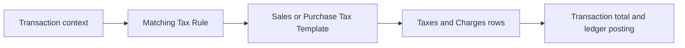

<!-- Frappe documentation: erpnext, part 17 of 18. Index: docs/INDEX.md -->

<!-- page: erpnext/erpnext__tax-rule.md -->
---
title: "Tax Rule\n"
space: "ERPNext"
url: "https://docs.frappe.io/erpnext/tax-rule"
updated: "2026-08-03"
---

A Tax Rule automatically selects a Sales or Purchase Taxes and Charges Template when a transaction matches the rule's conditions. It prevents users from having to remember which tax template applies to each customer, supplier, item, location, or period.

The rule selects a template. The selected template contains the tax accounts, rates, and calculation types that calculate the transaction tax.




Transaction context can include a party, party group, item, item group, billing or shipping location, [Tax Category](/erpnext/tax-category), date, company, and priority.

## Before you begin

Create the reusable [Sales Taxes and Charges Template](/erpnext/sales-taxes-and-charges-template) or [Purchase Taxes and Charges Template](/erpnext/purchase-taxes-and-charges-template) that the rule should select. Verify its company, accounts, rates, and calculation types with a representative draft transaction.

Create Tax Categories when the tax treatment depends on a party or address classification. A category is especially helpful when the same tax treatment is shared by many customers, suppliers, or locations.

Plan rules before entering them. List each tax treatment and the smallest set of conditions that makes it unique. Broad, overlapping rules are harder to troubleshoot than a few mutually exclusive rules.

## Create a Tax Rule

Go to **Accounting &gt; Taxes &gt; Tax Rule** and select **Add Tax Rule**.

1. Set **Tax Type** to **Sales** or **Purchase**.
2. Select the corresponding Sales Tax Template or Purchase Tax Template.
3. Enable **Use for Shopping Cart** only when the rule must also apply to website checkout transactions.
4. Add the conditions that identify the intended transaction.
5. Set validity dates when the rule is temporary or changes by tax period.
6. Set the priority and company.
7. Save.


The example rule selects **Nova Standard Sales Tax 8%** for Northstar Retail under the Standard Tax category.

## Important fields and what they mean


| Field                            | What it controls                                                       |
| -------------------------------- | ---------------------------------------------------------------------- |
| Tax Type                         | Whether the rule applies to selling or buying transactions             |
| Sales Tax Template               | The sales template selected by a Sales rule                            |
| Purchase Tax Template            | The purchase template selected by a Purchase rule                      |
| Use for Shopping Cart            | Extends a Sales rule to applicable website checkout transactions       |
| Customer or Supplier             | Restricts the rule to one party                                        |
| Customer Group or Supplier Group | Applies the rule to parties in a group                                 |
| Item or Item Group               | Restricts the rule using transaction item context                      |
| Billing or Shipping location     | Matches city, county, state, postal code, or country information       |
| Tax Category                     | Matches the treatment resolved from the party, Address, or transaction |
| From Date and To Date            | Limits the period during which the rule can apply                      |
| Priority                         | Decides which similar matching rule is considered first; 1 is highest  |
| Company                          | Restricts the rule to one company                                      |


Leave a filter blank when it is not needed. Every populated condition narrows the match, so a rule with Customer, Billing City, and Tax Category applies only when all three conditions match.

## Apply a rule to a Customer or Supplier

Select a specific [Customer](/erpnext/customer) or [Supplier](/erpnext/supplier) when the treatment is unique to that party. Use [Customer Group](/erpnext/customer-group) or [Supplier Group](/erpnext/supplier-group) when several parties share the treatment.

When a party is selected, ERPNext can use its linked billing and shipping addresses as transaction context. The relevant Address can also supply the Tax Category according to [Accounts Settings](/erpnext/accounts-settings).

If the rule should apply broadly, leave the specific party blank and use a meaningful group or category. Test a broad rule carefully so it does not select tax for exempt or out-of-scope parties.

## Apply a rule by item or item group

Use Item or Item Group conditions when the entire transaction template depends on the goods or services being sold or purchased.

If individual items within the same transaction use different rates, use an [Item Tax Template](/erpnext/item-tax-template) for the rate overrides. The Sales or Purchase Taxes and Charges Template must still contain the matching tax account row.

Keep the responsibilities clear:

- A Tax Rule selects the transaction-level tax template.
- The transaction template supplies tax rows and accounts.
- An Item Tax Template can override the rate for a matching item.

Avoid creating overlapping transaction and item logic without testing the combined result. Use distinct, descriptive names for transaction templates and item templates so users can tell them apart.

## Apply a rule by location

A rule can match billing or shipping city, county, state, postal code, or country. Use the side that determines tax in your jurisdiction.

This example requires the Billing City to be **Metro City** in addition to matching Northstar Retail and Standard Tax.


The location value comes from the Address selected on the transaction. If a rule does not match, check the actual transaction Address rather than only the party master.

Location filters are useful for destination-based sales tax, export treatment, and regional rates. Keep address data standardized so values match the rule exactly.

## Use Tax Category with a rule

A [Tax Category](/erpnext/tax-category) identifies a tax treatment such as Standard Tax, Export, or Tax Exempt. Assign it to a Customer, Supplier, or Address, then use it as a Tax Rule condition.

One category can appear in multiple rules. For example, Standard Tax can have one Sales rule and one Purchase rule, or separate rules for different companies and periods. The additional conditions determine which rule is relevant to the transaction.

The category itself does not contain a rate. If a category is present but the tax table is empty, check whether a matching rule exists and whether its template contains valid rows.

## Set validity and priority

Use **From Date** and **To Date** when a rate or treatment is valid for a defined period. Leave both blank only when the rule has no time limit.

When rules change at the start of a tax period, create the future rule in advance with a later From Date. Give the older rule an appropriate To Date so their active periods do not overlap unnecessarily.

If multiple rules have similar conditions, **Priority** determines their order. Priority 1 is highest, 2 is lower, and so on.


Priority does not repair contradictory configuration. Make conditions as distinct as possible and use priority only where a real hierarchy exists, such as a specific-customer exception above a general category rule.

## Check the result on a transaction

Create a draft [Sales Invoice](/erpnext/sales-invoice), Purchase Invoice, Quotation, or Order that should match the rule.

1. Select the company, party, and billing or shipping Address.
2. Confirm the Tax Category.
3. Add representative items.
4. Check the selected Taxes and Charges Template.
5. Review each tax row, tax amount, and Grand Total.

For the example rule, selecting Northstar Retail with its Metro City billing address and Standard Tax category selects the 8% sales template.


Always test each rule with both a transaction that should match and one that should not. This detects filters that are too broad, missing location data, and unintended priority conflicts.

## Shopping Cart rules

Enable **Use for Shopping Cart** only for Sales rules intended to calculate website checkout tax. The customer's website context, address, and available item data must satisfy the rule conditions.

Test checkout separately from Desk transactions. A rule that works after a Desk user selects or edits an Address may not have the same data available at an earlier stage of website checkout. See [Shopping Cart](/erpnext/shopping-cart) for the complete website flow.

## Troubleshooting

### No tax template is selected

Confirm that Tax Type matches the transaction, the rule and template belong to the correct company, and the transaction date is within the validity period. Compare every populated rule filter with the actual Customer, Supplier, items, groups, Address, and Tax Category on the draft transaction.

### The wrong rule wins

Look for another active rule with overlapping conditions. Compare their priorities and validity dates. Give a specific exception a higher priority than a broad rule, or make the conditions mutually exclusive.

### A location rule does not match

Open the billing or shipping Address selected on the transaction and compare its city, county, state, postal code, and country with the rule. Confirm in Accounts Settings which Address supplies Tax Category when category is also a condition.

### Item-specific rates are not applied

Check the Item or Item Group assignment, the Item Tax Template's category, and the tax account rows in the selected transaction template. If the category or item setup changed after adding items, review or re-add the affected rows.

## Frequently asked questions

### Does a Tax Rule create tax rows without a template?

1. The rule selects a Sales or Purchase Taxes and Charges Template. That template supplies the rows, accounts, rates, and calculation types used by the transaction.

### Can more than one Tax Rule apply to the same category?

Y

es. Rules can differ by Sales or Purchase, company, party, location, item context, validity dates, and priority. Design them so ERPNext can identify the intended template for a given transaction.

### Is Priority 1 higher or lower than Priority 2?

Priority 1 is higher. Use it for the most specific rule that should take precedence when comparable rules can match.

### Why did the rule work for one customer but not another in the same group?

Compare the parties' Addresses, Tax Categories, company, and transaction dates. A populated location or category condition may differ even when both Customers belong to the same group.

### Should I use a Tax Rule or an Item Tax Template for different item rates?

Use a Tax Rule to select the transaction-level template. Use Item Tax Templates when individual items need rate overrides within that tax context. Both require consistent categories and matching tax accounts.

## Related topics

- [Taxes](/erpnext/taxes)
- [Tax Category](/erpnext/tax-category)
- [Sales Taxes and Charges Template](/erpnext/sales-taxes-and-charges-template)
- [Purchase Taxes and Charges Template](/erpnext/purchase-taxes-and-charges-template)
- [Item Tax Template](/erpnext/item-tax-template)

<!-- page: erpnext/erpnext__tax-withholding-category.md -->
---
title: "Tax Withholding Category"
space: "ERPNext"
url: "https://docs.frappe.io/erpnext/tax-withholding-category"
updated: "2026-08-03"
---

A Tax Withholding Category tells ERPNext when to deduct or collect tax at source, which rate to use, and which account should receive the amount. It is commonly used when a business must withhold part of a supplier payment and remit it to a tax authority.

For example, Nova Electronics Trading receives an $800 professional-services invoice. Its withholding category uses a 5% rate and a $500 transaction threshold. ERPNext deducts $40 and leaves $760 payable to the supplier.

Tax withholding rules vary by country. Treat the examples as ERPNext configuration guidance, then use the rates, thresholds, accounts, and reporting required by your jurisdiction.

## Before you begin

Prepare:

- The relevant [Supplier](/erpnext/supplier) or Customer.
- A liability or tax Account Head in the [Chart of Accounts](/erpnext/chart-of-accounts) for every company using the category.
- The effective dates and withholding rate.
- The transaction and cumulative thresholds, if applicable.
- Confirmation of whether withholding uses Gross Total or Net Total.

Do not confuse Tax Withholding Category with [Tax Category](/erpnext/tax-category). Tax Category and a [Tax Rule](/erpnext/tax-rule) help select normal transaction-tax templates. Tax Withholding Category controls deductions or collections made at source.

## Create a Tax Withholding Category

Go to **Accounting &gt; Taxes &gt; Tax Withholding Category**, then select **New**.


Enter a specific name, such as **Professional Services Withholding**. In **Category Name**, describe the income or payment class covered by the rule.

Set **Deduct Tax On Basis**:


| Basis       | Meaning                                                                              |
| ----------- | ------------------------------------------------------------------------------------ |
| Gross Total | Uses the transaction amount before deductions defined by the withholding calculation |
| Net Total   | Uses the item net value before ordinary taxes and charges                            |


The correct basis depends on the applicable law. Verify it with your accountant.


## Add rates and thresholds

In **Rates**, add one row for every effective date range and rate combination. Select the pencil icon to edit the complete row.


Complete these fields:


| Field                 | Meaning                                                                                     |
| --------------------- | ------------------------------------------------------------------------------------------- |
| From Date and To Date | The dates for which the rate row is valid                                                   |
| Tax Withholding Group | Selects a group-specific rate when parties are classified into different withholding groups |
| Tax Withholding Rate  | The percentage ERPNext withholds                                                            |
| Transaction Threshold | The amount at which one transaction triggers withholding                                    |
| Cumulative Threshold  | The combined amount at which transactions in the applicable period trigger withholding      |


Current ERPNext uses **From Date** and **To Date** rather than the older Fiscal Year field. Keep date ranges continuous when the same category spans several periods.

## Understand the thresholds

Suppose the rate is 5%, the Transaction Threshold is $500, and the Cumulative Threshold is $2,000.

If one invoice is $800, it crosses the transaction threshold, so withholding applies.

If invoices are $400 each, no individual invoice crosses $500. Withholding can still apply when their relevant cumulative amount reaches $2,000.

The category also provides these controls:


| Option                           | Effect                                                            |
| -------------------------------- | ----------------------------------------------------------------- |
| Disable Transaction Threshold    | Ignores the per-transaction threshold                             |
| Disable Cumulative Threshold     | Ignores the cumulative threshold                                  |
| Only Deduct Tax On Excess Amount | Applies withholding only to the portion above the threshold       |
| Round Off Tax Amount             | Rounds the calculated amount according to ERPNext precision rules |


The older **Consider Entire Party Ledger Amount** option is not present in the current develop form. Do not build a new process around that legacy field without verifying the version in use.

## Add the company account

In **Accounts**, add each company and the Account Head where withholding will be credited or debited according to the transaction. Open the child row using its pencil icon.


Select the company and its matching account. The account must belong to that company.


For supplier withholding, the account is normally a liability representing tax withheld and payable to the authority. Confirm its root type and reporting position with your accountant.

## Assign the category to a supplier

Open the Supplier and go to the **Tax** tab. Select the Tax Withholding Category.


Use **Tax Withholding Group** when one category has group-specific rate rows, such as different rates for organizations and individuals. The supplier's group helps ERPNext select the matching rate row inside the category.

## Apply withholding on a Purchase Invoice

Create a [Purchase Invoice](/erpnext/purchase-invoice) for the supplier. ERPNext shows **Consider for Tax Withholding** when the transaction is eligible.


When selected, ERPNext evaluates the category, effective rate, group, basis, thresholds, and earlier relevant transactions. In the example:


| Calculation                | Amount  |
| -------------------------- | -------: |
| Net Total                  | $800.00 |
| Withholding at 5%          | $40.00  |
| Amount payable to supplier | $760.00 |


ERPNext adds the $40 as a deduction in Purchase Taxes and Charges.


The **Tax Withholding Entries** table records the category, taxable base, rate, amount, and source document. Use it to understand the calculation rather than relying only on Grand Total.


On submission, a simple expense invoice normally debits the expense, credits the supplier payable for the net amount, and credits the withholding liability for the withheld amount. Review the [General Ledger](/erpnext/general-ledger) because actual postings depend on the transaction and accounts.

## Withhold tax on a supplier advance

Withholding may be due when an advance is paid against a [Purchase Order](/erpnext/purchase-order), before a Purchase Invoice exists.

1. Create a [Payment Entry](/erpnext/payment-entry) with Payment Type **Pay**.
2. Select Party Type **Supplier** and the supplier.
3. Enter the advance amount before withholding.
4. Select **Consider for Tax Withholding**.
5. Confirm the Tax Withholding Category.
6. Save and review the generated Tax Withholding Entry before submission.


When the Purchase Invoice is created later, allocate the advance through the normal advance-allocation workflow. ERPNext uses the withholding entries to determine whether additional tax remains. Test this workflow with your jurisdiction's rules because timing requirements differ.

## Customer-side tax collection

Some regional rules require a seller to collect tax from an eligible customer after a threshold. ERPNext can use a Tax Withholding Category on a Customer for such rules where the localization supports the workflow.

Assign the category to the [Customer](/erpnext/customer), configure the correct rate and threshold, and test a [Sales Invoice](/erpnext/sales-invoice). When **Only Deduct Tax On Excess Amount** is enabled, ERPNext applies the rate only to the portion above the threshold.

Do not reuse a supplier-deduction account blindly for customer-side collection. Configure the correct company account and confirm the statutory report supplied by the regional app.

## Override or ignore thresholds carefully

Current transactions can expose **Ignore Tax Withholding Threshold** and **Edit Tax Withholding Entries**. Use them only when a documented exception requires a manual result.

Before overriding, capture the reason, supporting certificate or approval, correct taxable base, effective rate, and expected withholding. Review the resulting taxes table, detailed entries, and ledger posting. Manual edits bypass part of the protection provided by the category.

## Troubleshooting

### Consider for Tax Withholding does not appear

Confirm the party has a Tax Withholding Category, the transaction supports withholding, and the category has a valid rate row and company account.

### No tax is deducted from the invoice

The transaction may be below both thresholds, outside the rate dates, assigned to a group with no matching row, or using a disabled threshold combination. Inspect Tax Withholding Entries and the category settings.

### ERPNext uses the wrong rate

Check Posting Date, From Date, To Date, Tax Withholding Group, and overlapping rate rows. Avoid overlapping rows that could both match the same party and date.

### Advance withholding is repeated on the invoice

Confirm the Payment Entry is allocated correctly and inspect both documents' withholding entries. Do not add a manual deduction when ERPNext has already recognized the advance withholding.

## Frequently asked questions

### What is the difference between transaction and cumulative thresholds?

The transaction threshold evaluates one document. The cumulative threshold evaluates the relevant combined amount across transactions for the party and period.

### Does reaching a threshold apply tax to the entire amount?

Normally it can. Enable Only Deduct Tax On Excess Amount when the governing rule applies tax only to the portion above the threshold.

### Can different companies use the same category?

Y

es. Add a company-specific account row for each company and ensure the rate and legal treatment are genuinely shared.

### Can I withhold at payment instead of invoice?

Yes, Payment Entry supports withholding for supplier advances and payment-time workflows. Avoid applying it again on the invoice for the same taxable amount.

### Why is the supplier paid less than the invoice expense?

The withheld amount is owed to the tax authority instead of the supplier. The expense remains based on the taxable purchase, while payable is split between supplier and withholding liability.

## Related topics

- [Supplier](/erpnext/supplier)
- [Purchase Invoice](/erpnext/purchase-invoice)
- [Payment Entry](/erpnext/payment-entry)
- [Tax Category](/erpnext/tax-category)
- [Taxes](/erpnext/taxes)
- [Chart of Accounts](/erpnext/chart-of-accounts)

<!-- page: erpnext/erpnext__taxes.md -->
---
title: "Taxes"
space: "ERPNext"
url: "https://docs.frappe.io/erpnext/taxes"
updated: "2026-08-03"
---

ERPNext calculates taxes on sales and purchase transactions from reusable accounts, templates, categories, rules, and item-specific rates. The system can select the applicable setup automatically, show the calculation before submission, and post the tax amount to the correct General Ledger account.


ERPNext provides the calculation framework. It does not decide the tax rates, recoverability, filing treatment, or legal rules for your business. Confirm those requirements with a qualified tax adviser and use the relevant [regional documentation](/erpnext/regional) when a localization app changes the standard workflow.

## Understand the tax setup


| Record                                                                              | What it controls                                                    | Typical example                              |
| ----------------------------------------------------------------------------------- | ------------------------------------------------------------------- | -------------------------------------------- |
| Tax account                                                                         | Where tax is posted in the ledger                                   | Output Sales Tax Payable or Input Tax Credit |
| [Tax Category](/erpnext/tax-category)                                               | The tax treatment that applies to a party or transaction            | Standard, exempt, domestic, or export        |
| [Sales Taxes and Charges Template](/erpnext/sales-taxes-and-charges-template)       | Tax rows used on selling transactions                               | 8% sales tax on Net Total                    |
| [Purchase Taxes and Charges Template](/erpnext/purchase-taxes-and-charges-template) | Tax rows used on buying transactions                                | 5% recoverable purchase tax                  |
| [Tax Rule](/erpnext/tax-rule)                                                       | Conditions that select a sales or purchase template                 | Apply Standard Tax to a customer category    |
| [Item Tax Template](/erpnext/item-tax-template)                                     | A rate that overrides the transaction tax rate for particular items | A reduced rate or zero-rated item            |
| [Tax Withholding Category](/erpnext/tax-withholding-category)                       | Tax deducted when paying a supplier or receiving certain payments   | Supplier withholding with thresholds         |


A simple setup usually starts with one output tax account, one input tax account, one sales template, one purchase template, and a small number of categories and rules. Add more records only when rates or treatments genuinely differ.

## Before you begin

Confirm the following for every company and tax treatment you intend to use:

- Which sales taxes you collect and which purchase taxes you can recover
- The correct rates, taxable basis, effective dates, and exemptions
- Whether a charge affects the invoice total, item valuation, or both
- The accounts in which output tax, recoverable input tax, and non-recoverable tax must be posted
- The reports, identifiers, and electronic filing features supplied by your localization

Test the setup in a non-production company with representative invoices, discounts, returns, and mixed-rate items before using it for live transactions.

## Create the Tax Accounts

Open the Chart of Accounts and create the accounts required by your accounting policy.

For sales, output tax collected from a customer is normally a liability because it is payable to the tax authority. For purchases, recoverable input tax is normally an asset because it can be claimed or offset. A non-recoverable purchase tax may instead be added to valuation or posted as an expense.

Use separate sales and purchase accounts when you need to report collected and recoverable tax independently. Select the relevant company on each tax account.

## Create a Tax Category

A Tax Category gives a name to a tax treatment. It can be assigned to a Customer, Supplier, Address, tax template, or transaction and used by a Tax Rule to select the correct template.

Create categories that describe the treatment, not a single transaction. Examples include **Standard Tax**, **Export**, and **Exempt**.


If a category should no longer be selected, enable **Disabled** instead of deleting a record already referenced by transactions.

## Create sales and purchase tax templates

Create a Sales Taxes and Charges Template for taxes collected from customers. Select the company and Tax Category, then add one row for every tax or charge component. In each row, select the calculation type, account, rate, and description.


Create a separate purchase template for taxes charged by suppliers. Use the input tax account when the tax is recoverable. When it is not recoverable, decide with your accountant whether it should affect valuation or an expense account. See [Include Tax or Charge in Valuation or Total?](/erpnext/include-tax-or-charge-in-valuation-or-total) for the available treatments.


Mark a template as default only if it applies to most transactions for that company. Otherwise, let a Tax Rule select it or choose it manually.

## Select a template automatically with a Tax Rule

A Tax Rule matches transaction context to a template. It can consider the company, tax category, customer or supplier, groups, items, locations, dates, and priority.

In this example, a sales rule applies the **Nova Standard Sales Tax 8%** template to Northstar Retail when **Standard Tax** is selected.


Keep rules mutually exclusive where possible. If more than one rule can match, use a clear priority and non-overlapping conditions. When troubleshooting, check the transaction date and every condition on the rule, not only the Tax Category.

## Review tax on a transaction

Create a draft [Sales Invoice](/erpnext/sales-invoice) or Purchase Invoice. Select the party and items, then review the Tax Category, selected template, every row under Taxes and Charges, Total Taxes and Charges, and Grand Total.


In the example below, an invoice with a net total of $699 uses an 8% output tax row. ERPNext calculates $55.92 of tax and a grand total of $754.92.


Do not rely only on the template name. Confirm the account, rate, taxable basis, and amount on the transaction. A user can change a draft transaction, and a category or rule can select a different template from the one expected.

After submission, the calculated amount becomes part of the accounting entry.


## Understand the General Ledger impact

For the example sale, ERPNext posts the following entries:


| Account                  | Debit   | Credit  | Meaning                                     |
| ------------------------ | -------: | -------: | ------------------------------------------- |
| Debtors                  | $754.92 |         | Total amount owed by the customer           |
| Sales                    |         | $699.00 | Revenue before tax                          |
| Output Sales Tax Payable |         | $55.92  | Tax collected and owed to the tax authority |


On a purchase with recoverable input tax, ERPNext normally debits the input tax asset and credits the supplier for the tax-inclusive total. The exact entries depend on the selected accounts, perpetual inventory, and whether the tax affects valuation.

## Handle special tax calculations

Use the calculation type in each template row to control the taxable basis.

**On Net Total** calculates a rate on the transaction's net item value. **On Previous Row Total** calculates on the running total after an earlier row. **On Previous Row Amount** calculates only on the amount produced by an earlier row. See [Apply Tax on Another Tax or Charge](/erpnext/how-to-apply-tax-on-tax) and [Tax on another tax amount](/erpnext/v14/user/manual/en/accounts/articles/tax-on-another-tax-amount) for worked examples.


If item rates already include tax, use [Tax Inclusive Accounting](/erpnext/tax-inclusive-accounting) so ERPNext separates the included tax from income or expense. Use [Types in Tax Template](/erpnext/types-in-tax-template) to understand the complete list of row calculation options.


For items with different rates or exemptions on the same transaction, configure Item Tax Templates and ensure the matching tax account is present in the transaction's Taxes and Charges table. An item template overrides the rate for its item; it does not replace the transaction tax row or its account.

## Use withholding and regional tax features

Withholding is different from transaction tax. It records an amount deducted from a payment according to a category, rate, and threshold. For regional Indian requirements, a [Lower Deduction Certificate](/erpnext/lower-deduction-certificate) can apply a reduced or nil withholding rate when the supplier holds a valid certificate.

Local compliance apps can add statutory fields, reports, e-invoicing, withholding behavior, and validations. Follow their documentation where it differs from the generic ERPNext setup.

## Troubleshooting

### The expected tax template is not selected

Check the company, Tax Category, party, address, transaction date, rule validity, and priority. Confirm that the rule points to a template of the same transaction type. If you changed the category after adding items, re-check the tax template and item rows before saving.

### Tax is missing or wrong for one item

Open the item row and verify its Item Tax Template. Confirm that the same tax account exists in the Sales or Purchase Taxes and Charges table. The item template supplies an overriding rate only for matching accounts.

### The tax is calculated on the wrong amount

Check the row's calculation type and Reference Row number. **On Previous Row Total** and **On Previous Row Amount** produce different results. Also confirm whether discounts are applied before or after the referenced tax row.

### The invoice total is correct but the ledger account is wrong

Open the selected tax template and verify the Account Head and company. Then review the submitted transaction's General Ledger. Correct the configuration before cancelling and amending any affected transaction.

## Frequently asked questions

### Does a Tax Category calculate tax by itself?

A Tax Category identifies the treatment. A template contains the calculation rows, while a Tax Rule can use the category and other conditions to select that template.

### Should sales tax and purchase tax use the same account?

That depends on your accounting and reporting requirements. Many businesses use separate output tax liability and input tax asset accounts so collected and recoverable tax remain visible. Confirm the required structure with your accountant.

### Why did changing the Tax Category not refresh every item tax?

Item-specific tax is resolved from the transaction context and the item's matching template. If the category changes after items are added, review the item rows and tax table again. Remove and re-add an affected item when necessary, then confirm the calculation before submission.

### Can ERPNext determine the legally correct tax rate automatically?

ERPNext applies the rates and rules you configure. A localization or integration may supply additional logic, but your organization remains responsible for configuring, validating, and maintaining the correct statutory treatment.

### How do I record a bank fee deducted from a customer payment?

That is a payment difference, not a transaction tax. Record it in the Deductions or Loss section of the Payment Entry as described in [Additional Charges in Payment](/erpnext/handing-deductions-in-payment-entry).

## Related topics

- [Tax Category](/erpnext/tax-category)
- [Tax Rule](/erpnext/tax-rule)
- [Sales Taxes and Charges Template](/erpnext/sales-taxes-and-charges-template)
- [Purchase Taxes and Charges Template](/erpnext/purchase-taxes-and-charges-template)
- [Item Tax Template](/erpnext/item-tax-template)
- [Tax Withholding Category](/erpnext/tax-withholding-category)
- [Tax Inclusive Accounting](/erpnext/tax-inclusive-accounting)

<!-- page: erpnext/erpnext__taxjar_integration.md -->
---
title: "Taxjar Integration"
space: "ERPNext"
url: "https://docs.frappe.io/erpnext/taxjar_integration"
updated: "2026-05-29"
---

TaxJar integration allows ERPNext users to auto-calculate taxes based on the addresses of customers, companies and delivery locations.

## How to Setup TaxJar?

### TaxJar Account and API Tokens:

You will need the API tokens from your account to setup Taxjar.

1. Create a [Taxjar account](https://www.taxjar.com/) first as per your requirements.
2. Login to your account dashboard and click on the **Account** button and click on **TaxJar API** in the dropdown list of options.
  
3. You will now see your API tokens, these tokens would be needed to configure your ERPNext TaxJar integration.
  

### Adding Nexus and states in TaxJar:

**What is Nexus?**

You don't need to register to collect sales taxes from customers in every state. You'll only collect sales taxes from customers who live in the states where you have nexus!

"Nexus" is a specific type of connection to a state that's significant enough for you to be required to comply with that state's sales tax laws.

**How do I know where I have Nexus?**

You'll always have nexus in your home state where you are located.

For more details, please read up on the official [TaxJar page about Nexus](https://support.taxjar.com/article/115-how-do-i-know-where-i-have-nexus) without fail!

**Adding states:**

Please follow detailed instructions given on the official TaxJar page [here](https://support.taxjar.com/article/116-add-or-remove-states-from-your-dashboard) regarding adding/removing states to your dashboard, please follow their instructions from top to bottom as it will help you set up everything perfectly.

### Setting up TaxJar on ERPNext:

From the Desktop click on the '**TaskJar**' icon. This will redirect you to the TaxJar Workspace.


*Frappe Desktop with TaxJar desktop icon*

Click on '**TaxJar Settings**'. This is where you configure your TaxJar integration in ERPNext.


*TaxJar Workspace*

Fill


*TaxJar Settings Form View*


**Sandbox Mode:**

TaxJar provides a sandbox environment for automated testing and development. After generating a sandbox API token, point your API client to the sandbox environment: [https://api.sandbox.taxjar.com](https://api.sandbox.taxjar.com)]. Note sandbox transactions will not reflect in your TaxJar dashboard. To troubleshoot during development use the TaxJar API Log.

**Logging:**

- When Enable TaxJar Logging is checked in **TaxJar Settings**, TaxJar requests/responses/skips/errors are written to TaxJar API Log and file logs.
- When Enable TaxJar Logging is unchecked, tax logic still runs, but no new TaxJar log entries are written.


*TaxJar API Log List View*

Payload and responsed a stored in the Log,


*TaxJar API Log Form View*

**Setting up tokens and account heads:**

1. Enable Tax Calculation, Create TaxJar Transaction:
2. You need to enable these options for auto tax calculations and these transactions would appear on your TaxJar account transactions page where you can track them and analyse the tax breakdowns.
3. Once you've made some transactions, they would automatically appear on your TaxJar **Transactions** page:
4. You can check out all the transactions made and the detailed tax breakdowns.
5. Copy the API tokens from your TaxJar account as directed above and paste it in the **Live API Key** and **Sandbox API key field.**
6. You will have to set two account heads for Taxes and Shipping, select the accounts as required and once everything has been configured, click on save and you are good to go!

### Setting correct addresses

For the integration to work seamlessly please make sure you have created correct addresses for your company, customers, suppliers, etc.

**Note:**

1. While creating an address, make sure in the **State/Province** field you enter the correct state. TaxJar requires the 2 letter format for the states for ex. New York is considered as NY, but it **need not be** mandatorily entered that way, the system converts it to the 2-letter state code automatically.
  
  *Address Form View*
2. You may check the **Preferred Billing Address** and **Preferred Shipping Address** checkboxes to auto-fill those fields in different invoices and avoid the hassle.
3. Ensure that you have correctly filled the **City/Town, State/Province, Country, Postal Code** fields.
4. You might want to disable the taxes if any, that are set by default.

### TaxJar in Action!

In this instance we have a company that is based out in **New York** and we are issuing a Sales Invoice to a customer based within the same state.


As you see, the taxes and charges based on the state and pincode gets applied automatically on saving.

<!-- page: erpnext/erpnext__tds-setup-india.md -->
---
title: "TDS Setup for India"
space: "ERPNext"
url: "https://docs.frappe.io/erpnext/tds-setup-india"
updated: "2026-02-26"
---

To setup ***TDS*** in ERPNext follow below steps:

  
  


* First you have to define Tax withholding categories, by default 28 categories are already pre-defined as per Indian statutory compliances. But if you want to add new category then you can create the same by clicking on "New"(button at right top corner)

  


* As per category you have to define Tax withholding rate along with "Single Transaction Threshold" & "Cumulative Transaction Threshold" for Financial/Fiscal year.

  


* In same screen you will find another section of "Account Detail" to set company-wise TDS Payable account.

  


* Once you are done with Tax withholding setup go to Supplier master and assign Tax withholding category.

  


* Now when you create a Purchase invoice against that supplier make sure "Apply Tax withholding Amount" is checked then only system will auto fetch TDS Payable amount in "Taxes & Charges" table based on Threshold you have defined.

  


  


Standard report is also available to check monthly payable, just search for "TDS payable monthly" report for the same.

<!-- page: erpnext/erpnext__terms-and-conditions.md -->
---
title: "Terms and Conditions | ERPNext Documentation"
description: "Learn how to create, apply, print, and manage reusable Terms and Conditions templates across ERPNext sales, buying, and HR transactions."
space: "ERPNext"
url: "https://docs.frappe.io/erpnext/terms-and-conditions"
updated: "2026-07-23"
---

Terms and Conditions in ERPNext are reusable clauses that describe the commercial, delivery, warranty, return, and other conditions that apply to a transaction. A template helps your team use approved wording consistently instead of rewriting the same text for every Quotation, Sales Order, or purchase document.

ERPNext copies the selected template into the transaction. Users can review or edit the copied text before submitting the document, subject to your organization’s approval process. Because the wording may create legal obligations, have qualified legal or commercial reviewers approve every template used by your business.

## Before you begin

- Confirm the approved wording with your legal, finance, sales, and operations teams.
- Decide which ERPNext modules should be allowed to use the template.
- Create supporting records such as [Payment Terms](/erpnext/payment-terms), [Incoterms](/erpnext/incoterm), and shipping rules separately. Do not rely on narrative wording when ERPNext has a structured field for the same control.
- Choose a clear template naming convention, such as Sales Standard, Export Sales, Purchase Standard, or Service Engagement.
- Review the active [Print Format](/erpnext/print-format) to confirm that it displays Terms and Conditions.

## Create a Terms and Conditions template

1. Go to **Selling > Settings > Terms and Conditions**.
2. Select **Add Terms and Conditions**.
3. Enter a descriptive Title.
4. Select the Applicable Modules.
5. Enable **Copy Attachments to Transaction** when files attached to this template should be copied to documents that use it.
6. Enter and format the approved wording in **Terms and Conditions**.
7. Save the template.


The example is limited to Selling and contains reusable commercial terms for Nova Electronics Trading. 

## Alternative ways to add Terms and Conditions

### Select a template in a transaction

1. Open or create a supported transaction such as a [Quotation](/erpnext/quotation) or [Sales Order](/erpnext/sales-order).
2. Open the **Terms** tab.
3. In the Terms and Conditions section, select the required template in **Terms**.
4. Review the copied text in **Terms and Conditions Details**.
5. Edit transaction-specific details when permitted, then save the document.


The highlighted field selects Nova Standard Sales Terms. ERPNext copies the template content below it, where the terms can be reviewed before the document is submitted.

### Enter transaction-specific terms without a template

You can enter text directly in Terms and Conditions Details when the conditions apply only to one transaction. Use this for a genuine exception, not as a replacement for an approved reusable template. Ask the appropriate reviewer to approve material changes before the document is sent or submitted.

### Use a template in buying or HR

Enable Buying or HR on the template when its wording is intended for those modules. For example, a Purchase Order may need supplier delivery and inspection clauses, while an HR document may require employment-related wording. Keep unrelated conditions in separate templates so users see only appropriate choices.

## Important fields and what they mean


| Field                           | What it means                                                                                                                                                     |
| ------------------------------- | ----------------------------------------------------------------------------------------------------------------------------------------------------------------- |
| Title                           | The name users select in a transaction. Include the purpose, region, or document type when several templates exist.                                               |
| Disabled                        | Prevents new transactions from selecting the template without deleting its historical record.                                                                     |
| Copy Attachments to Transaction | Copies files attached to the template into a transaction that uses it. Use this for approved schedules or policy documents that must travel with the transaction. |
| Selling                         | Makes the template available to supported Selling documents.                                                                                                      |
| Buying                          | Makes the template available to supported Buying documents.                                                                                                       |
| HR                              | Makes the template available to supported HR documents when the installed application supports it.                                                                |
| Terms and Conditions            | The reusable rich-text content copied into a transaction.                                                                                                         |
| Terms                           | The template link selected on a transaction.                                                                                                                      |
| Terms and Conditions Details    | The copied transaction text. Changes here affect this transaction, not the original template.                                                                     |


## What should Terms and Conditions contain?

Avoid copying generic terms from another company or jurisdiction. ERPNext stores and displays your approved text, but it does not determine whether the wording is legally suitable.

## Use structured fields with narrative terms

Terms and Conditions complement ERPNext fields rather than replacing them. Use structured fields wherever possible:


| Requirement             | Recommended ERPNext control                                                                                                 |
| ----------------------- | --------------------------------------------------------------------------------------------------------------------------- |
| When payment is due     | Use a Payment Terms Template and Payment Schedule. Summarize special conditions in the narrative terms only when necessary. |
| Shipping responsibility | Use Incoterm and Named Place fields, then add explanatory wording if required.                                              |
| Delivery commitment     | Use transaction and item Delivery Dates.                                                                                    |
| Tax calculation         | Use the appropriate [Sales Taxes and Charges Template](/erpnext/sales-taxes-and-charges-template).                          |
| Currency and pricing    | Use Currency, [Price List](/erpnext/price-list), and transaction rates.                                                     |


Structured fields support calculations, reports, and downstream documents. Narrative terms provide the additional contractual explanation.

## Use attachments with a template

Attach a file to the Terms and Conditions record when users must send an approved schedule, warranty statement, specification, or policy with the transaction. Enable **Copy Attachments to Transaction** so ERPNext copies those files when the template is selected.

Before relying on this option, test the complete workflow. Confirm that the attachment appears on the transaction and that your email or document-sharing process includes it. Review attachment permissions and avoid placing confidential documents in a broadly available template.

## Use variables with Jinja

Terms and Conditions support Jinja expressions, which can insert values from the transaction into the copied content. For example, a Sales Order template can reference its document name or delivery date:

```python
Order reference: {{ name }}
Order date: {{ transaction_date }}
Expected delivery: {{ delivery_date }}
```

Use field names that exist on the transaction. Test the template on a draft document before using it operationally. Keep important obligations understandable even when an optional value is empty. For background, see [Jinja templating in ERPNext](/erpnext/jinja).

## Print and share the terms

Once terms are present in a transaction, they can appear in its print view, PDF, or email attachment if the selected Print Format includes that field.


1. Open the transaction.
2. Select **Print**.
3. Choose the required Print Format and language.
4. Review the Terms and Conditions section.
5. Print the document or generate its PDF.


The preview shows the commercial terms after the Sales Order totals. Always inspect the final document before sending it to the Customer.

## Submit and next steps

Review the copied wording together with the Customer, items, delivery dates, payment schedule, taxes, and totals. Save and submit the transaction only after the commercial terms match the agreement. The submitted [Sales Invoice](/erpnext/sales-invoice), Delivery Note, or another downstream document may use its own template and print format, so confirm the terms required at each stage.

Changing the reusable template later does not rewrite already created transactions. Update an existing draft transaction by selecting the template again or editing its copied terms. Do not silently replace terms on a submitted document. Follow the applicable amendment or cancellation process.

## Good practices

- Give every template a clear owner and review date.
- Keep sales, purchase, service, export, and HR wording separate.
- Disable superseded templates instead of deleting records needed for audit history.
- Limit editing permissions for approved templates using [Role-Based Permissions](/erpnext/role-based-permissions).
- Test Jinja variables, attachments, print formats, and translations before rollout.
- Use a short standard template for routine transactions and separate schedules for complex obligations.

## Troubleshooting

### The template does not appear in a transaction

Confirm that it is not disabled and that the correct Applicable Module is enabled. Also check that the transaction supports Terms and Conditions and that the user can read the template.

### Selecting the template does not update the text

Save the template, then select it again in the transaction. If text was already edited in the transaction, confirm before replacing it so approved changes are not lost.

### Terms do not appear in print

Confirm that the transaction contains Terms and Conditions Details. Then inspect the selected Print Format and verify that it displays the terms field. A custom format may omit it.

### Jinja values are blank or incorrect

Verify the field name on the source DocType and confirm that the field contains a value. Test the expression on a draft transaction and avoid using fields that are unavailable on that document type.

### An attachment was not copied

Confirm that the file is attached to the template and that Copy Attachments to Transaction is enabled before selecting the template. Check the Attachments section on the transaction.

## Frequently asked questions

### Can I edit the terms after selecting a template?

Yes. The text is copied into the transaction and can be adjusted before submission, subject to your approval process. The original template is not changed.

### Can I use one template for sales and purchases?

ERPNext allows multiple Applicable Modules, but separate templates are usually clearer because customer and supplier obligations differ.

### Will changing a template update old transactions?

No. Existing transactions keep the text that was copied when the template was selected.

### Can Terms and Conditions replace Payment Terms?

No. Use Payment Terms and the Payment Schedule for due dates and invoice portions. Use narrative terms for the additional contractual explanation.

### Can the same terms be printed in another language?

Create and approve the required translated wording and confirm the selected print language and format. Do not assume that ERPNext will legally translate custom contractual text.

<!-- page: erpnext/erpnext__territory.md -->
---
title: "Territory | ERPNext Documentation"
description: "Learn how to create ERPNext Territories, organize regional hierarchies, assign customers, managers, and item-group sales targets."
space: "ERPNext"
url: "https://docs.frappe.io/erpnext/territory"
updated: "2026-08-02"
---

A Territory in ERPNext represents a geographic or commercial region in which your company sells. Territories help classify Customers and Addresses, organize reporting, assign responsibility, and compare regional sales with targets.

Territories use a tree structure. A group territory contains lower-level territories, while a leaf territory can be selected on transactions. For example, United States can contain Northeast, which can contain New York Metro.

## Why use Territories?

- Segment customers and sales by region.
- Assign a Territory Manager for reference and accountability.
- Set item-group targets for a fiscal year.
- Compare regional targets with actual sales.
- Use consistent regional values across Customers, Addresses, and sales transactions.

## Before you begin

- Decide whether your hierarchy should follow countries, states, cities, sales zones, or another commercial structure.
- Keep the hierarchy stable enough for meaningful reporting.
- Create the relevant [Item Groups](/erpnext/item-group), Fiscal Years, and Monthly Distributions before adding targets.
- Set a Default Territory in [Selling Settings](/erpnext/selling-settings) if most new Customers should receive the same value.

## Create a Territory

1. Go to **Selling > Settings > Territory**.
2. Select **New**.
3. Enter a Territory Name.
4. Enable **Is Group** when this Territory will contain lower-level territories.
5. Select **Create New**.


The deep-red square highlights **Is Group**. A group organizes child territories and is not selected on a transaction. Leave it disabled when creating a leaf territory such as a city, metro area, or final sales zone.

## Alternative way to create a Territory

To create a Territory directly under an existing group:

1. Select the parent Territory in the tree.
2. Select **Add Child**.
3. Enter the child Territory name.
4. Enable Is Group only when the child will contain another level.
5. Create the record.

Using Add Child reduces the chance of placing the record under the wrong parent.

## Important fields and what they mean


| Field               | What it means                                                                                                                                                       |
| ------------------- | ------------------------------------------------------------------------------------------------------------------------------------------------------------------- |
| Territory Name      | The name displayed in the tree, Customer master, sales transactions, and reports. Use names that users can identify consistently.                                   |
| Parent Territory    | The group directly above the current Territory. It determines the Territory’s position in the hierarchy.                                                            |
| Is Group            | Allows child Territories below this record. Only leaf nodes are intended for transactions.                                                                          |
| Territory Manager   | A reference to the person responsible for the region. It does not replace user permissions or the [Sales Person](/erpnext/sales-person) assignment on transactions. |
| Item Group          | The product category to which a target applies.                                                                                                                     |
| Fiscal Year         | The period for the target.                                                                                                                                          |
| Target Qty          | The quantity target for the selected Item Group and Fiscal Year.                                                                                                    |
| Target Amount       | The monetary sales target for the selected Item Group and Fiscal Year.                                                                                              |
| Target Distribution | Distributes the annual target across months. Use an even distribution or a seasonal pattern that matches the business.                                              |


## Organize the Territory hierarchy

A well-designed hierarchy moves from broad groups to the lowest reporting level you need. The Nova Electronics Trading demo uses United States as a group, four regional groups below it, and metro areas as leaf Territories.


You can add multiple levels, but avoid unnecessary depth. A structure such as country → region → metro area is easier to maintain than a different hierarchy for every sales team.

Select a node to access actions such as Edit, Add Child, Rename, or Delete. ERPNext may prevent deletion when a Territory is linked to another record. Rename an existing Territory when the region continues to represent the same business segment.

## Choose an effective Territory structure


| Business model           | Example hierarchy                             |
| ------------------------ | --------------------------------------------- |
| National distributor     | Country → region → state or metro area        |
| International seller     | Global region → country → sales zone          |
| Local service company    | Service region → city → neighborhood or route |
| Account-based sales team | Market segment → named account region         |


Choose one primary purpose for the tree. Mixing geography, customer size, industry, and salesperson names in the same hierarchy makes reports difficult to interpret. Use Customer Group for customer segmentation and Sales Person for individual ownership instead.

Before creating many Territories, test the proposed hierarchy with a few representative Customers and reports. Confirm that users know which leaf to select and that managers can view totals at the group level they need.

## Assign a Territory to a Customer

Select the appropriate Territory on the [Customer](/erpnext/customer) record. The value can then flow into supported sales transactions. A default from Selling Settings helps during Customer creation, including when ERPNext converts a Lead-based [Quotation](/erpnext/quotation) into a Customer.

Use the final selectable Territory rather than a group. For example, select New York Metro instead of Northeast when metro-level reporting is required.

## Set Territory sales targets

1. Open a leaf Territory.
2. In Territory Targets, select **Add row**.
3. Select an Item Group and Fiscal Year.
4. Enter the Target Qty, Target Amount, or both.
5. Select a Target Distribution.
6. Save the Territory.


The example assigns New York Metro a 2026 target of 3,000 units and 750,000 in sales for All Item Groups, distributed evenly across the year.

For more detail about targets and distributions, see [Sales Person Target Allocation](/erpnext/sales-person-target-allocation). Territory targets can be reviewed using target variance reports in [Sales Reports](/erpnext/sales-reports).

## Good practices

- Use short, recognizable names and avoid two Territories with nearly identical meanings.
- Create a group only when it will contain children or provide a useful reporting subtotal.
- Assign Customers to the lowest meaningful leaf Territory.
- Review unassigned and incorrectly assigned Customers before relying on territory-wise reports.
- Update targets at the start of each Fiscal Year and confirm their Monthly Distributions.
- Document major hierarchy changes so report users understand comparisons with earlier periods.

## Where Territory is used


| Area                 | How Territory helps                                                                                                   |
| -------------------- | --------------------------------------------------------------------------------------------------------------------- |
| Customer and Address | Classifies the customer or location for regional reporting. See [Address](/erpnext/address).                          |
| Sales transactions   | Carries the regional classification into documents such as Sales Orders and [Sales Invoices](/erpnext/sales-invoice). |
| Targets              | Stores quantity and amount targets by Item Group and Fiscal Year.                                                     |
| Reports              | Supports territory-wise analysis and target variance comparisons.                                                     |


## Troubleshooting

### I cannot select a Territory on a transaction

Confirm that it is a leaf Territory. Group Territories organize the tree but are not intended for transaction selection.

### A new Customer has the wrong Territory

Check the Customer record and the Default Territory in Selling Settings. Users can replace the default when another Territory is appropriate.

### I cannot delete a Territory

The Territory may have child nodes or links from Customers, Addresses, or transactions. Move or update those dependencies before deleting it.

### The target does not reflect seasonality

Review the selected Monthly Distribution. Its monthly percentages must total 100 percent and should match the expected sales pattern.

## Frequently asked questions

### Must a Territory represent a geographic area?

No. It can represent any stable regional or commercial structure, but geographic naming is usually easiest for users and reports.

### Can a Customer’s Territory be changed?

Yes. Change it when the Customer’s ownership or reporting region changes. Review how the change affects future reporting and internal responsibility.

### Is Territory the same as Sales Person?

No. Territory represents the region. Sales Person represents an individual or sales-team hierarchy and can receive contribution percentages and targets.

### How many hierarchy levels should I use?

Use only the levels required for assignment and reporting. Two or three meaningful levels are often easier to maintain than a very deep tree.

<!-- page: erpnext/erpnext__the-champion.md -->
---
title: "The Project Champion"
space: "ERPNext"
url: "https://docs.frappe.io/erpnext/the-champion"
updated: "2026-08-14"
---

Implementing ERPNext in any organisation requires clear identification of pain points, meticulous planning and active involvement of all parties associated with the project. It involves the integration of various business processes, data migration, training, and organisational change management.

Since there are so many moving parts in parallel, having a single point of contact for driving the activities plays a huge role. It has been fund that effectiveness of the Project Champion is the key distinguishing factor between Success and Failure.


These are some of the key benefits of having a Project Champion assigned for each project.

1. **Leadership:** Project Champion acts as a single point of contact at customer's end and provides strong leadership by closely adhering to the vision, goals, and objectives for the project.
2. **Stakeholder Buy-In:** Project Champion acts as a liaison between the project team and key stakeholders. He/She works to create more awareness about the project and acquires buy-in from the potential users and stakeholders.
3. **Resource Allocation:** Project Champion ensures that the required resources (man power, funding etc) is allotted as per the requirement to ensure seamless continuation of the project.
4. **Problem-Solving:** Project Champion provides solutions whenever any challenges are faced. They are expected to address burning issues, resolve interpersonal conflicts and make informed decisions to keep the project on track.
5. **Change Management:** ERP implementation involves reasonable changes in the processes and the way teams operate. Project Champion helps employees adapt to the new system, ensuring a seamless transition.
6. **Risk Management:** ERP implementations can be complex and risky as it directly affects business continuity of the user. A project champion identifies potential risks and derives strategies to mitigate them, minimising the likelihood of project delays or failures.
7. **Communication:** Project Champion keeps track of the project and shares updates with the concerned stakeholders.
8. **Accountability:** Project Champion builds the team at their end and ensures that everyone is aware of the role they have to play in the implementation process. They keep track of commitments, deadlines and milestones very closely and call out any potential risks.
9. **Continuous Improvement:** At times, ERP implementation can be an iterative process. So, a Project Champion continues to lead the project involving customisations, localisations and enhancements.

<!-- page: erpnext/erpnext__time-based-payout.md -->
---
title: "Time Based Payout"
space: "ERPNext"
url: "https://docs.frappe.io/erpnext/time-based-payout"
updated: "2026-02-26"
---

Time-based payout in ERPNext projects refers to the process of calculating and disbursing payments to employees or contractors based on the time they have spent working on specific projects or tasks.

This feature is particularly useful in industries where billing is tied to hourly rates or milestone achievements. ERPNext facilitates time-based payout by accurately tracking the time logged by individuals against project tasks or milestones. It allows organizations to set hourly rates or payment terms for different roles or projects, ensuring fair compensation for work done.

* [Sales Invoice from Timesheet](/erpnext/user/manual/en/sales-invoice-from-timesheet)
* [Salary Slip from Timesheet](/erpnext/user/manual/en/salary-slip-from-timesheet)

<!-- page: erpnext/erpnext__time-tracking.md -->
---
title: "Time Tracking"
space: "ERPNext"
url: "https://docs.frappe.io/erpnext/time-tracking"
updated: "2026-02-26"
---

Project time tracking in ERPNext plays a pivotal role in ensuring accurate project management and resource utilisation.

By allowing employees to log time against specific tasks or projects, ERPNext provides a clear visibility to time spent on various activities. This feature helps in monitoring project progress, identifying bottlenecks, and optimizing resource allocation.Time tracking in the project management modules allows project managers to make informed decisions based on real-time data, ultimately contributing to more efficient project execution and successful outcomes.

* [Activity Type](/erpnext/user/manual/en/activity-type)
* [Activity Cost](/erpnext/user/manual/en/activity-cost)
* [Timesheets](/erpnext/user/manual/en/timesheets)

<!-- page: erpnext/erpnext__timer-in-timesheets.md -->
---
title: "Timer in Timesheets"
space: "ERPNext"
url: "https://docs.frappe.io/erpnext/timer-in-timesheets"
updated: "2026-07-05"
---

The Timer in Timesheet helps users record actual working time without manually entering start and end times.

It is useful when employees work on project tasks, support work, consulting, internal activities, or any activity where the exact time spent needs to be captured.

## How The Timer Works

In a Timesheet, click **Start Timer** to open the Timer dialog.

The dialog lets you select:

- Activity Type
- Project
- Task
- Expected Hrs

When you start the timer, ERPNext creates a row in the Timesheet table with the current time as the **From Time**. The timer continues to count the elapsed time.

When you click **Complete**, ERPNext sets the **To Time**, calculates the total hours, and marks the row as completed.

## Starting A New Timer

To start a timer:

1. Create or open a draft Timesheet.
2. Click **Start Timer**.
3. Select the Activity Type.
4. Optionally select the Project and Task.
5. Enter Expected Hrs if you want ERPNext to alert you when the expected time is exceeded.
6. Click **Start**.

ERPNext adds the time log row and starts recording time.

## Completing The Timer

When the work is done, open the Timer and click **Complete**.

ERPNext will:

- Set the To Time.
- Calculate Hours.
- Mark the time log row as completed.
- Save the Timesheet.

You can then submit the Timesheet after reviewing the time logs.

## Resuming A Timer

If a Timesheet has an incomplete time log, ERPNext shows **Resume Timer** instead of Start Timer.

Use this when work was started earlier but not completed. ERPNext resumes the timer from the existing From Time and continues counting elapsed time.

## Expected Hours

Expected Hrs is optional. If it is entered, ERPNext can alert the user when the timer exceeds the expected duration.

This is helpful when work is planned for a fixed amount of time and users need a reminder when the planned time is exceeded.

## Billing And Costing

The timer records working hours. Billing and costing are handled through Timesheet fields such as:

- Is Billable
- Billing Hours
- Billing Rate
- Costing Rate

After the timer is completed, review these fields before submitting or billing the Timesheet.

## Common Checks

If the timer is not working as expected, check the following:

- The Timesheet is still in Draft state.
- An Activity Type is selected.
- The time log is not already completed.
- From Time and To Time are not overlapping with another Timesheet for the same user or employee.
- Project and Task are selected when the time needs to be tracked against a project.

## Summary

Use the Timesheet Timer when users need a simple start-and-stop way to record actual working time. It reduces manual entry, improves accuracy, and keeps time logs connected to the right Activity Type, Project, and Task.

## Related Topics

- [Timesheet](https://docs.frappe.io/erpnext/timesheet)
- [Project](https://docs.frappe.io/erpnext/project)
- [Task](https://docs.frappe.io/erpnext/task)
- [Activity Type](https://docs.frappe.io/erpnext/activity-type)
- [Sales Invoice](https://docs.frappe.io/erpnext/sales-invoice)

<!-- page: erpnext/erpnext__timesheet-against-work-order.md -->
---
title: "Timesheet against Work Order"
space: "ERPNext"
url: "https://docs.frappe.io/erpnext/timesheet-against-work-order"
updated: "2026-07-05"
---

In ERPNext manufacturing, time spent on a Work Order is normally tracked through **Job Cards**. A Job Card is created for a Work Order operation and is used to record the employee, workstation, start time, end time, completed quantity, and operation time.

Timesheets are generally used for recording employee working hours against activities, projects, tasks, or billable work. They are useful for service and project-based tracking. For production operations, Job Cards are the standard document because they are directly connected to Work Orders and manufacturing operations.

## Recommended Flow

Use this flow when you want to record time against a Work Order:

1. Create and submit the **Work Order**.
2. Make sure the Work Order has operations defined in its routing or operations table.
3. Create **Job Cards** for the operations.
4. In the Job Card, record the employee, workstation, start time, end time, and completed quantity.
5. Submit the Job Card after the operation is completed.

The recorded time in the Job Card helps track actual manufacturing time against the planned operation time.

## When To Use Job Card

Use Job Cards when:

- Time is being recorded for a manufacturing operation.
- The work is linked to a Work Order.
- You want to track workstation time, operation time, and completed quantity.
- You want production progress to be reflected against the Work Order.

Job Cards are designed for manufacturing and are the best fit for Work Order execution.

## When To Use Timesheet

Use Timesheet when:

- Employees need to record general working hours.
- Work is tracked against a Project or Task.
- Hours are billable to a customer.
- The activity is service-oriented rather than a manufacturing operation.

If you need to track employee hours for production but do not need operation-level manufacturing tracking, Timesheet can still be used as an internal time record. However, it does not replace Job Card for Work Order operation tracking.

## Important Difference

The key difference is:

- **Work Order + Job Card** tracks manufacturing execution.
- **Timesheet** tracks employee time and billable or costing hours.

For manufacturing, use Job Cards to keep production data accurate. Use Timesheets only when the business also needs a separate employee time-tracking record.

## Common Checks

If you expected to create a Timesheet directly from a Work Order, check the following:

- Whether the requirement is actually to track operation time. If yes, use Job Card.
- Whether the Work Order has operations defined.
- Whether Job Cards have been created for the Work Order operations.
- Whether employees and workstations are selected on the Job Card.
- Whether the Job Card is submitted after work is completed.

## Summary

For Work Orders in ERPNext, use **Job Cards** to record manufacturing time. Use **Timesheets** when the purpose is employee time tracking, billing, or project/task-based work.

## Related Topics

- [Work Order](https://docs.frappe.io/erpnext/work-order)
- [Job Card](https://docs.frappe.io/erpnext/job-card)
- [Timesheet](https://docs.frappe.io/erpnext/timesheet)
- [BOM](https://docs.frappe.io/erpnext/bill-of-materials)
- [Routing](https://docs.frappe.io/erpnext/routing)
- [Workstation](https://docs.frappe.io/erpnext/workstation)

<!-- page: erpnext/erpnext__timesheets.md -->
---
title: "Timesheet\n"
space: "ERPNext"
url: "https://docs.frappe.io/erpnext/timesheets"
updated: "2026-02-26"
---

**A Timesheet is the record of the number of hours spent by an employee on completion of each task.**

The Timesheet can also be used to calculate the billable towards an employee, to calculate their salaries, or to track an employee's contribution towards a Project or a Task.

In ERPNext, a Timesheet can have an account of a particular employee working on multiple Tasks or Projects in a tabular format.

To access Timesheet, go to,

> Home > Projects > Time Tracking > Timesheet


## How to create a Timesheet

- Go to Timesheet list and Click on New.
- Enter the Company name and the Employee Code.
- Add the following details to the field 'Time Sheets'.
  - **Activity Type**: Add the type of activity for which the Time Sheet has been created.
  - **From Time**: Enter the date and time at which the work was started.
  - **Hrs**: Enter the number of hours for which this Time Sheet has been created. One Timesheet can be used to track the work hours on multiple days as well.
  - **Project**: If this Time Sheet needs to be tagged to a particular Project, you can add the name of the Project here.
  - **Bill**: This box needs to be checked if this particular Time Sheet is a billable.
- Click on 'Add Row' to add more such Time Sheets.
- Save.
- After saving the Timesheet, according to the details entered in the different Time Sheets, the Start Date, End Date and the Total Working Hours will get updated automatically. Click Submit.

## Alternatively, a Timesheet can also be created from a Task in the following way:

1. Go to the Task for which you want to create a new Timesheet.
2. Go to 'Timesheet' under the Activity section on the Dashboard. The plus icon '+' here would re-direct you to the Timesheet creation page.
3. Follow the steps to create a Time Sheet.
  

## Timer in Timesheet

A Timer can be used to record the actual time taken by an employee to finish a particular activity in a Timesheet.

### Steps to start a Timer:

- In a Timesheet On clicking **Start Timer** a dialog box pops up and you are required to enter the following details:
  - **Activity Type**: The Activity for which you are recording the Time.
  - **Project**: The Project for which you are creating the Timesheet.
  - **Task**: The Task for which you are recording the time in the Timesheet.
  - **Expected Hrs**: Enter the number of hours that you expect the Task to finish in.


- Once you have completed the Task, click on Complete. A new entry will be created in the Timesheet, and the time will get recorded as a Time Sheet in the Time Sheets Table in the Timesheet.
- If the time exceeds the 'Expected Hrs', an alert box appears.


## Additional Options while creating the Timesheet

The Time Sheet when expanded, allows you to enter the following details to it:

- **Expected Hours**: Enter the tentative time required to complete the Tasks on the Time Sheets.
- **To Time**: Enter the date and time at which the work was completed.
- **Completed**: This box needs to be checked if the Task has been completed while submitting the Timesheet.
- **Task**: If this Time Sheet needs to be tagged to a particular Task, you can do it here.
- **Billing Hours**: This number of hours for which the customer needs to be billed for this Timesheet.
- **Billing Rate**: The rate at which the customer needs to be billed for this work.
- **Costing Rate**: This is the actual cost of work done. It is fetched from the activity cost (per employee) or from activity type and can be edited.
- **Billing Amount**: The billing amount gets auto-calculated based on the billable number of hours and the billing Rate.
- **Costing Amount**: The costing amount gets auto-calculated based on the number of hours and the costing rate.


## Timesheet Configurations

### Billing Details

- **Total Billable Hours**: Based on the Timesheet, the Total Billable Hours will be auto-fetched here.
- **Total Billable Amount**: Based on the Timesheet, the Total Billable Amount will be auto-fetched here.
- **Total Billed Hours**: Once the Timesheet has been submitted, you will get an option to create a Sales Invoice from the Timesheet. The number of hours for which the Customer shall be billed will be fetched over here, and once the Sales Invoice is submitted, the Total Billed Hours will be fetched.
- **Total Billed Amount**: In a similar fashion as how the Total Billed Hours are fetched, the Total Billed Amount will also be fetched.
- **Total Costing Amount**: Based on the Timesheet, the Total Costing Amount, as specified by the Employee gets tagged here.
- **% Amount Billed**: Once the Timesheet is submitted, and a Sales Invoice is created from the Timesheet, the percentage of the Amount out of the Total Billable Amount which has been amounted for the Total Billed Amount gets calculated and is reflected here.


## After Saving the Time Sheet

Once a Timesheet is saved and submitted, the details like Billing Rate and Costing rate get locked, and cannot be changed. The following DocTypes can be created after submitting a Timesheet.

- Sales Invoice
- Salary Slip

<!-- page: erpnext/erpnext__track-items-using-barcode.md -->
---
title: "Track Items Using Barcode\n"
space: "ERPNext"
url: "https://docs.frappe.io/erpnext/track-items-using-barcode"
updated: "2026-03-02"
---


A barcode is a value decoded into vertical spaced lines. Barcode scanners are the input medium, like Keyboard. When it scans a barcode, the data appears in the computer screens at the point of a cursor.

## Item Master

To set the barcode of a particular item, you will have to open the Item record. You can also enter barcode while creating a new item.


Once barcode field is updated in item master, items can be fetched using barcode. This feature will be available in Delivery Note, Sales Invoice, Purchase Receipt, and Stock Reconciliation transactions only.


### UOM specific barcode 

You can also specify different barcode for different type of packaging of same item like unit and box. Select the UOM in Item Barcode table to get it auto selected when scanning items. 


## Using mobile phone / smartphone to scan and add items


Log in to your ERPNext account, go to the Item master and you'll be able to scan barcodes and add Items right from your smartphone!


<!-- page: erpnext/erpnext__track-purchases-in-accounts.md -->
---
title: "Track Purchases In Accounts"
space: "ERPNext"
url: "https://docs.frappe.io/erpnext/track-purchases-in-accounts"
updated: "2026-07-15"
---

:::note
ERPNext version 16 feature
:::


## Overview

According to industry standards, the Cost of Goods Sold is calculated as:

:::note
COGS = Opening + Purchases - Closing
:::


While the opening and closing figures are easily available from the Stock Balance report, determining the purchases component is challenging — the "Stock Received but Not Billed" account may not function properly when using Purchase Invoices with the 'Update Stock' option enabled.

Also, purchases are not the only way stock value changes. Stock Entry, Stock Reconciliation and Landed Cost Voucher also add or remove stock value, and these movements were not visible anywhere in the Profit & Loss or Trial Balance reports.

## Solution

ERPNext addresses this through two pairs of accounts:

- **Purchase Expense Account** and **Purchase Expense Contra Account** — booked when stock is received through a Purchase Receipt or a Purchase Invoice (with 'Update Stock' enabled)
- **Expenses Added To Stock Account** and **Expenses Added To Stock Contra Account** — booked when stock value changes through a Stock Entry, Stock Reconciliation or Landed Cost Voucher

When these vouchers are recorded, the accounts receive equal debits and credits, resulting in **zero net impact** on the books. However, this allows the purchase amounts and the value added to (or removed from) stock to appear in the Profit & Loss and Trial Balance reports, making the COGS components directly visible.

## Enabling the Feature

Go to **Accounts Settings > Stock Expense Accounting** and enable the **Book Stock Expense GL Entries** checkbox.

- When disabled (default), no Purchase Expense or Expenses Added To Stock entries are booked.
- When enabled, the accounts become mandatory depending on the voucher type:


| Voucher Type                                             | Mandatory Accounts                                                         |
| -------------------------------------------------------- | -------------------------------------------------------------------------- |
| Purchase Receipt / Purchase Invoice (Update Stock)       | Purchase Expense Account and Purchase Expense Contra Account               |
| Stock Entry / Stock Reconciliation / Landed Cost Voucher | Expenses Added To Stock Account and Expenses Added To Stock Contra Account |


A company that has not configured a pair of accounts at all is simply skipped — no entries are booked for it. If only one account of a pair is set, the system stops the voucher with a message asking to set the missing account. This way, in a multi-company setup, each company opts in by configuring its accounts.

> **Note for upgrading sites:** if any Company or Item Default already uses a Purchase Expense Account, the checkbox is enabled automatically during migration so that existing purchase expense entries continue to be booked.

## Company Master Configuration

Users can set the default accounts in the Company master:

- **Purchase Expense** section: Purchase Expense Account and Purchase Expense Contra Account
- **Stock Expense** section: Expenses Added To Stock Account and Expenses Added To Stock Contra Account

The accounts can also be set per item or item group in the **Item Defaults** table. The system resolves the accounts in the following order:

1. Item Defaults (on the Item)
2. Item Group Defaults
3. Brand Defaults
4. Company

## Accounting Entries

For a Purchase Receipt of value 10,000 (existing behaviour):


| Account                         | Debit  | Credit |
| ------------------------------- | ------ | ------ |
| Purchase Expense Account        | 10,000 |        |
| Purchase Expense Contra Account |        | 10,000 |


For the stock vouchers, the Expenses Added To Stock pair mirrors the stock value movement:


| Transaction                                          | Entry                                                                        |
| ---------------------------------------------------- | ---------------------------------------------------------------------------- |
| Stock Entry — Material Receipt (10,000 in)           | Dr Expenses Added To Stock 10,000 / Cr Expenses Added To Stock Contra 10,000 |
| Stock Entry — Material Issue (5,000 out)             | Dr Expenses Added To Stock Contra 5,000 / Cr Expenses Added To Stock 5,000   |
| Stock Entry — Manufacture (10,000 finished goods in) | Dr Expenses Added To Stock 10,000 / Cr Expenses Added To Stock Contra 10,000 |
| Stock Reconciliation (Add 10,000)                    | Dr Expenses Added To Stock 10,000 / Cr Expenses Added To Stock Contra 10,000 |
| Stock Reconciliation (Less 5,000)                    | Dr Expenses Added To Stock Contra 5,000 / Cr Expenses Added To Stock 5,000   |
| Landed Cost Voucher (10,000 charges)                 | Dr Expenses Added To Stock 10,000 / Cr Expenses Added To Stock Contra 10,000 |


A plain Material Transfer between warehouses does not change the total stock value, so nothing is booked.

Since every pair nets to zero, the Balance Sheet is unaffected — the accounts exist purely to make the stock value movements visible in the Profit & Loss and Trial Balance reports for COGS analysis.


<!-- page: erpnext/erpnext__track-semi-finished-goods.md -->
---
title: "Track Semi-Finished Goods"
space: "ERPNext"
url: "https://docs.frappe.io/erpnext/track-semi-finished-goods"
updated: "2026-02-26"
---

```
Note: This feature will be available in the ERPNext version 16
```

Semi-finished goods are materials that result from the completion of one operation and are used as raw materials to make final products or other semi-finished goods.

In ERPNext, if you want to track semi-finished goods, you need to create an item for each semi-finished good and also have an active Bill of Materials for each one.

So we thought, why can't we have a provision to define the finished/semi-finished goods against the operation as well as raw materials? With this, once we complete the operation, the semi-finished goods will be produced and the raw materials will be consumed. Similarly, after the completion of the last operation, the finished goods will be produced and all semi-finished goods will be consumed.

The user has to create a Bill of Materials for each finished/semi-finished good and assign it to operations of the final Bill of Materials, or they can manually select the raw materials required to produce the finished/semi-finished goods.


BOM (with Operations)
-----------------------------


* If you want to track "Semi Finished Goods", you need to enable "Track Operations" and "Track Semi Finished Goods" while making the BOM.
* While creating a BOM, the user will have the option to define the operation, operation time, workstation, and workstation type.
* The user will also have the option to set default warehouses, such as the source warehouse, work in progress warehouse, and finished goods warehouse.
* If the user has set 'skip material transfer' they can consume materials from the source warehouse or work-in-progress warehouse.
* If users perform specific operations through subcontracting, they will have options to define subcontracted operations. Users will also have the option to create a subcontracted purchase order against the subcontracted job cards.

Work Order
----------

  


In the work order, users can see the finished/semi-finished good as well raw materials against each operations. On submission of the work order system will create the job cards automatically and users have to complete the job cards manually. User can complete the job cards using job card view or from workstation dashboard. Below are different ways to complete the job cards

1. If the 'Skip Material Transfer to WIP' checkbox is enabled and the 'Backflush Materials From WIP Warehouse' checkbox is enabled, then users must consume raw materials from the 'WIP Warehouse'. Users need to click the 'Start Job' button to begin the job and the 'Complete Job' button to stop the job. After that, users must submit the job card to create a stock entry to consume materials from the 'WIP Warehouse' and add finished/semi-finished goods to the 'Target Warehouse'.
2. If the 'Skip Material Transfer to WIP' checkbox is enabled and the 'Backflush Materials From WIP Warehouse' checkbox is disabled, then users must consume raw materials from the 'Source Warehouse'. Users need to click the 'Start Job' button to begin the job and the 'Complete Job' button to stop the job. After that, users must submit the job card to create a stock entry to consume materials from the 'Source Warehouse' and add finished/semi-finished goods to the 'Target Warehouse'.
3. If the 'Skip Material Transfer to WIP' is disabled, then users must have to transfer raw materials from the 'Source Warehouse' to 'Wip Warehouse'. After that, users need to click the 'Start Job' button to begin the job and the 'Complete Job' button to stop the job. After that, users must submit the job card to create a stock entry to consume materials from the 'WIP Warehouse' and add finished/semi-finished goods to the 'Target Warehouse'.


Job Card
---------------------

Users have to complete the Job Card, and once all Job Cards are completed, the system will complete the Work Order. From the Job Card, users must transfer materials from the Store to the Work In Progress warehouse, if the Skip Material Transfer option is disabled on the respective job card. After that, users need to create a Manufacture Stock Entry against the Job Card for the semi-finished or finished goods.

While making the Manufacture Stock Entry, the system will prompt the user to confirm whether they want to submit the entry. If the user selects "Yes," the system will create the Stock Entry in a Submitted state; otherwise, it will be created in a Draft state.

Workstation Dashboard
---------------------

 Using the workstation dashboard, users can start, pause, resume, and complete job cards. Also, users can transfer raw materials from the source warehouse to the WIP warehouse against the job cards from the workstation dashboard. If "Skip Material Transfer" has enabled then no need to transfer raw materials. Also users don't get the subcontracted operations in the workstation dashboard.

### Transfer Materials

For the 'Brake Making' operation, the user has not enabled 'Skip Material Transfer', so they must transfer raw materials from the 'Stores' to the 'Work In Progress' warehouse. For the 'Chain Making' operation, the user has enabled 'Skip Material Transfer,' so they do not need to transfer raw materials.

  


### Start Job

To start the job card, click on the 'Start' button from the menu. On start system auto fetch the employee of the logged in user and set it in the modal.

### Pause Job

To pause the job card, click on the 'Pause' button from the menu.

### Resume Job

To resume the job card, click on the 'Resume' button from the menu.


### Complete Job with Auto Stock Entry

On click of 'Complete' button, system asks you to enter the quantity and system creates the auto stock entry with type as 'Manufacture'. This stock entry, consume the raw materials and add finished/semi-finished goods.

------------

Start and Complete Jobs Using **QR code**
-----------------------------------------

If you have QR codes for the job cards, you can use them to start and complete the job cards by scanning the QR codes in the 'Start Job'/'Complete Job' QR code fields.

  

<!-- page: erpnext/erpnext__translations.md -->
---
title: "Translations"
space: "ERPNext"
url: "https://docs.frappe.io/erpnext/translations"
updated: "2026-07-02"
---

**ERPNext is available in various languages most of which has been contributed by ERPNext community.**

The widely supported translations include French, Spanish, German, Turkish, Bosnian.

1. How to contribute translations?
----------------------------------

1. Open **Translations Tool** from the awesome bar
2. Select the language of your choice
3. Click any source message from left sidebar for which you want to add translation.
4. In the Translated Text field enter your suggested translation and click on **Suggest**.
5. You can click on another source text from left sidebar and add another translation.
6. Once you are done with all the translations you can click on **Contribute Translations** button.
7. You can view the status of your contribution by clicking on the source text under Contributed Translations section.

  


2. Status of the Contributed Translation
----------------------------------------

After you submit your translation, it will be queued for verification. A member of the Frappe team/community will validate the contributed translation and set the status as **Verified** if the translation is **correct**. If the contributed translation is **incorrect**, the member of the Frappe team/community will reject that contributed translation.

Every week the translation server will create a **Pull Request** containing all the **verified translations** that were contributed.

3. Become a Verifier for Translations
-------------------------------------

If you want to **verify** the translations contributed by other members of the community, sign-up on [translate.erpnext.com](https://translate.erpnext.com). Verifiers can verify or reject the contributions.

<!-- page: erpnext/erpnext__tree-master-renaming.md -->
---
title: "Tree Master Renaming\n"
space: "ERPNext"
url: "https://docs.frappe.io/erpnext/tree-master-renaming"
updated: "2026-03-04"
---


**There are various documents in ERPNext which are maintained in a tree structure.**

Read about [managing tree structures](/erpnext/managing-tree-structure-masters.html) to learn more.

Following are the steps to be followed for renaming the ID of a master which is maintained in a tree structure. Let's rename an Account for the instance.

* **Step 1:** Go to the Tree View of the Document

* **Step 2:** Go to the node of the Document which you wish to rename

 When you click on that node, you will have an option to 'Rename' the document.

 

* **Step 3:** Rename Account

 When you click on rename, a box will pop-up wherein you will be allowed to rename the document.

 

<!-- page: erpnext/erpnext__twitter-settings.md -->
---
title: "Twitter Settings | ERPNext Documentation"
description: "Configure the legacy Twitter integration settings in ERPNext and understand current availability limitations."
space: "ERPNext"
url: "https://docs.frappe.io/erpnext/twitter-settings"
updated: "2026-07-23"
---

> Note: This integration doesn't work anymore due to Twitter's API changes. This has been removed from ERPNext starting from v15.

Twitter related settings like OAuth can be configured here. ERPNext needs access to the API through which the post is shared and achieved using OAuth 2.0 Authentication Protocol.

- How to set up Twitter App

You must have Twitter App for your company. ERPNext interacts with this App for sharing Tweet.

### Create Twitter Developer App

Create App by link [https://developer.twitter.com/](https://developer.twitter.com/) and check that the App has **Read and write** Access permission. 


### Configure Callback URL

- Select your App and go to **App Details**.
- Then go to **Edit** and click **Edit Details**.
- Add your website URL in **Callback URLs** like: https://{yoursite}/api/method/erpnext.crm.doctype.twitter_settings.twitter_settings.callback
- Click **Save** to make changes.


- How to set up Twitter Settings

To access Twitter Settings, go to:

> Home > CRM > Settings > Twitter Settings


### API Key and API Key Secret

You get **API Key** and **API Key Secret** from your Twitter Developer account go to:

> [https://developer.twitter.com/](https://developer.twitter.com/) > My Apps > {Your App} > Keys and tokens


Once you save the doc by filling **API Key** and **API Key Secret** it will redirect to Twitter's sign-in page by providing valid Twitter credentials and clicking **Authorize app**, the member approves your application's request to access their member data and interact with Twitter. 


<!-- page: erpnext/erpnext__types-in-tax-template.md -->
---
title: "Types in Tax Template"
space: "ERPNext"
url: "https://docs.frappe.io/erpnext/types-in-tax-template"
updated: "2026-08-03"
---

The **Type** on a Sales or Purchase Taxes and Charges row tells ERPNext which amount to use as the calculation base. Choosing the correct Type matters as much as choosing the rate: the same 5 can mean 5%, a fixed $5, or $5 for every item unit. Start with the [Taxes](/erpnext/taxes) overview if the template, rule, and item-override roles are not yet clear.

ERPNext provides five Types:


| Type                   | Formula                                |
| ---------------------- | -------------------------------------- |
| Actual                 | Entered Tax Amount                     |
| On Net Total           | Net Total × Tax Rate ÷ 100             |
| On Previous Row Amount | Referenced row Amount × Tax Rate ÷ 100 |
| On Previous Row Total  | Referenced row Total × Tax Rate ÷ 100  |
| On Item Quantity       | Total item quantity × Tax Rate         |


The same Types are available in [Sales Taxes and Charges Template](/erpnext/sales-taxes-and-charges-template) and [Purchase Taxes and Charges Template](/erpnext/purchase-taxes-and-charges-template).


## Before you begin

Separate the business question into three parts:

1. What is the base: net value, a fixed amount, another tax, a running total, or quantity?
2. Is the entered value a percentage or an amount per unit?
3. Should the row be added to or deducted from Total, Valuation, or both?

Write a small numerical example and calculate the expected result manually. Configure the rows in the same order as the calculation. For previous-row types, the referenced row must come earlier.

The examples below use a Net Total of $1,000 unless stated otherwise.

## Actual

Use **Actual** when the charge is a fixed amount rather than a percentage.

For example, a fixed shipping charge of $25 produces:


| Value                  | Amount    |
| ---------------------- | ---------: |
| Net Total              | $1,000.00 |
| Actual shipping charge | $25.00    |
| Total after the row    | $1,025.00 |


Enter the value in **Tax Amount**. The Tax Rate is not the calculation base for an Actual row.

Actual is suitable for a known shipping fee, documentation charge, insurance amount, or manual adjustment. If the amount varies by item value or quantity, choose a formula-based type instead.

On purchase documents, also decide whether the fixed amount affects supplier Total, stock Valuation, or both. See [Include Tax or Charge in Valuation or Total?](/erpnext/include-tax-or-charge-in-valuation-or-total).

## On Net Total

Use **On Net Total** for a percentage of the items' net value before taxes and charges.

With Net Total $1,000 and Tax Rate 8%:

`$1,000 × 8 ÷ 100 = $80`

The running Total after the row is $1,080 when the row is added to Total.

This is the usual choice for a standard tax applied uniformly to a [Sales Invoice](/erpnext/sales-invoice), purchase transaction, or order. If item rates differ, keep the transaction row for the tax account and use an [Item Tax Template](/erpnext/item-tax-template) for those amounts.

## On Previous Row Amount

Use **On Previous Row Amount** when the current row is calculated only on the Amount produced by another row.

Suppose row 1 calculates 8% tax on $1,000:


| Row | Calculation                                | Amount | Running Total |
| --- | ------------------------------------------ | ------: | -------------: |
| 1   | 8% On Net Total                            | $80.00 | $1,080.00     |
| 2   | 2% On Previous Row Amount, Reference Row 1 | $1.60  | $1,081.60     |


Row 2 uses `$80 × 2 ÷ 100`, not the $1,080 running total.

Set **Reference Row #** to 1. This type is useful for a surcharge, cess, or levy calculated only on another tax or charge amount.


## On Previous Row Total

Use **On Previous Row Total** when the current row is calculated on the running Total after an earlier row.

Using the same first row:


| Row | Calculation                               | Amount | Running Total |
| --- | ----------------------------------------- | ------: | -------------: |
| 1   | 8% On Net Total                           | $80.00 | $1,080.00     |
| 2   | 2% On Previous Row Total, Reference Row 1 | $21.60 | $1,101.60     |


Row 2 uses `$1,080 × 2 ÷ 100`. This is very different from the $1.60 result produced by **On Previous Row Amount**.

Use this type when the tax or charge is explicitly based on the subtotal that includes an earlier row. Confirm that this sequence is required by your pricing or tax rules.

## On Item Quantity

Use **On Item Quantity** when the charge is a fixed amount for every unit, regardless of item price.

If the transaction has 5 total units and the Tax Rate is 2:

`5 × $2 = $10`

The field is named Tax Rate, but for this Type it represents an amount per unit, not a percentage. A value of 2 does not mean 2%.

This type is suitable for an environmental fee, packaging charge, excise amount, or another per-unit levy. Check the [Unit of Measure](/erpnext/unit-of-measure-uom), quantities, and conversion factors carefully.

## Understand Amount and Total

Every tax row has two important calculated values:


| Column | Meaning                                                              |
| ------ | -------------------------------------------------------------------- |
| Amount | The tax or charge calculated by that row alone                       |
| Total  | The running transaction total after ERPNext adds or deducts that row |


**On Previous Row Amount** uses the first value. **On Previous Row Total** uses the second. When debugging a compound tax, inspect both columns on the referenced row rather than looking only at Grand Total.

## Use Reference Row # correctly

Reference Row # is valid only for **On Previous Row Amount** and **On Previous Row Total**.

The reference must point to an earlier row. If you insert, delete, duplicate, or move rows, check every dependent reference again. A formula that still points to row 1 may become wrong when a new row is inserted above the intended base.

Keep compound templates short. Use clear descriptions and test a known numerical example before making the template the default or selecting it through a [Tax Rule](/erpnext/tax-rule).

## Inclusive tax does not change the Type

**Is this Tax included in Basic Rate?** changes whether ERPNext adds tax on top of the entered price or back-calculates it from a price that already contains tax. It does not create another calculation Type.

For example, an 8% **On Net Total** row applied to a tax-exclusive net price of $100 adds $8. When the entered price of $108 is tax-inclusive, ERPNext derives the same $100 net and $8 tax from the entered amount.

See [Tax Inclusive Accounting](/erpnext/tax-inclusive-accounting) for the complete transaction effect.

## Purchase valuation is a separate decision

On a purchase tax row, **Consider Tax or Charge for** determines whether the calculated Amount affects supplier Total, stock Valuation, or both. The Type determines how the Amount is calculated; the valuation field determines where its effect goes.

For example, an Actual freight amount of $25 can be:

- Total only, which increases the supplier amount without allocating it into stock value.
- Valuation only, which allocates it into stock value without increasing that document's payable.
- Valuation and Total, which does both.

Configure both fields intentionally.

## Verify the calculation

Create a draft Sales Invoice or [Purchase Invoice](/erpnext/purchase-invoice) with small, easy-to-check values.

1. Confirm the item Net Total and total quantity.
2. Review each row in order.
3. Compare Amount and Total with your manual calculation.
4. Check Reference Row # on compound rows.
5. Confirm Add or Deduct and valuation treatment on purchase rows.
6. Review Total Taxes and Charges and Grand Total.
7. Submit a controlled example and inspect the [General Ledger](/erpnext/general-ledger).

Do not validate a complex template only with a large live invoice. A small example makes an incorrect base or row reference immediately visible. Confirm every Account Head in the [Chart of Accounts](/erpnext/chart-of-accounts).

## Troubleshooting

### ERPNext says a row can be referenced only for a previous-row Type

Either change Type to **On Previous Row Amount** or **On Previous Row Total**, or remove Reference Row #. A fixed or Net Total row must not carry a previous-row reference.

### A compound tax is much larger than expected

You may have selected Previous Row Total when you intended Previous Row Amount. Compare the referenced row's Amount and Total, then recalculate the expected result manually.

### On Item Quantity gives an unexpected value

Treat the entered rate as currency per unit, not a percentage. Check total quantity, stock UOM, transaction UOM, and conversion factor.

### Changing row order changed the result

Previous-row calculations are sequence-dependent. Recheck every Reference Row # and the running Total after moving rows.

## Frequently asked questions

### Which Type should I use for a normal percentage tax?

Use On Net Total when the percentage applies to the transaction's item net value. Use Item Tax Templates when individual item rates differ.

### Which Type should I use for a fixed shipping fee?

Use Actual and enter the amount in Tax Amount. On a purchase document, separately choose whether it affects Total, Valuation, or both.

### What is the simplest difference between the two previous-row Types?

Previous Row Amount uses only the earlier row's charge. Previous Row Total uses the cumulative transaction total after that row.

### Can a later row reference more than one earlier row?

The row stores one Reference Row #. If a calculation needs a combined base, design the preceding running total carefully or use separate supported rows and verify the result.

### Does On Item Quantity apply a percentage to each item?

1. It multiplies quantity by a fixed amount per unit. A rate of 2 and quantity of 5 produces 10.

## Related topics

- [Sales Taxes and Charges Template](/erpnext/sales-taxes-and-charges-template)
- [Purchase Taxes and Charges Template](/erpnext/purchase-taxes-and-charges-template)
- [Item Tax Template](/erpnext/item-tax-template)
- [Apply Tax on Another Tax or Charge](/erpnext/apply-tax-on-another-tax-or-charge)
- [Tax on Another Tax Amount](/erpnext/tax-on-another-tax-amount)
- [Tax Inclusive Accounting](/erpnext/tax-inclusive-accounting)

<!-- page: erpnext/erpnext__UAE-regional-fields.md -->
---
title: "UAE Regional Fields\n"
space: "ERPNext"
url: "https://docs.frappe.io/erpnext/UAE-regional-fields"
updated: "2026-02-26"
---

**Fields added to the Standard DocTypes to help regional compliances.**

1\. Item Master
---------------

1. **Is Zero Rated**: Tick this checkbox for items that are Zero Rated.
2. **Is Exempt**: Tick this checkbox for items that are tax exempted.

2\. Sales Invoice
-----------------

1. **VAT Emirate**: Select the Emirate of Place of Supply.
2. **Refund Provided to Tourists**: Enter the Tax Amount that was refunded to tourists.

3\. Purchase Invoice
--------------------

1. **Recoverable Standard Rated Expense**: Enter the Tax Amount that can be recovered.
2. **Reverse Charge Applicable**: Choose 'Y' if Reverse Charge is applicable. Taxes would be made zero and a reverse GL Entry will be created.
3. **Recoverable Reverse Charge (Percentage)**: Enter the percentage for which the Tax Paid under Reverse Charge is recoverable.

<!-- page: erpnext/erpnext__uae-vat-201-report.md -->
---
title: "UAE VAT 201 Report in ERPNext\n"
space: "ERPNext"
url: "https://docs.frappe.io/erpnext/uae-vat-201-report"
updated: "2026-02-26"
---


To generate UAE VAT 201 Report in ERPNext go to:
> Accounting > Value-Added Tax (VAT UAE) > UAE VAT 201
or simply search for UAE VAT 201 in the awesomebar.


To print the report, go to Menu > Print as shown in the screenshot below.


Note: To make sure the calculations in the report are correct, check the following:

1. Correct Emirate is selected in Company Address and Sales Invoice. The Sales Invoice Emirate field is auto filled using the selected Company Address but is editable.

2. Zero Rated or Exempted Items have "Is Zero Rated" or "Is Exempt" checkbox checked in the item master.

3. All VAT accounts are selected in UAE VAT Settings.


<!-- page: erpnext/erpnext__uae-vat-setup.md -->
---
title: "VAT/EXCISE Tax Implementation for UAE/KSA\n"
space: "ERPNext"
url: "https://docs.frappe.io/erpnext/uae-vat-setup"
updated: "2026-02-27"
---


### 1. Setting up Tax Registration No for customer, supplier and company

Set Tax Registration Number in the field, Tax ID for the Customer, Supplier, and Company.

1. For Customer


2. For Company


### 2. Setting up TAX Code for Products
Setup tax code in the item master, system will fetch same code in the sales/purchase invoice on selection of an item.


### 3. Default Tax Templates

ERPNext provides you default tax template for vat(5%, zero, exempted) and excise(50%, 100%). You can create your own [tax template](/erpnext/setting-up-taxes.html).


### 3. Making VAT Ready Invoices

If you have setup the TRN of your Customers and Suppliers, and your tax template, you are ready to go for making VAT Ready Invoices!

For **Sales Invoice**,

1. Select the correct Customer and Item and the address where the transaction will happen.
2. Check if the TRN of your Company and Supplier have been correctly set.
3. Check if the TAX Code has been set in the Item
4. Select the template that you have created based on the type of transaction
5. Save and Submit the Invoice


### 4. Print Tax Invoice

ERPNext provides two default print format

1. Simplified Tax Invoice


2. Detailed Tax Invoice


### 5. Set-up VAT Accounts
Select the accounts that will be used for creating VAT invoices here.


<!-- page: erpnext/erpnext__understand-debit-and-credit.md -->
---
title: "Understanding Debit and Credit | ERPNext Documentation"
description: "Learn how debit and credit work in ERPNext with balanced examples for sales, purchases, payments, stock, expenses, and depreciation."
space: "ERPNext"
url: "https://docs.frappe.io/erpnext/understand-debit-and-credit"
updated: "2026-08-14"
---

Debit and credit are the two sides ERPNext uses to keep the books balanced. They do not mean good and bad, or always mean increase and decrease. Their effect depends on the type of account being updated.


For example, when Nova Industries receives $1,000 from a customer, Bank increases with a debit and Accounts Receivable decreases with a credit. The two sides balance, while the business story is simple: cash arrived and the customer now owes less.


This page explains the rules through familiar sales, purchase, expense, asset, liability, and payment examples. The aim is to help you read ERPNext ledger entries confidently, not memorize isolated journal formulas.

## Start with the accounting equation

The balance sheet is built on:

**Assets = Liabilities + Equity**


Income increases profit and therefore increases equity. Expenses reduce profit and therefore reduce equity. This gives the normal behavior of the five account classes:


| Account class | What it represents                     | Increase with | Decrease with | Common examples                               |
| ------------- | -------------------------------------- | ------------- | ------------- | --------------------------------------------- |
| **Asset**     | Resources the company owns or controls | Debit         | Credit        | Cash, bank, receivables, inventory, equipment |
| **Liability** | Amounts the company owes               | Credit        | Debit         | Payables, loans, tax payable                  |
| **Equity**    | Owners' residual interest              | Credit        | Debit         | Capital, retained earnings                    |
| **Income**    | Value earned during a period           | Credit        | Debit         | Sales, service income                         |
| **Expense**   | Value consumed during a period         | Debit         | Credit        | Rent, salaries, cost of goods sold            |


A useful memory aid is: assets and expenses normally increase on the debit side; liabilities, equity, and income normally increase on the credit side.


The word **normally** matters. An account can contain entries on both sides. A Customer payment credits receivables because it reduces an asset. A sales return debits sales because it reduces income.

## Debit and credit are not payment directions

Consider three events:

1. A Customer pays an invoice. Bank is debited because the bank asset increases. Receivables are credited because the amount owed by the Customer decreases.
2. You pay a Supplier. Payables are debited because the liability decreases. Bank is credited because the bank asset decreases.
3. You buy a laptop for cash. Equipment is debited because an asset increases. Bank is credited because another asset decreases.

The same bank account can therefore be debited or credited depending on whether its balance increases or decreases.

## How common ERPNext transactions balance

The examples use simplified values and omit rounding. Account names in your Company may differ.

### Credit sale

Nova Electronics Trading issues a Sales Invoice for USD 1,000 plus USD 80 tax and will collect payment later.


| Account             | Debit     | Credit    |
| ------------------- | ---------: | ---------: |
| Accounts Receivable | 1,080     |           |
| Sales               |           | 1,000     |
| Tax Payable         |           | 80        |
| **Total**           | **1,080** | **1,080** |


Receivables increase because the Customer owes more. Income and tax liability also increase. A submitted [Sales Invoice](/erpnext/sales-invoice) creates these entries automatically from its items, taxes, and configured accounts.

### Receive the Customer payment

The Customer pays USD 1,080.


| Account             | Debit     | Credit    |
| ------------------- | ---------: | ---------: |
| Bank                | 1,080     |           |
| Accounts Receivable |           | 1,080     |
| **Total**           | **1,080** | **1,080** |


Cash at bank increases and the Customer's debt decreases. A [Payment Entry](/erpnext/payment-entry) also links this amount to the invoice so its outstanding balance becomes zero.

### Credit purchase

Nova receives a Supplier invoice for USD 600 of office equipment.


| Account          | Debit   | Credit  |
| ---------------- | -------: | -------: |
| Office Equipment | 600     |         |
| Accounts Payable |         | 600     |
| **Total**        | **600** | **600** |


The equipment asset and Supplier liability both increase. If the purchase were an operating expense, the debit would go to an expense account instead.

### Pay the Supplier


| Account          | Debit   | Credit  |
| ---------------- | -------: | -------: |
| Accounts Payable | 600     |         |
| Bank             |         | 600     |
| **Total**        | **600** | **600** |


Both the liability and the bank asset decrease.

### Deliver stock to a Customer

Suppose a laptop sold for USD 1,000 has a valuation cost of USD 700. With [perpetual inventory](/erpnext/perpetual-inventory), the delivery records the cost separately from the sale:


| Account            | Debit   | Credit  |
| ------------------ | -------: | -------: |
| Cost of Goods Sold | 700     |         |
| Stock Asset        |         | 700     |
| **Total**          | **700** | **700** |


Cost of goods sold increases as an expense; inventory decreases as an asset. This entry can come from a Delivery Note or a stock-updating Sales Invoice.

### Receive stock before the Supplier invoice

When goods are received before billing:


| Account                       | Debit | Credit |
| ----------------------------- | -----: | ------: |
| Stock Asset                   | 700   |        |
| Stock Received But Not Billed |       | 700    |


The Purchase Receipt records the inventory and a temporary liability. The later Purchase Invoice debits Stock Received But Not Billed and credits Accounts Payable. This clears the receipt accrual and establishes the Supplier balance.

### Record an expense paid immediately

Nova pays USD 120 for internet service.


| Account          | Debit | Credit |
| ---------------- | -----: | ------: |
| Internet Expense | 120   |        |
| Bank             |       | 120    |


An expense increases and the bank asset decreases. This can be recorded through a Purchase Invoice followed by payment, or an appropriate payment or journal workflow based on the required controls and evidence.

### Record depreciation


| Account                  | Debit | Credit |
| ------------------------ | -----: | ------: |
| Depreciation Expense     | 100   |        |
| Accumulated Depreciation |       | 100    |


Depreciation expense increases. Accumulated depreciation is a contra-asset account with a normal credit balance, so it reduces the net book value of the Asset without changing its original cost account.

## Contra accounts and unusual balances

A contra account offsets another account while remaining separately visible. Common examples include accumulated depreciation, sales returns, purchase returns, and allowances.

An account can also show an unexpected balance without being invalid:

- A Customer receivable with a credit balance may represent an advance or overpayment.
- A Supplier payable with a debit balance may represent an advance paid.
- A bank account with a credit balance may represent an overdraft.
- Income may be debited by a Credit Note or correction.

Investigate the source vouchers and business meaning before deciding that the sign is wrong.

## How parties and accounts work together

ERPNext usually uses a shared receivable account for many Customers and a shared payable account for many Suppliers. The **Party Type** and **Party** on each ledger entry identify whose balance changed.


This is why the Chart of Accounts does not need one ledger account per Customer. The [Accounts Receivable and Payable reports](/erpnext/accounting-reports) combine account postings with party and payment references to show invoice-level outstanding amounts and ageing.

## Dimensions do not change debit and credit

A Cost Center, Project, or other [Accounting Dimension](/erpnext/accounting-dimensions) tags an entry for analysis. It does not replace the account or change whether the amount is a debit or credit.


For example, one rent expense account can be split across Retail, Online Sales, and Administration Cost Centers. The General Ledger remains balanced, while the Profit and Loss Statement can be filtered or grouped for management reporting.

## Review entries in ERPNext

After submitting a transaction:

1. Open the source document.
2. Select **View &gt; Accounting Ledger**.
3. Confirm the debit and credit totals are equal.
4. Check that each account matches the economic event.
5. Verify the party on receivable or payable rows.
6. Review the Cost Center, Project, Finance Book, and other dimensions where applicable.
7. Open the [General Ledger](/erpnext/general-ledger) to see the entry in account context.

Use the [Trial Balance](/erpnext/accounting-reports) to confirm that total debits and credits remain equal across the selected period. Equality proves mathematical balance, but it does not prove that every account choice is correct.

## When to use a Journal Entry

Use a [Journal Entry](/erpnext/journal-entry) for genuine accounting adjustments such as accruals, provisions, reclassifications, opening balances, and approved write-offs.

Prefer specialized transactions for normal operations:

- Sales Invoice for Customer billing
- Purchase Invoice for Supplier billing
- Payment Entry for receipts, payments, and internal transfers
- Delivery Note, Purchase Receipt, or Stock Entry for inventory movement
- Asset transactions for capitalization, depreciation, sale, and disposal

Specialized documents calculate taxes, update outstanding amounts, preserve operational references, and apply validations that a manual Journal Entry may bypass.

## Common mistakes


| Mistake                                            | Better approach                                                                                                   |
| -------------------------------------------------- | ----------------------------------------------------------------------------------------------------------------- |
| Treating debit as money received                   | Identify the account class, then ask whether that account increased or decreased.                                 |
| Treating credit as a negative amount               | Read debit and credit as sides of an entry, not positive and negative signs.                                      |
| Creating one receivable account for every Customer | Use shared receivable accounts and let the Party identify the Customer unless a separate account is required.     |
| Fixing an invoice with an unrelated Journal Entry  | Correct, return, cancel, or amend the source document where possible so operational and accounting records agree. |
| Checking only that totals balance                  | Also verify accounts, parties, dates, dimensions, references, taxes, and currencies.                              |


## Frequently asked questions

### Why does a bank receipt appear as a debit?

Bank is an asset. Receiving money increases that asset, and an asset increase is a debit.

### Why is sales income a credit?

Income increases profit and equity. Income accounts therefore normally increase with credits.

### Can I enter a negative debit?

ERPNext usually represents the opposite effect on the other side of the entry. Follow the relevant document's return or reversal workflow rather than forcing negative values.

### Does every transaction affect exactly two accounts?

Double entry requires equal totals, not exactly two rows. An invoice with several taxes, income accounts, discounts, and stock effects can create many GL Entries.

## Related topics

- [Accounting Introduction](/erpnext/accounting-introduction)
- [How Transactions Affect the Ledger](/erpnext/how-transactions-affect-the-ledger)
- [Chart of Accounts](/erpnext/chart-of-accounts)
- [Journal Entry](/erpnext/journal-entry)
- [General Ledger](/erpnext/general-ledger)
- [Accounting Reports](/erpnext/accounting-reports)

<!-- page: erpnext/erpnext__unicommerce_integration.md -->
---
title: "Unicommerce Integration"
space: "ERPNext"
url: "https://docs.frappe.io/erpnext/unicommerce_integration"
updated: "2026-02-26"
---


Unicommerce is aggregator for many e-commerce platforms that allows you to sell items through many supported marketplaces and process order via unified interface called Uniware. Learn more about Unicommerce at [https://unicommerce.com/](https://unicommerce.com/)

## ERPNext Integration with Unicommerce

ERPNext offers a full 2-way integration with Unicommerce using Uniware's REST APIs. This integration is provided using Frappe App officially supported by Frappe team. Broadly this integration covers:

1. Item catalogue syncing with Unicommerce (2-way)
2. Inventory Syncing (1-way from ERPNext to Unicommerce)
3. New Sales Order syncing
4. Sales Invoice syncing OR Sales Invoice generation (Any one option should be used)


## App Installation

- If you are hosting your ERPNext site on Frappe Cloud, you can quickly install the app by going to your site Dashboard. The app is available in [Frappe Cloud Marketplace](https://frappecloud.com/marketplace/apps/ecommerce_integrations)
- If your site is hosted by Frappe, please raise a support ticket to get the app installed on your site.
- If you are self hosting ERPNext you can install the app using Frappe bench. Refer [bench documentation](https://frappeframework.com/docs/user/en/bench/frappe-commands#app-installation) for installing Frappe Apps. `bench get-app ecommerce_integrations --branch main`


## Authentication and basic setup


1. Once app is installed go to "Unicommerce Settings" page.
2. Click on "Enable Unicommerce" checkbox.
3. Enter your Unicommerce site, username and password.
4. Client ID is added by default, however if you've configured a separate client ID, you need to update it here. If you're unsure about your client ID, please get in touch with Unicommerce support team.
5. Click "Save" this will initiate process of authenticating with Unicommerce and setting up custom fields for integration.
6. Once this setup is finished you'll see access/refresh tokens in "Authentication Details" section. This implies that authentication was successful and you can now start working on further setup.

If authentication fails:

1. Please recheck entered details.
2. Your server might be getting blocklisted by firewall. Get in touch with Unicommerce support team to get your server's IP whitelisted.


## Item Sync

This integration checks for newly created items and uploads them to Unicommerce on hourly basis. To enable this feature you need to setup following:


1. Go to "Unicommerce Settings" and enable "Upload new items to Unicommerce".
2. Set a Default Item Group. This is only used as fallback in case item group is missing.
3. While creating a new item check "Sync with Unicommerce" checkbox, to upload that item to Unicommerce.
4. This checkbox can also be enabled on existing items.

Unicommerce SKU code is immutable, hence you should not change Item Code after creation.


In order to correctly sync item group with product categories you need to map all item groups to their respective product categories on Unicommerce.

To map and item group to product category:

1. First find product category code on Unicommerce.
2. Open related Item Group on ERPNext and update Unicommerce product category code there.


Item sync field mapping is as follows:

| ERPNext field | Unicommerce Field | Comments |
| :-: | :-: | --- |
| Item Code | SKU | Unicommerce SKU restrictions apply |
| Item Name | Item Name | |
| Description | Description | |
| Weight per unit | Weight | Only if set in Grams. |
| Shelf life in days | Shelf life | |
| HSN Code | HSN Code | |
| Image | Image | |
| Unicommerce item length | Length | |
| Unicommerce item width | Width | |
| Unicommerce item height | Height | |
| Disabled | Enabled | (opposite is mapped) |
| EAN barcode | EAN | |
| UPC Barcode | UPC-A | |
| Item group | Product category | |


## Inventory Sync

Once Item sync is setup Inventory Sync can be enabled. The integration checks for changes in ERPNext inventory and pushes them to Unicommerce on configured interval. ERPNext inventory levels are considered source of truth by the integration and Unicommerce inventory levels are overwritten by ERPNext's inventory values.

1. Go to "Unicommerce Settings" and scroll down to "Inventory Sync" section.
2. Check "Enable inventory Sync"
3. Configure the sync frequency. Recommended frequency is 15 to 60 minutes.
4. In Warehouse mapping table add all the facility codes you have in Unicommerce and map them with ERPNext warehouse.
5. Check "Enabled" checkbox for all facilities you want to enable.
6. Save the settings.

> Note: All inventory is pushed to "DEFAULT" shelf. Unicommerce Shelves are not supported by this integration, make sure you only have one shelf on Unicommerce called "DEFAULT" to ensure correctness of inventory sync.

> Note: Unicommerce, like other e-commerce intengrations does not support fractional inventory.

## Sales Order Processing - Workflow

Following is workflow for processing orders on ERPNext. You can alternatively also process orders on Unicommerce and only sync finished order. 


## Sales Order Sync - Channel(s) Setup


Unicommerce Integration supports receiving and processing from multiple channel. To allow this, setup for Sales Order sync also has to be done in multiple stages.


### Defaults for Sales Order Sync


1. Go to "Unicommerce Settings".
2. Scroll to "Sales Order Sync" setting section.
3. Setup order sync frequency. 30 to 60 minutes is recommended frequency.
4. Setup default customer group and naming series for documents.


### Channel specific Sales Order sync configurations


To allow for flexible configuration for each channel you need to create "Unicommerce Channel" document for each channel you want to enable for Sales Order sync.


1. Go to "Unicommerce Channel" from searchbar or from Unicommerce settings page.
2. Click "Add Unicommerce Channel"
3. Fill in required details like channel ID, default warehouse, company, accounts and naming series.
4. If Shipping for this channel is handled by marketplace then click "Shipping Handled by marketplace" or uncheck it.
5. After fully configuring the channel click on "Enabled" checkbox.


New Sales Order created in Unicommerce will now start syncing with ERPNext. During this process if new item is encountered then it's created in ERPNext using information from Unicommerce. Relevant information about Unicommerce order is mapped to ERPNext fields, additional information can be found in "Unicommerce Details" section on Sales ORder.


## Sales Invoice Sync

Sales Invoice syncing can be handled in one of two ways. Please select the appropriate option as per your needs.

#### 1. Processing invoice on Unicommerce (recommended)

If you want to process orders and invoices on Unicommerce and only sync fully processed orders in ERPNext then enable "Only Sync Completed Orders" in Unicommerce settings.

#### 2. Processing invoice on ERPNext

 If you want to process orders from ERPNext only then you need to generate invoice from ERPNext's Sales Order.

 In order to generate invoice, go to synced Unicommerce Sales Order, click on "Unicommerce > generate invoice". This will create a Sales Invoice and deduc the stock too.
 
 

## Shipment Manifest

If you're processing orders on ERPNext using method #2 described above then you need to create and submit a shipping manifest to let Unicommerce know you've shipped the orders.

Pre-requisites is to setup following doctypes, you can find code on Unicommerce manifest creation page: 
1. Create Unicommerce Shipping Provider
2. Create Unicommerce Shipping Method


Process of creating manifest:

1. Once you're ready to dispatch the packages to shipping provider, you should create "Unicommerce Shipment Manifest" document. Go to search bar > "Unicommerce Shipping Manifest" > + Add
2. Select Channel ID, Shipping Method, and Shipping provider code.
3. Now you can either use "Get Package" button to fetch open orders based on selected filters or use "Scan AWB Code" field to scan AWB of packages. Both will auto populate remaining details after saving. 
4. Once you're sure that all details look correct, save and submit the document. 
5. Upon submitting the manifest, same manifest is created and closed on Unicommerce and shipments are marked as "Dispatched". Unicommerce Manifest PDF is also fetched and attached to ERPNext manifest document. 

## Status Updates


Status of Unicommerce is periodically updated in ERPNext, you can see the current status in the "Unicommerce details" section.

## Order Cancellations

When order gets cancelled on Unicommerce, the integration syncs this action and cancels the order on ERPNext as well. Partially cancelled orders are also synced and cancelled items are removed from the ERPNext Sales Order. Both full and partial cancellations are synced on hourly basis and right before generating invoices. 


## Order returns

When return is created on Unicommerce, the integration syncs this action and creates a *Draft* Credit Note in ERPNext. 

Both return cases are handled by integration:

- RTO (return to origin)
 When shipment is returned to origin, shipment status changes and a Credit Note (with Update Stock) is created is created in ERPNext. Credit Note will be full return. 
- CIR (Customer Initiated Return)
 When a customer returns shipment, it is reflected on Unicommerce's Sales Order section. Full or Partial Credit note is created depending upon the nature of customer initated return.

You can view all returns by going to "Sales Invoice" and filtering by "Is Return" set to Yes. Return tracking code is also captured on Credit Note.


While creating returns, the return warehouse is picked based on configured Return Warehouse in Unicommerce settings. If it's not set, original warehouse will be used. 


<!-- page: erpnext/erpnext__united_arab_emirates.md -->
---
title: "Requirements for United Arab Emirates"
space: "ERPNext"
url: "https://docs.frappe.io/erpnext/united_arab_emirates"
updated: "2026-02-28"
---


ERPNext aims to support local regulation for different regions in the world. In most cases, ERPNext is very flexible, so you can easily add custom fields and make custom reports to support the regulation of your region.

This section contains region-specific features for the United Arab Emirates.

- [VAT Implementation for UAE/KSA](/erpnext/UAE-vat-setup)
- [UAE VAT 201 Report in ERPNext](/erpnext/UAE-vat-201-report)
- [UAE Regional Fields](/erpnext/UAE-regional-fields)

<!-- page: erpnext/erpnext__unreconciliation.md -->
---
title: "Unreconcile Payments | ERPNext Documentation"
description: "Remove an incorrect ERPNext payment allocation without deleting the original voucher."
space: "ERPNext"
url: "https://docs.frappe.io/erpnext/unreconciliation"
updated: "2026-08-01"
---

Unreconciliation removes an allocation between a payment or credit and an invoice. It does not erase the original vouchers. Use it when the payment was linked to the wrong invoice or for the wrong amount.

## Before you begin

Confirm the correct Company, currency, receivable or payable account, and bank or cash ledger. Use submitted source documents and keep the bank reference or remittance advice available.

## Use Unreconcile Payments

1. Identify the incorrect allocation and verify the source documents.
2. Open the unreconciliation tool from the supported voucher or workspace.
3. Select only the allocation that must be removed.
4. Confirm the action and review the resulting outstanding and unallocated balances.
5. Apply the payment to the correct invoice when appropriate.

Before submitting, verify the Payment Entry, the linked invoice, and the amount that will be unlinked.


After submission, the example Payment Entry has no invoice allocation and its 400 USD is available again as an unallocated amount.


## Important fields and what they mean


| Field            | What it controls                                                            |
| ---------------- | --------------------------------------------------------------------------- |
| Voucher          | Payment Entry, Journal Entry, or credit document containing the allocation. |
| Against Voucher  | Invoice from which the allocation will be removed.                          |
| Allocated Amount | Amount to delink.                                                           |
| Posting Date     | Date associated with the original allocation.                               |
| Delinked Status  | Indicates that the allocation is no longer active.                          |


## What happens after you submit or process

ERPNext updates the relevant accounting records and, where applicable, the outstanding or unallocated amounts. Review the General Ledger, party ledger, and source document status before treating the workflow as complete. A saved draft does not affect the ledger.

## Troubleshooting

### The Unreconcile action is unavailable

Confirm that the payment is currently reconciled, the document and version support unreconciliation, and your role has permission. Some older allocations require cancellation and amendment instead.

### The wrong invoice still shows as paid after unreconciliation

Refresh the report and inspect Payment Ledger for other allocations, credit notes, or payments. Removing one allocation does not remove other valid settlements.

### The payment does not become available for reallocation

Check its unallocated amount, party, account, currency, and document status. Verify that the unreconciliation process completed without an error.

## Frequently asked questions

### Does unreconciliation cancel the Payment Entry?

It does not reverse the bank movement. It removes the selected payment-to-invoice allocation so the amount can be applied correctly.

### Does unreconciliation change General Ledger entries?

The supported process updates the accounting references needed to reverse the allocation. Review General Ledger and Payment Ledger after processing.

### Can only part of an allocation be unreconciled?

Use the controls available in the current version and select only the intended allocation where supported. Verify the resulting outstanding and unallocated amounts.

### What should be done immediately afterward?

Reconcile the payment to the correct invoice or document the reason it remains unallocated. Leaving unexplained credits can distort collection and payable follow-up.

## Related topics

- [Payment Entry](/erpnext/payment-entry)
- [Payment Reconciliation](/erpnext/payment-reconciliation)
- [Bank Reconciliation](/erpnext/bank-reconciliation)
- [Bank Transaction](/erpnext/bank-transaction)
- [Journal Entry](/erpnext/journal-entry)

<!-- page: erpnext/erpnext__uom.md -->
---
title: "Unit of Measure (UoM)\n"
space: "ERPNext"
url: "https://docs.frappe.io/erpnext/uom"
updated: "2026-03-06"
---

**A UoM is a unit using which an Item is measured.**

By default, there are many UoMs created in ERPNext. However, more can be added depending on your business use case.  
In the UoM there is an option 'Must be Whole Number'. If this is checked, you cannot use fraction numbers in this UoM. To know more about fractions and UoMs, check out [this page](/erpnext/managing-fractions-in-uom).

The UoM list by itself only stores the name. The actual conversion rates are stored in a document called 'UoM Conversion Factor'. If you add new UoMs and plan to use it in transactions where it'll be converted to other UoMs, it is advised that you add it to this list.

For example, here 1 Kg is approximately 2.2 Pounds and the exact conversion factor is stored:


<!-- page: erpnext/erpnext__update-gstr-1-data-in-gst-offline-tool.md -->
---
title: "Generate GSTR-1 JSON File"
space: "ERPNext"
url: "https://docs.frappe.io/erpnext/update-gstr-1-data-in-gst-offline-tool"
updated: "2026-07-31"
---

  
Follow below steps to generate JSON file using ERPNext.  
**Setup GST Parameters:**Go to Accounts > Goods and Services Tax (GST India) > GST Settings and update GST parameters.  
**Report GSTR-1:**Go to Accounts > Goods and Services Tax (GST India) > GSTR-1. Also, you can search in awesome bar.  
**Select Return period and Type of Business:**Update filters as per return period and type of Business ( invoice Type) to get the required data.  
**Download GSTR-1 Data:**Go to Menu and export and download GSTR-1 Data.  
**GST Return Offline Tool:**Open GST Offline Tool. (Download Offline Tool from [GST Portal](https://www.gst.gov.in/download/returns))****Press **New** button and update GST return type, GSTIN Fiscal Year and Tax Period in Offline Tool .  
**Select Section and Import GSTR-1 CSV in Offline Tool.**  
**Generate and Download JSON file.**  
**Upload JSON file on GST Portal.**

<!-- page: erpnext/erpnext__update-stock-option-in-sales-invoice.md -->
---
title: "Delivery from Sales Invoice\n"
space: "ERPNext"
url: "https://docs.frappe.io/erpnext/update-stock-option-in-sales-invoice"
updated: "2026-03-02"
---


If you have items delivery and invoicing happening at the same time, you can create delivery from with Sales Invoice itself. Sales Invoice has field called **Update Stock**, just before Item table. If this field is checked, on submission of Sales Invoice, stock of Item will be deducted from selected Warehouse.


On checking Update Stock, Sales Invoice Item will show relevant fields like Warehouse, Serial No., Batch No., Item valuation etc.

On submission of Sales Invoice, with general ledger posting, stock ledger posting will happen as well.

<!-- page: erpnext/erpnext__use-inline-serial-batch-editor.md -->
---
title: "Use Inline Serial / Batch Editor"
space: "ERPNext"
url: "https://docs.frappe.io/erpnext/use-inline-serial-batch-editor"
updated: "2026-07-19"
---

The Inline Serial / Batch Editor lets you add and manage Serial Numbers and Batches directly on the item row of your stock documents — no separate pop-up dialog needed. You see your entries in a simple table right where you are working, and everything is saved together when you save the document.

---

## How to Enable It

1. Open **Stock Settings** (search for "Stock Settings" in the search bar).
2. Go to the **Serial & Batch Item** section.
3. Make sure **"Use Serial No / Batch Fields"** is unchecked.
4. Tick the checkbox **"Use Inline Serial / Batch Editor"**.
5. Click **Save**.

That's it — the feature is now on for everyone on your site. (It is enabled by default on new installations.)

> Tip: If you don't see the editor after enabling it, refresh your browser page once.

---

## Where You Will See It

Open any of these documents, then click on an item row to expand it. You will find a **Serial / Batch Entries** table inside the row (for items that have Serial Numbers or Batches):

- Purchase Receipt and Purchase Invoice (including the Rejected quantity section)
- Sales Invoice, POS Invoice and Delivery Note (including bundled / packed items)
- Stock Entry
- Stock Reconciliation
- Subcontracting Receipt (items and supplied items)
- Pick List
- Asset Capitalization and Asset Repair

---

## Why Use It? (Benefits)

- **Everything in one place** — add, edit and remove serial numbers or batches right on the item row. No switching to a pop-up and back.
- **Faster** — your changes are collected as you type and saved to the system in one go when you save the document, instead of one server call per change. Adding 20 batches is one save, not 40 separate updates.
- **Nothing saved by accident** — until you click Save on the document, your serial/batch changes are only on your screen. The Save button appears as soon as you change anything, so you always know there is unsaved work.
- **Handles large lists easily** — entries are shown in pages of 10 with simple navigation buttons, so even hundreds of serial numbers stay easy to browse.
- **Missing serials and batches are created for you** — on incoming documents (like Purchase Receipt), if you enter a serial number or batch that doesn't exist yet, the system creates it automatically when you save.

---

## How to Use It

### Adding entries

1. Click on the item row to expand it and find the **Serial / Batch Entries** table.
2. Click **Add row**.
3. Pick the Serial Number / Batch from the dropdown (or type a new one) and enter the quantity.
4. Repeat for as many entries as you need, then **Save** the document.

The item's quantity and the Total Qty shown under the table update automatically as you add entries.

### Editing entries

- Click directly on a Serial No, Batch No or Qty cell in the table and type the new value — it works just like editing a spreadsheet cell.

### Deleting entries

- Tick the checkbox at the start of one or more rows, then click **Delete row**.
- To clear everything, tick the checkbox in the table header (select all) and click **Delete All**. If you remove all entries and save, the linked Serial and Batch Bundle is removed as well.

### The ⋯ (three dots) menu

At the bottom right of the table you will find a menu with extra tools:

- **Auto Fetch Serial Nos / Batch Nos** *(outgoing documents like Delivery Note)* — enter the quantity you want and the system picks the serial numbers / batches for you, based on the **Pick Serial / Batch Based On** rule in Stock Settings (FIFO, LIFO or Expiry). It replaces whatever is currently in the table, skips reserved stock, and saves the document for you.
- **Scan Serial Nos / Scan Batch Nos** — use a barcode scanner (or type and press Enter) to add entries one by one. Scanning the same batch again simply increases its quantity.
- **Create Serial Nos from Range** *(serial items)* — type a range like `SN-01::10` to add SN-01 through SN-10 in one step.
- **Download** — download the current entries (or a blank template) as a CSV file.
- **Upload** — fill the CSV template and upload it to load many entries at once. Missing serial numbers and batches are created automatically on incoming documents.

### Moving between pages

When there are more than 10 entries, use the arrows at the bottom of the table to move between pages, or type a page number directly. You can jump straight to the first or last page with the outer arrow buttons.

---

## Good to Know

- The editor appears only while the document is in **Draft**. After submission the entries are locked, as usual.
- If an item row has **"Use Serial No / Batch Fields"** ticked, that row keeps the simple text fields and the inline table is hidden for it.
- Prefer the old pop-up dialog? Untick **"Use Inline Serial / Batch Editor"** in Stock Settings and the previous behaviour returns.


<!-- page: erpnext/erpnext__user-permission-based-on-hierarchy.md -->
---
title: "User Permission based on Hierarchy "
space: "ERPNext"
url: "https://docs.frappe.io/erpnext/user-permission-based-on-hierarchy"
updated: "2026-03-04"
---

**Question:**

How to configure User Permissions, so that an Employee can view his Expense Claims, and also of ones who report to him/her?

 

**Answer:**

In the Employee master, for each Employee, you can define who does he/she reports to. Based on the Reports To defined, the Employee hierarchy is built as well.


 

 

**Employee Hierarchy**

Also, one a User is linked with the Employee, it creates a User Permission as follows. As per this User Permission, Employee will be allowed to review his/her own document created in the HR module + the document which are created for Employees reporting to hm/her.

 


As per this configuration, when an Expense Claim is being created by the User reporting to Kenneth, it will also be accessible to Kenneth as well.


 

Can you please ensure that seniors Employee ID is updated as Reports To in the Employee's who report to him/er? After that, manager should be able to view the Expense Claims and other documents (like Leave Application, Appraisal etc.) made for his/her sub-ordinates.

<!-- page: erpnext/erpnext__user-permissions.md -->
---
title: "User Permissions"
space: "ERPNext"
url: "https://docs.frappe.io/erpnext/user-permissions"
updated: "2026-02-27"
---

**User permissions is a way of restricting user access to particular documents.**

Role based permissions allow setting complete (by default) access to a document type (doctype) like Sales Invoice, Orders, Quotation, etc. This means that when you assign a Sales User role to a user, they can access all the Sales Orders and Quotations.

User Permissions can be used to restrict access to select documents based on the link fields in the document. For example, consider that you do business with multiple territories and you want to restrict access of certain Sales Users to Quotations/Sales Order belonging to a particular territory. This can be done via User Permissions. The restrictions can be set on Customer, Supplier, Customer Group, Supplier Group, etc.

Setting User Permissions are particularly useful when you want to restrict based on:

1. Allowing user to access data belonging to one Company
2. Allowing user to access data related to a specific Customer or Territory

To access User Permissions, go to: > Home > User and Permissions > User Permissions

1. How to create User Permissions
---------------------------------

1. Go to the User Permissions list, click on New.
2. Select the user for which the rule has to be applied.
3. Select the type of document to be allowed (for example "Company").
4. Under For Value, select the specific item that you want to allow (the name of the "Company).
5. If you check 'Is Default', the value selected in 'For Value' will be used by default for any future transactions by this user. That is if company 'Unico Plastics Inc.' is selected as 'For Value', this Company will be set as default for all future transactions by this user.

  


> Note: Only a single user permission can be set as default for a particular document type for a specific user.

2. More User Permission actions
-------------------------------

### 2.1 Advanced Control

In Advanced Control, you can have better command over where the User Permission is applied.

### 2.1.1. Applicable For

You can optionally apply user permissions only for specific document type by setting the Document Type after unchecking the Apply To All Document Types checkbox. Setting **Applicable For** option will make the current user permission applicable only under the selected Document Type master.

  


In the above User Permission, the user will be able to access only Sales Orders of the selected company.

**Note:** If **Applicable For** is not set, User Permission will apply across all related Document Types.

### 2.1.2. Hide Descendants

The value of **Allow** could be a DocType with a Tree View, which will have records with a parent-child or ancestor-descendant relationship.

Let's assume **For Value**, 'Unico Plastics Inc.', has a child company 'Unico Toys'. When a User Permission is created for 'Unico Plastics Inc.', permissions for its descendants are granted as well.

**Hide Descendants** is visible only on selecting a Tree View DocType. By enabling this checkbox, permissions for descendants of **For Value** will not be granted.

  


A user that can view records of 'Unico Plastics Inc.' will not be able to view those of 'Unico Toys'.

### 2.2 Ignoring User Permissions on Certain Fields

Another way of allowing documents to be seen by everyone that have been restricted by User Permissions is to tick "Ignore User Permissions" on a particular field by going to **Customize Form**.

For example, you don't want Assets to be restricted for any user, then select **Asset** in form type. Under the fields table, expand the Company field and tick on "Ignore User Permissions".

  


### 2.3 Strict Permissions

When user permissions are defined, for a particular role - the role permissions are only applied when the user permission are defined. When there are no user permissions for a particular user, there could be two interpretations:

1. Show everything (nothing is restricted)
2. Show nothing (nothing is permitted)

You can choose how to interpret this the way you want by checking "Apply strict permissions" on the System Settings page.

To know more, go to the [System Settings page](/erpnext/system-settings#14-permissions).

### 2.4 Checking How User Permissions are Applied

Finally, once you have created your air-tight permission model, and you want to check how it applies to various users. You can see it via the **Permitted Documents for User** report. Using this report, you can select the **User** and document type and view which documents a particular user can access.

Ticking on the Show Permissions checkbox will show the read/write/submit and other access levels.

  


Note: If you cannot access Sales Order or any other document type in this list, make sure you've set the [roles](/erpnext/role-based-permissions) correctly.

For example, the user, Bruce is restricted to Company 'Unico Plastics Inc.'   


### 3. Related Topics

1. [Adding Users](/erpnext/adding-users)
2. [Role and Role Profile](/erpnext/role-and-role-profile)
3. [Role Based Permissions](/erpnext/role-based-permissions)
4. [Role Permission For Page And Report](/erpnext/role-permission-for-page-and-report)

<!-- page: erpnext/erpnext__using-custom-api-rows-in-financial-report-template.md -->
---
title: "Using Custom API Rows in Financial Report Template"
space: "ERPNext"
url: "https://docs.frappe.io/erpnext/using-custom-api-rows-in-financial-report-template"
updated: "2026-08-14"
---

Nova Industries wants one management-report line that cannot be produced from account categories alone: a specialised budget-adjusted operating metric calculated by its installed custom app. The value must appear beside standard account lines and remain available to later formulas.


A Financial Report Template row with Data Source set to **Custom API** calls an approved server-side Python function. Use it only when Account Data and Calculated Amount rows cannot express the requirement. This is an advanced developer feature, not a way to call an external HTTP endpoint from the report.

## Before you begin

- Use a site where the custom Frappe app can be installed and deployed.
- Implement and test a module-level Python function in that app.
- Confirm the function's performance, permissions, data access, and error handling.
- Create or identify the [Financial Report Template](/erpnext/financial-report-template) that needs the row.


## Add the Custom API row


1. Open the Financial Report Template.
2. Add a row in Report Line Items and open its row editor.
3. Set Data Source to **Custom API**.
4. Enter a dotted Python path such as `my_app.financial_report_api.get_budget_variance`.
5. Set a Line Reference when later formula rows need the returned value.
6. Configure Reverse Sign, Hide If Zero, Hidden Line, Include in Charts, and Value Type as required.
7. Save the template and run its financial report.

## Function contract

ERPNext can pass the report `filters`, generated `periods`, and current `row`. Return one numeric value for each period, in the same order.


```
from frappe.utils import flt

def get_budget_variance(filters=None, periods=None, row=None):
    filters = filters or {}
    periods = periods or []
    values = []

    for period in periods:
        variance = calculate_variance(
            company=filters.get("company"),
            from_date=period.from_date,
            to_date=period.to_date,
        )
        values.append(flt(variance))

    return values
```

## Return requirements


| Requirement            | Reason                                                 |
| ---------------------- | ------------------------------------------------------ |
| List of numeric values | The report needs one renderable amount per period.     |
| Same length as periods | Each displayed period must receive exactly one result. |
| Same order as periods  | Values must align with their headings.                 |
| Stable Line Reference  | Later calculated rows use the API result safely.       |


## Important behavior

The path must use the form `app.module.method`. The function must exist in an installed app. `@frappe.whitelist()` is not required solely for the report call. Server Scripts are not supported for Custom API rows. ERPNext processes Custom API rows before account and formula results, so they should not depend on later template lines.

## Secure and test the function

Validate filter values, use permission-aware queries where required, avoid returning sensitive detail, and keep queries bounded. Test no-data periods, multiple periodicities, company separation, foreign currencies, large date ranges, and error conditions. Reconcile the result with an independent calculation before publishing the template.

## Troubleshooting

### The API path is rejected

Use a complete dotted module path and confirm that the function is defined at module level inside an installed app.

### The row shows zeros

Review Error Log for a Custom API error, confirm the function returned one numeric value per period, and test the function with the same report filters.

### A calculated row cannot use the result

Give the Custom API row a unique Line Reference and use that exact reference in the later formula.

## Frequently asked questions

### Can the row call a public REST API directly?

The template calls a Python function on the ERPNext server. That controlled function may integrate with another system according to your app's security and reliability design.

### Can the function change accounting data?

A reporting function should be read-only. Creating or changing transactions during report execution would make results unsafe and unpredictable.

### What happens when the function raises an error?

ERPNext records an error and can fill the row with zeros. Treat that state as a failed report calculation and investigate before sharing the output.

## Related topics

- [Financial Report Template](/erpnext/financial-report-template)
- [Accounting Reports](/erpnext/accounting-reports)
- [Chart of Accounts](/erpnext/chart-of-accounts)
- [Frappe Framework](/erpnext/frappe-framework)

<!-- page: erpnext/erpnext__using-finance-book-for-asset-depreciation.md -->
---
title: "Using Finance Book for Asset Depreciation | ERPNext Documentation"
description: "Maintain separate statutory and management depreciation schedules for one ERPNext Asset using Finance Books."
space: "ERPNext"
url: "https://docs.frappe.io/erpnext/using-finance-book-for-asset-depreciation"
updated: "2026-08-15"
---

Imagine Nova Industries must report a machine one way in its statutory accounts, but management wants a second view for internal planning. The law may allow a ten-year useful life, while managers may prefer five years because they expect to replace the machine sooner.


Finance Books allow both views to exist without changing the original asset cost. ERPNext can keep a separate depreciation schedule for each book, so the finance team can compare statutory reporting with its internal view.

## Configure Finance Books

Create each [Finance Book](https://docs.frappe.io/erpnext/finance-book) and add its depreciation policy to the Asset Category.


## Apply them to an Asset

Review the rows copied to the Asset. Each row can use its own method, frequency, useful life, residual value, and start date.


## Report by Finance Book

Select the intended Finance Book in asset and accounting reports. Leaving the filter blank can include default-book behavior and may not answer a policy-specific question.


## Troubleshooting

### A report shows the wrong depreciation values

Check the report's Finance Book filter and whether **Include Default Finance Book Assets** is enabled.

### Only one schedule exists

Confirm the Asset contains a complete row for every required Finance Book before submission.

## Frequently asked questions

### Does a Finance Book create a separate asset?

In ERPNext, no. It creates a separate accounting schedule for the same Asset.

### Can Finance Books use different methods?

In ERPNext, yes. That is one of their main purposes.

### Which Finance Book posts by default?

The company or transaction defaults determine the default view. Always set an explicit filter when validating a specific reporting basis.

## Related topics

- [Asset Category](https://docs.frappe.io/erpnext/asset-category)
- [Asset Location](https://docs.frappe.io/erpnext/asset-location)
- [Asset](https://docs.frappe.io/erpnext/asset)
- [Purchasing an Asset](https://docs.frappe.io/erpnext/purchasing-an-asset)
- [Depreciation](https://docs.frappe.io/erpnext/asset-depreciation)
- [Asset Movement](https://docs.frappe.io/erpnext/asset-movement)
- [Asset Repair](https://docs.frappe.io/erpnext/asset-repair)
- [Asset Reports](https://docs.frappe.io/erpnext/asset-reports)

<!-- page: erpnext/erpnext__validate-the-migration.md -->
---
title: "Validate and Correct an Accounting Migration | ERPNext Documentation"
description: "Reconcile ERPNext migration masters, invoices, payments, bank, stock, assets, Trial Balance, and financial statements, then correct errors safely."
space: "ERPNext"
url: "https://docs.frappe.io/erpnext/validate-the-migration"
updated: "2026-08-14"
---

A successful import only proves that ERPNext accepted the rows. Validation proves that the new books represent the same financial position as the signed-off source system.


Nova Industries compares its Trial Balance, customer and supplier ageing, bank balances, stock value, fixed assets, taxes, and equity at the cut-off date. A difference is traced to the import file or mapping rule, corrected, and tested again before normal posting begins.


This page provides a practical reconciliation order, explains how to isolate differences, and distinguishes corrections to imported data from adjustments that require an approved accounting entry.

## Reconcile in layers

Validate in this order:

1. Master counts and mappings
2. Imported document counts and totals
3. Subledger schedules
4. Control accounts
5. Trial Balance
6. Balance Sheet and Profit and Loss Statement
7. Operational testing

An exact Trial Balance can still hide party, Warehouse, or Cost Center mapping errors, so subledger checks come first.

## Master validation

Compare source and ERPNext counts for Customers, Suppliers, Items, Warehouses, accounts, Cost Centers, banks, and assets.

Review:

- duplicates;
- disabled records;
- missing parents;
- wrong companies;
- wrong currencies;
- missing tax IDs;
- incorrect defaults;
- unmapped legacy identifiers.

## Receivables and payables

Run Accounts Receivable and Accounts Payable at cutover. Compare:

- party total;
- invoice count;
- invoice outstanding amount;
- due date;
- ageing bucket;
- currency;
- credit notes;
- unallocated payments and advances.

The receivable and payable control accounts in the Trial Balance must equal their subledger totals.

## Bank and cash

Compare each General Ledger account with the reconciled legacy book balance. Recreate or document outstanding bank items. Confirm the statement balance plus reconciling items equals the ERPNext book balance.

## Stock

Run Stock Balance by Item and Warehouse. Compare quantity and value separately. Investigate zero or negative valuation, wrong Warehouse, serial or batch differences, and rounding.

The stock ledger value must agree with the relevant General Ledger control accounts when perpetual inventory is used.

## Fixed assets

Compare gross cost, accumulated depreciation, net book value, category, location, and next depreciation date with the source asset register.

## Trial Balance and financial statements

Run Trial Balance at the cutover date and compare every mapped account.


Classify each difference as:

- source adjustment posted after extraction;
- omitted import row;
- duplicate import;
- incorrect sign;
- wrong account mapping;
- exchange-rate difference;
- rounding;
- balance imported through two methods;
- date or company error.

Then compare Balance Sheet and Profit and Loss Statement. Review retained earnings and current-year result carefully.

## Test real workflows

Create controlled transactions after opening:

- sell and receive payment;
- purchase and pay;
- allocate an imported advance;
- return an imported invoice where supported;
- reconcile a bank statement;
- issue stock from an opening quantity;
- post asset depreciation;
- run tax and financial reports.

## Correcting errors

Correct the source document, not the ledger output.


| Error                        | Correction                                                            |
| ---------------------------- | --------------------------------------------------------------------- |
| Wrong master name or default | Rename, merge, or update the master using a supported method          |
| Failed import row            | Correct the approved file and import only the failed row              |
| Wrong opening invoice        | Cancel and recreate or amend before go-live                           |
| Wrong opening journal row    | Cancel and amend the Journal Entry or post an approved correction     |
| Duplicate balance            | Cancel the duplicate opening document                                 |
| Wrong stock opening          | Correct through Stock Reconciliation                                  |
| Wrong asset opening          | Correct the Asset and depreciation opening data before later postings |


After every correction, rerun the affected subledger and the Trial Balance.

## Sign-off

Record:

- report name and filters;
- source total;
- ERPNext total;
- difference;
- explanation;
- preparer;
- reviewer;
- approval date.

Freeze the cutover period only after all unexplained differences are zero and finance has signed off.

## Related topics

- [General Ledger](https://docs.frappe.io/erpnext/general-ledger)
- [Trial Balance](https://docs.frappe.io/erpnext/trial-balance)
- [Accounts Receivable](https://docs.frappe.io/erpnext/accounts-receivable)
- [Stock Balance](https://docs.frappe.io/erpnext/stock-balance)
- [Opening and Closing During Migration](https://docs.frappe.io/erpnext/opening-and-closing)

<!-- page: erpnext/erpnext__valuation-based-on-field-in-bom.md -->
---
title: "Raw material valuation"
space: "ERPNext"
url: "https://docs.frappe.io/erpnext/valuation-based-on-field-in-bom"
updated: "2026-03-02"
---

**Question:** What are for various options in `Valuation Based On` in the Bill Of Materials (BOM)?

**Answer:** There are 3 available options in the *Valuation Based On* field:

  


**Valuation Rate:** Item valuation rate is defined based on it's purchase or manufacture value.

For Purchase Item, it is defined based on charges entered in the Purchase Receipt. If you don't have any Purchase Receipt made for an item or a Stock Reconciliation, then there won't be any Valuation Rate for that item.

**Price List Rate:** This option allows to pull item rates from [Price List.](/erpnext/item-price)

**Last Purchase Rate:** It will be the last Purchase (Order) Rate of an item.

<!-- page: erpnext/erpnext__vat_audit_report.md -->
---
title: "VAT Audit Report"
space: "ERPNext"
url: "https://docs.frappe.io/erpnext/vat_audit_report"
updated: "2026-03-02"
---

>Introduced in version 13

VAT Audit Report shows the amount details of each item from the Purchase and Sales invoices for specified time period.


You need to add the VAT Accounts in the South Africa VAT Settings for which you want to generate the report.


#### Note:

 

Check the following to make sure the calculations in the report are correct,

1. Zero Rated items have "Is Zero Rated" checkbox checked in the item master.

2. All VAT accounts are selected in South Africa VAT Settings.


Currently, this report only maps invoice data.
