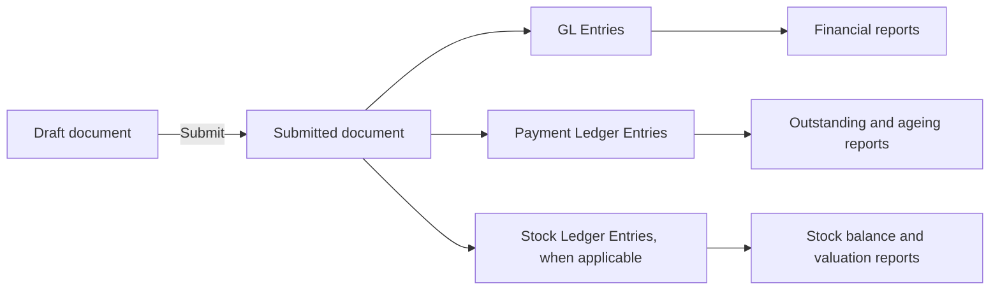

<!-- Frappe documentation: erpnext, part 29 of 69. Index: docs/INDEX.md -->

<!-- page: erpnext/erpnext__how-to-give-commission-to-sales-partner.md -->
---
title: "Setting Company Sales Goal | ERPNext Documentation"
description: "Set a monthly Company sales target in ERPNext and compare it with submitted current-month sales for practical progress tracking."
space: "ERPNext"
url: "https://docs.frappe.io/erpnext/how-to-give-commission-to-sales-partner"
updated: "2026-07-24"
---

A Company sales goal gives users a simple monthly revenue benchmark in ERPNext. Set the goal on the Company record, then compare it with **Total Monthly Sales**, which ERPNext updates from current-month sales activity.

Use this setting for a company-wide monthly target. Use [Sales Person Target Allocation](/erpnext/sales-person-target-allocation) when targets must be assigned by salesperson, Item Group, Fiscal Year, or monthly distribution.

## Before you begin

Confirm that:

- The [Company](/erpnext/company-setup) is a leaf company, not only a group node.
- The default currency is correct because the goal is stored in the Company currency.
- Sales transactions use the correct company and posting dates.
- Users responsible for the goal can read the Company record and relevant sales reports.

Choose a target approved by the business. The field does not create a forecast, budget, incentive plan, or accounting entry.

## Set the monthly Company sales goal

1. Open the required Company.
2. Select the **Buying and Selling** tab.
3. In **Buying & Selling Settings**, enter the **Monthly Sales Target**, as highlighted.
4. Save.
5. Review **Total Monthly Sales**, also highlighted, to compare actual current-month sales with the target.

[Screenshot on the live page: Monthly Sales Target and Total Monthly Sales on the Company]

In this example, Nova Electronics Trading has a monthly target of $100,000 and current monthly sales of $13,949.

## Fields and what they mean

| Field                | Meaning                                                                       |
| -------------------- | ----------------------------------------------------------------------------- |
| Monthly Sales Target | Company-wide sales goal for each month, entered in the Company currency       |
| Total Monthly Sales  | Current-month sales total maintained by ERPNext from submitted sales activity |
| Default Currency     | Currency used to display and interpret the goal and total                     |
| Company              | Legal entity whose sales contribute to the total                              |

The target is one recurring monthly value. It does not store a different target for every month. When the plan changes, update the field according to your approval process and record the reason separately if an audit trail is required.

## What contributes to monthly sales

ERPNext updates the Company sales history from submitted [Sales Invoices](/erpnext/sales-invoice). The posting date and Company determine which month and entity receive the value.

For reliable comparison:

- Submit invoices only after the sale is approved.
- Use the correct posting date.
- Keep returns and credit notes in the same accounting workflow so net sales remain meaningful.
- Review [Sales Returns](/erpnext/sales-return) when goods or invoiced value must be reversed.
- Use consistent company and currency configuration in multi-company environments.

Draft transactions should not be treated as achieved revenue. A [Sales Order](/erpnext/sales-order) represents a customer commitment, while a Sales Invoice records billed sales activity.

## Track progress during the month

Calculate simple achievement using:

**Achievement % = Total Monthly Sales ÷ Monthly Sales Target × 100**

For the example above:

**$13,949 ÷ $100,000 × 100 = 13.949%**

Use ERPNext reports for the supporting detail:

- [Sales Analytics](/erpnext/sales-analytics) for trends by customer, item, territory, or other dimensions.
- [Accounts Receivable](/erpnext/accounts-receivable) for billed amounts that remain outstanding.
- [Sales Person Target Variance](/erpnext/sales-person-target-allocation) for salesperson performance against allocated targets.
- [Profit and Loss Statement](/erpnext/profit-and-loss-statement) when management needs accounting revenue and profitability rather than the Company goal indicator.

The Company goal is intentionally simple. Build dashboards or reports when the organization requires forecasts, weighted pipelines, separate product targets, or quarter-to-date analysis.

## Multi-company considerations

Set the target separately on each operating Company. A parent group company does not automatically combine or distribute the goals of its child companies.

When Nova Electronics Trading is a child of Nova Industries, its monthly target and actual sales belong to Nova Electronics Trading. Review consolidated financial reports separately when the group needs combined performance.

Use [Inter Company Invoices](/erpnext/inter-company-invoices) carefully. Internal revenue can distort operational sales goals if the target definition is meant to measure only external customers.

## Change or remove a goal

To change the target, update **Monthly Sales Target** and save. ERPNext uses the new value for comparison with the current total.

To stop using the indicator, set the value according to your organization's convention, usually zero, and save. This does not change invoices, accounting entries, or historical transactions.

## Troubleshooting

### Total Monthly Sales is not updating

Confirm that the Sales Invoice is submitted, uses the same Company, and has a posting date in the current month. Refresh the Company record after the transaction completes.

### The total is lower than expected

Review credit notes, returns, posting dates, and company filters. Confirm that expected invoices are submitted rather than saved as drafts.

### The total is in the wrong currency

Check the Company's Default Currency and the invoice conversion rate. The Company goal is interpreted in company currency.

### Users cannot edit the target

The user may lack permission to write the Company record. An administrator can review [Role-Based Permissions](/erpnext/role-based-permissions) and the user's company permissions.

### A parent company does not show combined child sales

Use consolidated reports or a dashboard designed for group analysis. The field is maintained per Company.

## Frequently asked questions

### Can I enter a different target for each month?

Not in the single Company field. Use target allocation and Monthly Distribution for more detailed planning.

### Does the target block sales when it is exceeded?

No. It is an informational benchmark.

### Does changing the target alter accounting records?

No. It changes only the goal used for comparison.

### Can I use Sales Orders instead of Sales Invoices for actual performance?

Use an order-based report or dashboard for bookings. The Company monthly sales total is based on submitted sales activity maintained by ERPNext.

### Is this the same as a budget?

No. Use [Budgeting](/erpnext/budgeting) for accounting budgets by account and cost center.

## Related topics

- [Company](/erpnext/company-setup)
- [Sales Person Target Allocation](/erpnext/sales-person-target-allocation)
- [Sales Analytics](/erpnext/sales-analytics)

<!-- page: erpnext/erpnext__how-to-grant-permissions-for-reports.md -->
---
title: "Edit Export/Print permissions for reports"
space: "ERPNext"
url: "https://docs.frappe.io/erpnext/how-to-grant-permissions-for-reports"
updated: "2026-03-04"
---

To handle Export/Print permissions for a report, use Role Permission Manager of the DocType the report is created from.

### Step 1:

Find out from which Document Type the Report is generated from

[Screenshot on the live page]

### Step 2: 

Go to Role Permission Manager, filter using the same Document Type *(Sales Invoice in our example)* and edit the permissions based on Roles

[Screenshot on the live page]

<!-- page: erpnext/erpnext__how-to-handle-a-scenario-of-1-raw-material-multiple-finish-goods.md -->
---
title: "Multiple finished goods with single raw material"
space: "ERPNext"
url: "https://docs.frappe.io/erpnext/how-to-handle-a-scenario-of-1-raw-material-multiple-finish-goods"
updated: "2026-03-02"
---

In many Manufacturing industries deal with a scenario where they use one RM (Raw Material) & produce multiple Finish goods. Most of the chemical manufacturing industries you can find this business use-case. Now how you can map this use-case in ERPNext? Lets take an example of Oil manufacturing Industry where from Crude oil multiple products are produced like Petrol, Gas, Diesel, Kerosene etc.  
* First create an Item master where crude oil will be RM & Petrol, Gas, Diesel, Kerosene etc. will be your FG. Here every product can also have different UOM.

  
* After creation of item master create a BOM for any of the FG you are going to produce from Crude oil (RM). Here I have created BOM of Petrol for 25 litres where I am going to use Crude oil (RM) of qty. 100 litres. Rest of the FG like Gas, Diesel & Kerosene I have added in Scrap section.

  
  
[Screenshot on the live page]  
[Screenshot on the live page]  
* While creating a BOM you can add operations as well & run your production cycle (Work order) accordingly.

  
* After completion of work-order at the time of Back-flush entry your Raw material will get consumed & you will have multiple finish goods.

<!-- page: erpnext/erpnext__how-to-manage-material-transfers-and-goods-in-transit.md -->
---
title: "How to Manage Material Transfers and Goods in Transit"
space: "ERPNext"
url: "https://docs.frappe.io/erpnext/how-to-manage-material-transfers-and-goods-in-transit"
updated: "2026-07-02"
---

# Goods in Transit

Goods in Transit is used when stock has left one warehouse but has not yet been received at the destination warehouse. In ERPNext, this is handled through a **Material Transfer** Stock Entry. The outgoing entry moves stock out of the sending warehouse and into transit. The receiving entry later moves the same stock from transit into the receiving warehouse.

This is useful when goods physically travel between warehouses, branches, stores, or locations, and the transfer should not appear as completed until the receiving location confirms the stock.

## How it works

- **Send to Warehouse:** records that goods have been sent out from the source warehouse and are now in transit.
- **Receive at Warehouse:** records that the goods have reached the destination warehouse and should be added to its stock.
- **Goods in Transit:** keeps the stock separate while it is between the two warehouses.

In the current ERPNext Stock Entry form, the Goods in Transit flow is visible on a **Material Transfer** entry through the **Add to Transit** checkbox and the **Stock Entry (Outward GIT)** reference field.

## Create the outward transfer

1. Go to **Stock Entry** and create a new Stock Entry.
2. Set **Stock Entry Type** to **Material Transfer**.
3. In the item table, select the **Source Warehouse**, item, and quantity to send.
4. Enable **Add to Transit**.
5. Save and submit the Stock Entry.

When **Material Transfer** is selected, ERPNext shows the Goods in Transit fields on the Stock Entry.

*(screenshot — not bundled; see the live page URL in this file's front matter)*

Enable **Add to Transit** when the transfer should first go into Goods in Transit instead of being received directly into the destination warehouse.

*(screenshot — not bundled; see the live page URL in this file's front matter)*

## Create the inward transfer

1. Create another **Material Transfer** Stock Entry.
2. Use **Stock Entry (Outward GIT)** to select the outward Goods in Transit Stock Entry.
3. Set the receiving warehouse in the item table.
4. Save and submit the Stock Entry.

The inward entry completes the transfer. Stock is removed from Goods in Transit and added to the receiving warehouse.

## Example

A company sends 10 units from **Stores - Mumbai** to **Stores - Delhi**.

1. The Mumbai team creates an outward Material Transfer and enables **Add to Transit**.
2. The stock is no longer available in the Mumbai warehouse and is shown as in transit.
3. When the Delhi team receives the goods, they create the inward Material Transfer against the outward Goods in Transit entry.
4. The stock is added to the Delhi warehouse.

## When to use Goods in Transit

- Transfers between warehouses take time to complete.
- The sending and receiving locations are handled by different teams.
- You need visibility of stock that has been dispatched but not yet received.
- You want the receiving warehouse to confirm the receipt before stock is available there.

## Important notes

- Use Goods in Transit only for warehouse-to-warehouse movement, not for sales delivery or purchase receipt.
- The outward and inward Stock Entries should use the same item and quantity unless there is a documented difference.
- Do not use the receiving entry until the goods have physically arrived at the destination warehouse.
- If the transfer is immediate and does not need an in-transit stage, use a normal Material Transfer without enabling **Add to Transit**.

<!-- page: erpnext/erpnext__how-to-restore-deleted-documents-in-erpnext.md -->
---
title: "Restore Deleted Documents"
space: "ERPNext"
url: "https://docs.frappe.io/erpnext/how-to-restore-deleted-documents-in-erpnext"
updated: "2026-03-04"
---

**Use Case:** Need to restore/ retrieve the documents that were deleted.  
**Steps:**  
1) Go to Settings > Deleted Documents (or search for "Deleted Document list" in the search bar).  
2) Search for the deleted document. You can also filter out the document based on the Deleted DocType. For example we need to restore the Purchase Order, PUR-ORD-2019-00019. To do so, search for the same in the deleted document list and open it.  
[Screenshot on the live page]  
3) Click on the "Restore" button as shown below. Also note the Data box which gives the information on various fields of the document. This helps you confirm whether it is the same document you want to restore.  
[Screenshot on the live page]  
4) Once the Restore button is clicked, the document gets restored in Draft State with a New Name according to the Naming Series.  
[Screenshot on the live page]  
[Screenshot on the live page]  
  
5) You can directly open the newly restored document through the "Open" button or search for the same in that document's list (in this case, Purchase Order list).  
[Screenshot on the live page]  
[Screenshot on the live page]  
[Screenshot on the live page]

<!-- page: erpnext/erpnext__how-to-setup-seo-for-your-website-on-erpnext.md -->
---
title: "3 Step SEO for your ERPNext Website"
space: "ERPNext"
url: "https://docs.frappe.io/erpnext/how-to-setup-seo-for-your-website-on-erpnext"
updated: "2026-03-04"
---

SEO stands for **Search Engine Optimisation** and is the process of increasing the quality and quantity of website traffic by increasing the visibility of a website or a web page to users of a web search engine. SEO refers to the improvement of unpaid results and excludes direct traffic/visitors and the purchase of paid placement.  
[Screenshot on the live page]  
  
Having a presence in the top positions for keywords that your prospects are looking for will increase the probability of your business expansion. Enhance the visibility of your products and offerings by optimizing SEO and using it to maximize the social promotion of your website.   
You can setup meta tags in ERPNext within 3 steps:  
**Step 1: Using awesome bar (Global search bar), open "New Website Route Meta"**  
[Screenshot on the live page]  
  
**Step 2: Enter the key and value for the meta tag. In our example, we are making it for privacy, and have entered the key and value as below:**  
[Screenshot on the live page]  
**Step 3: Save this document.**  
[Screenshot on the live page]  
**Watch SEO in action on your webpage. In this case, the webpage "privacy" holds the corresponding meta tag:**  
[Screenshot on the live page]  
To learn more about Websites in ERPNext, click [here](https://erpnext.com/docs/user/manual/en/website)

<!-- page: erpnext/erpnext__how-to-short-close-multiple-orders-in-erpnext.md -->
---
title: "Short Close Multiple Orders | ERPNext Documentation"
description: "Learn how to bulk close or reopen multiple Sales Orders in ERPNext while preserving fulfilled quantities and linked transactions."
space: "ERPNext"
url: "https://docs.frappe.io/erpnext/how-to-short-close-multiple-orders-in-erpnext"
updated: "2026-07-24"
---

Use the Sales Order list to close several submitted orders whose remaining quantities will no longer be delivered or billed. Bulk closing keeps every [Sales Order](/erpnext/sales-order) and its linked transactions in the audit trail while removing outstanding balances from active fulfilment.

> Closing is not deletion. The orders, completed deliveries, invoices, and payments remain available.

## Before you begin

Review the selected orders and confirm that:

- Each order is submitted and still open.
- Any quantity accepted by the customer has already been handled through a [Delivery Note](/erpnext/delivery-note) or [Sales Invoice](/erpnext/sales-invoice).
- The customer does not want the remaining quantity fulfilled.
- You are not selecting a draft, completed, cancelled, or already closed order by mistake.

Use [Cancel and Amend](/erpnext/amending-sales-order-after-submit) instead when the original order contains incorrect information.

## Close multiple Sales Orders

1. Open the **Sales Order** list.
2. Use filters such as **Company**, **Customer**, **Delivery Status**, or **Billing Status** to narrow the list.
3. Select the checkbox beside each order you want to close.
4. Select **Actions**.
5. Select **Close**, as highlighted.

[Screenshot on the live page: Select Sales Orders and use Actions to close them]

ERPNext changes eligible orders to **Closed**. Review the list after the operation and confirm that each intended order has the correct status.

A closed order cannot create new Delivery Notes or Sales Invoices against its outstanding quantity. Submitted downstream documents remain linked and unchanged.

## Reopen multiple Sales Orders

Reopen orders when fulfilment should continue:

1. Filter the Sales Order list to show **Closed** orders.
2. Select the required orders.
3. Select **Actions**.
4. Select **Re-open**, as highlighted.

[Screenshot on the live page: Select closed Sales Orders and use Actions to reopen them]

After reopening, verify the outstanding quantities before creating a [Pick List](/erpnext/pick-list), Delivery Note, or Sales Invoice.

## What happens to partially fulfilled orders

If an order is partly delivered or partly billed, closing affects only the outstanding balance. Completed transactions remain valid.

For example, if five selected orders each contain 10 units and 8 units have already been delivered, closing the orders removes the remaining 2 units per order from pending fulfilment. It does not reverse the 8 delivered units.

Use [Partial Fulfilment of Sales Order](/erpnext/partial-fulfilment-of-sales-order) when the balance is still expected later. Use [Sales Return](/erpnext/sales-return) when delivered goods are coming back.

## Troubleshooting

### Close is not available under Actions

Confirm that you selected at least one Sales Order and that your role has permission to update submitted orders. An administrator can review [Role-Based Permissions](/erpnext/role-based-permissions).

### Some selected orders were not closed

A mixed selection can include ineligible documents, such as drafts, completed orders, cancelled orders, or orders already closed. Filter the list by status and retry only with eligible submitted orders.

### The wrong orders were closed

Select the affected orders and use **Actions > Re-open**. Then review the intended selection before closing again.

### Pending quantities still appear in a report

Refresh the report and check its company, date, and status filters. Also confirm that the Sales Order itself shows **Closed**.

## Frequently asked questions

### Does bulk close cancel linked Delivery Notes or Sales Invoices?

No. It closes only the outstanding Sales Order balance.

### Can I close orders from different customers together?

Yes, provided every selected order is eligible. Filtering by customer or company reduces selection mistakes.

### Can I use the same process for Purchase Orders?

The Purchase Order list provides equivalent bulk close and reopen actions for eligible orders. Review each order type separately before applying a bulk action.

### Is there an undo button?

There is no single undo command. Use **Re-open** for the selected closed orders.

## Related topics

- [Close Sales Order](/erpnext/close-sales-order)
- [Amending Sales Order after Submit](/erpnext/amending-sales-order-after-submit)
- [Sales Order Statuses](/erpnext/sales-order#statuses)

<!-- page: erpnext/erpnext__how-to-sync-doc-types-with-calendar.md -->
---
title: "Sync DocTypes with Events Calendar"
space: "ERPNext"
url: "https://docs.frappe.io/erpnext/how-to-sync-doc-types-with-calendar"
updated: "2026-03-04"
---

Create calendar view for sales order, sales invoice or any other doc-types by following these simple steps  
* Type 'Calendar View List' in the awesome bar/ Search bar.
* Click on new to create a new Calendar List
* Select the Reference Doc-Type you want to be view in the calendar. Eg: Sales Order
* Set the Start date and End date fields. Eg: Delivery Date.
* Save your changes.

  
  
[Screenshot on the live page]  
  
[Screenshot on the live page]

<!-- page: erpnext/erpnext__how-transactions-affect-the-ledger.md -->
---
title: "How Transactions Affect the Ledger | ERPNext Documentation"
description: "Learn how ERPNext invoices, payments, stock transactions, assets, returns, and adjustments create General Ledger, Payment Ledger, and Stock Ledger entries."
space: "ERPNext"
url: "https://docs.frappe.io/erpnext/how-transactions-affect-the-ledger"
updated: "2026-07-30"
---

ERPNext creates ledger entries when an accounting or stock transaction is submitted. The source document describes what happened in the business; the generated entries record its financial effect. Understanding this connection helps you verify setup, investigate balances, and choose the correct document for a workflow.

## When a transaction affects the books

A draft normally has no ledger effect. On submission, ERPNext validates the posting date, company, currency, accounts, cost centers, dimensions, totals, and debit-credit balance. If validation succeeds, it creates the applicable entries.

The **Posting Date** determines the accounting period. The document's creation date and submission time may be different. If stock is involved, **Posting Time** can also affect the sequence used for stock valuation.

Cancelling a submitted transaction reverses its ledger effect if cancellation is allowed. ERPNext does not simply remove the original history. This supports the [immutable ledger](/erpnext/immutable-ledger-in-erpnext) and makes the sequence of posting and reversal traceable. To correct and replace a document, cancel it and create an amended copy.

## The ledgers serve different purposes

| Ledger             | Primary purpose                                                                       | Common sources                                                           |
| ------------------ | ------------------------------------------------------------------------------------- | ------------------------------------------------------------------------ |
| **General Ledger** | Records debit and credit amounts by account                                           | Invoices, payments, journal entries, stock transactions, assets, payroll |
| **Payment Ledger** | Tracks receivable and payable references, allocations, and outstanding amounts        | Invoices, payments, credit notes, journal entries                        |
| **Stock Ledger**   | Tracks quantity, incoming rate, valuation rate, and stock value by Item and Warehouse | Receipts, deliveries, stock entries, stock-updating invoices             |

One document can affect more than one ledger. For example, a stock-updating Sales Invoice records income and receivable in the General Ledger, reduces inventory in both the Stock and General Ledgers, and creates the Customer's outstanding amount in the Payment Ledger.

## Common transaction effects

The entries below show the normal pattern. Actual account names come from the Company, Item, Item Group, Warehouse, party, and tax configuration.

### Sales Invoice

Submitting a [Sales Invoice](/erpnext/sales-invoice) normally records:

| Account             | Debit         | Credit     |
| ------------------- | -------------: | ----------: |
| Customer receivable | Invoice total |            |
| Income              |               | Net sales  |
| Output tax payable  |               | Tax amount |

The Customer's outstanding amount remains open until it is paid, allocated, written off, or reversed.

If **Update Stock** is enabled, the same invoice also reduces stock:

| Account            | Debit          | Credit         |
| ------------------ | --------------: | --------------: |
| Cost of goods sold | Valuation cost |                |
| Stock asset        |                | Valuation cost |

Without **Update Stock**, a Delivery Note normally records the stock and cost effect separately.

### Purchase Invoice

Submitting a [Purchase Invoice](/erpnext/purchase-invoice) normally records:

| Account               | Debit        | Credit        |
| --------------------- | ------------: | -------------: |
| Expense or asset      | Net purchase |               |
| Recoverable input tax | Tax amount   |               |
| Supplier payable      |              | Invoice total |

When perpetual inventory is used with a Purchase Receipt, the Purchase Invoice can clear the **Stock Received But Not Billed** account rather than debit stock again. This prevents the same receipt from being capitalized twice.

### Payment Entry

An incoming [Payment Entry](/erpnext/payment-entry) normally debits Bank or Cash and credits the Customer receivable account. An outgoing payment debits the Supplier payable account and credits Bank or Cash. An internal transfer moves value between two cash or bank accounts.

Payment allocation is separate from the cash posting. A payment can:

- settle one invoice;
- be divided across several invoices;
- partially settle an invoice;
- remain unallocated for later use;
- be recorded as an advance against an order.

Use [Payment Reconciliation](/erpnext/payment-reconciliation) to connect existing payments or credits to invoices without recording the money again.

### Credit Note and Debit Note

A return Sales Invoice, commonly called a Credit Note, reverses or reduces sales, tax, receivable, and stock effects according to the selected return options. A return Purchase Invoice, commonly called a Debit Note, reverses or reduces purchase, tax, payable, and stock effects.

Create returns against the original invoice whenever possible. The reference improves traceability and updates the original document's returned and outstanding values.

### Journal Entry

A [Journal Entry](/erpnext/journal-entry) posts the debit and credit rows entered by an authorized user. It is suitable for accruals, provisions, reclassifications, opening entries, write-offs, inter-account transfers, and other adjustments without a more specific transaction.

Do not replace a Sales Invoice, Purchase Invoice, or Payment Entry with a generic Journal Entry merely to save time. Specialized documents carry parties, taxes, items, due dates, stock behavior, and operational references that a manual entry may not provide.

### Delivery Note and Purchase Receipt

With perpetual inventory:

- A [Delivery Note](/erpnext/delivery-note) credits the Warehouse's stock asset account and debits cost of goods sold.
- A [Purchase Receipt](/erpnext/purchase-receipt) debits the Warehouse's stock asset account and credits stock received but not billed.

These documents do not normally create Customer receivables or Supplier payables. Billing happens when the invoice is submitted.

### Stock Entry and Stock Reconciliation

A Stock Entry changes quantity and value for material receipt, issue, transfer, manufacture, and repack operations. Transfers can move value between Warehouse accounts. Manufacturing entries consume component value and add the resulting value to finished goods.

[Stock Reconciliation](/erpnext/stock-reconciliation) sets counted quantities and valuation rates at a point in time. The difference is posted to the configured stock adjustment account when perpetual inventory is active.

### Assets and depreciation

Buying or capitalizing an Asset records its value in an asset account. Submitted depreciation entries debit depreciation expense and credit accumulated depreciation. Asset sale, disposal, scraping, and value adjustment create additional entries based on the Asset's current book value and proceeds.

### Payroll and expenses

Payroll entries generally debit salary and benefit expenses and credit payroll payables. Paying employees clears the liability against Bank. An [Expense Claim](/erpnext/expense-claim) records the approved expense and an amount payable to the employee; payment later clears that payable.

### Deferred revenue and expense

When deferred accounting is configured on an invoice item, the invoice first posts to a deferred account. ERPNext then recognizes income or expense across the configured service period through scheduled accounting entries. This separates billing date from recognition period.

### Foreign-currency transactions

ERPNext stores the party or account currency amount and its value in the Company's base currency. The invoice uses the exchange rate on its posting date. If settlement uses a different rate, the difference is posted as exchange gain or loss.

An [Exchange Rate Revaluation](/erpnext/exchange-rate-revaluation) adjusts eligible open foreign-currency balances for reporting at a selected date. Revaluation entries should be distinguished from realized differences created during payment.

## Commitment documents versus ledger documents

Not every submitted business document posts accounting entries.

| Document         | Business effect                         | Usual ledger effect                                        |
| ---------------- | --------------------------------------- | ---------------------------------------------------------- |
| Quotation        | Offer to a prospect or Customer         | None                                                       |
| Sales Order      | Customer commitment and fulfilment plan | None, except linked advances recorded separately           |
| Purchase Order   | Commitment to a Supplier                | None, except linked advances recorded separately           |
| Delivery Note    | Goods delivered                         | Stock and cost entries with perpetual inventory            |
| Purchase Receipt | Goods received                          | Stock and receipt accrual entries with perpetual inventory |
| Sales Invoice    | Customer billing                        | Income, tax, receivable, and optional stock                |
| Purchase Invoice | Supplier billing                        | Expense or asset, tax, payable, and optional stock         |
| Payment Entry    | Movement of money                       | Bank or cash and party account                             |

Orders affect operational reports even when they do not affect the General Ledger. They can reserve or plan stock, track fulfilment, establish payment schedules, and provide references for advances.

## Trace an amount from document to report

1. Open the submitted transaction.
2. Use **View &gt; Accounting Ledger** to inspect its GL Entries.
3. Confirm that total debits equal total credits and that the posting date, accounts, party, cost center, project, and dimensions are correct.
4. If stock is involved, open **Stock Ledger** and compare the quantity and valuation effect.
5. Review the [General Ledger](/erpnext/general-ledger) for the account and voucher.
6. Review Accounts Receivable or Accounts Payable when an outstanding amount is involved.
7. Open the relevant financial statement and drill into the amount when further analysis is needed.

If the source document is correct but the account is wrong, inspect Company defaults, Item and Item Group defaults, Warehouse accounts, party accounts, tax templates, and rules. Correct configuration before posting additional transactions.

## What downstream documents created directly can change

ERPNext allows many downstream documents to be created without an order or receipt. A direct invoice can be valid, but it loses the upstream reference and its operational controls.

- A direct Sales Invoice bills the Customer but does not update a Sales Order's billed percentage.
- A direct Delivery Note reduces stock but does not update an order's delivered percentage.
- A direct Purchase Invoice creates a payable but does not update a Purchase Order's billed percentage.
- A direct stock-updating invoice combines stock and billing, so there is no separate delivery or receipt document.

Choose the shorter path only when the business does not need the omitted commitment, approval, fulfilment, or audit milestone. See [Accounting Workflows by Business Type](/erpnext/accounting-workflows-by-business-type) for workflow choices.

## Troubleshooting

| Problem                                       | What to check                                                                                                                |
| --------------------------------------------- | ---------------------------------------------------------------------------------------------------------------------------- |
| A submitted document has no expected GL Entry | Confirm whether the document is a commitment or ledger document, then check perpetual inventory and stock-update settings.   |
| The wrong income or expense account was used  | Review Item, Item Group, Company, and party defaults in their precedence order.                                              |
| The invoice is paid but still outstanding     | Check Payment Entry references and allocations; reconcile an unallocated payment if necessary.                               |
| Stock Ledger and General Ledger values differ | Check backdated stock entries, valuation reposting, cancelled vouchers, and the Stock and Account Balance Comparison report. |
| A backdated correction is blocked             | Check Accounts Frozen Upto, Accounting Period restrictions, permissions, and the requested posting date.                     |

## Related topics

- [Accounting Introduction](/erpnext/accounting-introduction)
- [Understanding Debit and Credit](/erpnext/understand-debit-and-credit)
- [General Ledger](/erpnext/general-ledger)
- [Payment Entry](/erpnext/payment-entry)
- [Perpetual Inventory](/erpnext/perpetual-inventory)
- [Accounting Reports](/erpnext/accounting-reports)

<!-- page: erpnext/erpnext__immutable-ledger-in-erpnext.md -->
---
title: "Immutable Ledger | ERPNext Documentation"
description: "Understand ERPNext immutable ledger behavior, cancellation reversals, backdated stock reposting, audit trails, correction workflows, and closed-period controls."
space: "ERPNext"
url: "https://docs.frappe.io/erpnext/immutable-ledger-in-erpnext"
updated: "2026-08-14"
---

After Nova Industries closes a month, an accountant discovers that a submitted invoice was wrong. Quietly replacing its original ledger rows would make the audit trail impossible to trust because reviewers could no longer see what was posted first.

ERPNext's immutable ledger keeps the original accounting and stock entries and records matching reversals when a transaction is cancelled. Corrections are made through traceable follow-up documents instead of silently rewriting history.

This design makes period reviews, audits, and reconciliations more reliable because every posting and reversal remains visible.

## Why the ledger is protected

Accounting and stock transactions form ordered histories. A backdated change can affect later records:

- Under FIFO valuation, inserting or changing an earlier stock movement can change which inventory layers are consumed later.
- Under moving-average valuation, it can change later valuation rates and Cost of Goods Sold.
- A changed invoice or tax entry can alter reports or tax declarations for an earlier period.
- Recomputing every later stock or accounting entry can be expensive on a large database.

The [General Ledger](https://docs.frappe.io/erpnext/general-ledger) and [Stock Ledger](https://docs.frappe.io/erpnext/stock-ledger-report) therefore retain traceable posting rows and use supported correction and reposting logic rather than inviting users to edit or delete ledger entries directly.

## What happens when you cancel a transaction

Consider a submitted [Journal Entry](https://docs.frappe.io/erpnext/journal-entry) that debits Office Maintenance Expense by $120 and credits Nova Operating Bank by $120. Cancelling the document changes its status to **Cancelled**.

[Screenshot on the live page: A cancelled Journal Entry in ERPNext]

ERPNext retains the original debit and credit and adds opposite rows for the same voucher. The combined effect is zero, but the audit trail still shows what was posted and how it was cancelled.

[Screenshot on the live page: Original and reversal rows for a cancelled Journal Entry in the General Ledger]

In the General Ledger report, enable **Show Cancelled Entries** to see these rows. Without that filter, cancelled rows are excluded from normal balances so the report shows only active accounting effects.

The same principle applies to posting documents such as a [Payment Entry](https://docs.frappe.io/erpnext/payment-entry), [Sales Invoice](https://docs.frappe.io/erpnext/sales-invoice), and [Purchase Invoice](https://docs.frappe.io/erpnext/purchase-invoice). The exact linked records and reversal logic depend on the document.

## Why cancelled transactions cannot normally be deleted

A cancelled posting document remains the source of its original and reversal ledger rows. Deleting it would break that audit trail and remove the business context behind the entries. ERPNext therefore prevents normal deletion of cancelled documents linked to ledger entries.

If a document is wrong, use its supported correction workflow:

| Situation                                                    | Recommended correction                                                                                   |
| ------------------------------------------------------------ | -------------------------------------------------------------------------------------------------------- |
| Draft is wrong                                               | Edit or delete the draft before submission.                                                              |
| Submitted invoice is wrong                                   | Cancel and amend when the period and links permit it.                                                    |
| Customer returns goods                                       | Create a return or [Credit Note](https://docs.frappe.io/erpnext/credit-note).                            |
| Supplier return or rate correction                           | Create the appropriate return or [Debit Note](https://docs.frappe.io/erpnext/debit-note).                |
| Journal needs an opposite entry without cancellation         | Use **Reverse Journal Entry** and review the generated draft.                                            |
| Source document is correct but generated accounting is stale | Use [Repost Accounting Ledger](https://docs.frappe.io/erpnext/repost-accounting-ledger) after diagnosis. |

Do not delete GL Entry or Stock Ledger Entry rows through the database or API. Those rows are system-generated evidence, not transaction-entry forms.

## Backdated stock transactions and reposting

The original immutable-ledger release placed a strict restriction on stock transactions dated before a later movement for the same item and warehouse. For example, after posting Item A at `19-06-2020 23:00:10`, an earlier posting could be blocked because recalculating all later FIFO or moving-average values was expensive.

Current ERPNext builds include controlled stock-reposting infrastructure. A permitted backdated stock transaction can create a **Repost Item Valuation** job so later Stock Ledger Entries are recalculated in sequence. Whether the transaction is accepted also depends on Stock Settings, negative-stock rules, frozen periods, Accounting Period restrictions, serial and batch constraints, and other validations.

[Screenshot on the live page: Repost Item Valuation records created for stock recalculation]

This means you should not assume that every backdated stock transaction is always prohibited, or that every backdated transaction is safe. Enter transactions promptly and in chronological order. When a backdated correction is unavoidable:

1. Confirm that the posting period is open under [Freeze Accounting Entries](https://docs.frappe.io/erpnext/freeze-accounting-entries) and [Accounting Period](https://docs.frappe.io/erpnext/accounting-period).
2. Check the item, warehouse, batch, serial number, posting date, and posting time.
3. Submit the smallest necessary correction.
4. Allow any Repost Item Valuation job to complete.
5. Verify the Stock Ledger, Stock Balance, valuation rate, stock value, and affected accounting reports.

Large or old corrections can require substantial processing. Test them on a restored backup when they can materially change valuation or closed reports.

## Corrections in a closed period

Immutable-ledger behavior does not replace period controls. A submitted [Period Closing Voucher](https://docs.frappe.io/erpnext/period-closing-voucher), frozen date, or Accounting Period can block cancellation, amendment, or reposting.

Do not change a closed period simply to make an error disappear. Decide with your accountant whether to reopen the period under controlled approval, post an adjustment in the current open period, issue a return or credit note, or create a reversal Journal Entry. The correct treatment depends on reporting and regulatory requirements.

## Verify the audit trail

After any correction:

1. Open the source document and confirm its status and amended-from or return reference.
2. Use **View &gt; Ledger** or filter the General Ledger by voucher number.
3. Enable **Show Cancelled Entries** when you need to inspect reversal rows.
4. For stock documents, review the Stock Ledger Report and any Repost Item Valuation record.
5. Confirm that active balances are correct and that original plus reversal rows net to zero where expected.
6. Recheck the Profit and Loss Statement, Balance Sheet, stock valuation, tax reports, and outstanding balances affected by the change.

## Troubleshooting

### A cancelled voucher does not appear in the General Ledger

Enable **Show Cancelled Entries** in the report filters. Cancelled rows are hidden from the normal report because their net accounting effect is zero.

### ERPNext will not let me delete a cancelled transaction

This is expected when the document has linked ledger entries. Keep the cancelled source document as part of the audit trail. Create the corrected document through amendment, return, or another supported workflow.

### A backdated stock transaction is blocked

Read the validation message before changing settings. Check later stock movements, negative stock, batches or serial numbers, frozen dates, closed Accounting Periods, and permissions. Do not alter the posting time merely to bypass valuation controls.

### Stock values changed after a backdated posting

The repost recalculated later FIFO or moving-average values. Wait for Repost Item Valuation to finish, then compare the Stock Ledger before and after the inserted transaction and verify related Cost of Goods Sold entries.

### A cancellation is blocked by a closed period

Follow your approved period-correction policy. You may need accounting authorization to reopen the period or to post a current-period reversal or adjustment instead.

## FAQs

### Is immutable ledger a blockchain?

No, It is ERPNext's application-level audit and posting design. It retains and reverses ledger effects through database records; it is not a distributed blockchain network.

### Can System Manager delete GL Entries directly?

Normal business corrections should never be made by deleting GL Entries. Correct the source document through a supported workflow so linked ledgers and reports remain consistent.

### Does cancelling a document erase its original accounting entry?

No, The original rows and opposite cancellation rows remain available as cancelled entries. Their combined effect is zero in active balances.

### Are all backdated stock entries prohibited?

No, Current ERPNext can process permitted backdated entries through controlled valuation reposting, but validations and period controls still apply. Backdating can change later valuations and should be used carefully.

### Is Repost Accounting Ledger the same as cancelling a transaction?

No, Cancellation removes the active business and accounting effect through reversal logic. Reposting regenerates ledger entries from a source document that remains submitted and valid.

## Related topics

- [General Ledger](https://docs.frappe.io/erpnext/general-ledger)
- [Stock Ledger Report](https://docs.frappe.io/erpnext/stock-ledger-report)
- [Journal Entry](https://docs.frappe.io/erpnext/journal-entry)
- [Repost Accounting Ledger](https://docs.frappe.io/erpnext/repost-accounting-ledger)
- [Period Closing Voucher](https://docs.frappe.io/erpnext/period-closing-voucher)
- [Accounting Entries](https://docs.frappe.io/erpnext/accounting-entries)
