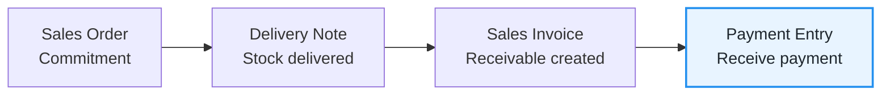
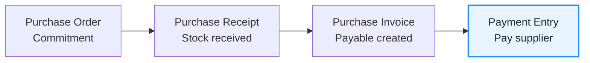

<!-- Frappe documentation: erpnext, part 40 of 69. Index: docs/INDEX.md -->

<!-- page: erpnext/erpnext__partial-fulfilment-of-sales-order.md -->
---
title: "Partial Fulfilment of Sales Order | ERPNext Documentation"
description: "Learn how to partially deliver and invoice ERPNext Sales Orders using multiple documents, decimal quantities, returns, and mixed fulfilment."
space: "ERPNext"
url: "https://docs.frappe.io/erpnext/partial-fulfilment-of-sales-order"
updated: "2026-07-23"
---

A submitted [Sales Order](/erpnext/sales-order) does not need to be delivered or billed in one transaction. In ERPNext, you can fulfil selected Items and quantities through several [Delivery Notes](/erpnext/delivery-note), create several [Sales Invoices](/erpnext/sales-invoice), return delivered stock, and close a balance that the customer no longer wants.

ERPNext calculates the remaining quantity from the submitted documents linked to each Sales Order row. This preserves one confirmed order while giving the warehouse and billing teams the flexibility to work in stages.

## Before you begin

You need:

- a submitted Sales Order with at least one outstanding Item quantity;
- permission to create and submit the required delivery, invoice, return, and purchasing documents;
- available stock in the selected [Warehouse](/erpnext/warehouse) for warehouse-fulfilled [Items](/erpnext/item); and
- a [Supplier](/erpnext/supplier) and purchasing setup for [drop-shipped Items](/erpnext/drop-shipping).

Confirm the customer's requested quantities and dates before creating downstream documents. You cannot reduce an order below quantities that are already delivered, billed, picked, or assigned to production.

## One Sales Order, multiple Delivery Notes

Use multiple Delivery Notes when Items ship in batches, on different dates, or from different warehouses.

1. Open the submitted Sales Order.
2. Select **Create > Delivery Note**.
3. In the new Delivery Note, keep only the lines being dispatched.
4. Enter the quantity being delivered for each retained line.
5. Confirm the source Warehouse, posting date, delivery address, and transporter details.
6. Save and submit the Delivery Note.
7. Repeat the process from the same Sales Order when the next batch is ready.

The mapped Delivery Note starts with quantities that remain deliverable. Before submission, remove lines that are not part of the current shipment and reduce a line's **Quantity** when only part of it is being delivered.

After each submission, ERPNext updates **% Delivered** on the Sales Order. The Sales Order remains **To Deliver and Bill** or **To Deliver** until its delivery requirement is complete.

## Deliver selected lines or quantities

Suppose an order contains 10 phones, 6 laptop docks, and 4 headphones, but the first shipment contains only 4 phones and 2 docks. Create a Delivery Note, remove the headphone row, and set the two retained quantities to 4 and 2.

The dot before an Item Code shows stock availability at a glance: green means the Item is in stock, while red means it is out of stock.

Select the **pencil icon** at the end of an Item row when the field you need—such as Warehouse, serial number details, or a row-level reference—is not shown as a table column.

Do not change the original ordered quantity merely to record a partial dispatch. The Sales Order should continue to show what the customer confirmed; the Delivery Note records what was dispatched now.

## One Sales Order, multiple Sales Invoices

You can split billing independently of physical delivery:

1. Open the submitted Sales Order.
2. Select **Create > Sales Invoice**.
3. Keep only the lines being billed.
4. Enter the quantity to invoice now.
5. Review taxes, payment terms, income accounts, and cost centers.
6. Save and submit the invoice.
7. Create another invoice from the same Sales Order for the next billing stage.

ERPNext updates **% Billed** from submitted invoices. A direct invoice from the Sales Order does not create a stock movement unless **Update Stock** is enabled. When your process uses Delivery Notes, create the invoice from the relevant Delivery Note when you want its delivered quantities and references carried into billing.

Avoid billing the same quantity through two routes. Review the source references and remaining quantity before submitting each invoice.

## Partial fulfilment for services and projects

Service and project-based companies can represent one engagement with a single Sales Order line whose quantity is **1**, then use decimal quantities to record progress. For example, invoice **0.25** after completing 25% of the work, **0.35** at the next milestone, and the remaining **0.40** at completion. If your process records service delivery separately, use the same decimal quantities on Delivery Notes.

Use a decimal-friendly UOM and ensure **Must be Whole Number** is not enabled for that UOM. The Item should normally be configured as a non-stock service Item. Each submitted document updates the delivered or billed percentage against the same Sales Order, so the order remains the common reference for the full engagement.

Before using this method, define what each decimal represents in the contract—for example, accepted effort, a completed milestone, or a percentage of the total service. Use [Payment Terms](/erpnext/payment-terms) when the schedule is purely date- or milestone-based and does not need partial quantities.

## Review linked fulfilment documents

Open the **Connections** tab on the Sales Order to see the Delivery Notes, Sales Invoices, [Pick Lists](/erpnext/pick-list), and purchasing documents linked to it. This is the quickest way to confirm how many stages have been completed and open the underlying transactions.

The Delivery Note count can include a return because a sales return is recorded as a return Delivery Note. Use the document list and its **Is Return** value to distinguish outbound deliveries from returned stock.

## Reduce an outstanding quantity

Use **Update Items** when the customer and seller agree to reduce the ordered quantity but want the Sales Order to remain the controlling document.

1. Open the submitted Sales Order.
2. Select **Update Items**.
3. Change the Item quantity to the revised total quantity—not the remaining quantity.
4. Review the revised totals and save the update.

For example, if 7 of 10 phones were delivered and the customer now wants only 8 in total, update the Sales Order quantity to 8. The outstanding delivery becomes 1. Do not enter 1 as the revised order quantity.

ERPNext prevents a reduction that conflicts with quantities already delivered, billed, picked, or produced. If the commercial value changes after an invoice was submitted, handle the financial adjustment with a [Credit Note](/erpnext/credit-note) instead of forcing the order below its billed quantity.

## Close the undelivered balance

Close the Sales Order when the customer no longer wants any outstanding quantity and you want to preserve the original order as submitted.

1. Confirm that no further Delivery Note or Sales Invoice should be created.
2. Open the Sales Order and select **Status > Close**.
3. Confirm the action.

The status becomes **Closed**, and ERPNext stops treating the remaining balance as work to be fulfilled. Closing does not cancel submitted Delivery Notes or Sales Invoices, return stock, or create a financial adjustment. Complete those actions separately when required.

Use **Update Items** when the agreed order itself changed and the revised total should be visible. Use **Close** when the original commitment should remain visible but its remainder will not be completed.

## Returns after partial or complete delivery

Create a [Sales Return](/erpnext/sales-return) against the Delivery Note that originally moved the stock:

1. Open the submitted Delivery Note.
2. Select **Create > Sales Return**.
3. Keep only the returned lines and enter the returned quantities.
4. Confirm the receiving Warehouse.
5. Save and submit the return.

The return Delivery Note uses negative quantities, adds accepted stock back to the Warehouse, and reduces the net delivered quantity against the Sales Order. A return can therefore make a previously completed delivery partially outstanding again.

For money already invoiced, create a Credit Note against the relevant Sales Invoice. The stock return and financial credit are related business actions, but they affect different ledgers.

## Mixed warehouse and drop-ship fulfilment

A Sales Order can contain some Items supplied from your Warehouse and other Items shipped directly by a Supplier.

- For warehouse lines, set the source Warehouse and create Delivery Notes as each batch leaves your premises.
- For drop-ship lines, mark the Item row for Supplier delivery and create the required [Purchase Order](/erpnext/purchase-order) for the selected Supplier.
- Keep the delivery address and Supplier instructions accurate because the goods bypass your Warehouse.
- Review each line's fulfilment route before creating documents; do not include a drop-ship line in a normal warehouse Delivery Note.

This mixed model is useful when Nova Electronics Trading ships accessories from stock but asks a distributor to send a tablet directly to the customer. The Sales Order remains the common commercial reference while the operational documents follow different routes.

## Status and progress

| Sales Order indicator   | What it means                                                                           |
| ----------------------- | --------------------------------------------------------------------------------------- |
| **% Delivered**         | Net quantity delivered through submitted Delivery Notes, adjusted for submitted returns |
| **% Billed**            | Quantity or value billed through submitted Sales Invoices, adjusted by relevant credits |
| **To Deliver and Bill** | Both delivery and billing are incomplete                                                |
| **To Deliver**          | Billing is complete, but delivery remains                                               |
| **To Bill**             | Delivery is complete, but billing remains                                               |
| **Completed**           | Delivery and billing requirements are complete                                          |
| **Closed**              | The remaining balance was intentionally closed                                          |

## Troubleshooting

| Problem                                          | What to check                                                                                                |
| ------------------------------------------------ | ------------------------------------------------------------------------------------------------------------ |
| The mapped document includes unwanted Items      | Remove those rows before submission; do not set them to an arbitrary value                                   |
| The remaining quantity is not what you expect    | Check submitted Delivery Notes, returns, Sales Invoices, and cancelled documents in **Connections**          |
| ERPNext will not let you reduce the order        | The proposed total may be below a quantity already delivered, billed, picked, or produced                    |
| The Sales Order did not become Completed         | Check both **% Delivered** and **% Billed**; one side may still have a balance                               |
| A drop-ship Item appears in a warehouse shipment | Review the Item row's drop-ship setting, Supplier, and purchasing document                                   |
| A return changed the order back to To Deliver    | The return reduced net delivered quantity; close the balance or create a replacement delivery as appropriate |

## Frequently asked questions

### Can I invoice before delivering?

Yes. You can create a Sales Invoice directly from the Sales Order. Whether this is appropriate depends on your accounting policy and whether stock movement must be recorded separately.

### Can one invoice cover quantities from several Delivery Notes?

Yes, provided the invoice references the correct delivered quantities and does not exceed what remains billable. Review the linked source rows before submission.

### Should I cancel the Sales Order when only the balance is cancelled?

Usually no. Close the order or reduce its total quantity, depending on whether you need to preserve the original commitment. Cancel the Sales Order only when the whole transaction should be reversed and linked documents allow it.

### Does a return automatically create a refund?

No. A return Delivery Note reverses stock movement. Use a Credit Note and the appropriate payment process for the financial reversal.

### Can I reopen a closed Sales Order?

Use **Status > Re-open** when the option is available and your permissions allow it. Recheck the outstanding quantities before creating more documents.

## Related topics

- [Sales Order](/erpnext/sales-order)
- [Delivery Note](/erpnext/delivery-note)
- [Sales Invoice](/erpnext/sales-invoice)
- [Sales Return](/erpnext/sales-return)
- [Drop Shipping](/erpnext/drop-shipping)

<!-- page: erpnext/erpnext__party-specific-item.md -->
---
title: "Party Specific Item"
space: "ERPNext"
url: "https://docs.frappe.io/erpnext/party-specific-item"
updated: "2026-07-04"
---

Party Specific Item is used to restrict which items, item groups, or brands can be used for a particular party. A party can be a **Customer** or a **Supplier**. This is useful when a business wants certain customers or suppliers to transact only in an approved set of items.

## When To Use Party Specific Item

- Use it when a customer should only be allowed to buy selected items, item groups, or brands.
- Use it when a supplier should only be used for selected purchase items, item groups, or brands.
- Use it when different parties have different product restrictions because of contracts, territory rules, compliance, or commercial agreements.
- Use it to reduce mistakes while creating sales and purchase transactions.

## Where To Find It

Open the Awesomebar and search for **Party Specific Item**, or go to **Selling > Item and Pricing > Party Specific Item**. The list view shows all configured party-specific item rules.

## How It Works

A Party Specific Item rule combines two decisions:

- **Party:** Select whether the rule applies to a Customer or Supplier, then choose the specific party.
- **Restriction Basis:** Choose whether the restriction is based on Item, Item Group, or Brand.

After the rule is saved, ERPNext can use it to control which items are allowed for that party in relevant sales or purchase transactions.

## Creating A Rule

1. Click **Add Party Specific Item**.
2. Select the **Party Type**: Customer or Supplier.
3. Select the **Party Name**.
4. Choose **Restrict Items Based On**: Item, Item Group, or Brand.
5. Select the corresponding value in **Based On Value**.
6. Save the document.

## Example

If **Mirae Fashion** is allowed to transact only in the item **Table**, create a Party Specific Item with:

- **Party Type:** Customer
- **Party Name:** Mirae Fashion
- **Restrict Items Based On:** Item
- **Based On Value:** Table

You can also create broader rules by selecting **Item Group** or **Brand** instead of a single item.

## Good Practices

- Use **Item** when the restriction is very specific.
- Use **Item Group** when the party is allowed to transact in a full product category.
- Use **Brand** when the restriction follows brand-level agreements.
- Keep the rules easy to audit by avoiding duplicate or overlapping restrictions for the same party.
- Test the rule in a sales or purchase transaction after saving it.

## Related Topics

- [Item](https://docs.frappe.io/erpnext/user/manual/en/item)
- [Customer](https://docs.frappe.io/erpnext/user/manual/en/customer)
- [Supplier](https://docs.frappe.io/erpnext/user/manual/en/supplier)
- [Item Group](https://docs.frappe.io/erpnext/user/manual/en/item-group)
- [Brand](https://docs.frappe.io/erpnext/user/manual/en/brand)

<!-- page: erpnext/erpnext__payment-entry-for-capital-account.md -->
---
title: "Payment Entry for Capital Account | ERPNext Documentation"
description: "Record owner or shareholder capital introduced into ERPNext bank or cash accounts."
space: "ERPNext"
url: "https://docs.frappe.io/erpnext/payment-entry-for-capital-account"
updated: "2026-08-01"
---

Use an internal transfer or a suitable accounting entry when an owner or shareholder contributes capital. The correct method depends on whether the contributor is maintained as a party and how the equity account is configured.

## Before you begin

Confirm the correct Company, currency, receivable or payable account, and bank or cash ledger. Use submitted source documents and keep the bank reference or remittance advice available.

## Use Payment Entry for Capital Account

1. Confirm the equity or capital ledger with your accountant.
2. Create a Payment Entry when the transfer fits the supported party or internal-transfer flow.
3. Set the bank or cash account receiving the money and the capital account as the counterpart.
4. Enter the bank reference and posting date.
5. Submit and verify the General Ledger.

## Important fields and what they mean

| Field                 | What it controls                                |
| --------------------- | ----------------------------------------------- |
| Paid From             | Capital or source account.                      |
| Paid To               | Company bank or cash account receiving funds.   |
| Party                 | Shareholder or other supported party when used. |
| Amount                | Capital introduced.                             |
| Reference No and Date | Bank evidence for the contribution.             |

## What happens after you submit or process

ERPNext updates the relevant accounting records and, where applicable, the outstanding or unallocated amounts. Review the General Ledger, party ledger, and source document status before treating the workflow as complete. A saved draft does not affect the ledger.

## Troubleshooting

### The shareholder or partner is not available as a party

Create the supported party master and confirm the user's permissions. Do not substitute a Supplier or Customer merely to make the transaction selectable.

### The contribution was posted as sales income

Use the correct equity or capital account. Owner contributions and withdrawals are financing transactions, not customer revenue or supplier expense.

### The Payment Entry does not balance

Check the bank or cash account, capital account, party type, amount, and currency. Obtain accounting advice before using a temporary receivable or payable account as a workaround.

## Frequently asked questions

### Is owner capital recorded with a Receive Payment Entry?

A cash contribution commonly debits bank and credits the appropriate capital or equity account. Configure the exact accounts according to the legal entity and accounting policy.

### How is an owner's withdrawal recorded?

Use an approved payment or Journal Entry against the owner's drawings or capital account. Do not record it as an operating expense unless it genuinely is one.

### Can capital contributions be allocated to invoices?

Capital is not normally a customer or supplier settlement. Keep it separate from receivable and payable allocations.

### Should every shareholder have a separate capital account?

Use the account structure required for ownership reporting and local compliance. Separate ledgers can improve traceability, but confirm the design with your accountant.

## Related topics

- [Payment Entry](/erpnext/payment-entry)
- [Payment Reconciliation](/erpnext/payment-reconciliation)
- [Bank Reconciliation](/erpnext/bank-reconciliation)
- [Bank Transaction](/erpnext/bank-transaction)
- [Journal Entry](/erpnext/journal-entry)

<!-- page: erpnext/erpnext__payment-entry.md -->
---
title: "Payment Entry | ERPNext Documentation"
description: "Record customer receipts, supplier payments, transfers, advances, and allocations in ERPNext."
space: "ERPNext"
url: "https://docs.frappe.io/erpnext/payment-entry"
updated: "2026-08-02"
---

## Why use a Payment Entry?

Use a Payment Entry when money is received, paid, or transferred between bank and cash accounts. It is the standard operational document for recording a customer receipt, supplier payment, advance, partial payment, payment covering several invoices, or internal account transfer.

A Payment Entry does more than create debit and credit postings. It can link the money to a [Sales Invoice](/erpnext/sales-invoice), [Purchase Invoice](/erpnext/purchase-invoice), Sales Order, Purchase Order, or another supported reference. ERPNext then updates the allocated and outstanding amounts. An advance or standalone payment can remain unallocated and be matched later using [Payment Reconciliation](/erpnext/payment-reconciliation).

The guided form also records the party, payment mode, bank or cash accounts, reference number, currencies, exchange rates, deductions, and invoice allocations. This provides a clearer payment trail and reduces the risk of manually choosing the wrong debit or credit account.

## How a Payment Entry affects the ledger

Submitting a Payment Entry creates General Ledger entries. The exact account names depend on your Chart of Accounts, but the usual postings are:

| Payment type          | Debit                            | Credit                      | Operational result                                                                                                                                           |
| --------------------- | -------------------------------- | --------------------------- | ------------------------------------------------------------------------------------------------------------------------------------------------------------ |
| **Receive**           | Bank or Cash                     | Customer receivable         | Money increases in the selected bank or cash account. When allocated to a Sales Invoice, its outstanding amount decreases.                                   |
| **Pay**               | Supplier payable                 | Bank or Cash                | The supplier liability decreases and money leaves the selected bank or cash account. When allocated to a Purchase Invoice, its outstanding amount decreases. |
| **Internal Transfer** | Destination bank or cash account | Source bank or cash account | Money moves between company accounts without creating a customer or supplier balance.                                                                        |

A Payment Entry normally settles an amount already recognized by another transaction. For example, a Sales Invoice records income and the customer receivable. The later Payment Entry moves that amount from receivables to bank or cash. It does not record the sales income again.

## Payment Entry or Journal Entry?

Use a Payment Entry when the event is primarily a movement of money. Use a [Journal Entry](/erpnext/journal-entry) when the event is primarily an accounting adjustment and no customer or supplier payment is taking place.

| Situation                                                                                        | Use           | Why                                                                                            |
| ------------------------------------------------------------------------------------------------ | ------------- | ---------------------------------------------------------------------------------------------- |
| Receive money from a customer                                                                    | Payment Entry | It records the bank receipt, party, references, and invoice allocation.                        |
| Pay a supplier                                                                                   | Payment Entry | It records the bank payment and reduces the selected payable.                                  |
| Record an advance or partial payment                                                             | Payment Entry | It supports unallocated amounts and later reconciliation.                                      |
| Transfer money between bank or cash accounts                                                     | Payment Entry | Internal Transfer provides a guided account-to-account flow.                                   |
| Write off a bad debt, accrue an expense, reclassify a balance, or enter an accounting adjustment | Journal Entry | You control the debit and credit accounts directly because the purpose is a ledger adjustment. |

Use a **Payment Entry** when money is received, paid, or transferred between accounts. ERPNext helps you:

- Select the correct bank, cash, customer, and supplier accounts.
- Record money received from a customer or paid to a supplier.
- Transfer money between bank or cash accounts.
- Link a payment to one or more invoices.
- Update invoice outstanding amounts automatically.
- Record full payments, partial payments, and advances.
- Handle currencies and store bank references, cheque numbers, and payment dates.
- Keep unallocated payments available for later reconciliation.
- Create the required General Ledger entries when you submit.

### Why not use a Journal Entry for routine payments?

A Journal Entry can also record some bank or cash movements, but you must:

- Choose the debit and credit accounts yourself.
- Enter the correct amount on each side.
- Understand the required accounting treatment.
- Take greater care to avoid posting to the wrong account.

If you use journal entry to record payments, you will not be able to track receivables, reconcile invoices and complete a sales / purchase cycle.

For most customer receipts, supplier payments, advances, and bank transfers, use a **Payment Entry**. Use a **Journal Entry** mainly for accounting adjustments where no actual payment is being made.

## Where Payment Entry fits in the business cycle

In the standard invoice-first workflow, Payment Entry is the settlement step at the end of both the selling and buying cycles. The order records the commitment, the delivery or receipt records the movement of goods, the invoice records the amount due, and the Payment Entry records the money received or paid.

### Selling cycle

Use a **Receive** Payment Entry when the customer pays. ERPNext debits the bank or cash account, credits Accounts Receivable, and reduces the Sales Invoice outstanding amount.

### Buying cycle

Use a **Pay** Payment Entry when you pay the supplier. ERPNext debits Accounts Payable, credits the bank or cash account, and reduces the Purchase Invoice outstanding amount.

| Cycle   | Payment Type | Debit            | Credit              | Result                       |
| ------- | ------------ | ---------------- | ------------------- | ---------------------------- |
| Selling | Receive      | Bank or Cash     | Accounts Receivable | Customer outstanding reduces |
| Buying  | Pay          | Accounts Payable | Bank or Cash        | Supplier outstanding reduces |

**Payment Entry is not always the last document.** If you receive a customer advance or pay a supplier advance, create the Payment Entry before the invoice. Link or reconcile that advance with the invoice later to complete the settlement.

## Before you begin

Confirm the correct Company, currency, receivable or payable account, and bank or cash ledger. Use submitted source documents and keep the bank reference or remittance advice available.

## Create a Payment Entry

1. Select **Receive**, **Pay**, or **Internal Transfer**.
2. Set the Company, posting date, Mode of Payment, and party.
3. Check the paid-from and paid-to accounts and currencies.
4. Enter the amount and reference details.
5. Use **Get Outstanding Invoices** or add references manually.
6. Review allocations and deductions, then submit.

## Important fields and what they mean

| Field                           | What it controls                                                                             |
| ------------------------------- | -------------------------------------------------------------------------------------------- |
| Payment Type                    | Receive, Pay, or Internal Transfer.                                                          |
| Party Type and Party            | Customer, Supplier, Employee, Shareholder, or another supported party.                       |
| Paid From and Paid To           | Source and destination ledger accounts.                                                      |
| Paid Amount and Received Amount | Amounts in the respective account currencies.                                                |
| Reference No and Date           | Bank, check, or transfer evidence.                                                           |
| References                      | Invoices, Orders, or other documents against which the payment is allocated.                 |
| Deductions or Loss              | Bank fees, write-offs, withholding, or exchange differences recorded with explicit accounts. |

## Troubleshooting

### Get Outstanding Invoices does not show an invoice

Confirm that the invoice is submitted, belongs to the selected party and Company, uses the same receivable or payable account, and still has an outstanding amount. Also check the **From Date**, **To Date**, and other filters in the outstanding-invoice dialog. An invoice already fully allocated will not appear.

### Difference Amount is not zero

First confirm the Paid Amount, Received Amount, exchange rates, and invoice allocations. Record bank fees, withholding, small write-offs, or exchange differences in **Deductions or Losses** with the appropriate account. Do not put a bank fee in Taxes and Charges because it is not money paid to the party.

### The payment was submitted against the wrong invoice

If the money and party are correct but the allocation is wrong, use [Unreconcile Payments](/erpnext/unreconcile-payments) and then [Payment Reconciliation](/erpnext/payment-reconciliation) to apply it correctly. Cancel and amend the Payment Entry only when the payment details or accounts themselves are wrong.

### A foreign-currency payment leaves a small outstanding balance

Check both account currencies and the source and target exchange rates. Allocate the invoice in its account currency, then post the genuine exchange difference through **Deductions or Losses** to the configured exchange gain or loss account. Verify the party ledger after submission.

## Frequently asked questions

### Can one Payment Entry settle several invoices for the same party?

One Payment Entry can settle several invoices for the selected party. Fetch the outstanding invoices and enter an allocation against each reference. The total allocated amount can be less than or equal to the payment, but it cannot exceed the available amount.

### What happens when a customer pays more than the selected invoice amount?

Allocate only the invoice balance. ERPNext keeps the remainder as an unallocated advance for that customer, which can later be applied through Payment Reconciliation or a supported invoice workflow.

### Can one Payment Entry allocate money across different customers or suppliers?

A standard Payment Entry has one party. Use separate Payment Entries when money belongs to different parties, even if the bank deposited or paid a single combined amount. Reconcile the bank transaction to the individual entries afterward.

### Can a Payment Entry require approval above a specified amount?

Configure a [Workflow](/framework/workflows) for Payment Entry with amount-based conditions and roles. Test the states, transition permissions, and who can submit before using it for live payments.

### Can I preview the ledger impact before submitting?

Use the document's **Accounting Ledger** or ledger preview action when it is available in your version. At minimum, verify Paid From, Paid To, amounts, exchange rates, allocations, and deductions. A draft does not post to the General Ledger.

## Related topics

- [Payment Entry](/erpnext/payment-entry)
- [Payment Reconciliation](/erpnext/payment-reconciliation)
- [Bank Reconciliation](/erpnext/bank-reconciliation)
- [Bank Transaction](/erpnext/bank-transaction)
- [Journal Entry](/erpnext/journal-entry)

<!-- page: erpnext/erpnext__payment-order.md -->
---
title: "Payment Order | ERPNext Documentation"
description: "Prepare and control bulk supplier payments in ERPNext."
space: "ERPNext"
url: "https://docs.frappe.io/erpnext/payment-order"
updated: "2026-08-14"
---

A Payment Order groups Supplier payments into a controlled payment run. It tells the finance team which payments have been selected and approved, but submitting the Payment Order does not itself transfer money through the bank.

In current ERPNext, a Payment Order can fetch either initiated Supplier [Payment Requests](/erpnext/payment-request) or submitted Supplier [Payment Entries](/erpnext/payment-entry) whose Payment Order Status is **Initiated**. A Supplier Payment Request is therefore useful, but it is not mandatory before creating a Payment Order.

Use it when:

- You pay many suppliers together, such as in a weekly payment run.
- A purchase or department manager decides what should be paid.
- An accountant or treasury employee executes the approved payments.
- You need a documented approval handoff before payments are recorded.
- You want to generate several Payment Entries together.

 Mermaid diagram

 Start typing Mermaid to preview your diagram.

Unsupported color format: "oklch(.946 0 0)"

For a small business paying one Supplier invoice at a time, a Payment Order is usually unnecessary. Create a Payment Entry directly from the Purchase Invoice. Payment Order becomes valuable when several payments must be selected, reviewed, grouped, and handed to another person or system for execution.

## Before you begin

Confirm the correct Company, currency, receivable or payable account, and bank or cash ledger. Use submitted source documents and keep the bank reference or remittance advice available.

## Create a Payment Order

1. Create a Payment Order for the correct Company.

2. Select the Company bank account from which the payment run will be made.
3. Under **Get Payments from**, choose **Payment Request** or **Payment Entry**.

4. Filter and select the approved Supplier references.
5. Verify the Supplier, reference document, amount, Mode of Payment, and beneficiary bank account in every row.

6. Review the batch total and submit the Payment Order according to your approval process.
7. Complete the action provided for the selected Payment Order Type, then verify the resulting accounting documents and bank processing.

## Important fields and what they mean

| Field                 | What it controls                                                                 |
| --------------------- | -------------------------------------------------------------------------------- |
| Company               | Legal entity making the payment.                                                 |
| Payment Order Type    | Identifies whether the batch was built from Payment Requests or Payment Entries. |
| Company Bank Account  | Account from which the batch will be paid.                                       |
| References            | Supplier Payment Requests or Payment Entries included in the batch.              |
| Supplier Bank Account | Beneficiary account for each row.                                                |
| Amount                | Approved amount to pay for the reference.                                        |

## What happens after you submit

ERPNext marks the included source records as **Payment Ordered**. When the Payment Order was created from Payment Requests, current ERPNext provides an action to create the corresponding Journal Entries. When it was created from Payment Entries, those submitted entries already contain the accounting postings and the Payment Order records that they have been included in the payment run.

The Payment Order does not confirm that the bank has transferred the money. Complete the bank upload, integration, or manual transfer used by your organization, then use [Bank Reconciliation](/erpnext/bank-reconciliation) to match the accounting entries with the bank statement.

## Troubleshooting

### A supplier invoice or request is not available for selection

Confirm that the source document is submitted, approved, unpaid, and belongs to the Payment Order's Company. Check the Payment Order Type and whether the reference has already been included in another active batch.

### A supplier bank account is missing

Create and validate the supplier's [Bank Account](/erpnext/bank-account), link it to the correct party, and include the beneficiary name and required routing details. Reopen the Payment Order and fetch the reference again if the existing row does not refresh.

### The bank rejects the exported or transferred batch

Compare the bank's required file or API specification with the data exported from ERPNext. Payment Order organizes approved references, but bank-specific file formats and automated transmission can require an integration or customization. Validate a small test batch before production use.

### The order includes the wrong supplier or amount

Correct the draft before submission. If it is already submitted, follow the supported cancellation or amendment process and keep the audit trail. Do not create compensating Payment Entries until you confirm whether the bank actually processed the batch.

## Frequently asked questions

### Does submitting a Payment Order pay suppliers or post the ledger?

Submitting a Payment Order does not transfer money through the bank. If it was built from Payment Requests, the resulting accounting entries still need to be created and processed. If it was built from submitted Payment Entries, the ledger entries already exist, but the real bank movement must still be completed and reconciled.

### Is Payment Order the same as paying several invoices with one Payment Entry?

The documents serve different purposes. A Payment Order can group payments for multiple suppliers and beneficiaries. A standard Payment Entry belongs to one party and records the actual accounting movement.

### Can Payment Order generate a bank upload file automatically?

Only when your ERPNext version, regional app, or integration implements the bank's required format. The standard document should not be assumed to produce a file accepted by every bank.

### Can I use Payment Order for customers, employees, or shareholders?

Use only the party and reference types supported by the current Payment Order form and its validation. Supplier payment batching is the common workflow. Test other supported sources in a non-production site before relying on them.

### How should approvals be handled for large batches?

Use roles and a [Workflow](/framework/workflows) so preparation, review, and submission are performed by the appropriate users. Review beneficiary details and batch totals independently before releasing payment to the bank.

## Related topics

- [Payment Entry](/erpnext/payment-entry)
- [Payment Reconciliation](/erpnext/payment-reconciliation)
- [Bank Reconciliation](/erpnext/bank-reconciliation)
- [Bank Transaction](/erpnext/bank-transaction)
- [Journal Entry](/erpnext/journal-entry)
