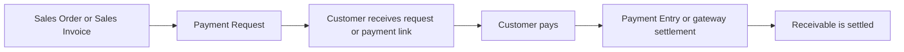
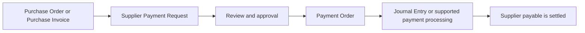

<!-- Frappe documentation: erpnext, part 41 of 69. Index: docs/INDEX.md -->

<!-- page: erpnext/erpnext__payment-reconciliation.md -->
---
title: "Payment Reconciliation | ERPNext Documentation"
description: "Allocate unlinked payments and credits against ERPNext invoices."
space: "ERPNext"
url: "https://docs.frappe.io/erpnext/payment-reconciliation"
updated: "2026-08-14"
---

Payment Reconciliation links a submitted payment or credit with one or more outstanding invoices for the same Customer or Supplier. Use it when money has already been recorded in ERPNext but the correct invoice was not selected in the original transaction.

Reconciliation does not create another bank movement. It updates how the existing amount is allocated and recalculates the invoice outstanding balance.

## Before you begin

Confirm that the invoice and payment are submitted, belong to the same Company and party, use the same receivable or payable account, and still have an outstanding or unallocated amount.

For this example, Northstar Retail has an outstanding Sales Invoice of $1,796 and an unallocated Payment Entry of $525.

## Reconcile a payment against an invoice

### 1. Select the company and party

Open **Payment Reconciliation**. Select the **Company**, **Party Type**, and **Party**. ERPNext fills the relevant **Receivable / Payable Account** when a default account is available.

Use the optional Filters section when you need to narrow a long list by invoice date, payment date, amount, bank or cash account, or result limit.

[Screenshot on the live page: Select the company, customer, and receivable account in Payment Reconciliation]

Click **Get Unreconciled Entries**.

### 2. Review the unreconciled entries

ERPNext displays outstanding invoices on the left and unallocated payments or credits on the right. Check the document number, date, and amount before selecting anything.

[Screenshot on the live page: Review outstanding invoices and unallocated payments]

If no rows are selected, ERPNext can allocate entries in first-in, first-out order. Select rows when you need to control exactly which payment settles which invoice.

### 3. Select the invoice and payment

Select the invoice that should receive the payment. Then select the matching Payment Entry or credit.

In this example, Payment Entry **ACC-PAY-2026-00010** is matched with Sales Invoice **ACC-SINV-2026-00009**.

[Screenshot on the live page: Select the invoice and payment to match]

### 4. Create the allocation

Click **Allocate**. ERPNext proposes an allocation based on the smaller of the invoice outstanding amount and the payment amount.

[Screenshot on the live page: Use Allocate after selecting the invoice and payment]

### 5. Review and reconcile

Review every row under **Allocated Entries**. Confirm the Payment Entry, invoice, **Allocated Amount**, and **Difference Amount**. Edit a row if only part of the available payment should be applied.

[Screenshot on the live page: Review the allocation and reconcile it]

Click **Reconcile** only after the allocation is correct.

### 6. Verify the result

Before reconciliation, Sales Invoice **ACC-SINV-2026-00009** had an outstanding amount of **$746**. After the **$525** payment was reconciled, the outstanding amount became **$221**.

[Screenshot on the live page: Sales Invoice outstanding amount before payment reconciliation]

Open Payment Entry **ACC-PAY-2026-00010** and verify that the invoice appears under **Payment References**. The **Total Allocated Amount** is **$525**, while **Unallocated Amount** is **$0**.

[Screenshot on the live page: Payment Entry reference and allocated amount after reconciliation]

You can also open the [Accounts Receivable report](/erpnext/accounts-receivable) and confirm that it shows the reduced invoice balance.

### Video demo

<iframe src="https://www.youtube.com/embed/Y63Cbmcp7wA" title="Payment Reconciliation in ERPNext" allow="accelerometer; autoplay; clipboard-write; encrypted-media; gyroscope; picture-in-picture; web-share" frameborder="0"></iframe>

## Important fields and what they mean

| Field                        | What it controls                                                                                              |
| ---------------------------- | ------------------------------------------------------------------------------------------------------------- |
| Company                      | Limits the tool to one legal entity and its accounts.                                                         |
| Party Type                   | Chooses whether you are reconciling a Customer or Supplier.                                                   |
| Party                        | Loads documents for the selected Customer or Supplier.                                                        |
| Receivable / Payable Account | Limits results to documents posted to the same control account.                                               |
| Default Advance Account      | Includes supported Payment Entries posted to the selected advance account.                                    |
| Invoice and Payment filters  | Narrow results by date, amount, document name, bank account, or result limit.                                 |
| Invoices                     | Lists submitted documents with an outstanding balance.                                                        |
| Payments                     | Lists submitted Payment Entries, Journal Entries, and supported credits with an amount available to allocate. |
| Allocated Amount             | Amount from the payment or credit that will be applied to the invoice.                                        |
| Difference Amount            | Amount left unmatched in that allocation row.                                                                 |

## What changes after reconciliation

ERPNext adds or updates the payment reference, reduces the invoice outstanding amount, and reduces the payment unallocated amount. The original bank or cash posting remains unchanged because the money was already recorded when the payment was submitted.

## Troubleshooting

### The invoice or payment is missing

Check the Company, party, receivable or payable account, document status, currency, filters, and date range. A fully allocated payment or fully settled invoice is not an unreconciled entry.

### The payment and invoice use different receivable or payable accounts

The tool cannot match entries across different control accounts. Correct the account on the source document through the supported cancellation and amendment workflow, or use an appropriate accounting adjustment reviewed by your finance team.

### Allocate uses the wrong invoice

Select the exact invoice and payment before clicking **Allocate**. Leaving rows unselected allows FIFO allocation.

### The allocation amount is too high

Open the allocation row and reduce **Allocated Amount**. It cannot exceed the available payment amount or invoice outstanding amount.

### A payment was reconciled incorrectly

Use [Unreconcile Payments](/erpnext/unreconcile-payments) to remove the incorrect link, verify the restored balances, and then reconcile the payment again.

## Frequently asked questions

### When should I use Payment Reconciliation instead of Payment Entry?

Use [Payment Entry](/erpnext/payment-entry) when recording the receipt or payment and you already know the invoices to settle. Use Payment Reconciliation when the payment or credit already exists but remains unallocated or was not linked to the right invoice.

### Can one payment settle several invoices?

ERPNext supports this. Select the payment and the required invoices, allocate the available amount across them, and review every allocation row before reconciling.

### Can one invoice be settled by several payments?

ERPNext supports this. Reconcile each available payment against the same invoice until its outstanding amount reaches zero.

### Can I allocate only part of a payment?

ERPNext supports this. Edit **Allocated Amount** before reconciling. The remaining amount stays unallocated and can be used later.

### Does Payment Reconciliation change the bank balance?

Payment Reconciliation does not change the bank balance. It changes the link between existing accounting entries and does not post the receipt or payment again.

### Is this the same as Bank Reconciliation?

These tools serve different purposes. Payment Reconciliation matches ERPNext payments and credits with ERPNext invoices. [Bank Reconciliation](/erpnext/bank-reconciliation) matches ERPNext bank ledger entries with transactions shown by the bank.

## Related topics

- [Payment Entry](/erpnext/payment-entry)
- [Receiving Bulk Payments](/erpnext/receiving-bulk-payments)
- [Unreconcile Payments](/erpnext/unreconcile-payments)
- [Process Payment Reconciliation Tool](/erpnext/process-payment-reconciliation-tool)
- [Accounts Receivable](/erpnext/accounts-receivable)
- [Accounts Payable](/erpnext/accounts-payable)

<!-- page: erpnext/erpnext__payment-request.md -->
---
title: "Payment Request | ERPNext Documentation"
description: "Request and track online or offline customer payments from ERPNext transactions."
space: "ERPNext"
url: "https://docs.frappe.io/erpnext/payment-request"
updated: "2026-08-02"
---

A Payment Request records that a specific amount needs to be paid. It is a request or instruction, not proof that money has moved, so creating it does not post to the General Ledger.

For a Customer, create an inward Payment Request from a submitted [Sales Order](/erpnext/sales-order) or [Sales Invoice](/erpnext/sales-invoice). ERPNext can email the request with an online payment link when a [Payment Gateway Account](/erpnext/payment-gateway-account) is configured, or you can use it to communicate offline bank-transfer instructions.

For a Supplier, an outward Payment Request can become the internal instruction that an approved [Purchase Order](/erpnext/purchase-order) or [Purchase Invoice](/erpnext/purchase-invoice) should be paid. The finance team can later collect approved Supplier Payment Requests in a [Payment Order](/erpnext/payment-order).

Use Payment Request when you need to ask for payment, send a payment link, request an advance, or introduce an approval step before paying a Supplier. If money has already been received or paid and you only need to record it, create a [Payment Entry](/erpnext/payment-entry) directly.

## Before you begin

Confirm the correct Company, currency, receivable or payable account, and bank or cash ledger. Use submitted source documents and keep the bank reference or remittance advice available.

## Create a Customer Payment Request

1. Open the submitted Sales Order or Sales Invoice.
2. Choose **Create &gt; Payment** to create the Payment Request.

[Screenshot on the live page: The Create menu on a submitted Sales Invoice with Payment Request highlighted.]

3. Confirm the amount, currency, recipient, and reference document.

[Screenshot on the live page: An inward Customer Payment Request with its type and Sales Invoice reference highlighted.]

[Screenshot on the live page: The amount requested from the Customer highlighted on the Payment Request.]

4. Select the payment gateway account when collecting online.
5. Save and send the request.
6. Track its status and verify the resulting payment before treating the source document as paid.

[Screenshot on the live page: The Payment Request list showing the available Customer and Supplier requests.]

## Request a Supplier payment

1. Open the submitted Purchase Order or Purchase Invoice that should be paid.
2. Create an outward Payment Request.
3. Confirm the Supplier, amount, Company bank details, and supporting reference.

[Screenshot on the live page: An outward Supplier Payment Request with its type, Supplier, and Purchase Invoice reference highlighted.]

[Screenshot on the live page: The requested Supplier payment amount highlighted on the Payment Request.]

4. Submit the request according to your approval process.
5. Add the approved request to a Payment Order, or process the payment through the supported accounting workflow.

## Watch Video

<iframe src="https://www.youtube.com/embed/CRrEiA2Myj4" title="Payment Request in ERPNext" allow="accelerometer; autoplay; clipboard-write; encrypted-media; gyroscope; picture-in-picture; web-share" frameborder="0" allowfullscreen></iframe>

## Important fields and what they mean

| Field                   | What it controls                                                     |
| ----------------------- | -------------------------------------------------------------------- |
| Payment Request Type    | Inward for Customer receipts or Outward for supported payment flows. |
| Reference Document      | Sales Order, Sales Invoice, or another supported source.             |
| Grand Total             | Amount requested.                                                    |
| Currency                | Currency presented to the payer.                                     |
| Payment Gateway Account | Gateway and settlement account used for online collection.           |
| Status                  | Tracks initiation, request, and payment state.                       |

## What happens after you submit or process

Submitting a Payment Request records and communicates the request. It does not, by itself, settle the invoice or post a bank transaction. For a Customer request, the accounting impact occurs when the gateway completes the payment or a Payment Entry is recorded. For a Supplier request, the accounting impact occurs only when the approved payment is processed through the resulting accounting document.

## Troubleshooting

### The recipient email address is blank or incorrect

Check the Contact linked to the Customer and confirm that it has the correct email address. Select or correct **Email To** before sending. Use one valid recipient address when the payment provider accepts only a single payer email.

### Submitting or sending the request times out

Test the outgoing [Email Account](/framework/email-account) separately. Incorrect SMTP host, port, SSL, or STARTTLS settings can make the request appear to hang while ERPNext tries to send the message. Review the Email Queue and Error Log before resending.

### The customer paid, but the request still shows Initiated

Verify the transaction in the payment provider first. Then check the [Payment Gateway Account](/erpnext/payment-gateway-account), webhook or callback configuration, site URL, and Error Log. Do not manually mark a request paid until the actual settlement and resulting accounting entry have been verified.

### The payment link does not open or uses the wrong gateway

Confirm that the selected gateway account is enabled, belongs to the correct Company, supports the transaction currency, and has valid credentials. Generate a fresh request after correcting the configuration rather than editing a link already sent to the customer.

## Frequently asked questions

### Does a Payment Request itself post to the General Ledger?

A Payment Request does not post to the ledger. It records and communicates the request. The ledger is affected when the successful payment creates or is recorded through the appropriate Payment Entry or gateway transaction.

### Can I request only part of an invoice or order amount?

A partial amount can be requested when the source workflow and gateway support it. Confirm the remaining outstanding amount afterward and avoid sending overlapping active requests for the same portion.

### Can I customize the email sent with the request?

The available message comes from the Payment Request and gateway configuration in your version. Review the generated subject, body, recipient, and print format before sending. Use supported templates or a controlled customization when the standard message is insufficient.

### Can a Payment Request be used without an online gateway?

It can still document an offline request, but it will not automatically collect money. Share the relevant payment instructions, then record the receipt with a Payment Entry and verify it against the source document.

### Should I send another request when a customer says the first link failed?

First check whether the original request or provider transaction succeeded. If it did not, correct the configuration and create or resend a valid request. Avoid multiple active links that could let the customer pay the same amount twice.

## Related topics

- [Payment Entry](/erpnext/payment-entry)
- [Payment Reconciliation](/erpnext/payment-reconciliation)
- [Bank Reconciliation](/erpnext/bank-reconciliation)
- [Bank Transaction](/erpnext/bank-transaction)
- [Journal Entry](/erpnext/journal-entry)

<!-- page: erpnext/erpnext__payment-terms-template.md -->
---
title: "Payment Terms Template | ERPNext Documentation"
description: "Create reusable installment and due-date schedules for ERPNext transactions."
space: "ERPNext"
url: "https://docs.frappe.io/erpnext/payment-terms-template"
updated: "2026-08-14"
---

A Payment Terms Template combines reusable Payment Term records into a schedule for sales and purchase transactions. For Nova Industries, an electronics manufacturer and distributor, Net 30 contains one term for 100% due after 30 days. A 50% Advance, 50% Net 30 template contains two installments.

## Before you begin

Decide which schedules you offer to [Customers](/erpnext/customer) or accept from [Suppliers](/erpnext/supplier). Create the individual [Payment Term](/erpnext/payment-term) records first. Each term defines an installment percentage and its due-date rule.

## Create a Payment Terms Template

1. Create the Payment Term records required by the schedule.
2. Open **Payment Terms Template** and enter a descriptive name.
3. Add the terms in sequence and set each **Invoice Portion**.
4. Confirm that the total invoice portion is 100%.
5. Enable **Allocate Payment Based on Payment Terms** only when payments must be tracked against individual installments.
6. Save the template and select it in a [Sales Order](/erpnext/sales-order), [Sales Invoice](/erpnext/sales-invoice), [Purchase Order](/erpnext/purchase-order), or [Purchase Invoice](/erpnext/purchase-invoice).

[Screenshot on the live page: Reusable Payment Term records in ERPNext]

The template list below shows how individual terms can be combined into reusable schedules. These are demonstration records, not a fixed catalogue installed on every ERPNext site.

[Screenshot on the live page: Payment Terms Template catalogue in ERPNext]

## Important fields and what they mean

| Field                                   | What it controls                                                                                  |
| --------------------------------------- | ------------------------------------------------------------------------------------------------- |
| Template Name                           | Name shown in transactions.                                                                       |
| Payment Term                            | Reusable installment and due-date rule.                                                           |
| Invoice Portion                         | Percentage of the transaction assigned to the row.                                                |
| Credit Days or Months                   | Time allowed before the installment is due.                                                       |
| Due Date Based On                       | Date from which ERPNext calculates the deadline.                                                  |
| Allocate Payment Based on Payment Terms | Tracks allocations against individual schedule rows in a [Payment Entry](/erpnext/payment-entry). |

## Troubleshooting

### The template cannot be saved

Make sure every row has a Payment Term and the Invoice Portions total exactly 100%. If ERPNext reports that a term may be duplicated, review whether two rows use the same term or the same due-date rule. Use distinct terms for genuinely different installments.

### The due dates are not what I expected

Open each Payment Term and review **Due Date Based On**, **Credit Days**, and **Credit Months**. When a template is selected, its schedule controls the calculated due dates. If you need a one-off schedule, clear or replace the template before editing the schedule manually.

### The template is missing or was not copied to the next document

Confirm that the template is saved and selected on the source transaction. A schedule normally carries through supported mapped flows, such as Sales Order to Sales Invoice. A Delivery Note does not itself hold payment terms, so a Sales Invoice created only from a Delivery Note may need the template selected again.

### A payment cannot be allocated to the invoice

If term-based allocation is enabled, ERPNext expects the Payment Entry reference to identify the relevant Payment Term and will not allow an allocation above that term's outstanding amount. Refresh outstanding references before retrying.

## Frequently asked questions

### Does ERPNext install standard Payment Terms Templates automatically?

ERPNext provides the feature, but the records available on a site depend on its setup and imported data. Create a small catalogue that matches your actual commercial policy, such as Due on Receipt, Net 30, and an advance-plus-balance schedule.

### Which date takes priority when a template is selected?

The payment schedule generated from the selected template controls the installment due dates. If you manually change a due date that conflicts with the template, ERPNext may ask you to clear the template or schedule first.

### Can one template contain several installments?

Y

es. Add one row for each installment and make sure all Invoice Portions total 100%. ERPNext calculates each payment amount from the transaction total.

### Can the first installment be a fixed amount instead of a percentage?

The standard template is percentage-based. For a genuinely variable fixed advance followed by percentages of the remaining balance, adjust the transaction's payment schedule manually or use a controlled customization.

### Where should I set a default template?

Set the appropriate default on the relevant [Customer](/erpnext/customer), Supplier, or Company where the field is available. A party-specific default is useful when different customers or suppliers follow different schedules. Verify the populated schedule before submitting the transaction.

## Related topics

- [Payment Term](/erpnext/payment-term)
- [Payment Entry](/erpnext/payment-entry)
- [Sales Invoice](/erpnext/sales-invoice)
- [Purchase Invoice](/erpnext/purchase-invoice)
- [Sales Order](/erpnext/sales-order)
- [Purchase Order](/erpnext/purchase-order)

<!-- page: erpnext/erpnext__payment-terms.md -->
---
title: "Payment Terms | ERPNext Documentation"
description: "Create ERPNext Payment Terms and templates for due dates, deposits, instalments, milestones, and early-payment discounts."
space: "ERPNext"
url: "https://docs.frappe.io/erpnext/payment-terms"
updated: "2026-08-14"
---

A sale or purchase does not always become due in one amount on one date. Payment Terms let ERPNext express the commercial promise clearly, including deposits, instalments, credit periods, and milestone-based payments.

Nova Industries might collect 30% when a bulk laptop order is confirmed and the remaining 70% within 30 days of delivery. Recording that schedule on the transaction gives both teams the same due dates and lets receivables and payables reports show what is actually overdue.

This page explains individual Payment Terms, reusable templates, due-date calculation, allocation percentages, and how the schedule flows into invoices and payment follow-up.

## Create a Payment Term

Go to **Home &gt; Accounting &gt; Accounting Masters &gt; Payment Term**.

1. Enter a clear name.
2. Choose how the due date is calculated.
3. Enter the credit days or due date basis.
4. Enter an invoice-portion percentage if this term represents one instalment.
5. Optionally configure an early-payment discount.
6. Save.

[Screenshot on the live page: Payment Term for a deposit]

## Create a Payment Terms Template

1. Open **Payment Terms Template**.
2. Add terms in the required order.
3. Enter the invoice portion for each row.
4. Confirm that the total allocation is 100%.
5. Mark it as default only if it should apply broadly.
6. Save.

[Screenshot on the live page: Payment Terms Template]

A template can represent Net 30, a deposit plus balance, milestones, or staged payments.

## Apply payment terms

Select the template on a Quotation, Sales Order, Purchase Order, Sales Invoice, or Purchase Invoice. ERPNext creates the payment schedule from the transaction date and the configured rules.

Check the schedule before submitting. The invoice schedule drives due dates, overdue calculations, payment allocation, and receivable or payable reporting.

## Early-payment discounts

A Payment Term can define a discount percentage or amount and a validity period. The customer or supplier must pay within that period for the discount to apply. Test the accounting result before making this part of a production collection process.

## Troubleshooting

**The due date is unexpected**

Check the posting date, due-date basis, credit days, and whether the term uses a day of the month.

**The template cannot be saved**

Verify that invoice portions total 100% and that every row has a Payment Term.

**The schedule was not copied**

Check whether the transaction or party has another template and whether the schedule was edited manually.

## Related topics

- [Sales Invoice](https://docs.frappe.io/erpnext/sales-invoice)
- [Purchase Invoice](https://docs.frappe.io/erpnext/purchase-invoice)
- [Payment Entry](https://docs.frappe.io/erpnext/payment-entry)
- [Accounts Receivable](https://docs.frappe.io/erpnext/accounts-receivable)

<!-- page: erpnext/erpnext__payment_ledger.md -->
---
title: "Payment Ledger | ERPNext Documentation"
description: "Understand the immutable payment allocation ledger used by ERPNext."
space: "ERPNext"
url: "https://docs.frappe.io/erpnext/payment_ledger"
updated: "2026-08-14"
---

Northstar Retail has a $1,796 Sales Invoice from Nova Industries and makes a separate payment of $525. The bank movement is already recorded, but the invoice will remain fully outstanding until ERPNext knows that the payment belongs to it. The Payment Ledger keeps that invoice-to-payment relationship.

The Payment Ledger is a specialised ledger for Receivable and Payable accounts. ERPNext uses its entries to calculate invoice outstanding amounts, advances, allocations, ageing, and reconciliation. It does not create a second accounting posting or replace the [General Ledger](/erpnext/general-ledger). The General Ledger explains debits and credits. The Payment Ledger explains which receivable or payable reference those amounts settle.

## How the Payment Ledger works

| Event                                                                                   | Payment Ledger effect                                                                      |
| --------------------------------------------------------------------------------------- | ------------------------------------------------------------------------------------------ |
| A [Sales Invoice](/erpnext/sales-invoice) is submitted                                  | Creates a Customer receivable reference and its initial outstanding amount.                |
| A [Purchase Invoice](/erpnext/purchase-invoice) is submitted                            | Creates a Supplier payable reference and its initial outstanding amount.                   |
| A [Payment Entry](/erpnext/payment-entry) is submitted with an invoice reference        | Allocates the payment immediately and reduces the referenced invoice.                      |
| A standalone payment or advance is submitted                                            | Creates an unallocated party amount that can be matched later.                             |
| A [Credit Note](/erpnext/credit-note) or [Debit Note](/erpnext/debit-note) is allocated | Reduces the corresponding receivable or payable reference.                                 |
| A payment is reconciled or unreconciled                                                 | Updates the invoice-payment relationship while preserving the underlying bank transaction. |

## Run the Payment Ledger report

1. Open **Accounting** and select **Payment Ledger**.
2. Select **Nova Industries** and the required date range.
3. Select Party Type and Party when investigating one Customer or Supplier.
4. Use Account, Voucher No, or Against Voucher No to trace a specific receivable, payable, payment, or invoice.
5. Refresh the report and wait until all entries and outstanding rows have loaded.

[Screenshot on the live page: Payment Ledger for Nova Industries showing invoice references and outstanding amounts]

## Understand Voucher and Against Voucher

| Column                                      | Meaning                                                                                                   |
| ------------------------------------------- | --------------------------------------------------------------------------------------------------------- |
| Voucher Type and Voucher No                 | The document that created this Payment Ledger entry, such as an invoice, Payment Entry, or Journal Entry. |
| Against Voucher Type and Against Voucher No | The invoice or other reference that the voucher is settling.                                              |
| Amount                                      | The value created, allocated, reversed, or left outstanding by the row.                                   |
| Account and Party                           | The Receivable or Payable account and the Customer or Supplier whose balance is affected.                 |
| Account Currency                            | The currency of the party account when account-currency values are included.                              |

An invoice row can initially point against itself because it creates the original outstanding reference. A later Payment Entry row points against that invoice. The report then shows the remaining outstanding amount after applying the related entries.

## Follow the $525 reconciliation

Before reconciliation, the $1,796 Sales Invoice remains fully outstanding even though the $525 Payment Entry exists. This happens because the payment was submitted without allocating that invoice in its References table.

[Screenshot on the live page: Sales Invoice showing 1796 outstanding before the payment is reconciled]

Use [Payment Reconciliation](/erpnext/payment-reconciliation) to match the unallocated payment to the invoice. After reconciliation, the invoice outstanding amount becomes $1,271 and its status becomes Partly Paid.

[Screenshot on the live page: Sales Invoice showing 1271 outstanding after allocating a 525 payment]

The Payment Entry now carries a $525 reference allocation to the Sales Invoice. ERPNext has not moved another $525 through the bank. It has updated which invoice the existing payment settles.

[Screenshot on the live page: Payment Entry showing 525 allocated to the Sales Invoice after reconciliation]

## Where Payment Ledger data appears

[Accounts Receivable](/erpnext/accounts-receivable) and [Accounts Payable](/erpnext/accounts-payable) use Payment Ledger references to calculate invoice-level outstanding amounts and ageing. [Process Statement of Accounts](/erpnext/process-statement-of-accounts) uses those outstanding balances when preparing customer statements. Reconciliation tools use the same ledger to locate eligible unallocated entries and update their references.

## Payment Ledger and General Ledger

| Question                                             | Use                                                   |
| ---------------------------------------------------- | ----------------------------------------------------- |
| Which accounts were debited and credited?            | General Ledger                                        |
| Why is this invoice still outstanding?               | Payment Ledger                                        |
| Did the bank balance change?                         | General Ledger and the source Payment Entry           |
| Which invoice received the payment?                  | Payment Ledger and the Payment Entry References table |
| Which invoices require collection or payment action? | Accounts Receivable or Accounts Payable               |

## Troubleshooting

### An invoice does not appear

Confirm that the invoice is submitted and posts to an Account whose Account Type is Receivable or Payable. Verify Company, Party, dates, and Account filters. Draft invoices have not created Payment Ledger entries.

### A payment exists but the invoice is still outstanding

The Payment Entry may be unallocated, allocated to another invoice, or posted for a different Party or Account. Review its References table, then use Payment Reconciliation when the correct invoice was not selected during payment entry.

### The outstanding amount changed unexpectedly

Review Payment Entries, Credit Notes, Debit Notes, Journal Entries, reconciliation activity, and cancellations linked to the invoice. Compare Voucher No and Against Voucher No to see which entry changed the reference balance.

### Payment Ledger and General Ledger look different

The reports answer different questions. Compare the same Company, dates, Account, Party, voucher, and currency. General Ledger values are accounting postings, while Payment Ledger values describe outstanding references and allocations.

## Frequently asked questions

### Does reconciliation create another bank entry?

Reconciliation normally changes the invoice reference attached to an existing payment. The submitted Payment Entry already recorded the bank movement.

### Can a payment be split across several invoices?

A Payment Entry can allocate its amount across multiple eligible invoices for the same party and account. Each allocation contributes to the outstanding balance of its referenced invoice.

### Can Payment Ledger rows be edited directly?

ERPNext generates these rows from submitted source documents and supported reconciliation actions. Correct the source voucher or use reconciliation and unreconciliation rather than editing a ledger row.

### Does the report include ordinary non-party accounts?

The Payment Ledger focuses on accounts configured as Receivable or Payable and the parties associated with them. Use General Ledger for other account types.

## Related topics

- [Payment Entry](/erpnext/payment-entry)
- [Payment Reconciliation](/erpnext/payment-reconciliation)
- [General Ledger](/erpnext/general-ledger)
- [Accounts Receivable](/erpnext/accounts-receivable)
- [Accounts Payable](/erpnext/accounts-payable)
- [Credit Note](/erpnext/credit-note)

<!-- page: erpnext/erpnext__payment_terms_status_report.md -->
---
title: "Payment Terms Status Report"
space: "ERPNext"
url: "https://docs.frappe.io/erpnext/payment_terms_status_report"
updated: "2026-08-14"
---

Nova Industries accepts a $7,000 Sales Order from Northstar Retail with two payment terms: 50% first and 50% later. Nova invoices $4,900. Finance needs to know which part of the agreed schedule has been covered by invoices rather than treating the order as one undivided amount.

The Payment Terms Status for Sales Order report splits invoiced value across the Sales Order's payment schedule in first-in, first-out order. In this example, the first $3,500 term is Completed and $1,400 of the second term is covered, so the second term is Partly Billed.

## Before you begin

- Create reusable [Payment Terms](/erpnext/payment-terms) and a [Payment Terms Template](/erpnext/payment-terms-template).
- Apply the template to a submitted Sales Order.
- Create and submit Sales Invoices against that Sales Order.

## Run the report

[Screenshot on the live page: Reusable Payment Terms Templates available before running the report]

1. Open **Payment Terms Status for Sales Order**.
2. Select Nova Industries and the relevant date range.
3. Filter by Customer, Sales Order, status, or other available fields when needed.
4. Refresh the report and compare each payment term with its invoiced allocation.

[Screenshot on the live page: Payment Terms Status for Sales Order report with Nova demo records]

## How FIFO allocation works

| Term       | Scheduled amount | Invoice allocation | Status        |
| ---------- | ---------------- | ------------------ | ------------- |
| First 50%  | $3,500           | $3,500             | Completed     |
| Second 50% | $3,500           | $1,400             | Partly Billed |
| Total      | $7,000           | $4,900             | 70% billed    |

## What the report does not show

This report tracks Sales Order billing against scheduled terms. It does not prove that the customer has paid the Sales Invoice. Use [Accounts Receivable](/erpnext/accounts-receivable-and-payable), the invoice outstanding amount, or the [Payment Ledger](/erpnext/payment_ledger) for payment status.

## Troubleshooting

### A Sales Order is missing

Confirm that the order is submitted, contains a Payment Schedule, falls inside the filters, and belongs to the selected company.

### The status does not match the customer's payment

The report measures invoicing against Sales Order terms, not cash collection. Review the linked Sales Invoices and Payment Entries separately.

### Allocation appears against the wrong term

ERPNext allocates invoice value to the earliest scheduled term first. Check the Payment Schedule order, percentages, and amounts on the Sales Order.

## Frequently asked questions

### Does the invoice need to copy the same Payment Terms Template?

The report evaluates invoice value created against the Sales Order's schedule. Review both documents when contractual invoice due dates must also match.

### What happens after the full $7,000 is invoiced?

Both 50% terms should be fully allocated and appear completed, provided the linked submitted invoices cover the full order value.

### Can partial invoices cover selected items?

The report allocates the linked invoiced amount across the schedule in FIFO order. Item selection affects the invoice value but does not change that allocation principle.

## Related topics

- [Sales Order](/erpnext/sales-order)
- [Sales Invoice](/erpnext/sales-invoice)
- [Payment Terms](/erpnext/payment-terms)
- [Payment Terms Template](/erpnext/payment-terms-template)
- [Accounts Receivable](/erpnext/accounts-receivable-and-payable)

<!-- page: erpnext/erpnext__paypal-integration.md -->
---
title: "Setting up PayPal\n"
space: "ERPNext"
url: "https://docs.frappe.io/erpnext/paypal-integration"
updated: "2026-02-26"
---

A payment gateway is an e-commerce application service provider service that authorizes credit card payments for e-businesses, online retailers, bricks and clicks, or traditional brick and mortar.

A payment gateway facilitates the transfer of information between a payment portal (such as a website, mobile phone or interactive voice response service) and the Front End Processor or acquiring bank.

To setup PayPal ,
`Explore > Integrations > PayPal Settings`

#### Setup PayPal

To enable PayPal payment service, you need to configure parameters like API Username, API Password and Signature.

[Screenshot on the live page: PayPal Settings]

You also can set test payment environment, by settings `Use Sandbox`

On enabling service, the system will create Payment Gateway record and Account head in chart of accounts having account type as Bank.

[Screenshot on the live page: PayPal COA]

Also it will create Payment Gateway Account entry. Payment Gateway Account is configuration hub from this you can set account head from existing COA, default Payment Request email body template.

[Screenshot on the live page: Payment Gateway Account]

After enabling service and configuring Payment Gateway Account your system is able to accept online payments.

####Supporting transaction currencies
AUD, BRL, CAD, CZK, DKK, EUR, HKD, HUF, ILS, JPY, MYR, MXN, TWD, NZD, NOK, PHP, PLN, GBP, RUB, SGD, SEK, CHF, THB, TRY, USD

##Get PayPal credentials

#### Paypal Sanbox API Signature
 - Login to paypal developer account, [PayPal Developer Account](https://developer.paypal.com/)
 - From **Accounts** tab. create a new business account.
[Screenshot on the live page: Payment Request]

 - From this account profile you will get your sandbox api credentials
[Screenshot on the live page: Payment Request]

---

#### PayPal Account API Signature
 - Login to PayPal Account and go to profile
[Screenshot on the live page: Payment Request]

 - From **My Selling Tools** go to **api Access**
[Screenshot on the live page: Payment Request]

 - On API Access Page, choose option 2 to generate API credentials
[Screenshot on the live page: Payment Request]

<!-- page: erpnext/erpnext__paytm-integration.md -->
---
title: "Paytm Integration\n"
space: "ERPNext"
url: "https://docs.frappe.io/erpnext/paytm-integration"
updated: "2026-02-26"
---

**Paytm integration allows processing transactions with the payment gateway provider Paytm.**

Paytm Integration facilitates processing of payments between Paytm payment portal and ERPNext. Your customers can choose to pay from any credit/debit card, UPI, Netbanking, Paytm Wallet.

To set up Paytm, go to:
> Integrations > Payments > Paytm Settings

## 1.How to get your Paytm API credentials?
1. In order to activate your API credentials, you need to log in to your Paytm account.
2. Then, open the Developer Settings option in the sidebar.
3. Choose API Keys option, it should display a two types of API details (Test/Production).
4. Details mentioned in the Production API details are the credentials that you are supposed to use in Paytm Settings.

[Screenshot on the live page: Razorpay Settings]

## 2.Setting up Paytm

To enable Paytm payment service, you need to configure all the mandatory parameters which you received from the Paytm. If you want to use staging environment of the integration, you can select the staging option and use the test API developer credentials provided by Paytm.
[Screenshot on the live page: Razorpay Settings]

On enabling the Paytm integration in ERPNext, the system will create a Payment Gateway record and an Account Head in Chart of Account with the Account type as Bank as seen in the following screenshot.

[Screenshot on the live page: Stripe COA]

Also, it will create a Payment Gateway Account entry. Payment Gateway Account is the configuration hub from where you can set Account Heads and the default Payment Request email template for requesting payments from customers.

[Screenshot on the live page: Payment Gateway Account]

After configuring Payment Gateway Account, you will be able to accept online payments via Paytm.

## 3.Supporting transaction currencies

Paytm will only work for the Company which has INR (Indian Rupee) as Company Currency.
