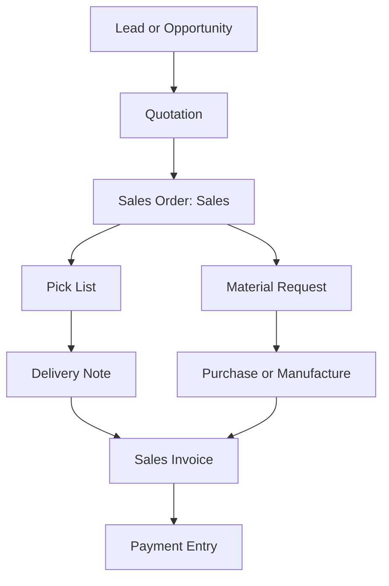
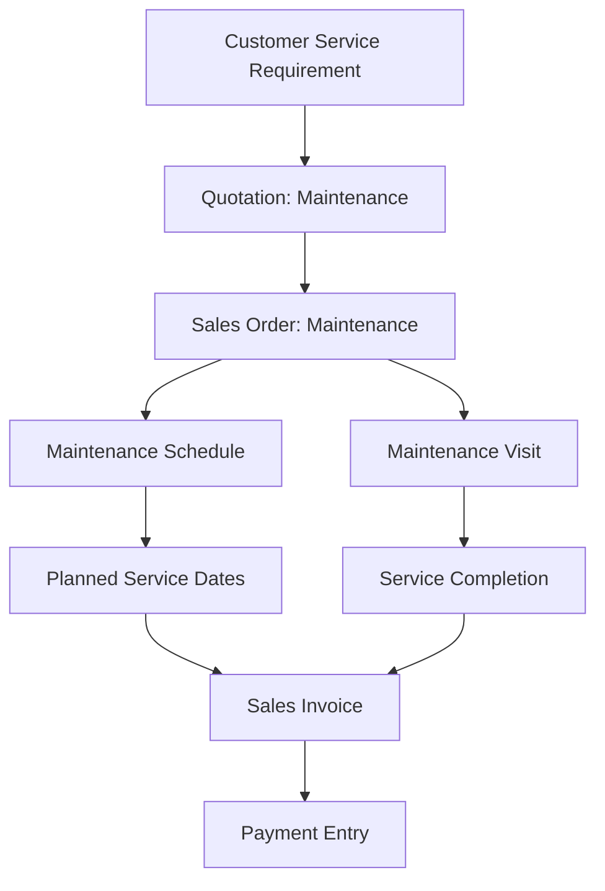
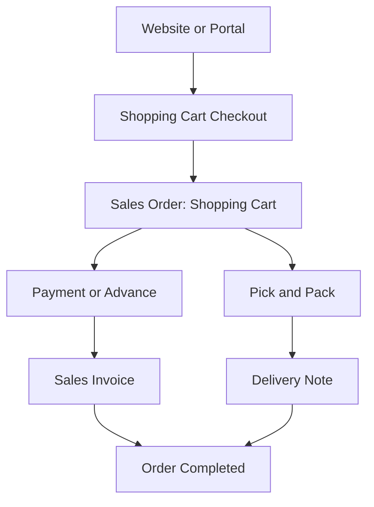

<!-- Frappe documentation: erpnext, part 52 of 69. Index: docs/INDEX.md -->

<!-- page: erpnext/erpnext__sales-analytics.md -->
---
title: "Sales Reports and Analytics | ERPNext Documentation"
description: "Choose and use ERPNext sales reports for orders, billing, customers, items, salespeople, targets, gross profit, and sales pipeline analysis."
space: "ERPNext"
url: "https://docs.frappe.io/erpnext/sales-analytics"
updated: "2026-07-25"
---

ERPNext sales reports help teams review pipeline, orders, fulfilment, billing, customer activity, item performance, salesperson attribution, targets, and profitability. Choose a report based on the business question and confirm which transaction type, date field, and document status it uses.

## Before you begin

For reliable reports:

- Use consistent [Customers](/erpnext/customer), Territories, Sales Persons, Item Groups, and Warehouses.
- Submit operational transactions when the report measures confirmed activity.
- Assign the correct Company and posting or transaction dates.
- Keep Sales Team contribution and target allocations current.
- Use accurate buying or valuation rates for profitability reports.

## Open a sales report

1. Open the Selling workspace.
2. Select a report, or search for it by name.
3. Set Company, date range, and other filters.
4. Select **Refresh**.
5. Review, export, print, or chart the results as required.

[Screenshot on the live page: The fully loaded Selling dashboard with sales-order trends, summary cards, and report links.]

[Screenshot on the live page: Sales Analytics for Nova Electronics Trading with Sales Order values for Northstar Retail.]

## Choose the right report

| Question                                       | Useful report                                              |
| ---------------------------------------------- | ---------------------------------------------------------- |
| Which orders are confirmed and still open?     | Sales Order Analysis                                       |
| What has been sold by Customer?                | Sales Analytics or Customer-wise Sales                     |
| What has been sold by Item or Item Group?      | Sales Analytics or Item-wise Sales                         |
| Which orders remain to be delivered or billed? | Sales Order Analysis and order status views                |
| How much has each Sales Person contributed?    | Sales Person-wise Transaction Summary                      |
| Are Sales Persons meeting targets?             | Sales Person Target Variance                               |
| Are Territories meeting targets?               | Territory Target Variance                                  |
| Which invoices remain unpaid?                  | [Accounts Receivable](/erpnext/accounts-receivable)        |
| Which sales are profitable?                    | Gross Profit                                               |
| What is the CRM pipeline?                      | [Sales Pipeline](/erpnext/sales-pipeline) or CRM Analytics |

Report names and available filters can vary by ERPNext version and installed apps.

## Sales Analytics

Use Sales Analytics to compare sales across dimensions such as Customer, Customer Group, Territory, Item, Item Group, and Sales Person. Select the value or quantity basis and the period grouping needed for the comparison.

Use it for trends and concentration, not as a substitute for invoice-level audit.

## Sales Order reporting

[Sales Orders](/erpnext/sales-order) track confirmed demand, delivery progress, and billing progress. Review statuses and percentage fields to separate:

- To Deliver and Bill.
- To Deliver.
- To Bill.
- Completed.
- Closed.

Returns, cancellations, partial fulfilment, and short-closing can change outstanding values.

## Salesperson and target reporting

Salesperson reports depend on the Sales Team table. Confirm each transaction contains the correct [Sales Person contribution](/erpnext/sales-persons-in-the-sales-transactions).

Target variance also depends on [Sales Person Target Allocation](/erpnext/sales-person-target-allocation), Fiscal Year, Item Group, and Monthly Distribution.

## Gross Profit

Gross Profit compares sales value with buying or valuation information. Investigate:

- Missing or unusual buying rates.
- Returns and credit notes.
- Stock and non-stock Items.
- Currency conversion.
- Costing and valuation method.

Use the [General Ledger](/erpnext/general-ledger) and stock reports when accounting or inventory values need reconciliation.

## Export and saved views

Use report export for further analysis, but keep ERPNext as the source of the transactional record. Save commonly used filters or views where supported so teams compare the same scope.

## Troubleshooting

| Problem                           | What to check                                                                                 |
| --------------------------------- | --------------------------------------------------------------------------------------------- |
| Report shows no data              | Company, dates, transaction type, status, permissions, and dimension filters                  |
| Totals differ from another report | Confirm both reports use the same document type, date field, status, and return treatment     |
| Sales Person totals are missing   | Review Sales Team rows and contribution percentages                                           |
| Target variance is empty          | Review target rows, Fiscal Year, Item Group, Monthly Distribution, and submitted transactions |
| Gross profit is unexpected        | Review valuation, buying rates, returns, and currency                                         |

## Frequently asked questions

### Do draft transactions appear in sales reports?

It depends on the report. Reports of confirmed activity usually use submitted transactions, while pipeline-style reports may include drafts or opportunities.

### Why do two reports show different totals?

They may use different source DocTypes, statuses, dates, or grouping logic. Compare filters and report definitions.

### Can I add custom columns?

Use report customization or a custom Query or Script Report when standard output does not meet the requirement.

### Which report should I use for unpaid invoices?

Use Accounts Receivable rather than an order or sales analytics report.

## Related topics

- [Sales Order](/erpnext/sales-order)
- [Sales Invoice](/erpnext/sales-invoice)
- [Sales Person Target Allocation](/erpnext/sales-person-target-allocation)
- [Sales Pipeline](/erpnext/sales-pipeline)
- [CRM Analytics](/erpnext/crm-analytics)

<!-- page: erpnext/erpnext__sales-invoice-from-timesheet.md -->
---
title: "Sales Invoice from Timesheet\n"
space: "ERPNext"
url: "https://docs.frappe.io/erpnext/sales-invoice-from-timesheet"
updated: "2026-02-26"
---

A customer can be billed based on the total number of hours an employee has worked for that customer. The actual number of hours of billable work can be tracked via a Timesheet.

**A sales invoice can be generated from each Timesheet submitted by an employee which can be used to bill the customer.**

[Screenshot on the live page]

## How to Create A Sales Invoice from A Timesheet

1. Once the Timesheet is submitted, click on 'Create Sales Invoice'.
2. Enter the Item Code and name of the Customer who has to be billed against this Timesheet. The Item could be a Product as well as a Service. Click on 'Create Sales Invoice'.
3. All the details of the Timesheet will get auto-populated in the Sales Invoice.
4. The posting date and time will be set to current, you can edit after you tick the checkbox below Posting Time.
5. Optionally, you can include payments for POS or make this a credit note.
6. Save and Submit.

To fetch the details automatically in a Sales Invoice, click on the **Get items from** button. The details can be fetched from a Sales Order, Delivery Note, or a Quotation. The details like Customer PO, Address and Contact Number, Currency and Price List, Items will get auto-populated.

[Screenshot on the live page]
*Sales invoice from timesheet*

## Features

Additional Details while creating a Sales Invoice from a Timesheet:

- **Accounting Dimensions**: Accounting Dimensions lets you tag transactions to a specific Territory, Branch, Project, etc. This helps in viewing accounting statements separately based on the criteria selected. To know more, visit the Accounting Dimensions page.
- **Time Sheet List**: Since the Project is created from a Time Sheet, the details of the Time Sheet will get auto-fetched. You can click on 'Add Row' to add more Time Sheets to this Invoice.

All the other details can be added as you would add them in any Sales Invoice.

## After submitting

Once you have submitted the Sales Invoice, The details like 'Total Billed Hours', 'Total Billed Amount' and '% Amount Billed' will get updated in the Timesheet. Further, a Salary Slip can also be generated from the Timesheet.

<!-- page: erpnext/erpnext__sales-invoice-without-an-item.md -->
---
title: "Create a Sales Invoice without an Item Code | ERPNext Documentation"
description: "Create ERPNext Sales Invoices and Credit Notes for one-time charges without an Item Code by completing the required child-row fields."
space: "ERPNext"
url: "https://docs.frappe.io/erpnext/sales-invoice-without-an-item"
updated: "2026-07-25"
---

ERPNext can invoice a one-time charge without selecting an Item Code. Enter the required details directly in the Sales Invoice Items child row. Use this sparingly because an [Item](/erpnext/item) provides better reporting, tax, UOM, income-account, and pricing consistency.

## Before you begin

Confirm:

- The [Customer](/erpnext/customer), Company, currency, and receivable account.
- The correct Income Account, Cost Center, UOM, and tax treatment for the charge.
- Whether your organization's controls require an Item master for every invoice line.
- Permission to create and submit a [Sales Invoice](/erpnext/sales-invoice).

Create a non-stock service or charge Item instead when the same charge is likely to recur.

## Create a Sales Invoice without an Item Code

1. Open the Sales Invoice list and select **Add Sales Invoice**.
2. Select the Customer.
3. Set the Posting Date, Due Date, and Company.
4. In the Items table, add a row.
5. Select the highlighted pencil icon to open the complete child-row editor.
6. Leave Item Code blank.
7. Enter Item Name, Description, Quantity, UOM, Rate, and Income Account.
8. Complete the Cost Center and tax-related fields required by your configuration.
9. Review totals, save, and submit.

[Screenshot on the live page: A Sales Invoice Items row with the pencil icon highlighted.]

[Screenshot on the live page: The Sales Invoice Item editor with an empty Item field and completed one-time charge details.]

Because there is no Item Code, the stock-availability dot used for normal Item rows does not apply.

## Required line information

| Field          | Purpose                                         |
| -------------- | ----------------------------------------------- |
| Item Name      | Short label printed and reported for the charge |
| Description    | Complete explanation shown on the invoice       |
| Quantity       | Number of units billed                          |
| UOM            | Unit used to interpret Quantity                 |
| Rate           | Price per unit                                  |
| Income Account | Revenue account credited by the invoice         |
| Cost Center    | Organizational dimension used for reporting     |

Additional mandatory fields can appear through accounting dimensions, tax rules, or customization.

## Example

Nova Electronics Trading needs to bill a one-time **Expedited handling service**:

| Field          | Value                      |
| -------------- | -------------------------- |
| Item Name      | Expedited handling service |
| Quantity       | 1                          |
| UOM            | Nos                        |
| Rate           | $125                       |
| Income Account | Service Revenue            |

After submission, the Sales Invoice creates the normal receivable and income accounting entries. It does not create a stock movement.

## Create a Credit Note without an Item Code

Create a return against the original invoice where possible so the audit link is retained.

1. Open the submitted Sales Invoice.
2. Create a Return or [Credit Note](/erpnext/credit-note).
3. Confirm **Is Return** and the reference invoice.
4. Enter the one-time line with a negative quantity or mapped return values.
5. Review accounts and submit.

Do not create an unrelated negative invoice when a linked return is available.

## When to create an Item instead

Create a non-stock Item when:

- The charge will be used repeatedly.
- It requires consistent taxes or income accounts.
- Users need Item-wise reporting.
- It has a standard [Item Price](/erpnext/item-price).
- It appears in Quotations or [Sales Orders](/erpnext/sales-order).

## Troubleshooting

| Problem                                   | What to check                                                                                        |
| ----------------------------------------- | ---------------------------------------------------------------------------------------------------- |
| Invoice cannot be saved                   | Complete Item Name, Quantity, UOM, Rate, Income Account, Cost Center, and other mandatory dimensions |
| Stock validation appears                  | Confirm the row has no stock Item and no stock-update requirement                                    |
| Tax is incorrect                          | Review tax templates, Item Tax Template behavior, and charge classification                          |
| Reporting is inconsistent                 | Create a reusable non-stock Item instead                                                             |
| Credit Note does not reverse the original | Create it from the submitted invoice and verify the return reference                                 |

## Frequently asked questions

### Can I update stock for a row without an Item Code?

No meaningful stock ledger entry can be created without a stock Item. Use an Item when inventory is involved.

### Can I use this method for services?

Yes, but a reusable non-stock service Item is better when the service is sold regularly.

### Does the invoice create accounting entries?

Yes. The configured Income Account and receivable account are used on submission.

### Can a Sales Order contain a line without an Item Code?

This page covers Sales Invoice. Use a proper Item for a controlled multi-step sales cycle.

## Related topics

- [Sales Invoice](/erpnext/sales-invoice)
- [Credit Note](/erpnext/credit-note)
- [Item](/erpnext/item)
- [Item Price](/erpnext/item-price)
- [Chart of Accounts](/erpnext/chart-of-accounts)

<!-- page: erpnext/erpnext__sales-invoice.md -->
---
title: "Sales Invoice | ERPNext Documentation"
description: "Learn how to create, submit, and collect payment for a Sales Invoice in ERPNext, including taxes, stock updates, ledger impact, and common fixes."
space: "ERPNext"
url: "https://docs.frappe.io/erpnext/sales-invoice"
updated: "2026-08-14"
---

Nova Industries has delivered two phones to Northstar Retail. The sale is operationally complete, but until finance issues a Sales Invoice, the customer has no formal bill and Nova has no posted receivable or sales income.

A Sales Invoice converts that sale into an amount the Customer owes. When it is submitted, ERPNext records the receivable, income, and taxes in the general ledger. If **Update Stock** is enabled, the same invoice can also record the goods leaving the Warehouse, which is useful for a direct sale without a Delivery Note.

Create the invoice from a [Sales Order](/erpnext/sales-order) or [Delivery Note](/erpnext/delivery-note) when those documents already exist. Create it directly for a service sale or an immediate stock sale. This guide explains how to prepare the invoice, choose the correct stock flow, submit it, and understand its accounting effect.

## Before you begin

Prepare these records before creating an invoice:

- A [Customer](/erpnext/customer) with the correct billing address, contact, currency, and receivable account.
- Each product or service as an [Item](/erpnext/item), with its income account and default Unit of Measure.
- A selling [Price List](/erpnext/price-list) if rates should be fetched automatically.
- Sales tax accounts or a Sales Taxes and Charges Template if tax applies.
- [Payment Terms](/erpnext/payment-terms) if the Customer pays in installments.
- A Warehouse and available stock if the invoice will update stock.

## Create a Sales Invoice

1. Go to **Accounting &gt; Sales and Receivables &gt; Sales Invoice**.
2. Click **Add Sales Invoice**.

[Screenshot on the live page: Sales Invoice list with Add Sales Invoice highlighted]

3. Select the **Company** and **Customer**. ERPNext fetches the Customer's billing address, contact, currency, price list, and receivable account when defaults exist.
4. Check the **Posting Date** and **Payment Due Date**. The posting date decides the accounting period. The due date is used to determine whether the invoice is overdue.

[Screenshot on the live page: Customer, Posting Date, and Payment Due Date highlighted]

5. In **Items**, add each product or service. Check the Quantity, Rate, Amount, and Warehouse.

[Screenshot on the live page: Sales Invoice item row and pencil icon highlighted]

The dot before an Item Code shows stock availability at a glance: green means in stock and red means out of stock.

6. Click the pencil icon to edit a row. This opens fields that do not fit in the table, including UOM, Income Account, Cost Center, Project, Warehouse, serial or batch details, and deferred revenue settings.

[Screenshot on the live page: Quantity and Rate highlighted in the open Sales Invoice item row]

7. Add the applicable taxes or select a Sales Taxes and Charges Template. Review the tax amount and Grand Total.

[Screenshot on the live page: Sales Taxes and Charges table and Grand Total highlighted]

8. Open the **Payments** tab. Review the payment schedule, allocate any advances, and confirm the payment terms.
9. Review the billing and shipping addresses, Customer purchase order details, currency, terms, and totals.
10. Save the draft, then click **Submit** when the invoice is ready to affect the books.

## Alternative ways to create a Sales Invoice

Creating the invoice from an upstream document carries forward items, quantities, rates, taxes, addresses, and references. It also lets ERPNext update the upstream document's billed percentage.

### From a Sales Order

Open a submitted Sales Order, click **Create**, and select **Sales Invoice**. Invoice only the lines and quantities that are ready for billing. You can create several invoices from one order for [partial fulfilment](/erpnext/partial-fulfilment-of-sales-order).

[Screenshot on the live page: Sales Invoice action highlighted in the Sales Order Create menu]

### From a Delivery Note

Open a submitted Delivery Note, click **Create**, and select **Sales Invoice**. This is the usual route when stock has already been delivered. Do not enable Update Stock on the invoice because the Delivery Note has already updated the Stock Ledger.

### Direct invoice with stock update

For an immediate counter sale or another flow without a Delivery Note, create the invoice directly and enable **Update Stock**. Select the correct Warehouse on every stock Item.

[Screenshot on the live page: Update Stock highlighted on a Sales Invoice]

On submission, this single document updates both the Stock Ledger and General Ledger. Do not use this option when a Delivery Note has already recorded the same movement.

### Services, projects, and timesheets

For services, use non-stock Items and leave Update Stock disabled. You can link a Project and Cost Center to the invoice or its item rows. For time-based billing, use **Get Items From &gt; Timesheet** to fetch billable hours and rates.

Subscriptions and Auto Repeat can create recurring invoices. Point of Sale can create paid retail invoices with payment and stock effects in one flow.

## Important fields and what they mean

| Field                                           | What it controls                                                                                                                       |
| ----------------------------------------------- | -------------------------------------------------------------------------------------------------------------------------------------- |
| Customer                                        | The party being billed. It supplies address, contact, currency, price list, tax, and account defaults.                                 |
| Posting Date                                    | The date on which the invoice affects accounting. Backdating may be restricted by frozen accounts or an Accounting Period.             |
| Payment Due Date                                | The date used for aging and Overdue status. Payment Terms can calculate it.                                                            |
| Currency and Conversion Rate                    | The invoice currency and its conversion into the Company's base currency.                                                              |
| Update Stock                                    | Posts the item quantities to the Stock Ledger when the invoice is submitted.                                                           |
| Item, Quantity, and UOM                         | What is billed and how much. The Stock UOM and conversion factor matter when selling in another UOM.                                   |
| Rate and Price List Rate                        | The charged price and the reference rate fetched from the Price List. Pricing Rules, margins, and discounts can change the final rate. |
| Warehouse                                       | The stock source when Update Stock is enabled. It is also useful as a reference on other invoices.                                     |
| Income Account                                  | The income ledger credited for the item value. Defaults normally come from the Item or Item Group.                                     |
| Cost Center, Project, and Accounting Dimensions | Tags income and related postings for management reporting.                                                                             |
| Sales Taxes and Charges                         | Calculates tax, shipping, or other charges and posts each amount to its Account Head.                                                  |
| Debit To                                        | The receivable account debited for the Customer.                                                                                       |
| Payment Terms Template and Payment Schedule     | Splits the invoice into due dates and amounts.                                                                                         |
| Allocate Advances Automatically                 | Applies eligible Customer advances against the invoice. Review every allocation before submission.                                     |
| Is Return (Credit Note)                         | Creates a return or credit note. Prefer creating it from the original invoice so references and amounts are carried forward.           |
| Is Rate Adjustment Entry (Debit Note)           | Adjusts the rate of an existing invoice while retaining its quantity.                                                                  |
| Customer PO Number and Date                     | Stores the Customer's purchase reference for matching and duplicate control.                                                           |
| Terms and Conditions                            | Adds the commercial or legal text used on the invoice print.                                                                           |

## Submit and next steps

Submitting a normal accrual invoice usually creates these General Ledger entries:

| Entry                   | Debit       | Credit                          |
| ----------------------- | -----------: | -------------------------------: |
| Customer receivable     | Grand Total |                                 |
| Income accounts         |             | Net item amount                 |
| Tax and charge accounts |             | Applicable tax or charge amount |

If Update Stock is enabled, ERPNext also posts Stock Ledger entries and the related cost-of-goods accounting entries when perpetual inventory is enabled.

After submission, use **Create &gt; Payment** to make a [Payment Entry](/erpnext/payment-entry). The payment reduces the invoice's outstanding amount.

[Screenshot on the live page: Payment action highlighted on a submitted Sales Invoice]

You can also create a Payment Request, a return or [Credit Note](/erpnext/sales-return), or a Dunning document. Use **View Ledger** to inspect the accounting entries. Cancel only after handling linked payments, returns, and stock transactions.

## Status

| Status             | Meaning                                                                   |
| ------------------ | ------------------------------------------------------------------------- |
| Draft              | Saved but not submitted. It has no ledger effect.                         |
| Unpaid             | Submitted with an outstanding amount that is not yet overdue.             |
| Overdue            | The due date has passed and an amount remains outstanding.                |
| Partly Paid        | A payment or credit has reduced, but not cleared, the outstanding amount. |
| Paid               | The outstanding amount is zero.                                           |
| Credit Note Issued | A submitted return or credit note exists against the invoice.             |
| Return             | The document is itself a submitted credit note.                           |
| Cancelled          | The invoice was cancelled and its ledger effects were reversed.           |

## Troubleshooting

### The invoice does not update the Sales Order's billed percentage

Create the invoice from the Sales Order or use **Get Items From** so each invoice item retains its Sales Order reference. A manually created invoice without that link does not update the order.

### Payment was received, but the invoice is still outstanding

Confirm the Payment Entry is submitted and allocated to this invoice. If the payment was recorded without an invoice reference, use [Payment Reconciliation](/erpnext/payment-reconciliation) to allocate it.

### The tax or rate is unexpected

Check the Customer's Tax Category, Item Tax Template, Sales Taxes and Charges Template, Price List, Pricing Rules, and transaction date. Review the calculated rows before submission.

### ERPNext reports insufficient stock

Check Update Stock, the Warehouse on each row, available quantity, reserved stock, and serial or batch selection. If stock was already delivered through a Delivery Note, disable Update Stock on the invoice.

### The invoice posts to the wrong account or Cost Center

Check the Item row's Income Account, Cost Center, Project, and other Accounting Dimensions. Correct the defaults on the Item or Item Group to prevent the same issue on later invoices.

## FAQs

### Can I invoice a Customer without a Sales Order?

Yes, unless Selling Settings or the Customer requires a Sales Order. Direct invoices are common for services and immediate sales.

### Can one Sales Order have multiple Sales Invoices?

Y

es. Create an invoice for selected lines or partial quantities, then create more invoices for the remaining balance.

### Do I need a Delivery Note?

Not always. Use a Delivery Note when delivery needs separate control or proof. For a direct stock sale, enable Update Stock on the invoice. For services, neither a Delivery Note nor stock update is required.

### How do I correct a submitted invoice?

Use a Credit Note for a return or reduction. Use a rate adjustment Debit Note when the current version and your accounting policy support it. Amend the invoice only after cancellation and after resolving linked documents.

### Can I bill in another currency?

You can bill in another currency. Select the transaction currency and verify the exchange rate. The receivable account must support the chosen currency when the balance is maintained in that currency.

## Related topics

- [Sales Order](/erpnext/sales-order)
- [Delivery Note](/erpnext/delivery-note)
- [Payment Entry](/erpnext/payment-entry)
- [Credit Note and Sales Return](/erpnext/sales-return)
- [Payment Reconciliation](/erpnext/payment-reconciliation)
- [Applying a Discount](/erpnext/applying-discount)
- [Accounting Dimensions](/erpnext/accounting-dimensions)

<!-- page: erpnext/erpnext__sales-order-type.md -->
---
title: "Sales Order Type: Sales, Maintenance, Shopping Cart"
space: "ERPNext"
url: "https://docs.frappe.io/erpnext/sales-order-type"
updated: "2026-07-24"
---

A Sales Order is the customer-confirmed commitment to sell goods or services. In ERPNext, the Order Type helps the system understand what kind of sales cycle should follow after the order is submitted.

ERPNext includes three standard Sales Order types:

- Sales
- Maintenance
- Shopping Cart

Each type uses the same Sales Order document, but the downstream cycle is slightly different.

## 1. Sales Order Type: Sales

Use Sales when the customer is buying goods or services through the regular sales process. This is the most common order type.

A Sales order usually starts after a customer accepts a quotation, or when the sales team directly records a confirmed customer order.

Typical examples:

- Selling stock items to a customer
- Selling finished goods
- Selling services that need billing
- Selling products that need delivery before invoicing

### Typical Sales Cycle

The exact path depends on how the company operates. If the item is in stock, the team may create a Pick List and Delivery Note. If the item needs to be purchased or manufactured, the Sales Order can help create a Material Request, Purchase Order, Work Order, or Production Plan.

A Sales Invoice can be created after delivery, before delivery, or independently, depending on company policy and configuration.

### When to use it

Use Sales when the order will normally result in delivery, billing, or both.

## 2. Sales Order Type: Maintenance

Use Maintenance when the customer order is for after-sales service, repair, annual maintenance, support visits, or scheduled maintenance.

This order type is useful when the main activity is not simply shipping goods, but performing service work for a customer.

Typical examples:

- Annual maintenance contracts
- Equipment repair visits
- Preventive maintenance
- Customer support visits
- Service work linked to installed products

### Typical Maintenance Cycle

A Maintenance Schedule is used when service needs to happen on planned dates. A Maintenance Visit is used to record the actual work done. The order can still be billed through a Sales Invoice.

### When to use it

Use Maintenance when the customer is buying service work that must be scheduled, visited, tracked, or completed over time.

## 3. Sales Order Type: Shopping Cart

Use Shopping Cart when the Sales Order is created from an e-commerce or website checkout flow.

This order type is still a Sales Order, but it usually starts from the customer placing an online order instead of the internal sales team creating the order manually.

Typical examples:

- Website orders
- E-commerce checkout
- Customer self-service orders
- Online orders using coupons or loyalty points

### Typical Shopping Cart Cycle

Shopping Cart orders may include website-specific information such as loyalty points, coupons, shipping charges, or online payment information. After the order is submitted, the fulfillment and billing steps are similar to a regular Sales order.

### When to use it

Use Shopping Cart when the order originates from the website or e-commerce flow.

## Quick Comparison

| Order Type    | Best For                                   | Common Next Documents                                                                  |
| ------------- | ------------------------------------------ | -------------------------------------------------------------------------------------- |
| Sales         | Regular sale of goods or services          | Pick List, Delivery Note, Sales Invoice, Material Request, Work Order, Production Plan |
| Maintenance   | Service, repair, support, scheduled visits | Maintenance Schedule, Maintenance Visit, Sales Invoice                                 |
| Shopping Cart | Website or e-commerce orders               | Sales Invoice, Delivery Note, Payment Entry                                            |

## How to choose the right Sales Order type

Choose Sales when the order is part of the normal selling and fulfillment process.

Choose Maintenance when the customer has ordered service work that needs scheduling, visits, or completion tracking.

Choose Shopping Cart when the order came from the website or customer portal checkout.

In all cases, the Sales Order remains the central document that confirms what the customer ordered, at what price, and under what terms. The Order Type simply helps guide the next steps in the sales cycle.
