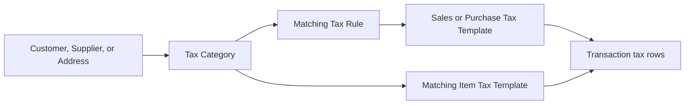
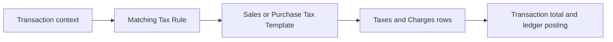

<!-- Frappe documentation: erpnext, part 63 of 69. Index: docs/INDEX.md -->

<!-- page: erpnext/erpnext__tax-category.md -->
---
title: "Tax Category\n"
space: "ERPNext"
url: "https://docs.frappe.io/erpnext/tax-category"
updated: "2026-08-03"
---

A Tax Category identifies the tax treatment that applies to a party, address, item, or transaction. It does not store a tax rate or calculate tax by itself. Instead, ERPNext uses the category as context when selecting a matching [Tax Rule](/erpnext/tax-rule), Sales or Purchase Taxes and Charges Template, and Item Tax Template.

For example, a business could use **Standard Tax**, **Export**, and **Tax Exempt** categories. A customer or address assigned to Standard Tax can cause ERPNext to select the standard sales tax template when a sales transaction is created.

## Understand the relationship

| Record                                       | Responsibility                                                       |
| -------------------------------------------- | -------------------------------------------------------------------- |
| Tax Category                                 | Names the tax treatment and connects related configuration           |
| Tax Rule                                     | Selects a sales or purchase template when its conditions match       |
| Sales or Purchase Taxes and Charges Template | Supplies tax accounts, rates, calculation types, and descriptions    |
| Item Tax Template                            | Overrides the rate for particular items within the selected category |

One category can be used by multiple rules. For example, Standard Tax can have one sales rule and one purchase rule, or different rules for companies, parties, locations, and effective dates. Only the rule that matches the current transaction supplies its applicable template.

## Before you begin

Create the required tax accounts and reusable [Sales Taxes and Charges Template](/erpnext/sales-taxes-and-charges-template) or [Purchase Taxes and Charges Template](/erpnext/purchase-taxes-and-charges-template). Decide which treatments your organization needs and how ERPNext should distinguish them.

Use a small, meaningful set of categories. Categories normally describe a jurisdiction or tax treatment, such as Standard, Export, Exempt, In-State, or Out-of-State. Avoid creating a category for every customer if several customers follow the same rules.

## Create a Tax Category

Go to **Accounting &gt; Taxes &gt; Tax Category** and select **Add Tax Category**.

The example list contains reusable categories for standard, export, and exempt transactions.

Enter a clear title and save. The title is the value users will see on Customers, Suppliers, Addresses, and transactions.

The Tax Category record has only two important fields:

| Field    | What it means                                                                                 |
| -------- | --------------------------------------------------------------------------------------------- |
| Title    | The reusable name of the tax treatment                                                        |
| Disabled | Prevents the category from being selected for new work without deleting historical references |

Disabling a category is safer than deleting one that has already been used. Before disabling it, update parties, addresses, templates, rules, and unsaved transactions that still depend on it.

## Choose which Address controls the category

A customer or supplier can have separate billing and shipping addresses. Their tax treatment may depend on one of those addresses, so ERPNext lets you choose which address is used first.

Open [Accounts Settings](/erpnext/accounts-settings). Under **Invoice and Billing**, set **Determine Address Tax Category from** to **Billing Address** or **Shipping Address** according to your tax policy.

The selected address is checked before the party master. If that Address has no Tax Category, ERPNext falls back to the category on the Customer or Supplier.

Use the billing address when liability depends on the invoiced party or bill-to location. Use the shipping address when the destination of goods determines the treatment. Confirm the correct choice for your jurisdiction.

## Assign a category to a Customer or Supplier

Open the [Customer](/erpnext/customer) or [Supplier](/erpnext/supplier). In the Tax section, select the category that normally applies to the party and save.

This provides a useful default when an Address does not supply a category. It also keeps parties with the same tax treatment grouped under consistent configuration.

Do not confuse Tax Category with Tax Withholding Category. A Tax Category helps select transaction taxes. A [Tax Withholding Category](/erpnext/tax-withholding-category) controls deductions and thresholds associated with withholding.

## Override the party through an Address

Use an [Address](/erpnext/address) when the same customer or supplier needs different treatments at different locations. Open the billing or shipping Address, select its Tax Category, and save.

The Address must be linked to the correct Customer or Supplier. ERPNext then evaluates the preferred billing or shipping address according to Accounts Settings.

This is useful when a company buys from or sells to branches in different jurisdictions. You can keep one party master and let each address supply the appropriate category.

## Connect the category to tax templates

Create the required Tax Rules. Select whether each rule is for Sales or Purchase, choose the corresponding tax template, and set the Tax Category. Add other conditions only when they are needed, such as company, customer, supplier, item group, location, validity dates, or priority.

For item-specific rates, create an [Item Tax Template](/erpnext/item-tax-template) with the same category and assign it to the Item or Item Group. A category filters which item template is eligible. If the category on the transaction and item template do not match, ERPNext will not use that item template.

The transaction template must still include the relevant tax account. An Item Tax Template overrides the rate for a matching item; it does not replace the account row needed to calculate and post tax.

## Check the result on a transaction

Create a draft [Sales Invoice](/erpnext/sales-invoice), Purchase Invoice, Quotation, or Order and select the party and address. Review the Tax Category before adding or finalizing items.

In this example, Northstar Retail and its preferred billing address use **Standard Tax**. The matching Tax Rule selects **Nova Standard Sales Tax 8%**, and the transaction receives an 8% output tax row.

Always verify the selected template, account, rate, tax amount, and Grand Total. A category identifies the treatment, but the template and item tax configuration perform the calculation.

If you manually change the category after adding items, review the Item Tax Template on every affected row and the Taxes and Charges table. When the calculated result does not refresh as expected, remove and re-add the affected items or reselect their item templates before submitting.

## How ERPNext determines the Tax Category

ERPNext uses this practical order when a party and addresses are available:

1. The preferred billing or shipping Address selected by **Determine Address Tax Category from**
2. The other applicable transaction context and party Address
3. The Tax Category on the Customer or Supplier when no Address category is available
4. A category manually selected on the transaction

The final category then filters matching Tax Rules and Item Tax Templates. Because a user can change the category on a draft transaction, the transaction itself remains the final record of the treatment used.

## Troubleshooting

### The Tax Category is blank on the transaction

Check whether the selected Customer or Supplier has a category. Then open the billing and shipping Addresses and verify their links, preferred status, and category. Confirm the address preference in Accounts Settings. Save the party or Address before creating a new test transaction.

### The category appears but the tax template is not selected

A category does not select a template without matching configuration. Review the Tax Rule's transaction type, company, category, party and location filters, validity dates, and priority. Confirm that the linked template is enabled and belongs to the same company.

### An Item Tax Template is filtered out or marked invalid

The item template's Tax Category must match the category resolved on the transaction. Check the Item or Item Group assignment and ensure the matching tax account exists in the transaction's Taxes and Charges table.

### The wrong address controls tax

Open Accounts Settings and verify whether ERPNext is configured to use the billing or shipping address. Then check which address is selected on the transaction. A category on the chosen Address takes precedence over the party-level default.

## Frequently asked questions

### Can one Tax Category have more than one Tax Rule?

Y

es. The same category can be used in separate sales and purchase rules or in rules with different companies, parties, locations, dates, and priorities. Design the conditions so that ERPNext can identify one appropriate template for the current transaction.

### Does assigning a category to a Customer override its Address?

1. ERPNext checks the relevant Address first. The Customer or Supplier category acts as a fallback when that Address does not have a category.

### Should exempt customers and exempt items use the same setup?

Not necessarily. A party-wide exemption can use an exempt Tax Category and matching rule. If only particular items use a reduced or zero rate, use Item Tax Templates linked to the applicable category. Confirm how your jurisdiction distinguishes exempt, zero-rated, and non-taxable supplies.

### Why did item tax not change after I selected another category?

Changing a category late in a draft may leave existing item rows with earlier tax context. Recheck or reselect the Item Tax Template, and remove and re-add affected items when necessary. Verify the complete tax table and totals before submission.

### Can I select a Tax Category manually on a transaction?

Y

es. Manual selection is useful for an exceptional transaction, but it also changes which rules and item templates are eligible. Review the calculation and record the reason for the exception according to your controls.

## Related topics

- [Taxes](/erpnext/taxes)
- [Tax Rule](/erpnext/tax-rule)
- [Sales Taxes and Charges Template](/erpnext/sales-taxes-and-charges-template)
- [Purchase Taxes and Charges Template](/erpnext/purchase-taxes-and-charges-template)
- [Item Tax Template](/erpnext/item-tax-template)
- [Accounts Settings](/erpnext/accounts-settings)

<!-- page: erpnext/erpnext__tax-inclusive-accounting.md -->
---
title: "Tax Inclusive Accounting"
space: "ERPNext"
url: "https://docs.frappe.io/erpnext/tax-inclusive-accounting"
updated: "2026-08-03"
---

Use tax-inclusive accounting when the item price entered on a sales or purchase transaction already contains tax. ERPNext back-calculates the tax and taxable value instead of adding the tax on top of the entered price.

For example, an item price of $108 includes 8% tax. ERPNext separates it into:

| Component             | Amount  |
| --------------------- | -------: |
| Tax-exclusive value   | $100.00 |
| Included tax          | $8.00   |
| Customer-facing total | $108.00 |

Without the inclusive setting, an 8% tax row would add $8.64 to $108 and produce $116.64. The checkbox therefore changes how ERPNext interprets the entered price.

## Before you begin

Confirm that the displayed or agreed item rate is tax-inclusive. Do not enable the option simply to keep a desired Grand Total. The commercial price, printed rate, tax rule, and accounting treatment must all describe the same arrangement.

You need:

- A tax Account Head in the [Chart of Accounts](/erpnext/chart-of-accounts).
- A [Sales Taxes and Charges Template](/erpnext/sales-taxes-and-charges-template) or [Purchase Taxes and Charges Template](/erpnext/purchase-taxes-and-charges-template).
- The applicable tax rate.
- A small example whose net value and included tax you can calculate manually.

If different items use different rates, prepare the relevant [Item Tax Templates](/erpnext/item-tax-template) before testing the transaction.

## Understand the back-calculation

For one inclusive percentage tax, ERPNext derives the tax-exclusive value using:

`Inclusive price ÷ (1 + tax rate ÷ 100)`

For an entered price of $108 and an 8% rate:

`$108 ÷ 1.08 = $100`

The included tax is:

`$108 - $100 = $8`

The original documentation used a $100 price that included 10% tax. The same principle produces approximately $90.91 net and $9.09 tax, with display rounding commonly shown as $9.10 depending on currency precision. The current demo uses $108 at 8% so the result is easier to verify exactly.

## Configure an inclusive tax row

Create or open the reusable tax template.

1. Add a tax row.
2. Set **Type** to the required calculation, commonly **On Net Total**.
3. Select the correct Account Head.
4. Enter the Tax Rate.
5. Open the row using its pencil icon.

In the row editor, select **Is this Tax included in Basic Rate?**. The field description explains that the tax amount is already included in the Print Rate or Print Amount.

The calculation Type and the inclusive checkbox have different purposes. Type determines the calculation base. The checkbox tells ERPNext that the calculated tax is already inside the entered item rate.

## Apply the template to a transaction

Select the template on a draft [Sales Invoice](/erpnext/sales-invoice), Quotation, Sales Order, Purchase Invoice, or another supported transaction.

Enter the tax-inclusive item rate. In this example, the item row uses $108. ERPNext displays:

- Net Total: $100.00.
- Tax Amount: $8.00.
- Grand Total: $108.00.

The customer still pays $108. ERPNext posts the net value and tax to their respective accounts rather than treating the complete $108 as income.

## Understand Rate, Net Rate, and printed values

Inclusive pricing can expose both commercial and accounting values:

| Value                 | Meaning in the example                          |
| --------------------- | -----------------------------------------------: |
| Entered or Print Rate | $108.00, the price communicated to the customer |
| Net Rate              | $100.00, the rate after removing included tax   |
| Tax Amount            | $8.00                                           |
| Grand Total           | $108.00                                         |

Review the selected [Print Format](/erpnext/print-format) to ensure the invoice communicates prices and taxes as required. Whether tax must be shown separately depends on local rules even when it is included in the displayed price.

## Use multiple inclusive taxes carefully

When more than one tax is included in the item rate, row order and calculation type matter. A second row might apply to Net Total, another tax Amount, or a previous running Total.

Build the sequence using [Types in Tax Template](/erpnext/types-in-tax-template), then verify every row with a manual example. Do not assume ERPNext divides the inclusive price equally between taxes.

If a tax is calculated on another tax, confirm whether the required type is **On Previous Row Amount** or **On Previous Row Total**. The two bases produce different results.

## Use item-specific inclusive tax rates

When a transaction contains items taxed at different rates, apply Item Tax Templates to those items. The transaction tax table must still contain the matching tax Account Head so ERPNext can calculate and post the item-wise amounts.

Test a mixed transaction containing:

- A standard-rate item.
- A reduced-rate item.
- An exempt item, if applicable.

Confirm each item's Net Rate and the tax breakup. Also verify the [Tax Category](/erpnext/tax-category) and [Tax Rule](/erpnext/tax-rule) if ERPNext selects templates automatically.

## Discounts and inclusive tax

A discount can change the taxable value and included tax. The exact result depends on whether the discount is applied to the item rate, Net Total, or Grand Total.

Use a controlled example to confirm the intended sequence. Compare the entered Rate, Net Rate, Net Total, tax Amount, discount, and Grand Total. Avoid manually editing the tax Amount to force the result because that can hide an incorrect configuration.

## Verify accounting after submission

Submit a controlled invoice and open the [General Ledger](/erpnext/general-ledger).

For a simple $108 sale with $8 included tax, the high-level effect is:

| Account effect      | Debit   | Credit  |
| ------------------- | -------: | -------: |
| Customer receivable | $108.00 |         |
| Income              |         | $100.00 |
| Tax liability       |         | $8.00   |

Actual account names and additional entries depend on company configuration and whether stock is updated. The total credit should still reconcile to the customer debit for this simple example.

## Troubleshooting

### ERPNext adds tax on top of the displayed price

Open the tax row and confirm that **Is this Tax included in Basic Rate?** is selected. Also verify that the correct template and row are applied to the transaction.

### The calculated tax differs by a cent

Inclusive tax often requires division and rounding. Review currency precision, item quantity, per-line rounding, and the document's rounding adjustment before treating a small difference as a configuration error.

### The total is correct but income is overstated

The entire entered rate may be posting as income because the inclusive tax row is missing, uses the wrong Account Head, or was not applied. Review the transaction tax breakup and General Ledger.

### An exempt item still receives tax

Check its Item Tax Template, item row selection, matching transaction tax Account Head, and the Tax Rule or Tax Category that selected the main template.

## Frequently asked questions

### Does inclusive tax reduce the amount the customer pays?

1. It separates tax from a price that already contains it. In the $108 example, the customer pays $108 while ERPNext records $100 net income and $8 tax.

### Should I enter $100 or $108 as the item rate?

Enter $108 when $108 is the agreed tax-inclusive price. Enter $100 when the agreed price is tax-exclusive and tax should be added on top.

### Can purchase prices be tax-inclusive?

Y

es. Use the inclusive setting on purchase tax rows when the supplier's entered price includes tax, then verify recoverability and valuation treatment with your accountant.

### Can some tax rows be inclusive and others exclusive?

Yes, but the sequence can become complex. Configure each row according to the real calculation and verify the resulting bases and totals manually.

### Why is included tax not exactly rate multiplied by the entered price?

Because the entered price already contains tax. ERPNext first derives the tax-exclusive base, then calculates the included tax from that base.

## Related topics

- [Sales Taxes and Charges Template](/erpnext/sales-taxes-and-charges-template)
- [Purchase Taxes and Charges Template](/erpnext/purchase-taxes-and-charges-template)
- [Types in Tax Template](/erpnext/types-in-tax-template)
- [Item Tax Template](/erpnext/item-tax-template)
- [Tax Rule](/erpnext/tax-rule)
- [Sales Invoice](/erpnext/sales-invoice)

<!-- page: erpnext/erpnext__tax-on-another-tax-amount.md -->
---
title: "Tax on another tax amount"
space: "ERPNext"
url: "https://docs.frappe.io/erpnext/tax-on-another-tax-amount"
updated: "2026-08-03"
---

Use **On Previous Row Amount** when a tax, levy, or surcharge must be calculated only on the amount produced by another tax row. ERPNext uses the referenced row's **Amount** as the calculation base, not the item value and not the running transaction total.

For example, a document has a Net Total of $1,000. Row 1 calculates an 8% tax of $80. Row 2 is a 2% levy on that $80 tax:

`$80 × 2% = $1.60`

The final total is $1,081.60. This is different from applying 2% to the $1,080 running total, which would produce $21.60.

Start with [Types in Tax Template](/erpnext/types-in-tax-template) if you need an overview of all available calculation types.

## Before you begin

Confirm that the second charge is legally or commercially calculated only on the earlier tax amount. Write down a small manual example and the expected total before configuring ERPNext. If the combination depends on the customer's or supplier's tax treatment, verify the relevant [Tax Category](/erpnext/tax-category) as well.

You need:

- An Account Head for the base tax.
- A separate Account Head for the tax or levy calculated on it when accounting rules require separate posting.
- A [Sales Taxes and Charges Template](/erpnext/sales-taxes-and-charges-template) or [Purchase Taxes and Charges Template](/erpnext/purchase-taxes-and-charges-template), or a transaction where the rows can be entered directly.
- The base tax row above the dependent row.

The examples use two accounts so each tax amount can be reviewed separately in the [General Ledger](/erpnext/general-ledger).

## Understand the formula

The relevant row values are:

| Row | Type                   | Base      | Rate | Amount | Running Total |
| --- | ---------------------- | ---------: | ----: | ------: | -------------: |
| 1   | On Net Total           | $1,000.00 | 8%   | $80.00 | $1,080.00     |
| 2   | On Previous Row Amount | $80.00    | 2%   | $1.60  | $1,081.60     |

For row 2, ERPNext reads the **Amount** column from row 1. The calculation is:

`Referenced row Amount × Tax Rate ÷ 100`

The word **Amount** is important. Row 1's Amount is $80, while its Total is $1,080.

## Configure the base tax row

Create or open the tax template that applies to the transaction.

1. Add the base tax as the first row.
2. Set **Type** to **On Net Total** when the base tax applies to item net value.
3. Select the correct Account Head.
4. Enter the Tax Rate, such as 8.
5. Add a clear Description so users can identify the calculation.

The base need not always be On Net Total. What matters is that the dependent row points to the correct earlier row and that the earlier row produces the Amount required by the rule.

## Add the tax-on-tax row

Add the dependent tax after the base tax.

1. Set **Type** to **On Previous Row Amount**.
2. Set **Reference Row #** to the row number containing the base tax. In this example, enter 1.
3. Select the Account Head for the dependent tax or levy.
4. Enter the Tax Rate, such as 2.
5. Confirm whether the row is added or deducted.
6. Save the template.

Reference Row # is positional. If you insert, delete, or move rows, recheck the number. A row that still refers to 1 may silently use the wrong base after the template order changes.

## Apply and verify the calculation

Select the template on a draft [Sales Invoice](/erpnext/sales-invoice) or another supported transaction. Use simple item values for the first test.

In the current example, the tax table shows:

- Row 1 Amount: $80.00.
- Row 2 Net Amount: $80.00.
- Row 2 Amount: $1.60.
- Total Taxes and Charges: $81.60.
- Grand Total: $1,081.60.

Check the **Net Amount**, **Amount**, and **Total** columns rather than looking only at Grand Total. The row 2 Net Amount should equal the earlier row's Amount.

After submitting a controlled example, review the accounting ledger. Confirm that the two tax amounts post to their intended accounts and that the customer or supplier balance equals the document total.

## Previous Row Amount versus Previous Row Total

These settings sound similar but produce very different results.

| Setting for row 2      | Calculation base    | At 2%  | Final total |
| ---------------------- | -------------------: | ------: | -----------: |
| On Previous Row Amount | Row 1 Amount: $80   | $1.60  | $1,081.60   |
| On Previous Row Total  | Row 1 Total: $1,080 | $21.60 | $1,101.60   |

Use Previous Row Amount only when the rule says the second tax applies to another tax or charge itself. Use Previous Row Total when the rule says it applies to the subtotal after the earlier row. See [Apply Tax on Another Tax or Charge](/erpnext/how-to-apply-tax-on-tax) for that workflow.

## Use the calculation in reusable templates

A template is useful when the same sequence applies repeatedly. Give it a name that identifies the tax combination and company. Before setting it as a default or selecting it through a [Tax Rule](/erpnext/tax-rule), test it with:

- A normal taxable item.
- An exempt or differently taxed item if [Item Tax Templates](/erpnext/item-tax-template) are used.
- A discount, when discounts can change the net base.
- A return or [Credit Note](/erpnext/credit-note) when the same tax sequence must reverse.

Do not duplicate the dependent tax in both the reusable template and the transaction manually.

## Multiple dependent taxes

More than one later row can reference an earlier row, but each dependent row stores one Reference Row #. Keep the sequence readable and describe the base in each row.

If a rule requires a tax on a combination of several amounts, do not assume Previous Row Amount will combine them. It uses only the Amount of the one referenced row. Model the running-total sequence carefully or confirm the supported setup with an accountant and an ERPNext implementation specialist.

## Troubleshooting

### The second tax is much larger than expected

Check whether the Type is On Previous Row Total. Change it to On Previous Row Amount only when the calculation should use the earlier tax amount.

### ERPNext says the reference row is invalid

The referenced row must come before the dependent row, and Reference Row # is valid only with On Previous Row Amount or On Previous Row Total. Move the rows or correct the Type and reference.

### The calculation changed after rows were reordered

Reference Row # stores a row position. Reopen every dependent row and verify its reference after inserting, deleting, duplicating, or moving rows.

### The second tax uses the wrong amount for items with special rates

Review the base row's Amount after Item Tax Templates are applied. The dependent row uses the amount ERPNext actually calculates for that referenced row, including item-wise overrides.

## Frequently asked questions

### Can I use the same Account Head for both rows?

ERPNext configuration may allow some combinations, but separate accounts make different tax liabilities easier to review and reconcile. Follow the required chart-of-accounts design and local reporting rules.

### Does Reference Row # refer to a tax template or a document row?

It refers to the numbered tax or charge row in the current table, not an item row and not another template.

### Can the reference point to a later row?

1. Previous-row calculations depend on a row that has already been calculated, so the referenced row must come earlier.

### Does this calculation work on purchases too?

Yes, the previous-row calculation types are available in purchase tax rows. On purchases, also choose whether the calculated amount affects Total, Valuation, or both.

### Why does the dependent row show a Net Amount of $80?

For On Previous Row Amount, Net Amount represents the calculation base taken from the referenced row. In this example, the base tax Amount is $80.

## Related topics

- [Types in Tax Template](/erpnext/types-in-tax-template)
- [Apply Tax on Another Tax or Charge](/erpnext/how-to-apply-tax-on-tax)
- [Sales Taxes and Charges Template](/erpnext/sales-taxes-and-charges-template)
- [Purchase Taxes and Charges Template](/erpnext/purchase-taxes-and-charges-template)
- [Item Tax Template](/erpnext/item-tax-template)
- [Tax Rule](/erpnext/tax-rule)

<!-- page: erpnext/erpnext__tax-rule.md -->
---
title: "Tax Rule\n"
space: "ERPNext"
url: "https://docs.frappe.io/erpnext/tax-rule"
updated: "2026-08-03"
---

A Tax Rule automatically selects a Sales or Purchase Taxes and Charges Template when a transaction matches the rule's conditions. It prevents users from having to remember which tax template applies to each customer, supplier, item, location, or period.

The rule selects a template. The selected template contains the tax accounts, rates, and calculation types that calculate the transaction tax.

Transaction context can include a party, party group, item, item group, billing or shipping location, [Tax Category](/erpnext/tax-category), date, company, and priority.

## Before you begin

Create the reusable [Sales Taxes and Charges Template](/erpnext/sales-taxes-and-charges-template) or [Purchase Taxes and Charges Template](/erpnext/purchase-taxes-and-charges-template) that the rule should select. Verify its company, accounts, rates, and calculation types with a representative draft transaction.

Create Tax Categories when the tax treatment depends on a party or address classification. A category is especially helpful when the same tax treatment is shared by many customers, suppliers, or locations.

Plan rules before entering them. List each tax treatment and the smallest set of conditions that makes it unique. Broad, overlapping rules are harder to troubleshoot than a few mutually exclusive rules.

## Create a Tax Rule

Go to **Accounting &gt; Taxes &gt; Tax Rule** and select **Add Tax Rule**.

1. Set **Tax Type** to **Sales** or **Purchase**.
2. Select the corresponding Sales Tax Template or Purchase Tax Template.
3. Enable **Use for Shopping Cart** only when the rule must also apply to website checkout transactions.
4. Add the conditions that identify the intended transaction.
5. Set validity dates when the rule is temporary or changes by tax period.
6. Set the priority and company.
7. Save.

The example rule selects **Nova Standard Sales Tax 8%** for Northstar Retail under the Standard Tax category.

## Important fields and what they mean

| Field                            | What it controls                                                       |
| -------------------------------- | ---------------------------------------------------------------------- |
| Tax Type                         | Whether the rule applies to selling or buying transactions             |
| Sales Tax Template               | The sales template selected by a Sales rule                            |
| Purchase Tax Template            | The purchase template selected by a Purchase rule                      |
| Use for Shopping Cart            | Extends a Sales rule to applicable website checkout transactions       |
| Customer or Supplier             | Restricts the rule to one party                                        |
| Customer Group or Supplier Group | Applies the rule to parties in a group                                 |
| Item or Item Group               | Restricts the rule using transaction item context                      |
| Billing or Shipping location     | Matches city, county, state, postal code, or country information       |
| Tax Category                     | Matches the treatment resolved from the party, Address, or transaction |
| From Date and To Date            | Limits the period during which the rule can apply                      |
| Priority                         | Decides which similar matching rule is considered first; 1 is highest  |
| Company                          | Restricts the rule to one company                                      |

Leave a filter blank when it is not needed. Every populated condition narrows the match, so a rule with Customer, Billing City, and Tax Category applies only when all three conditions match.

## Apply a rule to a Customer or Supplier

Select a specific [Customer](/erpnext/customer) or [Supplier](/erpnext/supplier) when the treatment is unique to that party. Use [Customer Group](/erpnext/customer-group) or [Supplier Group](/erpnext/supplier-group) when several parties share the treatment.

When a party is selected, ERPNext can use its linked billing and shipping addresses as transaction context. The relevant Address can also supply the Tax Category according to [Accounts Settings](/erpnext/accounts-settings).

If the rule should apply broadly, leave the specific party blank and use a meaningful group or category. Test a broad rule carefully so it does not select tax for exempt or out-of-scope parties.

## Apply a rule by item or item group

Use Item or Item Group conditions when the entire transaction template depends on the goods or services being sold or purchased.

If individual items within the same transaction use different rates, use an [Item Tax Template](/erpnext/item-tax-template) for the rate overrides. The Sales or Purchase Taxes and Charges Template must still contain the matching tax account row.

Keep the responsibilities clear:

- A Tax Rule selects the transaction-level tax template.
- The transaction template supplies tax rows and accounts.
- An Item Tax Template can override the rate for a matching item.

Avoid creating overlapping transaction and item logic without testing the combined result. Use distinct, descriptive names for transaction templates and item templates so users can tell them apart.

## Apply a rule by location

A rule can match billing or shipping city, county, state, postal code, or country. Use the side that determines tax in your jurisdiction.

This example requires the Billing City to be **Metro City** in addition to matching Northstar Retail and Standard Tax.

The location value comes from the Address selected on the transaction. If a rule does not match, check the actual transaction Address rather than only the party master.

Location filters are useful for destination-based sales tax, export treatment, and regional rates. Keep address data standardized so values match the rule exactly.

## Use Tax Category with a rule

A [Tax Category](/erpnext/tax-category) identifies a tax treatment such as Standard Tax, Export, or Tax Exempt. Assign it to a Customer, Supplier, or Address, then use it as a Tax Rule condition.

One category can appear in multiple rules. For example, Standard Tax can have one Sales rule and one Purchase rule, or separate rules for different companies and periods. The additional conditions determine which rule is relevant to the transaction.

The category itself does not contain a rate. If a category is present but the tax table is empty, check whether a matching rule exists and whether its template contains valid rows.

## Set validity and priority

Use **From Date** and **To Date** when a rate or treatment is valid for a defined period. Leave both blank only when the rule has no time limit.

When rules change at the start of a tax period, create the future rule in advance with a later From Date. Give the older rule an appropriate To Date so their active periods do not overlap unnecessarily.

If multiple rules have similar conditions, **Priority** determines their order. Priority 1 is highest, 2 is lower, and so on.

Priority does not repair contradictory configuration. Make conditions as distinct as possible and use priority only where a real hierarchy exists, such as a specific-customer exception above a general category rule.

## Check the result on a transaction

Create a draft [Sales Invoice](/erpnext/sales-invoice), Purchase Invoice, Quotation, or Order that should match the rule.

1. Select the company, party, and billing or shipping Address.
2. Confirm the Tax Category.
3. Add representative items.
4. Check the selected Taxes and Charges Template.
5. Review each tax row, tax amount, and Grand Total.

For the example rule, selecting Northstar Retail with its Metro City billing address and Standard Tax category selects the 8% sales template.

Always test each rule with both a transaction that should match and one that should not. This detects filters that are too broad, missing location data, and unintended priority conflicts.

## Shopping Cart rules

Enable **Use for Shopping Cart** only for Sales rules intended to calculate website checkout tax. The customer's website context, address, and available item data must satisfy the rule conditions.

Test checkout separately from Desk transactions. A rule that works after a Desk user selects or edits an Address may not have the same data available at an earlier stage of website checkout. See [Shopping Cart](/erpnext/shopping-cart) for the complete website flow.

## Troubleshooting

### No tax template is selected

Confirm that Tax Type matches the transaction, the rule and template belong to the correct company, and the transaction date is within the validity period. Compare every populated rule filter with the actual Customer, Supplier, items, groups, Address, and Tax Category on the draft transaction.

### The wrong rule wins

Look for another active rule with overlapping conditions. Compare their priorities and validity dates. Give a specific exception a higher priority than a broad rule, or make the conditions mutually exclusive.

### A location rule does not match

Open the billing or shipping Address selected on the transaction and compare its city, county, state, postal code, and country with the rule. Confirm in Accounts Settings which Address supplies Tax Category when category is also a condition.

### Item-specific rates are not applied

Check the Item or Item Group assignment, the Item Tax Template's category, and the tax account rows in the selected transaction template. If the category or item setup changed after adding items, review or re-add the affected rows.

## Frequently asked questions

### Does a Tax Rule create tax rows without a template?

1. The rule selects a Sales or Purchase Taxes and Charges Template. That template supplies the rows, accounts, rates, and calculation types used by the transaction.

### Can more than one Tax Rule apply to the same category?

Y

es. Rules can differ by Sales or Purchase, company, party, location, item context, validity dates, and priority. Design them so ERPNext can identify the intended template for a given transaction.

### Is Priority 1 higher or lower than Priority 2?

Priority 1 is higher. Use it for the most specific rule that should take precedence when comparable rules can match.

### Why did the rule work for one customer but not another in the same group?

Compare the parties' Addresses, Tax Categories, company, and transaction dates. A populated location or category condition may differ even when both Customers belong to the same group.

### Should I use a Tax Rule or an Item Tax Template for different item rates?

Use a Tax Rule to select the transaction-level template. Use Item Tax Templates when individual items need rate overrides within that tax context. Both require consistent categories and matching tax accounts.

## Related topics

- [Taxes](/erpnext/taxes)
- [Tax Category](/erpnext/tax-category)
- [Sales Taxes and Charges Template](/erpnext/sales-taxes-and-charges-template)
- [Purchase Taxes and Charges Template](/erpnext/purchase-taxes-and-charges-template)
- [Item Tax Template](/erpnext/item-tax-template)
