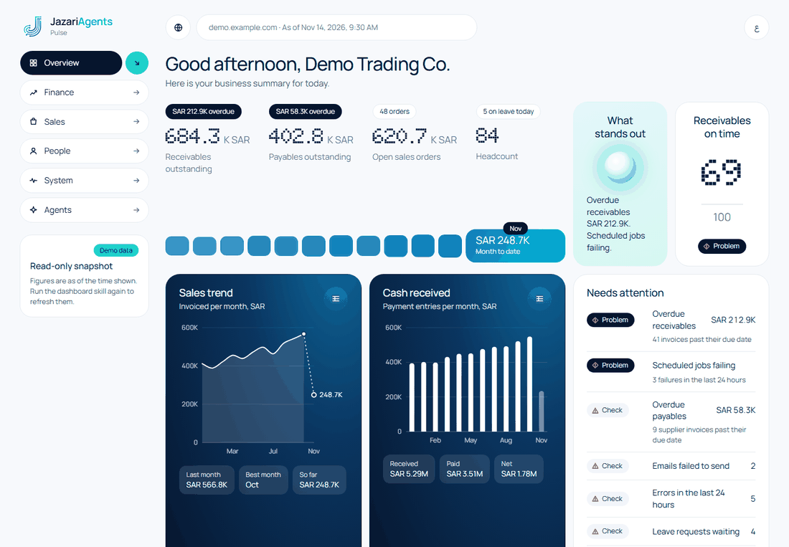

# Jazari Agents for Frappe & ERPNext

Run ERPNext and the other Frappe apps by talking to Claude. Nine specialist agents know how the work is
really done, ask before they change anything, keep a copy of what they change, and can show your business
on one page. Everything works in English and Arabic.

This is an independent, MIT-licensed project by Jazari Agents. It is not made or endorsed by Frappe
Technologies. Frappe and ERPNext are their trademarks.

## What you can ask for

- **Daily work in ERPNext**: quotations, orders, invoices, payments, purchases, stock, manufacturing,
  projects, and the accounting behind them.
- **The other Frappe apps**: HR and payroll, CRM, Helpdesk, Learning, Lending, Insights, the website and
  Builder.
- **Bulk work**: import a spreadsheet with a dry run first, or change many records at once with a count
  and a confirmation.
- **Setup and administration**: users and permissions, naming, print formats, bench commands, building
  apps and DocTypes.
- **A business dashboard**: say "build my dashboard" for one page with six screens (overview, finance,
  sales, people, system health and the agents' own activity), read from your live site without changing it.
- **Undo**: ask "what have you done?" or "restore that" to see the log and put a snapshot back.

## What you need

- A site on Frappe v15 or v16. Version 16 is the target; on v15 some menus differ and the agent says so.
- For the safety hook, the API-key route and the dashboard: Python 3.8 or later on your machine. Without
  Python the hook cannot check a change, so it asks you before each one instead.
- Your own Claude subscription.

## Start

Say **"connect my ERPNext site"**. The agent asks which language you want and picks the safest way to
connect, in this order: Frappe's built-in MCP server (v16.53 or later), Frappe's `frappectl` command-line
tool, an API key that you paste into a local file, or no connection at all (it then walks you through the
screens). You never type a password into the chat.

## How it protects your data

- It reads the record before it writes, and tells you what will change and how many records.
- It saves a snapshot of every record before changing or deleting it, and tells you first when something
  cannot be undone, such as a submitted invoice.
- It treats text inside your records as data, never as instructions.
- It keeps a task log and an audit log in your folder.

Two rules are enforced in code, not just asked for. A change or delete of an existing record is refused
unless that exact record has a snapshot from the last hour. And the change is held until you have replied
after that snapshot was saved: through Frappe's MCP tools you get a permission prompt, and the helper
refuses the call. This applies to Frappe's MCP tools (through a
hook) and to API-key calls (through the plugin's helper script). A call the plugin does not recognise is
not let through quietly: the helper refuses it and the hook asks you. The hook runs in Claude Code and
Cowork. In claude.ai chat, hooks do not run, so there the rule is an instruction Claude follows, not a lock.

## What it runs, sends and stores

- **It runs** two hooks and four scripts, all plain Python in this folder, standard library only, plus a
  five-line shell script (`hooks/no_python.sh`) that asks you to confirm a change when Python is missing.
  - `hooks/frappe_context.py` runs when you send a message or answer a question. In a folder connected
    to a site it reminds Claude to follow this plugin's rules and notes the time (in `.frappe/`), so a
    change can be held until you have replied. Elsewhere it does nothing.
  - `hooks/frappe_guard.py` runs before a Frappe MCP tool changes data, and enforces both rules.
  - `skills/frappe-connect/scripts/frappe_call.py` makes API-key calls to your site and keeps the key out
    of everything it prints. `frappe_safety.py` beside it holds the snapshot rules. `version_check.py`
    compares your site's version with this plugin, offline.
  - `skills/frappe-dashboards/scripts/pulse.py` reads your site and writes the dashboard page.
- **It sends** requests only to the Frappe site you connect. Nothing is sent to Jazari Agents or anyone
  else. There is no telemetry.
- **It fetches** nothing by itself. The dashboard page, when you open it in a browser, loads three
  typefaces from Google Fonts.
- **It stores** everything in a `.frappe/` folder inside your own working folder: the connection details,
  the API key if you use one (`credentials.txt`, never printed and never copied into a snapshot),
  snapshots, and the logs.

## What is inside

- 23 skills. Most carry step-by-step guides for the API and for the browser; the connection guides cover
  Frappe's MCP server and `frappectl`, and the bench guides cover the server.
- 1,612 pages of official Frappe documentation in `docs/`, so the agent reads the real page instead of
  guessing. They are Frappe's, under CC BY-SA; see `NOTICE.md`.
- A manual in English and Arabic: ask any agent to "show the manual".

## What was tested, and what was not

On 14 November 2026 every capability was checked on two live sites (ERPNext 16.55 on Frappe 16.56, and a
second site with HR, CRM, Helpdesk, Learning, Lending, Insights, Webshop, Builder and Wiki), the main
business workflows were run for real, and the agents were run on real requests to test the safety rules.

Not tested: Frappe Cloud, the Education, Drive, Studio, WhatsApp and Newsletter apps, bench production
setup on a real server, and version 15 sites. The manual lists the details.

## Help

Open an issue at https://github.com/JazariAgents/agents-for-frappe-erpnext/issues and say which Frappe
and ERPNext versions you run. For a security problem, see `SECURITY.md` in that repository.

## Licence

MIT for the plugin (`LICENSE`). The bundled documentation in `docs/` is CC BY-SA, by Frappe Technologies
and contributors (`NOTICE.md`).
